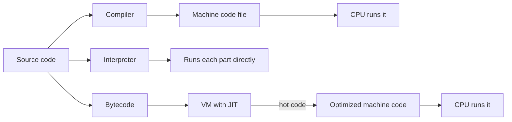
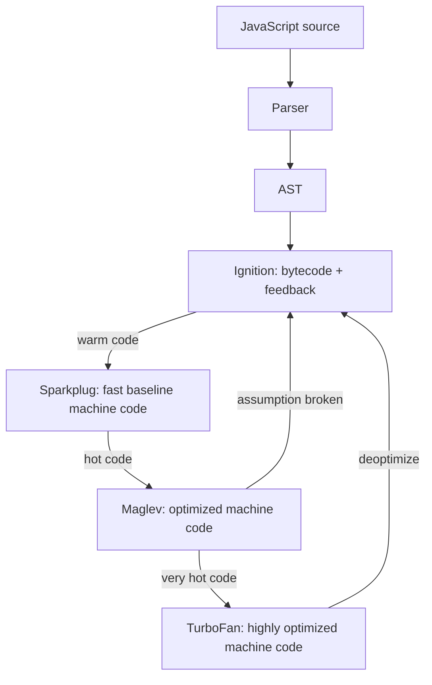
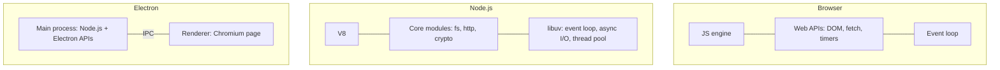
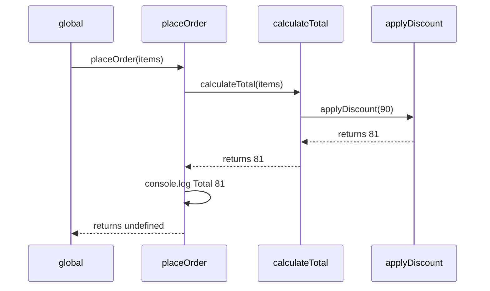
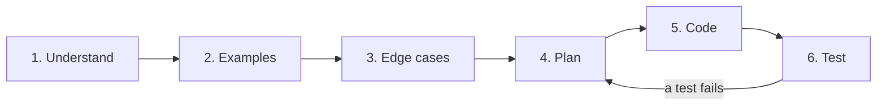

# How Programs Run

> In this document you will learn what really happens between the code you type and the result you see: compilers, interpreters and JIT compilers, how V8 runs JavaScript, what a runtime is, how numbers and text are stored as bits, and how the call stack runs your functions. These basics explain many "strange" JavaScript results, such as `0.1 + 0.2 !== 0.3` and `"😀".length === 2`, and they come up often in interviews.

**Before this:** nothing, this is the starting point. · **Interview questions:** [jump to the interview section](#interview-questions)

## Table of contents

1. [What a program is](#what-a-program-is)
2. [From source code to machine code](#from-source-code-to-machine-code)
3. [Compilers, interpreters and JIT](#compilers-interpreters-and-jit)
4. [How V8 runs JavaScript](#how-v8-runs-javascript)
5. [Runtime environments: browser, Node.js and Electron](#runtime-environments-browser-nodejs-and-electron)
6. [Bits, bytes, binary and hexadecimal](#bits-bytes-binary-and-hexadecimal)
7. [Integers and two's complement](#integers-and-twos-complement)
8. [Floating point and why 0.1 + 0.2 is not 0.3](#floating-point-and-why-01--02-is-not-03)
9. [Text and character encoding](#text-and-character-encoding)
10. [Variables and memory](#variables-and-memory)
11. [Control flow](#control-flow)
12. [Functions and the call stack](#functions-and-the-call-stack)
13. [Recursion and stack overflow](#recursion-and-stack-overflow)
14. [Programming paradigms](#programming-paradigms)
15. [Type systems: static vs dynamic, strong vs weak](#type-systems-static-vs-dynamic-strong-vs-weak)
16. [A practical problem-solving process](#a-practical-problem-solving-process)
17. [Interview questions](#interview-questions)
18. [Summary](#summary)
19. [References](#references)

---

## What a program is

A **program** is a list of instructions that a computer follows to turn **input** into **output**.

Here is a tiny program. The input is a shopping cart. The output is the total price.

```js
// Input
const cart = [
  { name: "Keyboard", priceCents: 4999, quantity: 1 },
  { name: "Mouse", priceCents: 1999, quantity: 2 },
];

// Steps
let totalCents = 0;
for (const item of cart) {
  totalCents += item.priceCents * item.quantity;
}

// Output
console.log(totalCents); // 8997
```

Every program follows this shape: **input → steps → output**. A big web application is the same idea, repeated many times. The input is a click, a key press or an HTTP request. The output is a changed screen, a saved record or an HTTP response.

### The building blocks of a program

| Building block | What it is | Example |
| --- | --- | --- |
| **Value** | A piece of data | `42`, `"Asha"`, `true` |
| **Variable** | A name that points to a value | `let total = 0;` |
| **Expression** | Code that produces a value | `price * quantity` |
| **Statement** | Code that does something | `if (...) { ... }`, `return total;` |
| **Function** | A named group of steps you can reuse | `function getTotal(cart) { ... }` |

### Analogy: a recipe

A program is like a recipe. A recipe has ingredients (input), steps, and a dish (output).

The analogy breaks down in one important way. A human cook handles surprises. If the milk is missing, the cook improvises. A computer does **exactly** what you wrote, nothing more. If the cart is empty, or a price is a string, the program does whatever your code says, even if that is wrong. This is why good programs handle **edge cases** (unusual inputs) on purpose.

---

## From source code to machine code

The **CPU** (central processing unit) is the chip that runs instructions. A CPU only understands **machine code**: binary instructions such as "load this number", "add these two numbers", "jump to this instruction".

Machine code is different for each CPU family. Code built for an Intel/AMD **x86-64** CPU cannot run directly on an **ARM64** CPU (for example, Apple Silicon Macs or most phones). It must be rebuilt, or translated by a tool such as Apple's Rosetta 2. This is also why desktop apps (including Electron apps) are built separately for each operating system and CPU type.

Programming languages exist at different levels:

| Level | Example | Who reads it easily |
| --- | --- | --- |
| Machine code | `10001011 01000101 11111000` | The CPU |
| Assembly | `mov eax, [a]` then `add eax, [b]` | Low-level programmers |
| High-level language | `const sum = a + b;` | Humans |

The assembly line above is simplified x86-64 assembly for "load `a`, then add `b`". You will almost never write assembly. The point is this: **something must translate your high-level code into machine code**. There are three main ways to do that: compile it ahead of time, interpret it, or compile it just in time.

---

## Compilers, interpreters and JIT

### Compiler (ahead-of-time)

A **compiler** translates the whole program into machine code **before** the program runs. The result is usually an executable file (for example, `app.exe`).

- Languages usually compiled this way: C, C++, Rust, Go.
- You run the compiler once (the "build"). Then you run the output many times.

**Advantages:** the program starts fast and runs fast. Many errors are found at build time.
**Disadvantages:** you need a build step. You need a separate build for each CPU and operating system.

### Interpreter

An **interpreter** reads your code and runs it directly, piece by piece, while the program is running. It does not produce a separate machine-code file.

- Examples: shell scripts (`bash`), early JavaScript engines.

**Advantages:** you can run code immediately. The same source runs anywhere the interpreter exists.
**Disadvantages:** it is slower. If a loop runs one million times, the interpreter does the "understand this line" work again and again.

### Bytecode and virtual machines

Many languages use a middle step. They compile source code into **bytecode**. Bytecode is a compact set of instructions for a **virtual machine** (VM), not for a real CPU. The VM then runs the bytecode.

- Java: `javac` compiles to `.class` bytecode. The JVM runs it.
- C#: compiles to IL (intermediate language). The .NET runtime runs it.
- Python (CPython): compiles to bytecode (`.pyc` files) and then interprets that bytecode.

### JIT (just-in-time) compiler

A **JIT compiler** compiles code to machine code **while the program is running**. It does not compile everything. It watches which functions run often (**hot** code) and compiles those to fast machine code. It also uses what it learns while watching, such as "this function always receives numbers".

**Advantages:** fast start (no big build step) and fast hot code.
**Disadvantages:** uses extra memory, needs some "warm-up" time, and is complex to build. If its guesses are wrong, it must throw away the fast code (this is called **deoptimization**).

### Comparison

| | Compiler (AOT) | Interpreter | JIT |
| --- | --- | --- | --- |
| When translation happens | Before running | While running, line by line | While running, for hot code |
| Start-up time | Fast (after build) | Fast | Fast |
| Speed of long-running code | Fast | Slow | Fast after warm-up |
| Uses runtime information | No | No | Yes (types, object shapes) |
| Examples | C, Rust, Go | Bash | V8 (JavaScript), JVM HotSpot, PyPy |

### Analogy: three kinds of translators

- **Compiler:** a translator who translates a whole book before anyone reads it.
- **Interpreter:** a live translator at a meeting who translates each sentence as it is spoken.
- **JIT:** a live translator who notices that the same phrases come up again and again, so they write good translations for those phrases and read them out instantly next time.



### "Compiled" or "interpreted" describes the implementation, not the language

A language is just rules. The **implementation** decides how the code runs. Python is usually run by CPython (bytecode interpreter), but PyPy runs Python with a JIT. JavaScript is usually run by a JIT engine, but Hermes (used by React Native) compiles JavaScript to bytecode ahead of time. So the honest answer to "Is language X compiled?" often starts with "It depends on the engine."

### Transpilers and other compilers you use every day

A **transpiler** (source-to-source compiler) translates code from one high-level language to another high-level language.

- **TypeScript compiler (`tsc`)**: TypeScript → JavaScript. It checks types and then removes them.
- **Babel / esbuild / SWC**: modern JavaScript → older JavaScript, or JSX → JavaScript.
- **Angular compiler**: turns your component templates (HTML) into JavaScript instructions at build time. This is called **AOT (ahead-of-time) compilation**, and it is the default in Angular 16.

The browser never sees your TypeScript or your Angular templates. It only receives JavaScript. Build tools are covered in [Build tools and bundlers](../05-frontend-engineering/10-build-tools-and-bundlers.md).

**WebAssembly (Wasm)** is a compact binary instruction format that browsers and Node.js can run next to JavaScript. Languages such as C, C++ and Rust can compile to it. You use it for heavy work such as image processing, video editing or games in the browser.

---

## How V8 runs JavaScript

**V8** is the JavaScript engine built by Google. It runs JavaScript in Chrome, Edge, Node.js, Deno and Electron. Other engines are **SpiderMonkey** (Firefox) and **JavaScriptCore** (Safari, and the Bun runtime). They work in a similar, multi-tier way. Here we use V8 because it powers Chrome, Node.js and Electron.

### Step 1: Parsing

First, V8 reads your source text and builds an **AST** (abstract syntax tree). An AST is a tree that shows the structure of your code: "this is a function declaration, its body has a return statement, the return value is `a + b`".

Syntax errors are found in this step, **before any of your code runs**. You can prove it:

```js
console.log("start");

const total = 10 +;
```

Running this file prints **no** "start". You only see `SyntaxError: Unexpected token ';'`. The engine read and checked the whole file before it ran line 1. A pure line-by-line interpreter would have printed "start" first.

To start faster, V8 parses lazily. For functions that are not called right away, it does a quick **pre-parse** (check syntax, find variables) and does the full parse only when the function is called for the first time.

### Step 2: Ignition, the interpreter

**Ignition** turns the AST into **bytecode** and runs that bytecode. While it runs, it records **feedback**: what types each operation saw and what shape each object had.

You can see real bytecode. Save this as `add.js`:

```js
function add(a, b) {
  return a + b;
}

let result = 0;
for (let i = 0; i < 200000; i++) {
  result = add(i, 1);
}
console.log(result);                  // 200000
console.log(add("Hello, ", "world")); // Hello, world
```

Run `node --print-bytecode --print-bytecode-filter=add add.js`. The output contains something like this (trimmed; exact output depends on the V8 version):

```text
[generated bytecode for function: add]
Ldar a1          // load argument b into the accumulator
Add a0, [0]      // add argument a; [0] is a feedback slot
Return
```

The `[0]` is a **feedback slot**. Ignition writes what it sees there, for example "both operands were small integers".

### Step 3: Sparkplug, Maglev and TurboFan

When a function runs often, V8 compiles it to machine code. Modern V8 has three compiler tiers above Ignition:

| Tier | What it does | Trade-off |
| --- | --- | --- |
| **Ignition** | Interprets bytecode and collects feedback | Starts instantly, slowest |
| **Sparkplug** | Baseline compiler: turns bytecode into machine code very quickly, without real optimization | Quick compile, moderate speed-up |
| **Maglev** | Mid-tier optimizing compiler that uses feedback | Good code, still compiles quickly |
| **TurboFan** | Top-tier optimizing compiler for very hot code | Fastest code, slowest to compile |

Sparkplug arrived in 2021. Maglev shipped in Chrome 117 (2023) and is enabled by default in Node.js 22. You do not need to memorize these names for most interviews. The key idea is: **the more often a function runs, the more effort V8 spends making it fast.**

### Step 4: Speculation and deoptimization

The optimizing compilers **speculate**. They use the feedback to guess: "`add` always gets small integers, so I will produce machine code that only handles small integers." That code is much faster than generic code.

If a guess becomes wrong, V8 **deoptimizes**: it throws away the optimized machine code and goes back to Ignition bytecode. Later, it may optimize again with the new information.

You can watch this happen with `node --trace-opt --trace-deopt add.js`. Trimmed output from Node.js 22:

```text
[marking <JSFunction add> for optimization to TURBOFAN, reason: hot and stable]
[completed optimizing <JSFunction add> (target TURBOFAN)]
[bailout (kind: deopt-eager, reason: not a Smi): begin. deoptimizing <JSFunction add> ...]
```

Step by step:

1. The loop calls `add(i, 1)` 200,000 times with small integers. (V8 calls a small integer a **Smi**.)
2. V8 marks `add` as "hot and stable" and optimizes it for small integers.
3. The last line calls `add("Hello, ", "world")` with strings.
4. The optimized code checks its assumption, sees "not a Smi", and **bails out** to the bytecode.
5. The result is still correct. Deoptimization is about speed, never about correctness.

### Hidden classes and inline caches

JavaScript objects can get new properties at any time, so a property lookup could be slow. V8 makes it fast with two tricks:

- **Hidden classes** (V8 calls them "maps"; often called "shapes"): objects created with the same properties in the same order share one hidden class. V8 knows where each property sits in memory.
- **Inline caches:** each property access remembers the hidden classes it saw. Next time, if the object has the same hidden class, V8 reads the property directly from the known position.

```js
// ✅ Correct: same properties, same order -> objects share one shape
class Point {
  constructor(x, y) {
    this.x = x;
    this.y = y;
  }
}
const p1 = new Point(1, 2);
const p2 = new Point(3, 4);

// ❌ Wrong (for hot code): different property order creates different shapes
const a = { x: 1, y: 2 };
const b = { y: 2, x: 1 };
```

Practical rules:

- Create objects with all their properties up front (for example, in the constructor).
- Avoid adding or deleting properties on objects in hot code. `delete obj.prop` can push an object into a slower "dictionary" mode.
- Keep functions **monomorphic** when it matters: give them the same types every time.

But do not micro-optimize everyday code. Write clear code first. Measure with a profiler (see [Debugging and code review](../11-coding-interviews/06-debugging-and-code-review.md)) before you change code for speed.



---

## Runtime environments: browser, Node.js and Electron

### Engine vs runtime

The **engine** (V8) runs the JavaScript **language** as defined by the ECMAScript specification: variables, functions, objects, classes, promises, `Array`, `Map`, `JSON`, `Math`.

The engine alone cannot do much useful work. It has no timers, no network, no files and no screen. `setTimeout`, `fetch`, `document` and `fs` are **not** part of the JavaScript language.

A **runtime environment** is the engine **plus** extra APIs **plus** an event loop. The runtime decides what your code can talk to.

| Runtime | Built from | Extra APIs you get |
| --- | --- | --- |
| **Browser** | Engine (V8, SpiderMonkey or JavaScriptCore) + Web APIs | DOM (`document`), `fetch`, `setTimeout`, `localStorage`, Web Workers, events |
| **Node.js** | V8 + libuv + core modules | `fs`, `http`, `path`, `crypto`, `child_process`, `process`, `Buffer`, timers, `fetch` (global since Node.js 18) |
| **Electron** | Chromium (browser) + Node.js | Main process: Node.js and Electron APIs (windows, menus, files). Renderer: web APIs; Node.js access only through a preload script |

**libuv** is a C library inside Node.js. It provides the event loop, non-blocking I/O and a small thread pool. You will learn how it works in [Operating systems, processes, threads and memory](03-operating-systems-processes-threads-memory.md).



### What exists where

| Global or API | Browser page | Node.js | Electron main | Electron renderer (secure defaults) |
| --- | --- | --- | --- | --- |
| `window`, `document` | Yes | No | No | Yes |
| `setTimeout`, `console` | Yes | Yes | Yes | Yes |
| `fetch` | Yes | Yes (18+) | Yes | Yes |
| `process`, `Buffer` | No | Yes | Yes | No |
| `require("fs")` | No | Yes | Yes | No |
| `globalThis` | Yes | Yes | Yes | Yes |

"Secure defaults" means `contextIsolation: true`, `nodeIntegration: false` and `sandbox: true`. The renderer then talks to Node.js only through a **preload script** that exposes a few safe functions. See [Electron architecture and process model](../08-electron-desktop/01-electron-architecture-and-process-model.md).

### Example: detecting the environment

```js
const isBrowser = typeof window !== "undefined" && typeof document !== "undefined";
const isNode = typeof process !== "undefined" && process.versions?.node != null;

console.log({ isBrowser, isNode }); // in Node.js: { isBrowser: false, isNode: true }
console.log(typeof globalThis);     // "object" everywhere (ES2020)
```

`typeof` is safe for names that do not exist. Writing `window` directly in Node.js throws `ReferenceError: window is not defined`.

### Real-world example: Angular server-side rendering

When Angular renders a page on the server (Angular Universal / SSR), your component code runs in **Node.js**, not in a browser. Code like `window.innerWidth` or `localStorage.getItem(...)` then crashes with `window is not defined`.

```ts
import { Component, Inject, PLATFORM_ID } from "@angular/core";
import { isPlatformBrowser } from "@angular/common";

@Component({ selector: "app-banner", template: "<p>{{ width }}</p>" })
export class BannerComponent {
  width = 0;

  constructor(@Inject(PLATFORM_ID) private platformId: object) {
    // ✅ Correct: only touch browser APIs when running in the browser
    if (isPlatformBrowser(this.platformId)) {
      this.width = window.innerWidth;
    }
  }
}
```

The lesson: always know **which runtime** your code runs in. The language is the same, but the available APIs are different.

---

## Bits, bytes, binary and hexadecimal

Computers store everything (numbers, text, images, code) as **bits**.

- A **bit** is a single 0 or 1.
- A **byte** is 8 bits. One byte can hold 2^8 = **256** different values (0 to 255).
- 1 KiB (kibibyte) = 1024 bytes. 1 kB (kilobyte) = 1000 bytes. People often mix these up. Memory tools usually use 1024; disk makers often use 1000.

### Binary (base 2)

In everyday **decimal** (base 10), each position is worth 10 times the one to its right: 1, 10, 100... In **binary** (base 2), each position is worth 2 times: 1, 2, 4, 8, 16...

The number 13 in binary is `1101`:

| Position value | 8 | 4 | 2 | 1 |
| --- | --- | --- | --- | --- |
| Bit | 1 | 1 | 0 | 1 |

8 + 4 + 0 + 1 = 13.

### Hexadecimal (base 16)

**Hexadecimal** ("hex") uses 16 digits: `0-9` and then `a-f` (a = 10, ..., f = 15). One hex digit represents exactly 4 bits. So **two hex digits represent one byte**. That is why hex is a short, readable way to write bytes.

| Decimal | Binary | Hex |
| --- | --- | --- |
| 0 | 0000 0000 | 00 |
| 10 | 0000 1010 | 0a |
| 15 | 0000 1111 | 0f |
| 255 | 1111 1111 | ff |

Where you see hex as a developer:

- CSS colors: `#ff5733` means red = `ff` (255), green = `57` (87), blue = `33` (51).
- Unicode code points: `U+1F600` is 😀.
- Memory addresses in crash reports and V8 traces: `0x006f8a628c49`.
- Hashes and IDs: SHA-256 digests, UUIDs, Git commit IDs.
- Byte dumps: Node.js shows a `Buffer` as hex bytes.

### Binary and hex in JavaScript

```js
console.log(0b1101);               // 13  (binary literal)
console.log(0o17);                 // 15  (octal literal)
console.log(0xff);                 // 255 (hex literal)

console.log((255).toString(2));    // "11111111"
console.log((255).toString(16));   // "ff"
console.log(parseInt("ff", 16));   // 255
console.log(parseInt("1101", 2));  // 13

// Node.js: strings become bytes
console.log(Buffer.from("Hi"));    // <Buffer 48 69>  ("H" = 0x48, "i" = 0x69)
```

A realistic example: convert a hex color to RGB values for a canvas or a theme generator.

```js
function hexToRgb(hex) {
  const value = parseInt(hex.slice(1), 16); // "#ff5733" -> 16734003
  return {
    r: (value >> 16) & 255, // take the top byte
    g: (value >> 8) & 255,  // take the middle byte
    b: value & 255,         // take the lowest byte
  };
}

console.log(hexToRgb("#ff5733")); // { r: 255, g: 87, b: 51 }
```

`>>` shifts bits to the right. `& 255` keeps only the lowest 8 bits (one byte).

---

## Integers and two's complement

### Unsigned and signed integers

An **unsigned** 8-bit integer uses all 8 bits for the size of the number: 0 to 255.

To store **negative** numbers, computers use **two's complement**. The rule to make a negative number: write the positive number in binary, **flip every bit**, then **add 1**.

Example with 8 bits: how do we store -5?

1. 5 is `0000 0101`.
2. Flip every bit: `1111 1010`.
3. Add 1: `1111 1011`. That is -5.

Facts to remember:

- The leftmost bit tells the sign. 0 means positive, 1 means negative.
- A signed 8-bit integer ranges from -128 to 127. A signed 32-bit integer ranges from -2,147,483,648 to 2,147,483,647.
- -1 is all ones: `1111 1111`.

**Why use it?** With two's complement, the CPU uses the same addition circuit for positive and negative numbers, and there is only one zero.

### Integer overflow

In languages like C or Java, a 32-bit `int` **overflows** when it goes past its maximum. 2,147,483,647 + 1 becomes -2,147,483,648. It "wraps around".

Normal JavaScript numbers do not wrap like this, because they are 64-bit floating point numbers (next section). But two places in JavaScript do use fixed-size integers.

**1. Bitwise operators** (`|`, `&`, `^`, `~`, `<<`, `>>`, `>>>`) first convert numbers to **32-bit signed integers**:

```js
console.log(2147483647 | 0);  // 2147483647
console.log(2147483648 | 0);  // -2147483648  (wrapped around)
console.log(~5);              // -6  (~x is always -x - 1)
console.log(~~3.7);           // 3   (old trick to drop decimals)
console.log(~~-3.7);          // -3
console.log(~~3e9);           // -1294967296  ❌ the trick breaks for big numbers
console.log(Math.trunc(3e9)); // 3000000000   ✅ use Math.trunc instead
console.log(-1 >>> 0);        // 4294967295  (>>> gives an unsigned 32-bit result)
```

**2. Typed arrays** store fixed-size numbers:

```js
console.log(new Int8Array([128])[0]);           // -128 (8-bit signed wraps)
console.log(new Uint8ClampedArray([300, -5]));  // Uint8ClampedArray(2) [ 255, 0 ] (clamped)
```

`Uint8ClampedArray` is what the canvas uses for pixel data, so colors never wrap around.

### Real-world use: bit flags

Bit flags store several yes/no values in one number. File permissions and many internal framework flags work this way.

```js
const READ = 0b001;    // 1
const WRITE = 0b010;   // 2
const EXECUTE = 0b100; // 4

let permissions = READ | WRITE;            // 0b011 = 3
console.log((permissions & WRITE) !== 0);  // true  (has WRITE)
console.log((permissions & EXECUTE) !== 0); // false

permissions |= EXECUTE;                    // add EXECUTE
permissions &= ~WRITE;                     // remove WRITE
console.log(permissions.toString(2));      // "101"
```

The Unix permission `chmod 755` is the same idea: each digit is three bits (read, write, execute) for owner, group and others.

### BigInt for very large integers

`BigInt` (ES2020) stores integers of any size. You write it with an `n` suffix.

```js
console.log(2n ** 64n); // 18446744073709551616n
// 1n + 1;              // TypeError: Cannot mix BigInt and other types, use explicit conversions
```

You cannot mix `BigInt` and `Number` in arithmetic. Convert explicitly with `BigInt(x)` or `Number(x)`.

---

## Floating point and why 0.1 + 0.2 is not 0.3

### What it is

Every JavaScript `number` is a **64-bit IEEE-754 double-precision floating point** value. "Floating point" means the number is stored like scientific notation, but in base 2:

> value = sign × 1.fraction × 2^exponent

The 64 bits are split like this:

| Part | Bits | Meaning |
| --- | --- | --- |
| Sign | 1 | 0 = positive, 1 = negative |
| Exponent | 11 | How far to move the binary point |
| Fraction (mantissa) | 52 | The digits of the number |

You can see these bits yourself:

```js
function bitsOf(number) {
  const view = new DataView(new ArrayBuffer(8));
  view.setFloat64(0, number);
  let bits = "";
  for (let i = 0; i < 8; i++) bits += view.getUint8(i).toString(2).padStart(8, "0");
  return `${bits[0]} ${bits.slice(1, 12)} ${bits.slice(12)}`;
}

console.log(bitsOf(1));
// 0 01111111111 0000000000000000000000000000000000000000000000000000
console.log(bitsOf(0.1));
// 0 01111111011 1001100110011001100110011001100110011001100110011010
```

Look at the fraction for `0.1`: `1001 1001 1001 ...` repeats forever, and the end is rounded (`...1010`).

### Why 0.1 cannot be stored exactly

In decimal, 1/3 = 0.3333... forever. You must stop somewhere, so you round.

In binary, the same problem happens with 1/10. The number 0.1 in binary is `0.0001100110011...` forever. Only 52 fraction bits fit, so the computer stores the **closest possible** double, not exactly 0.1.

```js
console.log((0.1).toFixed(20));       // "0.10000000000000000555"
console.log((0.2).toFixed(20));       // "0.20000000000000001110"
console.log((0.3).toFixed(20));       // "0.29999999999999998890"
console.log((0.1 + 0.2).toFixed(20)); // "0.30000000000000004441"

console.log(0.1 + 0.2);         // 0.30000000000000004
console.log(0.1 + 0.2 === 0.3); // false
```

Step by step:

1. `0.1` is stored as a tiny bit **more** than 0.1.
2. `0.2` is stored as a tiny bit **more** than 0.2.
3. Their sum is rounded to the nearest double, which is `0.30000000000000004`.
4. The literal `0.3` is stored as a tiny bit **less** than 0.3.
5. These are two different doubles, so `===` is `false`.

This is **not a JavaScript bug**. Python, Java (`double`), C# (`double`) and C give the same result because they all use IEEE-754.

More examples that surprise people:

```js
console.log(0.1 * 3);   // 0.30000000000000004
console.log(0.3 / 0.1); // 2.9999999999999996
console.log(0.1 + 0.7); // 0.7999999999999999
console.log((1.005).toFixed(2)); // "1.00"  (1.005 is really 1.00499999999999989...)
```

### How to deal with it

**1. Compare with a tolerance, not with `===`.**

```js
// ❌ Wrong
if (0.1 + 0.2 === 0.3) { /* never runs */ }

// ✅ Correct for numbers near 1
console.log(Math.abs(0.1 + 0.2 - 0.3) < Number.EPSILON); // true

// ✅ Better for numbers of any size: a relative tolerance
function nearlyEqual(a, b, relativeTolerance = 1e-9) {
  return Math.abs(a - b) <= relativeTolerance * Math.max(Math.abs(a), Math.abs(b));
}
console.log(nearlyEqual(0.1 + 0.2, 0.3)); // true
```

`Number.EPSILON` (about 2.2 × 10^-16) is the gap between 1 and the next double. It is a good tolerance only for numbers close to 1. For large numbers the gaps between doubles are bigger, so use a relative tolerance.

**2. For money, use integers of the smallest unit.**

```js
// ❌ Wrong: floating point money
const priceA = 0.1;
const priceB = 0.2;
console.log(priceA + priceB); // 0.30000000000000004

// ✅ Correct: store cents (or paise) as integers
const priceACents = 10;
const priceBCents = 20;
const totalCents = priceACents + priceBCents; // 30, exact
console.log((totalCents / 100).toFixed(2));   // "0.30" (only for display)
```

For real money systems, also store the currency and define rounding rules (for tax, discounts, splits). Some teams use a decimal library or `BigInt` of minor units. Format for users with `Intl.NumberFormat`.

### Special number values

```js
console.log(1 / 0);             // Infinity
console.log(0 / 0);             // NaN ("not a number")
console.log(NaN === NaN);       // false (NaN is not equal to anything, even itself)
console.log(Number.isNaN(NaN)); // true
console.log(-0 === 0);          // true
console.log(Object.is(-0, 0));  // false (-0 really exists in IEEE-754)
```

### Safe integers

With 52 fraction bits plus one hidden leading bit, a double can store every integer exactly only up to 2^53 − 1.

```js
console.log(Number.MAX_SAFE_INTEGER);        // 9007199254740991 (2^53 - 1)
console.log(2 ** 53 + 1 === 2 ** 53);        // true  ❗
console.log(Number.isSafeInteger(2 ** 53));  // false
```

**Real-world bug:** a backend sends a 64-bit database ID as a JSON number.

```js
const response = '{"id": 9007199254740993}';
console.log(JSON.parse(response).id); // 9007199254740992  ❌ the ID changed!
```

`JSON.parse` turns the ID into a `number` and loses precision. Your app then loads the wrong record. The fix: send large IDs as **strings** (`"id": "9007199254740993"`), or parse them as `BigInt` with a custom parser.

### How to explain this in an interview

1. **Define it:** "JavaScript numbers are 64-bit IEEE-754 floating point values. They store numbers in binary scientific notation with 52 fraction bits."
2. **Why it happens:** "Many decimal fractions, like 0.1, repeat forever in binary, just like 1/3 in decimal. The computer stores the nearest double."
3. **How it works:** "0.1 and 0.2 are both stored slightly too big. Their sum rounds to 0.30000000000000004, which is a different double from the stored 0.3."
4. **Small example:** "`0.1 + 0.2 === 0.3` is false. `(0.1).toFixed(20)` shows `0.10000000000000000555`."
5. **Where it matters:** "Money, comparisons in tests, and big IDs above 2^53."
6. **Trade-offs / fixes:** "Compare with a tolerance, keep money in integer cents or use a decimal library, and send big IDs as strings or BigInt. It is not a JavaScript bug; every language that uses IEEE-754 doubles does this."

---

## Text and character encoding

Computers only store numbers. To store text, we need an agreement: "this number means this character". That agreement is a **character set**. The way we turn those numbers into bytes is the **encoding**.

### ASCII

**ASCII** is an old 7-bit standard with 128 characters: English letters, digits, punctuation and control characters (like newline).

```js
console.log("A".charCodeAt(0)); // 65
console.log("a".charCodeAt(0)); // 97
console.log("0".charCodeAt(0)); // 48
```

ASCII has no `é`, no `€`, no Hindi, no Chinese and no emoji. That was a big problem for a global internet.

### Unicode

**Unicode** is one big list of characters from (almost) every writing system, plus symbols and emoji. Each character gets a number called a **code point**, written as `U+` and hex digits.

| Character | Code point |
| --- | --- |
| `A` | U+0041 |
| `€` | U+20AC |
| `ह` (Hindi letter "ha") | U+0939 |
| `😀` | U+1F600 |

Code points go from U+0000 to U+10FFFF (about 1.1 million possible values).

Important: **Unicode is the list. It is not an encoding.** UTF-8, UTF-16 and UTF-32 are different ways to turn code points into bytes.

### UTF-8

**UTF-8** uses **1 to 4 bytes** per code point.

| Character | UTF-8 bytes | Byte count |
| --- | --- | --- |
| `A` | 41 | 1 |
| `€` | e2 82 ac | 3 |
| `ह` | e0 a4 b9 | 3 |
| `😀` | f0 9f 98 80 | 4 |

You can check this in Node.js with `Buffer.from("€")`, which prints `<Buffer e2 82 ac>`.

Why UTF-8 is everywhere:

- **ASCII-compatible:** English text in UTF-8 is byte-for-byte the same as ASCII.
- **Compact** for English and code.
- It is the standard encoding of the web: HTML pages use `<meta charset="utf-8">`, JSON exchanged between systems must be UTF-8 (RFC 8259), and Node.js uses `utf8` as its default string encoding for `Buffer` and `fs`.

### UTF-16

**UTF-16** uses **2 bytes** for code points up to U+FFFF (this range is called the **Basic Multilingual Plane**, or BMP) and **4 bytes** for code points above it. Those 4 bytes are written as two 2-byte pieces called a **surrogate pair**.

UTF-16 is used inside JavaScript strings, Java, .NET and Windows APIs.

**UTF-32** uses exactly 4 bytes for every code point. It is simple but large, so it is rarely used for storage.

### How JavaScript strings work

A JavaScript string is a sequence of **UTF-16 code units** (16-bit values). The `length` property counts **code units**, not characters.

```js
const smile = "😀"; // U+1F600, above U+FFFF, so it needs a surrogate pair

console.log(smile.length);                        // 2
console.log(smile.charCodeAt(0).toString(16));    // "d83d" (high surrogate)
console.log(smile.charCodeAt(1).toString(16));    // "de00" (low surrogate)
console.log(smile.codePointAt(0).toString(16));   // "1f600" (the real code point)
console.log([...smile].length);                   // 1 (spread iterates by code point)
console.log(new TextEncoder().encode(smile).length); // 4 (UTF-8 bytes)
```

There are three different ways to "count characters":

| Unit | What it counts | How to get it in JS |
| --- | --- | --- |
| UTF-16 code units | 16-bit pieces | `str.length` |
| Code points | Unicode characters | `[...str].length` or `Array.from(str).length` |
| Grapheme clusters | What a human sees as one character | `Intl.Segmenter` |

Some characters a human sees as one are made of **several code points**:

```js
const family = "👨‍👩‍👧"; // man + zero-width joiner + woman + ZWJ + girl
console.log(family.length);       // 8
console.log([...family].length);  // 5
const segments = [...new Intl.Segmenter("en", { granularity: "grapheme" }).segment(family)];
console.log(segments.length);     // 1

const accented = "é";       // "e" + combining acute accent, looks like "é"
console.log(accented.length);                // 2
console.log(accented === "é");               // false
console.log(accented.normalize() === "é");   // true (NFC normalization)
```

`normalize()` matters when you compare or search user input. The same visible word can be stored in different ways.

### Real-world bugs caused by encoding

**Bug 1: cutting a string in the middle of an emoji.**

```js
const comment = "Great job 😀";
// ❌ Wrong: slice works on code units and can split a surrogate pair
console.log(comment.slice(0, 11)); // "Great job \uD83D" (a broken half character, shown as �)

// ✅ Better: slice by code points
console.log(Array.from(comment).slice(0, 11).join("")); // "Great job 😀"
```

For text that may contain combined emoji (families, flags, skin tones), slice by grapheme with `Intl.Segmenter`. ES2024 added `str.isWellFormed()` and `str.toWellFormed()` to detect and fix broken surrogate halves.

**Bug 2: reversing a string.**

```js
const text = "hello 😀";
console.log(text.split("").reverse().join("")); // "\uDE00\uD83D olleh" (shows as "�� olleh") ❌
console.log([...text].reverse().join(""));      // "😀 olleh" ✅
```

**Bug 3: bytes vs characters in HTTP.** The `Content-Length` header must be the number of **bytes**, not characters.

```js
const body = JSON.stringify({ city: "Zürich" });
console.log(body.length);             // 17 (code units)
console.log(Buffer.byteLength(body)); // 18 (UTF-8 bytes, "ü" takes 2 bytes)

// ❌ Wrong: res.setHeader("Content-Length", body.length);
// ✅ Correct: res.setHeader("Content-Length", Buffer.byteLength(body));
```

**Bug 4: databases.** MySQL's old `utf8` charset (really `utf8mb3`) stores at most 3 bytes per character, so it cannot store emoji. Use `utf8mb4`. Also, a column limit like `VARCHAR(50)` may count characters or bytes depending on the database, so test it with non-English text.

**Note on Base64:** Base64 turns bytes into plain ASCII text (used in JWTs, data URLs, email). The browser function `btoa()` only accepts characters in the Latin-1 range, so `btoa("😀")` throws `InvalidCharacterError`. Encode to UTF-8 bytes first (`new TextEncoder()`), or in Node.js use `Buffer.from(text).toString("base64")`.

More string methods are covered in [Strings, numbers and dates](../02-javascript/11-strings-numbers-and-dates.md).

---

## Variables and memory

**Memory** (RAM) is like a very long row of numbered boxes. Each box holds one byte. The box number is its **address**.

A **variable** is a name that the language gives you so you do not have to remember addresses. In C, you can see and use addresses directly (pointers). In JavaScript, the engine manages memory for you.

### Values and references

A simple and useful mental model for JavaScript:

- **Primitives** (`number`, `string`, `boolean`, `null`, `undefined`, `symbol`, `bigint`) behave like values. Copying a variable copies the value.
- **Objects** (including arrays and functions) live in a memory area called the **heap**. A variable holds a **reference** to the object (think: its address). Copying the variable copies the reference, so both variables point to the **same** object.

```js
let a = 10;
let b = a;   // copies the value 10
b = 20;
console.log(a); // 10 (a did not change)

const user1 = { name: "Asha" };
const user2 = user1; // copies the reference, not the object
user2.name = "Ravi";
console.log(user1.name); // "Ravi" (same object)
```

### Stack and heap (simple model)

- The **stack** holds the data for function calls that are running right now: local variables, arguments and where to return. It grows when a function is called and shrinks when it returns. It is fast and small.
- The **heap** is a big area for data whose size or lifetime is not known in advance, such as objects and arrays. A **garbage collector** frees heap memory that is no longer reachable.

Real engines are more complex. For example, V8 stores small integers directly, keeps strings on the heap, and moves variables captured by closures to the heap. For interviews, the simple model is enough. Stack vs heap is covered in depth in [Operating systems, processes, threads and memory](03-operating-systems-processes-threads-memory.md#memory-stack-heap-and-virtual-memory). Copying objects is covered in [Objects and copying](../02-javascript/07-objects-and-copying.md), and garbage collection in [Memory management and garbage collection](../02-javascript/19-memory-management-and-garbage-collection.md).

---

## Control flow

**Control flow** is the order in which statements run. By default, code runs top to bottom. Control-flow statements change that order.

| Kind | Statements | What it does |
| --- | --- | --- |
| Sequence | normal statements | Run one after another |
| Selection | `if/else`, `switch`, `? :` | Choose a path |
| Iteration | `for`, `while`, `do...while`, `for...of`, `for...in` | Repeat steps |
| Jumps | `break`, `continue`, `return`, `throw` | Leave a loop, function or block early |

### Selection

```js
function getShippingCents(order) {
  if (order.totalCents >= 50000) {
    return 0;            // free shipping
  } else if (order.express) {
    return 1500;
  } else {
    return 500;
  }
}

console.log(getShippingCents({ totalCents: 60000, express: true })); // 0
console.log(getShippingCents({ totalCents: 2000, express: true }));  // 1500
```

Use `switch` when you compare one value against many fixed options:

```js
function statusLabel(status) {
  switch (status) {
    case "PENDING":
      return "Waiting for payment";
    case "SHIPPED":
      return "On the way";
    default:
      return "Unknown";
  }
}
console.log(statusLabel("SHIPPED")); // "On the way"
```

### Iteration and jumps

```js
const products = [
  { name: "Pen", stock: 4 },
  { name: "Book", stock: 0 },
  { name: "Bag", stock: 2 },
];

// Stop as soon as we find what we need
let firstOutOfStock = null;
for (const product of products) {
  if (product.stock === 0) {
    firstOutOfStock = product.name;
    break; // leave the loop early
  }
}
console.log(firstOutOfStock); // "Book"
```

Use `while` when you do not know how many times the loop will run:

```js
let attempts = 0;
let connected = false;
while (!connected && attempts < 3) {
  attempts++;
  connected = attempts === 2; // pretend the 2nd attempt succeeds
}
console.log(attempts, connected); // 2 true
```

A common confusion: `for...of` gives **values**; `for...in` gives **keys** (as strings).

```js
const sizes = ["S", "M", "L"];
for (const index in sizes) console.log(index); // "0", "1", "2"
for (const size of sizes) console.log(size);   // "S", "M", "L"
```

Use `for...of` for arrays. Use `for...in` (or better, `Object.keys`) for object keys.

### Every loop needs a way to stop

A loop must move toward its stop condition. An infinite loop in JavaScript is serious: JavaScript runs your code on one main thread. In a browser, the tab freezes. In Node.js, the server stops answering **all** users. You will see why in [The event loop](../02-javascript/16-event-loop.md).

### Control flow inside expressions

Short-circuit operators also control what runs:

```js
const user = null;
console.log(user && user.name);  // null (stops at user, does not read .name)
console.log(user?.name);         // undefined (optional chaining, ES2020)
console.log(user?.name ?? "Guest"); // "Guest" (nullish coalescing, ES2020)
```

---

## Functions and the call stack

### What a function call does

A **function** is a named group of steps. It takes inputs (**parameters**) and gives back an output (**return value**).

When you call a function, the engine:

1. Creates a **stack frame** (also called an **execution context**). It holds the arguments, the local variables and the place to go back to when the function ends.
2. **Pushes** the frame on top of the **call stack**.
3. Runs the function body.
4. When the function returns, **pops** the frame off the stack and continues where the caller stopped.

The **call stack** is the list of functions that are running right now. The newest function is on top. It is "last in, first out" (LIFO): the last function called is the first to finish.

### Example with a walkthrough

```js
function applyDiscount(amount) {
  return amount * 0.9;
}

function calculateTotal(items) {
  const subtotal = items.reduce((sum, item) => sum + item.price, 0);
  return applyDiscount(subtotal);
}

function placeOrder(items) {
  const total = calculateTotal(items);
  console.log("Total:", total);
}

placeOrder([{ price: 50 }, { price: 40 }]); // Total: 81
```

Step by step (the stack is shown with the top on the right):

1. The script starts. Stack: `[global]`.
2. `placeOrder(...)` is called. Stack: `[global, placeOrder]`.
3. `placeOrder` calls `calculateTotal`. Stack: `[global, placeOrder, calculateTotal]`.
4. `reduce` runs the arrow function for each item. Each call is pushed and popped quickly. `subtotal` becomes 90.
5. `calculateTotal` calls `applyDiscount(90)`. Stack: `[global, placeOrder, calculateTotal, applyDiscount]`.
6. `applyDiscount` returns 81 and is popped. Stack: `[global, placeOrder, calculateTotal]`.
7. `calculateTotal` returns 81 and is popped. Stack: `[global, placeOrder]`.
8. `placeOrder` logs `Total: 81`, returns, and is popped. Stack: `[global]`.



### Reading a stack trace

When an error is thrown, the stack trace shows the call stack at that moment. Suppose `applyDiscount` throws:

```js
function applyDiscount(amount) {
  if (amount > 100) throw new Error("Discount service failed");
  return amount * 0.9;
}
```

Calling `placeOrder([{ price: 100 }, { price: 50 }])` prints (paths shortened):

```text
Error: Discount service failed
    at applyDiscount (order.js:2:27)
    at calculateTotal (order.js:7:10)
    at placeOrder (order.js:10:17)
    at Object.<anonymous> (order.js:14:7)
```

Read it from the **top** (where the error happened) to the **bottom** (who called whom). `order.js:2:27` means file `order.js`, line 2, column 27.

### One call stack means one thing at a time

JavaScript has **one** call stack per thread. While a function runs, nothing else in that thread can run. A slow function blocks clicks, rendering and other requests. Asynchronous callbacks (timers, network responses) run **later**, on a fresh, empty stack, when the event loop picks them up. That is why a callback's stack trace does not show the code that scheduled it (browser DevTools add "async stack traces" to help). See [The event loop](../02-javascript/16-event-loop.md).

---

## Recursion and stack overflow

### What recursion is

**Recursion** is when a function calls itself. Every recursive function needs two parts:

- A **base case**: when to stop.
- A **recursive case**: call itself with a smaller problem that moves toward the base case.

```js
function factorial(n) {
  if (n <= 1) return 1;        // base case
  return n * factorial(n - 1); // recursive case
}
console.log(factorial(4)); // 24
```

Walkthrough for `factorial(3)`:

1. `factorial(3)` is pushed. It needs `factorial(2)`.
2. `factorial(2)` is pushed. It needs `factorial(1)`.
3. `factorial(1)` is pushed. Base case: returns 1. Popped.
4. `factorial(2)` computes 2 × 1 = 2. Popped.
5. `factorial(3)` computes 3 × 2 = 6. Popped.

At the deepest point, three frames of `factorial` were on the stack at the same time.

### A realistic example: nested data

Recursion is natural for **tree-shaped data**: nested categories, folder trees, comment threads, the DOM, JSON.

```js
const catalog = {
  name: "All",
  products: 2,
  children: [
    { name: "Laptops", products: 5, children: [] },
    {
      name: "Phones",
      products: 3,
      children: [{ name: "Android", products: 4, children: [] }],
    },
  ],
};

function countProducts(category) {
  let total = category.products;
  for (const child of category.children) {
    total += countProducts(child); // the same problem on a smaller tree
  }
  return total;
}

console.log(countProducts(catalog)); // 14
```

### Stack overflow

Every call adds a frame. The stack has a **fixed size**. In Node.js, V8 uses about 984 KB of stack by default (`node --v8-options` shows `--stack-size=984`). If you push too many frames, the engine stops you:

```js
function countDown(n) {
  return countDown(n - 1); // ❌ no base case
}

try {
  countDown(10);
} catch (error) {
  console.log(error.name, error.message); // RangeError Maximum call stack size exceeded
}
```

This is a **stack overflow**. The usual causes:

1. **Missing or wrong base case** (infinite recursion).
2. **Input that is too deep**, even with a correct base case. For example, a linked list with 100,000 nodes processed recursively. On Node.js 22 an empty recursive function reaches roughly 12,000 levels before failing; real functions with more local variables reach fewer. The exact number depends on the engine and the frame size.
3. **Accidental recursion**, such as a setter that sets itself:

```js
class UserProfile {
  set name(value) {
    this.name = value; // ❌ calls the setter again, forever
  }
}
// new UserProfile().name = "Asha"; // RangeError: Maximum call stack size exceeded

class FixedUserProfile {
  #name = "";            // ✅ store the value in a different (private) field
  set name(value) {
    this.#name = value.trim();
  }
  get name() {
    return this.#name;
  }
}
const profile = new FixedUserProfile();
profile.name = "  Asha ";
console.log(profile.name); // "Asha"
```

4. **Cycles in data**, such as a naive deep-clone function on an object that refers to itself. Proper deep clone handles cycles with a `WeakMap` (see [JavaScript polyfills and implementations](../11-coding-interviews/04-javascript-polyfills-and-implementations.md)).

### Fix: use a loop and your own stack

Any recursion can be rewritten with a loop and an explicit stack (an array). Your array lives on the heap, which is much bigger than the call stack.

```js
function countProductsIterative(root) {
  let total = 0;
  const stack = [root];          // our own stack
  while (stack.length > 0) {
    const category = stack.pop();
    total += category.products;
    stack.push(...category.children);
  }
  return total;
}

console.log(countProductsIterative(catalog)); // 14
```

You could also raise the limit with `node --stack-size=...`, but this is risky. If V8's limit is larger than the real operating system thread stack, the process can crash hard instead of throwing a catchable error. Rewriting the algorithm is the safe fix.

### Tail call optimization

A **tail call** is a call that is the very last action of a function (`return f(x)`). ES2015 specified "proper tail calls" in strict mode, so such calls would not grow the stack. In practice, only Safari's JavaScriptCore implements it. V8 (Chrome, Node.js, Electron) and SpiderMonkey (Firefox) do not. **Do not rely on tail calls to avoid stack overflow in JavaScript.**

### Recursion: advantages and disadvantages

| Advantages | Disadvantages |
| --- | --- |
| Short, clear code for trees and nested data | Risk of stack overflow for deep input |
| Matches the shape of the problem (divide and conquer) | Each call has overhead |
| Easy to prove correct with base case + smaller case | Can repeat work (naive Fibonacci) unless you memoize |

Complexity of recursive functions (for example, why naive Fibonacci is O(2^n)) is covered in [Data structures and Big-O](02-data-structures-and-big-o.md#recursion).

---

## Programming paradigms

A **paradigm** is a style of organizing code. JavaScript is **multi-paradigm**: you can write in several styles, and real projects mix them.

We will solve one problem in each style: *"What is the total price of the products that are in stock?"*

```js
const products = [
  { name: "Pen", price: 10, inStock: true },
  { name: "Book", price: 250, inStock: false },
  { name: "Bag", price: 900, inStock: true },
];
```

### Imperative

**Imperative** code tells the computer **how** to do the work, step by step, by changing state (variables).

```js
let total = 0;
for (let i = 0; i < products.length; i++) {
  if (products[i].inStock) {
    total += products[i].price;
  }
}
console.log(total); // 910
```

### Procedural

**Procedural** code is imperative code organized into **procedures** (functions) that you can name and reuse.

```js
function sumInStock(list) {
  let sum = 0;
  for (const product of list) {
    if (product.inStock) sum += product.price;
  }
  return sum;
}
console.log(sumInStock(products)); // 910
```

### Object-oriented (OOP)

**Object-oriented** code bundles **data and the behavior that uses it** into objects. Objects talk to each other through methods.

```js
class Inventory {
  #products;
  constructor(products) {
    this.#products = products;
  }
  totalInStock() {
    return this.#products
      .filter((product) => product.inStock)
      .reduce((sum, product) => sum + product.price, 0);
  }
}
console.log(new Inventory(products).totalInStock()); // 910
```

OOP is covered in [OOP four pillars](../04-oop-solid-design-patterns/01-oop-four-pillars.md).

### Functional

**Functional** code builds programs from **pure functions** (same input gives the same output, no side effects) and avoids changing data. You describe a pipeline of transformations.

```js
const isInStock = (product) => product.inStock;
const addPrice = (sum, product) => sum + product.price;

const totalInStock = (list) => list.filter(isInStock).reduce(addPrice, 0);
console.log(totalInStock(products)); // 910
```

See [Functions and functional programming](../02-javascript/04-functions-and-functional-programming.md).

### Declarative

**Declarative** code describes **what** result you want, not how to get it. The system decides the steps. Functional code is one kind of declarative code. Other examples you already use:

```text
-- SQL: say what you want; the database plans how to get it
SELECT SUM(price) FROM products WHERE in_stock = true;
```

```html
<!-- Angular template: say what the screen should show; Angular updates the DOM -->
<li *ngFor="let product of inStockProducts">{{ product.name }}</li>
```

HTML and CSS are declarative too.

### Reactive

**Reactive** code describes how values **flow and react to change over time**. When a source value changes, everything that depends on it updates. A spreadsheet is the classic example: change cell A1 and every formula that uses A1 recalculates.

```ts
// RxJS (needs the rxjs package): recalculate the total every time products$ emits
import { BehaviorSubject, map } from "rxjs";

const products$ = new BehaviorSubject(products);
const totalInStock$ = products$.pipe(
  map((list) => list.filter((p) => p.inStock).reduce((sum, p) => sum + p.price, 0))
);

totalInStock$.subscribe((total) => console.log(total)); // 910
products$.next([...products, { name: "Lamp", price: 90, inStock: true }]); // logs 1000
```

See [RxJS](../06-angular-16/09-rxjs.md) and [Change detection and signals](../06-angular-16/10-change-detection-and-signals.md).

### Event-driven

**Event-driven** code runs in response to events: clicks, key presses, HTTP requests, timers, IPC messages. This is the main style of JavaScript in browsers, Node.js and Electron.

```js
// Browser: run this function whenever the button is clicked
// saveButton.addEventListener("click", () => saveDraft());
```

### Which style to use

| Paradigm | Good for | Watch out for |
| --- | --- | --- |
| Imperative / procedural | Simple scripts, performance-critical loops | Hard to follow when state is changed in many places |
| OOP | Modelling domains with state and behavior (services, entities) | Deep inheritance trees, too many small classes |
| Functional | Data transformation, predictable logic, easy testing | Copying big data on every change can cost memory |
| Declarative | UI templates, queries, configuration | Less control over exactly how the work is done |
| Reactive | Values that change over time: user input, live data, WebSockets | Harder to debug; memory leaks if you forget to unsubscribe |

A typical Angular app mixes all of them: OOP classes and dependency injection, declarative templates, reactive RxJS streams, functional pipes, and event handlers.

---

## Type systems: static vs dynamic, strong vs weak

A **type** says what kind of value something is (number, string, user object) and what you can do with it.

Two separate questions describe a type system:

1. **When** are types checked? This is static vs dynamic.
2. **How strictly** does the language refuse to mix types? This is strong vs weak.

### Static vs dynamic typing

- **Static typing:** types are checked **before** the program runs (at compile time). Variables have fixed types. Examples: Java, C#, Go, Rust, TypeScript.
- **Dynamic typing:** types belong to **values**, and they are checked **while** the program runs. A variable can hold a number now and a string later. Examples: JavaScript, Python, Ruby, PHP.

```js
// JavaScript (dynamic): this is allowed
let id = 42;
id = "user-42";
console.log(typeof id); // "string"
```

```ts
// TypeScript (static): the compiler rejects it before the code runs
let id: number = 42;
id = "user-42"; // Error: Type 'string' is not assignable to type 'number'.
```

### Strong vs weak typing

This is about **implicit conversion** (also called **coercion**): does the language silently convert one type to another?

- **Weakly typed** languages convert types automatically, even when it may hide a mistake.
- **Strongly typed** languages refuse and throw an error.

```js
// JavaScript (weak): silent conversions
console.log("5" * 2);   // 10  ("5" becomes a number)
console.log("5" + 2);   // "52" (2 becomes a string)
console.log([] + {});   // "[object Object]"
console.log(true + 1);  // 2
```

```text
# Python (strong): no silent conversion
>>> "5" + 2
TypeError: can only concatenate str (not "int") to str
```

"Strong" and "weak" are not exact terms. They describe a spectrum. Coercion rules in JavaScript are covered in [Type coercion and equality](../02-javascript/02-type-coercion-and-equality.md).

| | Strong | Weak |
| --- | --- | --- |
| **Static** | Java, C#, Rust, Go | C (allows many implicit conversions and casts) |
| **Dynamic** | Python, Ruby | JavaScript, PHP |

### Where TypeScript fits

TypeScript adds **static** type checking on top of JavaScript. But it checks types **only at compile time**. The compiler then **erases** the types and outputs plain JavaScript. At runtime, there are no TypeScript types.

```ts
interface User {
  id: number;
  name: string;
}

// The server sent the id as a string, but we told TypeScript to trust us
const user = JSON.parse('{"id": "42", "name": "Asha"}') as User;
console.log(user.id + 1); // prints "421" at runtime, not 43!
```

This code compiles with no errors. `as User` is a promise you make to the compiler, not a check. Data from outside your program (API responses, files, `localStorage`, IPC messages) must be **validated at runtime**, for example with a schema library. See [Runtime validation and type-safe APIs](../03-typescript/11-runtime-validation-and-type-safe-apis.md).

TypeScript is also **structural**: two types are compatible if they have the same shape, even if they have different names. Java and C# are mostly **nominal**: the type name matters. See [Interfaces and type aliases](../03-typescript/02-interfaces-and-type-aliases.md).

### Trade-offs

| | Static typing | Dynamic typing |
| --- | --- | --- |
| Errors found | Before running | While running (maybe in production) |
| Editor help (autocomplete, safe rename) | Excellent | Limited |
| Speed of writing small scripts | Slower (more code) | Faster |
| Large teams and large codebases | Easier to change safely | Needs more tests and discipline |

---

## A practical problem-solving process

In interviews and at work, the way you approach a problem matters as much as the final code. Use the same six steps every time.



1. **Understand.** Repeat the problem in your own words. Ask about input types, input size, output format and what to do with invalid input.
2. **Examples.** Write 2–3 normal examples with the expected output.
3. **Edge cases.** Empty input, one item, duplicates, negative numbers, very large input, `null`, non-English text, emoji.
4. **Plan.** Describe a simple (brute-force) solution first, with its complexity. Then improve it if needed.
5. **Code.** Small functions, clear names. Talk while you write.
6. **Test.** Run your examples and edge cases. Trace the code by hand if you cannot run it.

### Worked example: first non-repeating character

**Problem:** "Return the first character in a string that appears exactly once. Return `null` if there is none."

**1. Understand.** "So for `"swiss"`, `s` appears three times and `w` once, so the answer is `w`. Should uppercase and lowercase count as different? Should an emoji count as one character?" Assume: case-sensitive, and an emoji is one character.

**2. Examples.** `"swiss"` gives `"w"`. `"aabb"` gives `null`. `"abc"` gives `"a"`.

**3. Edge cases.** Empty string gives `null`. One character gives that character. Emoji: `"😀a😀"` gives `"a"`.

**4. Plan.**

- Brute force: for each character, count it by scanning the whole string. That is O(n²) time.
- Better: one pass to count every character in a `Map`, then a second pass to find the first one with count 1. That is O(n) time and O(k) extra space, where k is the number of different characters.

**5. Code.**

```js
function firstUniqueChar(text) {
  const chars = Array.from(text); // split by code point, so an emoji is one item
  const counts = new Map();

  for (const ch of chars) {
    counts.set(ch, (counts.get(ch) ?? 0) + 1);
  }
  for (const ch of chars) {
    if (counts.get(ch) === 1) return ch;
  }
  return null;
}
```

**6. Test.**

```js
console.log(firstUniqueChar("swiss")); // "w"
console.log(firstUniqueChar("aabb"));  // null
console.log(firstUniqueChar(""));      // null
console.log(firstUniqueChar("x"));     // "x"
console.log(firstUniqueChar("😀a😀")); // "a"
```

If we had used `text.split("")`, the emoji test would fail: the two halves of each emoji would be counted separately.

### Edge cases change the design

Edge cases are design decisions, not an afterthought. Look at this common sum function:

```js
// ❌ Wrong: throws on an empty array, and concatenates strings
const total = (prices) => prices.reduce((a, b) => a + b);
// total([]);        // TypeError: Reduce of empty array with no initial value
// total([10, "5"]); // "105"

// ✅ Correct: initial value and explicit validation
function totalCents(prices) {
  let sum = 0;
  for (const price of prices) {
    if (!Number.isSafeInteger(price) || price < 0) {
      throw new TypeError(`Invalid price: ${price}`);
    }
    sum += price;
  }
  return sum;
}
console.log(totalCents([125, 200, 0])); // 325
console.log(totalCents([]));            // 0
```

Should one bad price fail the whole import, or should you skip it and report it? There is no single right answer. Ask, decide, and say your decision out loud.

Big-O is explained in [Data structures and Big-O](02-data-structures-and-big-o.md). More practice is in [Problem solving and complexity](../11-coding-interviews/02-problem-solving-and-complexity.md), and how to talk through answers is in [How to explain technical answers](../11-coding-interviews/01-how-to-explain-technical-answers.md).

---

## Interview questions

### How to explain "Is JavaScript compiled or interpreted?" in an interview

1. **Define it:** "JavaScript is a language. Whether it is compiled or interpreted depends on the engine. Modern engines like V8 use both."
2. **Why it exists:** "Pure interpretation is slow for hot code. Full ahead-of-time compilation would slow down page start-up, and it cannot use runtime type information."
3. **How it works:** "V8 parses the code into an AST. Ignition turns it into bytecode and interprets it while collecting type feedback. Hot functions are compiled to optimized machine code by Maglev and TurboFan."
4. **Small example:** "A function called many times with numbers gets optimized for numbers. If I later pass strings, V8 deoptimizes it back to bytecode."
5. **Where it is useful:** "It explains why JavaScript starts fast and still reaches good peak speed, and why consistent types and object shapes help hot code."
6. **Trade-offs / gotchas:** "JIT uses more memory and needs warm-up. And there is a compile step before running: a syntax error at the bottom of a file stops the whole file."

### Q1. What happens when you run a program?

**What the interviewer is checking:** Whether you understand the path from source code to CPU instructions, and the role of the runtime and the operating system.

**Short spoken answer (30–60 seconds):**
> The CPU only understands machine code for its own architecture, so my source code must be translated. In a compiled language like Go or Rust, a compiler does that before the program runs and produces an executable. When I run it, the operating system loads it into memory as a process and the CPU executes the instructions. In JavaScript, the engine does the translation at runtime: it parses the code, turns it into bytecode, interprets it, and compiles hot parts to machine code with a JIT. The runtime around the engine, like the browser or Node.js, adds things the language does not have, such as timers, files and the network.

**Detailed explanation:** The steps are: write source, translate it (compile, interpret or JIT), the OS creates a **process** and gives it memory (code, stack, heap) and a thread, the CPU fetches, decodes and executes instructions, and the program asks the OS (through system calls) for files, network and screen. Processes are covered in [Operating systems, processes, threads and memory](03-operating-systems-processes-threads-memory.md).

**Follow-up questions:**
- **Why can't a program built for x86-64 run on ARM?** — The machine code instructions are different for each CPU family. It must be recompiled for ARM, or translated by an emulator such as Rosetta 2.
- **What is bytecode?** — Instructions for a virtual machine instead of a real CPU. It is compact and portable. Java, C#, Python and V8's Ignition all use bytecode.
- **Where does the operating system come in?** — It loads the program into memory, creates the process, schedules it on a CPU core, and handles requests like "open this file" through system calls.

**Common mistakes:** Saying "the computer reads JavaScript directly". Forgetting the runtime and the OS. Thinking all languages work the same way.

**Where this is used in real projects:** Understanding builds (why Electron needs a build per platform), deployment (Docker images built for the right CPU architecture, such as `linux/arm64`), and performance work.

### Q2. What is the difference between a compiler and an interpreter?

**What the interviewer is checking:** The basic distinction, and whether you know that real systems mix both.

**Short spoken answer (30–60 seconds):**
> A compiler translates the whole program into machine code before it runs. You build once and then run a fast executable, and many errors show up at build time. C, Rust and Go work like that. An interpreter reads the program and executes it directly while running, without producing a separate machine-code file. It starts immediately and is portable, but it is slower because it redoes the work of understanding the code every time. Many modern systems are in between: Java and C# compile to bytecode, and a virtual machine runs it with a JIT. JavaScript engines like V8 interpret bytecode first and JIT-compile hot code.

**Detailed explanation:** See the [comparison table](#comparison). The key point for a senior answer: compiled vs interpreted is a property of the **implementation**, not of the language. CPython interprets bytecode, while PyPy JIT-compiles Python. Hermes compiles JavaScript to bytecode ahead of time.

**Follow-up questions:**
- **Which is faster?** — Usually compiled code, because the translation is done once and the compiler can optimize the whole program. A good JIT can come close on hot code, because it knows the real runtime types.
- **Is TypeScript compiled?** — `tsc` is a transpiler: TypeScript to JavaScript. Then the JavaScript engine runs the JavaScript. TypeScript types do not exist at runtime.
- **What is a transpiler?** — A compiler whose output is another high-level language, such as TypeScript to JavaScript, or modern JavaScript to older JavaScript (Babel).

**Common mistakes:** Saying "interpreted languages have no compile step" (most have a bytecode step). Saying a language "is" compiled or interpreted as a fixed fact.

**Where this is used in real projects:** Choosing build tools, understanding Angular AOT compilation, and explaining why plain Node.js apps need no build step but TypeScript apps do.

### Q3. Is JavaScript compiled or interpreted?

**What the interviewer is checking:** Whether you know how modern engines really work, beyond the old "JavaScript is interpreted" answer.

**Short spoken answer (30–60 seconds):**
> Both. JavaScript is often called interpreted, but modern engines like V8 use just-in-time compilation. V8 first parses the whole script, which is why a syntax error anywhere stops the file before line one runs. Then its Ignition interpreter turns the code into bytecode and runs it while collecting feedback about types. When a function gets hot, V8 compiles it to machine code with Sparkplug, Maglev and TurboFan, and the optimizing ones use that feedback to make fast, specialized code. If an assumption breaks, it deoptimizes back to bytecode. So I would say JavaScript is JIT-compiled.

**Detailed explanation:** See [How V8 runs JavaScript](#how-v8-runs-javascript). Evidence of a compile phase you can mention: syntax errors are reported before any code runs, and hoisting works because the engine knows all declarations before execution (see [Scope, hoisting and TDZ](../02-javascript/03-scope-hoisting-and-tdz.md)).

**Code or diagram:**

```js
console.log("start"); // never printed
const total = 10 +;   // SyntaxError: Unexpected token ';' (found while parsing)
```

**Follow-up questions:**
- **If JavaScript is compiled, why do we still get errors like `TypeError` at runtime?** — Parsing only checks syntax. Types are dynamic, so an error like calling `undefined` as a function can only be found when that line runs.
- **Do all engines use the same tiers?** — No. SpiderMonkey and JavaScriptCore have their own multi-tier designs. The general idea (interpreter first, optimizing JIT for hot code) is the same.
- **Can JavaScript be compiled ahead of time?** — Yes, some tools do it. Hermes (React Native) compiles JavaScript to bytecode at build time.

**Common mistakes:** Answering just "interpreted". Saying "JavaScript is compiled to machine code before running" (only hot code is, and only at runtime). Confusing TypeScript compilation with what the JavaScript engine does.

**Where this is used in real projects:** Explaining warm-up effects in benchmarks, why consistent object shapes matter in hot paths, and why short-lived Node.js CLI tools start faster with Maglev.

### Q4. What is JIT compilation, and why do JavaScript engines use it?

**What the interviewer is checking:** Understanding of the trade-off between start-up speed and peak speed, and the role of runtime feedback.

**Short spoken answer (30–60 seconds):**
> JIT means just-in-time: the engine compiles code to machine code while the program is running, not before. JavaScript engines use it because web pages must start fast, so they cannot spend seconds compiling everything first, but long-running code also needs to be fast. So the engine starts with a cheap interpreter, measures which functions are hot, and spends compile time only on those. A big bonus is that the JIT sees real runtime data, like "this function always gets integers" or "this object always has this shape", and it can generate specialized code. The cost is extra memory, warm-up time, and deoptimization when a guess turns out wrong.

**Detailed explanation:** A dynamic language does not tell the compiler the types ahead of time. A static compiler would have to generate slow, generic code that handles every type. The JIT uses the **feedback** collected by the interpreter to **speculate**, and adds cheap checks ("is this still a small integer?"). If a check fails, it **deoptimizes**.

**Follow-up questions:**
- **What is warm-up?** — The time when code still runs in the interpreter or baseline tier. Benchmarks that only measure the first few runs measure warm-up, not peak speed.
- **What makes a function hot?** — It is called often, or it contains loops that run many times. The engine counts calls and loop iterations to decide.
- **Why several tiers instead of one great compiler?** — Optimizing compilation is expensive. Cheap tiers give a quick speed-up for warm code; expensive tiers are used only where they pay off.

**Common mistakes:** Thinking the JIT compiles the whole program at start. Not mentioning speculation and deoptimization.

**Where this is used in real projects:** Performance investigations in Node.js services and Electron apps, writing fair micro-benchmarks, understanding why the first requests to a freshly started server can be slower.

### Q5. What is deoptimization, and how do you write JavaScript that the engine can optimize well?

**What the interviewer is checking:** Senior-level knowledge of engine behavior, with good judgment about when it matters.

**Short spoken answer (30–60 seconds):**
> Optimizing compilers make assumptions based on what they saw, for example "this function always receives small integers" or "these objects always have the same hidden class". They produce machine code that only handles that case, with checks in front. If a check fails, say I suddenly pass a string, the engine throws away the optimized code and goes back to the interpreter. That is deoptimization. To help the engine in hot code, I keep types consistent, create objects with the same properties in the same order, avoid adding or deleting properties later, and avoid mixing element types in big arrays. But I only do this after profiling shows a hot path. For normal code, readability matters more.

**Detailed explanation:** Hidden classes and inline caches make property access fast when shapes are consistent. A call site that sees one shape is **monomorphic** (fastest). A few shapes is **polymorphic**. Many shapes is **megamorphic** (slow, generic lookup). `delete` can turn an object into slow dictionary mode.

**Code or diagram:**

```js
function area(shape) {
  return shape.width * shape.height;
}
// ✅ Monomorphic: all objects share one shape
area({ width: 2, height: 3 });
area({ width: 4, height: 5 });
// ❌ Different property order or extra properties add more shapes at this call site
area({ height: 5, width: 4 });
area({ width: 1, height: 1, color: "red" });
```

**Follow-up questions:**
- **How can you see deoptimizations?** — Run Node.js with `--trace-opt --trace-deopt`. In practice, use the Chrome DevTools or Node.js profiler first to find the hot functions.
- **Is deoptimization a bug?** — No. The result is always correct. It only costs speed. Repeated optimize/deoptimize cycles in a hot path are worth fixing.
- **Does TypeScript help the engine?** — Not directly, because types are erased. Indirectly, yes: TypeScript pushes you toward consistent shapes and types.

**Common mistakes:** Recommending micro-optimizations everywhere. Claiming deoptimization changes results.

**Where this is used in real projects:** Hot loops in data processing, parsers, rendering large tables, game loops and high-throughput Node.js services.

### Q6. What is the difference between a JavaScript engine and a runtime?

**What the interviewer is checking:** Whether you separate the language (ECMAScript) from host APIs.

**Short spoken answer (30–60 seconds):**
> The engine, like V8, implements the JavaScript language itself: syntax, objects, functions, promises, Map, JSON and so on. It knows nothing about files, the network or the screen. A runtime is the engine plus host APIs plus an event loop. The browser runtime adds the DOM, fetch, timers and storage. Node.js adds libuv for async I/O plus modules like fs, http and crypto. Electron combines Chromium and Node.js in a multi-process app. So setTimeout, for example, is not part of JavaScript; it comes from the runtime.

**Detailed explanation:** See [Runtime environments](#runtime-environments-browser-nodejs-and-electron). Promises are part of the language, but timers are not. This matters for the event loop: promise callbacks (microtasks) come from the language's job queue, while timers and I/O callbacks are scheduled by the host.

**Follow-up questions:**
- **Is `console` part of JavaScript?** — No. It is a host API (defined by the Console standard) provided by browsers and Node.js.
- **What is libuv?** — A C library used by Node.js for the event loop, non-blocking network I/O through the OS, and a thread pool for file system work, DNS lookups, some crypto and compression.
- **Can the same engine run in different runtimes?** — Yes. V8 runs inside Chrome, Node.js, Deno and Electron, and each gives different APIs.

**Common mistakes:** Saying `fetch`, `setTimeout` or `document` are JavaScript language features. Calling Node.js "a language" or "a framework".

**Where this is used in real projects:** Writing code that runs on both server and browser (SSR, shared libraries), choosing polyfills, understanding Electron's main vs renderer process.

### Q7. Your Angular app works in the browser but crashes during server-side rendering with "window is not defined". Why, and how do you fix it?

**What the interviewer is checking:** Applying the engine-vs-runtime idea to a real bug.

**Short spoken answer (30–60 seconds):**
> During server-side rendering, the same component code runs in Node.js, and Node.js has no window, document or localStorage. So any direct access to those globals throws a ReferenceError. I fix it by only touching browser APIs when the code runs in the browser, using isPlatformBrowser with the PLATFORM_ID token, or by injecting the DOCUMENT token instead of using the global document. Browser-only work, like measuring the window, should be guarded the same way.

**Detailed explanation:** It is the same JavaScript language on both sides, but a different runtime. Angular gives you abstractions (`DOCUMENT`, `PLATFORM_ID`, `isPlatformBrowser`) so code can run in both. See the [code example above](#real-world-example-angular-server-side-rendering).

**Follow-up questions:**
- **Why does `typeof window !== "undefined"` not throw?** — `typeof` on an undeclared name returns `"undefined"` instead of throwing a ReferenceError.
- **What changed in newer Angular?** — Angular 17+ added the `afterNextRender` and `afterRender` hooks for browser-only work. In Angular 16, use `isPlatformBrowser`.

**Common mistakes:** Adding a fake global `window` object on the server. It hides the problem and causes other bugs.

**Where this is used in real projects:** Angular Universal, Next.js and any isomorphic (server plus browser) code.

### Q8. What does this print, and why?

```js
console.log(0.1 + 0.2);
console.log(0.1 + 0.2 === 0.3);
console.log((0.1 + 0.2).toFixed(2) === "0.30");
console.log(Math.abs(0.1 + 0.2 - 0.3) < Number.EPSILON);
```

**Answer:**

```text
0.30000000000000004
false
true
true
```

**What the interviewer is checking:** Understanding of IEEE-754 floating point and practical fixes.

**Short spoken answer (30–60 seconds):**
> JavaScript numbers are 64-bit binary floating point. 0.1 and 0.2 cannot be stored exactly in binary, just like one third cannot be written exactly in decimal, so each is stored as the closest double, which is slightly larger than the real value. When you add them, the result rounds to 0.30000000000000004, while the literal 0.3 is stored slightly below 0.3. They are two different doubles, so strict equality is false. To compare, I use a tolerance, and for display I round with toFixed. Every language that uses IEEE-754 doubles behaves the same way.

**Step by step:**
1. `0.1 + 0.2` gives the double nearest to 0.30000000000000004441, printed as `0.30000000000000004`.
2. `0.3` is stored as 0.29999999999999998890. It is a different double, so `===` gives `false`.
3. `toFixed(2)` rounds to two decimals and returns the string `"0.30"`, so the comparison is `true`.
4. The difference is about 5.5 × 10^-17, which is smaller than `Number.EPSILON` (about 2.2 × 10^-16), so `true`.

**Follow-up questions:**
- **Why is `0.5 + 0.25 === 0.75` true?** — These numbers are exact powers of two (1/2 and 1/4), so binary stores them exactly.
- **Is `Number.EPSILON` always the right tolerance?** — No. It fits numbers near 1. For large values use a relative tolerance, because the gap between neighboring doubles grows with the size of the number.
- **Why does `(1.005).toFixed(2)` give `"1.00"`?** — 1.005 is stored as 1.00499999999999989..., which rounds down.

**Common mistakes:** Calling it a JavaScript bug. Using `toFixed` in calculations (it returns a string). Using `Number.EPSILON` for big numbers.

**Where this is used in real projects:** Price calculations, unit test assertions on decimals (Jest has `toBeCloseTo`), charts and financial reports.

### Q9. How should you handle money in JavaScript?

**What the interviewer is checking:** Practical judgment about floating point in business code.

**Short spoken answer (30–60 seconds):**
> I never do money math with floating point decimals like 19.99. I store amounts as integers in the smallest unit, like cents or paise, so adding and multiplying by whole quantities is exact. I keep the currency next to the amount, because currencies have different minor units. For tax or percentage discounts, where fractions appear, I apply one clear rounding rule at a defined point, or I use a decimal library. I convert to a decimal only for display, with Intl.NumberFormat. And for very large amounts or IDs, I use BigInt or send values as strings between systems.

**Detailed explanation:** Integers are exact up to `Number.MAX_SAFE_INTEGER` (about 9 × 10^15), which is enough for cents in almost every app. The backend and database should use a decimal type (for example, SQL `DECIMAL(19,4)`) or integer minor units, never a binary `FLOAT`.

**Code or diagram:**

```js
const items = [
  { priceCents: 1999, quantity: 3 },
  { priceCents: 499, quantity: 2 },
];
const totalCents = items.reduce((sum, i) => sum + i.priceCents * i.quantity, 0);
console.log(totalCents); // 6995

const formatted = new Intl.NumberFormat("en-IN", { style: "currency", currency: "INR" })
  .format(totalCents / 100);
console.log(formatted); // "₹69.95"
```

**Follow-up questions:**
- **How do you split ₹100 between 3 people?** — Work in paise: 10000 / 3 is 3333 with remainder 1. Give 3334 to one person and 3333 to the others, so the parts add up exactly.
- **Why not just round at the end?** — Small errors add up across many operations, and different rounding points give different totals. Pick one rule and apply it consistently.

**Common mistakes:** Storing prices as `FLOAT` in the database. Rounding at random places. Forgetting the currency.

**Where this is used in real projects:** E-commerce carts, invoices, payment integrations, financial dashboards.

### Q10. What does this print?

```js
console.log(Number.MAX_SAFE_INTEGER);
console.log(Number.MAX_SAFE_INTEGER + 2);
console.log(2 ** 53 === 2 ** 53 + 1);
console.log(JSON.parse('{"id": 9007199254740993}').id);
console.log(9007199254740993n + 1n);
```

**Answer:**

```text
9007199254740991
9007199254740992
true
9007199254740992
9007199254740994n
```

**Explanation:** Doubles have 53 bits of precision. Above 2^53, not every integer can be stored. Neighboring doubles are 2 apart there, so values round to an even neighbor. `MAX_SAFE_INTEGER + 2` would be 9007199254740993, which rounds to ...992. `JSON.parse` has the same problem with big IDs. `BigInt` keeps exact integers of any size.

**Follow-up:** **How do you send a 64-bit ID from a Java or C# backend to the browser safely?** — As a string in JSON. Most teams do this for any ID that can go above 2^53.

### Q11. What does this print?

```js
console.log(~5);
console.log(~~-3.7);
console.log(2 ** 31 | 0);
console.log(~~3e9);
console.log(-1 >>> 0);
```

**Answer:**

```text
-6
-3
-2147483648
-1294967296
4294967295
```

**Explanation:** Bitwise operators convert their operands to **32-bit signed integers** (two's complement). `~x` flips all bits, which equals `-x - 1`. `~~` drops the decimal part, but only inside the 32-bit range: 2^31 and 3e9 are too large and wrap around. `>>>` is the unsigned right shift, so -1 (all ones) becomes 4294967295. Use `Math.trunc` to remove decimals safely.

### Q12. What is two's complement?

**Short answer:** It is the way almost all CPUs store signed integers. To get -x, you flip all bits of x and add 1. The top bit means "negative". It lets the CPU use the same adder for positive and negative numbers, and there is only one zero. An 8-bit signed integer holds -128 to 127; a 32-bit one holds about ±2.1 billion. In JavaScript you meet it through bitwise operators and typed arrays like `Int32Array`.

### Q13. What is the difference between Unicode, UTF-8 and UTF-16?

**What the interviewer is checking:** That you separate the character set from the encoding, and know what JavaScript uses.

**Short spoken answer (30–60 seconds):**
> Unicode is the big list of characters. It gives every character a number called a code point, like U+0041 for "A" or U+1F600 for the grinning emoji. UTF-8 and UTF-16 are two ways to store those code points as bytes. UTF-8 uses one to four bytes, and English text is identical to ASCII, so it is compact, and it is the standard for the web, JSON and files. UTF-16 uses two bytes for most common characters and four bytes, a surrogate pair, for everything above U+FFFF, like most emoji. JavaScript strings are sequences of UTF-16 code units, which is why string length counts an emoji as 2.

**Detailed explanation:** See [Text and character encoding](#text-and-character-encoding). UTF-8 is variable-length and has no byte-order problem. UTF-16 is used inside JavaScript, Java, .NET and Windows APIs. When text crosses a boundary (network, file, database), it is usually converted to UTF-8.

**Follow-up questions:**
- **How many bytes does "€" take in UTF-8 and in UTF-16?** — 3 bytes in UTF-8 (`e2 82 ac`) and 2 bytes in UTF-16 (one code unit, `20ac`).
- **What is a surrogate pair?** — Two 16-bit code units (a high surrogate D800–DBFF and a low surrogate DC00–DFFF) that together encode one code point above U+FFFF.
- **What is a grapheme cluster?** — What a user sees as one character. It can be several code points, like an emoji family joined with zero-width joiners, or a letter plus a combining accent.

**Common mistakes:** Saying "Unicode is 16 bits" or "UTF-8 is one byte per character". Saying JavaScript strings are UTF-8.

**Where this is used in real projects:** `Content-Length` headers, database column sizes, input limits, text truncation in the UI, reading files in Node.js with the right encoding.

### Q14. What does this print?

```js
const s = "😀";
console.log(s.length);
console.log([...s].length);
console.log(s.charCodeAt(0) === s.codePointAt(0));
console.log(new TextEncoder().encode(s).length);
console.log("👍🏽".length, [..."👍🏽"].length);
```

**Answer:**

```text
2
1
false
4
4 2
```

**Explanation:**
1. 😀 is U+1F600, above U+FFFF, so JavaScript stores it as a surrogate pair. `length` is 2.
2. Spreading a string iterates by **code point**, so there is 1 item.
3. `charCodeAt(0)` returns only the high surrogate (0xD83D). `codePointAt(0)` returns the full code point (0x1F600). They are not equal.
4. In UTF-8, this emoji takes 4 bytes.
5. "👍🏽" is a thumbs-up (U+1F44D) plus a skin-tone modifier (U+1F3FD). That is two code points, and each one is a surrogate pair: length 4, code points 2. A user sees one character (one grapheme).

### Q15. Write a function that shortens a comment to N visible characters for a preview, without breaking emoji.

**What the interviewer is checking:** Practical Unicode handling and knowledge of modern APIs.

**Short spoken answer (30–60 seconds):**
> String slice works on UTF-16 code units, so it can cut an emoji in half and show a broken character. Splitting by code point with Array.from is better, but it still breaks emoji made of several code points, like flags, families or skin tones. The right tool is Intl.Segmenter with grapheme granularity, which splits text the way a user sees characters. I take the first N segments, join them, and add an ellipsis if I cut anything.

**Code or diagram:**

```js
function truncateGraphemes(text, maxChars) {
  const segmenter = new Intl.Segmenter(undefined, { granularity: "grapheme" });
  const graphemes = Array.from(segmenter.segment(text), (s) => s.segment);
  if (graphemes.length <= maxChars) return text;
  return graphemes.slice(0, maxChars).join("") + "…";
}

console.log(truncateGraphemes("Nice work 👍🏽 team", 11)); // "Nice work 👍🏽…"
console.log("Nice work 👍🏽 team".slice(0, 11) + "…");     // "Nice work \uD83D…" (broken) ❌
```

**Follow-up questions:**
- **Is `Intl.Segmenter` available everywhere?** — It is supported in current versions of Chrome, Edge, Safari, Firefox and Node.js. For very old browsers you need a fallback, such as code-point splitting.
- **How do you count characters for a "max 280 characters" rule?** — Decide the rule first (code units, code points or graphemes) and use the same rule on the frontend and the backend, or the two will disagree.

**Common mistakes:** Using `slice` or `substring` on user text. Using `split("")`.

**Where this is used in real projects:** Notification previews, chat apps, social posts, SMS limits, table cells with an ellipsis.

### Q16. A Node.js endpoint works for English names, but clients get cut-off JSON when the name contains "ü" or Hindi letters. What is the bug?

**What the interviewer is checking:** Debugging bytes vs characters.

**Short spoken answer (30–60 seconds):**
> This looks like a Content-Length header that counts characters instead of bytes. Someone set it to body.length, but length counts UTF-16 code units, while the header must be the number of bytes actually sent, and the body is sent as UTF-8. Non-ASCII characters take two to four bytes in UTF-8, so the real body is longer than the header says, and the client stops reading early. The fix is Buffer.byteLength(body), or better, let the framework set the header, for example res.json in Express.

**Code or diagram:**

```js
const body = JSON.stringify({ city: "Zürich" });
console.log(body.length);             // 17
console.log(Buffer.byteLength(body)); // 18
```

**Follow-up questions:**
- **Where else do bytes vs characters matter?** — Database column limits, request size limits, file sizes, WebSocket messages, HTTP header size limits, and cookies (browsers allow about 4 KB per cookie).

**Common mistakes:** Blaming the client or the network first.

**Where this is used in real projects:** Any custom HTTP code in Node.js, proxies, file uploads and streaming.

### Q17. What is the call stack?

**What the interviewer is checking:** The core runtime model that the event loop, recursion and stack traces depend on.

**Short spoken answer (30–60 seconds):**
> The call stack is how the engine keeps track of which functions are running. When I call a function, the engine pushes a frame with its arguments, local variables and the place to return to. When the function returns, the frame is popped and execution continues in the caller. It is last in, first out. JavaScript has one call stack per thread, so it runs one piece of code at a time, and a long-running function blocks everything else on that thread. The stack trace in an error is a snapshot of this stack.

**Detailed explanation:** See [Functions and the call stack](#functions-and-the-call-stack). The event loop only takes the next task when the call stack is empty. That is why `setTimeout(fn, 0)` runs after the current synchronous code finishes.

**Follow-up questions:**
- **What happens to the stack when an error is thrown?** — The engine unwinds the stack, popping frames, until it finds a `try/catch` that handles the error. If there is none, the error is "uncaught".
- **Why does an async callback's stack trace not show who scheduled it?** — The callback runs later on a fresh stack. DevTools can show "async stack traces" by recording extra information when the callback is scheduled.
- **Where do objects created inside a function live?** — In the heap. The frame only holds references to them. If something still references an object after the function returns (for example, a closure), the object stays alive.

**Common mistakes:** Mixing up the call stack with the task queue. Saying JavaScript has several stacks in one thread.

**Where this is used in real projects:** Reading stack traces, debugging with breakpoints, understanding UI freezes and the event loop.

### Q18. What does this print?

```js
function c() {
  throw new Error("boom");
}
function b() {
  console.log("b start");
  c();
  console.log("b end");
}
function a() {
  console.log("a start");
  try {
    b();
  } catch (error) {
    console.log("caught", error.message);
  }
  console.log("a end");
}
a();
```

**Answer:**

```text
a start
b start
caught boom
a end
```

**Step by step:**
1. `a` is pushed and logs `a start`.
2. Inside `try`, `b` is pushed and logs `b start`.
3. `b` calls `c`, which throws.
4. The engine unwinds: `c` is popped, then `b` is popped **without** running `console.log("b end")`.
5. The `catch` in `a` handles the error and logs `caught boom`.
6. `a` continues after the `try/catch` and logs `a end`.

### Q19. What is a stack overflow, and how do you fix deep recursion?

**What the interviewer is checking:** Understanding of stack limits and how to turn recursion into iteration.

**Short spoken answer (30–60 seconds):**
> Every function call adds a frame to the call stack, and the stack has a fixed size, around one megabyte in Node.js. If recursion goes too deep, because the base case is missing or because the input is very deep, the engine throws "RangeError: Maximum call stack size exceeded". To fix it, I first check the base case. If the input really can be deep, I rewrite the recursion as a loop with my own stack or queue in an array, which lives on the heap and can grow much larger. I don't rely on tail call optimization, because V8 doesn't implement it.

**Detailed explanation:** See [Recursion and stack overflow](#recursion-and-stack-overflow). The iterative version may visit nodes in a different order. A stack gives depth-first order; push children in reverse if you need the same order as the recursion. A queue gives breadth-first order.

**Follow-up questions:**
- **Can you just increase the stack size?** — `node --stack-size` exists, but setting it above the real OS thread stack can crash the process. Treat it as a last resort.
- **Does async recursion overflow the stack?** — Each `await` ends the current synchronous run, and the rest of the function continues later on a fresh stack. So async recursion with real awaits does not grow the call stack in the same way. It can still use a lot of memory for pending promises.
- **What is mutual recursion?** — Two functions that call each other, like `isEven` and `isOdd`. It can overflow the same way.

**Common mistakes:** Saying "the browser crashes" (it throws a catchable `RangeError`). Increasing the stack size instead of fixing the algorithm.

**Where this is used in real projects:** Walking deep JSON, file trees, comment threads, DOM trees and graphs.

### Q20. Find the bug.

```js
class Cart {
  get count() {
    return this.count;
  }
  set count(value) {
    this.count = value;
  }
}
const cart = new Cart();
cart.count = 3;
```

**Answer:** The setter assigns `this.count`, which calls the setter again, forever. The getter has the same problem. This throws `RangeError: Maximum call stack size exceeded`. Store the value in a separate field, for example a private field `#count`, and read and write that field inside the accessors.

```js
class Cart {
  #count = 0;
  get count() {
    return this.#count;
  }
  set count(value) {
    if (!Number.isInteger(value) || value < 0) throw new RangeError("Invalid count");
    this.#count = value;
  }
}
const cart = new Cart();
cart.count = 3;
console.log(cart.count); // 3
```

### Q21. Does JavaScript support tail call optimization?

**Short answer:** The ES2015 specification includes "proper tail calls" in strict mode, but only Safari's JavaScriptCore implements them. V8 (Chrome, Node.js, Electron) and SpiderMonkey (Firefox) do not. So in practice, a tail-recursive function still grows the stack and can overflow. Use a loop instead.

### Q22. What is the difference between static and dynamic typing, and between strong and weak typing? Where does JavaScript fit?

**What the interviewer is checking:** That you know these are two different axes, and can place JavaScript and TypeScript correctly.

**Short spoken answer (30–60 seconds):**
> Static versus dynamic is about when types are checked. In a static language like Java or TypeScript, the compiler checks types before the code runs. In a dynamic language like JavaScript or Python, types belong to values and are checked at runtime, so a variable can hold a number and later a string. Strong versus weak is about how much the language silently converts types. JavaScript is weak: "5" times 2 is 10, and "5" plus 2 is "52". Python is dynamic but strong: "5" plus 2 throws a TypeError. So JavaScript is dynamic and weak. TypeScript adds a static type checker on top, but the code still runs as dynamic, weak JavaScript.

**Detailed explanation:** See [Type systems](#type-systems-static-vs-dynamic-strong-vs-weak).

**Follow-up questions:**
- **Which is better?** — Neither in general. Static typing catches errors earlier and helps large teams refactor safely. Dynamic typing is quicker for small scripts and prototypes. Most large JavaScript codebases now use TypeScript.
- **Is TypeScript strongly typed?** — Its checker rejects many mixed-type operations at compile time, but the output JavaScript still coerces at runtime. With `any` or type assertions you can bypass the checker.

**Common mistakes:** Saying "dynamic means weak" or "static means strong". Saying TypeScript changes runtime behavior.

**Where this is used in real projects:** Choosing TypeScript for an Angular or Node.js project, and deciding where runtime validation is needed.

### Q23. If TypeScript checks types, why do we still need runtime validation?

**What the interviewer is checking:** Understanding of type erasure and trust boundaries.

**Short spoken answer (30–60 seconds):**
> TypeScript only checks code at compile time, and then it erases the types. At runtime it's plain JavaScript. For data from outside, like an HTTP response, localStorage, a file or an IPC message, TypeScript can only trust what I tell it. If I write "as User" and the server sends the id as a string, the compiler is happy but my code breaks at runtime. So at every trust boundary I validate the data with a runtime check or a schema library, and I derive the TypeScript type from that schema so the two stay in sync.

**Code or diagram:**

```ts
const user = JSON.parse('{"id": "42", "name": "Asha"}') as { id: number; name: string };
console.log(user.id + 1); // "421" at runtime; the compiler did not complain
```

**Follow-up questions:**
- **What is a trust boundary?** — Any place where data comes from outside your code: network, user input, storage, environment variables, other processes.
- **What does `as` do at runtime?** — Nothing. It only tells the compiler to treat a value as a certain type.

**Common mistakes:** Believing interfaces validate data. Using `as` to silence compiler errors.

**Where this is used in real projects:** Angular `HttpClient` responses (`http.get<User>()` does not validate anything), Node.js request bodies, and Electron IPC handlers (which must validate input for security).

### Q24. What is the difference between imperative and declarative programming?

**What the interviewer is checking:** Understanding of paradigms with concrete examples from frontend work.

**Short spoken answer (30–60 seconds):**
> Imperative code describes how to do something step by step, changing state along the way, like a for loop that pushes into an array, or code that calls document.createElement and appendChild. Declarative code describes what result I want and lets the system work out the steps, like SQL, HTML, CSS, array methods like filter and map, or an Angular template where I bind data and Angular updates the DOM. Declarative code is usually shorter and easier to read and test. Imperative code gives more control, which can matter for performance or unusual cases. Under the hood, declarative code is always implemented with imperative code.

**Code or diagram:**

```js
const orders = [{ total: 50 }, { total: 150 }, { total: 300 }];

// Imperative
const bigOrders1 = [];
for (const order of orders) {
  if (order.total > 100) bigOrders1.push(order);
}

// Declarative
const bigOrders2 = orders.filter((order) => order.total > 100);
console.log(bigOrders1.length, bigOrders2.length); // 2 2
```

**Follow-up questions:**
- **Is functional programming declarative?** — Yes, it is one form of declarative programming: you compose transformations instead of writing step-by-step state changes.
- **Is reactive programming declarative?** — Mostly. You declare how values derive from other values over time (RxJS pipes, signals, spreadsheet formulas), and the library decides when to recompute.

**Common mistakes:** Saying declarative code "has no loops" (the loops are hidden inside the library). Saying one style is always better.

**Where this is used in real projects:** Angular templates and reactive forms, RxJS pipelines, SQL queries, infrastructure-as-code.

### Q25. How do you approach a coding problem you have never seen before?

**What the interviewer is checking:** A structured process and clear communication, not just the final code.

**Short spoken answer (30–60 seconds):**
> First I make sure I understand the problem: I repeat it in my own words and ask about input types, size, and what to return for invalid input. Then I write two or three examples with the expected output, and I list edge cases like empty input, one element, duplicates and very large input. Next I describe a simple brute-force solution and its complexity, and then improve it, for example with a hash map. Only then do I code, with small functions and clear names, and I talk while I write. Finally I test with my examples and edge cases, and I state the final time and space complexity.

**Detailed explanation:** See [A practical problem-solving process](#a-practical-problem-solving-process). Clarifying questions and edge cases show the interviewer how you will work on real tickets.

**Follow-up questions:**
- **What if you get stuck?** — Say what you know, solve a smaller version of the problem, or try a different data structure. Thinking out loud lets the interviewer give hints.
- **When do you optimize?** — After a correct solution exists, and only if the constraints need it. State the brute-force complexity first, so you have a baseline.

**Common mistakes:** Starting to code immediately. Coding in silence. Not testing edge cases.

**Where this is used in real projects:** Every ticket: clarify requirements, define example inputs and outputs, think about edge cases, implement, test.

### Q26. What is hexadecimal, and where do you see it?

**Short answer:** Hexadecimal is base 16, with digits 0–9 and a–f. One hex digit is exactly 4 bits, so two hex digits are one byte. That makes hex a short way to write binary data. You see it in CSS colors (`#ff5733`), Unicode code points (`U+1F600`), memory addresses in crash logs, hashes and UUIDs, and Node.js `Buffer` output. In JavaScript: `0xff`, `(255).toString(16)` and `parseInt("ff", 16)`.

---

## Summary

- A program turns input into output. The CPU only runs machine code, so source code must be translated.
- Compilers translate before running, interpreters run code directly, and JIT compilers compile hot code while running. "Compiled vs interpreted" describes the engine, not the language.
- V8 parses code into an AST, Ignition interprets bytecode and collects feedback, and Sparkplug, Maglev and TurboFan compile hot code. Broken assumptions cause deoptimization: slower, never wrong.
- The engine runs the language. The runtime (browser, Node.js, Electron) adds APIs like the DOM, `fs` and timers, plus the event loop.
- Two hex digits are one byte. Bitwise operators work on 32-bit two's-complement integers.
- JavaScript numbers are IEEE-754 doubles: `0.1 + 0.2 !== 0.3`, and integers are exact only up to 2^53 − 1. Use tolerances, integer cents, and string or BigInt IDs.
- Unicode assigns code points; UTF-8 and UTF-16 encode them as bytes. JavaScript strings are UTF-16 code units, so `"😀".length === 2`. Use `[...str]` or `Intl.Segmenter` for user-visible characters, and byte length for HTTP and storage.
- The call stack holds one frame per running function (last in, first out). JavaScript has one stack per thread, so long code blocks everything on that thread.
- Recursion needs a base case. Deep recursion causes "Maximum call stack size exceeded"; fix it with a loop and an explicit stack. V8 has no tail call optimization.
- JavaScript is multi-paradigm and is dynamically and weakly typed. TypeScript adds compile-time checks only, so validate outside data at runtime.
- Solve problems in six steps: understand, examples, edge cases, plan, code, test.

## References

- V8 blog, "Firing up the Ignition interpreter": https://v8.dev/blog/ignition-interpreter
- V8 blog, "Sparkplug, a non-optimizing JavaScript compiler": https://v8.dev/blog/sparkplug
- V8 blog, "Maglev, V8's fastest optimizing JIT": https://v8.dev/blog/maglev
- V8 blog, "Fast properties in V8" (hidden classes and dictionary mode): https://v8.dev/blog/fast-properties
- Node.js 22 release announcement (V8 12.4, Maglev enabled by default): https://nodejs.org/en/blog/announcements/v22-release-announce
- ECMAScript language specification (Number and String types, tail calls): https://tc39.es/ecma262/
- MDN, Number (IEEE-754 encoding, `MAX_SAFE_INTEGER`, `EPSILON`): https://developer.mozilla.org/en-US/docs/Web/JavaScript/Reference/Global_Objects/Number
- MDN, String (UTF-16 code units, `length`, `isWellFormed`): https://developer.mozilla.org/en-US/docs/Web/JavaScript/Reference/Global_Objects/String
- MDN, Intl.Segmenter: https://developer.mozilla.org/en-US/docs/Web/JavaScript/Reference/Global_Objects/Intl/Segmenter
- MDN, Call stack (glossary): https://developer.mozilla.org/en-US/docs/Glossary/Call_stack
- Unicode FAQ, UTF-8, UTF-16, UTF-32 and BOM: https://www.unicode.org/faq/utf_bom.html
- RFC 3629, UTF-8: https://www.rfc-editor.org/rfc/rfc3629
- RFC 8259, JSON (UTF-8 for data exchange): https://www.rfc-editor.org/rfc/rfc8259
- TypeScript Handbook, "The Basics" (static checking, erased types): https://www.typescriptlang.org/docs/handbook/2/basic-types.html
- Angular 16 docs, Ahead-of-time (AOT) compilation: https://v16.angular.io/guide/aot-compiler
- Electron docs, Process model: https://www.electronjs.org/docs/latest/tutorial/process-model
