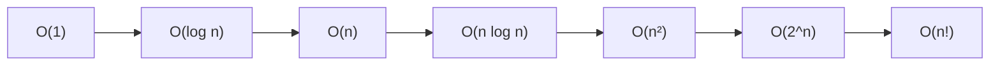
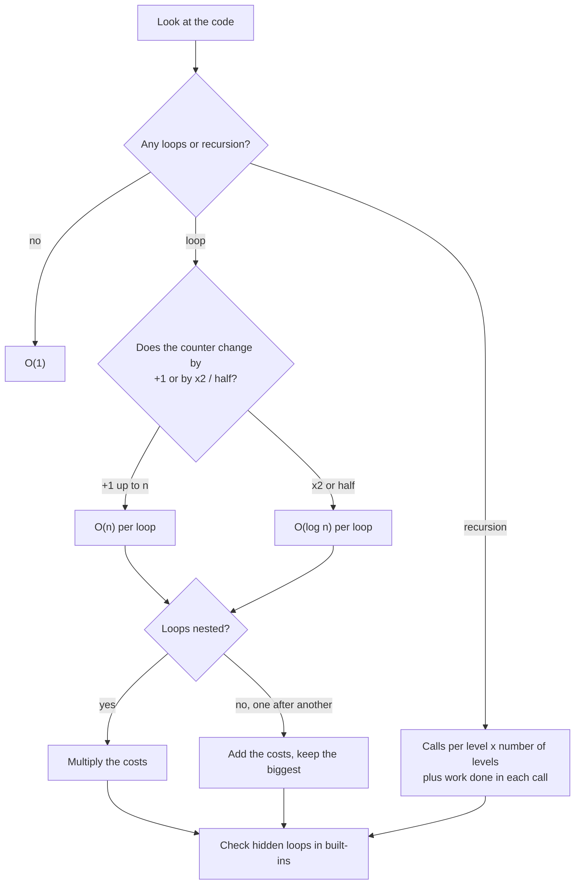
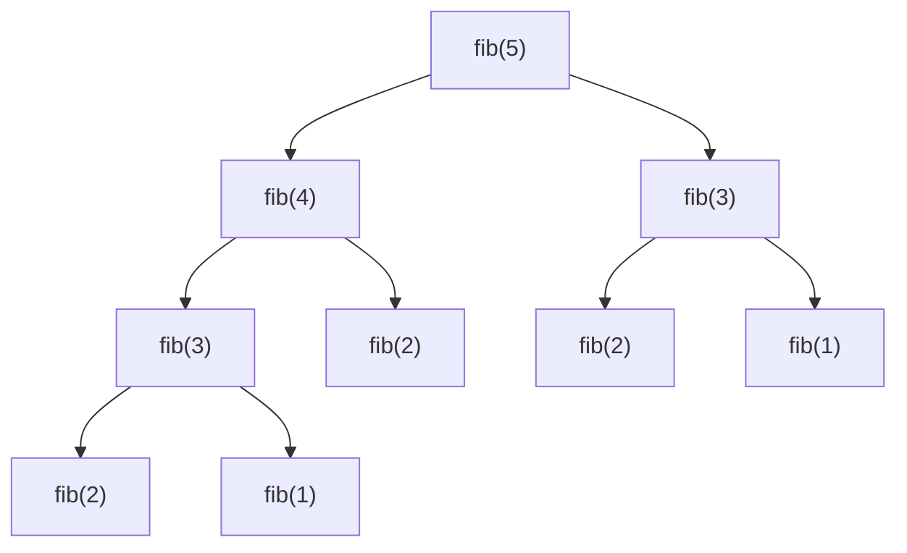
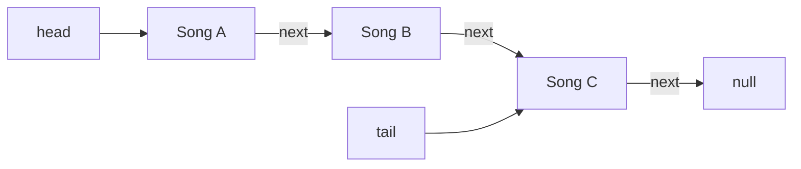
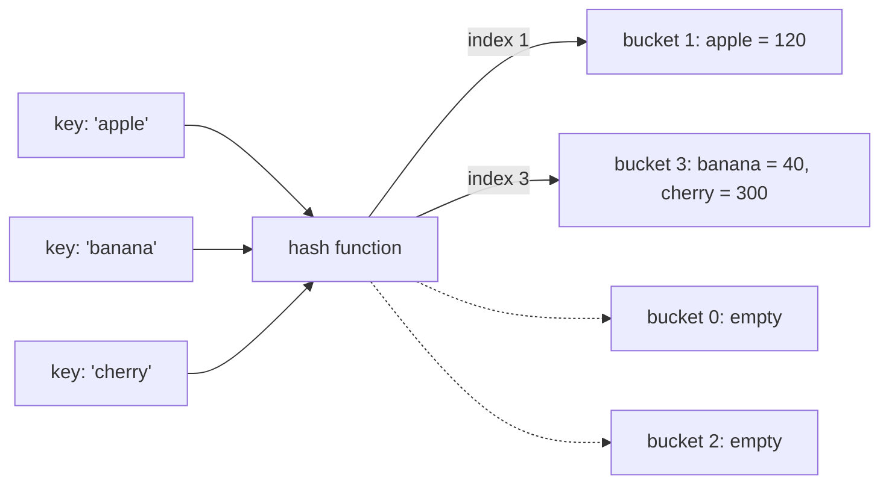
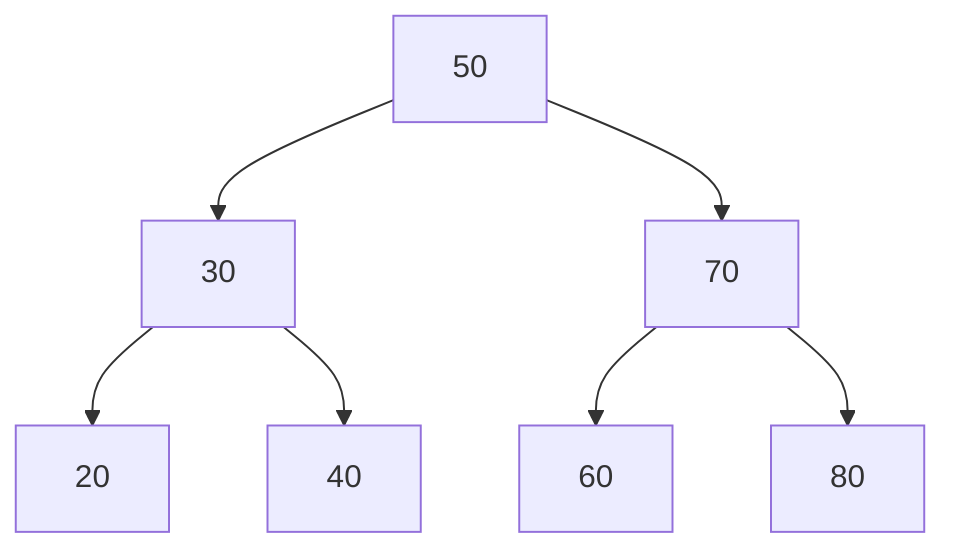
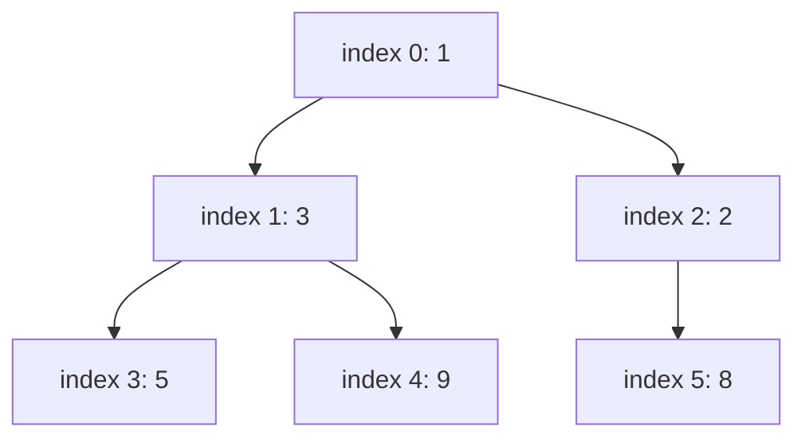
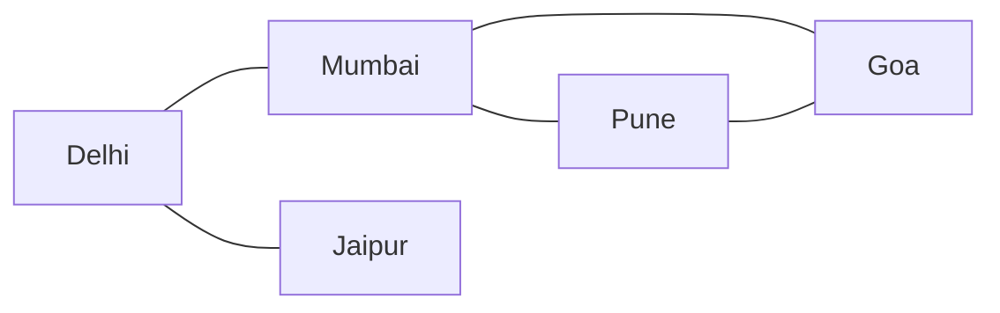
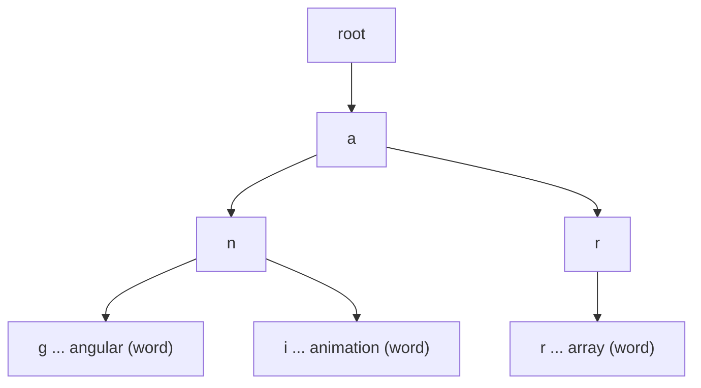
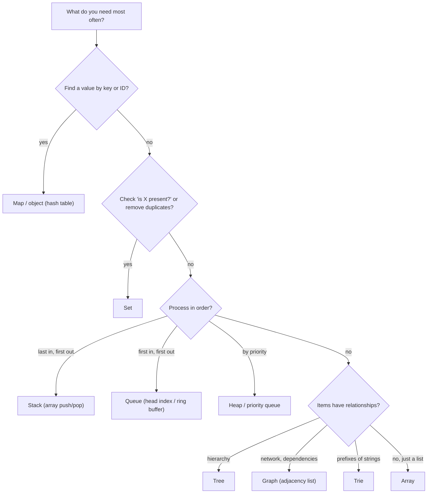

# Data Structures and Big-O

> In this document you will learn how to measure the cost of code with Big-O notation, how to calculate the complexity of any function, and how the main data structures work: arrays, linked lists, stacks, queues, hash tables, sets, trees, heaps, graphs and tries. Interviewers use these topics to check whether you can choose the right tool and explain why your code is fast or slow.

**Before this:** [How programs run](01-how-programs-run.md) · **Interview questions:** [jump to the interview section](#interview-questions)

## Table of contents

1. [Why complexity matters](#why-complexity-matters)
2. [What Big-O means](#what-big-o-means)
3. [Big-O, Big-Theta and Big-Omega](#big-o-big-theta-and-big-omega)
4. [Best, average and worst case](#best-average-and-worst-case)
5. [Time complexity and space complexity](#time-complexity-and-space-complexity)
6. [Common complexity classes](#common-complexity-classes)
7. [How to calculate complexity from code](#how-to-calculate-complexity-from-code)
8. [Amortized cost](#amortized-cost)
9. [Arrays](#arrays)
10. [Linked lists](#linked-lists)
11. [Stacks](#stacks)
12. [Queues and deques](#queues-and-deques)
13. [Hash tables](#hash-tables)
14. [Sets](#sets)
15. [Trees](#trees)
16. [Heaps and priority queues](#heaps-and-priority-queues)
17. [Graphs](#graphs)
18. [Tries](#tries)
19. [Operation complexity table](#operation-complexity-table)
20. [Complexity of JavaScript built-ins](#complexity-of-javascript-built-ins)
21. [Choosing the right data structure](#choosing-the-right-data-structure)
22. [Common mistakes](#common-mistakes)
23. [Best practices](#best-practices)
24. [Interview questions](#interview-questions)
25. [Summary](#summary)
26. [References](#references)

Deeper problem practice (two pointers, sliding window, dynamic programming and more) is in [Problem solving and complexity](../11-coding-interviews/02-problem-solving-and-complexity.md).

---

## Why complexity matters

Look at this function. It finds the customers who bought something in both January and February.

```js
// ❌ Slow for big lists
function commonCustomersSlow(january, february) {
  return january.filter((id) => february.includes(id));
}

// ✅ Fast for big lists
function commonCustomersFast(january, february) {
  const februarySet = new Set(february);
  return january.filter((id) => februarySet.has(id));
}

console.log(commonCustomersSlow([1, 2, 3, 4], [3, 4, 5])); // [ 3, 4 ]
console.log(commonCustomersFast([1, 2, 3, 4], [3, 4, 5])); // [ 3, 4 ]
```

Both give the same answer. With 4 items, both are instant. Now imagine 100,000 customers in each month:

- The slow version calls `february.includes(id)` for every January customer. `includes` scans the array from the start. That is up to 100,000 × 100,000 = **10 billion** comparisons.
- The fast version builds a `Set` once (100,000 steps) and then does 100,000 quick lookups. That is about **200,000** steps.

Same result, but one version may take minutes and the other takes milliseconds. **Complexity analysis** lets you see this difference by reading the code, before your users feel it.

---

## What Big-O means

### What it is

**Big-O notation** describes how the work (or memory) of an algorithm **grows** when the input grows. We write it like `O(n)`, where **n** is the size of the input (number of items, length of a string, number of users).

Big-O does **not** tell you the exact time in milliseconds. It tells you the **shape of the growth**:

- `O(1)`: the work stays the same, no matter how big the input is.
- `O(n)`: double the input, roughly double the work.
- `O(n²)`: double the input, roughly four times the work.

### Why it exists

Exact time depends on the machine, the engine, the other programs running, and many small details. Big-O ignores those details so you can compare **algorithms**, not computers. It answers the question that matters at scale: "What happens when the data becomes 100 times bigger?"

### Analogy

Think about finding a name:

- In a phone's contact list with search: you type and get the result immediately. That is like `O(1)` or `O(log n)`.
- In a stack of unsorted business cards: you check cards one by one. Twice the cards, twice the time. That is `O(n)`.
- Checking every pair of cards to find duplicates: twice the cards, four times the pairs. That is `O(n²)`.

### Counting steps

To find the Big-O, count how many basic steps the code does as a function of n.

```js
function findMax(values) {
  let max = values[0];                    // 1 step
  for (let i = 1; i < values.length; i++) { // loop runs n - 1 times
    if (values[i] > max) max = values[i];   // 1-2 steps each time
  }
  return max;                             // 1 step
}
console.log(findMax([4, 9, 2, 7])); // 9
```

The exact count is about `2(n − 1) + 2` steps. Big-O keeps only the part that grows fastest and drops constant factors, so this is **O(n)**.

### The two simplification rules

1. **Drop constant factors.** `O(2n)` becomes `O(n)`. `O(500)` becomes `O(1)`.
2. **Drop smaller terms.** `O(n² + n)` becomes `O(n²)`. `O(n + log n)` becomes `O(n)`.

Why is this allowed? Because for large n, the biggest term wins. When n = 1,000,000, n² is 10^12 and n is only 10^6. The `+ n` changes the total by 0.0001%.

---

## Big-O, Big-Theta and Big-Omega

There are three related notations. In everyday interviews, people say "Big-O" for all of them, but you should know the difference.

| Notation | Meaning | Simple words |
| --- | --- | --- |
| **O (Big-O)** | Upper bound | "It grows **at most** this fast." |
| **Ω (Big-Omega)** | Lower bound | "It grows **at least** this fast." |
| **Θ (Big-Theta)** | Tight bound | "It grows **exactly** this fast (both bounds)." |

Example: `findMax` must look at every element, so it is Ω(n). It never does more than a constant amount of work per element, so it is O(n). Both together mean it is **Θ(n)**.

Strictly speaking, `findMax` is also O(n²), because "at most n²" is true. But that is not useful. When engineers say "this is O(n)", they normally mean the **tightest** bound, which is really Θ(n).

---

## Best, average and worst case

The same algorithm can do different amounts of work for different inputs of the same size.

```js
function indexOfUser(users, id) {
  for (let i = 0; i < users.length; i++) {
    if (users[i].id === id) return i;
  }
  return -1;
}
```

- **Best case:** the user is first. 1 step: O(1).
- **Worst case:** the user is last or missing. n steps: O(n).
- **Average case:** if the user is equally likely to be anywhere, about n/2 steps: still O(n).

Best case and worst case are **not** the same as Ω and O. You can give an upper bound for the best case, or a lower bound for the worst case. They answer different questions.

In interviews, **give the worst case** unless asked otherwise, and mention the average case when it is very different. Famous examples:

| Algorithm / structure | Average | Worst | Why the worst case happens |
| --- | --- | --- | --- |
| Hash table lookup | O(1) | O(n) | Many keys land in the same bucket |
| Quicksort | O(n log n) | O(n²) | Bad pivots (for example, already sorted input with a naive pivot) |
| Binary search tree lookup | O(log n) | O(n) | The tree becomes a "linked list" when data is inserted in sorted order |

---

## Time complexity and space complexity

- **Time complexity:** how the number of steps grows with input size.
- **Space complexity:** how the **extra memory** grows with input size.

When you talk about space, separate two things:

- **Auxiliary space:** extra memory the algorithm uses while working (temporary arrays, maps, the recursion stack).
- **Output space:** memory for the result you return.

Many people count only auxiliary space. Say which one you mean.

```js
// O(n) time, O(1) auxiliary space: only a few variables
function sum(values) {
  let total = 0;
  for (const v of values) total += v;
  return total;
}

// O(n) time, O(n) space: the result is a new array of size n
function doubled(values) {
  return values.map((v) => v * 2);
}

// O(n) time, O(n) auxiliary space: the Set can grow to n items
function hasDuplicate(values) {
  const seen = new Set();
  for (const v of values) {
    if (seen.has(v)) return true;
    seen.add(v);
  }
  return false;
}

console.log(sum([1, 2, 3]), doubled([1, 2, 3]), hasDuplicate([1, 2, 1])); // 6 [ 2, 4, 6 ] true
```

**Recursion uses space too.** Each recursive call adds a frame to the call stack. A recursive function that goes n levels deep uses O(n) stack space, even if it creates no arrays. (See [Recursion and stack overflow](01-how-programs-run.md#recursion-and-stack-overflow).)

### The time–space trade-off

You can often **buy speed with memory**. `hasDuplicate` above uses an O(n) `Set` to get O(n) time. Without extra memory, you would compare every pair: O(n²) time, O(1) space. Caching and memoization are the same trade: store results to avoid computing them again.

---

## Common complexity classes

From the slowest-growing (best) to the fastest-growing (worst):

| Big-O | Name | Example |
| --- | --- | --- |
| O(1) | Constant | Read `array[i]`, `map.get(key)`, `stack.push(x)` |
| O(log n) | Logarithmic | Binary search, balanced tree lookup |
| O(n) | Linear | Loop over all items, `includes`, `indexOf` |
| O(n log n) | Linearithmic | Efficient sorting (merge sort, `Array.prototype.sort`) |
| O(n²) | Quadratic | Nested loops over the same data, comparing every pair |
| O(2^n) | Exponential | Naive recursive Fibonacci, all subsets |
| O(n!) | Factorial | All orderings (permutations) |

How fast do they grow? Here are the step counts for different n (rounded):

| n | log₂ n | n log₂ n | n² | 2^n |
| --- | --- | --- | --- | --- |
| 10 | 3.3 | 33 | 100 | 1,024 |
| 100 | 6.6 | 664 | 10,000 | 1.3 × 10^30 |
| 1,000 | 10 | 9,966 | 1,000,000 | far too big |
| 1,000,000 | 20 | about 20 million | 10^12 | far too big |

A rough feel: a computer does on the order of hundreds of millions of simple steps per second. So O(n²) with n = 1,000,000 (10^12 steps) is far too slow, while O(n log n) (20 million steps) is fine.



The arrow means "grows slower than". Left is better for large inputs.

### O(1): constant

The work does not depend on n.

```js
function firstItem(items) {
  return items[0]; // one step, whether items has 3 or 3 million elements
}

const prices = new Map([["apple", 120]]);
console.log(firstItem([7, 8, 9]), prices.get("apple")); // 7 120
```

### O(log n): logarithmic

Each step throws away a big fraction (usually half) of the remaining work. **log₂ n** is "how many times can I halve n until I reach 1?" For 1,000,000 that is only about 20.

```js
// Binary search: the array must already be sorted
function binarySearch(sorted, target) {
  let low = 0;
  let high = sorted.length - 1;
  while (low <= high) {
    const mid = Math.floor((low + high) / 2);
    if (sorted[mid] === target) return mid;
    if (sorted[mid] < target) low = mid + 1; // throw away the left half
    else high = mid - 1;                      // throw away the right half
  }
  return -1;
}

console.log(binarySearch([3, 8, 15, 23, 42, 57, 91], 42)); // 4
console.log(binarySearch([3, 8, 15, 23, 42, 57, 91], 5));  // -1
```

Walkthrough for target 42 in `[3, 8, 15, 23, 42, 57, 91]`:

1. low = 0, high = 6, mid = 3. `sorted[3]` is 23, smaller than 42. Throw away the left half: low = 4.
2. low = 4, high = 6, mid = 5. `sorted[5]` is 57, bigger than 42. Throw away the right half: high = 4.
3. low = 4, high = 4, mid = 4. `sorted[4]` is 42. Found at index 4.

Three checks for seven items. For a million items, about 20 checks.

### O(n): linear

You touch each item a constant number of times. `findMax` and `sum` above are O(n).

### O(n log n): linearithmic

This is the cost of good comparison sorting. **Merge sort** splits the array in half again and again (log n levels), and at each level it merges all n items.

```js
function mergeSort(items) {
  if (items.length <= 1) return items;
  const mid = Math.floor(items.length / 2);
  const left = mergeSort(items.slice(0, mid));
  const right = mergeSort(items.slice(mid));

  const merged = [];
  let i = 0;
  let j = 0;
  while (i < left.length && j < right.length) {
    merged.push(left[i] <= right[j] ? left[i++] : right[j++]);
  }
  return merged.concat(left.slice(i), right.slice(j));
}

console.log(mergeSort([38, 27, 43, 3, 9, 82, 10]).join(" ")); // 3 9 10 27 38 43 82
```

No comparison-based sort can beat O(n log n) in the general case. That is why "sort first, then do something in O(n)" gives O(n log n) overall.

### O(n²): quadratic

Usually two nested loops over the same data.

```js
function hasDuplicateSlow(items) {
  for (let i = 0; i < items.length; i++) {
    for (let j = i + 1; j < items.length; j++) {
      if (items[i] === items[j]) return true;
    }
  }
  return false;
}
console.log(hasDuplicateSlow([1, 2, 3, 2])); // true
```

The inner loop runs n−1, then n−2, ..., then 0 times. The total is n(n−1)/2. For n = 10 that is 45 comparisons. Dropping the constant ½ and the smaller term gives **O(n²)**.

### O(2^n): exponential

Each call makes two more calls, and the depth is n. The classic example is naive Fibonacci:

```js
let calls = 0;
function fib(n) {
  calls++;
  if (n < 2) return n;
  return fib(n - 1) + fib(n - 2);
}

console.log(fib(20), calls); // 6765 21891
```

`fib(20)` makes 21,891 calls. `fib(30)` makes 2,692,537 calls. Each +1 to n multiplies the work by about 1.6. (The tight bound is about O(1.618^n), but O(2^n) is the usual answer.) Generating **all subsets** of n items is truly 2^n, because each item is either in or out.

### O(n!): factorial

Generating all orderings of n items: n choices for the first position, n−1 for the second, and so on. 10 items have 3,628,800 orderings. 20 items have about 2.4 × 10^18. Brute-force "try every route" solutions to the travelling salesman problem are O(n!).

---

## How to calculate complexity from code

### The rules

| Code pattern | Complexity |
| --- | --- |
| Simple statements, no loops | O(1) |
| One loop over n items | O(n) |
| Two loops **one after the other** | O(n) + O(n) = O(n) |
| Two loops **nested**, both over n | O(n) × O(n) = O(n²) |
| Loops over **different inputs** a and b, nested | O(a × b), not O(n²) |
| A loop where the counter is halved or doubled | O(log n) |
| A loop of n, with an inner loop that halves | O(n log n) |
| Recursion with b branches and depth d | about O(b^d) calls |
| Calling a built-in that loops (`includes`, `indexOf`, spread, `slice`) | Count the built-in's cost too |



### Example 1: loops one after another

```js
function minAndMax(values) {
  let min = Infinity;
  for (const v of values) min = Math.min(min, v); // n steps
  let max = -Infinity;
  for (const v of values) max = Math.max(max, v); // n steps
  return [min, max];
}
console.log(minAndMax([4, 1, 9])); // [ 1, 9 ]
```

**Answer:** n + n = 2n, so **O(n)**. Two separate loops do not make it O(n²).

### Example 2: different inputs

```js
function printAllPairs(products, colors) {
  for (const product of products) {
    for (const color of colors) {
      console.log(`${product} - ${color}`);
    }
  }
}
printAllPairs(["Shirt"], ["Red", "Blue"]); // Shirt - Red, then Shirt - Blue
```

**Answer:** **O(p × c)**, where p is the number of products and c is the number of colors. Calling it O(n²) is wrong, because the two sizes are independent. If colors is always a fixed list of 5, it becomes O(5p) = **O(p)**.

### Example 3: a loop that halves

```js
function countHalvings(n) {
  let steps = 0;
  while (n > 1) {
    n = Math.floor(n / 2);
    steps++;
  }
  return steps;
}
console.log(countHalvings(1000));      // 9
console.log(countHalvings(1_000_000)); // 19
```

**Answer:** **O(log n)**. A million needs only 19 halvings.

### Example 4: an outer loop that doubles, inner loop over n

```js
function work(n) {
  let steps = 0;
  for (let i = 1; i < n; i *= 2) {   // log n times
    for (let j = 0; j < n; j++) {    // n times
      steps++;
    }
  }
  return steps;
}
console.log(work(16)); // 64  (4 outer rounds x 16)
```

**Answer:** **O(n log n)**.

### Example 5: inner loop with a fixed size

```js
function hasRecentDuplicate(events) {
  for (let i = 0; i < events.length; i++) {
    for (let j = Math.max(0, i - 10); j < i; j++) { // at most 10 steps
      if (events[j] === events[i]) return true;
    }
  }
  return false;
}
console.log(hasRecentDuplicate(["a", "b", "a"])); // true
```

**Answer:** **O(n)**. The inner loop runs at most 10 times, which is a constant. Nested loops are only O(n²) when **both** loops grow with n.

### Example 6: square-root loop

```js
function isPrime(n) {
  if (n < 2) return false;
  for (let i = 2; i * i <= n; i++) {
    if (n % i === 0) return false;
  }
  return true;
}
console.log(isPrime(97), isPrime(91)); // true false
```

**Answer:** **O(√n)**. The loop stops when i reaches √n.

### Example 7: hidden loops inside built-ins

```js
function uniqueTags(tags) {
  const result = [];
  for (const tag of tags) {             // n times
    if (!result.includes(tag)) {        // includes scans result: up to n steps
      result.push(tag);
    }
  }
  return result;
}
console.log(uniqueTags(["js", "ts", "js"])); // [ 'js', 'ts' ]
```

**Answer:** **O(n²)**. It looks like one loop, but `includes` is a loop too. The fix is `[...new Set(tags)]`, which is O(n).

Other built-ins that hide a loop: `indexOf`, `find`, `filter`, `some`, `splice`, `shift`, `unshift`, `slice`, spread `[...arr]`, `Object.keys`, `JSON.stringify`, `str.split`, `arr.join`.

### Example 8: spread inside reduce

```js
const users = [
  { id: "u1", name: "Asha" },
  { id: "u2", name: "Ravi" },
];

// ❌ O(n²): each step copies every key collected so far
const byIdSlow = users.reduce((acc, user) => ({ ...acc, [user.id]: user }), {});

// ✅ O(n): change one accumulator
const byIdFast = users.reduce((acc, user) => {
  acc[user.id] = user;
  return acc;
}, {});

// ✅ O(n) and clear
const byIdMap = new Map(users.map((user) => [user.id, user]));

console.log(Object.keys(byIdSlow), Object.keys(byIdFast), byIdMap.size); // [ 'u1', 'u2' ] [ 'u1', 'u2' ] 2
```

**Answer:** The spread version is **O(n²)**. Step k copies k−1 keys, so the total is 0 + 1 + ... + (n−1) = n(n−1)/2. This pattern is common in Redux/NgRx reducers and in code reviews. It is fine for 20 items and very slow for 50,000.

### Recursion

For recursive functions, ask two questions:

1. **How many calls happen in total?** (Draw the recursion tree: calls per level × number of levels.)
2. **How much work does each call do** (not counting the recursive calls)?

Total time = number of calls × work per call (when each call does similar work).

| Function | Calls per level | Levels | Work per call | Total |
| --- | --- | --- | --- | --- |
| `factorial(n)` | 1 | n | O(1) | O(n) |
| Recursive binary search | 1 | log n | O(1) | O(log n) |
| `fib(n)` (naive) | doubles each level | n | O(1) | O(2^n) |
| Merge sort | doubles, but each half is smaller | log n | O(size of part); n per level | O(n log n) |

The recursion tree of naive `fib(5)` shows the repeated work:



`fib(3)` is computed twice and `fib(2)` three times, and the waste grows exponentially. **Memoization** stores each result the first time, so each `fib(k)` is computed once:

```js
function fibMemo(n, memo = new Map()) {
  if (n < 2) return n;
  if (memo.has(n)) return memo.get(n);
  const value = fibMemo(n - 1, memo) + fibMemo(n - 2, memo);
  memo.set(n, value);
  return value;
}
console.log(fibMemo(50)); // 12586269025
```

Now it is **O(n) time and O(n) space** (the map plus the recursion depth).

Space for recursion = **maximum depth** of the recursion (the longest path in the tree), not the total number of calls. Naive `fib(n)` makes O(2^n) calls but uses only O(n) stack space, because only one path is on the stack at a time.

---

## Amortized cost

### What it is

**Amortized cost** is the average cost per operation over a long sequence of operations, even if a few operations are expensive.

### The classic example: array push

A JavaScript array (and a C++ `vector`, a Java `ArrayList`) is a **dynamic array**. It reserves some capacity in memory. When it is full and you push one more item, it must:

1. Allocate a bigger block (typically about twice as big, the exact growth factor depends on the engine).
2. Copy all existing items into the new block.
3. Add the new item.

That one push costs O(n). So why do we say `push` is O(1)?

Because the expensive copies happen rarely. Let's simulate a doubling array and count copies:

```js
function simulatePushes(n) {
  let capacity = 1;
  let length = 0;
  let copies = 0;
  for (let i = 0; i < n; i++) {
    if (length === capacity) {
      copies += length; // copy everything into a bigger block
      capacity *= 2;
    }
    length++;
  }
  return { pushes: n, copies, capacity };
}

console.log(simulatePushes(8));         // { pushes: 8, copies: 7, capacity: 8 }
console.log(simulatePushes(1_000_000)); // { pushes: 1000000, copies: 1048575, capacity: 1048576 }
```

A million pushes cause about a million copies in total: 1 + 2 + 4 + ... + 524,288, which is less than 2n. So the total work is O(n) for n pushes, which is **O(1) amortized per push**.

### Analogy

Think of a bus pass: you pay a big amount once a month, but per ride it is cheap. One push is sometimes expensive, but averaged over all pushes, each one is cheap.

### Amortized vs average case

- **Average case** is about random inputs: "on typical data, it is fast".
- **Amortized** is a guarantee over a sequence: "**any** sequence of n pushes costs O(n) in total". No luck is involved.

Note that a single push can still be slow. For real-time code (like a 60 FPS animation), a rare O(n) pause can matter even if the amortized cost is O(1). For large numeric data with a known size, a typed array (for example, `new Float64Array(n)`) has a fixed length and never regrows.

---

## Arrays

### What it is

An **array** is an ordered list of items, where each item has a numbered position called an **index**, starting at 0.

In the classic computer-science sense, an array is one **continuous block of memory** where all items have the same size. That is why reading `array[i]` is O(1): the address is simply `start + i × itemSize`. No searching is needed.

### Operations and their cost

| Operation | Cost | Why |
| --- | --- | --- |
| Read or write `arr[i]` | O(1) | Address is computed directly |
| `push` / `pop` (at the end) | O(1) amortized | No other items move |
| `unshift` / `shift` (at the start) | O(n) | Every other item moves one position |
| Insert or delete in the middle (`splice`) | O(n) | Items after the position move |
| Search for a value (`includes`, `indexOf`, `find`) | O(n) | Must check items one by one |
| Search in a **sorted** array (binary search) | O(log n) | Halve the range each step |

```js
const queue = ["a", "b", "c", "d"];
queue.shift();       // removes "a"; "b", "c", "d" all move one place left
console.log(queue);  // [ 'b', 'c', 'd' ]

queue.splice(1, 0, "x"); // insert "x" at index 1; "c" and "d" move right
console.log(queue);      // [ 'b', 'x', 'c', 'd' ]
```

### How JavaScript arrays really work

A JavaScript array is an **object** with special handling for integer keys and a `length` property. The language does not require continuous memory. Engines optimize it:

- V8 stores a **dense** array (no gaps, similar types) in a fast, continuous backing store. V8 tracks the "elements kind", for example "only small integers", "only doubles" or "anything".
- If you create big gaps, V8 may switch to a slower **dictionary** (hash table) representation.

```js
const scores = [10, 20, 30];  // dense, fast
scores[1000] = 40;            // ❌ creates a huge gap (a "holey"/sparse array)
console.log(scores.length);   // 1001
console.log(scores[500]);     // undefined (a hole)
```

Practical rules:

- Do not create holes. Fill arrays in order.
- Keep element types consistent in large, hot arrays.
- For large amounts of numbers (pixels, audio, binary files), use **typed arrays** such as `Uint8Array` or `Float64Array`. They really are continuous memory with fixed-size items.

### Cache locality

Modern CPUs read memory in chunks into a fast **cache**. Items stored next to each other are read together. Looping over an array is very cache-friendly. Following pointers between objects spread around the heap (like a linked list) is less friendly. This is why arrays often beat "theoretically equal" structures in practice.

### When to use

Use arrays by default for ordered lists: lists of products, table rows, API results. Avoid them for frequent inserts at the front, or frequent "is this value present?" checks on large data (use a `Set` instead).

---

## Linked lists

### What it is

A **linked list** is a chain of **nodes**. Each node holds a value and a reference (pointer) to the next node. The list keeps a reference to the first node, called the **head**, and often to the last node, called the **tail**.

- **Singly linked list:** each node points to the next node.
- **Doubly linked list:** each node points to the next **and** the previous node.



### Why it exists

In an array, inserting at the front moves every item. In a linked list, inserting at the front only creates one node and changes one pointer: O(1). No resizing, no shifting.

### Analogy

A treasure hunt: each clue tells you where the next clue is. To reach clue 50, you must follow 49 clues. But adding a new clue at the start is easy: write a new clue that points to the old first clue.

### Implementation

```js
class ListNode {
  constructor(value, next = null) {
    this.value = value;
    this.next = next;
  }
}

class LinkedList {
  #head = null;
  #tail = null;
  #size = 0;

  prepend(value) {                       // O(1)
    this.#head = new ListNode(value, this.#head);
    if (this.#tail === null) this.#tail = this.#head;
    this.#size++;
  }

  append(value) {                        // O(1) because we keep a tail pointer
    const node = new ListNode(value);
    if (this.#tail === null) {
      this.#head = node;
      this.#tail = node;
    } else {
      this.#tail.next = node;
      this.#tail = node;
    }
    this.#size++;
  }

  find(predicate) {                      // O(n)
    for (let node = this.#head; node !== null; node = node.next) {
      if (predicate(node.value)) return node.value;
    }
    return undefined;
  }

  remove(value) {                        // O(n) to find, O(1) to unlink
    let previous = null;
    for (let node = this.#head; node !== null; previous = node, node = node.next) {
      if (node.value === value) {
        if (previous === null) this.#head = node.next;
        else previous.next = node.next;
        if (node === this.#tail) this.#tail = previous;
        this.#size--;
        return true;
      }
    }
    return false;
  }

  toArray() {
    const result = [];
    for (let node = this.#head; node !== null; node = node.next) result.push(node.value);
    return result;
  }

  get size() {
    return this.#size;
  }
}

const playlist = new LinkedList();
playlist.append("Song B");
playlist.append("Song C");
playlist.prepend("Song A");
console.log(playlist.toArray());                     // [ 'Song A', 'Song B', 'Song C' ]
playlist.remove("Song B");
console.log(playlist.toArray(), playlist.size);      // [ 'Song A', 'Song C' ] 2
console.log(playlist.find((s) => s.endsWith("C")));  // Song C
```

### A classic interview task: reverse a linked list

```js
function reverseList(head) {
  let previous = null;
  let current = head;
  while (current !== null) {
    const next = current.next; // 1. remember the rest of the list
    current.next = previous;   // 2. turn the arrow around
    previous = current;        // 3. move both pointers one step forward
    current = next;
  }
  return previous;             // the old tail is the new head
}

let head = new ListNode(1, new ListNode(2, new ListNode(3)));
head = reverseList(head);
const values = [];
for (let node = head; node !== null; node = node.next) values.push(node.value);
console.log(values.join(" -> ")); // 3 -> 2 -> 1
```

O(n) time, O(1) extra space.

### Array vs linked list

| | Array | Linked list |
| --- | --- | --- |
| Access by index | O(1) | O(n) |
| Insert/delete at the front | O(n) | O(1) |
| Insert/delete at the end | O(1) amortized | O(1) with a tail pointer (delete at the end needs a doubly linked list) |
| Insert/delete in the middle, when you already hold the node | O(n) | O(1) (doubly linked) |
| Memory per item | Small | Extra pointer(s) per node |
| Cache locality | Excellent | Poor |

### Real-world usage

In everyday JavaScript, you rarely write a linked list, because arrays are fast and convenient. But the idea is everywhere:

- An **LRU cache** is classically built with a hash map plus a doubly linked list (in JavaScript, `Map` gives you the same behavior; see [the LRU example](#real-world-uses)).
- The **prototype chain** is a linked list of objects: each object points to its prototype.
- React's Fiber tree links nodes with `child`, `sibling` and `return` pointers.
- Undo history, music playlists with next/previous, and browser history can be modelled as doubly linked lists.

---

## Stacks

### What it is

A **stack** is a collection where you add and remove items **only at the top**. The last item added is the first item removed: **LIFO** (last in, first out).

Operations: `push` (add on top), `pop` (remove from top), `peek` (look at the top). All are O(1).

### Analogy

A stack of plates. You put a clean plate on top, and you take the top plate first.

### Implementation in JavaScript

A JavaScript array already works as a stack with `push` and `pop`. A small class makes the intent clear and prevents misuse:

```js
class Stack {
  #items = [];
  push(item) { this.#items.push(item); }
  pop() { return this.#items.pop(); }
  peek() { return this.#items[this.#items.length - 1]; }
  get size() { return this.#items.length; }
  isEmpty() { return this.#items.length === 0; }
}
```

### Example: checking balanced brackets

This is how editors and parsers check `{ [ ( ) ] }`:

```js
function isBalanced(text) {
  const pairs = { ")": "(", "]": "[", "}": "{" };
  const stack = new Stack();
  for (const ch of text) {
    if (ch === "(" || ch === "[" || ch === "{") {
      stack.push(ch);
    } else if (ch in pairs) {
      if (stack.pop() !== pairs[ch]) return false; // wrong closing bracket
    }
  }
  return stack.isEmpty(); // anything left open is an error
}

console.log(isBalanced("{ items: [1, 2, (3)] }")); // true
console.log(isBalanced("([)]"));                   // false
console.log(isBalanced("(("));                     // false
```

Walkthrough for `"([)]"`:

1. `(` is pushed. Stack: `(`.
2. `[` is pushed. Stack: `( [`.
3. `)` arrives. Pop gives `[`, but `)` needs `(`. Return `false`.

### Example: undo and redo

```js
class UndoStack {
  #undo = [];
  #redo = [];
  do(action) {
    this.#undo.push(action);
    this.#redo.length = 0; // a new action clears the redo history
  }
  undo() {
    const action = this.#undo.pop();
    if (action !== undefined) this.#redo.push(action);
    return action;
  }
  redo() {
    const action = this.#redo.pop();
    if (action !== undefined) this.#undo.push(action);
    return action;
  }
}

const history = new UndoStack();
history.do("type A");
history.do("type B");
console.log(history.undo(), history.undo(), history.redo()); // type B type A type A
```

### Real-world usage

- The **call stack** that runs your functions (see [Functions and the call stack](01-how-programs-run.md#functions-and-the-call-stack)).
- Undo/redo in editors and design tools.
- Browser back/forward history (two stacks).
- Depth-first search (DFS) without recursion.
- Parsing expressions, matching HTML tags and brackets.

---

## Queues and deques

### What it is

A **queue** adds items at the **back** and removes them from the **front**. The first item added is the first item removed: **FIFO** (first in, first out).

Operations: `enqueue` (add at the back), `dequeue` (remove from the front), `peek`. A good queue does all of them in O(1).

A **deque** (double-ended queue, said "deck") lets you add and remove at **both** ends in O(1).

### Analogy

A line of people at a ticket counter. New people join at the back. The person at the front is served first.

### The JavaScript trap: `shift` is O(n)

The easy way is `array.push` to enqueue and `array.shift` to dequeue. But `shift` moves every remaining item one position left, so it is O(n) in the general case. With a large queue, a loop that calls `shift` becomes O(n²). (Engines sometimes optimize `shift` for some arrays, but you should not depend on it.)

### Implementation with a head index

Keep the items in an array, and remember where the front is instead of moving items:

```js
class Queue {
  #items = [];
  #head = 0; // index of the front item

  enqueue(item) {
    this.#items.push(item);                 // O(1) amortized
  }

  dequeue() {                               // O(1) amortized
    if (this.#head >= this.#items.length) return undefined;
    const item = this.#items[this.#head];
    this.#items[this.#head] = undefined;    // let the garbage collector free the item
    this.#head++;
    // Compact now and then, so the array does not grow forever
    if (this.#head > 1000 && this.#head * 2 > this.#items.length) {
      this.#items = this.#items.slice(this.#head);
      this.#head = 0;
    }
    return item;
  }

  peek() {
    return this.#items[this.#head];
  }

  get size() {
    return this.#items.length - this.#head;
  }
}

const jobs = new Queue();
jobs.enqueue("send-email");
jobs.enqueue("resize-image");
jobs.enqueue("generate-invoice");
console.log(jobs.dequeue()); // send-email
console.log(jobs.size);      // 2
console.log(jobs.peek());    // resize-image
```

The compaction step costs O(n), but it happens only after many dequeues, so the cost per operation stays O(1) amortized. Another classic solution is a **ring buffer** (circular array): a fixed-size array where the head and tail indexes wrap around to 0 at the end. Ring buffers are also the usual way to build a deque.

### Real-world usage

- **Task queues** in the event loop: timers, I/O callbacks and promise callbacks wait in queues (see [The event loop](../02-javascript/16-event-loop.md)).
- **Job queues** in backends: emails, image processing, report generation (see [Background jobs and queues](../07-nodejs-backend/13-background-jobs-and-queues.md)).
- **Breadth-first search** over trees and graphs (see [Graphs](#graphs)).
- Buffering: keyboard input, network packets, log lines, streams.
- Rate limiting and request throttling (a deque of timestamps in a sliding window).

---

## Hash tables

### What it is

A **hash table** (hash map) stores **key–value pairs** and finds a value by its key in **O(1) on average**.

In JavaScript, `Map`, `Set`, `WeakMap`, `WeakSet` and (in practice) plain objects are built on hash tables or similar structures.

### Why it exists

Searching an array for a key is O(n). A hash table computes **where** the key should be, so it can jump straight there.

### How it works inside

1. A **hash function** turns the key into a number, for example `"apple"` becomes 93029210.
2. The number is reduced to a **bucket index**: `hash % numberOfBuckets`.
3. The value is stored in that bucket.
4. To read, compute the same hash, go to the same bucket, and look there.



### Collisions

Two different keys can land in the same bucket. This is a **collision**. It is normal and unavoidable. Two common ways to handle it:

- **Chaining:** each bucket holds a small list of entries. On lookup, scan that short list.
- **Open addressing:** if the bucket is taken, try another bucket by a fixed rule (for example, the next one), until you find a free one.

### Load factor and resizing

The **load factor** is `number of entries / number of buckets`. When it gets too high (a common limit is about 0.75), buckets get crowded and lookups slow down. The table then **resizes**: it allocates about twice as many buckets and re-inserts every entry. Like array growth, a resize costs O(n), but it is rare, so insertion stays O(1) amortized.

### A small hash table with chaining

You will never need to write this at work (use `Map`), but writing it once makes the idea concrete, and interviewers sometimes ask for it.

```js
class HashTable {
  #buckets;
  #size = 0;

  constructor(capacity = 8) {
    this.#buckets = Array.from({ length: capacity }, () => []);
  }

  #hash(key) {
    let hash = 0;
    for (const ch of String(key)) {
      hash = (hash * 31 + ch.codePointAt(0)) >>> 0; // keep it a 32-bit unsigned number
    }
    return hash % this.#buckets.length;
  }

  set(key, value) {
    const bucket = this.#buckets[this.#hash(key)];
    const entry = bucket.find((e) => e[0] === key);
    if (entry) {
      entry[1] = value; // update an existing key
      return;
    }
    bucket.push([key, value]);
    this.#size++;
    if (this.#size / this.#buckets.length > 0.75) this.#resize();
  }

  get(key) {
    const bucket = this.#buckets[this.#hash(key)];
    return bucket.find((e) => e[0] === key)?.[1];
  }

  #resize() {
    const oldBuckets = this.#buckets;
    this.#buckets = Array.from({ length: oldBuckets.length * 2 }, () => []);
    this.#size = 0;
    for (const bucket of oldBuckets) {
      for (const [key, value] of bucket) this.set(key, value);
    }
  }

  get size() { return this.#size; }
  get capacity() { return this.#buckets.length; }
}

const prices = new HashTable(4);
prices.set("apple", 120);
prices.set("banana", 40);
prices.set("cherry", 300);
prices.set("apple", 130); // update, size stays 3
console.log(prices.get("apple"), prices.get("mango"), prices.size, prices.capacity); // 130 undefined 3 4
prices.set("dates", 500); // 4 / 4 = 1.0 > 0.75, so it resizes
console.log(prices.size, prices.capacity); // 4 8
```

### Worst case: O(n)

If many keys land in the same bucket, a lookup must scan all of them: O(n). This can happen with a bad hash function, or on purpose: an attacker who knows the hash function can send many keys that collide (**hash flooding**), making a server very slow. Language runtimes defend against this with randomized hash seeds. The ECMAScript specification only requires `Map` and `Set` to have access times that are **sublinear on average**. "O(1) average" is the standard way to describe them in interviews.

### `Map` vs plain object

Both store key–value pairs. They are not the same.

| | `Map` | Plain object `{}` |
| --- | --- | --- |
| Key types | Any value (objects, numbers, strings) | Strings and symbols only (numbers become strings) |
| Order | Insertion order | Integer-like keys first (ascending), then string keys in insertion order |
| Size | `map.size`, O(1) | `Object.keys(obj).length`, O(n) |
| Inherited keys | None | Inherits from `Object.prototype` (for example, `constructor`, `toString`) unless created with `Object.create(null)` |
| Frequent add/delete | Designed for it | `delete` can make the object slower in V8 |
| Iteration | `for...of`, `map.forEach` directly | Needs `Object.keys`/`Object.entries` |
| JSON | Not directly serializable | Works with `JSON.stringify` |

```js
// ❌ Plain object as a dictionary: inherited keys cause a bug
const counts = {};
for (const word of ["constructor", "a"]) {
  counts[word] = (counts[word] || 0) + 1;
}
console.log(counts.constructor); // "function Object() { [native code] }1"  (not 1!)

// ✅ Map has no inherited keys
const safeCounts = new Map();
for (const word of ["constructor", "a"]) {
  safeCounts.set(word, (safeCounts.get(word) ?? 0) + 1);
}
console.log(safeCounts.get("constructor")); // 1

// Object keys are converted to strings
const byKey = {};
byKey[1] = "a";
byKey["1"] = "b";
console.log(Object.keys(byKey)); // [ '1' ] (same key!)
const map = new Map([[1, "a"], ["1", "b"]]);
console.log(map.size);           // 2 (different keys)

// Integer-like keys are ordered first
console.log(Object.keys({ b: 1, 2: "x", a: 2, 1: "y" })); // [ '1', '2', 'b', 'a' ]
```

**Rule of thumb:** use an object for a **record** with known fields (`{ id, name, email }`). Use a `Map` for a **dictionary** with dynamic keys (cache, counts, lookups by ID).

### Hash table patterns you will use often

**Counting and grouping:**

```js
const orders = [
  { customer: "asha", total: 50 },
  { customer: "ravi", total: 20 },
  { customer: "asha", total: 30 },
];

const totalByCustomer = new Map();
for (const order of orders) {
  totalByCustomer.set(order.customer, (totalByCustomer.get(order.customer) ?? 0) + order.total);
}
console.log(totalByCustomer); // Map(2) { 'asha' => 80, 'ravi' => 20 }

// ES2024: Map.groupBy and Object.groupBy (Node.js 21+, modern browsers)
console.log(Map.groupBy(orders, (o) => o.customer).get("asha").length); // 2
```

**Remember what you have seen (two sum):** find two numbers that add up to a target.

```js
function twoSum(nums, target) {
  const seen = new Map(); // value -> index
  for (let i = 0; i < nums.length; i++) {
    const needed = target - nums[i];
    if (seen.has(needed)) return [seen.get(needed), i]; // check BEFORE adding
    seen.set(nums[i], i);
  }
  return null;
}
console.log(twoSum([2, 7, 11, 15], 9)); // [ 0, 1 ]
console.log(twoSum([3, 3], 6));         // [ 0, 1 ]
console.log(twoSum([1, 2], 10));        // null
```

O(n) time instead of O(n²) for checking every pair. Checking before adding stops an item from pairing with itself.

### Real-world usage

- Caches: `Map<url, response>`, memoization, LRU caches.
- Lookups by ID: normalized state in NgRx/Redux (`entities: { [id]: entity }`).
- Counting: word frequency, analytics events, rate limits per IP.
- Deduplication and "seen" sets in BFS/DFS.
- Databases use hash indexes; HTTP routers often use maps for exact routes.

---

## Sets

### What it is

A **set** stores **unique values**, with no duplicates. Its main job is answering "is this value present?" quickly.

JavaScript's `Set` is hash-based: `add`, `has` and `delete` are O(1) on average. It keeps insertion order. It compares values with the **SameValueZero** rule: like `===`, except `NaN` equals `NaN`. Objects are compared by reference, not by content.

```js
const tags = ["js", "ts", "js", "angular", "ts"];
console.log([...new Set(tags)]); // [ 'js', 'ts', 'angular' ]  (dedupe in O(n))

const visited = new Set();
visited.add("/home");
console.log(visited.has("/home"), visited.has("/cart")); // true false

const a = { id: 1 };
console.log(new Set([a, { id: 1 }]).size); // 2 (different objects, even with the same content)
```

### Set operations (ES2025)

ES2025 added methods for set math. They are available in Node.js 22+ and current browsers.

```js
const editorRights = new Set(["read", "write"]);
const reviewerRights = new Set(["write", "delete"]);

console.log(editorRights.union(reviewerRights));        // Set(3) { 'read', 'write', 'delete' }
console.log(editorRights.intersection(reviewerRights)); // Set(1) { 'write' }
console.log(editorRights.difference(reviewerRights));   // Set(1) { 'read' }
console.log(editorRights.isSubsetOf(new Set(["read", "write", "admin"]))); // true
```

There are also `symmetricDifference`, `isSupersetOf` and `isDisjointFrom`.

### Real-world usage

- Removing duplicates from API results.
- "Visited" tracking in graph traversal, and avoiding duplicate requests.
- Permission checks: `userPermissions.has("orders:delete")`.
- Selected rows in a data table: `selectedIds.has(row.id)` instead of `selectedIds.includes(row.id)`.

For object keys that should not keep objects alive, use `WeakSet`/`WeakMap`, covered in [Map, Set, WeakMap and WeakSet](../02-javascript/12-map-set-weakmap-weakset.md).

---

## Trees

### What it is

A **tree** is a structure of **nodes** connected like a family tree. It starts at one top node and branches downward. There are no cycles: you can never walk down and come back to where you started.

Words you need:

| Term | Meaning |
| --- | --- |
| **Root** | The top node (it has no parent) |
| **Parent / child** | A node directly above / below another node |
| **Leaf** | A node with no children |
| **Depth** of a node | Number of edges from the root to that node |
| **Height** of a tree | Number of levels (the longest path from the root to a leaf) |
| **Subtree** | A node plus everything below it |

You already work with trees every day: the **DOM**, the Angular **component tree**, folders on disk, JSON objects, nested menus, and comment threads.

### Binary trees

A **binary tree** is a tree where each node has **at most two** children: `left` and `right`.

```js
class TreeNode {
  constructor(value) {
    this.value = value;
    this.left = null;
    this.right = null;
  }
}
```

### Binary search tree (BST)

A **binary search tree** is a binary tree with one ordering rule for every node:

- All values in the **left** subtree are **smaller** than the node.
- All values in the **right** subtree are **larger** (or equal, if you allow duplicates).



Because of the rule, searching is like binary search: at each node you go left or right and ignore the other half.

```js
class BinarySearchTree {
  root = null;

  insert(value) {
    const node = new TreeNode(value);
    if (this.root === null) {
      this.root = node;
      return;
    }
    let current = this.root;
    while (true) {
      if (value < current.value) {
        if (current.left === null) { current.left = node; return; }
        current = current.left;
      } else {
        if (current.right === null) { current.right = node; return; }
        current = current.right;
      }
    }
  }

  has(value) {
    let current = this.root;
    while (current !== null) {
      if (value === current.value) return true;
      current = value < current.value ? current.left : current.right;
    }
    return false;
  }

  inOrder(node = this.root, result = []) {
    if (node !== null) {
      this.inOrder(node.left, result);
      result.push(node.value);
      this.inOrder(node.right, result);
    }
    return result;
  }

  height(node = this.root) {
    if (node === null) return 0;
    return 1 + Math.max(this.height(node.left), this.height(node.right));
  }
}

const tree = new BinarySearchTree();
for (const n of [50, 30, 70, 20, 40, 60, 80]) tree.insert(n);
console.log(tree.has(60), tree.has(65));  // true false
console.log(tree.inOrder().join(" "));    // 20 30 40 50 60 70 80 (sorted!)
console.log(tree.height());               // 3
```

Walkthrough of `has(60)`:

1. Start at 50. 60 > 50, so go right.
2. At 70. 60 < 70, so go left.
3. At 60. Found.

Three steps for seven nodes, because the tree is **balanced**.

### The worst case: an unbalanced tree

If you insert values in sorted order, every new node goes to the right. The "tree" becomes a linked list:

```js
const skewed = new BinarySearchTree();
for (const n of [10, 20, 30, 40, 50, 60, 70]) skewed.insert(n);
console.log(skewed.height()); // 7 (one long chain)
```

Now search is O(n), not O(log n).

### Balanced trees (the idea)

**Self-balancing trees** fix this by reorganizing (rotating) nodes after inserts and deletes, so the height stays about log n. Then search, insert and delete are all **O(log n) in the worst case**.

- **AVL trees** and **red-black trees** are the classic balanced binary search trees. Java's `TreeMap` and C++'s `std::map` use red-black trees.
- **B-trees** (and B+ trees) are balanced trees where each node has many children. Databases and file systems use them for **indexes**, because one node fits one disk page. This is why a database index makes `WHERE email = ...` fast, and also why indexes support range queries like `ORDER BY created_at` (see [Databases](../07-nodejs-backend/10-databases.md)).

JavaScript has no built-in sorted tree. If you need a sorted structure with fast inserts, you use a library, or a sorted array when inserts are rare.

### Tree traversals

There are two families of traversal:

**Depth-first (DFS):** go deep down one branch before trying the next one. Usually written with recursion or a stack.

- **Pre-order** (node, left, right): copy a tree, print a folder structure.
- **In-order** (left, node, right): gives a BST's values in sorted order.
- **Post-order** (left, right, node): delete a tree, compute folder sizes (children first).

**Breadth-first (BFS), also called level-order:** visit all nodes at depth 0, then depth 1, then depth 2. Written with a queue.

```js
function preOrder(node, out = []) {
  if (node) {
    out.push(node.value);
    preOrder(node.left, out);
    preOrder(node.right, out);
  }
  return out;
}

function postOrder(node, out = []) {
  if (node) {
    postOrder(node.left, out);
    postOrder(node.right, out);
    out.push(node.value);
  }
  return out;
}

function levelOrder(root) {
  const result = [];
  const queue = root ? [root] : [];
  let head = 0; // head index instead of shift(), see the Queue section
  while (head < queue.length) {
    const node = queue[head++];
    result.push(node.value);
    if (node.left) queue.push(node.left);
    if (node.right) queue.push(node.right);
  }
  return result;
}

console.log(preOrder(tree.root).join(" "));   // 50 30 20 40 70 60 80
console.log(postOrder(tree.root).join(" "));  // 20 40 30 60 80 70 50
console.log(levelOrder(tree.root).join(" ")); // 50 30 70 20 40 60 80
```

Every traversal visits each node once: **O(n) time**. DFS uses O(h) stack space (h = height). BFS uses O(w) queue space (w = the widest level).

### Real-world example: searching a DOM-like tree with BFS

BFS finds the match **closest to the root** first. That is useful when you want the "nearest" element.

```js
const page = {
  tag: "body",
  children: [
    { tag: "header", children: [{ tag: "nav", children: [] }] },
    {
      tag: "main",
      children: [
        { tag: "button", id: "buy", children: [] },
        { tag: "section", children: [{ tag: "button", id: "help", children: [] }] },
      ],
    },
  ],
};

function findFirst(root, predicate) {
  const queue = [root];
  let head = 0;
  while (head < queue.length) {
    const node = queue[head++];
    if (predicate(node)) return node;
    queue.push(...node.children);
  }
  return null;
}

console.log(findFirst(page, (node) => node.tag === "button").id); // buy
```

The browser's `document.querySelector` returns the first match in **document order**, which is a depth-first pre-order walk. BFS and DFS can give different "first" results.

---

## Heaps and priority queues

### What it is

A **priority queue** is a queue where the item with the **highest priority** comes out first, not the oldest item.

A **binary heap** is the usual way to build one. It is a binary tree with two rules:

1. **Shape rule:** the tree is complete. Every level is full, except maybe the last, which fills from the left.
2. **Heap rule:** in a **min-heap**, every parent is smaller than or equal to its children. So the **smallest** item is always at the root. (A **max-heap** keeps the largest at the root.)

A heap is **not sorted**. It only guarantees that the root is the minimum (or maximum).

### Stored in an array

Because the tree is complete, it fits perfectly in an array, with no pointers:

- The children of index `i` are at `2i + 1` and `2i + 2`.
- The parent of index `i` is at `Math.floor((i - 1) / 2)`.



The array for this heap is `[1, 3, 2, 5, 9, 8]`.

### Operations

| Operation | Cost | How |
| --- | --- | --- |
| `peek` (see the min) | O(1) | Read index 0 |
| `push` | O(log n) | Add at the end, then "bubble up": swap with the parent while smaller |
| `pop` (remove the min) | O(log n) | Move the last item to the root, then "sink down": swap with the smaller child while bigger |
| Build a heap from n items | O(n) | Sink down from the middle of the array to the start |

### Implementation

```js
class MinHeap {
  #items = [];
  #compare;

  constructor(compare = (a, b) => a - b) {
    this.#compare = compare; // negative means "a comes first"
  }

  get size() {
    return this.#items.length;
  }

  peek() {
    return this.#items[0];
  }

  push(item) {
    const items = this.#items;
    items.push(item);
    let i = items.length - 1;
    while (i > 0) {                                     // bubble up
      const parent = Math.floor((i - 1) / 2);
      if (this.#compare(items[i], items[parent]) >= 0) break;
      [items[i], items[parent]] = [items[parent], items[i]];
      i = parent;
    }
  }

  pop() {
    const items = this.#items;
    if (items.length === 0) return undefined;
    const top = items[0];
    const last = items.pop();
    if (items.length > 0) {
      items[0] = last;
      let i = 0;
      while (true) {                                    // sink down
        const left = 2 * i + 1;
        const right = 2 * i + 2;
        let smallest = i;
        if (left < items.length && this.#compare(items[left], items[smallest]) < 0) smallest = left;
        if (right < items.length && this.#compare(items[right], items[smallest]) < 0) smallest = right;
        if (smallest === i) break;
        [items[i], items[smallest]] = [items[smallest], items[i]];
        i = smallest;
      }
    }
    return top;
  }
}

const numbers = new MinHeap();
for (const n of [5, 3, 8, 1, 9, 2]) numbers.push(n);
const sorted = [];
while (numbers.size > 0) sorted.push(numbers.pop());
console.log(sorted.join(" ")); // 1 2 3 5 8 9
```

Popping everything gives sorted output. That is **heap sort**: O(n log n).

### Example: a job scheduler

```js
const tasks = new MinHeap((a, b) => a.priority - b.priority); // 1 = most urgent
tasks.push({ name: "send newsletter", priority: 3 });
tasks.push({ name: "charge card", priority: 1 });
tasks.push({ name: "resize avatar", priority: 2 });

console.log(tasks.pop().name);  // charge card
console.log(tasks.pop().name);  // resize avatar
console.log(tasks.peek().name); // send newsletter
```

### Example: top K items

To find the 3 largest values among millions, keep a **min-heap of size K**. When it grows past K, drop the smallest. At the end, the heap holds the K largest.

```js
function topK(values, k) {
  const heap = new MinHeap();
  for (const value of values) {
    heap.push(value);
    if (heap.size > k) heap.pop(); // remove the smallest of the K+1
  }
  const result = [];
  while (heap.size > 0) result.push(heap.pop());
  return result.reverse();
}
console.log(topK([40, 10, 90, 70, 20, 80], 3)); // [ 90, 80, 70 ]
```

This is O(n log k) time and O(k) space, much better than sorting everything (O(n log n) time, O(n) space) when k is small.

### Real-world usage

- Job and task schedulers that run the most urgent or the earliest-due job first (timers in runtimes are often kept in a heap ordered by due time).
- Dijkstra's shortest-path algorithm (maps, network routing).
- "Top 10 products", "trending hashtags", leaderboards.
- Merging many sorted streams (for example, merging sorted log files).

JavaScript has no built-in heap. Write a small one like above or use a library.

---

## Graphs

### What it is

A **graph** is a set of **vertices** (nodes) connected by **edges**. Unlike a tree, a graph can have cycles, and a node can have any number of connections.

Kinds of graphs:

- **Undirected:** edges go both ways (a friendship, a road with two-way traffic).
- **Directed:** edges have a direction (Twitter "follows", "module A imports module B").
- **Weighted:** edges have a cost (distance, travel time, price).
- A tree is a special graph: connected, with no cycles.

### Representing a graph

**Adjacency list:** for each vertex, store the list of its neighbors. This is the usual choice.

```js
const routes = new Map([
  ["Delhi", ["Mumbai", "Jaipur"]],
  ["Mumbai", ["Delhi", "Pune", "Goa"]],
  ["Jaipur", ["Delhi"]],
  ["Pune", ["Mumbai", "Goa"]],
  ["Goa", ["Mumbai", "Pune"]],
]);
```

**Adjacency matrix:** a V × V grid. `matrix[i][j] = 1` means an edge from i to j.

```js
const cities = ["Delhi", "Mumbai", "Jaipur"];
const matrix = [
  [0, 1, 1], // Delhi -> Mumbai, Jaipur
  [1, 0, 0], // Mumbai -> Delhi
  [1, 0, 0], // Jaipur -> Delhi
];
console.log(matrix[0][2] === 1, matrix[1][2] === 1); // true false
```



| | Adjacency list | Adjacency matrix |
| --- | --- | --- |
| Memory | O(V + E) | O(V²) |
| "Is there an edge from A to B?" | O(degree of A) | O(1) |
| "List all neighbors of A" | O(degree of A) | O(V) |
| Best for | **Sparse** graphs (few edges per node): social networks, road maps, dependencies | **Dense** graphs (many edges), or when you need constant-time edge checks |

V is the number of vertices and E is the number of edges. Most real graphs are sparse, so adjacency lists are the default.

### Breadth-first search (BFS)

BFS explores the graph level by level, using a **queue**. In an **unweighted** graph, BFS finds the **shortest path** (fewest edges).

```js
function shortestPath(graph, start, goal) {
  const previous = new Map([[start, null]]); // also works as the "visited" set
  const queue = [start];
  let head = 0;

  while (head < queue.length) {
    const city = queue[head++];
    if (city === goal) break;
    for (const next of graph.get(city) ?? []) {
      if (!previous.has(next)) {   // mark when we enqueue, not when we dequeue
        previous.set(next, city);
        queue.push(next);
      }
    }
  }

  if (!previous.has(goal)) return null;
  const path = [];
  for (let at = goal; at !== null; at = previous.get(at)) path.push(at);
  return path.reverse();
}

console.log(shortestPath(routes, "Jaipur", "Goa"));   // [ 'Jaipur', 'Delhi', 'Mumbai', 'Goa' ]
console.log(shortestPath(routes, "Delhi", "London")); // null
```

Two important details:

- The **visited** set prevents infinite loops on cycles (Mumbai → Pune → Goa → Mumbai...).
- Mark a node as visited **when you add it to the queue**, not when you take it out. Otherwise the same node can be queued many times.

**Complexity:** O(V + E) time (each vertex and each edge is handled once), O(V) space.

For **weighted** graphs, BFS does not give the cheapest path. Use **Dijkstra's algorithm** (a BFS-like search with a priority queue) for non-negative weights.

### Depth-first search (DFS)

DFS goes as deep as possible before backtracking. It uses recursion or an explicit **stack**.

```js
function dfs(graph, start, visited = new Set()) {
  visited.add(start);
  for (const next of graph.get(start) ?? []) {
    if (!visited.has(next)) dfs(graph, next, visited);
  }
  return visited;
}
console.log([...dfs(routes, "Jaipur")]); // [ 'Jaipur', 'Delhi', 'Mumbai', 'Pune', 'Goa' ]
```

Also O(V + E). DFS is good for: "can I reach X at all?", finding connected components, detecting cycles, solving mazes and puzzles (backtracking), and topological sorting.

### BFS vs DFS

| | BFS | DFS |
| --- | --- | --- |
| Data structure | Queue | Stack (or recursion) |
| Order | Level by level | Deep first, then backtrack |
| Shortest path in unweighted graphs | Yes | No |
| Memory | Can be large for wide graphs | Can be large for deep graphs (risk of stack overflow with recursion) |
| Typical uses | Shortest path, "degrees of separation", nearest match | Reachability, cycle detection, topological sort, backtracking |

### Topological sort: dependency order

A **topological sort** orders the vertices of a **directed acyclic graph** (DAG) so that every dependency comes before the thing that needs it. This is exactly what package managers, build tools and task runners do.

**Kahn's algorithm:**

1. Count how many dependencies each node has (its **in-degree**).
2. Put every node with zero dependencies into a "ready" queue.
3. Take a node from the queue, add it to the result, and reduce the in-degree of everything that depends on it. Any node that reaches zero becomes ready.
4. If some nodes never become ready, there is a **cycle**.

```js
function buildOrder(dependencies) {
  // dependencies: { package: [packages it needs] }
  const inDegree = new Map();
  const dependents = new Map(); // package -> packages that need it

  for (const [pkg, needs] of Object.entries(dependencies)) {
    if (!inDegree.has(pkg)) inDegree.set(pkg, 0);
    for (const dep of needs) {
      if (!inDegree.has(dep)) inDegree.set(dep, 0);
      inDegree.set(pkg, inDegree.get(pkg) + 1);
      if (!dependents.has(dep)) dependents.set(dep, []);
      dependents.get(dep).push(pkg);
    }
  }

  const ready = [...inDegree].filter(([, degree]) => degree === 0).map(([pkg]) => pkg);
  const order = [];
  let head = 0;
  while (head < ready.length) {
    const pkg = ready[head++];
    order.push(pkg);
    for (const next of dependents.get(pkg) ?? []) {
      inDegree.set(next, inDegree.get(next) - 1);
      if (inDegree.get(next) === 0) ready.push(next);
    }
  }

  if (order.length !== inDegree.size) throw new Error("Circular dependency detected");
  return order;
}

console.log(buildOrder({
  app: ["ui-kit", "http-client"],
  "ui-kit": ["utils"],
  "http-client": ["utils"],
  utils: [],
})); // [ 'utils', 'ui-kit', 'http-client', 'app' ]

try {
  buildOrder({ a: ["b"], b: ["c"], c: ["a"] });
} catch (error) {
  console.log(error.message); // Circular dependency detected
}
```

O(V + E) time.

### Real-world usage

- **Dependency resolution:** npm installing packages, Nx/Turborepo deciding build order, webpack/Vite building the module graph, Angular's DI reporting a circular dependency (`NG0200`).
- **Social networks:** friends of friends (BFS to depth 2), recommendations.
- **Maps and routing:** shortest or cheapest route (Dijkstra, A*).
- **Workflows:** CI pipelines and job schedulers that run steps in dependency order.
- The web itself: pages are vertices and links are edges (web crawlers use BFS).

---

## Tries

### What it is

A **trie** (said "try", from re**trie**val), also called a **prefix tree**, stores strings character by character. Each edge is one character. Words that share a prefix share the same path from the root.



### Why it exists

To find all words that start with a prefix, a list or hash table must check every word: O(total words). A trie walks down the prefix once and then only visits words under that prefix. That is perfect for **autocomplete**.

### Implementation

```js
class TrieNode {
  children = new Map(); // character -> TrieNode
  isWord = false;
}

class Trie {
  #root = new TrieNode();

  insert(word) {                       // O(L), L = word length
    let node = this.#root;
    for (const ch of word) {
      if (!node.children.has(ch)) node.children.set(ch, new TrieNode());
      node = node.children.get(ch);
    }
    node.isWord = true;
  }

  has(word) {                          // O(L)
    const node = this.#find(word);
    return node !== null && node.isWord;
  }

  suggest(prefix, limit = 5) {         // O(P + size of the matching subtree)
    const start = this.#find(prefix);
    const results = [];
    if (start === null) return results;
    const walk = (node, path) => {
      if (results.length >= limit) return;
      if (node.isWord) results.push(path);
      for (const [ch, child] of node.children) walk(child, path + ch);
    };
    walk(start, prefix);
    return results;
  }

  #find(prefix) {
    let node = this.#root;
    for (const ch of prefix) {
      node = node.children.get(ch);
      if (node === undefined) return null;
    }
    return node;
  }
}

const searchIndex = new Trie();
for (const term of ["angular", "angular forms", "animation", "array", "async", "await"]) {
  searchIndex.insert(term);
}
console.log(searchIndex.suggest("an"));                      // [ 'angular', 'angular forms', 'animation' ]
console.log(searchIndex.has("angular"), searchIndex.has("ang")); // true false
console.log(searchIndex.suggest("x"));                       // []
```

### Trade-offs

| Advantages | Disadvantages |
| --- | --- |
| Prefix search in O(P) to reach the prefix, independent of the number of words | Uses a lot of memory: one node per character |
| Words come out in a natural order | More complex than a sorted array or a hash set |
| Easy to add counts or rankings to nodes (for "most popular" suggestions) | For exact lookups only, a `Set` is simpler and as fast |

Memory can be reduced with a **compressed trie** (radix tree), which merges chains of single-child nodes. Many HTTP routers (for example, the one used by Fastify) use radix trees to match URL paths.

### Real-world usage

- Autocomplete and search suggestions (see [Case study: autocomplete search](../09-system-design/11-case-study-autocomplete-search.md)).
- Spell checkers and word games.
- URL routing in web frameworks.
- IP routing tables (longest prefix match).

---

## Operation complexity table

Average case unless marked. n = number of items, L = length of a key or word.

| Structure | Access by index | Search | Insert | Delete | Notes |
| --- | --- | --- | --- | --- | --- |
| Array (dynamic) | O(1) | O(n) | O(1) amortized at end, O(n) at front or middle | O(1) at end, O(n) at front or middle | Sorted array: search O(log n) |
| Linked list | O(n) | O(n) | O(1) at head (and tail with a tail pointer) | O(1) if you hold the node (doubly linked) | Poor cache locality |
| Stack | — | — | O(1) push | O(1) pop | Only the top is accessible |
| Queue (head index or ring buffer) | — | — | O(1) enqueue | O(1) dequeue | `array.shift` is O(n) |
| Hash table (`Map`, `Set`) | — | O(1) average, O(n) worst | O(1) average | O(1) average | No order by value |
| Binary search tree (unbalanced) | — | O(log n) average, O(n) worst | Same as search | Same as search | Worst case on sorted input |
| Balanced BST (AVL, red-black) | — | O(log n) worst | O(log n) | O(log n) | Keeps items sorted |
| Binary heap | — | O(n) | O(log n) | O(log n) for the min/max | Peek min/max is O(1) |
| Graph (adjacency list) | — | BFS/DFS O(V + E) | Add edge O(1) | Remove edge O(degree) | Memory O(V + E) |
| Trie | — | O(L) | O(L) | O(L) | Prefix search O(P) to reach the prefix |

---

## Complexity of JavaScript built-ins

The ECMAScript specification describes what these methods do, not how fast they must be (except that `Map`/`Set` lookups must be sublinear on average). These are the costs you should assume, because they follow from what each method must do.

| Operation | Cost | Comment |
| --- | --- | --- |
| `arr[i]`, `arr.length`, `arr.at(i)` | O(1) | |
| `arr.push(x)`, `arr.pop()` | O(1) amortized | |
| `arr.shift()`, `arr.unshift(x)` | O(n) | Moves every other item |
| `arr.splice(i, k, ...)` | O(n) | Moves items after index i |
| `arr.includes`, `indexOf`, `find`, `findIndex`, `some`, `every` | O(n) | Linear scan (may stop early) |
| `arr.map`, `filter`, `reduce`, `forEach` | O(n) | Times the cost of your callback |
| `arr.slice()`, `[...arr]`, `Array.from(arr)`, `arr.concat(b)` | O(n) (size of the copy) | Creates a new array |
| `arr.reverse()`, `arr.join()` | O(n) | |
| `arr.sort()`, `arr.toSorted()` | O(n log n) | V8 uses TimSort; stable since ES2019 |
| `arr.flat(depth)` | O(total items) | |
| `map.get/set/has/delete`, `set.add/has/delete` | O(1) average | |
| `map.size`, `set.size` | O(1) | |
| `Object.keys/values/entries(obj)` | O(n) | Creates a new array |
| `obj[key]`, `obj[key] = value` | O(1) average | `delete obj[key]` is O(1) but can slow the object down in V8 |
| `str.length`, `str[i]` | O(1) | |
| `str.slice`, `str.substring` | O(k) for k characters | |
| `str.split`, `str.toUpperCase`, `str.trim` | O(n) | |
| `str.includes(sub)`, `str.indexOf(sub)` | O(n × m) worst case for a simple search | n = text length, m = pattern length; engines use faster algorithms in practice |
| `JSON.stringify`, `JSON.parse`, `structuredClone` | O(size of the data) | Can be slow for large objects |

**Important about `sort`:** the default `sort()` converts items to strings and compares them as text.

```js
console.log([10, 9, 1, 2, 100].sort());                // [ 1, 10, 100, 2, 9 ]  ❌ text order
console.log([10, 9, 1, 2, 100].sort((a, b) => a - b)); // [ 1, 2, 9, 10, 100 ]  ✅ numeric order
```

Also, `sort()` **changes the original array**. Use `toSorted()` (ES2023) when you need a sorted copy, for example for immutable state in Angular or NgRx.

---

## Choosing the right data structure

Ask yourself what you do **most often**: find by key, check membership, keep order, take the smallest, follow relationships?



### Real-world uses

| Problem | Data structure | Why |
| --- | --- | --- |
| Running functions | Call stack | Last called, first finished |
| Undo/redo in an editor | Two stacks | Undo pops the latest action |
| Event loop tasks, job queues | Queue | Fair, first come first served |
| Find a DOM element closest to the root, "friends of friends" | BFS with a queue | Visits level by level |
| Cache of API responses with a size limit | `Map` used as an LRU cache | O(1) get/set and remembers usage order |
| Run the most urgent job first | Priority queue (heap) | O(log n) insert and remove-min |
| Search suggestions while typing | Trie | Fast prefix search |
| Build order of packages or modules | Graph + topological sort | Dependencies first, detect cycles |
| Selected rows in a table | `Set` of IDs | O(1) `has` instead of O(n) `includes` |
| Normalized store (NgRx entities) | Object/`Map` by ID + array of IDs | O(1) lookup and stable order |

### Example: an LRU cache with `Map`

An **LRU (least recently used) cache** has a size limit. When it is full, it removes the item that was used longest ago. The classic design is a hash map plus a doubly linked list. In JavaScript, a `Map` remembers insertion order, so it can do both jobs:

- On `get`, delete the key and set it again, so it moves to the "newest" end.
- On `set`, if the cache is too big, delete the **first** key, which is the oldest.

```js
class LRUCache {
  #capacity;
  #map = new Map();

  constructor(capacity) {
    this.#capacity = capacity;
  }

  get(key) {
    if (!this.#map.has(key)) return undefined;
    const value = this.#map.get(key);
    this.#map.delete(key); // move to the newest position
    this.#map.set(key, value);
    return value;
  }

  set(key, value) {
    if (this.#map.has(key)) this.#map.delete(key);
    this.#map.set(key, value);
    if (this.#map.size > this.#capacity) {
      const oldestKey = this.#map.keys().next().value; // first key = least recently used
      this.#map.delete(oldestKey);
    }
  }

  keys() {
    return [...this.#map.keys()];
  }
}

const cache = new LRUCache(2);
cache.set("user:1", { name: "Asha" });
cache.set("user:2", { name: "Ravi" });
cache.get("user:1");                    // user:1 is now the most recently used
cache.set("user:3", { name: "Meera" }); // full, so the oldest (user:2) is removed
console.log(cache.keys());              // [ 'user:1', 'user:3' ]
console.log(cache.get("user:2"));       // undefined
```

All operations are O(1) on average. Caching strategy at the system level is covered in [Caching strategies and invalidation](../09-system-design/03-caching-strategies-and-invalidation.md).

---

## Common mistakes

1. **Hidden O(n) inside a loop.** `includes`, `indexOf`, `find`, `splice` or `shift` inside a loop makes the whole function O(n²). Use a `Set` or `Map`, or a head index.
2. **Spread inside `reduce`.** `{ ...acc, [key]: value }` copies the accumulator every step: O(n²).
3. **Calling nested loops "always O(n²)".** If the loops run over different inputs, it is O(a × b). If the inner loop has a fixed size, it is O(n).
4. **Forgetting the cost of sorting.** "I sort, then loop once" is O(n log n), not O(n).
5. **Ignoring space.** Recursion uses stack space. Copying arrays in every step uses memory and time.
6. **Plain objects as dictionaries with user-provided keys.** Inherited keys like `constructor` and `__proto__` cause bugs and even security problems (prototype pollution). Use `Map` or `Object.create(null)`.
7. **Default `sort()` on numbers.** It sorts as text. Always pass `(a, b) => a - b`.
8. **Saying hash lookups are "always O(1)".** They are O(1) on average. The worst case is O(n).
9. **Forgetting the visited set in graph traversal.** Cycles cause infinite loops. Mark nodes when you enqueue them.
10. **Optimizing too early.** For 50 items, the simplest code is usually best. Optimize when the data can grow or when profiling shows a problem.

## Best practices

- **State what n is.** "n is the number of orders, m is the number of products." This avoids wrong answers like O(n²) for O(n × m).
- **Start with a correct brute-force solution**, say its complexity, then improve. The brute force is also a great test oracle for the optimized version.
- **Pick the structure by its main operation.** Lookups by key → `Map`. Membership → `Set`. FIFO → queue with a head index. Most urgent first → heap.
- **Prefer built-ins** (`Map`, `Set`, `sort`, `Map.groupBy`) over hand-written structures in production. They are tested and optimized.
- **Remember constants matter at small sizes.** An O(n) scan over 10 items can beat an O(1) hash lookup because of overhead. Big-O is about growth, not about every input size.
- **Measure before and after** optimizing with real data sizes. Use the profiler, not guesses.
- **Do not mutate input** in helper functions unless that is the contract. `sort` and `reverse` mutate; use `toSorted` and `toReversed` (ES2023) for copies.

---

## Interview questions

### How to explain Big-O in an interview

1. **Define it:** "Big-O describes how the running time or memory of an algorithm grows as the input grows. It ignores constant factors and small terms, so it is about the shape of growth, not exact milliseconds."
2. **Why it exists:** "It lets me compare algorithms independently of the machine and predict what happens when the data becomes 100 times bigger."
3. **How it works:** "I count how many basic steps run as a function of n: one loop is O(n), nested loops over the same data are O(n²), halving the range each step is O(log n)."
4. **Small example:** "Checking `includes` inside a loop is O(n²). Putting one list into a Set first makes it O(n), because Set lookups are O(1) on average."
5. **Where it is useful:** "Code reviews, choosing data structures, and spotting functions that will be slow on large tables or big API responses."
6. **Trade-offs / gotchas:** "It is usually the worst case, and constants still matter for small inputs. Faster time often costs more memory, like a Set or a cache."

### Q1. What is Big-O notation?

**What the interviewer is checking:** Whether you understand growth rates, not just the symbols.

**Short spoken answer (30–60 seconds):**
> Big-O describes how the work an algorithm does grows as the input gets bigger. It is not the exact time. It is the shape of the growth. O(1) means the work stays the same no matter the size, O(n) means double the input doubles the work, and O(n²) means double the input gives four times the work. We drop constants and smaller terms, because for big inputs the biggest term dominates. For example, finding the max in an array is O(n), because I look at each element once. I use it to compare approaches before the data gets big, like replacing a nested loop with a hash map lookup.

**Detailed explanation:** See [What Big-O means](#what-big-o-means). Big-O is formally an upper bound. In practice, engineers use it to mean the tightest bound for the worst case.

**Follow-up questions:**
- **Is O(n) always faster than O(n²)?** — For large n, yes. For small n, constants can win: an O(n²) insertion sort is often faster than merge sort for 10 items, which is why real sort implementations use insertion sort for small chunks.
- **What does O(1) really mean?** — The cost does not grow with n. It can still be slow (a constant 2 seconds is O(1)).
- **What is n?** — Whatever measures the input size: number of items, string length, number of nodes. With several inputs, use several variables.

**Common mistakes:** Saying Big-O measures seconds. Forgetting to define n. Mixing up O(log n) and O(n log n).

**Where this is used in real projects:** Code reviews, choosing between `includes` and `Set`, designing pagination and search, estimating whether a feature will survive 100x more data.

### Q2. Why do we drop constants and smaller terms?

**Short answer:** Because Big-O is about growth for large inputs. When n is a million, the difference between 2n and n is a constant factor that depends on the machine and the engine, while the difference between n and n² is a factor of a million. Smaller terms like `+ n` in `n² + n` become meaningless as n grows. Dropping them keeps the comparison about the algorithm. But constants still matter in practice for small inputs and in hot code, so mention them when they are large (for example, "this does 3 passes over the data").

### Q3. What is the difference between Big-O, Big-Omega and Big-Theta?

**Short answer:** Big-O is an upper bound ("grows at most this fast"), Big-Omega is a lower bound ("at least this fast"), and Big-Theta is a tight bound (both). Finding the maximum of an array is Θ(n): it must look at every item (Ω(n)) and never does more than constant work per item (O(n)). In everyday talk, "Big-O" usually means the tight bound for the worst case.

### Q4. What are best, average and worst case? Give an example.

**Short answer:** They describe the cost for the luckiest input, a typical input, and the unluckiest input of the same size. Linear search is O(1) best case (first item), O(n) average and worst case. Hash table lookup is O(1) on average but O(n) in the worst case when many keys collide. Quicksort is O(n log n) on average and O(n²) in the worst case. In interviews, give the worst case by default and mention the average when it is very different.

### Q5. What is the difference between time and space complexity? Give a trade-off example.

**What the interviewer is checking:** That you think about memory, and know the time–space trade-off.

**Short spoken answer (30–60 seconds):**
> Time complexity is how the number of steps grows with input size, and space complexity is how the extra memory grows. They often trade against each other. For example, to check an array for duplicates I can compare every pair, which is O(n²) time but O(1) extra space, or I can use a Set, which is O(n) time but O(n) extra space. Caching and memoization are the same trade: spend memory to avoid recomputing. I also count recursion depth as space, because every call adds a stack frame.

**Detailed explanation:** See [Time complexity and space complexity](#time-complexity-and-space-complexity). Say whether you count the output (output space) or only extra working memory (auxiliary space).

**Follow-up questions:**
- **What is the space complexity of recursive DFS on a tree?** — O(h), where h is the height, because at most h frames are on the stack at once. For a balanced tree that is O(log n); for a skewed tree it is O(n).
- **When would you choose the slower, memory-light version?** — When memory is limited (huge files, mobile devices, many concurrent requests on one server), or when the input is small anyway.

**Common mistakes:** Forgetting the recursion stack. Counting the input itself as extra space.

**Where this is used in real projects:** Streaming a large file instead of loading it into memory, caching API results, choosing memoization.

### Q6. What is the time complexity of each function?

```js
// (a)
function a(items) {
  for (const x of items) console.log(x);
  for (const x of items) console.log(x);
}

// (b)
function b(users, orders) {
  for (const user of users) {
    for (const order of orders) {
      if (order.userId === user.id) console.log(user.name, order.id);
    }
  }
}

// (c)
function c(n) {
  for (let i = n; i > 1; i = Math.floor(i / 2)) console.log(i);
}

// (d)
function d(items) {
  return items.filter((item, index) => items.indexOf(item) === index);
}

// (e)
function e(n) {
  for (let i = 0; i < n; i++) {
    for (let j = 0; j < 3; j++) console.log(i, j);
  }
}

// (f)
function f(items) {
  const sorted = [...items].sort((x, y) => x - y);
  return sorted[0];
}
```

**Answers:**

- **(a) O(n).** Two loops one after the other: 2n steps.
- **(b) O(u × o).** Nested loops over two different inputs. A better version builds a `Map` from `userId` to orders first: O(u + o).
- **(c) O(log n).** `i` is halved each time.
- **(d) O(n²).** `indexOf` scans the array for each item. `[...new Set(items)]` does the same in O(n).
- **(e) O(n).** The inner loop always runs 3 times, which is constant.
- **(f) O(n log n) time, O(n) space** because of the copy and the sort. For just the minimum, `Math.min(...items)` or a single loop is O(n). (For very large arrays, prefer a loop: spreading a few hundred thousand arguments into `Math.min` already throws `RangeError: Maximum call stack size exceeded` in Node.js 22.)

### Q7. What is the complexity of naive recursive Fibonacci, and how do you improve it?

**What the interviewer is checking:** Analyzing recursion with a recursion tree, and knowing memoization.

**Short spoken answer (30–60 seconds):**
> Naive fib calls itself twice for every n above 1, so the calls form a binary tree about n levels deep. That gives roughly 2 to the n calls, so it is exponential. The tight bound is about 1.6 to the n, but O(2^n) is the usual answer. The problem is repeated work: fib(3) is computed many times. With memoization I store each result in a Map the first time, so each value from 0 to n is computed once, which makes it O(n) time and O(n) space. An iterative version that keeps only the last two values is O(n) time and O(1) space.

**Code or diagram:**

```js
function fibIterative(n) {
  let previous = 0;
  let current = 1;
  if (n === 0) return 0;
  for (let i = 2; i <= n; i++) {
    [previous, current] = [current, previous + current];
  }
  return current;
}
console.log(fibIterative(10), fibIterative(50)); // 55 12586269025
```

**Follow-up questions:**
- **What is the space complexity of the naive version?** — O(n), because only one path of the recursion tree is on the stack at a time.
- **When does Fibonacci exceed safe integers?** — `fib(79)` is above `Number.MAX_SAFE_INTEGER`, so use `BigInt` for larger values.
- **What is the difference between memoization and dynamic programming?** — Memoization is top-down: recurse and cache. Bottom-up dynamic programming fills a table from the smallest subproblems upward. Both avoid repeated work.

**Common mistakes:** Saying O(n) for the naive version. Saying memoization makes it O(1).

**Where this is used in real projects:** Memoizing expensive selectors (NgRx `createSelector`), caching computed values, avoiding repeated API calls for the same input.

### Q8. Why is `Array.prototype.push` O(1) if the array sometimes has to grow?

**What the interviewer is checking:** Understanding of amortized analysis.

**Short spoken answer (30–60 seconds):**
> A JavaScript array is a dynamic array: it has some spare capacity. Most pushes just write into the next free slot, which is O(1). When it is full, the engine allocates a bigger block, usually around double, and copies everything, which is O(n) for that one push. But because the capacity doubles, these copies happen rarely: for n pushes the total copying is less than 2n. So the total cost of n pushes is O(n), which is O(1) amortized per push. Amortized means a guaranteed average over a sequence, not luck.

**Detailed explanation:** See [Amortized cost](#amortized-cost). The doubling is important: if the array grew by a fixed amount each time (say +10), the total copying would be O(n²).

**Follow-up questions:**
- **What is the difference between amortized and average case?** — Average case depends on the input distribution. Amortized is a worst-case guarantee for a whole sequence of operations.
- **Can a single push still be slow?** — Yes, the push that triggers a resize is O(n). For real-time code, you may care about that one slow push.
- **What other structures are amortized O(1)?** — Hash table inserts (because of resizing) and the head-index queue with occasional compaction.

**Common mistakes:** Saying "push is always O(1)" without explaining resizing. Saying "push is O(n)".

**Where this is used in real projects:** Building large arrays, buffers and logs; understanding occasional pauses in performance traces.

### Q9. Array vs linked list: when would you use each?

**What the interviewer is checking:** Trade-offs, including the practical side (cache locality).

**Short spoken answer (30–60 seconds):**
> An array stores items next to each other, so reading by index is O(1) and looping is very cache-friendly, but inserting or deleting at the front or middle is O(n) because items have to move. A linked list stores nodes anywhere in memory, each pointing to the next, so inserting or removing at the head, or next to a node I already have, is O(1), but finding the i-th item is O(n), and following pointers is slower for the CPU cache. In JavaScript I use arrays almost always. A linked list makes sense when I do many inserts and removals in the middle while holding node references, like the classic LRU cache built from a hash map and a doubly linked list.

**Detailed explanation:** See [Linked lists](#linked-lists) and the comparison table there.

**Follow-up questions:**
- **How do you find the middle of a linked list in one pass?** — Use two pointers: a slow one moving one step and a fast one moving two steps. When the fast one reaches the end, the slow one is in the middle.
- **How do you detect a cycle in a linked list?** — Floyd's algorithm: the same slow and fast pointers. If they ever meet, there is a cycle. O(n) time, O(1) space.
- **Why are linked lists rare in JavaScript code?** — Arrays are highly optimized, and the extra objects in a linked list cost memory and garbage collection time.

**Common mistakes:** Saying linked list insertion is always O(1) (you must first find the position, which is O(n)). Ignoring cache effects.

**Where this is used in real projects:** LRU caches, the prototype chain, React Fiber, editors that store text pieces in linked structures.

### Q10. What is the difference between a stack and a queue? Give real uses.

**What the interviewer is checking:** Basic definitions plus examples from real systems.

**Short spoken answer (30–60 seconds):**
> A stack is last in, first out: you push and pop at the same end, like a pile of plates. A queue is first in, first out: you add at the back and remove from the front, like a line at a counter. The JavaScript call stack is a stack, and so is undo history in an editor. The event loop's task queue is a queue, and so are background job queues in a backend. In algorithms, depth-first search uses a stack and breadth-first search uses a queue. Both should give O(1) for adding and removing.

**Follow-up questions:**
- **How do you implement a queue with two stacks?** — Push into an "in" stack. To dequeue, if the "out" stack is empty, pop everything from "in" and push it onto "out" (this reverses the order), then pop from "out". Each item moves at most twice, so it is O(1) amortized.
- **How does the browser back button work?** — Two stacks: visiting a page pushes onto the back stack and clears the forward stack. Going back pops from back and pushes onto forward.

**Common mistakes:** Using `array.shift()` for a large queue without knowing it is O(n).

**Where this is used in real projects:** Call stack, undo/redo, event loop, job queues, BFS/DFS, message brokers.

### Q11. Implement a queue in JavaScript where enqueue and dequeue are O(1).

**What the interviewer is checking:** Knowing that `shift` is O(n), and practical implementation skill.

**Short spoken answer (30–60 seconds):**
> The naive way uses push and shift, but shift moves every element, so it's O(n). Instead, I keep the items in an array and a head index that points to the front. Enqueue is a push. Dequeue reads the item at head, clears that slot so the garbage collector can free it, and moves head forward. To stop the array from growing forever, I compact it once more than half of it is used-up slots. Compaction is O(n), but it happens rarely, so both operations are O(1) amortized. A ring buffer with a fixed capacity is the other classic answer.

**Code or diagram:** See the [Queue implementation](#implementation-with-a-head-index). The two-stack version:

```js
class TwoStackQueue {
  #in = [];
  #out = [];
  enqueue(item) {
    this.#in.push(item);
  }
  dequeue() {
    if (this.#out.length === 0) {
      while (this.#in.length > 0) this.#out.push(this.#in.pop());
    }
    return this.#out.pop();
  }
}
const q = new TwoStackQueue();
q.enqueue(1);
q.enqueue(2);
q.enqueue(3);
console.log(q.dequeue(), q.dequeue()); // 1 2
q.enqueue(4);
console.log(q.dequeue(), q.dequeue()); // 3 4
```

**Follow-up questions:**
- **Why set the old slot to `undefined`?** — Otherwise the array keeps a reference to dequeued items, and they cannot be garbage-collected (a memory leak in a long-running process).
- **What about a linked-list queue?** — Also O(1) for both operations (head for dequeue, tail for enqueue), at the cost of one object per item.

**Common mistakes:** Using `shift` and claiming O(1). Never compacting, so memory grows forever.

**Where this is used in real projects:** BFS on large graphs, in-memory job queues, buffering events or log lines.

### Q12. How does a hash table work?

**What the interviewer is checking:** Internal working: hashing, buckets, collisions, resizing.

**Short spoken answer (30–60 seconds):**
> A hash table stores key-value pairs in an array of buckets. To store a key, it runs a hash function that turns the key into a number, and takes that number modulo the number of buckets to pick a bucket. To read, it hashes the key again and goes straight to the same bucket, so lookups are O(1) on average. Different keys can land in the same bucket, which is a collision; it's handled with chaining, a small list per bucket, or open addressing, trying other slots. When the table gets too full, measured by the load factor, it resizes to about double and re-inserts everything. That resize is O(n) but rare, so inserts stay O(1) amortized. The worst case, when everything collides, is O(n).

**Detailed explanation:** See [Hash tables](#hash-tables), including the small implementation.

**Follow-up questions:**
- **What makes a good hash function?** — It is fast, deterministic (same key, same hash), and spreads keys evenly across buckets.
- **Why must keys not change after insertion?** — If the hash of a key changes, the table looks in the wrong bucket and cannot find it. In JavaScript, `Map` uses object identity for objects, so mutating an object key is fine, but two equal-looking objects are different keys.
- **What is hash flooding?** — An attack where someone sends many keys that collide, turning O(1) lookups into O(n) and slowing a server down. Runtimes use randomized hash seeds against it.

**Common mistakes:** Saying lookups are always O(1). Not knowing what happens on collisions.

**Where this is used in real projects:** `Map`/`Set`, caches, database hash indexes, deduplication, counting.

### Q13. When is a hash table lookup not O(1)?

**Short answer:** When many keys collide in the same bucket (bad hash function or a deliberate attack), a lookup degrades toward O(n). A resize also costs O(n) for that one insert (still O(1) amortized). Computing the hash itself costs O(L) for a key of length L, so very long string keys are not free. And the ECMAScript specification only promises "sublinear on average" for `Map` and `Set`, so O(1) is the expected case, not a hard guarantee.

### Q14. When would you use a `Map` instead of a plain object?

**What the interviewer is checking:** Practical JavaScript knowledge of both structures.

**Short spoken answer (30–60 seconds):**
> I use a plain object for records with known fields, like a user with id, name and email, because it's natural and works with JSON. I use a Map for dictionaries where keys are dynamic or come from data, like caches, counters or lookups by ID. Map accepts any key type, including objects and numbers without converting them to strings. It has no inherited keys, so a key like "constructor" can't clash with Object.prototype. It keeps insertion order, gives the size in O(1), and is designed for frequent adds and deletes. The downside is that a Map doesn't serialize to JSON directly.

**Detailed explanation:** See the [Map vs plain object table](#map-vs-plain-object).

**Follow-up questions:**
- **How do you convert between them?** — `new Map(Object.entries(obj))` and `Object.fromEntries(map)`.
- **What is `Object.create(null)`?** — An object with no prototype, so no inherited keys. It is a safer plain-object dictionary, but it still only supports string and symbol keys.
- **What is prototype pollution?** — An attack where user input such as `__proto__` keys modifies `Object.prototype` through unsafe object merging. Using `Map` for user-controlled keys avoids a whole class of these bugs (see [Web security](../10-testing-security-production/05-web-security-xss-csrf-cors-csp.md)).

**Common mistakes:** Using an object to count arbitrary words. Expecting object keys to keep numeric types.

**Where this is used in real projects:** Caches, lookup tables, grouping API data, normalized state.

### Q15. What does this print?

```js
const counts = {};
for (const word of ["toString", "a", "a"]) {
  counts[word] = (counts[word] || 0) + 1;
}
console.log(counts.a);
console.log(typeof counts.toString);

const lookup = {};
const keyA = { id: 1 };
const keyB = { id: 2 };
lookup[keyA] = "first";
lookup[keyB] = "second";
console.log(lookup[keyA]);
console.log(Object.keys(lookup));
```

**Answer:**

```text
2
string
second
[ '[object Object]' ]
```

**Step by step:**
1. `"a"` is counted twice: `counts.a` is 2.
2. For `"toString"`, `counts["toString"]` first reads the **inherited** function `Object.prototype.toString`, which is truthy. So the code computes `function + 1`, which is a string concatenation. `counts.toString` becomes a string.
3. Object keys are converted to strings. Both `keyA` and `keyB` become `"[object Object]"`, so they are the **same key**. The second assignment overwrites the first, and `lookup[keyA]` returns `"second"`.
4. There is only one key: `'[object Object]'`.

A `Map` fixes both problems.

### Q16. What does this print?

```js
console.log([10, 9, 1, 2, 100].sort());
console.log([10, 9, 1, 2, 100].sort((a, b) => a - b));
const original = [3, 1, 2];
const copy = original.toSorted();
console.log(original, copy);
```

**Answer:**

```text
[ 1, 10, 100, 2, 9 ]
[ 1, 2, 9, 10, 100 ]
[ 3, 1, 2 ] [ 1, 2, 3 ]
```

**Explanation:** Without a compare function, `sort` converts items to strings and compares them as text, so `"10"` comes before `"2"`. With `(a, b) => a - b`, it sorts numerically. `sort` mutates the array; `toSorted` (ES2023) returns a new sorted array and leaves the original unchanged. Sorting is O(n log n) and stable since ES2019.

### Q17. Code review: how would you improve this function?

```js
function markSelected(products, selectedIds) {
  return products.map((product) => ({
    ...product,
    selected: selectedIds.includes(product.id),
  }));
}
```

**What the interviewer is checking:** Spotting hidden loops and fixing them with the right data structure.

**Short spoken answer (30–60 seconds):**
> The map runs once per product, and inside it includes scans the whole selectedIds array, so this is O(p times s). With a few thousand products and a few thousand selected IDs, that's millions of comparisons, and it may run on every change detection or render. I'd build a Set from selectedIds once, which is O(s), and then use set.has, which is O(1) on average, so the total becomes O(p + s). Even better, if the selection is part of state, I'd keep it as a Set from the start.

**Code or diagram:**

```js
function markSelected(products, selectedIds) {
  const selected = new Set(selectedIds); // O(s), once
  return products.map((product) => ({
    ...product,
    selected: selected.has(product.id),  // O(1) average
  }));
}
console.log(markSelected([{ id: 1 }, { id: 2 }], [2]));
// [ { id: 1, selected: false }, { id: 2, selected: true } ]
```

**Follow-up questions:**
- **Is the object spread a problem here?** — No. Each spread copies one product's few fields, which is constant work per product. It is different from spreading a growing accumulator in `reduce`.
- **Where does this matter in Angular?** — If the function is called from a template binding, it runs on every change detection cycle. Precompute it, use a pure pipe, or memoize it.

**Common mistakes:** Not noticing that `includes` is a loop. Optimizing without asking how big the lists can be.

**Where this is used in real projects:** Data tables with selection, permission checks, filtering by tags.

### Q18. Code review: what is wrong with this reducer?

```js
function indexById(items) {
  return items.reduce((acc, item) => ({ ...acc, [item.id]: item }), {});
}
```

**Short answer:** Each step creates a new object and copies all keys collected so far. Step k copies k−1 keys, so the total is about n²/2 copies: **O(n²) time**, plus a lot of garbage for the garbage collector. It works for small arrays and becomes very slow for tens of thousands of items. Fix it by mutating a local accumulator (safe here, because nobody else sees it), or with `Object.fromEntries(items.map((i) => [i.id, i]))`, or `new Map(items.map((i) => [i.id, i]))`. All are O(n). Immutability matters for **shared state**, not for a temporary object that only exists inside the function.

### Q19. What is a binary search tree, and what is its worst case?

**What the interviewer is checking:** The BST property, complexity, and why balancing exists.

**Short spoken answer (30–60 seconds):**
> A binary search tree is a binary tree where, for every node, everything in the left subtree is smaller and everything in the right subtree is larger. That lets me search like binary search: at each node I go left or right and skip half of what's left, so search, insert and delete are O(log n) when the tree is balanced, and an in-order traversal gives the values sorted. The worst case is when I insert data in sorted order: every node goes to the same side and the tree becomes a linked list, so operations become O(n). Self-balancing trees like AVL or red-black trees rotate nodes to keep the height around log n, which guarantees O(log n). Databases use a related structure, the B-tree, for indexes.

**Detailed explanation:** See [Binary search tree](#binary-search-tree-bst).

**Follow-up questions:**
- **How do you check whether a binary tree is a valid BST?** — Recurse with an allowed range: each node must be within (min, max). Going left updates max to the node's value; going right updates min. Checking only parent–child pairs is a common bug.
- **Why do databases use B-trees instead of binary trees?** — Each B-tree node holds many keys and fits one disk page, so the tree is very shallow and needs few disk reads.
- **BST vs hash table?** — A hash table has faster average lookups (O(1)), but a balanced BST keeps keys sorted, so it supports range queries, min/max and ordered iteration.

**Common mistakes:** Forgetting the worst case. Saying a BST is always O(log n).

**Where this is used in real projects:** Database indexes (B-trees), sorted maps in other languages, interval and range queries.

### Q20. What is a heap? When would you use a priority queue instead of sorting?

**What the interviewer is checking:** Knowing heap operations and choosing them for "top K" and scheduling problems.

**Short spoken answer (30–60 seconds):**
> A binary heap is a complete binary tree stored in an array, where every parent is smaller than its children in a min-heap, so the minimum is always at the root. Peeking at the minimum is O(1), and inserting or removing the minimum is O(log n), because I only bubble an item up or down one path. It's not fully sorted, and that's the point: I only pay for what I need. I use it as a priority queue when items keep arriving and I always want the most urgent one, like a job scheduler, or for top K: keeping a min-heap of size K over n items is O(n log K) instead of sorting everything in O(n log n).

**Detailed explanation:** See [Heaps and priority queues](#heaps-and-priority-queues).

**Follow-up questions:**
- **Where are the children of index i?** — At `2i + 1` and `2i + 2`. The parent is at `Math.floor((i - 1) / 2)`.
- **Why is building a heap O(n) and not O(n log n)?** — Most nodes are near the bottom and sink only a short distance. The sum of all sink distances is O(n).
- **Heap vs balanced BST?** — Both give O(log n) insert. A heap gives O(1) access to the min but cannot search or list items in order efficiently. A BST supports search and ordered traversal.

**Common mistakes:** Thinking a heap is sorted. Saying insert is O(1).

**Where this is used in real projects:** Schedulers, timers, Dijkstra's algorithm, leaderboards, merging sorted streams.

### Q21. What is the difference between BFS and DFS?

**What the interviewer is checking:** Traversal mechanics and choosing the right one.

**Short spoken answer (30–60 seconds):**
> Both visit every reachable node in O(V + E). BFS goes level by level using a queue: first all neighbors of the start, then their neighbors, and so on. Because of that, in an unweighted graph BFS finds the shortest path in number of edges. DFS goes as deep as possible along one path before backtracking, using recursion or a stack. It's natural for reachability, cycle detection, topological sorting and backtracking puzzles. In both, I keep a visited set so cycles don't cause infinite loops. Memory-wise, BFS can get big for wide graphs, and recursive DFS can overflow the stack for very deep graphs.

**Detailed explanation:** See [Graphs](#graphs) and the [BFS vs DFS table](#bfs-vs-dfs).

**Follow-up questions:**
- **Does BFS find the shortest path in a weighted graph?** — No. Use Dijkstra's algorithm (with a priority queue) for non-negative weights.
- **How do you find the shortest path in a grid maze?** — BFS from the start cell, treating each cell as a vertex with up to 4 neighbors, and a visited grid.
- **Why mark visited at enqueue time?** — So a node is never added to the queue twice, which keeps the queue O(V).

**Common mistakes:** Forgetting the visited set. Using `shift()` for the BFS queue on large graphs.

**Where this is used in real projects:** Web crawlers, social network "friends of friends", dependency graphs, file system walks, finding the nearest element in a tree.

### Q22. Adjacency list or adjacency matrix: which do you choose?

**Short answer:** An adjacency list uses O(V + E) memory and lets you iterate over a node's neighbors quickly. It is the right choice for sparse graphs, which most real graphs are (social networks, roads, dependencies). An adjacency matrix uses O(V²) memory but answers "is there an edge between A and B?" in O(1). Choose it for small or dense graphs, or when edge checks dominate.

### Q23. What is a trie, and when would you use it?

**What the interviewer is checking:** Knowing a less common structure and its trade-offs.

**Short spoken answer (30–60 seconds):**
> A trie, or prefix tree, stores strings character by character, so words with the same prefix share the same path from the root. To find all words starting with a prefix, I walk down the prefix, which is O(length of the prefix), and then collect the words below that node. That makes it great for autocomplete, spell checking and URL routing. Insert and lookup are O(L) for a word of length L, independent of how many words are stored. The trade-off is memory, since there's a node per character. Compressed tries, or radix trees, reduce that, and many HTTP routers use them.

**Detailed explanation:** See [Tries](#tries).

**Follow-up questions:**
- **How would you rank suggestions by popularity?** — Store a count or score on each word node (or keep the top few suggestions cached at each node), and return the highest-scored words under the prefix.
- **Trie vs sorted array with binary search for autocomplete?** — A sorted array uses less memory and can find the first word with a prefix in O(log n), then scan forward. It works well for static lists. A trie is better when words are added often or when you need per-node data.

**Common mistakes:** Saying a trie is faster than a hash set for exact lookups (both are O(L) for hashing or walking the key).

**Where this is used in real projects:** Search boxes, command palettes, routing tables, IP longest-prefix match.

### Q24. Design an LRU cache with O(1) `get` and `set`.

**What the interviewer is checking:** Combining data structures, and knowing JavaScript `Map` ordering.

**Short spoken answer (30–60 seconds):**
> An LRU cache removes the least recently used item when it's full. I need two things in O(1): find an item by key, and know which item is the oldest. The classic answer is a hash map from key to node, plus a doubly linked list ordered by usage: on every access I move the node to the front, and to evict I remove the tail. In JavaScript I can use a single Map, because Map keeps insertion order. On get, I delete the key and set it again, which moves it to the end. On set, if the size goes over capacity, I delete the first key from map.keys(), which is the least recently used. All operations are O(1) on average.

**Code or diagram:** See [the LRU example](#example-an-lru-cache-with-map).

**Follow-up questions:**
- **How would you add expiry (TTL)?** — Store `{ value, expiresAt }` and treat expired entries as missing on `get`. Optionally clean them up with a periodic sweep.
- **What about a cache shared by many servers?** — An in-process cache is per server. For a shared cache, use Redis (which supports LRU eviction policies). See [Caching](../07-nodejs-backend/11-caching.md).
- **How would you limit by memory instead of item count?** — Track an approximate size per entry and evict until the total is under the limit.

**Common mistakes:** Using an array to track order (O(n) updates). Forgetting to update order on `get`.

**Where this is used in real projects:** Caching API responses, image thumbnails in Electron apps, memoizing expensive computations, DNS caches.

### Q25. How would you detect a circular dependency between modules?

**What the interviewer is checking:** Modelling a real problem as a graph.

**Short spoken answer (30–60 seconds):**
> I model modules as a directed graph, with an edge from a module to each module it depends on. A circular dependency is a cycle in that graph. One way is a topological sort with Kahn's algorithm: I repeatedly take modules with no remaining dependencies. If some modules never reach zero, they're part of a cycle. Another way is DFS with three colors, unvisited, in progress and done: if I reach a node that's still in progress, I've found a back edge, which means a cycle, and the current DFS path shows exactly which modules form it. Both are O(V + E).

**Code or diagram:** See [Topological sort](#topological-sort-dependency-order).

**Follow-up questions:**
- **How would you print the actual cycle?** — In the DFS version, keep the current path on a stack. When you find an in-progress node, the cycle is the part of the stack from that node to the top.
- **Where do you see this error in Angular?** — `NG0200: Circular dependency in DI detected`, when service A injects B and B injects A.

**Common mistakes:** Using a plain visited set without the "in progress" state, which cannot tell a cycle from a node that was reached twice through different paths.

**Where this is used in real projects:** Build tools, package managers, Angular DI, task schedulers, spreadsheet formula evaluation.

### Q26. Big-O says O(n) beats O(n log n) and O(1) beats O(n). Is that always true in practice?

**What the interviewer is checking:** Senior judgment: constants, real data sizes, and hardware effects.

**Short spoken answer (30–60 seconds):**
> For large enough inputs, yes, but in practice constants, data size and hardware matter. Big-O hides constant factors: a hash lookup has to hash the key and may miss the cache, so for ten items a simple array scan can be faster. Arrays are stored next to each other in memory and are very cache-friendly, while linked structures jump around memory. That's why real sort functions switch to insertion sort for small chunks, even though it's O(n²). So I use Big-O to rule out approaches that won't scale, and then I measure with realistic data before micro-optimizing.

**Follow-up questions:**
- **Give an example where the "worse" algorithm wins.** — Insertion sort on nearly sorted or tiny arrays. TimSort, used by V8 for `sort`, takes advantage of runs that are already sorted.
- **What else does Big-O ignore?** — Memory allocation and garbage collection cost, network and disk latency (one database query can cost more than millions of CPU steps), and parallelism.

**Common mistakes:** Treating Big-O as the only performance tool. Never measuring.

**Where this is used in real projects:** Performance tuning of data tables, choosing between a simple array and a Map for small configs, deciding what to optimize after profiling.

---

## Summary

- Big-O describes how time or memory **grows** with input size. Drop constants and smaller terms. Always say what n is.
- Big-O is an upper bound, Big-Omega a lower bound, Big-Theta a tight bound. Give the worst case unless asked otherwise.
- Common classes from best to worst: O(1), O(log n), O(n), O(n log n), O(n²), O(2^n), O(n!).
- Sequential loops add, nested loops multiply, halving gives log n, and recursion is "calls × work per call". Count hidden loops in built-ins like `includes`, `indexOf`, `shift` and spread.
- `push` is O(1) **amortized**: rare O(n) resizes are spread over many cheap pushes.
- Arrays: O(1) index access, O(n) insert at the front. Linked lists: O(1) insert at the head, O(n) access by index. Arrays usually win in JavaScript.
- Stack = LIFO (call stack, undo, DFS). Queue = FIFO (event loop, jobs, BFS). Do not use `shift` for large queues.
- Hash tables (`Map`, `Set`) give O(1) average lookups. Collisions and resizing explain the O(n) worst case. Use `Map` for dynamic keys, objects for records.
- Balanced trees give O(log n) and keep data sorted. Heaps give O(1) min and O(log n) insert/remove, ideal for priority queues and top K.
- Graphs model relationships. BFS (queue) finds shortest unweighted paths, DFS (stack) handles reachability and cycles, topological sort orders dependencies. All are O(V + E).
- Tries make prefix search fast for autocomplete, at a memory cost. An LRU cache can be built with one `Map`.

## References

- ECMAScript specification, Map and Set objects ("access times that are sublinear on average"): https://tc39.es/ecma262/#sec-map-objects
- MDN, Array: https://developer.mozilla.org/en-US/docs/Web/JavaScript/Reference/Global_Objects/Array
- MDN, Array.prototype.sort (default string comparison, stability): https://developer.mozilla.org/en-US/docs/Web/JavaScript/Reference/Global_Objects/Array/sort
- MDN, Map (Map vs Object comparison): https://developer.mozilla.org/en-US/docs/Web/JavaScript/Reference/Global_Objects/Map
- MDN, Set (including the ES2025 set composition methods): https://developer.mozilla.org/en-US/docs/Web/JavaScript/Reference/Global_Objects/Set
- MDN, Map.groupBy: https://developer.mozilla.org/en-US/docs/Web/JavaScript/Reference/Global_Objects/Map/groupBy
- V8 blog, "Getting things sorted in V8" (TimSort): https://v8.dev/blog/array-sort
- V8 blog, "Elements kinds in V8": https://v8.dev/blog/elements-kinds
- MIT OpenCourseWare, 6.006 Introduction to Algorithms: https://ocw.mit.edu/courses/6-006-introduction-to-algorithms-spring-2020/
