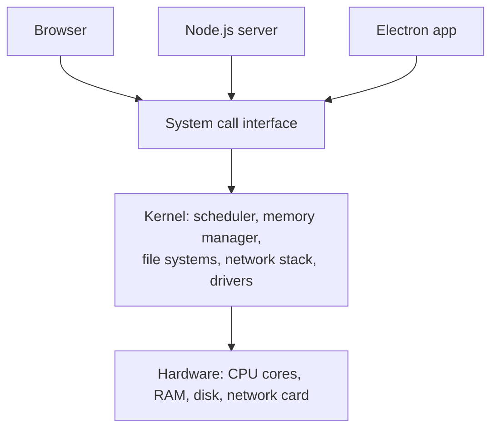
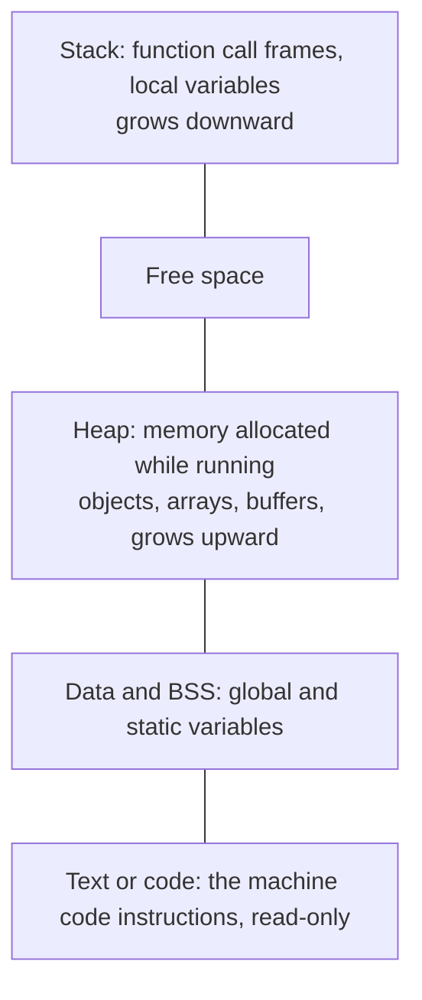
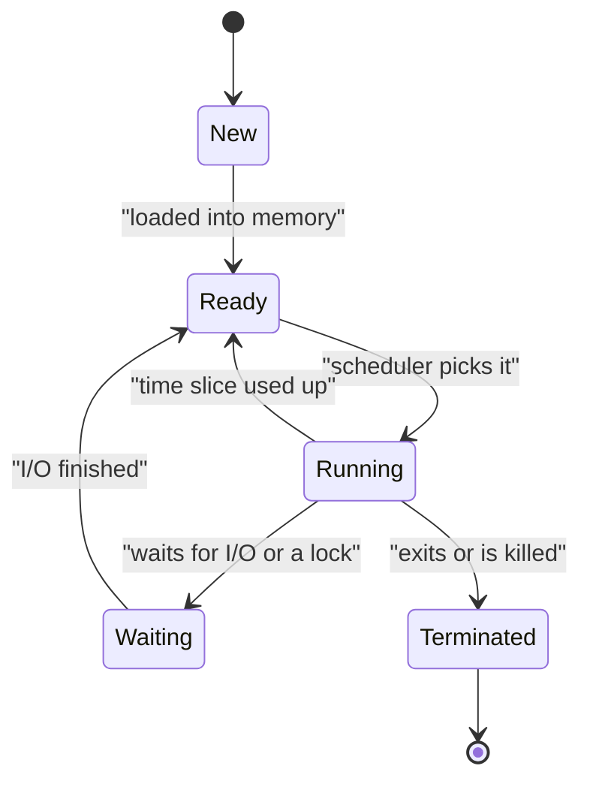
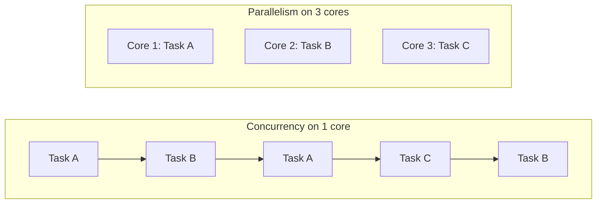

# Operating Systems: Processes, Threads and Memory

> In this document you will learn what the operating system does for your code: processes and threads, scheduling, concurrency and parallelism, race conditions and deadlocks, stack and heap, virtual memory, blocking and non-blocking I/O, inter-process communication and file descriptors. Each idea is connected to browsers, Node.js and Electron, because interviewers love questions like "How does Node.js handle many requests on one thread?" and "Process vs thread?".

**Before this:** [How programs run](01-how-programs-run.md) · **Interview questions:** [jump to the interview section](#interview-questions)

## Table of contents

1. [What an operating system does](#what-an-operating-system-does)
2. [Kernel space, user space and system calls](#kernel-space-user-space-and-system-calls)
3. [Processes](#processes)
4. [Threads](#threads)
5. [Processes vs threads](#processes-vs-threads)
6. [Context switching and scheduling](#context-switching-and-scheduling)
7. [Concurrency vs parallelism](#concurrency-vs-parallelism)
8. [Race conditions, locks and deadlocks](#race-conditions-locks-and-deadlocks)
9. [Race conditions in single-threaded JavaScript](#race-conditions-in-single-threaded-javascript)
10. [Memory: stack, heap and virtual memory](#memory-stack-heap-and-virtual-memory)
11. [Memory leaks](#memory-leaks)
12. [Blocking vs non-blocking I/O](#blocking-vs-non-blocking-io)
13. [I/O multiplexing: how Node.js handles many connections](#io-multiplexing-how-nodejs-handles-many-connections)
14. [Inter-process communication (IPC)](#inter-process-communication-ipc)
15. [File systems, file descriptors and permissions](#file-systems-file-descriptors-and-permissions)
16. [Putting it together: browsers, Node.js and Electron](#putting-it-together-browsers-nodejs-and-electron)
17. [Common mistakes](#common-mistakes)
18. [Best practices](#best-practices)
19. [Interview questions](#interview-questions)
20. [Summary](#summary)
21. [References](#references)

---

## What an operating system does

The **operating system** (OS) is the software that manages the computer's hardware and lets programs use it safely. Windows, macOS, Linux, Android and iOS are operating systems.

Without an OS, every program would need to know how to talk to every disk, network card and screen, and one buggy program could overwrite another program's memory. The OS solves this with three main jobs:

1. **Resource manager.** It shares the CPU, memory, disk and network between many programs. It decides which program runs on which CPU core and for how long.
2. **Abstraction layer.** It hides hardware details behind simple ideas: "a file", "a process", "a socket". Your code says "open `settings.json`". It does not care whether the disk is an SSD or a network drive.
3. **Protection.** It keeps programs apart. One program cannot read another program's memory or crash the whole machine.

### Analogy

The OS is like the manager of a shared office building. Companies (programs) rent offices (memory). They share the lifts, electricity and internet (CPU, disk, network). The manager decides who uses what, and a company cannot walk into another company's office.



---

## Kernel space, user space and system calls

### Two privilege levels

The CPU can run code at different **privilege levels**:

- **Kernel space (kernel mode):** the core of the OS, the **kernel**, runs here. It can do anything: talk to hardware, change any memory, stop any program.
- **User space (user mode):** normal programs run here, including your browser, Node.js and VS Code. They **cannot** touch hardware or other programs' memory directly.

This separation is why a crash in one app usually does not crash the whole computer.

### System calls

When a program needs something only the kernel can do (read a file, open a network connection, create a process, get the time), it makes a **system call** (syscall). A system call is a controlled doorway into the kernel:

1. The program puts the request (for example, "read 4096 bytes from file 7") in agreed places.
2. It runs a special CPU instruction that switches to kernel mode.
3. The kernel checks the request (Is this file open? Is the program allowed?), does the work, and puts the result back.
4. The CPU switches back to user mode, and the program continues.

Switching modes costs time, so programs try to avoid making millions of tiny system calls (for example, by reading files in big chunks).

### Example: what happens under `fs.readFile`

```js
const fs = require("node:fs");

fs.readFile(__filename, "utf8", (error, text) => {
  if (error) throw error;
  console.log(text.length > 0); // true
});
```

Your JavaScript never touches the disk. Under the hood, Node.js (through libuv) asks the kernel to **open** the file, **read** it (maybe several times, in chunks) and **close** it. On Linux you can watch these system calls with `strace node app.js`. Common system calls you will hear about: `open`, `read`, `write`, `close`, `fork`, `exec`, `mmap`, `socket`, `accept`, `epoll_wait`.

---

## Processes

### What it is

A **program** is a file on disk (for example, `node.exe` or `chrome.exe`). A **process** is a **running instance** of a program. If you open three Chrome windows and two Node.js servers, the same program files can produce many processes.

Each process gets from the OS:

- Its **own memory** (its own address space). Other processes cannot read it.
- At least one **thread** of execution (next section).
- A **process ID** (PID).
- Resources: open files, network sockets, environment variables, a current working directory.
- A security identity (which user it runs as, and what that user may do).

```js
console.log(process.pid);                 // e.g. 18452 (the ID of this Node.js process)
console.log(typeof process.ppid);         // "number" (the parent process ID)
console.log(process.platform);            // e.g. "win32", "linux" or "darwin"
console.log(Object.keys(process.memoryUsage()));
// [ 'rss', 'heapTotal', 'heapUsed', 'external', 'arrayBuffers' ]
```

### Process memory layout

The memory of a process is divided into areas. This is the classic layout (simplified):



| Area | What lives there | Size |
| --- | --- | --- |
| **Text (code)** | The program's machine code. Usually read-only, so it cannot be overwritten by accident. | Fixed |
| **Data / BSS** | Global and static variables (BSS holds the ones that start at zero) | Fixed |
| **Heap** | Memory requested while running (in C: `malloc`; in JavaScript: every object, array and closure) | Grows and shrinks |
| **Stack** | One frame per active function call: arguments, local variables, return address | Grows with call depth, limited size |

Each **thread** has its own stack. All threads in a process share the heap, code and data.

In Node.js, the V8 heap (your JavaScript objects) is part of the process heap. `process.memoryUsage().heapUsed` shows how much of it your objects use. `rss` (resident set size) shows the total memory of the process that is currently in RAM.

### Process states and lifecycle

A process moves between states while it lives:



- **Ready:** it could run, but it is waiting for a free CPU core.
- **Running:** it is running on a core right now.
- **Waiting (blocked):** it is waiting for something slow, such as a disk read or a network response. It uses **no CPU** while waiting.

### Creating processes

A process can create **child processes**. On Unix-like systems, this is classically done with `fork` (copy the current process) followed by `exec` (replace the copy with another program). Windows uses `CreateProcess`. In Node.js you use the `child_process` module:

```js
const { execFile } = require("node:child_process");

// Run another program as a separate process: here, Node.js itself, printing its version
execFile(process.execPath, ["--version"], (error, stdout) => {
  if (error) throw error;
  console.log("child printed:", stdout.trim()); // e.g. child printed: v22.20.0
});
```

### Real-world usage

- **Chrome** runs each site in its own renderer process, so one crashed tab does not take down the others.
- **Electron** apps have one main process plus one renderer process per window.
- **Node.js** servers run as a process. A process manager (PM2, systemd, Docker, Kubernetes) restarts it if it crashes.
- An Electron or Node.js app can spawn `git`, `ffmpeg` or a Python script as a child process (see [File system, child processes and native features](../08-electron-desktop/05-filesystem-child-processes-and-native-features.md)).

---

## Threads

### What it is

A **thread** is a single sequence of instructions that the CPU executes. It is the unit of work the OS **schedules** on a CPU core. Every process has at least one thread (the **main thread**). A process can create more.

All threads in a process **share the same memory** (heap, code, global data, open files). Each thread has its **own**:

- Stack (its own call stack).
- Registers, including the **instruction pointer** (which instruction it is running now).
- Thread-local storage.

### Why threads exist

1. **Parallelism:** on a CPU with 8 cores, 8 threads can truly run at the same time.
2. **Responsiveness:** one thread can wait for the disk while another keeps the user interface responsive.
3. **Cheap sharing:** threads share memory, so passing data between them is fast (no copying).

The price of sharing memory is danger: two threads can change the same data at the same time. That causes **race conditions** (covered below).

### Analogy

A process is a kitchen. Threads are the cooks in that kitchen. Cooks share the fridge, the stove and the ingredients (shared memory), so they work together quickly. But if two cooks grab the same pan at the same time, there is trouble. A second kitchen (another process) has its own fridge and cannot take ingredients from the first one.

### Threads in JavaScript environments

JavaScript itself runs your code on **one thread per JavaScript environment** (one call stack, one event loop). But the runtimes around it use many threads:

| Environment | JavaScript threads you control | Other threads |
| --- | --- | --- |
| **Browser tab** | The main thread, plus any **Web Workers** you create | Compositor and raster threads, network, timers, GPU work |
| **Node.js** | The main thread, plus any **worker threads** you create | libuv thread pool (default 4 threads), V8 helper threads for garbage collection and compilation |
| **Electron** | Main process thread, each renderer's main thread, workers | Everything Chromium and Node.js use |

You can see the hardware limit in Node.js:

```js
const os = require("node:os");
console.log(os.availableParallelism() > 0); // true (how many threads can truly run at once)
```

`os.availableParallelism()` was added in Node.js 18.14 / 19.4. On older versions, use `os.cpus().length`.

---

## Processes vs threads

| | Process | Thread |
| --- | --- | --- |
| What it is | A running program with its own resources | A sequence of execution inside a process |
| Memory | Its **own** isolated address space | **Shares** the process memory with other threads |
| Creation cost | Higher (new address space, resources) | Lower |
| Communication | Needs IPC (pipes, sockets, messages): slower, data is copied | Shared memory: fast, but needs synchronization |
| Crash impact | Usually only that process dies | A crash (or an uncaught error in some runtimes) can kill the whole process |
| Isolation and security | Strong (the OS enforces it) | Weak (any thread can read any shared memory) |
| Example | Each Chrome tab, Electron main vs renderer, a Node.js child process | Web Worker, Node.js worker thread, libuv pool thread |

**Rule of thumb:** use **processes** when you need isolation, security or crash safety. Use **threads** when you need cheap, fast sharing of data and you can handle synchronization.

---

## Context switching and scheduling

### Scheduling

A computer runs hundreds of processes and thousands of threads, but only has a few cores. The OS **scheduler** decides which thread runs on which core, and for how long.

Most modern OSes use **preemptive multitasking**: each thread gets a short **time slice** (a few milliseconds). When the slice ends, or the thread starts waiting for I/O, the OS stops it and runs another one. It happens so fast that everything seems to run at the same time.

Common scheduling ideas:

| Idea | How it works | Problem it solves or creates |
| --- | --- | --- |
| **First come, first served** | Run tasks in arrival order until they finish | Simple, but one long task makes everyone wait |
| **Round robin** | Each task gets a fixed time slice in turn | Fair and responsive |
| **Priority scheduling** | Higher priority tasks run first | Low-priority tasks can **starve** (never run) |
| **Multilevel feedback queues** | Tasks move between priority levels based on behavior; interactive tasks stay high | Used (in some form) by real OSes to balance fairness and responsiveness |

### Context switch

A **context switch** is when the CPU stops running one thread and starts running another. The OS must:

1. Save the current thread's **context**: its registers, instruction pointer and stack pointer.
2. Load the saved context of the next thread.
3. If the next thread belongs to a **different process**, also switch the memory mapping (the page tables), which makes the CPU caches and TLB (a cache of address translations) less useful.

### Why context switches are expensive

- The switch itself costs time (usually measured in microseconds), during which no useful work happens.
- After the switch, the CPU caches are full of the **old** thread's data. The new thread runs slowly until its own data is loaded again.
- Switching between **processes** costs more than switching between threads of the same process, because memory mappings change.

This is one reason why a server that creates **one thread per connection** struggles with tens of thousands of connections: lots of memory for stacks, and lots of time spent switching. Node.js and nginx use a different model, covered in [I/O multiplexing](#io-multiplexing-how-nodejs-handles-many-connections).

### Cooperative scheduling inside JavaScript

The JavaScript event loop does **not** preempt your code. A function runs until it finishes (**run-to-completion**). Other callbacks only run when the call stack is empty. This is **cooperative** scheduling: your code must give control back (by finishing, or by `await`).

The good news: no other JavaScript can interrupt your function in the middle. The bad news: a long-running function blocks everything else on that thread. In the browser, the page freezes. In Node.js, every user waits. See [The event loop](../02-javascript/16-event-loop.md).

---

## Concurrency vs parallelism

### Definitions

- **Concurrency** means **dealing with** many tasks in overlapping time periods. Tasks take turns making progress. It can happen on **one** core.
- **Parallelism** means **doing** many tasks at the **exact same moment**, on multiple cores.

Concurrency is about **structure** (how you organize many tasks). Parallelism is about **execution** (running at the same instant).

### Analogy

- **Concurrency:** one chef cooking three dishes. While the rice boils, she chops vegetables; while the sauce simmers, she plates the salad. One person, many tasks in progress.
- **Parallelism:** three chefs, each cooking one dish at the same time.



### In JavaScript

JavaScript gives you **concurrency** for I/O on one thread. While one request waits for the database, the thread handles other requests.

```js
const sleep = (ms) => new Promise((resolve) => setTimeout(resolve, ms));

const start = Date.now();
await Promise.all([sleep(200), sleep(200), sleep(200)]);
console.log(`3 waits of 200 ms took ${Date.now() - start} ms`); // about 200 ms, not 600
```

(Run this as an ES module, for example a `.mjs` file, because it uses top-level `await`.)

The three waits overlap, because waiting does not use the thread. But `Promise.all` does **not** make CPU work parallel:

```js
function cpuWork() {
  let x = 0;
  for (let i = 0; i < 2e8; i++) x += i;
  return x;
}

let start = Date.now();
cpuWork();
const oneTask = Date.now() - start;

start = Date.now();
await Promise.all([1, 2, 3].map(async () => cpuWork()));
console.log(`one: ${oneTask} ms, three in Promise.all: ${Date.now() - start} ms`);
// Example run: one: 424 ms, three in Promise.all: 1288 ms (about 3x: no parallelism)
```

The `async` functions still run one after another on the same thread. For **parallel CPU work** you need more threads or processes: **Web Workers** in the browser, **worker threads** or **child processes** in Node.js.

### I/O-bound vs CPU-bound

| | I/O-bound task | CPU-bound task |
| --- | --- | --- |
| Spends most time | Waiting for disk, network, database | Calculating |
| Examples | API calls, database queries, reading files | Image resizing, hashing passwords, parsing a huge JSON, compression |
| What helps | Concurrency (async I/O, event loop) | Parallelism (workers, more processes, more cores) |
| Node.js fit | Excellent | Needs worker threads or a separate service |

---
