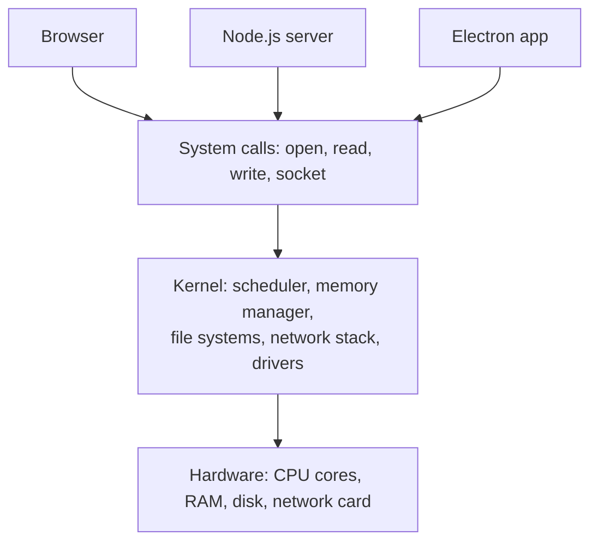
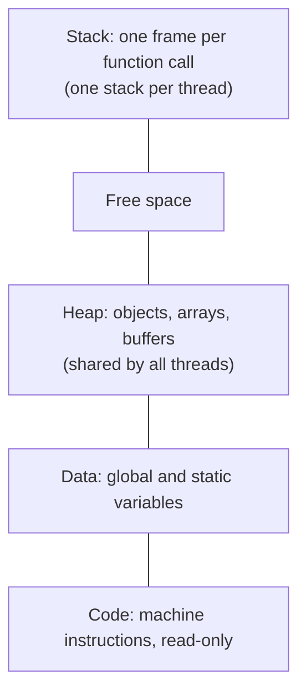
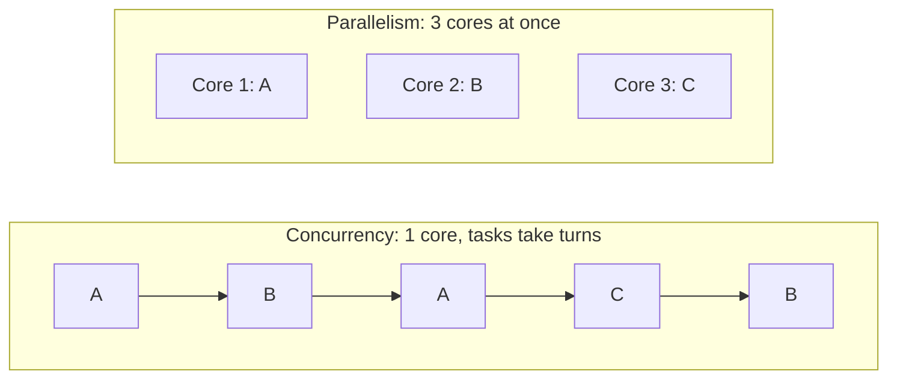
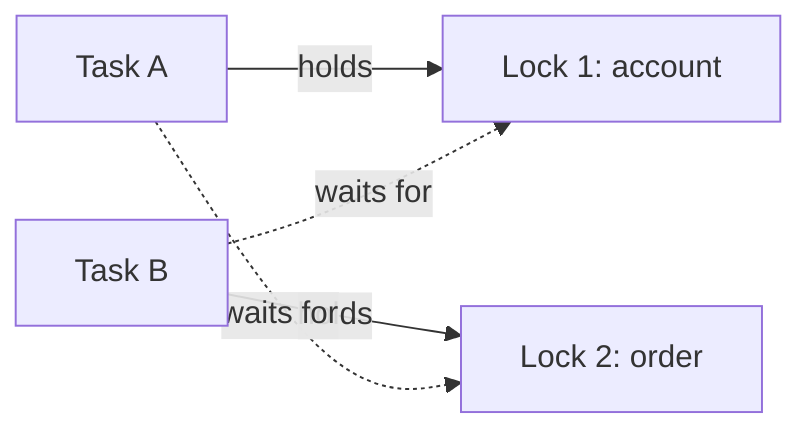
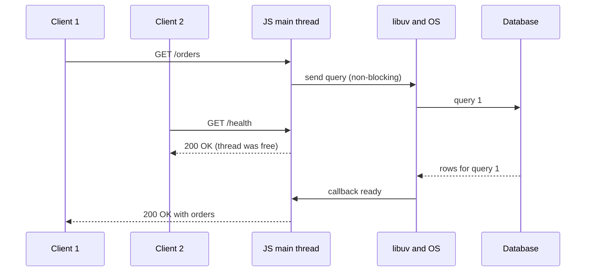

# Operating Systems: Processes, Threads and Memory

> In this document you will learn the operating-system ideas that sit under every browser, Node.js server and Electron app: processes and threads, context switching, concurrency vs parallelism, race conditions and deadlocks, stack vs heap, blocking vs non-blocking I/O, and how processes talk to each other. These ideas explain answers to classic interview questions such as "Process vs thread?" and "How does Node.js handle many requests on one thread?".

**Before this:** [How programs run](01-how-programs-run.md) · **Interview questions:** [jump to the interview section](#interview-questions)

## Table of contents

1. [What an operating system does](#what-an-operating-system-does)
2. [Processes](#processes)
3. [Threads](#threads)
4. [Processes vs threads](#processes-vs-threads)
5. [Context switching and scheduling](#context-switching-and-scheduling)
6. [Concurrency vs parallelism](#concurrency-vs-parallelism)
7. [Race conditions, locks and deadlocks](#race-conditions-locks-and-deadlocks)
8. [Race conditions in single-threaded JavaScript](#race-conditions-in-single-threaded-javascript)
9. [Memory: stack, heap and virtual memory](#memory-stack-heap-and-virtual-memory)
10. [Blocking vs non-blocking I/O](#blocking-vs-non-blocking-io)
11. [Inter-process communication (IPC)](#inter-process-communication-ipc)
12. [Files and file descriptors](#files-and-file-descriptors)
13. [Interview questions](#interview-questions)
14. [Summary](#summary)
15. [References](#references)

---

## What an operating system does

The **operating system** (OS) manages the hardware and lets many programs share it safely. It **shares resources** (CPU cores, memory), **hides hardware details** (your code opens "a file", not "sector 812 of an SSD") and **protects programs from each other**.

The core of the OS is the **kernel**. It runs in **kernel mode** and can do anything. Normal programs (browser, Node.js) run in **user mode** and cannot touch hardware directly. To get help (read a file, open a socket, start a process), a program makes a **system call**: a controlled doorway into the kernel.



Example: `fs.readFile("data.json")` never touches the disk itself. Node.js (through its C library **libuv**) asks the kernel to `open`, `read` and `close` the file.

---

## Processes

### What it is

A **program** is a file on disk, such as `node.exe`. A **process** is a **running instance** of a program. Two Node.js servers started from the same `node.exe` are two processes.

Each process gets from the OS:

- Its **own private memory** (address space). Other processes cannot read it.
- At least one **thread** (the main thread).
- A **process ID** (PID).
- Resources: open files, sockets, environment variables, a working directory.

```js
console.log(process.pid);      // e.g. 18452 (this Node.js process)
console.log(process.platform); // e.g. "win32", "linux" or "darwin"
console.log(Object.keys(process.memoryUsage()));
// [ 'rss', 'heapTotal', 'heapUsed', 'external', 'arrayBuffers' ]
```

### Process memory layout



The stack and heap are explained [below](#memory-stack-heap-and-virtual-memory). A process (or thread) is **running** (on a core), **ready** (waiting for a free core) or **waiting/blocked** (waiting for disk or network, using no CPU).

Real examples: Chrome runs sites in separate renderer processes, so one crashed tab does not kill the others (see [Browser architecture and rendering](07-browser-architecture-and-rendering.md)). Electron has one main process and one renderer process per window (see [Electron architecture and process model](../08-electron-desktop/01-electron-architecture-and-process-model.md)). A Node.js server is one process that PM2, Docker or Kubernetes restarts if it crashes.

---

## Threads

### What it is

A **thread** is one sequence of instructions that the CPU runs. The OS schedules **threads** onto CPU cores. Every process has at least one thread, and it can create more.

All threads in a process **share** the heap, code, globals and open files. Each thread has its **own** stack and its own CPU registers (including "which instruction am I on").

Threads exist for **parallelism** (8 cores can run 8 threads at once), **responsiveness** (one thread waits for the disk while another keeps the UI alive) and **cheap sharing** of data. The price: two threads can change the same data at once, which causes **race conditions**.

**Analogy:** a process is a kitchen. Threads are cooks in that kitchen. Cooks share the fridge and the stove (shared memory), so they work together quickly. But if two cooks grab the same pan at once, there is trouble. Another kitchen (another process) has its own fridge and cannot take ingredients from the first one.

### Threads in JavaScript environments

JavaScript runs your code on **one thread per environment**: one call stack, one event loop. But the runtimes use more threads around it:

| Environment | Threads that run your JavaScript | Other threads |
| --- | --- | --- |
| Browser tab | Main thread, plus any **Web Workers** you create | Compositor, raster, network and GPU work |
| Node.js | Main thread, plus any **worker threads** you create | libuv thread pool (4 threads by default), V8 helper threads for garbage collection and compiling |
| Electron | Main process thread, each renderer's main thread, workers | Everything Chromium and Node.js use |

Worker threads, child processes and `cluster` in Node.js are covered in [Concurrency: worker threads and cluster](../07-nodejs-backend/12-concurrency-worker-threads-and-cluster.md).

---

## Processes vs threads

| | Process | Thread |
| --- | --- | --- |
| What it is | A running program with its own resources | A path of execution inside a process |
| Memory | Own, isolated | Shared with other threads of the same process |
| Cost to create | Higher | Lower |
| Communication | IPC (pipes, sockets, messages); data is copied | Shared memory; fast, but needs synchronization |
| If it crashes | Usually only that process dies | Can take down the whole process |
| Isolation and security | Strong (enforced by the OS) | Weak |
| Examples | Chrome tab, Electron main vs renderer, Node.js child process | Web Worker, Node.js worker thread, libuv pool thread |

**Rule of thumb:** use processes for **isolation and crash safety**. Use threads for **fast sharing of data** when you can handle synchronization.

---

## Context switching and scheduling

The OS **scheduler** decides which thread runs on which core. Modern OSes are **preemptive**: each thread gets a short **time slice** (a few milliseconds), then the OS pauses it and runs another one. It also switches when a thread starts waiting for I/O.

A **context switch** is that change: the OS saves the current thread's registers, instruction pointer and stack pointer, and loads the next thread's saved state. If the next thread is in **another process**, it also switches the memory mapping.

It is expensive because the switch itself does no useful work, and afterwards the CPU caches still hold the old thread's data, so the new thread starts slowly. Process switches cost more than thread switches. This is one reason "one thread per connection" servers struggle with tens of thousands of connections, and why Node.js uses a [different model](#blocking-vs-non-blocking-io).

**JavaScript is cooperative, not preemptive.** The event loop never interrupts your function: it runs to completion, and other callbacks run only when the call stack is empty. A function that runs for 2 seconds freezes the page or makes every Node.js user wait. See [The event loop](../02-javascript/16-event-loop.md).

---

## Concurrency vs parallelism

- **Concurrency:** **dealing with** many tasks in overlapping time. Tasks take turns making progress. It works on **one** core.
- **Parallelism:** **doing** many tasks at the **same moment**, on several cores.

**Analogy:** concurrency is one chef cooking three dishes (while the rice boils, she chops vegetables). Parallelism is three chefs, each cooking one dish at the same time.



### In JavaScript

JavaScript gives you **concurrency** for I/O on one thread. Waiting does not use the thread, so waits overlap:

```js
// Save as demo.mjs (top-level await needs an ES module)
const sleep = (ms) => new Promise((resolve) => setTimeout(resolve, ms));

let start = Date.now();
await Promise.all([sleep(200), sleep(200), sleep(200)]);
console.log(`3 waits: ${Date.now() - start} ms`); // about 200 ms, not 600
```

But `Promise.all` does **not** make CPU work parallel:

```js
function cpuWork() {
  let x = 0;
  for (let i = 0; i < 2e8; i++) x += i;
  return x;
}

start = Date.now();
cpuWork();
const oneTask = Date.now() - start;

start = Date.now();
await Promise.all([1, 2, 3].map(async () => cpuWork()));
console.log(`one task: ${oneTask} ms, three tasks: ${Date.now() - start} ms`);
// Roughly 3x one task (exact numbers vary): the async functions still run one after another
```

So **I/O-bound** work (API calls, queries, file reads) benefits from concurrency, while **CPU-bound** work (image resizing, password hashing, parsing huge JSON) needs parallelism: Web Workers in the browser, worker threads or child processes in Node.js.

---

## Race conditions, locks and deadlocks

### Race condition

A **race condition** is a bug where the result depends on the **timing** of two or more tasks that use the same data.

The classic example: two threads run `counter++` at the same time. `counter++` is really three steps: **read**, **add 1**, **write**.

| Step | Thread A | Thread B | counter in memory |
| --- | --- | --- | --- |
| 1 | reads 5 | | 5 |
| 2 | | reads 5 | 5 |
| 3 | writes 6 | | 6 |
| 4 | | writes 6 | 6 |

Two increments happened, but the counter only went up by one. This is a **lost update**.

This really happens in JavaScript when two worker threads share memory through a `SharedArrayBuffer`. In a test where two Node.js workers each ran `counter[0]++` one million times, the final value was often around 1.3–1.4 million instead of 2 million (it varies per run). With `Atomics.add(counter, 0, 1)` it was always exactly 2 million.

### How to prevent races

- **Mutex (lock):** only one thread may enter a **critical section** (the code that touches shared data) at a time. Others wait.
- **Semaphore:** like a mutex, but allows up to N holders (for example, "at most 5 database connections").
- **Atomic operations:** the hardware does read-modify-write as one indivisible step (`Atomics.add` in JavaScript).
- **Avoid sharing:** give each thread its own data and send **messages** instead (`postMessage`). This is the default model in JavaScript workers.

### Deadlock

A **deadlock** happens when tasks wait for each other forever. Task A holds lock 1 and waits for lock 2. Task B holds lock 2 and waits for lock 1. Nobody can continue.



A deadlock needs **all four** of these conditions (the Coffman conditions):

1. **Mutual exclusion:** a resource can be held by only one task.
2. **Hold and wait:** a task holds one resource while waiting for another.
3. **No preemption:** nobody can take a resource away from a task.
4. **Circular wait:** a cycle of tasks, each waiting for the next.

Break **any one** condition and deadlock is impossible. The most practical fix is to **always take locks in the same order** (this breaks circular wait). Others: lock timeouts, or taking all locks at once.

Deadlocks are not only a thread problem. Two database transactions that update the same rows in opposite order can deadlock. Databases detect this and abort one transaction, so your backend must be ready to **retry**.

Related problems: **starvation** (a task never gets a turn because others always win) and **livelock** (tasks keep reacting to each other but make no progress).

---

## Race conditions in single-threaded JavaScript

Ordinary JavaScript objects cannot have **data races**: only one piece of your code runs at a time on a thread, and nothing interrupts it in the middle. But JavaScript **can** have **async race conditions**. Every `await` is a point where other code can run before your function continues.

### Example 1: lost update across `await`

```js
// Save as buy.mjs
const sleep = (ms) => new Promise((resolve) => setTimeout(resolve, ms));

let stock = 1; // pretend this lives in a database
async function getStock() { await sleep(10); return stock; }
async function saveStock(value) { await sleep(10); stock = value; }

async function buy(user) {
  const current = await getStock();    // 1. read
  if (current > 0) {
    await saveStock(current - 1);      // 2. write (other code ran in between!)
    console.log(`${user} bought the last item`);
  } else {
    console.log(`${user}: sold out`);
  }
}

await Promise.all([buy("Asha"), buy("Ravi")]);
console.log("stock:", stock);
// Asha bought the last item
// Ravi bought the last item   ❌ we sold one item twice
// stock: 0
```

Step by step:

1. `buy("Asha")` starts, reaches `await getStock()` and pauses.
2. `buy("Ravi")` starts, reaches `await getStock()` and pauses.
3. Both reads finish. Both see `stock = 1`.
4. Both pass the `if` and both save `0`. Two people bought one item.

The bug is the **read-modify-write across an `await`**: the same shape as `counter++` with threads.

**Fix A (one process): serialize the critical section with an async mutex.**

```js
class Mutex {
  #tail = Promise.resolve();
  runExclusive(task) {
    const result = this.#tail.then(() => task());
    this.#tail = result.catch(() => {}); // keep the chain going after errors
    return result;
  }
}

stock = 1;
const stockLock = new Mutex();
await Promise.all([
  stockLock.runExclusive(() => buy("Asha")),
  stockLock.runExclusive(() => buy("Ravi")),
]);
// Asha bought the last item
// Ravi: sold out ✅
```

**Fix B (the real fix for servers): make the update atomic in the database.** An in-memory mutex does not help when you run several Node.js processes. Let the database do the check and the update in one statement:

```text
UPDATE products SET stock = stock - 1 WHERE id = 42 AND stock > 0;
-- if 0 rows were updated, the item is sold out
```

### Example 2: stale responses in a search box

The user types "a", then "an". Two requests go out. The answer for "a" is slower and arrives **last**, so it overwrites the correct results for "an".

```js
const sleep = (ms) => new Promise((resolve) => setTimeout(resolve, ms));
const delays = { a: 300, an: 100 };
const fakeSearch = (query) => sleep(delays[query]).then(() => [`results for "${query}"`]);

let shown = null;
let latestRequestId = 0;

async function onInput(query) {
  const requestId = ++latestRequestId;
  const results = await fakeSearch(query);
  if (requestId !== latestRequestId) return; // ✅ ignore answers to old queries
  shown = results;
}

onInput("a");
onInput("an");
await sleep(400);
console.log(shown); // [ 'results for "an"' ]  (without the check: 'results for "a"')
```

Other fixes: cancel the old request with `AbortController`, or in Angular use RxJS `switchMap`, which unsubscribes from the previous request automatically (see [RxJS](../06-angular-16/09-rxjs.md)).

Deadlock is possible in JavaScript too: two async tasks that take two async locks in opposite order wait forever, and no error is thrown. The fix is the same as with threads: always take locks in the same order.

---

## Memory: stack, heap and virtual memory

The **stack** holds one **frame** per active function call (arguments, local variables, return address), last in, first out. Allocating is just moving a pointer, and a frame disappears when the function returns. It is small: V8 limits the JavaScript stack to about 1 MB by default, so too many nested calls cause a **stack overflow** (`RangeError: Maximum call stack size exceeded`, see [Recursion and stack overflow](01-how-programs-run.md#recursion-and-stack-overflow)).

The **heap** holds data whose size or lifetime is not known in advance: objects, arrays, strings, closures, buffers. It is large, slower to allocate, shared by all threads (which is why threads need locks) and must be freed: with `free()` in C, or by a **garbage collector** in JavaScript, Java and C#.

| | Stack | Heap |
| --- | --- | --- |
| Stores | Call frames, local values | Objects, arrays, dynamic data |
| Lifetime | Ends when the function returns | Until no longer referenced (or freed) |
| Size | Small, fixed limit | Large, grows |
| Speed | Very fast | Slower |
| Shared between threads | No | Yes |
| Typical error | Stack overflow | Out of memory, memory leaks |

In JavaScript, objects live in the heap and variables hold **references** to them (where primitives live is an engine detail).

### Virtual memory (short)

Each process sees its **own** large, private address space. This is **virtual memory**. The OS splits memory into **pages** (commonly 4 KB) and the CPU translates virtual addresses to real RAM with **page tables**. A page that is not in RAM causes a **page fault**, and the OS loads it (maybe from disk, called **swap**, which is slow). The big benefit is **isolation**: process A cannot even name process B's memory. Browser tab isolation and Electron's process separation are built on this.

**Memory leaks:** in JavaScript, a leak means objects that are still **reachable**, so the garbage collector cannot free them: a global `Map` cache that only grows, listeners added again and again, forgotten timers or subscriptions. In Node.js it ends with `JavaScript heap out of memory`. See [Memory management and garbage collection](../02-javascript/19-memory-management-and-garbage-collection.md).

---

## Blocking vs non-blocking I/O

**I/O** (input/output) is work with the outside world: disk, network, database. It is very slow compared to the CPU. Two separate ideas:

- **Blocking vs non-blocking:** does the call make the thread **wait** until the I/O is done?
- **Synchronous vs asynchronous:** do you get the result **right away** as the return value, or **later** through a callback, promise or event?

| | What happens | Example |
| --- | --- | --- |
| **Blocking, synchronous** | The thread stops until the data arrives, then the call returns it | `fs.readFileSync()` |
| **Non-blocking** | The call returns immediately, possibly with "not ready yet", and you check again later | A non-blocking socket read at OS level |
| **Asynchronous** | You start the operation and get notified when it is done; the thread does other work meanwhile | `fs.readFile(cb)`, `fetch()`, `await fs.promises.readFile()` |

### Why blocking hurts on one thread

```js
const start = Date.now();
setTimeout(() => {
  console.log(`timer fired after ${Date.now() - start} ms`);
}, 100);

const end = Date.now() + 500;
while (Date.now() < end) {
  // busy loop: blocks the only JavaScript thread for 500 ms
}
console.log("loop finished");
// loop finished
// timer fired after 50x ms (not 100: the thread was busy)
```

`readFileSync` or a heavy loop inside a request handler has the same effect: **every** other request waits.

### I/O multiplexing: one thread, many connections

How can one thread serve 10,000 open connections? With **I/O multiplexing**: the program asks the OS "here are 10,000 sockets; wake me up when **any** of them is ready." Linux provides `epoll`, macOS and BSD provide `kqueue`, and Windows provides IOCP (I/O completion ports).

**libuv**, the C library inside Node.js, wraps these in one API and runs the **event loop** on top of them. Node.js starts a network operation, the JavaScript thread continues with other work, and when the OS reports "this socket has data", the event loop runs your callback (or resolves your promise).

Some work has no good non-blocking OS API (most file system operations, `dns.lookup`, some `crypto` and `zlib` functions). libuv runs those on a small **thread pool** (4 threads by default, `UV_THREADPOOL_SIZE` can change it).



While the database works on client 1's query, the same thread answers client 2. So Node.js is excellent for **I/O-bound** servers and weak for **CPU-bound** work on the main thread. Details are in [Node.js runtime and architecture](../07-nodejs-backend/01-nodejs-runtime-and-architecture.md) and [The Node.js event loop](../07-nodejs-backend/02-node-event-loop.md).

---

## Inter-process communication (IPC)

Processes do not share memory, so they need **IPC** (inter-process communication) to work together.

| Mechanism | How it works | Where you see it |
| --- | --- | --- |
| **Pipes** | A one-way byte stream from one process to another | Shell `cat log.txt \| grep error`, a child process's `stdin`/`stdout` |
| **Sockets** | Two-way byte streams. TCP sockets work across machines; Unix domain sockets (named pipes on Windows) work on one machine | HTTP, databases, the Docker CLI talking to the Docker daemon |
| **Message passing** | Structured messages (copied or serialized) over a channel | `postMessage` for Web Workers, Node.js `process.send`, Electron IPC |
| **Shared memory** | Several processes or threads map the same memory | `SharedArrayBuffer` between workers (needs `Atomics`) |
| **Signals** | Tiny notifications from the OS or another process | `SIGINT` (Ctrl+C), `SIGTERM` (please shut down) |

In Node.js, `child_process.spawn()` connects to a child process through **pipes** (`child.stdin`, `child.stdout`), and `child_process.fork()` adds a **message channel** (`child.send(message)` and `process.on("message", ...)`).

```js
import { spawn } from "node:child_process";

// Child process (Node.js itself) that upper-cases what it reads from its stdin pipe
const child = spawn(process.execPath, ["-e", "process.stdin.on('data', d => process.stdout.write(String(d).toUpperCase()))"]);
child.stdout.on("data", (data) => console.log("child said:", String(data).trim())); // child said: HELLO
child.stdin.end("hello\n");
```

### Electron IPC

Electron is a multi-process app, so the renderer (web page) and the main process (Node.js) talk through IPC. With secure defaults the page cannot use Node.js. A preload script exposes a few safe functions with `contextBridge`, they call `ipcRenderer.invoke("settings:save", data)`, and the main process answers with `ipcMain.handle(...)` after validating the data. Details are in [IPC and preload scripts](../08-electron-desktop/03-ipc-and-preload-scripts.md).

**Signals:** when Docker or Kubernetes stops a container, it sends `SIGTERM` and later kills the process. A Node.js server should listen for it (`process.on("SIGTERM", ...)`), stop accepting new requests, finish the open ones and exit. See [Production Node.js](../07-nodejs-backend/14-production-nodejs.md).

---

## Files and file descriptors

When a process opens a file, socket or pipe, the kernel gives it a small integer handle called a **file descriptor** (on Windows: a **handle**). Every later `read` or `write` uses that number. By convention, `0` is standard input, `1` is standard output and `2` is standard error.

In Node.js, `fs.openSync("notes.txt", "w")` returns such a number, and you must release it with `fs.closeSync(fd)`. Each process has a **limit** on open descriptors (often 1024 by default on Linux, see `ulimit -n`). Forgetting to close files or sockets ends in **`EMFILE: too many open files`**.

**Permissions:** on Linux and macOS, each file has read, write and execute bits for owner, group and others (`chmod 644`: owner reads and writes, others only read). Windows uses access control lists. A process can only do what its **user** may do, so do not run servers or Electron apps as administrator.

---

## Interview questions

### How to explain "process vs thread" in an interview

1. **Define it:** "A process is a running program with its own memory. A thread is a path of execution inside a process; threads of one process share its memory."
2. **Why it exists:** "Processes give isolation and crash safety. Threads give cheap parallel work on shared data."
3. **How it works:** "The OS gives each process its own address space and schedules threads onto CPU cores. Each thread has its own stack but shares the heap."
4. **Small example:** "Each Chrome tab is a separate process, so one crashing tab doesn't kill the browser. Node.js worker threads run inside one process."
5. **Where it is useful:** "Electron main vs renderer processes, child processes for tools like ffmpeg, worker threads for CPU work."
6. **Trade-offs / gotchas:** "Processes cost more memory and need IPC. Threads share memory, so they need locks or atomics."

### Q1. What is the difference between a process and a thread?

**What the interviewer is checking:** Memory sharing, isolation, cost, and real examples.

**Short spoken answer (30–60 seconds):**
> A process is a running instance of a program. The OS gives it private memory, resources like open files, and at least one thread. A thread is what the OS actually schedules on a core. Threads in one process share the heap and globals, but each has its own stack and registers. So threads are cheaper and share data fast, but they need synchronization, and one bad thread can bring down the whole process. Processes are isolated and safer, but they talk through IPC. That's why Chrome puts sites in separate processes, and why Node.js uses worker threads for CPU work inside one process.

**Follow-up questions:**
- **Is JavaScript single-threaded?** — Your code runs on one thread per environment (one call stack, one event loop). The runtime uses other threads for I/O, garbage collection and rendering, and you can create Web Workers or worker threads, each with its own event loop.
- **Do Node.js worker threads share memory?** — Not by default: `postMessage` copies data. They can share memory explicitly with `SharedArrayBuffer`.

**Common mistakes:** Saying threads have separate memory. Saying "Node.js has only one thread in total".

**Where this is used in real projects:** Chrome and Electron process models, `child_process` vs `worker_threads` in Node.js.

### Q2. What is a context switch, and why is it expensive?

**What the interviewer is checking:** How scheduling works, and why thread-per-connection does not scale.

**Short spoken answer (30–60 seconds):**
> A context switch is when the OS stops one thread and starts another on the same core. It saves the old thread's registers, instruction pointer and stack pointer and loads the new thread's, and if the new thread is in another process it also switches the memory mapping. It's expensive because no useful work happens during the switch, and afterwards the CPU caches hold the wrong data, so the new thread starts slowly. With thousands of threads, a server spends a lot of time switching, which is one reason event-loop servers like Node.js and nginx use few threads.

**Follow-up questions:**
- **Preemptive vs cooperative scheduling?** — Preemptive: the OS can interrupt a thread at any time. Cooperative: a task runs until it gives up control. The JavaScript event loop is cooperative: your function runs to completion.

**Common mistakes:** Thinking switches are free. Calling `await` an OS context switch.

**Where this is used in real projects:** Server design and sizing thread pools.

### Q3. What is the difference between concurrency and parallelism?

**What the interviewer is checking:** A precise distinction, applied to JavaScript.

**Short spoken answer (30–60 seconds):**
> Concurrency is dealing with many tasks in overlapping time: they take turns, even on one core. Parallelism is doing several tasks at the same moment on different cores. JavaScript gives me concurrency on one thread: while one request waits for the database, the event loop handles others. So Promise.all with three network calls takes about as long as the slowest one. But Promise.all with three CPU-heavy functions takes three times as long, because they still run one after another. For real parallelism I need Web Workers, worker threads or more processes.

**Follow-up questions:**
- **How do you use all CPU cores in Node.js?** — Several processes (`cluster`, PM2, containers) for request handling, and worker threads for CPU-heavy jobs. See [Concurrency: worker threads and cluster](../07-nodejs-backend/12-concurrency-worker-threads-and-cluster.md).

**Common mistakes:** Saying `Promise.all` runs code in parallel. Saying async means multi-threaded.

**Where this is used in real projects:** Parallel API calls, offloading image processing to a worker, scaling Node.js across cores.

### Q4. What is a race condition? Can JavaScript have one if it is single-threaded?

**What the interviewer is checking:** The general idea and its async form in JavaScript.

**Short spoken answer (30–60 seconds):**
> A race condition is a bug where the result depends on the timing of tasks that touch the same data. The classic case is two threads doing counter plus plus: both read 5, both write 6, and one update is lost. Plain JavaScript can't have that data race on normal objects, because nothing interrupts running code. But it has async race conditions, because every await lets other code run. Two requests both read stock equals 1 and both sell the item, or an old slow search response arrives after a newer one and overwrites it. I fix these with an atomic update in the database, a lock that serializes the critical section, or by cancelling or ignoring stale requests, like switchMap in RxJS.

**Code or diagram:** See [Race conditions in single-threaded JavaScript](#race-conditions-in-single-threaded-javascript).

**Follow-up questions:**
- **Can JavaScript have true data races?** — Yes, with `SharedArrayBuffer` shared between workers. Use `Atomics`.
- **Does an in-memory mutex fix the stock bug in production?** — Only inside one process. With several servers, use an atomic database update, a transaction, or a distributed lock.

**Common mistakes:** "JavaScript is single-threaded, so race conditions are impossible."

**Where this is used in real projects:** Checkout and inventory, double form submits, autocomplete, two requests refreshing an auth token at once.

### Q5. What does this print?

```js
// Save as counter.mjs
const sleep = (ms) => new Promise((resolve) => setTimeout(resolve, ms));
let likes = 0;

async function addLike() {
  const current = likes;
  await sleep(10);
  likes = current + 1;
}

await Promise.all([addLike(), addLike(), addLike()]);
console.log(likes);
```

**Answer:**

```text
1
```

**Step by step:**
1. All three calls start at once. Each reads `likes` (0) into `current` and pauses at `await`.
2. After 10 ms, each one writes `0 + 1`. The last write wins, and two updates are lost.

Fix: do not split the read and the write around an `await` (do `likes++` after the await), serialize the calls, or let the server do an atomic increment.

### Q6. What is a deadlock? How do you prevent it?

**What the interviewer is checking:** The four conditions and a practical fix.

**Short spoken answer (30–60 seconds):**
> A deadlock is when tasks wait for each other forever: A holds lock 1 and waits for lock 2, while B holds lock 2 and waits for lock 1. It needs four conditions together: mutual exclusion, hold and wait, no preemption, and circular wait. Break any one and it can't happen. The practical fix is to always take locks in the same order, which breaks circular wait, plus timeouts. In backend work I see it mostly in databases, when two transactions update the same rows in opposite order; the database aborts one, so the code should retry.

**Follow-up questions:**
- **Deadlock vs starvation vs livelock?** — Deadlock: everyone waits forever. Starvation: one task never gets a turn. Livelock: tasks stay busy reacting to each other but make no progress.
- **Can async JavaScript deadlock?** — Yes, with async locks taken in opposite orders. Nothing throws; the promises just never settle.

**Common mistakes:** Naming only "circular wait". No practical prevention strategy.

**Where this is used in real projects:** Database transactions, connection pools, file locks.

### Q7. What is the difference between the stack and the heap?

**What the interviewer is checking:** Lifetime, size, speed, and the link to JavaScript errors.

**Short spoken answer (30–60 seconds):**
> The stack holds one frame per active function call, with arguments, local variables and the return address. It's very fast, freed automatically when the function returns, small, and each thread has its own, so very deep recursion causes a stack overflow. The heap is a large area for data with a dynamic size or lifetime, like objects, arrays and closures. It's shared by all threads and must be freed, in JavaScript by the garbage collector. Objects live on the heap and variables hold references, which is why two variables can point to the same object. Stack problems are stack overflows; heap problems are leaks and out-of-memory errors.

**Follow-up questions:**
- **What causes "JavaScript heap out of memory"?** — Too much reachable data: a leak (growing caches, listeners, timers) or loading huge data at once. Use heap snapshots to find it and streams for big data.
- **What is virtual memory?** — Each process sees its own private address space, mapped to real RAM page by page. It isolates processes.

**Common mistakes:** "Primitives always live on the stack" as a strict rule (the engine decides). Forgetting that each thread has its own stack.

**Where this is used in real projects:** Debugging stack overflows and memory leaks in long-running Node.js servers and SPAs.

### Q8. What is the difference between blocking and non-blocking I/O, and between synchronous and asynchronous?

**What the interviewer is checking:** That these are two different ideas, and how Node.js uses them.

**Short spoken answer (30–60 seconds):**
> Blocking versus non-blocking is about whether the call makes the thread wait. Synchronous versus asynchronous is about how I get the result: as the return value now, or later through a callback, promise or event. In Node.js, readFileSync is blocking and synchronous, and it freezes the only JavaScript thread, so in a server every user waits. fs.promises.readFile and fetch are asynchronous: the thread keeps working and the event loop resumes my code when the result is ready. Under the hood, libuv uses non-blocking OS mechanisms like epoll, kqueue or IOCP for network I/O, and a thread pool for file system work.

**Follow-up questions:**
- **Is `readFileSync` ever fine?** — Yes, at startup or in CLI scripts. Not inside request handlers.
- **Is an `async` function automatically non-blocking?** — No. A heavy loop inside it still blocks the thread.

**Common mistakes:** Treating "async" and "non-blocking" as the same thing. Sync APIs in request handlers.

**Where this is used in real projects:** Node.js API servers and the Electron main process (blocking it freezes every window).

### Q9. How does Node.js handle thousands of requests on one thread?

**What the interviewer is checking:** I/O multiplexing, the event loop, the thread pool, and the limits.

**Short spoken answer (30–60 seconds):**
> Most server work is waiting for the database, other APIs or the disk, and Node.js never makes its JavaScript thread wait for that. It starts the I/O without blocking and moves on to other requests. libuv asks the OS to watch all open sockets at once, with epoll, kqueue or IOCP, and when one is ready, the event loop runs the matching callback. File system work and a few CPU-heavy functions like pbkdf2 run on libuv's thread pool, four threads by default. So one thread can hold thousands of connections, because waiting costs almost nothing. The limit is CPU work: a heavy loop blocks everyone, so that goes to worker threads.

**Code or diagram:** See the sequence diagram in [I/O multiplexing](#io-multiplexing-one-thread-many-connections).

**Follow-up questions:**
- **Which operations use the libuv thread pool?** — Most `fs` operations, `dns.lookup`, and some `crypto` (`pbkdf2`, `scrypt`, async `randomBytes`) and `zlib` functions. Network sockets do not.
- **What if you start 5 `pbkdf2` calls at once?** — With 4 pool threads, four run in parallel and the fifth waits (in a test: four finished near 500 ms, the fifth near 970 ms). `UV_THREADPOOL_SIZE` changes the pool size.

**Common mistakes:** "Node.js creates a thread per request." "Single-threaded means slow."

**Where this is used in real projects:** API gateways, BFFs for Angular apps, WebSocket servers.

### Q10. What are the common ways processes communicate? How does Electron use IPC?

**What the interviewer is checking:** IPC mechanisms and their secure use in Electron.

**Short spoken answer (30–60 seconds):**
> Processes don't share memory, so they communicate through the OS. Pipes are one-way byte streams, like a child process's stdin and stdout. Sockets are two-way streams, TCP across machines or Unix sockets and named pipes locally. Message passing sends copied, structured messages, like process.send, postMessage or Electron IPC. Shared memory is fastest but needs synchronization, and signals like SIGTERM are small notifications. In Electron the renderer has no Node.js access, so a preload script exposes a few functions through contextBridge that call ipcRenderer.invoke, and the main process handles them with ipcMain.handle and validates every input, because the renderer is not trusted.

**Follow-up questions:**
- **Why prefer message passing to shared memory?** — No locks and no data races. The cost is copying data.
- **Why validate IPC in Electron's main process?** — A compromised renderer (for example, via XSS) can send any message, and the main process has full system access. See [Electron architecture and process model](../08-electron-desktop/01-electron-architecture-and-process-model.md).

**Common mistakes:** Exposing the whole `ipcRenderer` to the page. Turning on `nodeIntegration` to avoid IPC.

**Where this is used in real projects:** Electron apps, Node.js child processes (`git`, `ffmpeg`), services talking over sockets, graceful shutdown on `SIGTERM`.

### Q11. Your Node.js server crashes after some hours with "EMFILE: too many open files". What is happening?

**Short answer:** Every open file, socket or pipe uses a file descriptor, and each process has a limit (often 1024 on Linux). EMFILE means the process hit it. Usually it is a leak: files not closed on an error path, connections not released, or thousands of files opened at once with one giant `Promise.all`. Check open descriptors (for example with `lsof`), close resources in `finally` or use streams with `pipeline`, and limit concurrency (for example, 50 files at a time). Raise the limit with `ulimit` only after fixing leaks.

---

## Summary

- The OS shares hardware, hides hardware details and isolates programs. Programs ask the kernel for help through system calls.
- A process is a running program with its own memory. Threads run inside a process, share its heap and each have their own stack.
- Processes give isolation (Chrome tabs, Electron windows). Threads give cheap parallelism but need synchronization.
- A context switch saves one thread's state and loads another's. It wastes time and cache warmth, so thousands of threads scale badly.
- Concurrency means taking turns; parallelism means running at the same moment. JavaScript gives concurrency for I/O; workers give parallelism for CPU work.
- Race conditions depend on timing. Prevent them with locks, atomics or message passing. JavaScript has async races across `await`: lost updates and stale responses.
- Deadlock needs four conditions; take locks in a fixed order.
- Stack: small, fast, per thread (stack overflow). Heap: large, shared, garbage-collected (leaks). Virtual memory isolates processes.
- Blocking calls stop the thread; async calls notify you later. Node.js uses epoll, kqueue or IOCP through libuv, plus a 4-thread pool for file system and some crypto work.
- IPC: pipes, sockets, message passing, shared memory, signals. File descriptors are limited per process; leaking them causes `EMFILE`.

## References

- Node.js docs, "Don't block the event loop (or the worker pool)": https://nodejs.org/en/learn/asynchronous-work/dont-block-the-event-loop
- Node.js API, `UV_THREADPOOL_SIZE`: https://nodejs.org/api/cli.html#uv_threadpool_sizesize
- Node.js API, Child processes: https://nodejs.org/api/child_process.html
- Node.js API, Worker threads: https://nodejs.org/api/worker_threads.html
- libuv documentation, Design overview: https://docs.libuv.org/en/v1.x/design.html
- MDN, `Atomics` and `SharedArrayBuffer`: https://developer.mozilla.org/en-US/docs/Web/JavaScript/Reference/Global_Objects/Atomics
- Chromium, Site Isolation: https://www.chromium.org/Home/chromium-security/site-isolation/
- Electron docs, Inter-process communication: https://www.electronjs.org/docs/latest/tutorial/ipc
- Operating Systems: Three Easy Pieces (free book on processes, scheduling, memory and concurrency): https://pages.cs.wisc.edu/~remzi/OSTEP/

