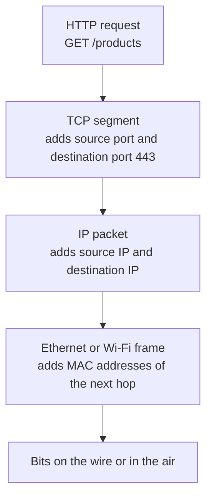
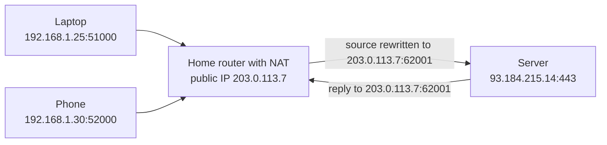
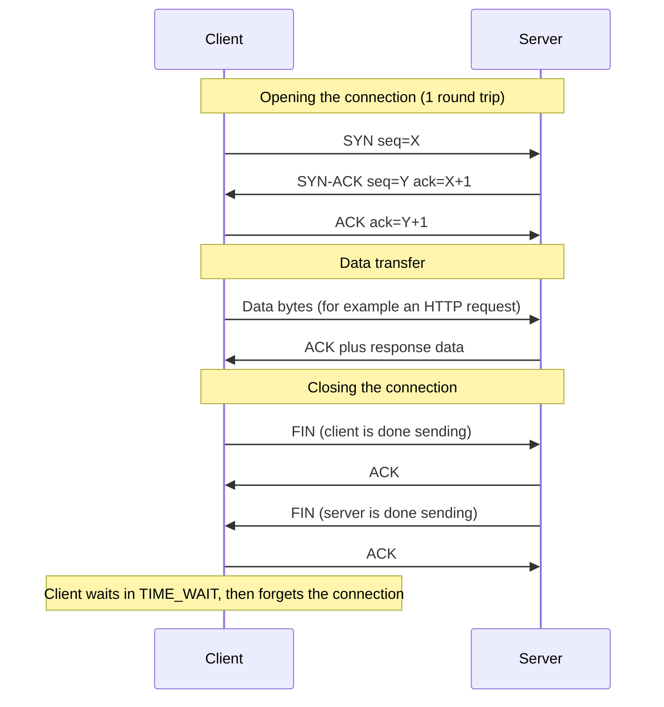
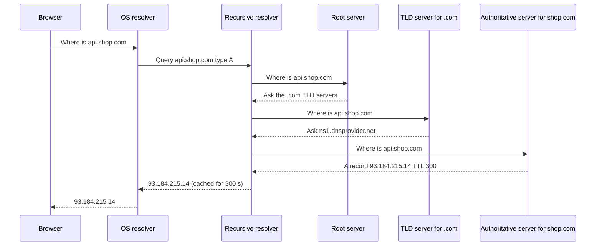
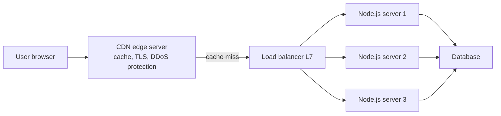
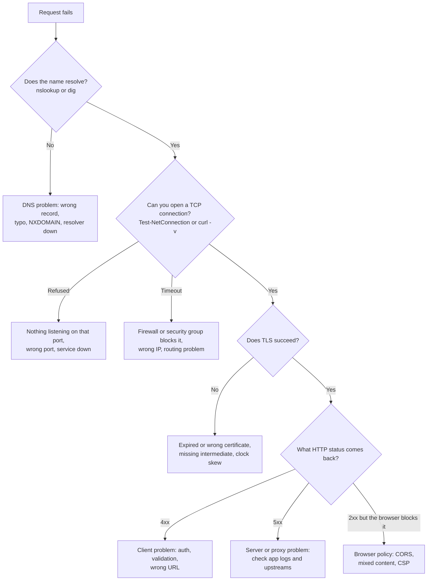

# Networking: TCP/IP, Ports and DNS

> In this document you will learn how data really moves between a browser and a server: network layers, IP addresses, ports, TCP, UDP, DNS, latency, proxies and load balancers. Interviewers use these topics to check if you understand what happens *under* `fetch()`, and you need them to debug real production problems like timeouts, `ECONNREFUSED` and slow first loads.

**Before this:** [Operating systems: processes, threads and memory](03-operating-systems-processes-threads-memory.md) · **Interview questions:** [jump to the interview section](#interview-questions)

## Table of contents

1. [The big picture](#the-big-picture)
2. [Network models: OSI and TCP/IP](#network-models-osi-and-tcpip)
3. [IP addresses](#ip-addresses)
4. [Ports and sockets](#ports-and-sockets)
5. [TCP: reliable connections](#tcp-reliable-connections)
6. [UDP: fast and simple messages](#udp-fast-and-simple-messages)
7. [TCP vs UDP and where QUIC fits](#tcp-vs-udp-and-where-quic-fits)
8. [DNS: turning names into addresses](#dns-turning-names-into-addresses)
9. [Latency, bandwidth and connection reuse](#latency-bandwidth-and-connection-reuse)
10. [Proxies, load balancers and CDNs](#proxies-load-balancers-and-cdns)
11. [Network tools you should know](#network-tools-you-should-know)
12. [Network errors in Node.js and what they mean](#network-errors-in-nodejs-and-what-they-mean)
13. [How to explain this in an interview](#how-to-explain-this-in-an-interview)
14. [Interview questions](#interview-questions)
15. [Summary](#summary)
16. [References](#references)

---

## The big picture

When your Angular app calls `fetch('https://api.shop.com/products')`, a lot of work happens before the first byte of JSON arrives:

1. The browser must find the **IP address** of `api.shop.com`. This is **DNS**.
2. The browser opens a **connection** to that IP address on **port 443**. This is usually **TCP** (or **QUIC** for HTTP/3).
3. The browser and server agree on encryption. This is **TLS** (covered in [HTTP, HTTPS and TLS](05-http-https-and-tls.md)).
4. The browser sends an **HTTP request**, and the server sends an **HTTP response**.
5. Under all of this, the data is cut into small pieces called **packets**. Routers pass these packets from network to network until they reach the server.

A **network** is a group of computers that can send data to each other. The **internet** is a network of networks. Your home network, your company network and a cloud provider's network are all connected through routers.

A **packet** is a small piece of data with a header. The header says where the packet comes from and where it is going. A large response (for example 2 MB of JSON) is split into many packets. They travel separately and are put back together at the other end.

A **router** is a device that receives a packet, looks at the destination address, and forwards the packet one step closer to its destination. No single router knows the full path. Each one only knows "the next hop".

**Analogy:** Sending data is like sending a long book by post, one page per envelope. Each envelope has the destination address. Post offices (routers) pass envelopes along. The envelopes may take different roads and arrive in a different order. Someone at the destination must put the pages back in order and ask for missing pages again. In networking, that "someone" is **TCP**.

Where the analogy breaks: real packets travel in milliseconds, and a router does not keep a copy of your packet. If a router is overloaded, it simply drops the packet.

---

## Network models: OSI and TCP/IP

### What it is

A **network model** splits networking into **layers**. Each layer has one job and uses the layer below it. This makes the system easier to build and to reason about. For example, HTTP does not care if your laptop uses Wi-Fi or a cable. That is a lower layer's problem.

There are two common models:

- The **OSI model** has 7 layers. It is a teaching and reference model.
- The **TCP/IP model** has 4 layers. It describes how the internet actually works.

### The layers side by side

| OSI layer | TCP/IP layer | Job | Examples | Unit of data |
| --- | --- | --- | --- | --- |
| 7 Application | Application | What the program wants to say | HTTP, DNS, WebSocket, SMTP, SSH | Message |
| 6 Presentation | Application | Encoding, compression, encryption | TLS (often placed here), gzip, UTF-8 | Message |
| 5 Session | Application | Keeping a conversation going | TLS sessions, RPC sessions | Message |
| 4 Transport | Transport | Process-to-process delivery, ports, reliability | TCP, UDP, QUIC (runs on UDP) | Segment (TCP) / Datagram (UDP) |
| 3 Network | Internet | Addressing and routing between networks | IP (IPv4, IPv6), ICMP | Packet |
| 2 Data link | Link | Delivery inside one local network | Ethernet, Wi-Fi, MAC addresses, ARP | Frame |
| 1 Physical | Link | Bits as signals | Cables, radio waves, fiber | Bits |

Note: TLS does not fit neatly into one OSI layer. People place it at layer 5, 6 or "between 4 and 7". In an interview, say "TLS sits between TCP and HTTP".

### Encapsulation: how layers wrap data

Each layer adds its own header around the data from the layer above. This is called **encapsulation**. On the receiving side, each layer removes its header and passes the rest up. This is **decapsulation**.



**Analogy:** You write a letter (HTTP). You put it in an envelope with a room number (TCP port). You put that envelope into a bigger envelope with the building address (IP). The courier puts it in a van going to the next post office (link layer).

### Where a JavaScript developer touches each layer

| Layer | What you see in daily work |
| --- | --- |
| Application | `fetch`, `HttpClient`, Express routes, WebSocket, DNS records you configure |
| Transport | `ECONNREFUSED`, `ECONNRESET`, port numbers, `server.listen(3000)`, Node's `net` module |
| Internet | IP addresses, `ping`, `traceroute`, firewall rules, VPC subnets in the cloud |
| Link | Mostly invisible, unless Wi-Fi is broken |

### Why this matters in interviews

Interviewers ask "What is the difference between L4 and L7 load balancers?" or "At which layer does TLS work?". The layer numbers are the shared language. **L4** means transport layer (TCP/UDP, IP and port). **L7** means application layer (HTTP: paths, headers, cookies).

---

## IP addresses

### What it is

An **IP address** is the address of a network interface on an IP network. Routers use it to deliver packets. Every packet has a source IP and a destination IP.

### IPv4

An **IPv4** address has 32 bits. We write it as four numbers from 0 to 255, separated by dots:

```text
192.168.1.25
```

32 bits allow about 4.3 billion addresses. That is not enough for every phone, laptop and server in the world. This shortage is why NAT and IPv6 exist.

### IPv6

An **IPv6** address has 128 bits. We write it as eight groups of four hexadecimal digits, separated by colons:

```text
2001:0db8:0000:0000:0000:ff00:0042:8329
2001:db8::ff00:42:8329        (short form: leading zeros removed, one run of zero groups becomes ::)
```

128 bits is a huge number of addresses, so every device can have a public address. Most operating systems and browsers support both IPv4 and IPv6. When a server has both, clients try both quickly and use whichever connects first. This technique is called **Happy Eyeballs**.

### CIDR notation

You will see addresses like `10.0.0.0/16` in cloud and firewall settings. This is **CIDR notation**. The number after the slash says how many bits are the fixed "network part".

| CIDR | Meaning | Number of addresses |
| --- | --- | --- |
| `10.0.0.0/8` | First 8 bits fixed (`10.x.x.x`) | about 16.7 million |
| `10.0.0.0/16` | First 16 bits fixed (`10.0.x.x`) | 65,536 |
| `10.0.1.0/24` | First 24 bits fixed (`10.0.1.x`) | 256 |
| `10.0.1.5/32` | All 32 bits fixed | exactly 1 |

### Special addresses you must know

| Address | Meaning |
| --- | --- |
| `127.0.0.1` (IPv4), `::1` (IPv6) | **Loopback.** "This same machine." Traffic never leaves the computer. |
| `localhost` | A name, not an address. It usually resolves to `127.0.0.1` and/or `::1`. |
| `0.0.0.0` | When a server **listens** on it: "accept connections on all IPv4 interfaces". It is not a destination you connect to. |
| `10.0.0.0/8`, `172.16.0.0/12`, `192.168.0.0/16` | **Private** IPv4 ranges (RFC 1918). Used inside homes, offices and cloud networks. Not routed on the public internet. |
| `169.254.0.0/16` | Link-local. A device picks one of these when it cannot get an address from DHCP. |

### Public vs private IP addresses

- A **public IP** is reachable from the internet. Your server's load balancer has one.
- A **private IP** only works inside its own network. Your laptop at home probably has something like `192.168.1.25`. Your database in the cloud should have only a private IP.

### NAT (Network Address Translation)

Your home router has one public IP from your internet provider, but you have many devices. **NAT** lets all of them share that one public IP.

How it works:

1. Your laptop (`192.168.1.25`, port `51000`) sends a packet to a server.
2. The router replaces the source address with its public IP (`203.0.113.7`) and a new port (`62001`). It remembers this mapping in a table.
3. The server replies to `203.0.113.7:62001`.
4. The router looks up the table, sees that port `62001` belongs to `192.168.1.25:51000`, and forwards the reply to your laptop.



Consequences you will meet in real work:

- A server outside cannot start a connection to your laptop. NAT only knows mappings for connections that started from inside. This is why peer-to-peer apps (WebRTC video calls) need extra tricks like STUN and TURN servers.
- Many users can appear with the same public IP (an office, or a mobile carrier using "carrier-grade NAT"). So rate limiting purely by IP can block innocent users.
- Cloud servers in a private subnet use a **NAT gateway** to call external APIs without being reachable from the internet.

### Practical example: what address should a Node server listen on?

```js
import http from 'node:http';

const server = http.createServer((req, res) => res.end('ok'));

// Only reachable from this same machine (good for local development).
server.listen(3000, '127.0.0.1');

// Reachable from other machines too: all IPv4 interfaces.
// Needed inside Docker containers, otherwise the port mapping will not work.
// server.listen(3000, '0.0.0.0');
```

If you omit the host, Node listens on `::` (all IPv6 interfaces) when IPv6 is available, which on most systems also accepts IPv4 connections. A common Docker bug: the app listens on `127.0.0.1` inside the container, so traffic coming from outside the container never reaches it.

---

## Ports and sockets

### What a port is

An IP address finds the **machine**. A **port** finds the **program** on that machine. A port is a 16-bit number, from 0 to 65535.

**Analogy:** The IP address is the building address. The port is the apartment number. One building has many apartments; one server runs many programs.

| Range | Name | Examples |
| --- | --- | --- |
| 0–1023 | Well-known ports | 80 HTTP, 443 HTTPS, 22 SSH, 53 DNS, 25 SMTP |
| 1024–49151 | Registered ports | 3000 and 4200 (dev servers by convention), 5432 PostgreSQL, 6379 Redis, 27017 MongoDB |
| 49152–65535 | Dynamic or **ephemeral** ports | Picked automatically by the OS for the client side of a connection |

On Linux and macOS, programs usually need admin rights to listen on ports below 1024. This is why Node apps listen on 3000 or 8080 and a reverse proxy listens on 80 and 443.

### Ephemeral ports

When your browser connects to `api.shop.com:443`, the browser's side of the connection also needs a port. The OS picks a free **ephemeral port** automatically, for example `51544`. You never choose it.

### What a socket is

A **socket** is one endpoint of a network conversation: an IP address plus a port, as seen by a program. In code, a socket is the object you read from and write to.

A TCP **connection** is identified by four values, called the **4-tuple**:

```text
(client IP, client port, server IP, server port)
(192.168.1.25, 51544, 93.184.215.14, 443)
```

Because the client port is different for every connection, one server port (443) can handle thousands of connections at the same time. Each connection has a different 4-tuple.

### Example: a TCP server and client in Node.js

Node's `net` module gives you raw TCP sockets. HTTP servers are built on top of this.

```js
import net from 'node:net';

const server = net.createServer((socket) => {
  // A new socket object is created for every client connection.
  console.log('server: client connected from port', typeof socket.remotePort);
  socket.on('data', (chunk) => {
    console.log('server: received', JSON.stringify(chunk.toString()));
    socket.write(chunk.toString().toUpperCase()); // echo back in upper case
  });
  socket.on('end', () => console.log('server: client ended'));
});

server.listen(4000, '127.0.0.1', () => {
  console.log('server: listening on', server.address());

  const client = net.connect({ host: '127.0.0.1', port: 4000 }, () => {
    console.log('client: connected');
    client.write('hello tcp');
  });
  client.on('data', (chunk) => {
    console.log('client: got', JSON.stringify(chunk.toString()));
    client.end(); // politely close our side (sends FIN)
  });
  client.on('close', () => {
    console.log('client: closed');
    server.close();
  });
});
```

Output:

```text
server: listening on { address: '127.0.0.1', family: 'IPv4', port: 4000 }
server: client connected from port number
client: connected
server: received "hello tcp"
client: got "HELLO TCP"
server: client ended
client: closed
```

Walkthrough:

1. `server.listen(4000, '127.0.0.1')` asks the OS to accept TCP connections on port 4000 of the loopback interface.
2. `net.connect` starts the TCP handshake. The OS gives the client a random ephemeral port (that is why we only print its type).
3. When the handshake completes, the server's connection callback runs with a new `socket`, and the client's connect callback runs.
4. The client writes `hello tcp`. TCP delivers the bytes. The server's `data` handler runs and writes back `HELLO TCP`.
5. The client calls `client.end()`. This sends a FIN ("I am done sending"). The server sees `end`, closes its side too, and the client sees `close`.

Important detail: TCP is a **byte stream**, not a message system. If the client writes `"hello"` and then `"world"` quickly, the server might receive `"helloworld"` in one `data` event, or `"hel"` and `"loworld"`. Protocols on top of TCP (HTTP, WebSocket) add their own framing to know where a message ends.

```js
// ❌ Wrong: assumes one write = one 'data' event
socket.on('data', (chunk) => handleMessage(JSON.parse(chunk.toString())));

// ✅ Correct: buffer the stream and split on a delimiter you defined (here: newline)
let buffer = '';
socket.on('data', (chunk) => {
  buffer += chunk.toString();
  let index;
  while ((index = buffer.indexOf('\n')) !== -1) {
    const line = buffer.slice(0, index);
    buffer = buffer.slice(index + 1);
    handleMessage(JSON.parse(line));
  }
});
```

---

## TCP: reliable connections

### What it is

**TCP (Transmission Control Protocol)** is a transport protocol that gives programs a **reliable, ordered byte stream** between two endpoints. HTTP/1.1, HTTP/2, database drivers, SSH and SMTP all run on TCP.

### Why it exists

IP alone is "best effort". Packets can be lost, duplicated, delayed or arrive out of order. Programs do not want to deal with that. TCP hides all of it. You write bytes on one side, and the same bytes come out in the same order on the other side, or you get an error.

### What TCP guarantees

| Guarantee | How TCP does it |
| --- | --- |
| **Connection** | A handshake before data flows, so both sides agree to talk. |
| **Reliability** | Every byte has a **sequence number**. The receiver sends **ACKs** (acknowledgements). If an ACK does not arrive in time, the sender **retransmits**. |
| **Ordering** | The receiver uses sequence numbers to put bytes back in order before giving them to the program. |
| **Integrity** | A checksum detects corrupted segments, which are dropped and resent. |
| **Flow control** | The receiver says how much buffer space it has (the **receive window**). The sender never sends more than that. |
| **Congestion control** | The sender slows down when the network looks overloaded, so the internet does not collapse. |

TCP does **not** guarantee speed, does **not** encrypt anything (that is TLS), and does **not** preserve message boundaries.

### The three-way handshake

Before any data flows, TCP opens a connection with three messages:

1. **SYN:** the client says "I want to connect. My starting sequence number is X."
2. **SYN-ACK:** the server says "OK. I received X. My starting sequence number is Y."
3. **ACK:** the client says "I received Y." The connection is now open.

The starting sequence numbers are random. This makes it hard for an attacker to inject fake packets into a connection.



**Why it matters for performance:** the handshake costs one full **round trip** (client to server and back) before the first byte of the request can be sent. If the server is 100 ms away, that is 100 ms of waiting. TLS adds more round trips on top. This is why reusing connections is so important.

### Reliability: ACKs and retransmission

Example with simple numbers:

1. The client sends bytes 1–1000 and bytes 1001–2000.
2. The packet with bytes 1001–2000 is lost.
3. The server ACKs "I have everything up to byte 1000".
4. The client's retransmission timer fires (or it notices repeated ACKs for 1000), and it sends bytes 1001–2000 again.
5. The server now ACKs "up to 2000" and gives all 2000 bytes, in order, to the program.

### Flow control

**Flow control** protects the **receiver**. Each ACK carries a **receive window** value: "I have room for N more bytes". If a slow phone app cannot process data fast enough, its window shrinks, and the server must wait. In Node.js you see a similar idea in streams: **backpressure** (see [Streams](../07-nodejs-backend/05-streams.md)).

### Congestion control

**Congestion control** protects the **network**. The sender keeps a **congestion window** (how much unacknowledged data it allows itself to have "in flight").

- **Slow start:** a new connection starts with a small window. Modern systems usually start with 10 segments, which is about 14 KB. Every round trip without loss, the window roughly doubles.
- **Loss = congestion signal:** when packets are lost, the sender reduces its window, then grows it again slowly.
- Common algorithms: **CUBIC** (default in Linux for many years) and **BBR** (developed by Google, which estimates bandwidth and round-trip time instead of reacting only to loss).

**Why front-end developers care:** a brand new connection cannot send a big response at full speed. The first round trip can carry only about 14 KB. This is one reason the advice "keep critical HTML and CSS small" exists, and why connection reuse helps so much.

### Closing a connection

- **Graceful close:** each side sends **FIN** when it is done sending, and the other side ACKs it (four messages in total, sometimes three when FIN and ACK are combined).
- **TIME_WAIT:** the side that closes first waits for a while (often 60 seconds on Linux) before fully forgetting the connection. This makes sure late packets from the old connection do not confuse a new one. A busy client that opens and closes thousands of connections can run out of ephemeral ports because of many sockets in TIME_WAIT. Connection pooling fixes this.
- **Abrupt close:** a side sends **RST** (reset). This means "this connection is dead, stop now". In Node.js you see it as `ECONNRESET`. Common causes: the server process crashed, a proxy closed an idle connection, or the server's keep-alive timeout was shorter than the client expected.

### Head-of-line blocking

Because TCP delivers bytes **strictly in order**, one lost packet holds up everything behind it, even if later packets already arrived. This is **head-of-line (HOL) blocking** at the TCP level. It matters for HTTP/2: many requests share one TCP connection, so one lost packet stalls all of them. HTTP/3 solves this with QUIC (see below).

### Nagle's algorithm and TCP keep-alive

- **Nagle's algorithm** combines many tiny writes into fewer packets. It saves bandwidth but can add small delays for chatty protocols. Node's `socket.setNoDelay(true)` disables it. Node's HTTP server already does this for you.
- **TCP keep-alive** sends small probe packets on an idle connection to check that the other side is still there. Do not confuse this with **HTTP keep-alive**, which means "reuse this connection for more requests". Both are explained in [connection reuse](#connection-reuse-and-keep-alive).

---

## UDP: fast and simple messages

### What it is

**UDP (User Datagram Protocol)** sends independent messages called **datagrams**. There is no handshake, no ACKs, no retransmission and no ordering. Each datagram either arrives whole or does not arrive at all.

### Why it exists

Sometimes reliability costs more than it is worth:

- In a **video call**, a frame that arrives 500 ms late is useless. It is better to skip it and show the next one.
- A **DNS query** is one small question and one small answer. A TCP handshake would double the time. If the answer does not come, the client simply asks again.
- **Online games** send player positions many times per second. Only the newest position matters.

UDP is also the base for building **new protocols in user space** (in the application, not the OS kernel). QUIC is the best-known example.

### Example: UDP in Node.js

```js
import dgram from 'node:dgram';

const server = dgram.createSocket('udp4');
server.on('message', (msg, rinfo) => {
  console.log('server got:', msg.toString(), 'from', rinfo.address);
  server.send('pong', rinfo.port, rinfo.address); // reply to the sender's port
});

server.bind(5000, '127.0.0.1', () => {
  const client = dgram.createSocket('udp4');
  client.on('message', (msg) => {
    console.log('client got:', msg.toString());
    client.close();
    server.close();
  });
  client.send('ping', 5000, '127.0.0.1'); // no connect step, just send
});
```

Output:

```text
server got: ping from 127.0.0.1
client got: pong
```

Notice there is no "connected" event. The client just sends. On a real network (not loopback), this datagram could be lost and nobody would tell you. Your program must handle that with timeouts and retries if it matters.

Browsers do not give web pages raw UDP sockets for security reasons. Web apps use UDP indirectly through **WebRTC** (real-time audio and video) and **HTTP/3**. The newer **WebTransport** API also runs over HTTP/3.

---

## TCP vs UDP and where QUIC fits

| Feature | TCP | UDP |
| --- | --- | --- |
| Connection setup | Yes, three-way handshake | No |
| Reliable delivery | Yes, retransmits lost data | No |
| Ordering | Yes, strict order | No |
| Message boundaries | No (byte stream) | Yes (each datagram is one message) |
| Flow and congestion control | Yes | No (the application must be careful) |
| Header size | 20 bytes minimum | 8 bytes |
| Speed to first byte | Slower (handshake) | Faster |
| Typical uses | HTTP/1.1, HTTP/2, databases, SSH, email | DNS, video and voice calls, games, QUIC (HTTP/3) |

**When to choose which:**

- Choose **TCP** when every byte matters and order matters: web pages, APIs, file transfer, database queries.
- Choose **UDP** when freshness matters more than completeness, or when you want to build your own reliability rules on top (like QUIC does).

### QUIC: reliable transport built on UDP

**QUIC** is a transport protocol standardized by the IETF in 2021 (RFC 9000). **HTTP/3** runs on QUIC. QUIC gives you TCP-like reliability, but it is built on top of UDP. Why build it on UDP instead of changing TCP?

- TCP lives inside operating system kernels and inside millions of routers, firewalls and middleboxes. Changing TCP takes many years. UDP packets pass through almost everything, so a new protocol on top of UDP can be deployed quickly, inside the browser and server software.

What QUIC improves:

| Problem with TCP + TLS | How QUIC solves it |
| --- | --- |
| TCP handshake, then TLS handshake (2 or more round trips) | Transport and encryption handshake combined: 1 round trip for a new connection, 0 for a resumed one |
| One lost packet blocks all HTTP/2 streams (TCP head-of-line blocking) | Each stream is independent. A lost packet only delays its own stream |
| Connection breaks when your IP changes (Wi-Fi to mobile) | **Connection IDs** let a connection survive an IP change (**connection migration**) |
| TCP headers are visible to and modified by middleboxes | Almost everything is encrypted, including most transport metadata |

The full HTTP/1.1 vs HTTP/2 vs HTTP/3 comparison is in [HTTP, HTTPS and TLS](05-http-https-and-tls.md#http-versions-11-vs-2-vs-3).

---

## DNS: turning names into addresses

### What it is

The **Domain Name System (DNS)** translates human-friendly names like `api.shop.com` into IP addresses like `93.184.215.14`. It is a huge, distributed, cached database.

### Why it exists

- People remember names, not numbers.
- IP addresses change. A company can move its servers to a new cloud provider and only update the DNS record. Users keep typing the same name.
- One name can point to many addresses, which helps with load distribution and failover.

**Analogy:** DNS is like the contacts app on your phone. You tap "Mom", and the phone dials the number. If Mom gets a new number, you update one contact, and you keep tapping "Mom".

Where the analogy breaks: your contacts app has one owner. DNS has millions of owners, each responsible for their own part of the name space, and answers are cached in many places along the way.

### The DNS hierarchy

Read a domain name from **right to left**. Each part is a level in a tree:

```text
api.shop.com.
            ^  root (the final dot is usually hidden)
        ^^^    TLD (top-level domain): com
   ^^^^        second-level domain: shop  (registered by the company)
^^^            subdomain: api             (created by the company)
```

| Server type | What it knows | Example |
| --- | --- | --- |
| **Root servers** | Where the TLD servers are | "For `.com`, ask these servers." |
| **TLD servers** | Where each domain's authoritative servers are | "For `shop.com`, ask `ns1.dnsprovider.net`." |
| **Authoritative servers** | The actual records for a domain | "`api.shop.com` is `93.184.215.14`." |
| **Recursive resolver** | Nothing permanently. It does the work of asking the others, and caches answers. | Your ISP's resolver, `8.8.8.8` (Google), `1.1.1.1` (Cloudflare), your company's resolver |

There are 13 named root server identities (`a.root-servers.net` to `m.root-servers.net`). Each one is served by many machines around the world using **anycast** (many servers share the same IP address, and the network routes you to a nearby one).

### How a lookup works, step by step

Assume nothing is cached yet.



1. The browser checks its own DNS cache. Not found.
2. The browser asks the operating system. The OS checks its cache and the **hosts file** (`/etc/hosts` on Linux/macOS, `C:\Windows\System32\drivers\etc\hosts` on Windows). Not found.
3. The OS sends the query to the configured **recursive resolver** (usually over UDP port 53).
4. The resolver asks a **root server**, which refers it to the `.com` TLD servers.
5. The resolver asks a **TLD server**, which refers it to `shop.com`'s authoritative name servers.
6. The resolver asks the **authoritative server**, which returns the record and its **TTL**.
7. The resolver caches the answer and returns it. The OS and browser cache it too.

Two words you should use correctly:

- A **recursive** query means "give me the final answer, do the work for me". The OS sends recursive queries to the resolver.
- An **iterative** query means "tell me what you know, or who to ask next". The resolver sends iterative queries to root, TLD and authoritative servers.

In practice, steps 4 and 5 rarely happen: resolvers cache TLD and popular domain information for a long time. Most lookups are answered from some cache in under a few milliseconds.

### DNS record types

| Record | Purpose | Example |
| --- | --- | --- |
| **A** | Name → IPv4 address | `api.shop.com. 300 IN A 93.184.215.14` |
| **AAAA** | Name → IPv6 address | `api.shop.com. 300 IN AAAA 2606:2800:21f:cb07::1` |
| **CNAME** | Name → another name (an alias) | `www.shop.com. CNAME shop.cdn-provider.net.` |
| **MX** | Mail servers for the domain, with priority | `shop.com. MX 10 mail1.shop.com.` |
| **TXT** | Free text. Used for domain ownership checks, SPF, DKIM and DMARC email security | `shop.com. TXT "v=spf1 include:_spf.google.com ~all"` |
| **NS** | Which servers are authoritative for this domain | `shop.com. NS ns1.dnsprovider.net.` |
| **SOA** | Start of authority: admin info and default timers for the zone | |
| **PTR** | Reverse lookup: IP → name | Used by mail servers and logs |
| **SRV** | Service location: host and port for a service | Used by some protocols (for example SIP, XMPP, MongoDB `mongodb+srv://`) |
| **CAA** | Which certificate authorities may issue certificates for the domain | `shop.com. CAA 0 issue "letsencrypt.org"` |
| **HTTPS / SVCB** | Connection hints, such as "this server supports HTTP/3" | Newer record type (RFC 9460, 2023) |

Practical rules:

- A **CNAME** cannot sit next to other records with the same name. So you normally cannot put a CNAME on the **apex** (root) domain `shop.com`, because the apex must also have NS and SOA records. DNS providers offer workarounds called "ALIAS", "ANAME" or "CNAME flattening".
- Each CNAME adds another lookup step. Long chains of CNAMEs slow down resolution.

### TTL and caching layers

**TTL (time to live)** is the number of seconds a DNS answer may be cached. The owner of the domain chooses it.

| Cache layer | Where | Notes |
| --- | --- | --- |
| Browser cache | Inside the browser | Short-lived. Chrome shows it at `chrome://net-internals/#dns` |
| OS cache | Windows DNS Client service, systemd-resolved, macOS mDNSResponder | `ipconfig /displaydns` and `ipconfig /flushdns` on Windows |
| Router | Home routers often cache | |
| Recursive resolver | ISP or public resolver | Serves millions of users, so popular names are almost always cached |

**Negative caching:** "this name does not exist" (`NXDOMAIN`) answers are also cached, based on the zone's SOA settings. If you query a subdomain before you create it, some users may keep getting "not found" for a while.

**The "DNS propagation" myth:** DNS changes are not pushed anywhere. Old answers simply expire from caches when their TTL runs out. That is why a change can appear "instant" for some users and "slow" for others.

**Real-world practice: migrating a server.**

1. A day before the migration, lower the TTL of the record (for example from 86400 to 60 seconds).
2. Wait for the old, long TTL to expire everywhere.
3. Change the record to the new IP. Most caches pick it up within about a minute.
4. Keep the old server running for a while for clients that ignore TTLs.
5. Raise the TTL again.

**Trade-off:** a short TTL means faster changes but more DNS queries (slower for users with cold caches, more load on DNS servers). A long TTL means fewer queries but slower changes.

### DNS prefetch and preconnect

A page can ask the browser to do DNS work early, before the resource is needed:

```html
<!-- Only resolve the name early (cheap) -->
<link rel="dns-prefetch" href="https://images.shop-cdn.com">

<!-- Resolve the name AND open the TCP + TLS connection early (more powerful, costs more) -->
<link rel="preconnect" href="https://api.shop.com" crossorigin>
```

Use `preconnect` only for a few origins you will definitely use soon (for example your API or font host), because each open connection costs resources. Use `dns-prefetch` for less important third-party origins. More detail in [Browser architecture and rendering](07-browser-architecture-and-rendering.md#resource-hints-preload-prefetch-preconnect).

### DNS security and privacy

- Classic DNS over UDP port 53 is **not encrypted**. Anyone on the path can see which names you look up, and in theory can fake answers.
- **DNS over HTTPS (DoH)** and **DNS over TLS (DoT)** encrypt DNS queries. Modern browsers support DoH.
- **DNSSEC** adds signatures to DNS records so resolvers can verify they are genuine. It protects integrity, not privacy.
- DNS answers can also be used for **load balancing**: an authoritative server can return different IPs based on the user's location (**GeoDNS**), or remove unhealthy servers from answers.

### DNS in Node.js: lookup vs resolve

Node has two different ways to resolve names, and the difference is a good senior-level interview topic.

```js
import dns from 'node:dns/promises';

// 1. dns.lookup: uses the operating system (getaddrinfo).
//    Respects the hosts file. This is what http, https, net and fetch use by default.
const all = await dns.lookup('localhost', { all: true });
console.log(all);
// Example output (depends on your OS):
// [ { address: '::1', family: 6 }, { address: '127.0.0.1', family: 4 } ]

// 2. dns.resolve4 / resolve6 / resolveMx ...: sends real DNS queries over the network.
//    Ignores the hosts file.
const ips = await dns.resolve4('example.com');
console.log(ips); // for example [ '104.20.23.154', '172.66.147.243' ] (changes over time)
```

| | `dns.lookup()` | `dns.resolve*()` |
| --- | --- | --- |
| How | OS function `getaddrinfo` | DNS protocol queries over the network |
| Uses hosts file | Yes | No |
| Thread pool | Runs on libuv's thread pool (default 4 threads) | Does not use the thread pool |
| Used by | `http`, `https`, `net`, `fetch` by default | Only when you call it |

**Why this matters:** `dns.lookup` looks asynchronous in JavaScript, but inside libuv it is a blocking call running on the thread pool. If DNS is slow and you make many requests to new hostnames, lookups can fill the 4 threads. Then file system operations and crypto (which share the pool) also wait. Fixes: reuse connections (keep-alive), cache DNS results, or raise `UV_THREADPOOL_SIZE`. See [Node.js event loop](../07-nodejs-backend/02-node-event-loop.md).

**The `localhost` gotcha in Node 17+:** since Node 17, `dns.lookup` returns addresses in the order the OS gives them (`verbatim`), so `localhost` may resolve to `::1` (IPv6) first. If your test server listens only on `127.0.0.1`, an old client could fail with `ECONNREFUSED ::1`. Since Node 20, `net.connect` (and therefore `fetch`) tries both address families by default (Happy Eyeballs, `autoSelectFamily: true`), so this mostly disappeared. If you still see it, connect to `127.0.0.1` directly or listen on both.

---

## Latency, bandwidth and connection reuse

### The key terms

| Term | Plain meaning | Unit | Analogy (water pipe) |
| --- | --- | --- | --- |
| **Latency** | How long one piece of data takes to get from A to B | milliseconds | How long the pipe is |
| **RTT (round-trip time)** | Time to go to the server and come back | milliseconds | Send a ball down the pipe and wait for it to return |
| **Bandwidth** | Maximum amount of data per second the link can carry | Mbps, Gbps | How wide the pipe is |
| **Throughput** | Data per second you actually get | Mbps | How much water really flows |
| **Packet loss** | Percentage of packets that never arrive | % | Leaks in the pipe |
| **Jitter** | How much latency varies from packet to packet | milliseconds | Water arriving in uneven spurts |

### Why latency usually matters more than bandwidth for web apps

A typical page load is many small requests, and each new connection needs several round trips before any data flows. Bandwidth helps with large downloads. It does not remove round trips.

**Physics sets a floor.** Light in optical fiber travels at roughly 200,000 km per second, which is about 5 ms per 1,000 km one way. A user in Mumbai calling a server in Virginia (about 13,000 km away) cannot get an RTT below roughly 130 ms, and real routes are longer. No amount of bandwidth fixes that. Only moving content closer (a CDN) or making fewer round trips does.

### Counting round trips for a first HTTPS request

For a brand new connection with HTTP/1.1 or HTTP/2 over TCP and TLS 1.3, and nothing cached:

| Step | Round trips |
| --- | --- |
| DNS lookup (if not cached) | 1 or more |
| TCP handshake | 1 |
| TLS 1.3 handshake | 1 (TLS 1.2 needs 2) |
| HTTP request and first byte of response | 1 |
| **Total** | about 4 RTTs |

With an RTT of 100 ms, the user waits about 400 ms before the first byte, even if the server answers instantly. With HTTP/3 (QUIC), the TCP and TLS steps are combined into one, saving one round trip. A reused connection skips DNS, TCP and TLS completely.

### Connection reuse and keep-alive

There are two different "keep-alive" ideas. Do not mix them up in an interview.

| | HTTP keep-alive (persistent connections) | TCP keep-alive |
| --- | --- | --- |
| Purpose | Reuse one TCP connection for many HTTP requests | Detect if an idle connection's other side has disappeared |
| Layer | Application (HTTP) | Transport (TCP) |
| Default | On by default in HTTP/1.1. HTTP/2 and HTTP/3 always use long-lived connections | Off by default in most OSes. Probes start after a long idle time (often 2 hours on Linux) unless configured |
| Benefit | Saves the TCP and TLS handshakes for every request after the first | Cleans up dead connections, keeps NAT and firewall entries alive |

**Node.js example: reuse connections when calling another service.** Since Node 19, the default global HTTP agent keeps connections alive. If you create your own agent, turn it on explicitly:

```js
import https from 'node:https';

// ✅ Reuse TCP + TLS connections to the payment API instead of opening a new one per request
const paymentAgent = new https.Agent({ keepAlive: true, maxSockets: 50 });

function chargeCard(body) {
  return new Promise((resolve, reject) => {
    const req = https.request(
      'https://payments.example.com/charges',
      { method: 'POST', agent: paymentAgent, headers: { 'content-type': 'application/json' } },
      (res) => {
        let data = '';
        res.on('data', (c) => (data += c));
        res.on('end', () => resolve({ status: res.statusCode, data }));
      }
    );
    req.on('error', reject);
    req.end(JSON.stringify(body));
  });
}
```

Node's built-in `fetch` (powered by the undici library) also pools and reuses connections automatically.

**A classic production bug: random 502 errors behind a load balancer.** A load balancer keeps idle connections to your Node server open for, say, 60 seconds. Node's HTTP server closes idle keep-alive connections after `server.keepAliveTimeout`, which is **5 seconds** by default. Sometimes Node closes a connection at the exact moment the load balancer sends a new request on it. The load balancer gets a reset and returns **502** to the user. The fix is to make the server's timeout longer than the load balancer's idle timeout:

```js
const server = app.listen(3000);
server.keepAliveTimeout = 65_000; // longer than the load balancer idle timeout (60 s here)
server.headersTimeout = 66_000;   // keep this a bit larger than keepAliveTimeout
```

---

## Proxies, load balancers and CDNs

### Forward proxy

A **forward proxy** sits in front of **clients**. Clients send their requests to the proxy, and the proxy talks to the internet for them.

- Used by companies to filter or log employee traffic, and by some networks to cache content.
- The server sees the proxy's IP, not the client's.
- In development, you meet it when `npm install` fails behind a corporate proxy and you must set `HTTPS_PROXY`.

### Reverse proxy

A **reverse proxy** sits in front of **servers**. Clients think they are talking to the real server, but the reverse proxy receives the request and passes it to one of the servers behind it.

Common jobs of a reverse proxy (Nginx, HAProxy, Envoy, cloud load balancers):

- **TLS termination:** decrypt HTTPS once at the edge, so app servers handle plain HTTP inside a private network.
- **Routing:** `/api/*` to the Node service, everything else to static files.
- **Compression**, **caching** and **rate limiting**.
- **Hiding** the internal servers and their IPs.

The proxy adds headers so the app still knows the real client:

```text
X-Forwarded-For: 198.51.100.23     (original client IP; each proxy appends one more)
X-Forwarded-Proto: https           (the original scheme)
Forwarded: for=198.51.100.23;proto=https   (the standard version of both)
```

In Express you must set `app.set('trust proxy', 1)` (or the right number of hops) so `req.ip` and `req.protocol` use these headers. Only trust them from your own proxy: a client can send fake `X-Forwarded-For` headers directly.

### Load balancers: L4 vs L7

A **load balancer** spreads incoming traffic over several servers. This gives you more capacity and lets one server fail without an outage (it removes unhealthy servers using **health checks**).

| | L4 load balancer (transport layer) | L7 load balancer (application layer) |
| --- | --- | --- |
| Sees | IP addresses and ports (TCP/UDP) | Full HTTP: method, path, headers, cookies |
| Routing decisions | Per connection, by IP/port and algorithm | Per request, by path, host, header, cookie |
| TLS | Usually passes encrypted traffic through | Usually terminates TLS so it can read HTTP |
| Speed | Very fast, little processing | More work per request |
| Features | Simple balancing, works for any TCP/UDP protocol | Path routing, header rewrites, sticky sessions by cookie, WebSocket awareness, auth, WAF |
| Examples | AWS Network Load Balancer, HAProxy in TCP mode | AWS Application Load Balancer, Nginx, Envoy, Azure Application Gateway |

Common balancing algorithms: **round robin** (take turns), **least connections** (send to the least busy server), **IP hash** (same client IP always goes to the same server).

**Sticky sessions** send one user to the same server every time. They are needed if sessions are stored in server memory. A better design stores sessions in a shared store such as Redis, so any server can handle any request.

### CDN basics

A **CDN (Content Delivery Network)** is a network of servers in many cities (**edge servers** or **points of presence**). It caches your content close to users.

- A user in Berlin gets your JavaScript bundle from a Frankfurt edge server instead of from your origin server in Virginia. RTT drops from about 90 ms to under 10 ms.
- The CDN asks your **origin** server only on a cache miss.
- CDNs usually find the nearest edge using **anycast** or **GeoDNS**.
- Many CDNs also terminate TLS, absorb DDoS attacks, and can run small functions at the edge.
- What a CDN caches and for how long is controlled by HTTP caching headers, explained in [HTTP caching](05-http-https-and-tls.md#http-caching).



For the system-design view of these building blocks (scaling, health checks, global traffic), see [Scalability and core building blocks](../09-system-design/02-scalability-and-core-building-blocks.md).

---

## Network tools you should know

| Tool | What it tells you | Example |
| --- | --- | --- |
| `ping` | Is the host reachable, and what is the RTT? Uses ICMP. Many servers and firewalls block ICMP, so "no reply" does not always mean "down". | `ping api.shop.com` |
| `traceroute` (Linux/macOS), `tracert` (Windows) | The routers (hops) on the path and the delay to each. Works by sending packets with increasing TTL values. | `tracert api.shop.com` |
| `nslookup`, `dig` | DNS answers: which IP, which records, which TTL, which server answered | `nslookup -type=MX shop.com` · `dig api.shop.com A +short` |
| `curl` | Full HTTP request from the command line, with headers and timing | `curl -v https://api.shop.com/health` |
| `netstat`, `ss`, `lsof` | Which ports are open, which connections exist, which process owns a port | `netstat -ano` (Windows) · `ss -tlnp` (Linux) · `lsof -i :3000` (macOS/Linux) |
| `Test-NetConnection` | Windows PowerShell: can I open a TCP connection to this host and port? | `Test-NetConnection api.shop.com -Port 443` |
| Browser DevTools (Network tab) | Per-request timing: DNS, connection, TLS, waiting (TTFB), download | Open DevTools, Network, click a request, Timing |

`curl` can show the time spent in each network phase. This is very useful when someone says "the API is slow":

```bash
curl -o /dev/null -s -w "dns=%{time_namelookup} connect=%{time_connect} tls=%{time_appconnect} ttfb=%{time_starttransfer} total=%{time_total}\n" https://api.shop.com/products
# dns=0.012 connect=0.045 tls=0.110 ttfb=0.480 total=0.495
```

Read it like this (all values are seconds since the start): DNS took 12 ms; the TCP connection finished at 45 ms; TLS finished at 110 ms; the first byte arrived at 480 ms. So the server spent about 370 ms thinking (`ttfb - tls`). The network was not the problem; the backend was. (On Windows PowerShell, use `curl.exe` and `-o NUL`.)

### A debugging flow for "the API call fails"



---

## Network errors in Node.js and what they mean

When a network call fails in Node.js, the error has a `code`. Each code points to a layer. Learning them makes debugging much faster.

```js
import net from 'node:net';
import dns from 'node:dns/promises';

// Nothing is listening on port 4999
const socket = net.connect({ host: '127.0.0.1', port: 4999 });
socket.on('error', (err) => console.log('connect error:', err.code));

// The name does not exist
try {
  await dns.lookup('does-not-exist.invalid');
} catch (err) {
  console.log('dns error:', err.code);
}

// Two servers try to use the same port
const s1 = net.createServer().listen(4100, () => {
  const s2 = net.createServer();
  s2.on('error', (err) => { console.log('listen error:', err.code); s1.close(); });
  s2.listen(4100);
});
```

Output (verified with Node 22):

```text
connect error: ECONNREFUSED
dns error: ENOTFOUND
listen error: EADDRINUSE
```

| Code | Layer | Meaning | Typical cause |
| --- | --- | --- | --- |
| `ENOTFOUND` | DNS | The name could not be resolved | Typo in hostname, record missing, internal name used outside the VPN |
| `EAI_AGAIN` | DNS | Temporary DNS failure | Resolver unreachable, no network, DNS overloaded |
| `ECONNREFUSED` | TCP | The host answered "nobody is listening on this port" (RST) | Service down, wrong port, listening on `127.0.0.1` vs `::1` |
| `ETIMEDOUT` | TCP | No answer at all within the time limit | Firewall silently dropping packets, wrong IP, host down |
| `ECONNRESET` | TCP | The other side abruptly closed the connection | Server crashed, proxy idle timeout, keep-alive race |
| `EPIPE` | TCP | You wrote to a connection the other side already closed | Writing after the client disconnected |
| `EADDRINUSE` | Local OS | The port is already taken on this machine | Another instance of your app is still running |
| `EHOSTUNREACH`, `ENETUNREACH` | IP | No route to that host or network | VPN not connected, wrong subnet |
| `CERT_HAS_EXPIRED`, `UNABLE_TO_VERIFY_LEAF_SIGNATURE`, `DEPTH_ZERO_SELF_SIGNED_CERT` | TLS | The certificate could not be trusted | Expired cert, missing intermediate certificate, self-signed cert in dev |

Note the difference between **refused** and **timed out**: "refused" is fast and means the machine is reachable but the port is closed. "Timed out" is slow and usually means something in between dropped your packets.

```js
// ❌ Wrong: "fixing" a TLS error by turning off certificate checks for the whole process
process.env.NODE_TLS_REJECT_UNAUTHORIZED = '0';

// ✅ Correct: trust your company's internal CA explicitly
// Start Node with: NODE_EXTRA_CA_CERTS=/path/to/company-root-ca.pem node server.js
```

Turning off certificate verification makes every HTTPS call open to man-in-the-middle attacks. Never ship it.

---

## How to explain this in an interview

### TCP vs UDP

1. **Define it:** "TCP and UDP are both transport-layer protocols. They deliver data between programs using ports. TCP is connection-based and reliable. UDP just sends independent datagrams."
2. **Why it exists:** "IP alone can lose, duplicate or reorder packets. TCP hides that from the application. UDP is for cases where that reliability is too slow or not needed."
3. **How it works:** "TCP opens a connection with a three-way handshake, numbers every byte, uses ACKs and retransmission, keeps order, and has flow and congestion control. UDP has none of that, so it has less overhead."
4. **Small example:** "Loading a web page or calling a REST API uses TCP, because every byte matters. A video call or a DNS query uses UDP, because a late packet is useless or a retry is cheap."
5. **Where it is useful:** "In my work, Node's HTTP servers and database drivers use TCP. HTTP/3 uses QUIC, which is built on UDP, to avoid TCP's head-of-line blocking and to combine the handshakes."
6. **Trade-offs / gotchas:** "TCP's reliability costs a round trip to connect and can block on one lost packet. With UDP, the application must deal with loss and ordering itself."

### DNS

1. **Define it:** "DNS is the distributed system that translates domain names into IP addresses."
2. **Why it exists:** "Names are easier to remember, and they let us change servers without changing the name."
3. **How it works:** "The browser checks its cache, then the OS cache and hosts file, then asks a recursive resolver. If the resolver does not have it cached, it asks a root server, then the TLD server, then the domain's authoritative server, and caches the result for the TTL."
4. **Small example:** "For `api.shop.com`, the root points to `.com`, `.com` points to `shop.com`'s name servers, and those return an A record like `93.184.215.14` with a TTL of 300 seconds."
5. **Where it is useful:** "I configure A, CNAME and TXT records when deploying apps, I lower TTLs before migrations, and I use `dns-prefetch` or `preconnect` to save time on page load."
6. **Trade-offs / gotchas:** "DNS changes are not instant because of caching. Short TTLs mean fast changes but more queries. Classic DNS is not encrypted, which is why DoH exists."

---

## Interview questions

### Q1. What is the difference between the OSI model and the TCP/IP model?

**What the interviewer is checking:** Whether you know the layers and can map real protocols to them, not just recite seven names.

**Short spoken answer (30–60 seconds):**
> Both models split networking into layers, where each layer has one job and uses the layer below. OSI has seven layers: physical, data link, network, transport, session, presentation and application. It is mostly a reference model for teaching. TCP/IP has four layers: link, internet, transport and application, and it describes how the internet really works. The mapping I keep in mind is: Ethernet and Wi-Fi at the link layer, IP at the network layer, TCP and UDP at the transport layer, and HTTP, DNS and WebSocket at the application layer. TLS sits between TCP and HTTP. When people say "L4" or "L7" load balancer, they mean OSI layer 4, transport, and layer 7, application.

**Detailed explanation:** OSI's session and presentation layers are folded into the application layer in TCP/IP, because in practice applications and libraries handle those jobs (TLS, compression, encoding). Each layer adds a header around the data from the layer above (encapsulation). This separation is why HTTP works the same over Wi-Fi, fiber or 5G.

**Follow-up questions:**
- **At which layer does a router work? A switch?** — A router works at layer 3 (it forwards by IP address). A classic switch works at layer 2 (it forwards by MAC address inside one local network).
- **Where does TLS fit?** — It runs on top of TCP and below HTTP. In OSI terms it is often placed at layer 5 or 6, but the honest answer is that it does not fit perfectly.
- **Where does QUIC fit?** — QUIC is a transport protocol (like TCP) but it runs on top of UDP and includes TLS 1.3 inside it.

**Common mistakes:** Listing the seven layers but not knowing which protocol lives where. Saying HTTP is layer 4.

**Where this is used in real projects:** Choosing L4 vs L7 load balancers, reading firewall rules (L3/L4) vs WAF rules (L7), and debugging which layer a failure is in.

### Q2. What is the difference between TCP and UDP? When would you use each?

**What the interviewer is checking:** Understanding of reliability vs latency trade-offs, and real examples.

**Short spoken answer (30–60 seconds):**
> Both are transport protocols that use ports. TCP is connection-oriented: it does a three-way handshake, numbers every byte, acknowledges and retransmits lost data, delivers everything in order, and controls the sending rate with flow and congestion control. UDP is connectionless: it sends independent datagrams with no guarantee they arrive or arrive in order. So TCP is the choice when every byte matters, like web pages, APIs and database connections. UDP is better when low latency matters more than completeness, like voice and video calls, games and DNS lookups. It is also the base for QUIC, which builds its own reliability on top of UDP for HTTP/3.

**Detailed explanation:** See [TCP vs UDP and where QUIC fits](#tcp-vs-udp-and-where-quic-fits). Extra points that show depth: TCP is a byte stream with no message boundaries; UDP preserves message boundaries; TCP suffers head-of-line blocking; UDP applications must implement their own congestion control to be fair to the network.

**Follow-up questions:**
- **Is UDP always faster?** — It has lower overhead and no handshake, so the first message goes out sooner. But on a lossy network, an application on UDP must retry itself, and a badly designed retry can be slower than TCP.
- **Why does DNS use UDP?** — A query and answer usually fit in one packet each. A TCP handshake would add a full round trip. If the answer is lost, the client just retries. DNS falls back to TCP for large answers and zone transfers.
- **Why is HTTP/3 on UDP if HTTP needs reliability?** — QUIC adds reliability, ordering per stream and encryption on top of UDP. It uses UDP because it can be deployed in user-space software without waiting for OS kernels and network boxes to change.

**Common mistakes:** Saying "UDP is unreliable so it is bad". Saying TCP guarantees speed or encryption.

**Where this is used in real projects:** HTTP APIs and database drivers (TCP), WebRTC video calls (UDP), HTTP/3 on CDNs (QUIC over UDP).

### Q3. Explain the TCP three-way handshake. Why three steps and not two?

**What the interviewer is checking:** Whether you understand that both sides must confirm each other's starting sequence numbers.

**Short spoken answer (30–60 seconds):**
> To open a TCP connection, the client sends a SYN with its random starting sequence number. The server replies with SYN-ACK: it acknowledges the client's number and sends its own starting number. Then the client sends an ACK for the server's number. Now both sides know the other is reachable and both know each other's sequence numbers, so they can detect lost or duplicate data. Two steps are not enough because the server would never learn that the client received the server's sequence number. The handshake costs one round trip before any data, which is why connection reuse matters so much for performance.

**Detailed explanation:** Sequence numbers are random to make spoofing and confusion with old connections harder. A server keeps half-open connections (after SYN-ACK, before ACK) in a queue; a **SYN flood** attack sends many SYNs without completing the handshake to fill that queue. **SYN cookies** let a server avoid storing state until the final ACK arrives.

**Code or diagram:** See the sequence diagram in [The three-way handshake](#the-three-way-handshake).

**Follow-up questions:**
- **How is a connection closed?** — Each side sends FIN when it is done sending and the other side ACKs it. The side that closed first stays in TIME_WAIT for a while so late packets do not confuse a new connection.
- **What is a RST?** — An abrupt reset. It means "this connection does not exist or is dead". You see it as `ECONNRESET` or `ECONNREFUSED` in Node.
- **What is TCP Fast Open?** — An extension that lets a client send data in the SYN on a repeat connection, saving a round trip. It is not widely used on the web because of middlebox problems; QUIC 0-RTT is the more common modern approach.

**Common mistakes:** Mixing up which side sends SYN-ACK. Forgetting that the handshake has a latency cost.

**Where this is used in real projects:** Understanding why `preconnect`, keep-alive agents and connection pools speed things up.

### Q4. What is the difference between flow control and congestion control?

**What the interviewer is checking:** Precise vocabulary and understanding of who is being protected.

**Short spoken answer (30–60 seconds):**
> Both limit how fast a TCP sender sends, but they protect different things. Flow control protects the receiver: the receiver advertises a receive window, which is how much buffer space it has left, and the sender never sends more than that. Congestion control protects the network: the sender keeps a congestion window, starts small with slow start, grows it while things go well, and cuts it when it sees packet loss or rising delay. The actual sending limit is the smaller of the two windows.

**Detailed explanation:** Slow start is why a new connection can only send around 14 KB (10 segments) in its first round trip. Algorithms like CUBIC react to loss; BBR models bandwidth and RTT. Node.js streams have a similar idea called backpressure: `write()` returns `false` when the internal buffer is full, and you should wait for `drain`.

**Follow-up questions:**
- **Why does slow start matter for web performance?** — A fresh connection cannot use the full bandwidth right away. Small critical resources (HTML, critical CSS) fit in the first round trips. Reused connections already have a large window.
- **What happens on packet loss?** — The sender retransmits the missing data and reduces the congestion window, so throughput drops for a while.

**Common mistakes:** Using the two terms as synonyms.

**Where this is used in real projects:** Explaining why first loads are slower than repeat loads, and why streaming large responses needs backpressure in Node.

### Q5. What is head-of-line blocking?

**What the interviewer is checking:** Whether you know it exists at two levels (HTTP/1.1 and TCP) and how HTTP/2 and HTTP/3 address each.

**Short spoken answer (30–60 seconds):**
> Head-of-line blocking is when one slow or lost item at the front of a queue holds up everything behind it. In HTTP/1.1, one connection handles one request at a time, so a slow response blocks the next request on that connection. HTTP/2 fixes that by multiplexing many streams over one connection. But it still runs on TCP, and TCP delivers bytes strictly in order, so one lost packet stalls all streams until it is retransmitted. That is TCP-level head-of-line blocking. HTTP/3 fixes it by running on QUIC, where each stream is delivered independently, so a lost packet only delays its own stream.

**Follow-up questions:**
- **Is HTTP/2 ever slower than HTTP/1.1?** — On very lossy networks it can be, because all streams share one TCP connection and one loss stalls everything, while HTTP/1.1 spreads requests over several connections.
- **How did HTTP/1.1 work around it?** — Browsers open up to about six connections per host, and developers used domain sharding and bundling. These tricks are unnecessary or harmful with HTTP/2.

**Common mistakes:** Saying HTTP/2 completely removed head-of-line blocking.

**Where this is used in real projects:** Choosing HTTP/2 or HTTP/3 on a CDN, removing old domain-sharding hacks.

### Q6. What happens during a DNS lookup?

**What the interviewer is checking:** The full resolution chain and the role of caches.

**Short spoken answer (30–60 seconds):**
> First the browser checks its own DNS cache. If the name is not there, it asks the operating system, which checks its cache and the hosts file. If that fails, the OS sends a recursive query to the configured resolver, for example the ISP's or 8.8.8.8. If the resolver does not have the answer cached, it asks a root server, which points to the TLD servers for .com. The TLD server points to the domain's authoritative name servers, and the authoritative server returns the actual record, like an A record with an IPv4 address and a TTL. The resolver caches it for the TTL and returns it, and the OS and browser cache it too. In practice almost every lookup is answered from a cache.

**Detailed explanation:** See [How a lookup works, step by step](#how-a-lookup-works-step-by-step). The OS-to-resolver query is recursive; resolver-to-servers queries are iterative. DNS normally uses UDP port 53; DoH uses HTTPS on port 443.

**Follow-up questions:**
- **What is the difference between a recursive resolver and an authoritative server?** — The authoritative server owns the records for a domain and is the source of truth. The recursive resolver owns nothing; it finds answers on behalf of clients and caches them.
- **What is a TTL?** — How many seconds an answer may be cached. The domain owner sets it per record.
- **How would you make a DNS change take effect faster?** — Lower the TTL well before the change, wait for the old TTL to expire, then change the record.
- **Can you flush DNS caches?** — Your own, yes (`ipconfig /flushdns`, the browser's internal page). Not other people's resolvers; you must wait for their TTLs.

**Common mistakes:** Forgetting caching layers. Saying the browser talks to root servers directly. Believing DNS changes "propagate".

**Where this is used in real projects:** Deployments, domain migrations, pointing a domain to a CDN with a CNAME, verifying domains with TXT records.

### Q7. What is the difference between an A record and a CNAME record?

**What the interviewer is checking:** Practical DNS configuration knowledge.

**Short spoken answer (30–60 seconds):**
> An A record maps a name directly to an IPv4 address, and AAAA does the same for IPv6. A CNAME maps a name to another name, like an alias, and the resolver then has to look up that other name. CNAMEs are useful when you point your subdomain at a service whose IPs you do not control, like a CDN or a hosting platform: `www.shop.com CNAME shop.cdn-provider.net`. If the provider changes IPs, you do not have to do anything. The catch is that a CNAME cannot coexist with other records on the same name, so you usually cannot put one on the apex domain, and every CNAME adds a lookup step.

**Follow-up questions:**
- **How do people point the apex domain at a CDN then?** — Providers offer ALIAS/ANAME records or CNAME flattening, which resolve the target on the server side and return A/AAAA records.
- **What are MX and TXT records for?** — MX lists mail servers with priorities. TXT holds text, used for domain verification and email security (SPF, DKIM, DMARC).

**Common mistakes:** Thinking a CNAME redirects HTTP requests. It does not; it only affects name resolution. The browser still sends `Host: www.shop.com`.

**Where this is used in real projects:** Connecting custom domains to Vercel, Netlify, Azure, CloudFront and similar services.

### Q8. What is the difference between latency and bandwidth? Which matters more for page load?

**What the interviewer is checking:** Whether you understand round trips as the main cost of the web.

**Short spoken answer (30–60 seconds):**
> Latency is how long it takes for data to travel from one point to another, usually measured as round-trip time. Bandwidth is how much data per second the link can carry. For most web pages, latency matters more, because a page load is many fairly small requests, and every new connection needs several round trips: DNS, TCP handshake, TLS handshake, then the request itself. Doubling bandwidth does not remove any of those round trips. That is why techniques that cut round trips, like connection reuse, HTTP/2 and HTTP/3, CDNs close to the user, preconnect and caching, often help more than a faster connection.

**Follow-up questions:**
- **How many round trips does a first HTTPS request take?** — About four with TCP and TLS 1.3 when DNS is not cached: DNS, TCP, TLS, and the HTTP request. Fewer with HTTP/3 or a reused connection.
- **Can you reduce latency below the speed of light?** — No. You can only move the content closer (CDN, edge) or make fewer round trips.

**Common mistakes:** Treating "fast internet" as only bandwidth.

**Where this is used in real projects:** Explaining why a CDN helped more than compressing images further, or why users far from the server see slow apps.

### Q9. What is the difference between a forward proxy and a reverse proxy?

**What the interviewer is checking:** Who the proxy acts for.

**Short spoken answer (30–60 seconds):**
> A forward proxy acts for clients: clients send their traffic to it, and it goes to the internet on their behalf. Companies use it to filter or log outgoing traffic, and the server sees the proxy's IP. A reverse proxy acts for servers: it sits in front of the backend, receives client requests, and forwards them to internal servers. It is used for TLS termination, routing, load balancing, caching, compression and hiding the internal servers. Nginx in front of a Node.js app is the classic reverse proxy. Because the app sees the proxy as the client, the proxy adds headers like X-Forwarded-For, and the app must be configured to trust them only from the proxy.

**Follow-up questions:**
- **Why put Nginx in front of Node instead of exposing Node directly?** — TLS termination, static files, compression, buffering slow clients, rate limiting and running several app instances behind one port.
- **Is a load balancer a reverse proxy?** — An L7 load balancer is a kind of reverse proxy. An L4 load balancer forwards TCP connections without reading HTTP, so it is usually described separately.

**Common mistakes:** Mixing up the two directions. Trusting `X-Forwarded-For` from any client.

**Where this is used in real projects:** Every production deployment of a web API.

### Q10. What is the difference between an L4 and an L7 load balancer?

**What the interviewer is checking:** Layer knowledge applied to architecture.

**Short spoken answer (30–60 seconds):**
> An L4 load balancer works at the transport layer. It sees IP addresses and ports and balances whole TCP or UDP connections, without understanding HTTP. It is very fast and works for any protocol, and it can pass TLS traffic through without decrypting it. An L7 load balancer works at the application layer. It terminates TLS, reads the HTTP request, and can route by path, host, header or cookie, rewrite headers, do sticky sessions with cookies and handle WebSocket upgrades. I would choose L7 for web APIs where I want path-based routing to different services, and L4 for raw TCP services, very high throughput, or when TLS must go end to end to the server.

**Follow-up questions:**
- **What are sticky sessions and why avoid them?** — Routing a user to the same server every time. They are needed only when state lives in server memory. They make scaling and failover harder; storing sessions in Redis or using stateless tokens is better.
- **How does a load balancer know a server is unhealthy?** — Health checks: it regularly calls an endpoint like `/health` or opens a TCP connection, and removes servers that fail.

**Common mistakes:** Saying L4 can route by URL path.

**Where this is used in real projects:** AWS ALB vs NLB, Kubernetes ingress controllers, Azure Application Gateway vs Azure Load Balancer.

### Q11. What is a CDN and how does it make websites faster?

**What the interviewer is checking:** Latency reduction and caching basics.

**Short spoken answer (30–60 seconds):**
> A CDN is a network of edge servers spread across many cities that cache content close to users. When a user requests a file, they reach a nearby edge server, often through anycast or GeoDNS. If the edge has the file cached, it answers immediately with a very short round trip. If not, it fetches it from the origin once and caches it for the next users. That reduces latency, reduces load on the origin, and adds protection like DDoS absorption and TLS termination at the edge. What is cached and for how long is controlled by HTTP cache headers like Cache-Control, so static assets with hashed file names can be cached for a year.

**Follow-up questions:**
- **Can a CDN cache API responses?** — Yes, if they are public and cacheable (for example a product catalog). Personalized responses must be marked `private` or `no-store`, or a user could see another user's data.
- **How do you update a cached file?** — Use content-hashed file names (`main.3f9a1c.js`) so a new deploy uses new URLs, or purge the CDN cache.

**Common mistakes:** Thinking a CDN only helps with images.

**Where this is used in real projects:** Serving Angular build output (`dist/`) from CloudFront, Azure Front Door or Cloudflare.

### Q12. What is NAT and why does it exist?

**What the interviewer is checking:** IPv4 scarcity and its side effects.

**Short spoken answer (30–60 seconds):**
> NAT, network address translation, lets many devices with private IP addresses share one public IP. When a device on the private network opens a connection, the router rewrites the source address and port to its own public address and a free port, and remembers the mapping. Replies come back to that public port, and the router translates them back to the right device. It exists mainly because there are not enough IPv4 addresses. A side effect is that devices behind NAT cannot easily receive incoming connections, which is why peer-to-peer apps like WebRTC need STUN and TURN servers, and why many users can share one IP, which matters for IP-based rate limiting.

**Follow-up questions:**
- **Does IPv6 need NAT?** — Not for address shortage, because there are enough addresses for every device. Firewalls still block unwanted incoming traffic.
- **What is a NAT gateway in the cloud?** — It lets servers in a private subnet make outgoing calls to the internet without being reachable from the internet.

**Common mistakes:** Calling NAT a security feature by itself. It hides addresses but a firewall is what actually enforces rules.

**Where this is used in real projects:** Cloud networking, rate limiting, WebRTC.

### Q13. What is the difference between a port and a socket? How can one server port handle thousands of connections?

**What the interviewer is checking:** The 4-tuple.

**Short spoken answer (30–60 seconds):**
> A port is a number that identifies a program on a machine, like 443 for HTTPS. A socket is one endpoint of a conversation: an IP and port as used by a program, and in code it is the object you read from and write to. A TCP connection is identified by four values: client IP, client port, server IP and server port. The server always uses port 443, but every client connection has a different client IP or client port, which the client's OS picks from the ephemeral range. So each connection is unique, and one listening port can serve thousands of connections at the same time.

**Follow-up questions:**
- **What is an ephemeral port?** — A temporary port the OS picks for the client side of an outgoing connection.
- **What does `EADDRINUSE` mean?** — Another process is already listening on that port on this machine. Find it with `netstat -ano` or `lsof -i :3000`.

**Common mistakes:** Thinking each connection needs its own server port.

**Where this is used in real projects:** Debugging port conflicts, understanding connection limits and ephemeral port exhaustion on busy proxies.

### Q14. A Node.js service calling another API sometimes fails with `ECONNRESET`. How do you investigate?

**What the interviewer is checking:** Real debugging with layer thinking.

**Short spoken answer (30–60 seconds):**
> ECONNRESET means the other side, or something in between, abruptly closed the TCP connection with a reset. My first suspect is a keep-alive timeout mismatch: my client reuses a pooled connection that the server or a proxy just closed because it was idle. I would check the idle timeouts on the server, the load balancer and my HTTP agent, and make sure the client's idle timeout is shorter than the server's. Second, I would check whether the upstream service crashed or restarted, using its logs. Third, I would look for proxies or firewalls that kill long or idle connections. As mitigation, I would add retries with backoff for idempotent requests only, and log the error code, target host and whether the socket was reused.

**Detailed explanation:** Node exposes `request.reusedSocket` to detect when a failed request used a pooled socket. Retrying non-idempotent POSTs blindly can create duplicate orders or payments, so use idempotency keys (see [HTTP, HTTPS and TLS](05-http-https-and-tls.md#safe-and-idempotent-methods)).

**Follow-up questions:**
- **What is the mirror image of this bug on the server side?** — Your Node server's `keepAliveTimeout` (5 seconds by default) is shorter than the load balancer's idle timeout, so the load balancer sends a request on a connection Node just closed and returns 502. Raise `keepAliveTimeout` above the load balancer's timeout.
- **How is `ETIMEDOUT` different?** — No response at all, usually a firewall dropping packets or a host that is down. A reset is an active "no".

**Common mistakes:** Retrying every failed request, including payments, without idempotency.

**Where this is used in real projects:** Microservices, calls to payment and third-party APIs, services behind cloud load balancers.

### Q15. What is the difference between `ECONNREFUSED` and `ETIMEDOUT`?

**Short answer:** `ECONNREFUSED` means the host is reachable but nothing is listening on that port, so the OS answered immediately with a reset. Check that the service is running, the port is right, and it listens on the address you connect to (`127.0.0.1` vs `::1` vs `0.0.0.0`). `ETIMEDOUT` means no answer came back at all, which usually means a firewall or security group is silently dropping packets, the IP is wrong, or the host is down. Refused is fast; timeout is slow.

### Q16. Your Node server works on your laptop but not inside a Docker container. The container port is mapped. What is a likely cause?

**Short answer:** The server listens on `127.0.0.1` (loopback) inside the container. The loopback of the container is not reachable from outside it, even with port mapping. Listen on `0.0.0.0` (or omit the host so Node listens on all interfaces). For example, `ng serve --host 0.0.0.0` or `app.listen(3000, '0.0.0.0')`.

### Q17. What does `dns.lookup` do in Node.js, and how is it different from `dns.resolve4`?

**What the interviewer is checking:** Senior Node knowledge of the thread pool.

**Short spoken answer (30–60 seconds):**
> `dns.lookup` asks the operating system to resolve the name using `getaddrinfo`, so it respects the hosts file and OS configuration, and it is what `http`, `net` and `fetch` use by default. It looks asynchronous, but inside libuv it is a blocking call running on the thread pool, which has four threads by default. `dns.resolve4` and the other resolve functions send real DNS queries over the network, ignore the hosts file and do not use the thread pool. The practical risk is that many slow lookups can fill the thread pool and delay file system and crypto work that share it. Connection reuse, DNS caching or a bigger `UV_THREADPOOL_SIZE` help.

**Follow-up questions:**
- **Why might `localhost` behave differently in Node 17+?** — Lookup results keep the OS order, so `localhost` can resolve to `::1` first. Since Node 20, `net.connect` tries both families automatically, which mostly hides the problem.

**Common mistakes:** Assuming all async Node APIs are non-blocking all the way down.

**Where this is used in real projects:** High-throughput services making many outgoing calls, debugging unexplained latency in file or crypto operations.

### Q18. HTTP keep-alive vs TCP keep-alive: what is the difference?

**Short answer:** HTTP keep-alive (persistent connections) means reusing one TCP connection for many HTTP requests, which saves the TCP and TLS handshakes; it is the default in HTTP/1.1. TCP keep-alive is a transport feature that sends small probe packets on an idle connection to detect a dead peer and keep NAT or firewall entries alive. They solve different problems at different layers.

### Q19. What does `traceroute` (or `tracert`) do, and how does it work?

**Short answer:** It shows the list of routers (hops) between you and a host, with the delay to each. It sends packets with a TTL (time to live) of 1, 2, 3 and so on. Each router decreases the TTL by one and, when it reaches zero, drops the packet and sends back an ICMP "time exceeded" message. That message reveals the router's address. Hops shown as `*` usually just mean that router does not reply to these probes, not that the path is broken.

### Q20. A user says your website is slow, but only in one country. How do you approach it?

**What the interviewer is checking:** Applying latency, DNS and CDN knowledge to a scenario.

**Short spoken answer (30–60 seconds):**
> If it is only one region, I suspect distance or routing rather than the code. First I would measure from that region, using real user monitoring data or a test tool with a location there, and break the time down: DNS, connection, TLS, time to first byte and download. If connection and TLS times are high, the server is far away, so a CDN or a regional deployment helps, along with connection reuse and HTTP/3. If DNS is slow, I would check the DNS provider's presence in that region and the TTLs. If time to first byte is high only there, maybe requests are routed to a distant origin or a CDN edge has a cold cache. I would also check whether the CDN actually has edge servers in that country.

**Follow-up questions:**
- **How would you serve dynamic API data faster to that region?** — Cache public API responses at the edge, add a read replica or regional deployment, and reduce the number of sequential API calls the page makes.

**Common mistakes:** Jumping straight to front-end code optimizations without measuring network phases.

**Where this is used in real projects:** Global SaaS products and e-commerce sites.

---

## Summary

- Networking is layered: link (Ethernet/Wi-Fi), internet (IP), transport (TCP/UDP/QUIC), application (HTTP, DNS). L4 means transport, L7 means application.
- An IP address finds a machine; a port finds a program. A TCP connection is identified by the 4-tuple (client IP, client port, server IP, server port).
- Private IP ranges (`10.x`, `172.16–31.x`, `192.168.x`) are not routed on the internet. NAT lets many private devices share one public IP.
- TCP gives a reliable, ordered byte stream using a three-way handshake, sequence numbers, ACKs, retransmission, flow control and congestion control. It costs a round trip to connect and suffers head-of-line blocking.
- UDP sends independent datagrams with no guarantees. It is used for DNS, real-time media and as the base for QUIC.
- QUIC (HTTP/3) combines transport and TLS handshakes, avoids TCP head-of-line blocking and survives network changes.
- DNS resolves names through caches (browser, OS, resolver) and the hierarchy (root, TLD, authoritative). TTL controls caching; changes are not instant.
- Latency (round trips) usually matters more than bandwidth for web apps. Connection reuse, CDNs, preconnect and HTTP/2/3 cut round trips.
- HTTP keep-alive reuses connections; TCP keep-alive detects dead peers. Server keep-alive timeouts must be longer than the load balancer's.
- Reverse proxies and L7 load balancers terminate TLS and route HTTP; L4 load balancers move TCP connections. CDNs cache content near users.
- Node error codes point to a layer: `ENOTFOUND` (DNS), `ECONNREFUSED`, `ETIMEDOUT`, `ECONNRESET` (TCP), certificate errors (TLS).

## References

- [MDN: How does the Internet work?](https://developer.mozilla.org/en-US/docs/Learn_web_development/Howto/Web_mechanics/How_does_the_Internet_work)
- [MDN: What is a domain name?](https://developer.mozilla.org/en-US/docs/Learn_web_development/Howto/Web_mechanics/What_is_a_domain_name)
- [MDN: rel="preconnect"](https://developer.mozilla.org/en-US/docs/Web/HTML/Reference/Attributes/rel/preconnect) and [rel="dns-prefetch"](https://developer.mozilla.org/en-US/docs/Web/HTML/Reference/Attributes/rel/dns-prefetch)
- [RFC 9293: Transmission Control Protocol (TCP)](https://www.rfc-editor.org/rfc/rfc9293)
- [RFC 768: User Datagram Protocol](https://www.rfc-editor.org/rfc/rfc768)
- [RFC 9000: QUIC](https://www.rfc-editor.org/rfc/rfc9000)
- [RFC 1034](https://www.rfc-editor.org/rfc/rfc1034) and [RFC 1035](https://www.rfc-editor.org/rfc/rfc1035): Domain Name System
- [RFC 1918: Address Allocation for Private Internets](https://www.rfc-editor.org/rfc/rfc1918)
- [RFC 6928: Increasing TCP's Initial Window](https://www.rfc-editor.org/rfc/rfc6928)
- [RFC 9460: SVCB and HTTPS DNS records](https://www.rfc-editor.org/rfc/rfc9460)
- [Node.js docs: dns module](https://nodejs.org/api/dns.html), [net module](https://nodejs.org/api/net.html), [dgram module](https://nodejs.org/api/dgram.html), [http module](https://nodejs.org/api/http.html)
- [IANA: Service Name and Transport Protocol Port Number Registry](https://www.iana.org/assignments/service-names-port-numbers/service-names-port-numbers.xhtml)
- [web.dev: Establish network connections early](https://web.dev/articles/preconnect-and-dns-prefetch)
