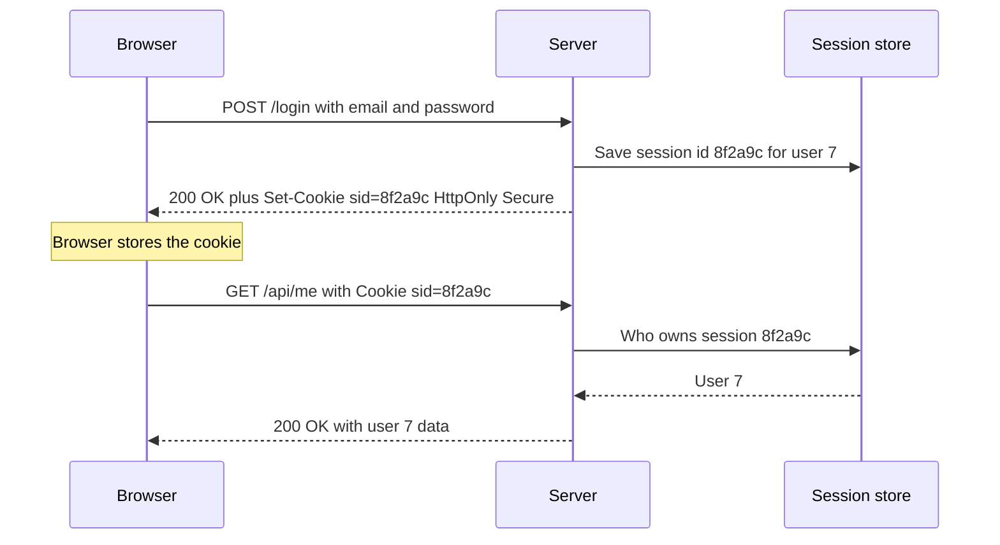
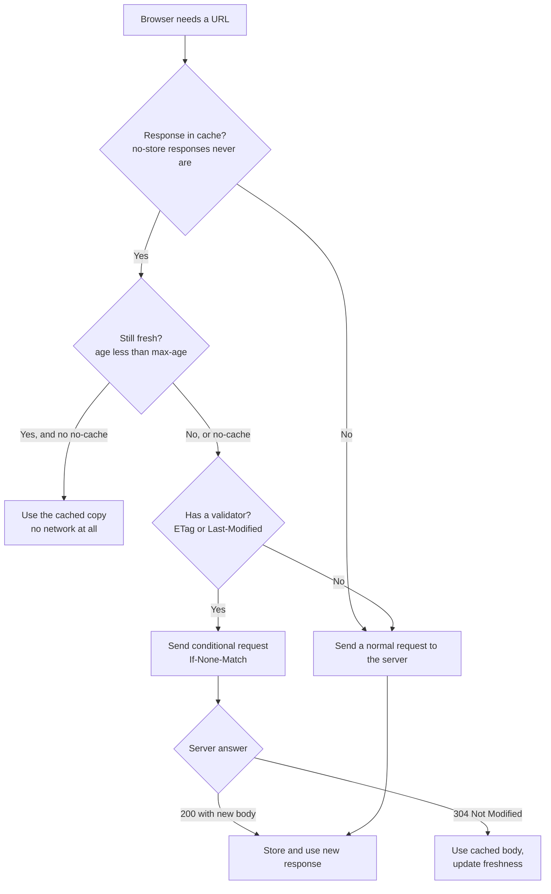
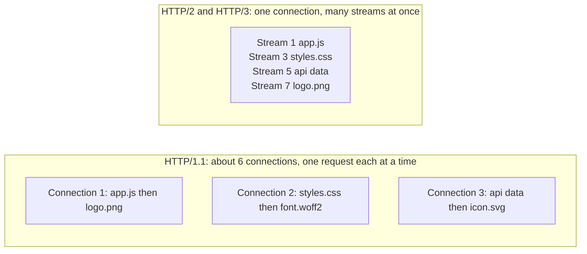
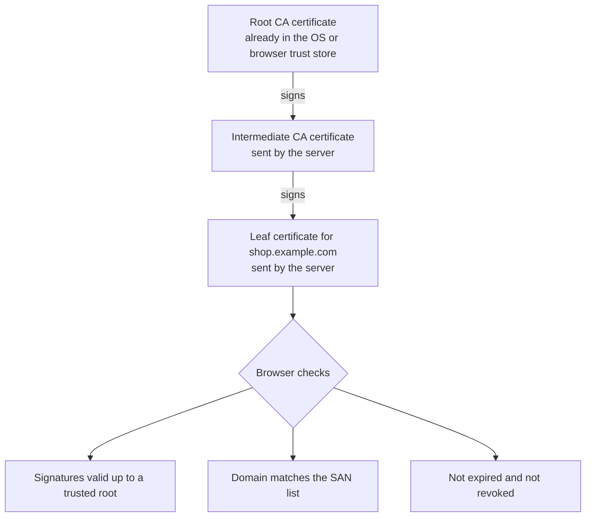
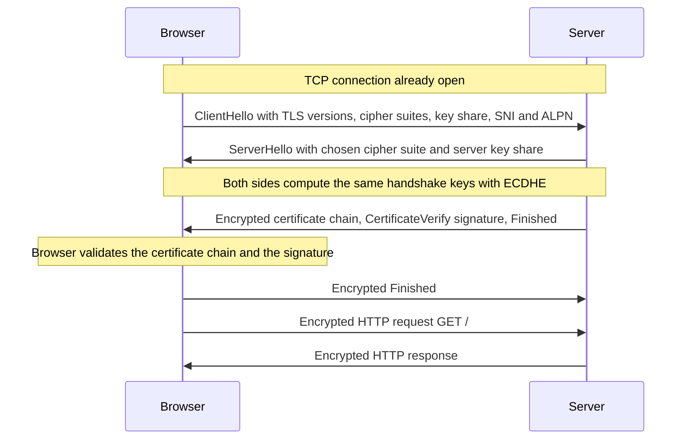

# HTTP, HTTPS and TLS

> In this document you will learn how HTTP works: requests and responses, methods, status codes, headers, cookies, caching, the differences between HTTP/1.1, HTTP/2 and HTTP/3, and how HTTPS and TLS keep traffic private and trusted. Almost every frontend, backend and full-stack interview has questions from this topic, such as "PUT vs PATCH", "401 vs 403", "no-cache vs no-store" and "how does HTTPS work?".

**Before this:** [Networking: TCP/IP, ports and DNS](04-networking-tcp-ip-and-dns.md) · **Interview questions:** [jump to the interview section](#interview-questions)

## Table of contents

1. [What HTTP is](#what-http-is)
2. [Request and response structure](#request-and-response-structure)
3. [HTTP methods](#http-methods)
4. [Safe and idempotent methods](#safe-and-idempotent-methods)
5. [Status codes](#status-codes)
6. [Important headers](#important-headers)
7. [Statelessness, cookies and sessions](#statelessness-cookies-and-sessions)
8. [HTTP caching](#http-caching)
9. [CORS headers overview](#cors-headers-overview)
10. [Compression](#compression)
11. [HTTP versions 1.1 vs 2 vs 3](#http-versions-11-vs-2-vs-3)
12. [HTTPS and TLS](#https-and-tls)
13. [WebSocket and Server-Sent Events](#websocket-and-server-sent-events)
14. [Using HTTP correctly from JavaScript](#using-http-correctly-from-javascript)
15. [How to explain this in an interview](#how-to-explain-this-in-an-interview)
16. [Interview questions](#interview-questions)
17. [Summary](#summary)
18. [References](#references)

---

## What HTTP is

**HTTP (HyperText Transfer Protocol)** is the language browsers, apps and servers use to ask for things and send things over the web. It is an **application-layer** protocol. It runs on top of a transport connection: TCP for HTTP/1.1 and HTTP/2, QUIC for HTTP/3 (see [Networking](04-networking-tcp-ip-and-dns.md)).

HTTP follows a **request–response** model:

1. A **client** (browser, mobile app, Node.js service, `curl`) sends a **request**: "Please give me `/products`."
2. A **server** sends back a **response**: "Here it is, status 200, and here is the JSON."

The client always starts. A server cannot send an HTTP response without a request. (For server-initiated messages, you use WebSocket or Server-Sent Events, covered [later](#websocket-and-server-sent-events).)

**Analogy:** HTTP is like ordering at a restaurant counter. You say what you want (method and path), add details (headers: "no onions", "I pay by card"), maybe hand over something (body). The cashier answers with a result code ("here you go", "sold out", "you are not allowed in the kitchen") and your order.

Where the analogy breaks: the cashier does not remember you between orders. HTTP is **stateless**. Every request must carry everything the server needs (for example a cookie that says who you are). This is explained in [Statelessness, cookies and sessions](#statelessness-cookies-and-sessions).

### A URL in one picture

```text
https://shop.example.com:443/products/42?color=red&size=m#reviews
\___/   \______________/\__/\__________/\_________________/\______/
scheme        host      port    path          query          fragment
```

- The **scheme** (`https`) says which protocol to use.
- The **host** is resolved with DNS. The **port** defaults to 443 for HTTPS and 80 for HTTP.
- The **path** and **query** are sent to the server.
- The **fragment** (`#reviews`) is **never sent** to the server. Only the browser uses it (for scrolling, or for old hash-based routing in SPAs).

URL parsing in detail is in [What happens when you type a URL](06-what-happens-when-you-type-a-url.md#stage-1-the-browser-understands-what-you-typed).

---

## Request and response structure

HTTP/1.1 messages are plain text (HTTP/2 and HTTP/3 send the same information in a binary format, but the meaning is the same).

### A request

```text
POST /api/orders HTTP/1.1
Host: shop.example.com
Content-Type: application/json
Accept: application/json
Authorization: Bearer eyJhbGciOi...
Content-Length: 41

{"productId": 42, "quantity": 2}
```

| Part | What it is |
| --- | --- |
| **Request line** | Method (`POST`), path (`/api/orders`), protocol version |
| **Headers** | `Name: value` pairs with extra information about the request |
| **Empty line** | Marks the end of the headers |
| **Body** (optional) | The data you send. GET requests normally have no body |

### A response

```text
HTTP/1.1 201 Created
Content-Type: application/json
Location: /api/orders/9001
Cache-Control: no-store
Content-Length: 37

{"orderId": 9001, "status": "pending"}
```

| Part | What it is |
| --- | --- |
| **Status line** | Protocol version, **status code** (`201`), reason phrase (`Created`) |
| **Headers** | Information about the response |
| **Body** | The content (HTML, JSON, image bytes...) |

### Seeing real messages

You can see these messages with `curl -v` (lines starting with `>` are sent, `<` are received) or in the browser's DevTools Network tab.

```bash
curl -v https://shop.example.com/api/products/42
# > GET /api/products/42 HTTP/2
# > Host: shop.example.com
# > Accept: */*
# < HTTP/2 200
# < content-type: application/json
# < cache-control: max-age=60
```

### A tiny HTTP server in Node.js

```js
import http from 'node:http';

const server = http.createServer((req, res) => {
  console.log(req.method, req.url, req.headers['content-type']);
  // POST /api/orders application/json

  res.statusCode = 201;
  res.setHeader('Content-Type', 'application/json');
  res.setHeader('Location', '/api/orders/9001');
  res.end(JSON.stringify({ orderId: 9001, status: 'pending' }));
});

server.listen(3000);
```

Express, Fastify and NestJS are built on top of this same `req`/`res` model (see [HTTP servers and Express](../07-nodejs-backend/06-http-servers-and-express.md)).

---

## HTTP methods

The **method** (also called a verb) says what the client wants to do with the resource.

| Method | Meaning | Has body? | Typical success code | Example |
| --- | --- | --- | --- | --- |
| **GET** | Read a resource | No | 200 | `GET /api/products/42` |
| **POST** | Create a resource, or start a process | Yes | 201 (created) or 200/202 | `POST /api/orders` |
| **PUT** | Replace the whole resource at this URL (create it if your API allows) | Yes | 200 or 204 (201 if created) | `PUT /api/users/7/profile` |
| **PATCH** | Change part of a resource | Yes | 200 or 204 | `PATCH /api/users/7` with `{"phone": "..."}` |
| **DELETE** | Remove a resource | Usually no | 204 or 200 | `DELETE /api/cart/items/3` |
| **HEAD** | Like GET, but only headers, no body | No | 200 | Check if a file exists or its size |
| **OPTIONS** | Ask which methods and headers are allowed | No | 204 or 200 | Used by browsers for CORS preflight |

### GET vs POST

- **GET** reads data. Parameters go in the URL (`?search=shoes&page=2`). It can be cached, bookmarked and shared. URLs are stored in browser history and server logs, so **never put passwords or tokens in a GET query string**.
- **POST** sends data in the body. It is used for creating things and for actions with side effects (place order, send email). It is not cached by default, and a browser warns before re-submitting a POST form.

```js
// ❌ Wrong: a GET that changes data. A crawler, a prefetch or a link preview could trigger it.
app.get('/api/orders/9001/cancel', cancelOrder);

// ✅ Correct: state changes use POST, PATCH or DELETE
app.post('/api/orders/9001/cancel', cancelOrder);
```

### PUT vs PATCH

Imagine this stored user:

```json
{ "id": 7, "name": "Asha", "email": "asha@example.com", "phone": "111" }
```

**PUT replaces the whole resource.** The body is the complete new version:

```text
PUT /api/users/7
{ "id": 7, "name": "Asha", "email": "asha@new.com" }
```

After this, `phone` is **gone**, because the new full representation did not include it (or, if your API requires all fields, the server rejects the request with 400 or 422).

**PATCH changes only what you send:**

```text
PATCH /api/users/7
Content-Type: application/merge-patch+json
{ "email": "asha@new.com" }
```

After this, `name` and `phone` stay the same and only `email` changes.

There are two standard PATCH formats:

| Format | Content-Type | Example body |
| --- | --- | --- |
| JSON Merge Patch (RFC 7396) | `application/merge-patch+json` | `{ "email": "asha@new.com", "phone": null }` (null means delete the field) |
| JSON Patch (RFC 6902) | `application/json-patch+json` | `[{ "op": "replace", "path": "/email", "value": "asha@new.com" }]` |

Many APIs simply accept `application/json` with a partial object, which behaves like merge patch.

### POST vs PUT

- With **POST**, the **server** chooses the new resource's URL: `POST /api/orders` → `201 Created`, `Location: /api/orders/9001`. Sending it twice creates two orders.
- With **PUT**, the **client** knows the URL: `PUT /api/users/7/avatar`. Sending it twice leaves the same result as sending it once.

REST API design in depth (resource naming, pagination, versioning) is in [REST API design](../07-nodejs-backend/07-rest-api-design.md).

---

## Safe and idempotent methods

These two properties come from the HTTP standard (RFC 9110). They decide what can be cached, prefetched and **retried automatically**.

- A **safe** method does not change anything on the server. It is read-only (logging and metrics do not count).
- An **idempotent** method has the **same effect** whether you send it once or ten times.

| Method | Safe | Idempotent | Cacheable by default |
| --- | --- | --- | --- |
| GET | Yes | Yes | Yes |
| HEAD | Yes | Yes | Yes |
| OPTIONS | Yes | Yes | No |
| PUT | No | Yes | No |
| DELETE | No | Yes | No |
| POST | No | **No** | Only with explicit freshness info (rare) |
| PATCH | No | **No** (not guaranteed) | No |

Examples:

- `DELETE /cart/items/3` twice: the first call removes the item, the second finds nothing to remove. The **state** of the server is the same either way, so DELETE is idempotent. The second call may return 404 instead of 204. Idempotency is about the **effect on the server**, not about getting the same response.
- `PUT /users/7` with the same body twice: same final user. Idempotent.
- `POST /orders` twice: two orders. Not idempotent.
- `PATCH /counter` with `{"op": "increment"}` twice: counter goes up by 2. Not idempotent. (A PATCH that sets `email` to a fixed value would be idempotent in practice, but the standard does not promise it.)

### Why idempotency matters: retries

Networks fail. A request can time out **after** the server already did the work. Should the client retry?

- For idempotent methods, retrying is safe. Browsers, proxies and HTTP libraries may retry them automatically.
- For POST, a blind retry can create a duplicate order or charge a card twice.

The common fix is an **idempotency key**: the client generates a unique ID for one logical operation and sends it in a header. The server remembers results by key and returns the saved result for repeats.

```js
import http from 'node:http';

const processed = new Map(); // idempotency key -> saved response
let ordersCreated = 0;

const server = http.createServer((req, res) => {
  if (req.method === 'POST' && req.url === '/orders') {
    const key = req.headers['idempotency-key'];
    if (key && processed.has(key)) {
      res.writeHead(200, { 'Content-Type': 'application/json' });
      return res.end(processed.get(key)); // same answer, no second order
    }
    ordersCreated++;
    const body = JSON.stringify({ orderId: ordersCreated });
    if (key) processed.set(key, body);
    res.writeHead(201, { 'Content-Type': 'application/json' });
    return res.end(body);
  }
  res.writeHead(404);
  res.end();
});

server.listen(3004, async () => {
  const key = crypto.randomUUID(); // one key per logical "place order" action
  const send = () =>
    fetch('http://localhost:3004/orders', { method: 'POST', headers: { 'Idempotency-Key': key } });

  const a = await send();
  const b = await send(); // a retry, for example after a timeout
  console.log(a.status, await a.text()); // 201 {"orderId":1}
  console.log(b.status, await b.text()); // 200 {"orderId":1}
  console.log('orders created:', ordersCreated); // orders created: 1
  server.close();
});
```

In production, the key store is a database or Redis with an expiry, and the "check and save" must be atomic so two parallel retries cannot both create an order. Payment providers such as Stripe use exactly this `Idempotency-Key` header pattern.

---

## Status codes

The **status code** is a three-digit number that tells the client how the request went. The first digit is the **family**.

| Family | Meaning | Think of it as |
| --- | --- | --- |
| **1xx** | Informational | "Wait, more is coming" (`101 Switching Protocols`, `103 Early Hints`) |
| **2xx** | Success | "Done" |
| **3xx** | Redirection | "Look somewhere else" or "use your cached copy" |
| **4xx** | Client error | "You sent something wrong" (fix the request) |
| **5xx** | Server error | "We failed" (the request may be fine) |

### Success codes

| Code | Name | When to use |
| --- | --- | --- |
| **200** | OK | General success with a body (`GET` returned data, `PATCH` returned the updated resource) |
| **201** | Created | A new resource was created (usually from POST). Add a `Location` header with its URL |
| **202** | Accepted | Request accepted, but processing happens later (a background job, video encoding) |
| **204** | No Content | Success with no body (`DELETE`, or a `PUT` that returns nothing) |
| **206** | Partial Content | Response to a `Range` request (video streaming, resuming downloads) |

### Redirect codes

| Code | Name | Permanent? | Method on redirect | Typical use |
| --- | --- | --- | --- | --- |
| **301** | Moved Permanently | Yes | Browsers may change POST to GET (historical behavior) | Old URL moved forever (`http://` → `https://`, old blog slug) |
| **302** | Found | No | Browsers may change POST to GET (historical behavior) | Temporary redirect (send to login page) |
| **303** | See Other | No | Always GET | After a form POST, send the browser to a result page (Post/Redirect/Get pattern) |
| **307** | Temporary Redirect | No | **Keeps** method and body | Temporary move of an API endpoint that receives POST |
| **308** | Permanent Redirect | Yes | **Keeps** method and body | Permanent move of an API endpoint that receives POST |
| **304** | Not Modified | — | — | Not a real redirect: "your cached copy is still valid" (see [caching](#http-caching)) |

Remember it like this: **301/302 are the old codes** with unclear method handling. **307/308 were added** to guarantee that the method and body are kept. Permanent redirects (301, 308) are cached by browsers, sometimes for a long time, so test them carefully before shipping.

### Client error codes

| Code | Name | When to use |
| --- | --- | --- |
| **400** | Bad Request | The request is malformed: invalid JSON, missing required field, wrong type |
| **401** | Unauthorized | Really means **unauthenticated**: no credentials, or invalid/expired ones. "Who are you?" Should include a `WWW-Authenticate` header |
| **403** | Forbidden | Authenticated, but **not allowed**. "I know who you are, and the answer is no." |
| **404** | Not Found | The resource does not exist (or you hide that it exists) |
| **405** | Method Not Allowed | The URL exists but not with this method (`DELETE /api/products`). Include an `Allow` header |
| **409** | Conflict | The request conflicts with the current state: duplicate username, editing an outdated version |
| **412** | Precondition Failed | A condition like `If-Match` failed (someone else changed the resource first) |
| **415** | Unsupported Media Type | The server does not accept this `Content-Type` |
| **422** | Unprocessable Content | The syntax is fine but the content is invalid by business rules (email format wrong, end date before start date) |
| **429** | Too Many Requests | Rate limit hit. Include `Retry-After` |

**400 vs 422:** both are used for validation errors in real APIs. A common convention: 400 for "cannot parse or wrong shape", 422 for "parsed fine, but the values break validation rules". Pick one convention and use it consistently.

**401 vs 403:** if logging in (or refreshing the token) could fix it, use 401. If the user is logged in and still not allowed, use 403. Some APIs return 404 instead of 403 to avoid revealing that a resource exists (for example another tenant's invoice).

### Server error codes

| Code | Name | Meaning | Who failed |
| --- | --- | --- | --- |
| **500** | Internal Server Error | Unexpected error in the app (an unhandled exception) | Your application |
| **502** | Bad Gateway | A proxy or load balancer got an **invalid response** from the upstream server (connection reset, garbage, crash) | The upstream, seen by the proxy |
| **503** | Service Unavailable | The server is **temporarily** unable to handle requests: overloaded, in maintenance, no healthy instances. Can include `Retry-After` | The service (temporarily) |
| **504** | Gateway Timeout | A proxy **waited too long** for the upstream to answer | The upstream was too slow |

A practical way to read them: 502 means "the upstream answered badly or hung up", 504 means "the upstream never answered in time", 503 means "we are deliberately not serving right now".

---

## Important headers

Headers are case-insensitive. HTTP/2 and HTTP/3 send them in lowercase.

### Content headers and content negotiation

| Header | Direction | Example | Meaning |
| --- | --- | --- | --- |
| `Content-Type` | Both | `application/json; charset=utf-8` | The format of the body being sent |
| `Accept` | Request | `application/json` | Formats the client can accept |
| `Content-Length` | Both | `348` | Body size in bytes |
| `Content-Encoding` | Response | `br` | The body is compressed with this algorithm |
| `Accept-Encoding` | Request | `gzip, deflate, br, zstd` | Compression the client supports |
| `Accept-Language` | Request | `en-US,en;q=0.9,hi;q=0.8` | Preferred languages (`q` is a priority weight) |

**Content negotiation** means the client says what it accepts (`Accept`, `Accept-Language`, `Accept-Encoding`), and the server picks the best version.

```js
// ❌ Wrong: sending JSON without Content-Type. Many servers will not parse the body.
fetch('/api/orders', { method: 'POST', body: JSON.stringify(order) });

// ✅ Correct
fetch('/api/orders', {
  method: 'POST',
  headers: { 'Content-Type': 'application/json' },
  body: JSON.stringify(order),
});
```

### Request context headers

| Header | Example | Meaning |
| --- | --- | --- |
| `Host` | `shop.example.com` | Which website on this server. Required in HTTP/1.1, so one IP can host many sites. In HTTP/2 and 3 it is the `:authority` pseudo-header |
| `User-Agent` | `Mozilla/5.0 ...` | Which client software |
| `Origin` | `https://app.example.com` | Which origin started the request (sent on CORS and most POST requests) |
| `Referer` | `https://app.example.com/cart` | The page the request came from (the misspelling is historical) |
| `Authorization` | `Bearer eyJ...` or `Basic dXNlcjpwYXNz` | Credentials |
| `Cookie` | `sid=abc123; theme=dark` | Cookies the browser sends back |

### Response headers you will set often

| Header | Example | Meaning |
| --- | --- | --- |
| `Location` | `/api/orders/9001` | URL of a created resource (201) or a redirect target (3xx) |
| `Set-Cookie` | `sid=abc; HttpOnly; Secure` | Store a cookie in the browser |
| `Cache-Control` | `max-age=3600` | Caching rules (see [HTTP caching](#http-caching)) |
| `ETag` | `"a1b2c3"` | Version identifier of the response, for revalidation |
| `Retry-After` | `120` | Seconds to wait (with 429 or 503) |
| `WWW-Authenticate` | `Bearer realm="api"` | How to authenticate (with 401) |
| `Strict-Transport-Security` | `max-age=31536000; includeSubDomains` | Use HTTPS only (see [HSTS](#hsts)) |

Security headers such as `Content-Security-Policy`, `X-Content-Type-Options` and `X-Frame-Options` are covered in [Browser storage and web security basics](08-browser-storage-and-web-security-basics.md#xss).

---

## Statelessness, cookies and sessions

### What "stateless" means

HTTP is **stateless**: each request is independent. The server does not remember the previous request from the same client by itself. If you log in with one request, the next request does not automatically "know" you.

**Why it is designed this way:** stateless requests are easy to scale. Any server behind a load balancer can handle any request, because everything needed is inside the request. Servers can restart without breaking a conversation.

To build logged-in experiences on top of a stateless protocol, the client sends some **proof of identity with every request**. The two common ways:

1. A **cookie** with a session ID (the browser sends it automatically).
2. A **token** in the `Authorization` header (the app's code adds it).

### What a cookie is

A **cookie** is a small piece of data (name and value, up to about 4 KB) that a server asks the browser to store with the `Set-Cookie` response header. The browser then sends it back automatically in the `Cookie` request header on matching requests.

```text
HTTP/1.1 200 OK
Set-Cookie: __Host-sid=8f2a9c...; Path=/; Secure; HttpOnly; SameSite=Lax; Max-Age=3600
```

Next request from the browser:

```text
GET /api/me HTTP/1.1
Host: shop.example.com
Cookie: __Host-sid=8f2a9c...
```

### Session login flow



Here is the same flow in runnable Node.js (the client is `fetch` in Node, so we copy the cookie by hand; a browser does that automatically):

```js
import http from 'node:http';
import crypto from 'node:crypto';

const sessions = new Map(); // sessionId -> user (use Redis or a database in production)

const server = http.createServer((req, res) => {
  if (req.method === 'POST' && req.url === '/login') {
    // (password check skipped in this example)
    const sessionId = crypto.randomBytes(16).toString('hex'); // long, random, unguessable
    sessions.set(sessionId, { name: 'Asha' });
    res.setHeader(
      'Set-Cookie',
      `__Host-sid=${sessionId}; Path=/; Secure; HttpOnly; SameSite=Lax; Max-Age=3600`
    );
    return res.end('logged in');
  }
  if (req.url === '/me') {
    const cookies = Object.fromEntries(
      (req.headers.cookie ?? '').split('; ').filter(Boolean).map((c) => c.split('='))
    );
    const user = sessions.get(cookies['__Host-sid']);
    if (!user) {
      res.statusCode = 401;
      return res.end('not logged in');
    }
    return res.end(`hello ${user.name}`);
  }
  res.statusCode = 404;
  res.end();
});

server.listen(3003, async () => {
  const login = await fetch('http://localhost:3003/login', { method: 'POST' });
  const setCookie = login.headers.getSetCookie()[0];
  console.log(setCookie.replace(/=[0-9a-f]{32}/, '=<random>'));
  // __Host-sid=<random>; Path=/; Secure; HttpOnly; SameSite=Lax; Max-Age=3600
  const cookie = setCookie.split(';')[0];

  const anonymous = await fetch('http://localhost:3003/me');
  console.log(anonymous.status, await anonymous.text()); // 401 not logged in

  const me = await fetch('http://localhost:3003/me', { headers: { Cookie: cookie } });
  console.log(me.status, await me.text()); // 200 hello Asha
  server.close();
});
```

### Cookie attributes

| Attribute | Example | What it does |
| --- | --- | --- |
| `Expires` | `Expires=Wed, 21 Oct 2026 07:28:00 GMT` | Delete the cookie at this date |
| `Max-Age` | `Max-Age=3600` | Delete the cookie after N seconds. Wins over `Expires` if both are set. `0` deletes immediately |
| (neither) | | A **session cookie**: deleted when the browser session ends (browsers that restore sessions may keep it) |
| `Domain` | `Domain=shop.example.com` | Send the cookie to this domain **and all its subdomains**. If omitted, the cookie is **host-only** (sent only to the exact host that set it), which is stricter |
| `Path` | `Path=/api` | Send only for URLs under this path. It is **not** a security boundary |
| `Secure` | `Secure` | Send only over HTTPS (browsers make an exception for `http://localhost`) |
| `HttpOnly` | `HttpOnly` | JavaScript cannot read it through `document.cookie`. Protects the value from theft by XSS |
| `SameSite` | `SameSite=Lax` | Controls whether the cookie is sent on **cross-site** requests (see below) |
| `Partitioned` | `Partitioned` | Store a third-party cookie separately for each top-level site (CHIPS). Requires `Secure` |

**SameSite values:**

| Value | Sent on same-site requests | Sent on cross-site top-level link navigation (GET) | Sent on cross-site POST, fetch, iframe, image |
| --- | --- | --- | --- |
| `Strict` | Yes | No | No |
| `Lax` | Yes | Yes | No |
| `None` | Yes | Yes | Yes (must also have `Secure`) |

Example: a user is logged in to `bank.com`. They click a link to `bank.com` from an email. With `Strict`, the first page load arrives **without** the cookie, so the user looks logged out. With `Lax`, the link works, but a hidden form on `evil.com` that POSTs to `bank.com` does not get the cookie. That is why `Lax` is a good default and an important CSRF defense.

**Default when SameSite is missing:** Chrome and other Chromium-based browsers (such as Edge) treat a cookie without `SameSite` as `Lax`. Firefox and Safari do not apply this default at the time of writing. So always set `SameSite` explicitly.

**Cookie name prefixes** add browser-enforced rules:

- `__Secure-name`: the cookie must have `Secure` and come from an HTTPS page.
- `__Host-name`: must have `Secure`, must have `Path=/`, and must **not** have `Domain`. This locks the cookie to exactly one host, so a subdomain cannot overwrite it. Good choice for session cookies.

**Lifetime limit:** Chrome caps cookie lifetimes at 400 days, even if `Max-Age` or `Expires` asks for longer (following the updated cookie specification draft).

Cookie storage limits, `document.cookie`, third-party cookies and where to store tokens are covered in [Browser storage and web security basics](08-browser-storage-and-web-security-basics.md). CSRF is explained in [Browser storage and web security basics](08-browser-storage-and-web-security-basics.md#csrf).

### Cookies vs tokens in the Authorization header

| | Session cookie | Token in `Authorization` header |
| --- | --- | --- |
| Who sends it | Browser, automatically | Your code, explicitly |
| Can JavaScript read it? | Not with `HttpOnly` | Yes (it must, to attach it) |
| XSS risk | Value cannot be stolen (but injected script can still make requests as the user) | Value can be stolen if stored where scripts can read it |
| CSRF risk | Yes, because it is sent automatically. Use `SameSite` and CSRF tokens | No, because the attacker's site cannot add your header |
| Works for mobile apps and server-to-server | Possible but awkward | Natural fit |

Auth implementation is covered in [Authentication and authorization](../07-nodejs-backend/09-authentication-and-authorization.md).

---

## HTTP caching

### What it is and why it exists

**HTTP caching** means storing a copy of a response so the same request can be answered later **without** going back to the origin server, or with a much cheaper check.

Benefits:

- **Faster** pages: a cached file loads in a few milliseconds instead of a network round trip.
- **Less load** on servers and less bandwidth cost.
- Pages can even work when the network is slow.

The risk: users can see **stale** (outdated) data, or, if you configure it badly, **another user's private data**.

### Where caches live

| Cache | Location | Shared between users? |
| --- | --- | --- |
| **Browser cache** (private cache) | The user's browser: memory cache and disk cache | No, one user only |
| **Shared caches** | CDNs, reverse proxies (Nginx, Varnish), corporate proxies | **Yes**, many users get the same copy |

This difference matters: a response with a user's account details must never be stored in a **shared** cache.

### Freshness: can I reuse it without asking?

A cached response is **fresh** for a while. While fresh, the cache uses it directly, with no network request at all.

```text
Cache-Control: max-age=3600
```

means "this response is fresh for 3600 seconds after it was generated". The `Age` response header (added by shared caches) says how old a copy already is.

Older servers use `Expires: <date>`. If both exist, `max-age` wins.

### Revalidation: is my stale copy still OK?

When a copy is **stale**, the cache does not have to download it again. It can ask the server "has this changed?" using a **validator**:

| Validator in the response | Conditional header the cache sends | If unchanged |
| --- | --- | --- |
| `ETag: "v42"` (a version ID for the content) | `If-None-Match: "v42"` | `304 Not Modified`, no body |
| `Last-Modified: Tue, 14 Oct 2026 10:00:00 GMT` | `If-Modified-Since: Tue, 14 Oct 2026 10:00:00 GMT` | `304 Not Modified`, no body |

A 304 response is tiny. The browser then uses its cached body. You still pay one round trip, but you skip downloading the content.

`ETag` is more precise than `Last-Modified` (which only has one-second precision and can change without content changes). A **weak ETag** looks like `W/"v42"` and means "semantically the same", for example the same content with different compression.

### Example: ETag and 304 in Node.js

```js
import http from 'node:http';
import crypto from 'node:crypto';

const products = [{ id: 1, name: 'Keyboard', price: 49 }];

const server = http.createServer((req, res) => {
  const body = JSON.stringify(products);
  // The ETag is a hash of the content: same content, same ETag.
  const etag = '"' + crypto.createHash('sha1').update(body).digest('base64url').slice(0, 16) + '"';

  res.setHeader('ETag', etag);
  res.setHeader('Cache-Control', 'no-cache'); // may store, but must revalidate before every reuse

  if (req.headers['if-none-match'] === etag) {
    res.statusCode = 304; // Not Modified: no body
    return res.end();
  }
  res.setHeader('Content-Type', 'application/json');
  res.end(body);
});

server.listen(3001, async () => {
  const first = await fetch('http://localhost:3001/products');
  const etag = first.headers.get('etag');
  console.log(first.status, (await first.text()).length, 'bytes'); // 200 39 bytes

  const second = await fetch('http://localhost:3001/products', {
    headers: { 'If-None-Match': etag },
  });
  console.log(second.status, (await second.text()).length, 'bytes'); // 304 0 bytes

  products.push({ id: 2, name: 'Mouse', price: 19 }); // the data changes
  const third = await fetch('http://localhost:3001/products', {
    headers: { 'If-None-Match': etag },
  });
  console.log(third.status, (await third.text()).length, 'bytes'); // 200 74 bytes
  server.close();
});
```

Walkthrough:

1. First request: no `If-None-Match`, so the server sends the full body (39 bytes) with an ETag.
2. Second request: the client sends the ETag back. The content hash is the same, so the server answers `304` with no body.
3. The data changes, so the hash changes. The old ETag no longer matches, and the server sends the new full body (74 bytes).

In a browser, you never write steps 2 and 3 yourself. The browser cache stores the ETag and sends `If-None-Match` automatically. (Express generates weak ETags for responses automatically.)

### Cache-Control directives you must know

| Directive | Meaning |
| --- | --- |
| `max-age=N` | Fresh for N seconds |
| `s-maxage=N` | Like `max-age`, but only for shared caches (CDN). Overrides `max-age` there |
| `no-cache` | You **may store** it, but you **must revalidate** with the server before every reuse |
| `no-store` | **Do not store** it anywhere. Every request goes to the server |
| `private` | Only the browser may store it. Shared caches (CDN) must not |
| `public` | Any cache may store it, even responses that normally are not cached (like ones with `Authorization`) |
| `must-revalidate` | Once stale, never use it without a successful revalidation (do not serve stale on errors) |
| `immutable` | This content will never change while fresh. Do not even revalidate when the user reloads |
| `stale-while-revalidate=N` | After it becomes stale, you may still serve it for N more seconds while refreshing in the background |
| `stale-if-error=N` | If the origin fails, you may serve the stale copy for N seconds |

### no-cache vs no-store (a favorite interview question)

The names are confusing:

- **`no-cache`** does **not** mean "do not cache". It means "cache it, but **check with me every time** before using it". With an ETag, the check is usually a cheap 304.
- **`no-store`** really means "do not cache at all". Use it for sensitive data: banking pages, personal medical data, one-time tokens.

### Heuristic caching: when you set nothing

If a response has **no** `Cache-Control` and **no** `Expires`, but has `Last-Modified`, browsers may guess a freshness time (commonly 10% of the time since it was last modified). A file last modified 10 days ago might be reused for about a day **without asking**. This surprises teams after a deploy. Always set `Cache-Control` explicitly.

### Vary: one URL, several versions

`Vary` tells caches which request headers change the response.

```text
Vary: Accept-Encoding
```

means "the gzip version and the Brotli version are different responses; store them separately". `Vary: Accept-Language` does the same for languages.

Be careful with `Vary: Cookie` or `Vary: Authorization` on CDNs: every user gets a separate cache entry, so the cache becomes almost useless. For personalized responses, use `private` or `no-store` instead.

### How a cache decides



### Caching recipes for a real Angular or React app

| Resource | Example | Recommended header | Why |
| --- | --- | --- | --- |
| Hashed build files | `main.3f9a1c7e.js`, `styles.8b2d.css` | `Cache-Control: public, max-age=31536000, immutable` | The file name changes when the content changes, so the old URL can be cached forever |
| `index.html` | `/`, `/index.html` | `Cache-Control: no-cache` | Must always point to the newest hashed bundles after a deploy. Revalidation is cheap |
| Public API data | `GET /api/products` | `Cache-Control: public, max-age=60, stale-while-revalidate=300` | Slightly stale data is fine, and it saves a lot of load |
| User-specific API data | `GET /api/me/orders` | `Cache-Control: private, no-cache` or `private, max-age=0` | Never in a shared cache; always fresh |
| Sensitive data | Bank statement, tokens | `Cache-Control: no-store` | Do not leave copies on disk or in proxies |
| Images without hashes | `/images/logo.png` | `Cache-Control: public, max-age=86400` plus an ETag | A day of reuse, then a cheap revalidation |

Angular CLI production builds add content hashes to file names by default (`outputHashing`), which is what makes the "cache forever" rule safe.

Cross-layer caching strategy (CDN, application cache, database cache, invalidation) is covered in [Caching strategies and invalidation](../09-system-design/03-caching-strategies-and-invalidation.md). Redis caching in Node.js is in [Caching](../07-nodejs-backend/11-caching.md).

---

## CORS headers overview

Browsers follow the **same-origin policy**: JavaScript on `https://app.example.com` cannot read a response from `https://api.other.com` unless that server allows it. **CORS (Cross-Origin Resource Sharing)** is the set of HTTP headers a server uses to say "this other origin may read my responses".

| Header | Sent by | Example | Meaning |
| --- | --- | --- | --- |
| `Origin` | Browser | `https://app.example.com` | Who is asking |
| `Access-Control-Allow-Origin` | Server | `https://app.example.com` | Which origin may read the response (`*` means any origin, but it is not allowed together with credentials) |
| `Access-Control-Allow-Credentials` | Server | `true` | The response may be read even when cookies were sent |
| `Access-Control-Allow-Methods` | Server (preflight) | `GET, POST, PATCH` | Allowed methods |
| `Access-Control-Allow-Headers` | Server (preflight) | `Content-Type, Authorization` | Allowed request headers |
| `Access-Control-Max-Age` | Server (preflight) | `600` | How long the browser may cache the preflight answer |
| `Access-Control-Expose-Headers` | Server | `X-Total-Count` | Extra response headers JavaScript may read |

For "non-simple" requests (for example a `PATCH`, a `POST` with `Content-Type: application/json`, or any request with an `Authorization` header), the browser first sends an **OPTIONS preflight** request to ask permission.

Two key facts:

- CORS is enforced **by the browser**, to protect **users**. It does not protect your server: `curl` or a Node script ignores CORS completely. Your API still needs authentication and authorization.
- A CORS error in the console usually means the **server** is missing a header. You fix it on the server (or with a dev-server proxy), not in the frontend code.

Origins and the same-origin policy are explained in [Browser storage and web security basics](08-browser-storage-and-web-security-basics.md#the-same-origin-policy). CORS preflight rules, credentials and common misconfigurations are in [CORS](08-browser-storage-and-web-security-basics.md#cors).

---

## Compression

Text responses (HTML, CSS, JavaScript, JSON, SVG) compress very well. The browser says what it supports, and the server compresses the body:

```text
GET /api/products HTTP/1.1
Accept-Encoding: gzip, deflate, br, zstd

HTTP/1.1 200 OK
Content-Encoding: br
Vary: Accept-Encoding
```

| Algorithm | Header value | Notes |
| --- | --- | --- |
| gzip | `gzip` | Supported everywhere. Fast. Good default |
| Brotli | `br` | Usually noticeably smaller than gzip for text. Browsers only use it over HTTPS. Slow at the highest levels, so pre-compress static files at build time |
| Zstandard | `zstd` | Newer. Very fast with good ratios. Supported in newer browser versions |

Measured with Node's `zlib` on a JSON list of 500 products:

```js
import zlib from 'node:zlib';

const products = Array.from({ length: 500 }, (_, i) => ({
  id: i,
  name: `Product ${i}`,
  inStock: i % 3 !== 0,
}));
const json = JSON.stringify(products);

console.log('original:', json.length);                        // original: 23448
console.log('gzip:', zlib.gzipSync(json).length);             // gzip: 2771
console.log('brotli:', zlib.brotliCompressSync(json).length); // brotli: 1233
```

Repetitive JSON like this compresses extremely well. Real responses usually shrink less, but text still often becomes several times smaller.

Practical rules:

- Compress text. Do **not** compress JPEG, PNG, WebP, MP4 or ZIP files again: they are already compressed, so you only waste CPU.
- Usually the reverse proxy or CDN does compression, not your Node code.
- Always send `Vary: Accept-Encoding`, so caches do not give Brotli bytes to a client that only understands gzip.
- Security note: compressing responses that contain both a secret (like a CSRF token) and attacker-controlled text can leak the secret through response sizes (the BREACH attack). Keep secrets out of responses that reflect user input, or randomize them per response.

---

## HTTP versions 1.1 vs 2 vs 3

### HTTP/1.0 and HTTP/1.1

- **HTTP/1.0** (1996) opened a **new TCP connection for every request** by default. With many images and scripts, all those handshakes made pages slow.
- **HTTP/1.1** (1997, refined many times since) made **persistent connections** the default (keep-alive), required the `Host` header (so one IP can host many websites), and added chunked transfer encoding, better caching and range requests.

The big limit of HTTP/1.1: **one request at a time per connection**. The next request must wait until the previous response finishes. This is **head-of-line blocking** at the HTTP level. HTTP/1.1 defined **pipelining** (sending several requests without waiting), but responses still had to come back in order, and buggy proxies broke it, so browsers never enabled it.

Workarounds from the HTTP/1.1 era:

- Browsers open **about six parallel connections per host**.
- Developers used **domain sharding** (`static1.example.com`, `static2.example.com`), **bundling** many files into one, **image sprites** and **inlining** small files.

### HTTP/2

**HTTP/2** (2015, current spec RFC 9113) keeps the same meaning (methods, status codes, headers) but changes how messages travel:

- **Binary framing:** messages are split into binary **frames** instead of text lines. They are easier and faster to parse.
- **Multiplexing:** many requests and responses (**streams**) share **one TCP connection** at the same time, with their frames interleaved. No more waiting in line at the HTTP level.
- **Header compression (HPACK):** headers like cookies and user agents repeat on every request. HPACK sends them once and then refers to them.
- **Prioritization:** the client can hint which streams matter most.
- **Server push:** the server could send resources before the browser asked for them. It turned out to be hard to use well and rarely helped. **Chrome disabled it in version 106 (2022) and Firefox removed it in version 132 (2024).** Use `<link rel="preload">` or `103 Early Hints` instead.

In browsers, HTTP/2 is only used over HTTPS. The browser and server agree on HTTP/2 during the TLS handshake using **ALPN** (Application-Layer Protocol Negotiation).

With HTTP/2, domain sharding and aggressive bundling become unnecessary or even harmful (sharding forces extra connections and handshakes).

The remaining problem: HTTP/2 still runs on **TCP**. If one packet is lost, TCP holds back **all** later data until that packet is resent, so **all streams** stall. This is TCP-level head-of-line blocking.

### HTTP/3

**HTTP/3** (2022, RFC 9114) runs on **QUIC** over **UDP** instead of TCP:

- **No TCP head-of-line blocking:** QUIC delivers each stream independently. A lost packet only delays its own stream.
- **Faster connection setup:** QUIC combines the transport handshake and the TLS 1.3 handshake into **one round trip**, and resumed connections can send data in **zero** round trips (0-RTT).
- **Connection migration:** a connection survives when your phone moves from Wi-Fi to mobile data, because it is identified by a connection ID, not by IP and port.
- **Always encrypted:** TLS 1.3 is built into QUIC.
- **QPACK** header compression (HPACK adapted for independent streams).

How a browser discovers HTTP/3: a response over HTTP/2 or HTTP/1.1 includes an `Alt-Svc: h3=":443"` header, or the DNS `HTTPS` record advertises it. Then the browser tries QUIC. If UDP is blocked (some corporate networks do this), the browser falls back to TCP.

### Comparison

| | HTTP/1.1 | HTTP/2 | HTTP/3 |
| --- | --- | --- | --- |
| Transport | TCP | TCP | QUIC over UDP |
| Format | Text | Binary frames | Binary frames |
| Requests per connection at once | One | Many (multiplexed streams) | Many (independent streams) |
| Header compression | None | HPACK | QPACK |
| Head-of-line blocking | HTTP level and TCP level | TCP level only | None at the transport level |
| Encryption | Optional | Required by browsers | Always (built into QUIC) |
| Handshake for a new HTTPS connection | TCP + TLS (2 RTT with TLS 1.3) | Same as HTTP/1.1 | 1 RTT (0-RTT on resumption) |



### What changes for a developer

- Your code (`fetch`, Express routes, Angular `HttpClient`) does not change. The version is negotiated between the browser and the server, CDN or load balancer.
- Stop domain sharding. Prefer reasonable code splitting over one giant bundle, because many small requests are cheap with HTTP/2 and HTTP/3.
- Node's built-in `http` module speaks HTTP/1.1. Node has a separate `http2` module. In production, a CDN or reverse proxy usually speaks HTTP/2 and HTTP/3 to browsers and HTTP/1.1 to your Node app.

---

## HTTPS and TLS

### What it is

**HTTPS** is HTTP sent through an encrypted **TLS (Transport Layer Security)** connection. TLS is the successor of SSL. People still say "SSL certificate", but SSL itself is obsolete and insecure.

TLS gives you three guarantees:

| Guarantee | Meaning | Without it |
| --- | --- | --- |
| **Confidentiality** | Nobody on the path can read the data | Anyone on the café Wi-Fi can read passwords and cookies |
| **Integrity** | Nobody can change the data without being detected | An ISP or attacker can inject ads or malware into pages |
| **Authentication** | You are really talking to `shop.example.com`, not an impostor | An attacker can pretend to be your bank (man-in-the-middle) |

Today HTTPS is the normal default. Browsers mark HTTP pages as "Not secure". Many features (service workers, geolocation, camera, HTTP/2 and HTTP/3 in browsers) only work on HTTPS. Browsers are also moving to HTTPS by default: for example, Google announced that Chrome's "Always Use Secure Connections" setting becomes the default in Chrome 154 (October 2026). It tries HTTPS first and warns before loading a public site over plain HTTP.

### Symmetric vs asymmetric encryption

TLS uses both kinds of encryption, each for what it does best.

**Symmetric encryption** uses **one shared secret key** to encrypt and decrypt. Examples: AES-GCM, ChaCha20-Poly1305.

- Very fast. Good for encrypting large amounts of data.
- Problem: how do two strangers on the internet agree on a secret key without an eavesdropper learning it?

**Asymmetric encryption** (public-key cryptography) uses a **key pair**: a **public key** you can share with everyone, and a **private key** you keep secret. Examples: RSA, elliptic-curve keys (ECDSA, Ed25519).

- What the public key encrypts, only the private key can decrypt.
- The private key can create a **digital signature** that anyone can check with the public key. This proves who signed it.
- Much slower than symmetric encryption.

**Analogy:** asymmetric encryption is like a padlock you give away for free (the public key). Anyone can lock a box with it, but only you have the key that opens it (the private key). Symmetric encryption is like two people with copies of the same house key.

**How TLS combines them:** asymmetric cryptography is used during the handshake to **authenticate the server** (certificates and signatures) and to **agree on a shared secret** (key exchange). Then all the actual data is encrypted with fast **symmetric** keys derived from that secret.

### Key exchange with Diffie-Hellman

Modern TLS agrees on the shared secret using **Elliptic-Curve Diffie-Hellman Ephemeral (ECDHE)** key exchange. Each side creates a temporary key pair, sends its public part, and combines its own private part with the other side's public part. Both sides end up with the **same secret**, but the secret itself is **never sent** over the network. An eavesdropper sees only the public parts and cannot compute the secret.

**Analogy (paint mixing):** both people start with the same public yellow paint. Each adds a secret color and sends the mix to the other. Each then adds their own secret color to the mix they received. Both end with the same final color. An observer saw only the intermediate mixes, and "un-mixing" paint is practically impossible.

### Certificates and certificate authorities

The key exchange gives you a secret shared with **someone**. But how do you know that someone is really `shop.example.com` and not an attacker in the middle? That is the job of the **certificate**.

A **TLS certificate** is a file that says "this public key belongs to `shop.example.com`", **signed** by a trusted **certificate authority (CA)**. It contains:

- The **domain names** it is valid for (in the **Subject Alternative Name**, or SAN, field), for example `shop.example.com` and `*.shop.example.com`.
- The site's **public key**.
- The **issuer** (which CA signed it).
- A **validity period** (not before and not after dates).
- The CA's **signature**.

**Certificate authorities** (Let's Encrypt, DigiCert, Sectigo, Google Trust Services and others) check that the requester controls the domain before signing. Your operating system and browser ship with a list of trusted **root CA** certificates, called the **trust store**.

### The chain of trust

Root CAs do not sign website certificates directly. They sign **intermediate** CA certificates, and intermediates sign website (**leaf**) certificates. The server sends its leaf certificate **plus the intermediates**. The browser builds a chain up to a root it already trusts.



The browser checks:

1. Each signature in the chain is valid, ending at a trusted root.
2. The domain you visited matches a name in the certificate.
3. The certificate is within its validity dates. (This is why a wrong system clock causes certificate errors.)
4. The certificate has not been revoked, and it appears in public **Certificate Transparency** logs (Chrome and Safari require this for public certificates).

A common production bug: the server is configured with only the leaf certificate, without the intermediate. Desktop browsers sometimes cope (they may have the intermediate cached, or download it), but Node.js, mobile apps and `curl` fail with errors like `UNABLE_TO_VERIFY_LEAF_SIGNATURE`. Always install the **full chain**.

**Certificate lifetimes are getting shorter.** Under CA/Browser Forum rules, the maximum validity of public TLS certificates dropped from 398 days to 200 days in March 2026. It is scheduled to drop to 100 days in 2027 and 47 days in 2029. Automated renewal (for example with the ACME protocol used by Let's Encrypt) is now essential.

### The TLS 1.3 handshake

TLS 1.3 (RFC 8446, 2018) is the current version. TLS 1.2 is still widely supported. TLS 1.0 and 1.1 are deprecated and disabled in modern browsers.

For a new connection, after the TCP handshake:



Step by step:

1. **ClientHello:** the browser lists the TLS versions and cipher suites it supports. It sends its **key share** (its temporary public Diffie-Hellman value), the **SNI** (Server Name Indication: which hostname it wants, so one IP can serve many certificates) and **ALPN** (which HTTP versions it speaks, for example `h2` and `http/1.1`).
2. **ServerHello:** the server picks a cipher suite and sends its own key share. Now both sides can compute the shared secret and derive encryption keys. **Everything after this point is encrypted.**
3. The server sends its **certificate chain**, a **CertificateVerify** message (a signature over the handshake made with the certificate's private key, which proves the server really owns that certificate), and **Finished** (a check value over the whole handshake, which proves nothing was tampered with).
4. The browser validates the certificate chain and the signature. If anything fails, it shows a certificate error and stops.
5. The browser sends its own **Finished** message and can immediately send the HTTP request.

**Cost:** TLS 1.3 needs **one round trip** for a new connection. TLS 1.2 needed **two**. On resumption, TLS 1.3 can even send data in the very first message (**0-RTT**, or "early data"). 0-RTT data can be **replayed** by an attacker, so servers should accept it only for safe, idempotent requests like GET.

**A note on SNI privacy:** in a normal handshake the SNI (the hostname) is sent unencrypted, so a network observer can see which site you visit (but not the path or the content). **Encrypted Client Hello (ECH)** is a newer extension that hides it. Support is growing in browsers and CDNs.

### Forward secrecy

**Forward secrecy** means that if a server's long-term private key is stolen **in the future**, an attacker who **recorded** old traffic still cannot decrypt it.

- Old TLS setups used **RSA key exchange**: the browser encrypted the session secret with the server's RSA public key. If the private key leaked years later, all recorded sessions could be decrypted.
- With **ephemeral** Diffie-Hellman (the "E" in ECDHE), each connection uses fresh temporary keys that are thrown away afterwards. The certificate's private key is only used to **sign**, not to protect the secret.
- **TLS 1.3 removed RSA key exchange**, so normal TLS 1.3 handshakes always use ephemeral key exchange and have forward secrecy.

### HSTS

Problem: a user types `shop.example.com`. The browser may try `http://` first. The server redirects to `https://`, but that first plain HTTP request can be intercepted by an attacker on the network, who keeps the user on a fake HTTP version of the site. This is an **SSL stripping** attack.

**HSTS (HTTP Strict Transport Security)** fixes this. The server sends:

```text
Strict-Transport-Security: max-age=31536000; includeSubDomains; preload
```

After the browser sees this header once over HTTPS, for one year (`max-age`) it:

- automatically changes every `http://` URL for this domain (and its subdomains, with `includeSubDomains`) to `https://` **before sending anything**, and
- does not let the user click through certificate errors for this site.

The remaining gap is the very first visit. The **HSTS preload list** closes it: domains that opt in (with `preload` and a submission at hstspreload.org) are built into browsers as HTTPS-only. Some top-level domains, such as `.dev` and `.app`, are preloaded entirely.

Be careful: `includeSubDomains` and preloading break any subdomain that still serves plain HTTP, and removal from the preload list takes months.

### Mixed content

**Mixed content** is an HTTPS page that loads resources over plain HTTP. Modern browsers automatically upgrade images, audio and video to HTTPS (the resource fails if the upgrade fails). They block scripts, stylesheets, iframes, `fetch` calls and similar resources completely. More in [Browser storage and web security basics](08-browser-storage-and-web-security-basics.md#https-secure-contexts-and-mixed-content).

### Mutual TLS

In normal TLS, only the **server** shows a certificate. In **mutual TLS (mTLS)**, the **client** also presents a certificate, so the server can verify the client too. It is common for service-to-service traffic inside a company or a service mesh, and for some B2B and banking APIs. Browsers rarely use it for normal websites.

### Common TLS problems in real projects

| Symptom | Likely cause |
| --- | --- |
| `NET::ERR_CERT_DATE_INVALID` | Certificate expired (or the device clock is wrong). Automate renewal |
| `NET::ERR_CERT_COMMON_NAME_INVALID` | The certificate does not include this hostname (for example `www` is missing) |
| Works in Chrome, fails in Node or on Android | Missing intermediate certificate on the server |
| `self signed certificate` in development | Use a local development CA (for example `mkcert`) and trust it, instead of disabling verification |
| A corporate network breaks HTTPS in Node | A TLS-inspecting proxy uses its own CA. Add it with `NODE_EXTRA_CA_CERTS` |

---

## WebSocket and Server-Sent Events

HTTP's request–response model cannot push data from the server whenever the server wants. Two standard solutions start as normal HTTP.

### WebSocket

A **WebSocket** is a long-lived, **two-way** connection. It starts as an HTTP/1.1 request that asks to **upgrade** the connection:

```text
GET /chat HTTP/1.1
Host: chat.example.com
Upgrade: websocket
Connection: Upgrade
Sec-WebSocket-Key: dGhlIHNhbXBsZSBub25jZQ==
Sec-WebSocket-Version: 13

HTTP/1.1 101 Switching Protocols
Upgrade: websocket
Connection: Upgrade
Sec-WebSocket-Accept: s3pPLMBiTxaQ9kYGzzhZRbK+xOo=
```

After `101 Switching Protocols`, the TCP connection no longer carries HTTP. Both sides send WebSocket **frames** whenever they want. Use `wss://` (WebSocket over TLS) in production.

```js
// Browser
const socket = new WebSocket('wss://chat.example.com/chat');
socket.addEventListener('open', () => {
  socket.send(JSON.stringify({ type: 'join', room: 'support' }));
});
socket.addEventListener('message', (event) => {
  console.log('new message', JSON.parse(event.data));
});
```

### Server-Sent Events (SSE)

**SSE** is a **one-way** stream from server to browser over a normal HTTP response that stays open. The response has `Content-Type: text/event-stream`, and the server writes text events:

```text
HTTP/1.1 200 OK
Content-Type: text/event-stream
Cache-Control: no-cache

id: 41
data: {"orderId": 9001, "status": "shipped"}

```

```js
// Browser
const events = new EventSource('/api/orders/9001/events');
events.onmessage = (event) => console.log(JSON.parse(event.data));
// EventSource reconnects automatically and sends Last-Event-ID so the server can resume.
```

| | WebSocket | SSE | Polling |
| --- | --- | --- | --- |
| Direction | Both ways | Server to client | Client asks repeatedly |
| Protocol | Upgrade from HTTP, then frames | A plain HTTP response stream | Plain HTTP requests |
| Reconnect | You build it | Built in | Not needed |
| Good for | Chat, multiplayer, collaborative editing | Notifications, live feeds, progress updates | Simple, infrequent updates |

With HTTP/1.1, each open SSE stream uses one of the browser's ~6 connections per host. With HTTP/2 this limit disappears, because streams share one connection. The system-level trade-offs (scaling WebSocket servers, fallbacks) are in [API styles and real-time communication](../09-system-design/04-api-styles-and-real-time-communication.md).

---

## Using HTTP correctly from JavaScript

### `fetch` does not reject on HTTP errors

`fetch()` returns a promise that **rejects only when no HTTP response arrives**: network failure, DNS failure, a CORS block, or an abort. A `404` or `500` is still a valid HTTP response, so the promise **fulfills**. You must check `response.ok` (true for status 200–299) yourself.

```js
// ✅ A safe fetch helper
async function getJson(url, { timeoutMs = 10_000, ...options } = {}) {
  const response = await fetch(url, {
    ...options,
    headers: { Accept: 'application/json', ...options.headers },
    signal: AbortSignal.timeout(timeoutMs), // fetch has no timeout by default
  });
  if (!response.ok) {
    throw new Error(`HTTP ${response.status} for ${url}`);
  }
  return response.json(); // can still throw SyntaxError if the body is not valid JSON
}
```

Different libraries behave differently, so know which one you use:

| Client | Non-2xx response |
| --- | --- |
| `fetch` (browsers, Node 18+) | The promise fulfills; check `response.ok` |
| Angular `HttpClient` | The observable errors with `HttpErrorResponse` |
| Axios | The promise rejects by default |

### Sending cookies with `fetch`

- Same-origin requests send cookies by default (`credentials: 'same-origin'`).
- Cross-origin requests need `credentials: 'include'`, **and** the server must reply with `Access-Control-Allow-Credentials: true` and a specific `Access-Control-Allow-Origin` (not `*`).
- In Angular, the equivalent option is `withCredentials: true`.

### Rules for calling APIs

- Set a **timeout**. A request without a timeout can hang for a very long time.
- Retry only **idempotent** requests automatically, with exponential backoff and jitter. For POST, use an idempotency key.
- Respect `Retry-After` on `429` and `503`.
- Never put secrets in URLs (they end up in logs and browser history).
- Treat the response as **untrusted input**: a TypeScript type does not validate data at runtime (see [Runtime validation and type-safe APIs](../03-typescript/11-runtime-validation-and-type-safe-apis.md)).

---

## How to explain this in an interview

### How HTTPS works

1. **Define it:** "HTTPS is HTTP inside a TLS connection. TLS gives three things: confidentiality, integrity and authentication of the server."
2. **Why it exists:** "Without it, anyone on the network path, like a public Wi-Fi or an ISP, could read passwords and cookies, change the page, or pretend to be the site."
3. **How it works:** "After the TCP connection, the client sends a ClientHello with its supported ciphers and a Diffie-Hellman key share. The server answers with its key share, its certificate chain and a signature that proves it owns the certificate's private key. The browser validates the certificate against trusted root CAs and checks the domain and dates. Both sides derive the same symmetric keys from the Diffie-Hellman exchange, and all HTTP traffic is then encrypted with fast symmetric encryption like AES-GCM."
4. **Small example:** "When I open my bank's site, the certificate says 'this key belongs to mybank.com', signed by an intermediate CA, which is signed by a root CA in my OS. An attacker on the Wi-Fi cannot fake that signature."
5. **Where it is useful:** "Everywhere now. Browsers require HTTPS for HTTP/2, service workers and many APIs. I use HSTS so browsers never try plain HTTP, and I automate certificate renewal."
6. **Trade-offs / gotchas:** "TLS 1.3 costs one extra round trip on a new connection, which connection reuse or HTTP/3 reduces. Certificates expire and must be renewed, the full chain must be installed, and HTTPS does not protect against bugs like XSS or a compromised server."

### HTTP caching

1. **Define it:** "HTTP caching lets browsers and CDNs reuse a stored response instead of downloading it again."
2. **Why it exists:** "It makes pages faster and reduces server load and bandwidth."
3. **How it works:** "The server controls it with Cache-Control. `max-age` says how long a response is fresh and can be reused without asking. After that, the cache revalidates with the ETag using If-None-Match, and the server answers 304 Not Modified if nothing changed."
4. **Small example:** "For an Angular app, I cache hashed bundles for a year with `immutable`, and serve `index.html` with `no-cache` so users always get the newest bundle names after a deploy."
5. **Where it is useful:** "Static assets on a CDN, and public API data with a short max-age and stale-while-revalidate."
6. **Trade-offs / gotchas:** "Stale data, and privacy: personalized responses need `private` or `no-store`, otherwise a CDN might show one user's data to another. Also, `no-cache` means 'revalidate', not 'do not cache'."

---

## Interview questions

### Q1. What is HTTP, and what does it mean that it is stateless?

**What the interviewer is checking:** The basic model, and whether you can connect statelessness to sessions and scaling.

**Short spoken answer (30–60 seconds):**
> HTTP is the application-layer protocol of the web. A client sends a request with a method, a path, headers and maybe a body, and the server sends back a response with a status code, headers and a body. It runs on TCP for HTTP/1.1 and 2, and on QUIC for HTTP/3. Stateless means the server does not remember previous requests by itself: each request must carry everything needed to handle it. That makes scaling easy, because any server behind a load balancer can handle any request. To keep a user logged in, we send proof with every request, usually a session cookie that the browser attaches automatically, or a token in the Authorization header.

**Detailed explanation:** See [Statelessness, cookies and sessions](#statelessness-cookies-and-sessions). The protocol being stateless does not mean the application has no state; it means state is either sent with each request or looked up from an identifier the request carries.

**Follow-up questions:**
- **If HTTP is stateless, how does a shopping cart work?** — The cart lives on the server (keyed by a session ID or user ID from the cookie or token) or in the browser (for example localStorage), and every request includes the identifier or the data.
- **Is a server that keeps sessions in memory still "stateless HTTP"?** — The protocol is still stateless, but the server is now stateful. With several instances you need sticky sessions. A shared session store like Redis removes that problem.

**Common mistakes:** Saying "stateless" means the server stores nothing at all.

**Where this is used in real projects:** Session design, horizontal scaling, load balancer configuration.

### Q2. What is the difference between GET and POST?

**What the interviewer is checking:** Semantics, safety and caching, not only "where the data goes".

**Short spoken answer (30–60 seconds):**
> GET is for reading. It is safe and idempotent, so it should not change anything, and browsers and CDNs can cache it, prefetch it and retry it. Its parameters go in the URL, which means they end up in browser history and server logs, so no secrets in GET URLs. POST is for creating resources or triggering actions with side effects. The data goes in the body, it is not idempotent, so sending it twice can create two orders, and it is not cached by default. The rule I follow: never change state with a GET, because crawlers, link previews and prefetching can call it.

**Follow-up questions:**
- **Can a GET request have a body?** — The standard gives a GET body no defined meaning, and many servers, proxies and `fetch` reject or ignore it. Use query parameters, or POST for complex searches.
- **Is POST more secure than GET because the data is hidden?** — Only slightly: the data is not in the URL or the logs. Without HTTPS both are equally visible on the network; with HTTPS both are equally encrypted.

**Common mistakes:** "POST is secure, GET is not." "GET can only send small data" (URL length limits exist but depend on the browser and server).

**Where this is used in real projects:** API design, avoiding accidental state changes, caching strategy.

### Q3. What is the difference between PUT and PATCH?

**What the interviewer is checking:** Full replacement vs partial update, and idempotency.

**Short spoken answer (30–60 seconds):**
> PUT replaces the whole resource at a URL with the representation I send. If I PUT a user without the phone field, the phone is removed, or the API rejects the request as incomplete. PUT is idempotent: sending the same PUT twice gives the same final state. PATCH sends only the changes, like just the new email, and the rest stays as it is. PATCH is not guaranteed to be idempotent, because a patch can be an operation like "increment the counter" or "append to a list". In practice I use PATCH for edit forms where the user changes a few fields, and PUT when the client owns the full document, like saving a settings object.

**Code or diagram:**

```text
Stored: { "name": "Asha", "email": "a@x.com", "phone": "111" }

PUT   { "name": "Asha", "email": "b@x.com" }  -> { "name": "Asha", "email": "b@x.com" }
PATCH { "email": "b@x.com" }                  -> { "name": "Asha", "email": "b@x.com", "phone": "111" }
```

**Follow-up questions:**
- **What formats exist for PATCH bodies?** — JSON Merge Patch (`application/merge-patch+json`: send a partial object, `null` deletes a field) and JSON Patch (`application/json-patch+json`: a list of operations like `replace` and `remove`).
- **How do you stop two users from overwriting each other's changes?** — Optimistic concurrency: return an `ETag`, require `If-Match: <etag>` on updates, and answer `412 Precondition Failed` if the resource changed in between.

**Common mistakes:** Saying PATCH is idempotent by definition. Saying "PUT is update and POST is create" without explaining replacement.

**Where this is used in real projects:** Edit forms in admin portals, settings pages, REST API design.

### Q4. What is the difference between POST and PUT for creating resources?

**Short answer:** With POST, the **server** decides the new resource's URL (`POST /orders` returns `201 Created` with `Location: /orders/9001`), and repeating the request creates duplicates. With PUT, the **client** knows the target URL (`PUT /users/7/avatar` or `PUT /documents/<client-generated-uuid>`), and repeating it leaves the same state, so it is safe to retry. Choose PUT for creation only when the client can choose a meaningful, unique ID.

### Q5. What does idempotent mean? Which HTTP methods are idempotent, and why does it matter?

**What the interviewer is checking:** A precise definition and the practical link to retries.

**Short spoken answer (30–60 seconds):**
> An idempotent request has the same effect on the server whether you send it once or many times. GET, HEAD, OPTIONS, PUT and DELETE are idempotent by definition. POST is not, and PATCH is not guaranteed. It is about the effect, not the response: deleting the same item twice might return 204 and then 404, but the server state is the same. It matters because networks fail, and a request can time out after the server already did the work. Idempotent requests can be retried safely by clients, proxies and libraries. For non-idempotent ones like "place order" or "charge card", I use an idempotency key: the client sends a unique key, and the server stores the result per key, so a retry gets the same result instead of creating a duplicate.

**Detailed explanation:** See [Safe and idempotent methods](#safe-and-idempotent-methods) and the runnable idempotency-key example there. **Safe** is a stronger property: safe methods do not change state at all (GET, HEAD, OPTIONS).

**Follow-up questions:**
- **Is DELETE safe?** — No. It changes state. It is idempotent but not safe.
- **How do you implement idempotency keys correctly?** — Store the key, a fingerprint of the request and the response in a durable store with an expiry. Make "check, process, save" atomic (for example with a unique constraint on the key) so two parallel retries cannot both run. Reject a reused key that comes with a different body.

**Common mistakes:** "Idempotent means it returns the same response." Forgetting concurrent retries.

**Where this is used in real projects:** Payment APIs, order placement, message queue consumers, Angular interceptors that retry failed requests.

### Q6. What is the difference between 401 and 403?

**What the interviewer is checking:** Authentication vs authorization.

**Short spoken answer (30–60 seconds):**
> 401 Unauthorized really means "unauthenticated": the server does not know who you are, because there are no credentials or they are invalid or expired. Logging in or refreshing the token could fix it, and the response should include a WWW-Authenticate header. 403 Forbidden means the server knows who you are, but you are not allowed to do this, and logging in again will not help. For example, a normal user calling an admin endpoint gets 403. In an Angular app my interceptor reacts differently: on 401 it tries a token refresh or redirects to login, on 403 it shows an "access denied" message.

**Follow-up questions:**
- **When might you return 404 instead of 403?** — When revealing that a resource exists is itself a leak, for example another tenant's invoice ID. Returning 404 hides it.
- **Which status for an expired token?** — 401, because authenticating again fixes it.

**Common mistakes:** Using 403 for "not logged in". Using 401 for "logged in but not allowed".

**Where this is used in real projects:** Auth interceptors, API error contracts, route guards.

### Q7. Explain 301, 302, 303, 307 and 308.

**What the interviewer is checking:** Permanent vs temporary, and whether the method is kept.

**Short spoken answer (30–60 seconds):**
> They are all redirects with a Location header, and they differ on two things: is the move permanent, and is the method kept. 301 and 308 are permanent, so browsers and search engines remember the new URL. 302 and 307 are temporary. The older codes, 301 and 302, historically let browsers change a POST into a GET when following the redirect. 307 and 308 were added to guarantee that the method and body stay the same, so a POST stays a POST. 303 See Other always switches to GET; it is used after a form submission to redirect to a result page, the Post/Redirect/Get pattern. I use 301 or 308 for permanent URL changes like HTTP to HTTPS, and 307 or 308 when API endpoints that receive POST move.

**Follow-up questions:**
- **What is the risk of a wrong 301?** — Browsers cache permanent redirects, sometimes for a long time, so a mistake keeps sending users to the wrong place even after you fix the server.
- **Is 304 a redirect?** — No. It is in the 3xx family, but it means "your cached copy is still valid".

**Common mistakes:** Not knowing about the method change with 301 and 302.

**Where this is used in real projects:** Migrations to HTTPS, renamed routes, login redirects, SEO.

### Q8. Which status code would you return for a validation error? And for a duplicate email?

**Short answer:** For invalid input, 400 Bad Request (malformed body or wrong types) or 422 Unprocessable Content (well-formed but breaking business rules). Choose one convention, use it consistently, and return a body that lists the field errors. For a duplicate email at sign-up, 409 Conflict, because the request conflicts with the current state of the server. Never return 200 with `{ "success": false }` for errors, because clients, monitoring and caches rely on the status code.

### Q9. What is the difference between 502, 503 and 504?

**What the interviewer is checking:** Understanding of proxies and upstreams in production.

**Short spoken answer (30–60 seconds):**
> All three usually come from a proxy or load balancer in front of the application. 502 Bad Gateway means the proxy got an invalid response from the upstream: for example the app crashed, reset the connection, or closed a keep-alive connection at the wrong moment. 504 Gateway Timeout means the proxy waited for the upstream and gave up, so the app is too slow or stuck. 503 Service Unavailable means the service is temporarily not accepting requests, for example during maintenance, under overload, or when the load balancer has no healthy instances; it can include Retry-After. When I debug, 502 makes me look at crashes and connection handling, 504 at slow queries and timeouts, and 503 at capacity and health checks.

**Follow-up questions:**
- **Your Node app behind a cloud load balancer returns random 502s. What do you check?** — Whether Node's `keepAliveTimeout` (5 seconds by default) is shorter than the load balancer's idle timeout (for example 60 seconds). Raise it above the load balancer's value. Also check for crashes and out-of-memory restarts. See [Networking](04-networking-tcp-ip-and-dns.md#connection-reuse-and-keep-alive).
- **Should a client retry on these?** — Often yes for idempotent requests, with backoff, respecting `Retry-After`.

**Common mistakes:** Treating every 5xx as "the code threw an exception".

**Where this is used in real projects:** Incident response, load balancer and timeout configuration.

### Q10. What is the difference between `no-cache` and `no-store`?

**What the interviewer is checking:** The most confusing caching directives.

**Short spoken answer (30–60 seconds):**
> The names are misleading. `no-cache` does not mean "do not cache". It means the cache may store the response, but must revalidate with the server before every reuse. With an ETag, that check is usually a tiny 304 Not Modified, so you save bandwidth and still always get fresh content. `no-store` really means "do not store this anywhere", not in the browser and not in any proxy, so every request goes to the server and downloads the full response. I use `no-cache` for the `index.html` of a single-page app, and `no-store` for sensitive data like account statements.

**Follow-up questions:**
- **What does `private` add?** — It allows only the user's own browser to cache the response, not shared caches like CDNs. Use it for personalized but non-sensitive responses.
- **What is `must-revalidate`?** — Once stale, the response must not be used without a successful revalidation, even if the server is down.

**Common mistakes:** Using `no-cache` for sensitive data and thinking nothing is stored.

**Where this is used in real projects:** Deploy-safe SPA caching, sensitive pages, CDN configuration.

### Q11. How does an ETag work?

**What the interviewer is checking:** Conditional requests and 304.

**Short spoken answer (30–60 seconds):**
> An ETag is a version identifier for a response, often a hash of the content. The server sends it in the ETag header. When the cached copy needs checking, the browser sends it back in If-None-Match. If the current version still has the same ETag, the server answers 304 Not Modified with no body, and the browser uses its cached copy. If it changed, the server sends 200 with the new body and a new ETag. You still pay a round trip, but not the download. ETags are also used for optimistic locking with If-Match on updates: if someone else changed the resource, the server returns 412 Precondition Failed.

**Code or diagram:** See the runnable [ETag example](#example-etag-and-304-in-nodejs). It prints `200 39 bytes`, then `304 0 bytes`, then `200 74 bytes` after the data changes.

**Follow-up questions:**
- **ETag vs Last-Modified?** — ETag is exact. Last-Modified has one-second precision and can change without a real content change. Servers often send both.
- **What is a weak ETag?** — `W/"..."`. It means "semantically equivalent" (for example the same content with different compression). It is fine for caching but not for byte-range requests.
- **What can go wrong with ETags behind several servers?** — If each server generates ETags differently (for example from file metadata), the same content gets different ETags and revalidation keeps failing. Use content hashes.

**Common mistakes:** Thinking 304 is a redirect.

**Where this is used in real projects:** API responses, static files, concurrency control in edit forms.

### Q12. How would you set caching headers for an Angular (or any SPA) production deployment?

**What the interviewer is checking:** A practical caching strategy that survives deploys.

**Short spoken answer (30–60 seconds):**
> I split resources by how they change. The build output files have content hashes in their names, like `main.3f9a1c.js`, so I serve them with `Cache-Control: public, max-age=31536000, immutable`. They can be cached forever, because any change produces a new file name. `index.html` has a fixed name and points to the current hashed files, so I serve it with `no-cache`: the browser always revalidates and picks up a new deploy immediately. For API responses, public data gets a short max-age with stale-while-revalidate, user-specific data gets `private, no-cache`, and sensitive data gets `no-store`.

**Follow-up questions:**
- **Users still see the old version after a deploy. Why?** — `index.html` is cached (no header set, so heuristic caching applies, or a long max-age on the CDN), or an old service worker serves cached files. Fix the `index.html` headers, purge it from the CDN, and handle service worker updates.
- **What happens to users who still have the old `index.html` open when you delete the old bundles?** — Lazy-loaded chunks fail to load (chunk load errors). Keep the previous build's files available for a while after a deploy.

**Common mistakes:** A long cache time on `index.html`. No content hashes on bundles.

**Where this is used in real projects:** Every SPA deployment on S3 with CloudFront, Azure Static Web Apps, Nginx and similar.

### Q13. A user reports seeing another user's account page. Your app is behind a CDN. What could cause it?

**What the interviewer is checking:** Security awareness around shared caches.

**Short spoken answer (30–60 seconds):**
> My first suspect is the CDN caching a personalized response. If the account page or API response was served with something like `Cache-Control: public, max-age=300`, or with no header and a CDN rule that caches everything, the first user's response is stored at the edge and served to the next users who request the same URL. I would immediately purge the CDN cache and set `private, no-store`, or at least `private, no-cache`, on all personalized responses. Then I would review the CDN rules so it never caches responses that depend on cookies or the Authorization header, and add an automated test that checks Cache-Control on authenticated endpoints.

**Follow-up questions:**
- **Why not just add `Vary: Cookie`?** — It makes every user a separate cache entry, which nearly disables the cache and still leaves room for mistakes. Not caching personalized responses in shared caches is simpler and safer.
- **Is this a security incident?** — Yes, it is a data leak. It needs incident handling, not just a config fix.

**Common mistakes:** Blaming frontend state management first.

**Where this is used in real projects:** E-commerce and banking sites behind CDNs.

### Q14. Explain the cookie attributes `HttpOnly`, `Secure` and `SameSite`.

**What the interviewer is checking:** Cookie security in practice.

**Short spoken answer (30–60 seconds):**
> `HttpOnly` means JavaScript cannot read the cookie through `document.cookie`, so if an attacker manages an XSS injection, they cannot steal the session ID. They can still send requests as the user while the page is open, so it limits the damage but does not stop XSS. `Secure` means the cookie is only sent over HTTPS, so it never travels in plain text. `SameSite` controls sending on cross-site requests: Strict never sends it on cross-site requests, Lax sends it on top-level link navigations but not on cross-site POSTs, iframes or fetches, and None always sends it but requires Secure. For a session cookie I use `HttpOnly; Secure; SameSite=Lax; Path=/`, ideally with the `__Host-` prefix.

**Follow-up questions:**
- **What does the `Domain` attribute do?** — It makes the cookie available to that domain and all its subdomains. Leaving it out makes the cookie host-only, which is stricter.
- **What happens if SameSite is missing?** — Chromium-based browsers treat it as Lax. Firefox and Safari do not apply that default at the time of writing. Always set it explicitly.
- **What does `__Host-` do?** — The browser accepts the cookie only if it has `Secure`, `Path=/` and no `Domain`, so it is locked to one host and subdomains cannot overwrite it.

**Common mistakes:** Saying HttpOnly prevents XSS. Using `SameSite=None` without `Secure`.

**Where this is used in real projects:** Session cookies, refresh-token cookies, CSRF defense.

### Q15. What is the difference between SameSite `Strict`, `Lax` and `None`, and how does it relate to CSRF?

**What the interviewer is checking:** That you understand cross-site cookie sending as the root of CSRF.

**Short spoken answer (30–60 seconds):**
> SameSite decides whether the browser attaches a cookie when the request comes from a different site. With Strict, the cookie is only sent when the request starts on the same site, so even clicking a link from an email arrives without the cookie, and the user looks logged out on that first page. Lax also sends the cookie on top-level navigations with safe methods, like clicking a link, but not on cross-site form POSTs, images, iframes or fetch calls. None sends it everywhere and requires Secure; you need it for legitimate cross-site uses like an embedded widget. CSRF attacks rely on the browser attaching cookies to a request started by another site, so Lax or Strict blocks most CSRF. I still add CSRF tokens or Origin checks for state-changing requests, because SameSite works on "site", not "origin", so a vulnerable subdomain still counts as same-site.

**Follow-up questions:**
- **What is the difference between "site" and "origin"?** — An origin is scheme + host + port. A site is scheme + registrable domain, so `app.shop.com` and `api.shop.com` are different origins but the same site. See [Browser storage and web security basics](08-browser-storage-and-web-security-basics.md#site-vs-origin).

**Common mistakes:** Thinking SameSite replaces all CSRF protection.

**Where this is used in real projects:** Session cookie configuration, embedded widgets, SSO.

### Q16. What are the differences between HTTP/1.1, HTTP/2 and HTTP/3?

**What the interviewer is checking:** Head-of-line blocking, multiplexing and transport.

**Short spoken answer (30–60 seconds):**
> HTTP/1.1 is text-based and handles one request at a time per connection, so browsers open about six connections per host and requests wait in line. HTTP/2 keeps the same semantics but uses binary frames and multiplexes many streams over one TCP connection, with HPACK header compression. That removes HTTP-level head-of-line blocking, but because it is still TCP, one lost packet stalls all streams. HTTP/3 runs over QUIC on UDP. Each stream is delivered independently, so packet loss only affects one stream; the transport and TLS handshakes are combined into one round trip; and connections survive network changes like Wi-Fi to mobile. For developers the API is the same; what changes is that tricks like domain sharding and huge bundles are no longer needed.

**Follow-up questions:**
- **What happened to HTTP/2 server push?** — It rarely helped and was hard to use. Chrome disabled it in version 106 and Firefox removed it in version 132. Preload links and 103 Early Hints replace it.
- **How does a browser know a server supports HTTP/2 or HTTP/3?** — HTTP/2 is negotiated in the TLS handshake through ALPN. HTTP/3 is advertised with the `Alt-Svc` header or a DNS HTTPS record, and the browser then tries QUIC.
- **Why might HTTP/3 not be used on a corporate network?** — UDP may be blocked or throttled. The browser falls back to HTTP/2 over TCP.

**Common mistakes:** Saying HTTP/2 completely solved head-of-line blocking. Saying HTTP/3 is "HTTP over UDP without reliability".

**Where this is used in real projects:** CDN and load balancer configuration, bundling strategy, performance discussions.

### Q17. How does HTTPS work?

**What the interviewer is checking:** The most important security protocol question: certificates, key exchange, symmetric encryption.

**Short spoken answer (30–60 seconds):**
> HTTPS is HTTP over TLS, which gives confidentiality, integrity and server authentication. With TLS 1.3, after the TCP connection opens, the browser sends a ClientHello with the TLS versions and ciphers it supports, a Diffie-Hellman key share, and the hostname through SNI. The server replies with its own key share, so both sides can now compute the same secret without ever sending it. Then the server sends, already encrypted, its certificate chain and a signature made with its private key. The browser checks that the chain leads to a trusted root CA, that the hostname matches and that the certificate is not expired. If everything is fine, both sides use symmetric keys derived from the shared secret, like AES-GCM, to encrypt all HTTP traffic. TLS 1.3 needs one round trip for all this.

**Detailed explanation:** See [The TLS 1.3 handshake](#the-tls-13-handshake) and its diagram. Asymmetric cryptography is used to authenticate and to agree on keys; symmetric cryptography encrypts the data because it is much faster. Ephemeral key exchange gives forward secrecy.

**Follow-up questions:**
- **Why not use asymmetric encryption for all the data?** — It is far slower. Symmetric encryption is fast and secure once both sides share a key.
- **What stops a man-in-the-middle from sending their own key share?** — The server signs the handshake with the private key that belongs to the certificate. The attacker does not have that private key, and cannot get a trusted CA to issue a certificate for your domain.
- **What does HTTPS NOT protect?** — The destination IP and (without ECH) the hostname are visible. It does not protect against XSS, server bugs, a compromised server or malicious browser extensions.
- **What is 0-RTT and what is its risk?** — On resumption, the client sends data in its first message. That data can be replayed, so it should only carry idempotent requests.

**Common mistakes:** "The browser encrypts the data with the server's public key" (that was the old RSA key exchange, removed in TLS 1.3). Forgetting certificate validation.

**Where this is used in real projects:** Every production deployment, TLS termination at load balancers, debugging certificate errors.

### Q18. What is the difference between symmetric and asymmetric encryption? Why does TLS use both?

**What the interviewer is checking:** That you know each tool's strength.

**Short spoken answer (30–60 seconds):**
> Symmetric encryption uses one shared secret key to encrypt and decrypt, like AES. It is very fast, but both sides need the key first. Asymmetric encryption uses a key pair: a public key everyone can know and a private key only the owner has. It makes signatures possible and lets strangers agree on a key, but it is much slower. TLS uses asymmetric cryptography during the handshake, to authenticate the server with its certificate and signature and to agree on a shared secret with Diffie-Hellman. Then it uses symmetric encryption for all the actual data, because it is fast.

**Follow-up questions:**
- **Where else do you see asymmetric keys in web development?** — JWTs signed with RS256 or ES256 (the auth server signs with a private key, APIs verify with the public key), SSH keys, and code signing for desktop apps.

**Common mistakes:** Saying asymmetric is "more secure" and symmetric "less secure". They serve different purposes.

**Where this is used in real projects:** TLS, JWT signing, encrypting data at rest with AES.

### Q19. What is a certificate chain? What happens if the intermediate certificate is missing?

**What the interviewer is checking:** Real-world TLS debugging.

**Short spoken answer (30–60 seconds):**
> A website's leaf certificate is signed by an intermediate CA, and the intermediate is signed by a root CA that is pre-installed in the OS or browser trust store. The server must send its leaf certificate plus the intermediates, and the client builds the chain up to a trusted root, checking each signature, the hostname and the dates. If the server forgets the intermediate, some desktop browsers still work because they cached that intermediate or can fetch it, but Node.js, curl, Java clients and many mobile apps fail with errors like UNABLE_TO_VERIFY_LEAF_SIGNATURE. So "it works in Chrome but my backend cannot call it" often means a missing intermediate. The fix is to configure the full chain file on the server.

**Follow-up questions:**
- **Why do roots not sign leaf certificates directly?** — Root private keys are kept offline for safety. Intermediates can be rotated or revoked without replacing roots on every device.
- **How do you check a server's chain?** — `openssl s_client -connect host:443 -showcerts`, or an online TLS checker.

**Common mistakes:** Disabling certificate verification in the client to "fix" it.

**Where this is used in real projects:** Server-to-server calls, mobile apps, corporate proxies.

### Q20. What is forward secrecy?

**What the interviewer is checking:** Understanding of ephemeral keys.

**Short spoken answer (30–60 seconds):**
> Forward secrecy means that if the server's long-term private key leaks in the future, recorded past traffic still cannot be decrypted. It works by using ephemeral Diffie-Hellman keys for every connection: the session keys come from temporary values that are thrown away, and the certificate's private key is only used for signing, not for protecting the secret. The old RSA key exchange did not have this property: with the private key, an attacker could decrypt everything they had recorded. TLS 1.3 removed RSA key exchange, so normal TLS 1.3 connections always have forward secrecy.

**Follow-up questions:**
- **Why does this matter if the key never leaks?** — Keys do leak (server breaches, bugs, old backups), and some attackers record encrypted traffic for years hoping to decrypt it later.

**Common mistakes:** Confusing forward secrecy with certificate expiry.

**Where this is used in real projects:** TLS configuration reviews and security audits.

### Q21. What is HSTS, and what problem does it solve?

**What the interviewer is checking:** SSL stripping and the first-visit problem.

**Short spoken answer (30–60 seconds):**
> HSTS is a response header, Strict-Transport-Security, that tells the browser "for the next max-age seconds, only ever contact this domain over HTTPS". After seeing it once, the browser rewrites any http URL to https before sending anything, and it does not let users click through certificate errors. It solves SSL stripping: without it, the first plain HTTP request, before the redirect to HTTPS, can be intercepted, and an attacker can keep the user on HTTP. The remaining gap is the very first visit, which the HSTS preload list fixes: browsers ship with a built-in list of HTTPS-only domains.

**Follow-up questions:**
- **Is there any risk in enabling HSTS?** — With `includeSubDomains` or preload, every subdomain must support HTTPS, and mistakes are slow to undo, because browsers remember the policy for `max-age` and removal from the preload list takes months. Start with a short `max-age` and increase it.

**Common mistakes:** Thinking an HTTP-to-HTTPS redirect alone is enough.

**Where this is used in real projects:** Security headers in Nginx, Helmet in Express, CDN settings.

### Q22. Predict the output

```js
import http from 'node:http';

const server = http.createServer((req, res) => {
  if (req.url === '/users/42') {
    res.writeHead(404, { 'Content-Type': 'application/json' });
    return res.end(JSON.stringify({ error: 'User not found' }));
  }
  res.end('not json');
});

server.listen(3002, async () => {
  try {
    const res = await fetch('http://localhost:3002/users/42');
    console.log('fulfilled:', res.status, res.ok);
    const data = await res.json();
    console.log('body:', data.error);
  } catch (err) {
    console.log('rejected:', err.message);
  }

  try {
    const res = await fetch('http://localhost:3002/other');
    await res.json();
  } catch (err) {
    console.log('json error:', err.name);
  }

  try {
    await fetch('http://localhost:3999/nothing-here');
  } catch (err) {
    console.log('network error:', err.name, err.message, err.cause.code);
  }
  server.close();
});
```

**Answer (verified with Node 22):**

```text
fulfilled: 404 false
body: User not found
json error: SyntaxError
network error: TypeError fetch failed ECONNREFUSED
```

**Why:**

1. The server returned a real HTTP response with status 404, so the `fetch` promise **fulfills**. `res.ok` is `false` because 404 is outside 200–299. The JSON error body is still readable.
2. `/other` returns the text `not json` with status 200. `res.json()` rejects with a `SyntaxError`, because the body is not valid JSON.
3. Nothing listens on port 3999. No HTTP response arrives at all, so `fetch` **rejects** with a `TypeError` ("fetch failed" in Node; browsers use messages like "Failed to fetch"). In Node, `err.cause` holds the low-level error with the code `ECONNREFUSED`.

**Follow-up:** "Which three failure layers must a robust API client handle?" — A network failure (the promise rejects), an HTTP error status (`!res.ok`), and an invalid or unexpected body (a parse error or a schema validation failure).

### Q23. WebSocket vs Server-Sent Events vs polling: when would you use each?

**What the interviewer is checking:** Choosing the simplest tool for real-time needs.

**Short spoken answer (30–60 seconds):**
> Polling means the client asks the server again and again, for example every 30 seconds. It is simple and works everywhere, but wastes requests and adds delay. Server-Sent Events keep one HTTP response open, and the server streams text events to the browser. It is one-way, server to client, EventSource reconnects automatically, and it works well through proxies, so it is great for notifications, progress updates and live dashboards. WebSocket upgrades an HTTP connection to a full two-way channel with little overhead per message, which fits chat, collaborative editing or multiplayer games. I pick the simplest one that meets the need: SSE when only the server pushes, WebSocket when both sides send often.

**Follow-up questions:**
- **How does a WebSocket connection start?** — With an HTTP GET that has `Upgrade: websocket` and `Connection: Upgrade`. The server answers `101 Switching Protocols`, and then both sides exchange WebSocket frames over the same TCP connection.
- **What is hard about scaling WebSockets?** — Connections are long-lived and stateful, so you need a shared pub/sub layer (for example Redis) to deliver messages to users connected to other servers, and you must plan for reconnect storms after deploys.

**Common mistakes:** Choosing WebSocket for one-way notifications by default.

**Where this is used in real projects:** Chat, notifications, live order tracking, dashboards.

### Q24. Code review: what is wrong with this retry helper?

```js
async function request(url, options) {
  for (let attempt = 1; attempt <= 3; attempt++) {
    try {
      return await fetch(url, options);
    } catch (err) {
      if (attempt === 3) throw err;
    }
  }
}

await request('/api/payments', { method: 'POST', body: JSON.stringify(payment) });
```

**What the interviewer is checking:** Idempotency, fetch semantics and resilience basics together.

**Answer:**

1. **It retries a non-idempotent POST.** If the first attempt reached the server and charged the card but the response was lost, the retry charges again. Only retry idempotent methods automatically, or send an `Idempotency-Key` header that stays the same across attempts.
2. **It never retries HTTP errors.** `fetch` fulfills on 500 or 503, so those are returned as if they succeeded. It should check `response.status`, retry only retryable statuses (for example 429, 502, 503, 504) and respect `Retry-After`.
3. **No backoff.** Three immediate retries hammer a server that is already struggling. Use exponential backoff with jitter.
4. **No timeout.** A hung request never fails, so the retry never happens. Use `AbortSignal.timeout()`.
5. **Missing `Content-Type: application/json`** for the JSON body.

**Follow-up:** "Where should retries live in an Angular app?" — In one interceptor or service with clear rules (methods, statuses, maximum attempts), not scattered across components. RxJS `retry` with a `delay` function is a common tool, as long as it applies only to safe requests.

### Q25. What does the `Vary` header do?

**Short answer:** It tells caches which request headers were used to choose the response, so they store a separate copy per value. `Vary: Accept-Encoding` keeps the gzip and Brotli versions apart. `Vary: Accept-Language` keeps language versions apart. Forgetting it can serve Brotli bytes to a client that does not support Brotli, or the wrong language. Overusing it (`Vary: Cookie`, `Vary: User-Agent`) destroys the cache hit rate.

---

## Summary

- HTTP is a stateless request–response protocol. A request has a method, path, headers and optional body; a response has a status code, headers and body.
- GET reads (safe, idempotent, cacheable). POST creates or triggers actions (not idempotent). PUT replaces (idempotent). PATCH changes part (not guaranteed idempotent). DELETE removes (idempotent).
- Idempotency decides what can be retried safely. Use idempotency keys for POST operations such as payments.
- Status families: 2xx success, 3xx redirect or cache, 4xx client error, 5xx server error. Know 401 vs 403, 301/302 vs 307/308, 400 vs 422 vs 409, and 502 vs 503 vs 504.
- Cookies add state: `HttpOnly` (no JavaScript access), `Secure` (HTTPS only), `SameSite` (cross-site sending), `__Host-` prefix (locked to one host). Chromium treats a missing SameSite as Lax.
- Caching: `max-age` sets freshness; `ETag` + `If-None-Match` revalidates with cheap 304s; `no-cache` means revalidate every time; `no-store` means never store; `private` keeps it out of CDNs. Cache hashed files forever; keep `index.html` on `no-cache`.
- HTTP/1.1 handles one request at a time per connection. HTTP/2 multiplexes streams over one TCP connection. HTTP/3 uses QUIC over UDP to remove transport head-of-line blocking and speed up handshakes. HTTP/2 server push is gone from browsers.
- HTTPS = HTTP over TLS: confidentiality, integrity, authentication. Asymmetric crypto authenticates and agrees on keys (ECDHE); symmetric crypto encrypts the data. TLS 1.3 needs one round trip and always has forward secrecy.
- Certificates bind a public key to a domain, signed through a chain up to a trusted root. Install the full chain and automate renewal, because lifetimes are getting shorter.
- HSTS forces HTTPS and prevents SSL stripping; the preload list covers the first visit.
- `fetch` fulfills on 404 and 500. Check `response.ok`, set timeouts, and only auto-retry idempotent requests.

## References

- [RFC 9110: HTTP Semantics](https://www.rfc-editor.org/rfc/rfc9110) (methods, status codes, safe and idempotent definitions)
- [RFC 9111: HTTP Caching](https://www.rfc-editor.org/rfc/rfc9111)
- [RFC 9112: HTTP/1.1](https://www.rfc-editor.org/rfc/rfc9112), [RFC 9113: HTTP/2](https://www.rfc-editor.org/rfc/rfc9113), [RFC 9114: HTTP/3](https://www.rfc-editor.org/rfc/rfc9114)
- [RFC 8446: TLS 1.3](https://www.rfc-editor.org/rfc/rfc8446)
- [RFC 6797: HTTP Strict Transport Security](https://www.rfc-editor.org/rfc/rfc6797)
- [RFC 6455: The WebSocket Protocol](https://www.rfc-editor.org/rfc/rfc6455)
- [RFC 7396: JSON Merge Patch](https://www.rfc-editor.org/rfc/rfc7396) and [RFC 6902: JSON Patch](https://www.rfc-editor.org/rfc/rfc6902)
- [MDN: An overview of HTTP](https://developer.mozilla.org/en-US/docs/Web/HTTP/Guides/Overview)
- [MDN: HTTP caching](https://developer.mozilla.org/en-US/docs/Web/HTTP/Guides/Caching) and [Cache-Control](https://developer.mozilla.org/en-US/docs/Web/HTTP/Reference/Headers/Cache-Control)
- [MDN: Set-Cookie](https://developer.mozilla.org/en-US/docs/Web/HTTP/Reference/Headers/Set-Cookie) and [Using HTTP cookies](https://developer.mozilla.org/en-US/docs/Web/HTTP/Guides/Cookies)
- [MDN: HTTP response status codes](https://developer.mozilla.org/en-US/docs/Web/HTTP/Reference/Status)
- [MDN: Mixed content](https://developer.mozilla.org/en-US/docs/Web/Security/Defenses/Mixed_content)
- [MDN: Server-sent events](https://developer.mozilla.org/en-US/docs/Web/API/Server-sent_events)
- [Chrome for Developers: Removing HTTP/2 Server Push from Chrome](https://developer.chrome.com/blog/removing-push)
- [Chrome for Developers: Cookie Expires and Max-Age attributes now have an upper limit](https://developer.chrome.com/blog/cookie-max-age-expires)
- [Google Online Security Blog (October 2025): HTTPS by default](https://security.googleblog.com/2025/10/)
- [CA/Browser Forum: Baseline Requirements and ballots (certificate validity schedule, ballot SC-081)](https://cabforum.org/)
- [web.dev: Prevent unnecessary network requests with the HTTP Cache](https://web.dev/articles/http-cache)
