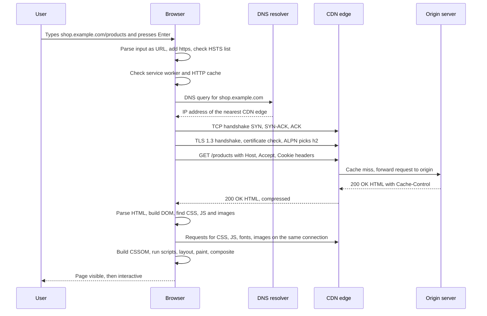
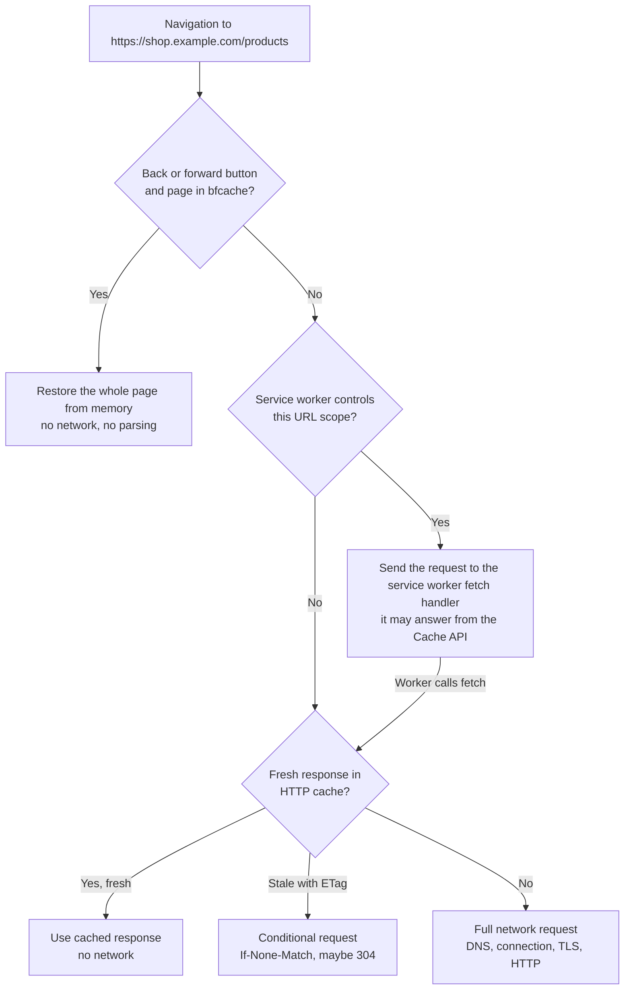
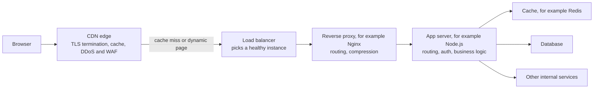
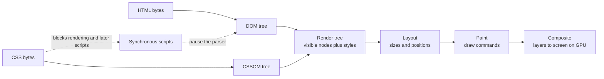
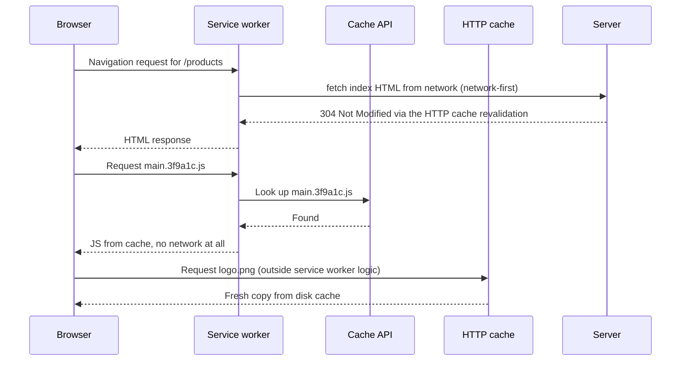
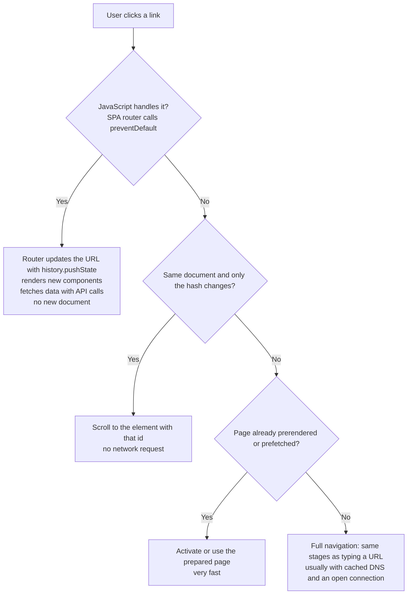

# What Happens When You Type a URL

> In this document you will follow one request from the moment you press Enter until the page is on screen and ready to use: URL parsing, HSTS, caches, DNS, TCP, TLS, HTTP, the server side, parsing, rendering and JavaScript. "What happens when you type a URL into the browser?" is one of the most common open-ended interview questions. It tests whether you can connect networking, HTTP, servers and browser internals into one clear story, at whatever depth the interviewer wants.

**Before this:** [Networking: TCP/IP, ports and DNS](04-networking-tcp-ip-and-dns.md) · [HTTP, HTTPS and TLS](05-http-https-and-tls.md) · **Interview questions:** [jump to the interview section](#interview-questions)

## Table of contents

1. [Why interviewers ask this](#why-interviewers-ask-this)
2. [The whole journey in one diagram](#the-whole-journey-in-one-diagram)
3. [Stage 1: The browser understands what you typed](#stage-1-the-browser-understands-what-you-typed)
4. [Stage 2: Checking caches before the network](#stage-2-checking-caches-before-the-network)
5. [Stage 3: DNS resolution](#stage-3-dns-resolution)
6. [Stage 4: Opening a connection](#stage-4-opening-a-connection)
7. [Stage 5: The TLS handshake](#stage-5-the-tls-handshake)
8. [Stage 6: Sending the HTTP request](#stage-6-sending-the-http-request)
9. [Stage 7: The server side](#stage-7-the-server-side)
10. [Stage 8: The response arrives](#stage-8-the-response-arrives)
11. [Stage 9: Parsing and the critical rendering path](#stage-9-parsing-and-the-critical-rendering-path)
12. [Stage 10: Subresources, JavaScript and interactivity](#stage-10-subresources-javascript-and-interactivity)
13. [Shortcut paths: service workers and cache hits](#shortcut-paths-service-workers-and-cache-hits)
14. [Seeing every stage in DevTools](#seeing-every-stage-in-devtools)
15. [How to explain this in an interview](#how-to-explain-this-in-an-interview)
16. [Variant: what happens when you click a link](#variant-what-happens-when-you-click-a-link)
17. [Variant: why is the first load slow and how would you speed it up](#variant-why-is-the-first-load-slow-and-how-would-you-speed-it-up)
18. [Interview questions](#interview-questions)
19. [Summary](#summary)
20. [References](#references)

---

## Why interviewers ask this

This question has no single "right" answer. It is a **map of the whole web stack**, and the interviewer watches:

- **Structure:** can you tell the story in a clear order, without jumping around?
- **Breadth:** do you know every big stage (browser, DNS, TCP, TLS, HTTP, server, rendering)?
- **Depth:** when they say "tell me more about TLS" or "what blocks rendering?", can you go deeper?
- **Judgment:** do you know which parts matter for *your* role? A frontend engineer should go deep on parsing and rendering. A backend engineer should go deep on load balancers, app servers and databases.

The trick is to have **one simple skeleton** in your head and to hang details on it:

1. Browser understands the input.
2. Caches are checked.
3. DNS finds the IP address.
4. A connection is opened (TCP or QUIC).
5. TLS makes it secure.
6. The HTTP request is sent.
7. The server side builds the response.
8. The response comes back.
9. The browser parses HTML and CSS and renders pixels.
10. JavaScript runs and the page becomes interactive.

The rest of this document fills in each stage. Most stages have their own deep document; here you learn how they **connect**.

---

## The whole journey in one diagram

Example: you type `shop.example.com/products` and press Enter. Nothing is cached yet.



Keep this picture in mind. Every section below zooms into one part of it.

---

## Stage 1: The browser understands what you typed

### URL or search?

The address bar (Chrome calls it the **omnibox**) first decides: is this a URL or a search query?

- `shop.example.com/products` looks like a hostname with a path, so it is treated as a URL.
- `best running shoes` has spaces and no dot-name, so it goes to the default search engine as `https://www.google.com/search?q=best+running+shoes` (or whatever engine is configured).
- While you type, the browser may already **predict** the destination from history and start a DNS lookup or even a connection early.

### Adding the scheme

You did not type `https://`. The browser must choose:

- Modern browsers try **HTTPS first** for addresses typed without a scheme, and fall back to HTTP only if HTTPS fails.
- If the domain is in the **HSTS** list (because the site sent a `Strict-Transport-Security` header before, or it is on the built-in **HSTS preload list**), the browser **must** use HTTPS. It will not even try HTTP. See [HSTS](05-http-https-and-tls.md#hsts).

### Parsing the URL

The browser splits the URL into parts using the standard **URL parser** (the WHATWG URL Standard). JavaScript exposes the same parser through the `URL` class, so you can see what the browser sees:

```js
const url = new URL('https://shop.example.com:443/products/42?color=red&size=m#reviews');

console.log(url.protocol);                  // https:
console.log(url.hostname);                  // shop.example.com
console.log(url.port);                      // '' (empty: 443 is the default for https)
console.log(url.pathname);                  // /products/42
console.log(url.search);                    // ?color=red&size=m
console.log(url.searchParams.get('color')); // red
console.log(url.hash);                      // #reviews
console.log(url.origin);                    // https://shop.example.com
```

Important details:

- The **fragment** (`#reviews`) is never sent to the server. The browser uses it to scroll to an element with `id="reviews"`.
- The **default port** is dropped: `https://...:443` is the same as `https://...`.
- **Scheme and host are case-insensitive**, so they are lowercased. The path is case-sensitive.
- Non-ASCII domain names are converted to **Punycode** for DNS: `münchen.example` becomes `xn--mnchen-3ya.example`.
- Special characters in the query are **percent-encoded** (a space becomes `%20` or `+` depending on how it is encoded).

```js
console.log(new URL('HTTPS://Shop.Example.COM/A%20B').href); // https://shop.example.com/A%20B
console.log(new URL('https://münchen.example/').hostname);   // xn--mnchen-3ya.example

const search = new URL('https://shop.example.com/search');
search.searchParams.set('q', 'shoes & socks');
console.log(search.href); // https://shop.example.com/search?q=shoes+%26+socks
```

### Leaving the current page

If a page is already open in the tab, the browser fires its `beforeunload` event. If that page registered a handler (for example an unsaved form), the browser may show a "Leave site?" dialog. The old page is unloaded only when the new page is ready to **commit** (to replace it on screen).

### Which part of the browser does this?

In Chrome, the **browser process** owns the address bar and starts the navigation. The actual network requests are made by the **network service** (running in its own process). Later, a **renderer process** is chosen to display the page. You learn these processes in [Browser architecture and rendering](07-browser-architecture-and-rendering.md#multi-process-architecture).

---

## Stage 2: Checking caches before the network

Before touching the network, the browser checks several places that might already have the answer.



| Cache | What it stores | When it helps |
| --- | --- | --- |
| **Back/forward cache (bfcache)** | A complete snapshot of a page in memory, including JavaScript state | Pressing Back or Forward. The page appears instantly |
| **Service worker** | Whatever the site's worker decides to cache (Cache API) | Repeat visits and offline use of sites that install a service worker (PWAs) |
| **Memory cache** | Resources used recently in this tab/session | Reloads and resources used again on the same page |
| **HTTP disk cache** | Responses allowed by `Cache-Control` | Repeat visits: fresh files load with no network; stale ones are revalidated |
| **Prefetch / prerender** | Pages or resources the browser fetched speculatively | When a site uses `<link rel="prefetch">` or the Speculation Rules API (Chromium), the next navigation can be almost instant |

For a **typed** navigation, the main HTML document usually has `Cache-Control: no-cache` or a short `max-age`, so the browser revalidates or fetches it. Static assets (hashed JS and CSS) usually come straight from the disk cache on repeat visits. HTTP caching rules are in [HTTP caching](05-http-https-and-tls.md#http-caching); service workers in [Browser storage and web security basics](08-browser-storage-and-web-security-basics.md#service-workers-and-the-cache-api).

---

## Stage 3: DNS resolution

If there is no cached response, the browser needs the server's IP address. It looks in caches first, and only then asks the network:

1. **Browser DNS cache** (very short-lived).
2. **Operating system cache** and the **hosts file**.
3. The **recursive resolver** (from your router, ISP, company network or a public resolver like `1.1.1.1`). Browsers may use **DNS over HTTPS** to talk to it.
4. If the resolver has no cached answer: **root server** → **TLD server** (`.com`) → **authoritative server** for `example.com`, which returns the A/AAAA record and its TTL.

For a site behind a CDN, the authoritative answer is often a **CNAME** to the CDN (`shop.example.com CNAME shop.cdn-provider.net`), and the CDN's DNS returns the IP of an edge server **near you** (GeoDNS) or a shared **anycast** IP.

Cost: from under 1 ms (cached) to a few hundred ms (full lookup on a slow network). Details, record types and TTLs are in [DNS: turning names into addresses](04-networking-tcp-ip-and-dns.md#dns-turning-names-into-addresses).

---

## Stage 4: Opening a connection

### Reuse first

If the browser already has an open connection to this origin (from an earlier request, a `preconnect`, or a prediction while you were typing), it **reuses** it and skips stages 3 to 5 completely. With HTTP/2 and HTTP/3, one connection per origin carries all requests.

### A new TCP connection

Otherwise the browser opens a **TCP connection** to the IP address on port **443**:

1. Browser → server: **SYN**
2. Server → browser: **SYN-ACK**
3. Browser → server: **ACK**

That costs **one round trip**. If the server has both IPv6 and IPv4 addresses, the browser races them (**Happy Eyeballs**) and uses whichever connects first.

### Or QUIC (HTTP/3)

If the browser already knows the server supports HTTP/3 (from an earlier `Alt-Svc` header or a DNS `HTTPS` record), it may use **QUIC over UDP** instead. QUIC combines the connection setup and the TLS handshake into **one** round trip, so stages 4 and 5 merge.

Details: [TCP: reliable connections](04-networking-tcp-ip-and-dns.md#tcp-reliable-connections) and [QUIC](04-networking-tcp-ip-and-dns.md#quic-reliable-transport-built-on-udp).

---

## Stage 5: The TLS handshake

Because the URL is HTTPS, the browser and server now set up encryption with **TLS 1.3**:

1. The browser sends **ClientHello**: supported TLS versions and ciphers, its Diffie-Hellman **key share**, the hostname in **SNI** (so the server knows which certificate to use) and **ALPN** (`h2`, `http/1.1`).
2. The server answers **ServerHello** with its key share. Both sides compute the same secret.
3. The server sends its **certificate chain** and a **signature** proving it owns the private key.
4. The browser **validates** the certificate: the chain leads to a trusted root CA, the name matches `shop.example.com`, the dates are valid, and the certificate is not revoked.
5. Both sides switch to fast **symmetric encryption**. ALPN has chosen the HTTP version (for example HTTP/2).

Cost: **one round trip** with TLS 1.3 (two with TLS 1.2), and zero for some resumed connections.

If validation fails (expired certificate, wrong name, unknown CA), the browser **stops** and shows a full-page warning. With HSTS, the user cannot even click through it.

Details: [HTTPS and TLS](05-http-https-and-tls.md#https-and-tls).

---

## Stage 6: Sending the HTTP request

Now the browser sends the request over the encrypted connection. Shown here in HTTP/1.1 text form for readability (HTTP/2 sends the same information as binary frames, with `:method`, `:path` and `:authority` pseudo-headers):

```text
GET /products HTTP/1.1
Host: shop.example.com
User-Agent: Mozilla/5.0 (Windows NT 10.0; Win64; x64) ...
Accept: text/html,application/xhtml+xml,application/xml;q=0.9,*/*;q=0.8
Accept-Language: en-US,en;q=0.9
Accept-Encoding: gzip, deflate, br, zstd
Cookie: __Host-sid=8f2a9c...; theme=dark
Upgrade-Insecure-Requests: 1
Sec-Fetch-Dest: document
Sec-Fetch-Mode: navigate
Sec-Fetch-Site: none
Sec-Fetch-User: ?1
```

What each part is for:

- `GET /products`: read the page. The fragment is not included.
- `Host`: which website, because one IP can host many sites.
- `Accept` and `Accept-Encoding`: the browser wants HTML and supports compression.
- `Cookie`: any cookies stored for this site that match the domain, path, `Secure` and `SameSite` rules. This is how the server knows you are logged in.
- `Sec-Fetch-*` (**Fetch Metadata** headers): tell the server what kind of request this is. `Sec-Fetch-Site: none` means the user started it (typed it), not another website. Servers can use these headers to block suspicious cross-site requests.

---

## Stage 7: The server side

The request does not go straight to "the server". In a real production setup, it passes through several layers. Each one can answer early or pass the request on.



Step by step:

1. **CDN edge.** The connection from the browser often ends at a CDN server near the user. The CDN terminates TLS, filters attacks (DDoS protection, web application firewall), and checks its cache. Static files and cacheable pages may be answered **right here**. Otherwise it forwards the request to the origin over a fast, already-open connection.
2. **Load balancer.** Spreads requests across several healthy app instances, using health checks to skip broken ones. An L7 load balancer can route by path (`/api/*` to the API service, `/` to the web app).
3. **Reverse proxy** (sometimes the same component as the load balancer). Routing, compression, request size limits, buffering slow clients.
4. **Application server.** For example a Node.js/Express app or a server-side rendering server:
   - matches the route (`GET /products`),
   - checks the session cookie or token (**authentication**) and permissions (**authorization**),
   - runs business logic,
   - reads data from a **cache** (Redis) or the **database**, and maybe calls other internal services,
   - builds the response: either a full HTML page (server-side rendering) or a small HTML shell that loads a JavaScript app (client-side rendering; for an Angular SPA, `index.html` is usually a static file served directly by the CDN).
5. **Response headers** are added: `Content-Type`, `Cache-Control`, `Set-Cookie`, security headers like `Content-Security-Policy` and `Strict-Transport-Security`, and compression (`Content-Encoding: br`).

The time from sending the request until the first byte of the response arrives is called **TTFB (time to first byte)**. Slow database queries, cold caches and many sequential service calls show up here.

Some servers send a **103 Early Hints** response while they are still building the page. It contains `Link: <...>; rel=preload` headers, so the browser can start downloading CSS and fonts before the real `200` response arrives.

Backend details: [HTTP servers and Express](../07-nodejs-backend/06-http-servers-and-express.md), [Caching in Node.js](../07-nodejs-backend/11-caching.md), [Scalability and core building blocks](../09-system-design/02-scalability-and-core-building-blocks.md), [Rendering strategies: CSR, SSR, SSG](../05-frontend-engineering/09-rendering-strategies-csr-ssr-ssg.md).

---

## Stage 8: The response arrives

```text
HTTP/2 200
content-type: text/html; charset=utf-8
content-encoding: br
cache-control: no-cache
etag: "6c1f-a9b2"
set-cookie: __Host-sid=8f2a9c...; Path=/; Secure; HttpOnly; SameSite=Lax
strict-transport-security: max-age=31536000; includeSubDomains
content-security-policy: default-src 'self'; script-src 'self'
x-content-type-options: nosniff
```

The browser looks at the response before showing anything:

- **Status code.** A `301`/`302`/`307`/`308` means "go to the `Location` URL instead". The browser starts the whole process again for the new URL (new DNS lookup and connection if it is a different host). Each redirect costs at least one extra round trip, so avoid redirect chains like `http://example.com` → `https://example.com` → `https://www.example.com`.
- **`Content-Type`.** `text/html` is rendered as a page. With `Content-Disposition: attachment`, or a type the browser cannot display, the response becomes a **download** instead of a navigation. `X-Content-Type-Options: nosniff` tells the browser not to guess the type.
- **Headers with side effects** are processed: cookies are stored, HSTS is remembered, the response may be stored in the HTTP cache.
- **Decompression:** the Brotli-compressed bytes are decompressed as they stream in.

Then the navigation **commits**: in Chrome, the browser process picks a **renderer process** for this site (with **site isolation**, different sites get different processes), sends it the response stream, and the address bar updates. The old page is now gone (or stored in the bfcache).

---

## Stage 9: Parsing and the critical rendering path

The renderer does not wait for the full HTML to download. It parses **as bytes arrive** (streaming). This is why sending the first part of the HTML quickly matters.

The **critical rendering path** is the sequence of steps the browser must complete before it can draw the first pixels:



1. **HTML parsing → DOM.** Bytes are decoded (UTF-8), tokenized into tags, and built into the **DOM** (Document Object Model), a tree of nodes. HTML parsing is very forgiving: unclosed tags are fixed automatically.
2. **Preload scanner.** While the main parser works, a lightweight **preload scanner** reads ahead in the raw HTML and starts downloading resources it finds (`<link rel="stylesheet">`, `<script src>`, ``). This is a big reason why resources should be visible in the HTML, not hidden inside JavaScript.
3. **CSS → CSSOM.** Each stylesheet is parsed into the **CSSOM** (CSS Object Model). CSS is **render-blocking**: the browser does not paint content until the CSS it has found is loaded, because painting without styles would show an unstyled page that then jumps.
4. **Scripts.** A normal `<script src="app.js">` (without `async`, `defer` or `type="module"`) is **parser-blocking**: parsing stops until the script is downloaded and executed, because the script could change the document. A script also waits for earlier stylesheets, because it may read styles. `defer` and `type="module"` scripts download in parallel and run after parsing finishes; `async` scripts run as soon as they arrive.
5. **Render tree, style, layout, paint, composite.** The browser combines DOM and CSSOM, calculates the final style of every visible element, computes geometry (**layout**), records drawing commands (**paint**), and assembles **layers** on the GPU (**composite**). The first meaningful pixels appear (**First Contentful Paint**), and the biggest content element appears (**Largest Contentful Paint**).

Two events mark progress:

- **`DOMContentLoaded`:** the HTML is fully parsed and all `defer` and module scripts have run. Images and stylesheets may still be loading.
- **`load`:** everything, including images, iframes and stylesheets, has finished loading.

This stage is explained in depth, with `async` vs `defer` timelines, reflow and repaint, in [Browser architecture and rendering](07-browser-architecture-and-rendering.md#the-rendering-pipeline).

---

## Stage 10: Subresources, JavaScript and interactivity

The HTML is only the start. A typical page then loads:

- **CSS** files and **web fonts** (fonts can delay text from appearing unless you use `font-display: swap`).
- **JavaScript** bundles. For an Angular or React single-page app, the HTML is mostly an empty shell (`<app-root></app-root>`), and the real UI appears only after the framework's JavaScript downloads, parses, executes and renders components.
- **Images** and videos (ideally lazy-loaded below the fold).
- **API calls** made by the JavaScript (`GET /api/products`), each going through the same request cycle (usually on an already-open connection).
- **Third-party scripts**: analytics, ads, chat widgets. Each new origin may need its own DNS, TCP and TLS setup.

With HTTP/2 or HTTP/3, all same-origin requests share one connection.

### When is the page "interactive"?

The page is interactive when the **main thread** is free to respond to clicks and key presses. JavaScript, style, layout and paint all run on the main thread. A large bundle that takes 800 ms to execute is an 800 ms period where clicks are not handled. This is why big JavaScript bundles hurt so much on slow phones, and why code splitting, lazy loading and avoiding long tasks matter. The metric for responsiveness is **INP (Interaction to Next Paint)**, explained in [Web performance and Core Web Vitals](../05-frontend-engineering/05-web-performance-and-core-web-vitals.md).

For server-side rendered apps, the HTML is visible early, but the page becomes fully interactive only after **hydration**: the framework's JavaScript attaches event listeners and state to the existing HTML.

### After load

The work does not stop at `load`:

- The site may **register a service worker**, which caches files for the next visit.
- Analytics beacons are sent.
- The connection stays open for a while (keep-alive), ready for the next request.
- The browser remembers useful facts for next time: DNS results (for the TTL), HSTS, `Alt-Svc` (HTTP/3 support), cached files and cookies.

---

## Shortcut paths: service workers and cache hits

The "full journey" happens rarely. Most real navigations take shortcuts. Here is a repeat visit to a PWA whose service worker uses a cache-first strategy for static files and a network request for fresh HTML:



What a repeat visit can skip:

| Shortcut | What it skips |
| --- | --- |
| DNS cached (within TTL) | The DNS lookup |
| Connection still open or preconnected | DNS, TCP and TLS |
| TLS session resumption / 0-RTT | Part or all of the TLS round trip |
| Fresh HTTP cache entry | The whole network request |
| Revalidation with `304 Not Modified` | Downloading the body (one round trip remains) |
| Service worker cache | The network entirely, even offline |
| bfcache (Back/Forward) | Network, parsing, JavaScript execution: the page is restored as it was |
| Prerendered page (Speculation Rules, Chromium) | Almost everything: the page was already loaded in the background |

This is why "first visit" and "repeat visit" performance are measured separately.

---

## Seeing every stage in DevTools

Open DevTools → **Network**, click the document request, and open the **Timing** tab. The phases map directly to the stages:

| DevTools phase | Stage |
| --- | --- |
| Queueing, Stalled | Waiting for a free connection, or the browser prioritizing other requests |
| DNS Lookup | Stage 3 |
| Initial connection | Stage 4 (TCP, or QUIC) |
| SSL | Stage 5 (TLS) — shown inside Initial connection |
| Request sent | Stage 6 |
| Waiting for server response (TTFB) | Stage 7: server processing plus one network round trip |
| Content Download | Stage 8: receiving the body |

You can also read the same numbers from JavaScript with the **Navigation Timing API** (browser-only code):

```js
// Run in the browser console after the page has loaded
const [nav] = performance.getEntriesByType('navigation');

console.table({
  redirect: nav.redirectEnd - nav.redirectStart,
  dns: nav.domainLookupEnd - nav.domainLookupStart,
  tcpAndTls: nav.connectEnd - nav.connectStart,
  tls: nav.secureConnectionStart > 0 ? nav.connectEnd - nav.secureConnectionStart : 0,
  ttfb: nav.responseStart - nav.requestStart,
  download: nav.responseEnd - nav.responseStart,
  domInteractive: nav.domInteractive,                  // ms since navigation start
  domContentLoaded: nav.domContentLoadedEventEnd,
  load: nav.loadEventEnd,
  protocol: nav.nextHopProtocol,                       // for example 'h2' or 'h3'
});
```

On a repeat visit with a reused connection, `dns` and `tcpAndTls` are `0`. Real-user monitoring tools collect these values from many users to find which stage is slow in which region.

---

## How to explain this in an interview

### The six-step structure

1. **Define it:** "It is the journey of a navigation: the browser turns the text into a URL, finds the server, opens a secure connection, gets the HTML, and turns it into pixels and an interactive page."
2. **Why it exists:** "Each stage solves one problem: DNS turns names into addresses, TCP gives reliable delivery, TLS gives security, HTTP gives the request format, and the rendering pipeline turns documents into a screen."
3. **How it works:** "URL parsing and HSTS, cache checks, DNS, TCP or QUIC, TLS, HTTP request, server-side processing, response, parsing, CSSOM, render tree, layout, paint, composite, then JavaScript and interactivity."
4. **Small example:** "For `shop.example.com`, DNS returns a CDN edge IP, the CDN terminates TLS, serves cached assets and forwards the HTML request to our Node servers through a load balancer."
5. **Where it is useful:** "This map is how I debug slow pages: DevTools timing tells me which stage is slow, and each stage has its own fixes."
6. **Trade-offs / gotchas:** "Most navigations take shortcuts: cached DNS, reused connections, HTTP cache, service workers, bfcache. And the order in the browser is not strictly sequential: parsing, downloading and rendering overlap."

### The 2-minute answer

Use this when the question is a warm-up or the interviewer says "briefly".

> First, the browser decides whether I typed a URL or a search. It parses the URL, adds https, and checks the HSTS list so it never uses plain HTTP for sites that require HTTPS. It also checks its caches: a service worker or the HTTP cache may already have the response.
>
> If not, it needs the server's IP address, so it does a DNS lookup: browser cache, OS cache, then the recursive resolver, which may ask the root, TLD and authoritative servers.
>
> With the IP, it opens a TCP connection with the three-way handshake, then does a TLS handshake: the server proves its identity with a certificate, and both sides agree on encryption keys. With HTTP/3, those two steps are combined over QUIC.
>
> Then it sends an HTTP GET request with headers like Host, Accept and cookies. On the server side, the request usually goes through a CDN, a load balancer and an application server, which may query a cache or database and returns HTML with headers like Cache-Control and Set-Cookie.
>
> The browser parses the HTML into the DOM while it downloads, finds CSS, scripts and images and fetches them, builds the CSSOM, runs scripts, then does layout, paint and compositing to show pixels. Finally JavaScript finishes executing, the main thread becomes free, and the page is interactive.

### The 5-minute answer

Use this for a dedicated question. Same skeleton, with one or two meaningful details per stage, and a mention of performance at the end.

> **Input and URL.** The omnibox decides URL versus search. The URL parser splits scheme, host, port, path and query; the fragment is never sent. The browser tries HTTPS first, and if the domain is in its HSTS list or on the preload list, it must use HTTPS. If another page is open, its beforeunload handler can run.
>
> **Caches.** For back and forward, the bfcache can restore the whole page instantly. Otherwise, if a service worker controls the site, the request goes to its fetch handler first. Then the HTTP cache: a fresh entry is used without the network; a stale entry with an ETag is revalidated with If-None-Match and may get a 304.
>
> **DNS.** Browser cache, OS cache and hosts file, then the recursive resolver. On a miss, the resolver walks root, TLD and authoritative servers. For a site on a CDN, the answer is usually a CNAME to the CDN, which returns an edge server near me. Results are cached for the TTL.
>
> **Connection.** If there is already an open connection to the origin, it is reused. Otherwise TCP's three-way handshake costs one round trip, and TLS 1.3 costs another: the ClientHello has the key share, SNI and ALPN; the server replies with its key share, certificate chain and signature; the browser validates the chain to a trusted root, the hostname and the dates; and ALPN picks HTTP/2. With HTTP/3, QUIC does both in one round trip. So a cold HTTPS request is roughly four round trips before the first byte, including DNS.
>
> **Request and server.** A GET with Host, Accept, Accept-Encoding, cookies and Sec-Fetch headers. The CDN terminates TLS and may answer from cache. On a miss, a load balancer picks a healthy instance, the app authenticates the session, runs business logic, reads from Redis or the database, and returns HTML. Response headers set caching, cookies, CSP and HSTS, and the body is compressed with Brotli or gzip. The time until the first byte is the TTFB.
>
> **Response handling.** Redirects restart the flow for the new URL. The Content-Type decides whether it is rendered or downloaded. The navigation commits to a renderer process, isolated per site.
>
> **Rendering.** The HTML parser builds the DOM incrementally while the preload scanner fetches CSS, scripts and images early. CSS is render-blocking, and plain scripts block the parser, which is why we use defer or module scripts. DOM plus CSSOM give the render tree, then style, layout, paint and compositing on the GPU, and we get first contentful paint and largest contentful paint.
>
> **Interactivity.** The framework bundle executes, components render, API calls go out over the same connection, and the page becomes interactive once the main thread is free. DOMContentLoaded fires after parsing and deferred scripts, load after all resources.
>
> **Performance link.** If someone says the first load is slow, I would check this timeline in DevTools: redirects, DNS, connection, TTFB, render-blocking resources and JavaScript execution, and fix the slowest stage first.

### Deep dive per stage

If the interviewer picks a stage, go deep there. Here is what to say and where the details live.

| Stage | Deep points to mention | Deep document |
| --- | --- | --- |
| URL and HSTS | WHATWG URL parsing, Punycode, percent-encoding, HTTPS-first, HSTS and preload list, SSL stripping | [HSTS](05-http-https-and-tls.md#hsts) |
| Caches | bfcache, service worker fetch event, memory vs disk cache, `max-age`, `no-cache`, ETag and 304 | [HTTP caching](05-http-https-and-tls.md#http-caching) |
| DNS | Recursive vs iterative, root/TLD/authoritative, TTL, CNAME to CDN, GeoDNS and anycast, DoH, negative caching | [DNS](04-networking-tcp-ip-and-dns.md#dns-turning-names-into-addresses) |
| TCP / QUIC | Three-way handshake, slow start (about 14 KB first flight), head-of-line blocking, Happy Eyeballs, QUIC 1-RTT and connection migration | [TCP](04-networking-tcp-ip-and-dns.md#tcp-reliable-connections) |
| TLS | ClientHello key share, SNI, ALPN, certificate chain validation, ECDHE and forward secrecy, 0-RTT replay risk | [TLS 1.3 handshake](05-http-https-and-tls.md#the-tls-13-handshake) |
| HTTP request | Methods, headers, cookies and SameSite, Fetch Metadata, HTTP/2 multiplexing | [HTTP](05-http-https-and-tls.md#request-and-response-structure) |
| Server side | CDN, L4 vs L7 load balancing, reverse proxy, app server, cache, database, TTFB, 103 Early Hints, SSR vs CSR | [Proxies and load balancers](04-networking-tcp-ip-and-dns.md#proxies-load-balancers-and-cdns) |
| Rendering | Incremental parsing, preload scanner, render-blocking CSS, parser-blocking JS, `async` vs `defer`, layout, paint, compositing | [Rendering pipeline](07-browser-architecture-and-rendering.md#the-rendering-pipeline) |
| Interactivity | Main thread, long tasks, bundle size, hydration, INP | [Web performance](../05-frontend-engineering/05-web-performance-and-core-web-vitals.md) |

---

## Variant: what happens when you click a link

Clicking a link is mostly the same journey, with some important differences.



Differences from typing a URL:

- **The URL is already exact.** No omnibox guessing; relative links are resolved against the current page URL (`new URL('../cart', location.href)`).
- **The `Referer` header** is sent (subject to `Referrer-Policy`), and `Sec-Fetch-Site` is `same-origin`, `same-site` or `cross-site` instead of `none`.
- **Cookies and SameSite:** a cross-site link click is a top-level navigation, so `SameSite=Lax` cookies **are** sent, but `Strict` cookies are not.
- **Same-origin links are usually faster:** DNS is cached and the connection is often still open.
- **SPA links (Angular `routerLink`, React Router `<Link>`):** the router intercepts the click, calls `history.pushState()` to change the URL **without** a page load, and renders new components. Only API calls and lazy-loaded chunks go to the network. The page is not re-parsed. This is why SPA navigation feels instant after the first load.
- **Hash links** (`#reviews`) only scroll and fire a `hashchange` event.
- **`target="_blank"`** opens a new tab (with its own browsing context). Modern browsers apply `noopener` by default for `target="_blank"` links, so the new page cannot control the opener through `window.opener`.
- **Back button:** the bfcache may restore the previous page instantly, including scroll position and JavaScript state.

---

## Variant: why is the first load slow and how would you speed it up

First loads are slow because **nothing is cached and nothing is connected**: every stage happens in full, often several times (for the HTML, then CSS, JS, fonts, APIs and third parties). Then the JavaScript must download, parse and execute on a possibly slow phone.

Structure the answer by stage. **Measure first** (DevTools, Lighthouse, real-user monitoring), then fix the biggest cost.

| Stage | Why it is slow on first load | How to speed it up |
| --- | --- | --- |
| Redirects | `http` → `https` → `www` chains cost round trips | Link directly to the final URL; use HSTS preload |
| DNS | Cold caches; many third-party domains | Fewer origins; `dns-prefetch` for third parties; a fast DNS provider |
| Connection + TLS | 2–3 round trips per new origin; users far from the server | CDN close to users; HTTP/2 or HTTP/3; TLS 1.3; `preconnect` to critical origins; fewer origins |
| TTFB | Slow server work, cold caches, database queries | Cache rendered pages or data (CDN, Redis), optimize queries, stream HTML early, 103 Early Hints |
| Download size | Large HTML, CSS, JS, images | Brotli compression, minification, tree shaking, modern image formats (AVIF/WebP), responsive images |
| Render-blocking | Large CSS, synchronous scripts in `<head>` | Inline critical CSS, `defer`/`type="module"` for scripts, load non-critical CSS later |
| Late discovery | Fonts or hero images found only after CSS or JS runs | `<link rel="preload">`, `fetchpriority="high"` for the LCP image, keep important images in the HTML |
| JavaScript execution | Big bundles, long tasks on slow CPUs | Code splitting and lazy-loaded routes, remove unused libraries, defer third-party scripts, SSR or prerendering for content pages |
| Data waterfall | The app loads JS, then calls API 1, then API 2... | Fetch in parallel, include initial data in the HTML (SSR, transfer state), cache API responses |
| Repeat visits | (Not first load, but related) | Long-lived caching for hashed assets, a service worker for app-shell caching |

A strong spoken answer for this variant:

> On the first load nothing is cached, so the user pays for every stage in full: DNS, TCP and TLS for every origin, the server's TTFB, downloading uncompressed or large assets, render-blocking CSS and scripts, and then executing a big JavaScript bundle. I would measure with Lighthouse and the Network and Performance panels, or with real-user data, and attack the biggest stage. Typical wins are: serve from a CDN with HTTP/2 or HTTP/3, reduce the number of origins and preconnect to critical ones, compress with Brotli, inline critical CSS and defer scripts, preload the LCP image and fonts, split the JavaScript by route so the first screen needs less code, and server-render or prerender content pages so users see something before the JavaScript runs. Then I set long cache lifetimes for hashed assets so the second visit is fast.

Optimization techniques in depth: [Web performance and Core Web Vitals](../05-frontend-engineering/05-web-performance-and-core-web-vitals.md).

---

## Interview questions

### Q1. What happens when you type a URL into the browser and press Enter?

**What the interviewer is checking:** Structure, breadth across the stack, and the ability to go deeper on request.

**Short spoken answer (30–60 seconds):**
> The browser parses the input as a URL, adds https, and checks HSTS. It checks its caches, like a service worker or the HTTP cache. If it needs the network, it resolves the hostname with DNS, opens a TCP connection and does a TLS handshake, where the server proves its identity with a certificate, or does both at once with QUIC for HTTP/3. Then it sends an HTTP GET with headers and cookies. The request goes through a CDN, a load balancer and an app server, which may use a cache or database, and returns HTML. The browser parses the HTML into the DOM as it streams, fetches CSS, JS and images, builds the CSSOM, runs scripts, and then does layout, paint and compositing. Once JavaScript has run and the main thread is free, the page is interactive.

**Detailed explanation:** Use the [2-minute](#the-2-minute-answer) or [5-minute](#the-5-minute-answer) version depending on the time, and go into the [deep dive](#deep-dive-per-stage) for whichever stage the interviewer picks. Say early that real navigations often skip stages thanks to caches and reused connections.

**Follow-up questions:**
- **Which of these stages are usually the slowest?** — On a cold load: connection setup to distant servers (round trips), server TTFB, and JavaScript execution on slow devices. On repeat loads, JavaScript execution and API calls usually dominate.
- **Does the browser do these steps strictly one after another?** — No. Parsing starts before the HTML finishes downloading, the preload scanner fetches resources in parallel, and many requests share one HTTP/2 connection.
- **Where does JavaScript first run?** — Inline scripts run while the parser reaches them; external classic scripts run when downloaded (blocking the parser), `defer` and module scripts after parsing, `async` scripts whenever they arrive.

**Common mistakes:** Skipping TLS or caching. Saying "the browser downloads the HTML, then the CSS, then the JS" as a strict sequence. Ending at "the server returns HTML" without rendering.

**Where this is used in real projects:** Debugging slow pages, explaining architecture to teammates, deciding where to cache.

### Q2. How many network round trips happen before the browser receives the first byte of HTML on a cold HTTPS visit?

**What the interviewer is checking:** Quantitative understanding of latency.

**Short spoken answer (30–60 seconds):**
> Roughly four, with TCP and TLS 1.3. One or more for DNS if it is not cached, one for the TCP handshake, one for the TLS 1.3 handshake, and one for the HTTP request and the start of the response. With TLS 1.2 add one more, and every redirect adds at least another one. With HTTP/3 the TCP and TLS steps merge into one QUIC handshake, so it is about three. If the user is 100 ms away from the server, that is 300 to 400 ms before any HTML, no matter how fast the server is, which is why CDNs, connection reuse and avoiding redirects help so much.

**Follow-up questions:**
- **What makes it zero?** — A fresh HTTP cache hit, a service worker cache, or bfcache: no network at all.
- **How does `preconnect` help?** — It does DNS, TCP and TLS in advance, so when the resource is needed only the request round trip remains.

**Common mistakes:** Forgetting DNS or TLS. Thinking bandwidth reduces round trips.

**Where this is used in real projects:** Justifying a CDN, HTTP/3, and removing redirect chains.

### Q3. What role does HSTS play when you type a URL?

**What the interviewer is checking:** Security awareness at the very first step.

**Short spoken answer (30–60 seconds):**
> If I type a domain without a scheme, the browser has to choose http or https. If the site previously sent a Strict-Transport-Security header, or the domain is on the built-in preload list, the browser internally upgrades to https before sending anything. That prevents an attacker on the network from intercepting the first plain HTTP request and keeping me on a fake HTTP site, which is called SSL stripping. HSTS also stops users from clicking through certificate warnings for that domain.

**Follow-up questions:**
- **What protects the very first visit?** — The HSTS preload list compiled into browsers. Without it, the first request could still be plain HTTP.
- **What do modern browsers do even without HSTS?** — They try HTTPS first for typed addresses and fall back to HTTP if HTTPS fails, and Chrome's "Always Use Secure Connections" mode warns before loading HTTP.

**Common mistakes:** Thinking a server-side redirect from HTTP to HTTPS is enough.

**Where this is used in real projects:** Security header configuration on Nginx, CDNs and Express (Helmet).

### Q4. Where can caching short-circuit this flow?

**What the interviewer is checking:** Knowing that the full journey is the exception, not the rule.

**Short spoken answer (30–60 seconds):**
> At almost every stage. For back and forward, the bfcache restores the whole page from memory. A service worker can answer the request from the Cache API, even offline. The HTTP cache can serve a fresh response without any network, or revalidate a stale one and get a 304 without downloading the body. If the network is needed, DNS results are cached in the browser, OS and resolver, and an already-open connection skips DNS, TCP and TLS. TLS session resumption shortens the handshake. And on the server side, the CDN can answer from its edge cache, and the app can answer from Redis instead of the database.

**Follow-up questions:**
- **Why is `index.html` usually not cached for long?** — It must reference the newest hashed bundles after every deploy, so it uses `no-cache` and is revalidated each time.

**Common mistakes:** Only mentioning the browser HTTP cache.

**Where this is used in real projects:** Performance tuning, PWA design, CDN configuration.

### Q5. What does the browser do while the HTML is still downloading?

**What the interviewer is checking:** Streaming parsing and the preload scanner.

**Short spoken answer (30–60 seconds):**
> It does not wait for the whole file. The HTML parser works on the bytes as they arrive and builds the DOM step by step. A separate preload scanner looks ahead in the raw HTML and starts downloading stylesheets, scripts and images it finds, even while the main parser is blocked by a script. So sending the head of the document early, with CSS and important resources referenced directly in the HTML, lets the browser start fetching sooner. That is also why servers stream HTML and why some send 103 Early Hints.

**Follow-up questions:**
- **What can the preload scanner not find?** — Resources requested by JavaScript, CSS background images and fonts referenced inside CSS. Use `<link rel="preload">` for critical ones.

**Common mistakes:** Assuming the page is processed only after the full download.

**Where this is used in real projects:** Optimizing LCP, structuring `<head>`, server-side streaming.

### Q6. What blocks the first render of a page?

**What the interviewer is checking:** Render-blocking vs parser-blocking resources.

**Short spoken answer (30–60 seconds):**
> Two main things. CSS is render-blocking: the browser will not paint content until the stylesheets it has discovered in the head are downloaded and parsed, otherwise users would see unstyled content jump around. And classic scripts without async, defer or type module are parser-blocking: the HTML parser stops until the script is downloaded and executed, and such a script also waits for preceding CSS. So a big stylesheet and a synchronous script in the head can delay first paint a lot. The fixes are to keep critical CSS small or inline it, load the rest later, and use defer or module scripts.

**Follow-up questions:**
- **Do images block rendering?** — No. The page renders and images appear when they load. But a late hero image delays Largest Contentful Paint.
- **Do web fonts block?** — Text using a font that is still loading can be invisible for a while. `font-display: swap` shows fallback text immediately.

**Common mistakes:** Saying "JavaScript blocks rendering" without the parser-blocking nuance; forgetting CSS.

**Where this is used in real projects:** Lighthouse "Eliminate render-blocking resources" audits, Angular `index.html` tuning.

### Q7. The server answers the request with a 301. What happens next?

**Short answer:** The browser reads the `Location` header and starts a new navigation to that URL: new DNS lookup and connection if the host is different, then a new request. Because 301 is permanent, the browser may cache the redirect and go directly to the new URL next time. Each redirect adds at least one round trip, so chains like `http://example.com` → `https://example.com` → `https://www.example.com` should be collapsed into one hop (and HSTS removes the first one).

### Q8. What is the difference between `DOMContentLoaded` and `load`?

**What the interviewer is checking:** Page lifecycle events.

**Short spoken answer (30–60 seconds):**
> DOMContentLoaded fires when the HTML document has been completely parsed and all deferred and module scripts have executed. It does not wait for images, iframes or async scripts, so it is the right moment to start code that needs the DOM. The load event fires later, when everything on the page has finished loading, including images, stylesheets and iframes. In modern code I rarely need either: scripts with defer or type module already run after parsing, and frameworks like Angular bootstrap from their main bundle.

**Code or diagram:**

```js
document.addEventListener('DOMContentLoaded', () => console.log('DOM ready'));
window.addEventListener('load', () => console.log('everything loaded'));
// Typical order: 'DOM ready' first, then 'everything loaded' (browser behavior)
```

**Follow-up questions:**
- **Does DOMContentLoaded wait for CSS?** — Not directly. But if a script must wait for a stylesheet before it runs, and parsing waits for that script, then DOMContentLoaded is delayed too.

**Common mistakes:** Saying DOMContentLoaded waits for images.

**Where this is used in real projects:** Legacy scripts, analytics timing, performance metrics.

### Q9. What happens differently on the second visit to the same site?

**Short answer:** Much less work. DNS may still be cached (within the TTL). Hashed JS, CSS and images come from the HTTP disk cache or a service worker with no network request. The HTML is revalidated (often a `304`). If the browser remembered `Alt-Svc`, it may connect with HTTP/3. TLS session resumption can shorten the handshake. So the remaining costs are usually the HTML request, API calls and JavaScript execution. That is why you measure first-visit and repeat-visit performance separately.

### Q10. What happens when you click a link in an Angular (or other SPA) app?

**What the interviewer is checking:** Client-side routing vs full navigation.

**Short spoken answer (30–60 seconds):**
> With `routerLink`, Angular's router intercepts the click and prevents the browser's default navigation. It updates the address bar with `history.pushState`, so no new document is requested. Then it matches the new route, runs guards and resolvers, lazy-loads the route's JavaScript chunk if needed, renders the new components, and those components fetch data through HTTP calls. The page is not re-parsed and the app's state stays in memory, which is why it feels instant. A normal link to another site, or a hard refresh, does the full journey instead. One consequence: the server must return `index.html` for deep links like `/products/42`, otherwise a refresh on that URL gives a 404.

**Follow-up questions:**
- **What happens when the user presses Back in an SPA?** — The browser fires a `popstate` event, and the router renders the matching route without a page load.
- **Why does a refresh on `/products/42` 404 on some servers?** — The server looks for a file at that path. You configure a fallback so unknown paths return `index.html`.

**Common mistakes:** Thinking every route change downloads a new HTML page.

**Where this is used in real projects:** Angular routing, server and CDN rewrite rules for SPAs.

### Q11. Why is the first load slow, and how would you speed it up?

**What the interviewer is checking:** Turning the journey into a performance plan.

**Short spoken answer (30–60 seconds):** See the [spoken answer in the first-load variant](#variant-why-is-the-first-load-slow-and-how-would-you-speed-it-up). In short: nothing is cached or connected, so every stage happens in full for every origin, and then a big JavaScript bundle must run. Measure, then use a CDN with HTTP/2 or HTTP/3, fewer origins plus `preconnect`, compression, critical CSS and deferred scripts, preloaded LCP image and fonts, route-based code splitting, and SSR or prerendering for content pages.

**Follow-up questions:**
- **How do you know which stage to fix first?** — DevTools Network timing for the document (DNS, connection, TTFB), the Performance panel for long tasks, and Lighthouse or real-user Core Web Vitals data. Fix the largest measured cost.
- **What if TTFB is the problem?** — Profile the server: database queries, missing caches, sequential service calls. Cache at the CDN or in Redis, and stream the HTML early.

**Common mistakes:** Listing random optimizations without measuring.

**Where this is used in real projects:** Performance work on any public-facing app.

### Q12. How would you find out which stage of a navigation is slow?

**Short answer:** In DevTools Network, open the document request's **Timing** tab: Queueing/Stalled, DNS Lookup, Initial connection and SSL, Request sent, Waiting (TTFB) and Content Download map directly to the stages. For real users, read the same values with the Navigation Timing API (`performance.getEntriesByType('navigation')`) and send them to monitoring. Then use the Performance panel to see parsing, long JavaScript tasks, layout and paint after the response arrives.

### Q13. What happens if the TLS certificate is invalid?

**Short answer:** The browser stops the navigation during the handshake and shows a full-page warning (for example `NET::ERR_CERT_DATE_INVALID` or `NET::ERR_CERT_COMMON_NAME_INVALID`). No HTTP request is sent. If the domain uses HSTS, the user cannot click through. Common causes: an expired certificate, a hostname missing from the certificate, a missing intermediate certificate, or a wrong device clock.

### Q14. What part of the browser handles each step?

**What the interviewer is checking:** Browser architecture knowledge (often in senior frontend interviews).

**Short spoken answer (30–60 seconds):**
> In Chrome, the browser process owns the address bar, so it handles the input, decides it is a URL and starts the navigation. The network service, which runs in its own process, does DNS, the connection, TLS and the HTTP request, and checks the HTTP cache. When the response arrives and looks like a document, the browser process picks a renderer process for that site, because of site isolation, and commits the navigation. The renderer's main thread parses HTML and CSS, runs JavaScript, computes style and layout and records paint; the compositor thread and the GPU process put the layers on screen.

**Follow-up questions:**
- **Why does Chrome use separate processes?** — Stability (one crashed tab does not kill others) and security (sites are isolated, and renderers are sandboxed). See [Browser architecture](07-browser-architecture-and-rendering.md#multi-process-architecture).

**Common mistakes:** Saying "the JavaScript engine downloads the page".

**Where this is used in real projects:** Understanding performance traces and why some work does not block the main thread.

### Q15. Is the URL fragment sent to the server? Predict the output.

```js
const url = new URL('https://shop.example.com:443/products/42?color=red#reviews');
console.log(JSON.stringify(url.port));
console.log(url.origin);
console.log(url.pathname + url.search);
console.log(new URL('../cart?step=2', 'https://shop.example.com/products/42').href);
```

**Answer (verified with Node 22):**

```text
""
https://shop.example.com
/products/42?color=red
https://shop.example.com/cart?step=2
```

**Why:**

1. `url.port` is an empty string (printed as `""` by `JSON.stringify`), because 443 is the default port for `https:` and the parser drops it.
2. The origin is scheme + host + port, without the default port.
3. `pathname + search` is exactly what goes into the request line (`GET /products/42?color=red`). The fragment `#reviews` is **not** sent; the browser keeps it to scroll to the element with `id="reviews"`.
4. The relative URL `../cart?step=2` is resolved against `/products/42`: the base "directory" is `/products/`, `..` goes up to `/`, so the result is `/cart?step=2`. Browsers resolve every relative link this way.

### Q16. What does a CDN change in this journey?

**Short answer:** DNS returns the IP of a nearby CDN edge (via a CNAME and GeoDNS or anycast), so the TCP and TLS handshakes happen with a server a few milliseconds away instead of across the world. The edge serves cached static files and cacheable pages directly. For everything else, it forwards the request to the origin over an already-open, optimized connection. It also absorbs DDoS traffic and can apply a WAF. The result is fewer long round trips and a lower TTFB.

### Q17. What happens when you press the Back button?

**Short answer:** If the previous page is in the **back/forward cache (bfcache)**, the browser restores the frozen page from memory instantly: no network request, no parsing, and the JavaScript state and scroll position are intact (the page receives a `pageshow` event with `event.persisted === true`). If the page is not eligible (for example because of certain `unload` handlers or open connections), the browser navigates normally, usually with many resources served from the HTTP cache. In an SPA, Back fires `popstate` and the router renders the previous route without loading a document.

### Q18. You are a backend engineer. Which part of this journey would you expand on?

**What the interviewer is checking:** Role-appropriate depth.

**Short spoken answer (30–60 seconds):**
> I would cover the browser part briefly and go deep on what happens after the request leaves the browser. DNS pointing to a CDN or a load balancer. TLS termination at the edge or the load balancer and whether traffic is re-encrypted inside. L7 load balancing with health checks, connection reuse and keep-alive timeouts. The application: routing, authentication, validation, business logic, calls to Redis and the database with connection pools, and how I keep TTFB low with caching, query optimization and timeouts on downstream calls. Then the response: status codes, Cache-Control so the CDN can cache public content, compression, and security headers like HSTS and CSP. I would finish with observability: logs, metrics and traces with a request ID that follows the request through every hop.

**Follow-up questions:**
- **How does one request get traced across services?** — A trace ID is created at the edge (or the first service) and passed in headers like `traceparent` (W3C Trace Context) to every downstream call, so logs and spans can be joined. See [Production Node.js](../07-nodejs-backend/14-production-nodejs.md).

**Common mistakes:** Spending all the time on rendering in a backend interview, or ignoring rendering in a frontend interview.

**Where this is used in real projects:** System design discussions and production debugging.

---

## Summary

- Have one skeleton: input and URL parsing → caches → DNS → connection (TCP or QUIC) → TLS → HTTP request → server side → response → parsing and rendering → JavaScript and interactivity.
- The browser decides URL vs search, parses the URL (the fragment is never sent), tries HTTPS first, and must use HTTPS for HSTS and preloaded domains.
- Caches can skip most of the journey: bfcache, service worker, HTTP cache (fresh or 304), DNS cache, reused connections, CDN edge cache.
- A cold HTTPS request costs about four round trips before the first byte (DNS, TCP, TLS 1.3, HTTP); HTTP/3 saves one; redirects add more.
- The server side is usually CDN → load balancer → reverse proxy → app server → cache and database. TTFB measures server time plus one round trip.
- The browser checks the status (redirects restart the flow) and Content-Type, stores cookies and HSTS, then commits the navigation to a site-isolated renderer process.
- Parsing is incremental. The preload scanner fetches resources early. CSS is render-blocking; classic scripts are parser-blocking; use `defer` or modules.
- DOM + CSSOM → render tree → style → layout → paint → composite. `DOMContentLoaded` = parsed plus deferred scripts; `load` = everything loaded.
- The page is interactive when the main thread is free; big JavaScript bundles and long tasks delay it.
- Answer at the depth asked: 2 minutes for the skeleton, 5 minutes with one detail per stage, and a deep dive on the stage the interviewer picks or that matches your role.

## References

- [MDN: How browsers work](https://developer.mozilla.org/en-US/docs/Web/Performance/Guides/How_browsers_work)
- [MDN: Populating the page: how browsers work (critical rendering path)](https://developer.mozilla.org/en-US/docs/Web/Performance/Guides/Critical_rendering_path)
- [Chrome for Developers: Inside look at modern web browser (part 2: what happens in navigation)](https://developer.chrome.com/blog/inside-browser-part2)
- [WHATWG URL Standard](https://url.spec.whatwg.org/) and [MDN: URL API](https://developer.mozilla.org/en-US/docs/Web/API/URL)
- [MDN: Strict-Transport-Security](https://developer.mozilla.org/en-US/docs/Web/HTTP/Reference/Headers/Strict-Transport-Security)
- [web.dev: Back/forward cache](https://web.dev/articles/bfcache)
- [MDN: PerformanceNavigationTiming](https://developer.mozilla.org/en-US/docs/Web/API/PerformanceNavigationTiming)
- [MDN: Fetch metadata request headers](https://developer.mozilla.org/en-US/docs/Glossary/Fetch_metadata_request_header)
- [MDN: 103 Early Hints](https://developer.mozilla.org/en-US/docs/Web/HTTP/Reference/Status/103)
- [Chrome DevTools: Network features reference (timing breakdown)](https://developer.chrome.com/docs/devtools/network/reference)
- [web.dev: Optimize Time to First Byte](https://web.dev/articles/optimize-ttfb)
- [RFC 9110: HTTP Semantics](https://www.rfc-editor.org/rfc/rfc9110) and [RFC 8446: TLS 1.3](https://www.rfc-editor.org/rfc/rfc8446)
