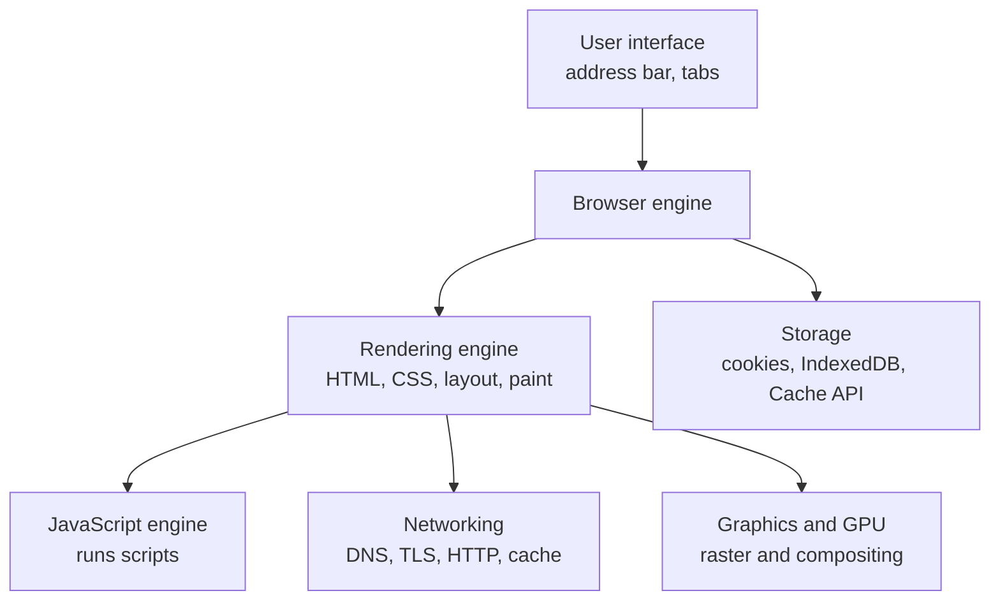
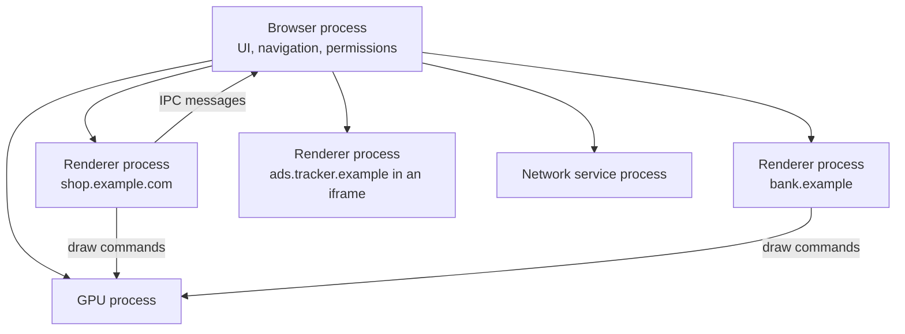
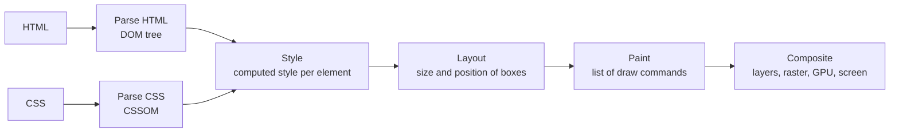
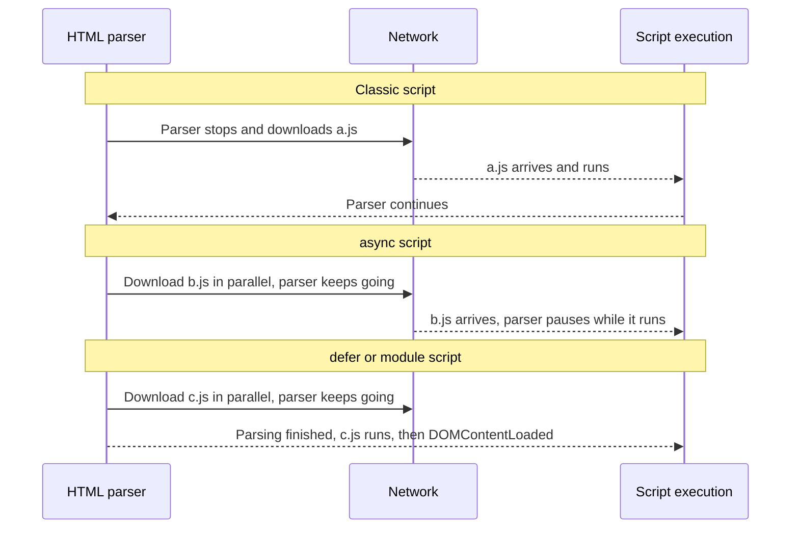
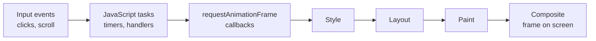

# Browser Architecture and Rendering

> In this document you will learn how a browser is built (engines, processes, threads) and how it turns HTML, CSS and JavaScript into pixels: DOM, CSSOM, style, layout, paint and compositing. You will also learn what blocks rendering, `async` vs `defer`, reflow vs repaint, layout thrashing and `requestAnimationFrame`. Frontend interviews test these topics directly ("What is the critical rendering path?", "Reflow vs repaint?"), and you need them to explain and fix slow, janky pages.

**Before this:** [What happens when you type a URL](06-what-happens-when-you-type-a-url.md) · [Operating systems: processes, threads and memory](03-operating-systems-processes-threads-memory.md) · **Interview questions:** [jump to the interview section](#interview-questions)

## Table of contents

1. [What a browser is made of](#what-a-browser-is-made-of)
2. [Rendering engines and JavaScript engines](#rendering-engines-and-javascript-engines)
3. [Multi-process architecture](#multi-process-architecture)
4. [Threads inside a renderer and the main thread](#threads-inside-a-renderer-and-the-main-thread)
5. [The rendering pipeline](#the-rendering-pipeline)
6. [What blocks parsing and rendering](#what-blocks-parsing-and-rendering)
7. [Resource hints: preload, prefetch, preconnect](#resource-hints-preload-prefetch-preconnect)
8. [Reflow, repaint and composite](#reflow-repaint-and-composite)
9. [Layout thrashing](#layout-thrashing)
10. [requestAnimationFrame and the frame budget](#requestanimationframe-and-the-frame-budget)
11. [The event loop and rendering](#the-event-loop-and-rendering)
12. [DOM vs virtual DOM](#dom-vs-virtual-dom)
13. [Finding rendering problems in DevTools](#finding-rendering-problems-in-devtools)
14. [How to explain this in an interview](#how-to-explain-this-in-an-interview)
15. [Interview questions](#interview-questions)
16. [Summary](#summary)
17. [References](#references)

---

## What a browser is made of

A browser is not one big program. It is a set of components, each with one job.

| Component | Job | Examples |
| --- | --- | --- |
| **User interface** | Everything you see that is not the web page: address bar, tabs, back button, bookmarks | Chrome's tab strip and omnibox |
| **Browser engine** | Coordinates between the UI and the rendering engine (for example, "the user clicked Back, load the previous page") | |
| **Rendering engine** | Parses HTML and CSS, computes layout, paints the page | Blink, WebKit, Gecko |
| **JavaScript engine** | Parses, compiles and runs JavaScript | V8, JavaScriptCore, SpiderMonkey |
| **Networking** | DNS, connections, TLS, HTTP, the HTTP cache | Chrome's network service |
| **Storage** | Cookies, localStorage, IndexedDB, Cache API | |
| **Graphics / GPU** | Draws pixels and composites layers using the GPU | Chrome's GPU process, Skia |



### JavaScript engine vs browser APIs

This is an important distinction for interviews:

- The **JavaScript engine** (for example V8) implements the **ECMAScript language**: variables, functions, objects, promises, classes, the call stack and the garbage collector.
- **Browser APIs** (also called **Web APIs**) are provided by the browser around the engine: `document`, `window`, `fetch`, `setTimeout`, `localStorage`, `requestAnimationFrame`, events.

V8 by itself has no `document` and no `setTimeout`. Node.js uses the same V8 engine, but gives it different APIs (`fs`, `http`, `process`) and its own `setTimeout` implementation. That is why `document` is `undefined` in Node.

---

## Rendering engines and JavaScript engines

| Browser | Rendering engine | JavaScript engine |
| --- | --- | --- |
| Chrome, Edge, Opera, Brave, Samsung Internet | **Blink** | **V8** |
| Safari | **WebKit** | **JavaScriptCore** |
| Firefox | **Gecko** | **SpiderMonkey** |
| Electron apps (VS Code, Slack, Teams) | Blink (Chromium) | V8 |
| Node.js, Deno | (no rendering engine) | V8 |

Notes:

- Blink started as a fork of WebKit in 2013, so they share history.
- On iOS, browsers have long been required to use WebKit, so Chrome and Firefox on iPhone use WebKit under the hood (recent regulation allows exceptions in some regions).
- Because most desktop users run a Blink-based browser, test in Safari and Firefox too. Bugs often come from engine differences.

JavaScript engines compile code with a **JIT (just-in-time) compiler**: V8 first runs bytecode in its Ignition interpreter, and optimizing compilers turn hot functions into fast machine code. See [How programs run](01-how-programs-run.md).

---

## Multi-process architecture

### What it is

Modern browsers split their work into **several operating system processes**. A process is a running program with its own memory that other processes cannot read directly (see [Operating systems](03-operating-systems-processes-threads-memory.md)). Chrome is the best-documented example:

| Process | Job |
| --- | --- |
| **Browser process** | The "main" process. Runs the UI (address bar, tabs), starts navigations, manages the other processes, handles permissions and file access |
| **Renderer processes** | Run Blink and V8 for web pages: parse HTML, run JavaScript, compute layout and paint. Usually one per **site** (with site isolation). **Sandboxed**: they cannot touch the file system or network directly |
| **GPU process** | Talks to the graphics card. Composites layers and draws to the screen for all tabs |
| **Network service** | DNS, connections, TLS, HTTP, cookies, HTTP cache. Runs in its own utility process on desktop |
| **Storage, audio and other utility processes** | Specific jobs isolated for stability and security |
| **Extension processes** | Run browser extensions |



Processes talk to each other with **IPC (inter-process communication)** messages. For example, a renderer cannot open a file. It asks the browser process, which checks permissions first.

### Why browsers use many processes

| Reason | Explanation |
| --- | --- |
| **Stability** | If one tab's renderer crashes or hangs, only that tab shows "Aw, Snap!". The browser and other tabs keep working |
| **Security (sandboxing)** | Renderers run untrusted code from the internet. They run in a **sandbox** with very few OS permissions. Even if an attacker finds a bug in V8 or Blink, they are trapped inside a process that cannot read your files |
| **Security (site isolation)** | Pages from different **sites** run in different processes. So a malicious page cannot read another site's data from memory, even with CPU-level attacks like **Spectre** |
| **Performance** | Processes can run in parallel on multiple CPU cores, and the GPU process keeps drawing smooth even when a page is busy |

### Site isolation

**Site isolation** means each **site** (scheme + registrable domain, for example `https://example.com`) gets its own renderer process, **including cross-site iframes**. If `shop.example.com` embeds an iframe from `ads.tracker.example`, the iframe runs in a separate process.

Chrome enabled site isolation by default on desktop in 2018, mainly in response to Spectre. Firefox has a similar architecture (project Fission).

### The cost

- **Memory:** each process has overhead. Many tabs mean many processes. When memory is low, Chrome may put same-site tabs in one process.
- **IPC overhead:** communication between processes is slower than function calls inside one process.

### Where you see this in real work

- **DevTools Task Manager** (Chrome menu → More tools → Task manager) shows each process, its memory and CPU.
- **Electron** apps use the same model: one **main process** (like the browser process, with Node.js access) and **renderer processes** for windows. Secure Electron apps keep renderers sandboxed and talk to the main process over IPC. See [Electron architecture and process model](../08-electron-desktop/01-electron-architecture-and-process-model.md).

---

## Threads inside a renderer and the main thread

Inside one renderer process there are several **threads** (independent paths of execution that share the process's memory):

| Thread | Job |
| --- | --- |
| **Main thread** | Runs JavaScript, handles DOM events, parses HTML, computes style and layout, records paint instructions. **One per page (per renderer)** |
| **Compositor thread** | Receives layers from the main thread and assembles frames. Can handle scrolling and some animations **without** the main thread |
| **Raster threads** | Turn paint instructions into pixels (tiles), often with GPU help |
| **Worker threads** | Run **Web Workers** and **Service Workers**: JavaScript off the main thread, without DOM access |

### The main thread is the bottleneck

Almost everything that matters for a page happens on **one** main thread:

- your JavaScript (event handlers, framework code, timers),
- HTML parsing,
- style calculation and layout,
- paint recording.

It can do only **one thing at a time**. While a long JavaScript function runs, the main thread cannot handle a click, cannot update layout and cannot produce a new frame. The page feels frozen.

A **long task** is any task that keeps the main thread busy for **more than 50 ms**. Long tasks are the main cause of slow interactions (poor INP).

You can see the same "single thread is blocked" behavior in Node.js, which also runs JavaScript on one main thread:

```js
const start = Date.now();
setTimeout(() => {
  console.log(`timer ran after ${Date.now() - start >= 300 ? 'at least 300' : 'less than 300'} ms`);
}, 0);

// Simulate a long task: 300 ms of synchronous work
while (Date.now() - start < 300) {}
console.log('long task finished');
```

Output:

```text
long task finished
timer ran after at least 300 ms
```

The timer asked for 0 ms but had to wait for the long task. In a browser, clicks, key presses and rendering wait in the same way.

### Fixing long tasks

**1. Split the work into chunks and yield** so other tasks (input, rendering) can run between chunks:

```js
const yieldToEventLoop = () => new Promise((resolve) => setTimeout(resolve, 0));

async function processInChunks(list, chunkSize) {
  let total = 0;
  for (let i = 0; i < list.length; i += chunkSize) {
    for (const item of list.slice(i, i + chunkSize)) total += item;
    console.log('processed up to', Math.min(i + chunkSize, list.length));
    await yieldToEventLoop(); // let clicks, timers and rendering run
  }
  return total;
}

setTimeout(() => console.log('a click handler could run here'), 0);
processInChunks(Array.from({ length: 10 }, (_, i) => i + 1), 4).then((total) => console.log('total', total));
```

Output (verified with Node 22):

```text
processed up to 4
a click handler could run here
processed up to 8
processed up to 10
total 55
```

The other task ran **between** chunks instead of waiting for the whole job. The newer `scheduler.yield()` API does the same job with better priority handling, but it is not available in all browsers yet, so feature-detect it (`globalThis.scheduler?.yield`) and fall back to `setTimeout`.

**2. Move heavy computation to a Web Worker.** Parsing a 50 MB CSV, image processing or complex calculations can run on a worker thread:

```js
// main.js (browser)
const worker = new Worker(new URL('./report-worker.js', import.meta.url), { type: 'module' });
worker.postMessage({ rows: hugeRowArray });
worker.onmessage = (event) => renderSummary(event.data); // main thread stays responsive

// report-worker.js
self.onmessage = (event) => {
  const summary = buildSummary(event.data.rows); // heavy work, off the main thread
  self.postMessage(summary);
};
```

Workers cannot touch the DOM, and data is **copied** between threads (structured clone) unless you transfer it, so they suit pure computation. Angular CLI can generate workers with `ng generate web-worker`.

**3. Do less work:** avoid unnecessary re-renders, virtualize long lists, debounce input handlers (see [Debounce, throttle and performance](../02-javascript/20-debounce-throttle-and-performance.md)).

---

## The rendering pipeline

### Overview

The **rendering pipeline** is the series of steps the browser uses to turn HTML and CSS into pixels. The steps that must happen before the first paint are called the **critical rendering path**.



Modern browsers have more detailed internal stages (Chrome's RenderingNG pipeline includes pre-paint, layerize, raster and more), but this six-step model is accurate enough to explain behavior and is what interviews expect.

We will follow this small page through the pipeline:

```html
<!doctype html>
<html>
  <head>
    <link rel="stylesheet" href="styles.css">
  </head>
  <body>
    <header class="banner">Summer sale</header>
    <p class="note" style="display: none">Debug info</p>
    <ul id="products">
      <li>Keyboard</li>
      <li>Mouse</li>
    </ul>
  </body>
</html>
```

```css
/* styles.css */
body { margin: 0; font: 16px system-ui, sans-serif; }
.banner { padding: 16px; background: gold; }
#products li { color: #333; }
```

### Step 1: Parse HTML into the DOM

1. **Bytes → characters:** the browser decodes the bytes using the character encoding (UTF-8).
2. **Characters → tokens:** the tokenizer finds start tags, end tags, attributes and text.
3. **Tokens → nodes → tree:** the tree builder creates **DOM nodes** and links them into a tree.

The **DOM (Document Object Model)** is the in-memory tree of the document, and also the API JavaScript uses to read and change it (`document.querySelector`, `element.append`).

```text
Document
└── html
    ├── head
    │   └── link (styles.css)
    └── body
        ├── header.banner  "Summer sale"
        ├── p.note         "Debug info"
        └── ul#products
            ├── li "Keyboard"
            └── li "Mouse"
```

Facts worth knowing:

- Parsing is **incremental**: the DOM grows while bytes are still arriving.
- HTML parsing is **error-tolerant**. A missing `</li>` or `</p>` is fixed automatically by rules in the HTML standard. The browser never refuses to render bad HTML.
- The DOM is **not** the same as your HTML source. The parser adds missing elements (like `<tbody>` inside a `<table>`), and JavaScript can change the DOM later.

### Step 2: Parse CSS into the CSSOM

Each stylesheet (external files, `<style>` blocks, inline `style` attributes) is parsed into the **CSSOM (CSS Object Model)**: a structure of rules that the style engine can match against elements.

CSS is **render-blocking**: the browser does not paint the page until it has the CSS discovered so far. Otherwise it would show unstyled content and then jump (a "flash of unstyled content").

### Step 3: Style (recalculate style)

For every DOM element, the browser finds all CSS rules that match it, applies the **cascade** (origin, specificity, order), inheritance and default values, and produces the **computed style**: the final value of every CSS property for that element.

For example, each `li` ends up with `color: #333` (from the rule), `font-size: 16px` and `font-family: system-ui, sans-serif` (inherited from `body`), and `display: list-item` (browser default).

### Step 4: Layout (also called reflow)

The browser builds a **layout tree** (often called the **render tree**): a tree of boxes for everything that will be **visible**.

- Elements with `display: none` (our `p.note`) and their children are **not** in the layout tree.
- Elements with `visibility: hidden` **are** in it: they are invisible but still take up space.
- Non-visual elements (`head`, `script`, `meta`) are not in it.
- Pseudo-elements like `::before` and `::after` **are** in it, even though they are not in the DOM.

Then **layout** calculates the exact **geometry** of each box: x and y position, width and height, line breaks in text. Layout works from the viewport size downwards: the body is as wide as the viewport, the header is as wide as the body minus margins, text wraps inside it, and so on.

Layout is expensive because boxes depend on each other. Changing the width of one element can change the position of everything after it.

### Step 5: Paint

**Paint** walks the layout tree and records **drawing instructions** in the right order: "draw a gold rectangle at (0, 0, 1280, 51)", "draw the text 'Summer sale' at (16, 16)", "draw the bullet and the text 'Keyboard'"... Paint order matters (backgrounds, borders, then content; stacking contexts and `z-index`).

At this step nothing is on screen yet. Paint produces a **list of instructions**, not pixels.

### Step 6: Layers, raster and compositing

The page is split into **layers**. Some elements get their own layer, for example elements with 3D transforms, `will-change: transform`, `<video>`, `<canvas>`, or elements being animated with `transform` or `opacity`.

1. **Raster:** each layer is turned into pixels, in tiles, often on the GPU.
2. **Composite:** the **compositor thread** stacks the layers in the right order, applies transforms and opacity, and the GPU process draws the final frame to the screen.

Because the compositor works on already-rastered layers, it can **move, scale, rotate or fade** a layer without running layout or paint again, and **without the main thread**. This is why `transform` and `opacity` animations stay smooth even when JavaScript is busy, and why scrolling usually stays smooth.

### When things change

The pipeline does not run only once. When JavaScript changes the DOM or styles, the browser repeats the necessary parts of the pipeline **before the next frame**:

- Change `width` → style, layout, paint, composite (everything).
- Change `background-color` → style, paint, composite (no layout).
- Change `transform` or `opacity` on a composited layer → style and composite only.

This is covered in [Reflow, repaint and composite](#reflow-repaint-and-composite).

---

## What blocks parsing and rendering

### Render-blocking CSS

- A `<link rel="stylesheet">` in the `<head>` blocks **rendering** until it is downloaded and parsed.
- It does **not** block HTML parsing: the parser keeps building the DOM.
- But it does block **scripts that come after it**: a classic script waits for earlier stylesheets, because the script might read styles (for example `getComputedStyle`).

Ways to reduce the cost:

```html
<!-- Only blocks rendering when the media query matches -->
<link rel="stylesheet" href="print.css" media="print">

<!-- Inline the small amount of CSS needed for the first screen ("critical CSS") -->
<style>/* header, hero, layout grid */</style>
```

### Parser-blocking scripts

A classic `<script>` without attributes **blocks the HTML parser**:

1. The parser reaches `<script src="app.js">`.
2. Parsing **stops**.
3. The browser downloads `app.js` (and waits for earlier CSS).
4. It executes `app.js`.
5. Only then does parsing continue.

The reason: the script could change the document being parsed (historically with `document.write`), so the parser must wait. Placing such scripts at the end of `<body>` was the old workaround. Today you use `defer`, `async` or `type="module"`.

### The preload scanner

While the main parser is blocked on a script, a lightweight **preload scanner** reads ahead in the HTML and starts downloading other resources it sees (`<link>`, `<script src>`, ``). This hides a lot of the blocking cost, but it can only find resources written in the HTML. Resources injected by JavaScript, CSS background images, and fonts referenced from CSS are discovered late.

### async vs defer vs type="module"

| Script tag | Downloads | Executes | Blocks the parser? | Order kept? | Typical use |
| --- | --- | --- | --- | --- | --- |
| `<script src="a.js">` | Immediately, parser waits | Right after download | **Yes** | Yes | Avoid in `<head>` |
| `<script async src="a.js">` | In parallel with parsing | As soon as it is downloaded (parsing pauses only while it runs) | Only while executing | **No** (whichever downloads first runs first) | Independent scripts: analytics, ads |
| `<script defer src="a.js">` | In parallel with parsing | After parsing finishes, before `DOMContentLoaded` | No | **Yes**, in document order | App scripts that need the DOM |
| `<script type="module" src="a.js">` | In parallel (plus its imports) | Like `defer` (modules are deferred by default) | No | Yes | Modern ES module code |
| `<script type="module" async src="a.js">` | In parallel (plus its imports) | As soon as it and its imports are ready | Only while executing | No | Independent modules |

Notes:

- `defer` and `async` only affect scripts with a `src`. For a classic **inline** script, they are ignored: inline scripts run immediately.
- Inline `<script type="module">` is still deferred until parsing finishes.
- Angular CLI builds output `<script src="main-xxxx.js" type="module">` tags, so they do not block parsing.



### DOMContentLoaded and load

- **`DOMContentLoaded`** fires when the HTML is fully parsed **and** all `defer` and module scripts have run. It does not wait for images, iframes or `async` scripts.
- **`load`** fires on `window` when **everything** has loaded: images, stylesheets, iframes, fonts used by the page.

```js
// Browser
document.addEventListener('DOMContentLoaded', () => console.log('DOM is ready'));
window.addEventListener('load', () => console.log('all resources loaded'));
// 'DOM is ready' is logged first, 'all resources loaded' later
```

---

## Resource hints: preload, prefetch, preconnect

**Resource hints** tell the browser about resources **before** it would discover them by itself.

| Hint | What it does | When to use | Example |
| --- | --- | --- | --- |
| `dns-prefetch` | Resolve a domain name early | Third-party origins you will probably use | `<link rel="dns-prefetch" href="https://cdn.analytics.example">` |
| `preconnect` | DNS + TCP + TLS early | A few critical origins used soon (API, font host, image CDN) | `<link rel="preconnect" href="https://api.shop.example" crossorigin>` |
| `preload` | Download a specific resource **now**, with high priority, for **this** page | Late-discovered critical resources: fonts, hero image, critical script | `<link rel="preload" href="/fonts/inter.woff2" as="font" type="font/woff2" crossorigin>` |
| `modulepreload` | Like `preload` for ES modules, also parses them | Critical module chunks | `<link rel="modulepreload" href="/chunk-checkout.js">` |
| `prefetch` | Download a resource with **low** priority for a **future** navigation | The next page the user will likely visit | `<link rel="prefetch" href="/checkout.js">` |

There is also the `fetchpriority` attribute, which adjusts the priority of a single resource:

```html
<!-- The LCP hero image: load it before other images -->


<!-- A carousel image that is not visible yet -->

```

Rules of thumb:

- **Preload only what the current page really needs soon.** Each preload competes for bandwidth with other critical resources. Preloading too much makes things slower. Browsers warn in the console if a preloaded resource is not used within a few seconds.
- **Fonts need `crossorigin`** on the preload, even on the same origin, because fonts are fetched in CORS mode. Without it the font downloads twice.
- **Preconnect to at most a few origins.** Unused connections waste CPU and are closed after some seconds.
- Chromium browsers also support the **Speculation Rules API** for prefetching or fully prerendering likely next pages.

More performance techniques: [Web performance and Core Web Vitals](../05-frontend-engineering/05-web-performance-and-core-web-vitals.md).

---

## Reflow, repaint and composite

### Definitions

- **Reflow (layout):** the browser recalculates the **size and position** of elements. It is the most expensive step, and it often affects many elements (children, siblings, parents). After a reflow, paint and composite usually follow.
- **Repaint:** the browser redraws pixels for elements whose **appearance** changed but whose geometry did not (color, background, shadow). No layout is needed.
- **Composite only:** the browser just moves or blends **existing layers** on the GPU (transform, opacity on a composited layer). No layout, no paint. Cheapest.

**Analogy:** think of a printed magazine page. Reflow is changing the size of a photo, so every paragraph after it moves and the page must be laid out again. Repaint is changing the color of a headline: same positions, new ink. Compositing is sliding a transparent sticker over the page: nothing underneath is redrawn.

### What triggers what

The exact behavior depends on the engine and situation, but this table is a good working model:

| Change | Layout | Paint | Composite | Examples |
| --- | --- | --- | --- | --- |
| Geometry | Yes | Yes | Yes | `width`, `height`, `margin`, `padding`, `border-width`, `top`/`left`, `font-size`, `display`, adding/removing DOM nodes, changing text |
| Appearance only | No | Yes | Yes | `color`, `background-color`, `box-shadow`, `border-color`, `visibility`, `outline` |
| Composited properties | No | No | Yes | `transform`, `opacity` (on an element that has its own layer); often `filter` too |

Other things that cause layout: resizing the window, changing the font (web font loaded), reading certain layout properties after a write (see [layout thrashing](#layout-thrashing)).

### Why transform and opacity animations are cheaper

```css
/* ❌ Animating 'left' triggers layout and paint on every frame */
.toast-bad {
  position: absolute;
  left: -300px;
  transition: left 300ms ease-out;
}
.toast-bad.visible { left: 16px; }

/* ✅ Animating 'transform' can run on the compositor thread */
.toast-good {
  position: absolute;
  left: 16px;
  transform: translateX(-320px);
  transition: transform 300ms ease-out;
}
.toast-good.visible { transform: translateX(0); }
```

With `left`, every frame of the animation runs style → layout → paint → composite on the **main thread**. If JavaScript is busy, frames are dropped and the animation stutters ("jank").

With `transform`, the element is promoted to its own layer. The compositor thread moves the already-painted layer on the GPU. The main thread is not needed for each frame, so the animation stays smooth.

### will-change and layer promotion

You can hint that an element will be animated:

```css
.drawer { will-change: transform; }
```

The browser may then create a separate layer in advance, so the animation starts without a hiccup.

Do not overuse it:

```css
/* ❌ Wrong: every element gets its own layer, using lots of GPU memory */
* { will-change: transform; }
```

Each layer costs memory, and too many layers ("layer explosion") make compositing slower, especially on phones. Add `will-change` only to elements that really animate, ideally just before the animation, and remove it afterwards.

### Reducing layout cost

- **CSS containment:** `contain: layout paint;` tells the browser that changes inside an element do not affect the outside, so layout and paint work stay local. Good for widgets, cards and list items.
- **`content-visibility: auto`:** the browser skips rendering work for off-screen sections until they come near the viewport. Use it with `contain-intrinsic-size` to reserve space. It is supported in current versions of the major browsers.
- **Virtual scrolling** for very long lists (Angular CDK `cdk-virtual-scroll-viewport`), so only visible rows exist in the DOM.
- Avoid huge DOM trees: thousands of nodes make every style and layout pass slower.

---

## Layout thrashing

### What it is

Normally, the browser is lazy in a smart way. When you change styles, it does not recalculate layout immediately. It marks layout as "dirty" and waits until it must render the next frame, so it can do **one** layout for many changes.

But if you **read** a layout property (like `offsetHeight`) after you **wrote** a style, the browser must give you a correct, up-to-date number. So it runs layout **right now**, synchronously, in the middle of your JavaScript. This is called a **forced synchronous layout** (or forced reflow).

**Layout thrashing** is when your code does this repeatedly in a loop: write, read, write, read... Each read forces a new layout. Instead of one layout per frame, you get one per loop iteration.

### Example (browser code)

Set every card's height to match the tallest card:

```js
const cards = document.querySelectorAll('.product-card');

// ❌ Wrong: read and write interleaved, forces a layout on every iteration
for (const card of cards) {
  card.style.height = 'auto';                        // write: layout is now dirty
  const height = card.offsetHeight;                  // read: forces layout NOW
  card.style.height = `${Math.max(height, 200)}px`;  // write again
}
```

With 500 cards, this can mean 500 forced layouts in one frame.

```js
// ✅ Correct: batch all writes, then all reads, then all writes
for (const card of cards) card.style.height = 'auto';          // writes (1 dirty mark)
const heights = [...cards].map((card) => card.offsetHeight);   // reads (1 layout)
const tallest = Math.max(200, ...heights);
for (const card of cards) card.style.height = `${tallest}px`;  // writes (layout happens once, before the next frame)
```

Step-by-step:

1. The first loop only **writes**. The browser just marks layout as dirty.
2. The first `offsetHeight` read forces **one** layout. All later reads reuse that fresh layout, because nothing changed in between.
3. The last loop only writes. The browser does one more layout when it renders the next frame.

So the work drops from about 500 layouts to about 2.

(For this exact problem, CSS Grid or Flexbox with `align-items: stretch` makes cards equal height with no JavaScript at all. Prefer CSS for layout.)

### Properties and methods that force layout

Reading any of these after a style change forces a synchronous layout:

| Group | Examples |
| --- | --- |
| Element box metrics | `offsetTop`, `offsetLeft`, `offsetWidth`, `offsetHeight`, `clientTop`, `clientWidth`, `clientHeight` |
| Scroll metrics | `scrollTop`, `scrollLeft`, `scrollWidth`, `scrollHeight`, and calling `scrollIntoView()`, `scrollTo()` |
| Geometry methods | `getBoundingClientRect()`, `getClientRects()` |
| Computed style | `getComputedStyle(el)` and reading layout-dependent values from it |
| Others | `innerText`, `focus()`, `window.innerWidth`/`innerHeight` in some cases |

### Other ways to avoid thrashing

- Read layout values **before** you make changes, or schedule writes for the next frame with `requestAnimationFrame` (next section).
- For "is this element visible?" checks, use **`IntersectionObserver`** instead of reading `getBoundingClientRect()` on scroll.
- For "did this element's size change?", use **`ResizeObserver`** instead of polling `offsetWidth`.
- In Angular, avoid reading layout properties inside code that runs on every change detection cycle (for example getters used in templates).

---

## requestAnimationFrame and the frame budget

### The frame budget

Screens refresh at a fixed rate, usually **60 times per second (60 Hz)**. Many phones and laptops now use **90 or 120 Hz**. To look smooth, the browser must produce a new frame for each refresh:

| Refresh rate | Time per frame |
| --- | --- |
| 60 Hz | about 16.7 ms |
| 90 Hz | about 11.1 ms |
| 120 Hz | about 8.3 ms |

Inside that time the browser must run your JavaScript **and** do style, layout, paint and compositing. In practice, aim to keep your own work per frame well under the total (around 10 ms at 60 Hz), because the browser needs time for its own steps. If a frame is not ready in time, it is **dropped**, and users see stutter.

### What happens in one frame



### What requestAnimationFrame does

`requestAnimationFrame(callback)` asks the browser: "run this function **right before you render the next frame**". The callback receives a high-resolution timestamp.

- It runs **once per frame**, matching the display's refresh rate (60, 120 Hz...).
- It runs at the best moment for visual updates: after input handling and just before style and layout, so your changes appear in that same frame.
- It is **paused in background tabs** and hidden iframes, which saves battery and CPU.

### Example: smooth progress animation (browser code)

```js
// ❌ setTimeout animation: not synced with the screen, may run twice in one frame or skip frames
function animateWithTimeout(bar) {
  let width = 0;
  const timer = setInterval(() => {
    width += 1;
    bar.style.width = `${width}%`;
    if (width >= 100) clearInterval(timer);
  }, 16);
}

// ✅ requestAnimationFrame animation: one update per frame, based on real elapsed time
function animateWithRaf(bar, durationMs = 1000) {
  const start = performance.now();
  function frame(now) {
    const progress = Math.min((now - start) / durationMs, 1);
    bar.style.transform = `scaleX(${progress})`; // transform: compositor-friendly
    if (progress < 1) requestAnimationFrame(frame);
  }
  requestAnimationFrame(frame);
}
```

Why the second version is better:

1. Updates happen exactly once per frame, right before rendering.
2. It uses **elapsed time**, not a counter, so the animation takes 1 second on a 60 Hz screen and on a 120 Hz screen, even if some frames are dropped.
3. It animates `transform` (with `transform-origin: left` in CSS) instead of `width`, so it avoids layout on every frame.
4. It stops automatically in background tabs.

For simple animations, **CSS transitions and animations** (or the Web Animations API) are even better: the browser can run them on the compositor without any JavaScript per frame.

### rAF for batching DOM writes

`requestAnimationFrame` is also useful to batch writes from many events (like `scroll` or `pointermove`, which can fire more often than the screen refreshes):

```js
let latestX = 0;
let scheduled = false;

window.addEventListener('pointermove', (event) => {
  latestX = event.clientX;           // just remember the value
  if (!scheduled) {
    scheduled = true;
    requestAnimationFrame(() => {    // apply at most once per frame
      tooltip.style.transform = `translateX(${latestX}px)`;
      scheduled = false;
    });
  }
});
```

### requestIdleCallback

`requestIdleCallback(callback)` runs low-priority work when the browser is **idle** (after a frame, when there is spare time). It is useful for non-urgent work like sending analytics or pre-computing data. It is not supported in all browsers (Safari has historically lacked it), so feature-detect it and fall back to `setTimeout`. Do not update the DOM in it; use rAF for visual changes.

---

## The event loop and rendering

The full event loop is explained in [The event loop](../02-javascript/16-event-loop.md). Here is how it connects to rendering.

The browser's event loop repeats roughly this cycle:

1. Take **one task** from a task queue (a script, a timer callback, an event handler, a message) and run it to completion.
2. Run **all microtasks** (promise callbacks, `queueMicrotask`, `MutationObserver`) until the microtask queue is empty.
3. If it is time for a new frame (about every 16.7 ms at 60 Hz) and something changed: run **`requestAnimationFrame` callbacks**, then **style, layout, paint and composite**.
4. Go back to step 1.

Consequences:

- **Rendering cannot happen in the middle of a task.** If you change the DOM 100 times in one function, the user sees only the final result.
- **Rendering cannot happen while microtasks keep running.** An endless chain of microtasks freezes the page even though no single function is "long".
- Changing an element and changing it back within the same task produces **no visible flash**, because no frame is rendered in between.

```js
// Browser: the box never visibly turns red, because no render happens inside this task
box.style.background = 'red';
box.style.background = 'blue';
```

```js
// ❌ Wrong: microtask starvation. The page freezes; rendering and clicks never get a turn.
function spin() {
  Promise.resolve().then(spin);
}
spin();
```

### Task, microtask and rAF ordering

The language-level part (synchronous code, then microtasks, then timer tasks) can be verified in Node:

```js
console.log('1 script start');
setTimeout(() => console.log('4 timeout'), 0);
Promise.resolve().then(() => console.log('3 microtask'));
queueMicrotask(() => console.log('3b queueMicrotask'));
console.log('2 script end');
```

Output (Node 22, and the same in browsers):

```text
1 script start
2 script end
3 microtask
3b queueMicrotask
4 timeout
```

Where does `requestAnimationFrame` fit? It runs at the next **rendering opportunity**, which is not tied to the timer queue. In a browser, after the synchronous code and microtasks, a `setTimeout(..., 0)` callback and a rAF callback can run in **either order**, depending on how close the next frame is. Never write code that depends on their relative order. (This is browser behavior; Node has no `requestAnimationFrame`.)

---

## DOM vs virtual DOM

- The **DOM** is the browser's real document tree. Changing it can trigger style, layout and paint.
- A **virtual DOM** is a lightweight JavaScript copy of the UI tree used by libraries like **React** and Vue. On each update, the library builds a new virtual tree, **diffs** it against the previous one, and applies only the necessary changes to the real DOM.

Important points:

- The virtual DOM is **not** a browser feature, and it is **not automatically faster** than direct DOM updates. Its value is a simple programming model (describe the UI for the current state) with reasonably efficient updates.
- **Angular does not use a virtual DOM.** Its compiler turns templates into instructions that create the DOM once and then, during change detection, update only the bindings whose values changed.
- Either way, the expensive part is often not the DOM call itself but the **style and layout work** it triggers, and how many components re-render.

React's model is explained in [React essentials](../05-frontend-engineering/08-react-essentials.md); Angular's in [Change detection and signals](../06-angular-16/10-change-detection-and-signals.md).

---

## Finding rendering problems in DevTools

Chrome DevTools **Performance** panel (Firefox and Safari have similar tools):

1. Click **Record**, perform the slow interaction (scroll, open a dialog, type in search), stop recording.
2. Look at the **Main** track:
   - **Yellow** blocks are scripting (JavaScript).
   - **Purple** blocks are rendering: **Recalculate Style** and **Layout**.
   - **Green** blocks are painting and compositing.
   - Tasks longer than 50 ms are marked with a **red corner** (long tasks).
3. A Layout block with a warning **"Forced reflow is a likely performance bottleneck"** points to layout thrashing, and DevTools shows the line of JavaScript that triggered it.
4. The **Frames** track shows dropped or partially presented frames.

Other helpful tools:

| Tool | What it shows |
| --- | --- |
| Rendering tab → **Paint flashing** | Highlights areas being repainted in green |
| Rendering tab → **Layout Shift Regions** | Highlights elements that move unexpectedly (CLS) |
| **Layers** panel | Which elements have their own compositing layer and how much memory they use |
| **Performance monitor** | Live CPU usage, DOM node count, layouts per second, style recalculations per second |
| Lighthouse | Render-blocking resources, main-thread work, long tasks |

Debugging and profiling in depth: [Debugging and profiling](../10-testing-security-production/07-debugging-and-profiling.md).

---

## How to explain this in an interview

### The rendering pipeline (critical rendering path)

1. **Define it:** "The critical rendering path is the sequence of steps the browser goes through to turn HTML, CSS and JavaScript into the first pixels on screen."
2. **Why it exists:** "HTML and CSS are just text. The browser needs a structured model of the document and its styles, then geometry, then draw commands, before it can show anything."
3. **How it works:** "The HTML parser builds the DOM incrementally, the CSS is parsed into the CSSOM, and style calculation combines them into computed styles for visible elements. Layout calculates the size and position of every box, paint records draw commands, and compositing rasterizes layers and puts them on screen with the GPU."
4. **Small example:** "If a page has a big stylesheet and a synchronous script in the head, the browser cannot paint until the CSS arrives, and the parser stops at the script. Moving to `defer` and inlining critical CSS lets the first paint happen much earlier."
5. **Where it is useful:** "It explains which optimizations matter: render-blocking resources, preloading the LCP image, avoiding layout thrashing, and animating transform and opacity."
6. **Trade-offs / gotchas:** "The steps overlap: parsing, downloading and rendering happen in parallel, and after the first paint the pipeline reruns on every change. The expensive part is usually layout and main-thread JavaScript, not the DOM API call itself."

### Reflow vs repaint

1. **Define it:** "Reflow, or layout, recalculates sizes and positions. Repaint redraws pixels when appearance changes without geometry changes. Compositing just moves or blends existing layers."
2. **Why it exists:** "The browser must keep the screen in sync with the DOM and styles, and it tries to do the minimum work for each kind of change."
3. **How it works:** "Changing width or adding nodes triggers layout, then paint, then composite. Changing color triggers paint and composite. Changing transform or opacity on a layered element only triggers composite, which can run on the compositor thread without the main thread."
4. **Small example:** "Animating `left` causes layout every frame and can jank; animating `transform: translateX` stays smooth."
5. **Where it is useful:** "Animations, drag-and-drop, sticky headers, large tables, infinite lists."
6. **Trade-offs / gotchas:** "Reading layout properties like `offsetHeight` right after a write forces a synchronous layout, and doing it in a loop is layout thrashing. Promoting too many layers with `will-change` wastes GPU memory."

---

## Interview questions

### Q1. What are the main components of a browser?

**What the interviewer is checking:** That you can separate the rendering engine, the JavaScript engine and Web APIs.

**Short spoken answer (30–60 seconds):**
> A browser has a user interface, like the address bar and tabs; a browser engine that coordinates navigation; a rendering engine like Blink, WebKit or Gecko that parses HTML and CSS, does layout and paint; a JavaScript engine like V8, JavaScriptCore or SpiderMonkey; a networking layer for DNS, TLS, HTTP and caching; storage for cookies, IndexedDB and so on; and a graphics layer that composites on the GPU. One important point is that the JavaScript engine only runs the language. Things like `document`, `fetch` and `setTimeout` are Web APIs provided by the browser around the engine, which is why Node.js has V8 but no DOM.

**Follow-up questions:**
- **Which engines does Chrome use?** — Blink for rendering and V8 for JavaScript. Edge and Opera use the same.
- **Is `setTimeout` part of JavaScript?** — No. It is a host API: browsers define it in the HTML standard, Node.js provides its own.

**Common mistakes:** Calling V8 "the browser". Saying `fetch` is part of ECMAScript.

**Where this is used in real projects:** Understanding why code behaves differently in Node, browsers and Electron.

### Q2. Why does Chrome use a multi-process architecture?

**What the interviewer is checking:** Stability, security and site isolation.

**Short spoken answer (30–60 seconds):**
> Chrome splits work into processes: a browser process for the UI and navigation, renderer processes for web content, a GPU process, a network service and other utilities. The main reasons are stability, because a crashing or hanging tab only takes down its own renderer, and security, because renderers run untrusted code in a sandbox with almost no OS permissions. With site isolation, different sites, even cross-site iframes, run in different renderer processes, so one site cannot read another site's memory, which matters for attacks like Spectre. The trade-off is higher memory use and the cost of inter-process communication.

**Follow-up questions:**
- **What is the difference between a site and an origin here?** — Site isolation works per site (scheme + registrable domain), so `a.example.com` and `b.example.com` can share a process; the same-origin policy is still enforced inside it.
- **How does a sandboxed renderer save a file?** — It sends an IPC message to the browser process, which checks permissions and does the file operation.
- **Where else do you see this model?** — Electron: a privileged main process plus sandboxed renderer processes that talk over IPC.

**Common mistakes:** Saying "one process per tab" as an exact rule. It is closer to one per site, with exceptions.

**Where this is used in real projects:** Electron security design, understanding memory usage, DevTools Task Manager.

### Q3. What is the main thread, and why should you not block it?

**What the interviewer is checking:** The single-threaded nature of page work and its impact on UX.

**Short spoken answer (30–60 seconds):**
> Each page has one main thread in its renderer, and it does almost everything: runs JavaScript and event handlers, parses HTML, calculates style and layout, and records paint. It can only do one thing at a time. If a function runs for 500 milliseconds, during that time the page cannot respond to clicks or typing and cannot render new frames, so it feels frozen. Tasks over 50 milliseconds are called long tasks and they hurt INP. To avoid it, I split work into chunks and yield back to the event loop, move heavy computation to a Web Worker, virtualize big lists and avoid unnecessary re-renders.

**Follow-up questions:**
- **What can still run when the main thread is busy?** — The compositor thread can keep scrolling and run `transform`/`opacity` animations on composited layers, and workers keep running.
- **How do you find long tasks?** — The DevTools Performance panel marks them with a red corner; in code, the Long Tasks API or the Long Animation Frames API (Chromium) reports them.

**Common mistakes:** Thinking `async` functions run on another thread. They run on the main thread; only waiting is non-blocking.

**Where this is used in real projects:** Large data grids, report generation, search-as-you-type, chart rendering.

### Q4. Explain the critical rendering path.

**What the interviewer is checking:** The core frontend rendering question.

**Short spoken answer (30–60 seconds):**
> The critical rendering path is the set of steps the browser must finish before showing the first pixels. It parses the HTML into the DOM, incrementally, as bytes arrive. It parses CSS into the CSSOM, and CSS is render-blocking, so it waits for stylesheets in the head. Then style calculation combines the DOM and CSSOM into computed styles for the visible elements, layout calculates the position and size of every box, paint records the draw commands, and compositing rasterizes layers and draws them with the GPU. Synchronous scripts interrupt the parser along the way. To optimize it, I reduce render-blocking CSS, defer scripts, and make sure important resources like the hero image are discovered early.

**Detailed explanation:** See [The rendering pipeline](#the-rendering-pipeline) with the step-by-step walkthrough of a small page.

**Follow-up questions:**
- **What is the render tree, and what is excluded from it?** — The tree of visible boxes with computed styles. `display: none` elements and their children, `head`, `script` and `meta` are excluded. `visibility: hidden` elements are included because they take space. `::before`/`::after` are included.
- **Does the browser wait for all HTML before rendering?** — No. It can render progressively once it has enough DOM and the blocking CSS.

**Common mistakes:** Forgetting compositing. Saying JavaScript is always render-blocking (it is parser-blocking unless deferred).

**Where this is used in real projects:** Improving FCP and LCP, structuring `index.html`, SSR.

### Q5. What is the difference between the DOM and the render tree?

**Short answer:** The DOM contains every node of the document, visible or not, including `head`, `script` and elements with `display: none`, and it is what JavaScript manipulates. The render (layout) tree contains only what will be drawn, each with computed styles and boxes: `display: none` subtrees are left out, `visibility: hidden` elements stay (they take space), and pseudo-elements like `::before` are added even though they are not DOM nodes.

### Q6. What is the difference between `async` and `defer`?

**What the interviewer is checking:** Script loading behavior and ordering.

**Short spoken answer (30–60 seconds):**
> Both download the script in parallel without blocking the HTML parser. The difference is when they execute. An `async` script runs as soon as it finishes downloading, which can be in the middle of parsing, and multiple async scripts run in whatever order they arrive, so it fits independent scripts like analytics. A `defer` script runs only after the whole document is parsed, in document order, right before DOMContentLoaded, so it fits application code that needs the DOM and depends on other scripts. Module scripts behave like defer by default. A plain script tag without either blocks the parser while it downloads and runs.

**Follow-up questions:**
- **What does `defer` do on an inline script?** — Nothing. `async` and `defer` only apply to classic scripts with a `src`. (Inline module scripts are still deferred.)
- **Does an async script block DOMContentLoaded?** — No. It may run before or after DOMContentLoaded.
- **Why does a classic script wait for a stylesheet?** — The script might read computed styles, so the browser waits for earlier CSS before running it.

**Common mistakes:** Saying async scripts keep their order. Saying defer scripts run after `load`.

**Where this is used in real projects:** Third-party tags, legacy `index.html` files, Angular build output (module scripts).

### Q7. What is the difference between preload, prefetch and preconnect?

**What the interviewer is checking:** Correct use of resource hints.

**Short spoken answer (30–60 seconds):**
> Preconnect sets up the connection early: DNS, TCP and TLS to an origin I will use soon, like my API or font host. Preload downloads a specific resource for the current page right away with high priority, for things the browser would discover late, like a web font referenced in CSS or the hero image. Prefetch downloads a resource with low priority for a likely future navigation, like the next route's chunk. I keep preloads few, because they compete with other critical downloads, and I add `crossorigin` when preloading fonts so they are not downloaded twice.

**Follow-up questions:**
- **What is `fetchpriority`?** — An attribute (`high`, `low`, `auto`) on images, scripts, links and `fetch()` that adjusts a resource's priority, for example `fetchpriority="high"` on the LCP image.
- **What is `dns-prefetch` for?** — Only the DNS lookup; it is cheaper than preconnect and fine for many third-party origins.

**Common mistakes:** Preloading everything. Using prefetch for resources the current page needs.

**Where this is used in real projects:** LCP optimization, font loading, Angular lazy routes with preloading strategies.

### Q8. What is the difference between reflow and repaint?

**What the interviewer is checking:** The cost model of DOM and style changes.

**Short spoken answer (30–60 seconds):**
> Reflow, also called layout, is when the browser recalculates the size and position of elements, for example after changing width, font size or adding elements. It is expensive because one change can move many other elements, and it is followed by paint. Repaint is when only the appearance changes, like color or background, so the browser redraws pixels without recalculating geometry. Cheapest of all is a composite-only change, like transform or opacity on an element with its own layer, which the compositor can apply on the GPU without layout or paint. So for animations I use transform and opacity, and in code I avoid patterns that force extra layouts.

**Follow-up questions:**
- **Does `visibility: hidden` cause reflow?** — Switching it causes a repaint, not a reflow, because the element keeps its space. Switching `display: none` causes a reflow, because the element is removed from layout.
- **Does reading `offsetHeight` cause reflow?** — Only if layout is dirty (a style changed since the last layout). Then it forces a synchronous layout.

**Common mistakes:** Thinking every DOM change immediately reflows. The browser batches changes until it needs layout.

**Where this is used in real projects:** Animations, drag-and-drop, sticky headers, virtualized tables.

### Q9. What is layout thrashing, and how do you fix it?

**What the interviewer is checking:** Forced synchronous layout and batching.

**Short spoken answer (30–60 seconds):**
> Normally the browser batches style changes and does one layout before the next frame. But if my code reads a layout property, like offsetHeight or getBoundingClientRect, right after changing styles, the browser must run layout immediately to give me a correct value. That is a forced synchronous layout. Layout thrashing is doing that in a loop, write, read, write, read, so instead of one layout per frame you get hundreds. The fix is to batch: do all the reads first, then all the writes, or schedule the writes in requestAnimationFrame. Often CSS can do the job instead, and IntersectionObserver or ResizeObserver can replace manual measurements.

**Code or diagram:** See the before/after card-height example in [Layout thrashing](#layout-thrashing).

**Follow-up questions:**
- **How do you detect it?** — In the DevTools Performance panel, many purple Layout blocks inside one task with the "Forced reflow" warning, linked to the JavaScript line.
- **Which properties force layout?** — `offset*`, `client*`, `scroll*`, `getBoundingClientRect()`, `getComputedStyle()` values, `innerText`, `focus()`, among others.

**Common mistakes:** Not knowing that reads, not writes, trigger the synchronous layout.

**Where this is used in real projects:** Masonry layouts, auto-sizing text areas, tooltips and popovers that measure elements, table column resizing.

### Q10. Why are `transform` and `opacity` animations cheaper than animating `top` or `width`?

**Short spoken answer (30–60 seconds):**
> Animating top, left or width changes geometry, so on every frame the main thread has to run style, layout and paint before compositing. If JavaScript is busy at the same time, frames are dropped and the animation stutters. Transform and opacity do not affect layout. When the element is on its own compositing layer, the compositor thread can just move, scale or fade the already-painted layer on the GPU, without layout or paint and without needing the main thread for each frame. So the animation stays smooth even when the page is doing other work.

**Follow-up questions:**
- **How do you make sure an element gets its own layer?** — Animating transform or opacity usually promotes it automatically; `will-change: transform` hints it in advance. Use it sparingly because layers cost memory.

### Q11. What is `requestAnimationFrame`, and why is it better than `setTimeout` for animations?

**What the interviewer is checking:** Frame timing knowledge.

**Short spoken answer (30–60 seconds):**
> requestAnimationFrame schedules a callback to run right before the browser renders the next frame. It runs once per frame and matches the display's refresh rate, so 60 times a second on a 60 hertz screen and 120 on a 120 hertz screen. setTimeout is not synchronized with the screen: a 16 millisecond interval can drift, run twice in one frame or miss frames, which causes jank. rAF also pauses in background tabs, which saves battery. For smooth animation I use rAF with the elapsed-time timestamp it passes, so speed is the same on any refresh rate, and I animate transform or opacity. For simple cases CSS transitions are even better.

**Follow-up questions:**
- **What is the frame budget at 60 Hz?** — About 16.7 ms per frame for everything, including the browser's own style, layout and paint work, so your JavaScript should take much less.
- **When does a rAF callback run relative to promises and timers?** — Microtasks always run right after the current task. rAF runs at the next rendering opportunity, and its order relative to a `setTimeout(0)` callback is not guaranteed.

**Common mistakes:** Using a counter instead of elapsed time, so the animation runs twice as fast on 120 Hz screens.

**Where this is used in real projects:** Custom animations, canvas drawing, drag handling, scroll-linked effects.

### Q12. Predict the output (browser)

```js
console.log('A');
setTimeout(() => console.log('B'), 0);
requestAnimationFrame(() => console.log('C'));
Promise.resolve().then(() => console.log('D'));
console.log('E');
```

**Answer:** `A`, `E`, `D` are always first, in that order. Then `B` and `C` appear in an order that is **not guaranteed**: often `B` then `C`, but `C` can come first if a frame is due right away.

**Why:**

1. `A` and `E` are synchronous, so they print during the current task.
2. `D` is a promise microtask, which runs as soon as the current task finishes, before any other task or rendering.
3. `B` is a timer task. `C` runs at the next rendering opportunity. Which comes first depends on how close the next frame is when the script runs. (This is browser behavior; the `A`, `E`, `D` part and the timer can be checked in Node, but Node has no `requestAnimationFrame`.)

**Follow-up:** "Why should you never rely on the order of `setTimeout(0)` and rAF?" — Because rendering timing depends on the display, the browser's scheduling and whether the tab is visible (rAF does not run at all in background tabs).

### Q13. Why can an infinite chain of promises freeze the page while an infinite chain of `setTimeout` calls does not?

**Short answer:** After each task, the event loop runs **all** microtasks until the queue is empty, and rendering and input only happen after that. A promise callback that schedules another promise callback keeps the microtask queue non-empty forever, so the browser never reaches the rendering step or the next input task. A `setTimeout` callback schedules a new **task**, so between tasks the browser can render and handle input (with nested timers clamped to at least 4 ms after several levels).

### Q14. Your page has a janky scroll. How do you investigate and fix it?

**What the interviewer is checking:** A practical performance debugging approach.

**Short spoken answer (30–60 seconds):**
> I record a scroll in the DevTools Performance panel and look at the main thread and the frames track. Common causes are scroll event handlers doing heavy work or reading layout every event, which causes forced reflows; non-passive touch or wheel listeners that make the compositor wait for JavaScript; animating layout properties like top instead of transform; large paint areas, like big box-shadows or fixed backgrounds repainting on every frame; and huge DOM trees. Fixes: use IntersectionObserver instead of scroll handlers for visibility, mark listeners passive, throttle work to requestAnimationFrame, animate transform and opacity, use `content-visibility` or virtual scrolling for long lists, and check paint flashing to cut repaint areas.

**Follow-up questions:**
- **What does `{ passive: true }` do?** — It promises the listener will not call `preventDefault()`, so the browser can scroll immediately on the compositor thread without waiting for the JavaScript handler.

**Common mistakes:** Jumping to "use a faster framework" without profiling.

**Where this is used in real projects:** Infinite feeds, dashboards with charts, sticky table headers.

### Q15. Your Angular app freezes for a second when a big table loads. What would you do?

**Short spoken answer (30–60 seconds):**
> First I profile it to see whether the time is in JavaScript, like change detection and component creation, or in style and layout for thousands of DOM nodes. Usually it is both, because rendering thousands of rows creates a huge DOM. The biggest fix is to render less: paginate or use virtual scrolling with the Angular CDK so only visible rows exist. Then reduce change detection work with OnPush and trackBy so rows are not recreated, move heavy data transformation to a Web Worker or the server, and avoid layout reads inside row templates. If some work must stay, I split it into chunks so the main thread can render in between.

**Follow-up questions:**
- **Why does `trackBy` help?** — Without it, a new array reference can make Angular destroy and recreate every row's DOM; with `trackBy`, rows with the same ID are kept and only changed bindings are updated. (In Angular 17+, the `@for` block requires a `track` expression.)

### Q16. What is a compositing layer, and what is the risk of too many?

**Short answer:** A compositing layer is a part of the page that is rasterized separately and then combined with other layers by the compositor (often on the GPU). Elements with 3D transforms, `will-change: transform`, video, canvas, or running transform/opacity animations usually get their own layer, which lets them move without repainting the rest of the page. Each layer costs GPU memory and compositing time, so too many layers ("layer explosion", for example from `will-change` on every element) slow things down and can crash pages on low-memory phones. Inspect them in the DevTools Layers panel.

### Q17. What is the difference between `display: none`, `visibility: hidden` and `opacity: 0`?

**Short answer:**

| | Takes space in layout | In the render tree | Receives clicks | Read by screen readers | Changing it causes |
| --- | --- | --- | --- | --- | --- |
| `display: none` | No | No | No | No | Reflow |
| `visibility: hidden` | Yes | Yes | No | No | Repaint |
| `opacity: 0` | Yes | Yes | **Yes** | **Yes** | Composite only (if layered) |

`opacity: 0` is the best one to animate (fade in or out), but remember the element is still clickable and announced by assistive technology, so combine it with `visibility: hidden` or `inert` when it should be fully hidden.

### Q18. Does modifying the DOM in a loop cause one repaint per iteration?

**Short answer:** No. The browser cannot render in the middle of a JavaScript task. It marks style and layout as dirty and renders once, after the task and its microtasks, at the next frame. The real danger is **reading** layout properties inside the loop after writes, which forces a synchronous layout on each read (layout thrashing). Building the content off-DOM (for example with a `DocumentFragment` or a single `replaceChildren` call) also reduces the number of style invalidations.

### Q19. What is the virtual DOM, and does Angular use one?

**What the interviewer is checking:** Avoiding the myth that the virtual DOM is a browser feature or always faster.

**Short spoken answer (30–60 seconds):**
> The virtual DOM is a JavaScript representation of the UI that libraries like React keep in memory. On each state change, React renders a new virtual tree, diffs it with the previous one, and applies only the minimal changes to the real DOM. It is not a browser feature, and it is not automatically faster than direct DOM manipulation: it is a convenient way to write UI as a function of state with reasonably efficient updates. Angular does not use a virtual DOM. Its compiler generates code that creates the DOM once and then, during change detection, updates only the bindings whose values changed. In both cases, the bigger costs are usually how many components re-render and the layout work that follows.

**Follow-up questions:**
- **How do Angular signals change this?** — Signals let Angular know exactly which values changed, which enables more targeted updates and, in newer versions, zoneless change detection. Signals are a developer preview in Angular 16. See [Change detection and signals](../06-angular-16/10-change-detection-and-signals.md).

**Common mistakes:** "The virtual DOM makes React faster than the DOM."

**Where this is used in real projects:** Framework choice discussions, performance tuning of components.

### Q20. What happens in the browser when you change an element's `width` from JavaScript?

**Short answer:** The style change marks style and layout as dirty; nothing happens immediately. When the current task and microtasks finish and a frame is due, the browser recalculates style, runs layout (the element and possibly its siblings, parent and children move or resize), repaints the affected areas, and composites the frame. If your code reads a layout property like `offsetWidth` before that, the browser runs style and layout synchronously right away to give you the correct value.

### Q21. Why should CSS be in the `<head>` and scripts be deferred?

**Short answer:** CSS in the `<head>` is discovered early, so the browser can download it while parsing and paint the first time with the correct styles (no flash of unstyled content and no re-layout). Scripts are deferred (or loaded as modules) so they download in parallel without stopping the parser and run after the DOM is ready, in order. Putting a synchronous script in the `<head>` delays everything after it, and putting CSS at the end of `<body>` causes a late restyle and layout of the whole page.

### Q22. What is site isolation, and how does it relate to Spectre?

**Short answer:** Spectre-type attacks let code read memory it should not access within the same process by measuring CPU timing side effects. If two sites shared a renderer process, a malicious page could potentially read another site's data from memory. Site isolation puts each site, including cross-site iframes, in its own renderer process, so the operating system's process boundaries protect the data. Related web features, such as cross-origin isolation (`Cross-Origin-Opener-Policy` and `Cross-Origin-Embedder-Policy` headers), are required before a page can use powerful features like `SharedArrayBuffer`.

---

## Summary

- A browser has a UI, a browser engine, a rendering engine (Blink, WebKit, Gecko), a JavaScript engine (V8, JavaScriptCore, SpiderMonkey), networking, storage and a GPU/graphics layer. `document`, `fetch` and `setTimeout` are Web APIs, not part of the JS engine.
- Chrome uses many processes (browser, renderers, GPU, network service) for stability and security. Renderers are sandboxed; site isolation puts different sites in different processes.
- Each page has one main thread for JavaScript, parsing, style, layout and paint. Long tasks (over 50 ms) freeze interaction. Chunk work, use Web Workers, render less.
- Pipeline: HTML → DOM, CSS → CSSOM, style, layout (render tree geometry), paint (draw commands), composite (layers on the GPU). It reruns on changes.
- CSS is render-blocking. Classic scripts are parser-blocking. The preload scanner fetches resources early. `defer` runs after parsing in order; `async` runs when ready in any order; modules are deferred by default.
- `DOMContentLoaded` = parsed plus deferred scripts; `load` = all resources loaded.
- Resource hints: `preconnect` (connection early), `preload` (current page, high priority), `prefetch` (future navigation, low priority), `fetchpriority` for individual resources.
- Reflow (geometry) is more expensive than repaint (appearance), which is more expensive than composite-only changes (`transform`, `opacity`). Animate transform and opacity.
- Layout thrashing = interleaved writes and layout reads forcing synchronous layouts. Batch reads, then writes; use observers and CSS.
- `requestAnimationFrame` runs once per frame before rendering. Frame budget is about 16.7 ms at 60 Hz (8.3 ms at 120 Hz). Use elapsed time, not counters.
- Rendering happens between tasks, after microtasks. Endless microtasks freeze rendering. The virtual DOM is a library technique; Angular updates bindings directly.

## References

- [Chrome for Developers: Inside look at modern web browser (parts 1 to 4)](https://developer.chrome.com/blog/inside-browser-part1)
- [Chrome for Developers: RenderingNG architecture](https://developer.chrome.com/docs/chromium/renderingng-architecture)
- [Chromium: Site Isolation](https://www.chromium.org/Home/chromium-security/site-isolation/)
- [MDN: How browsers work](https://developer.mozilla.org/en-US/docs/Web/Performance/Guides/How_browsers_work)
- [MDN: Critical rendering path](https://developer.mozilla.org/en-US/docs/Web/Performance/Guides/Critical_rendering_path)
- [MDN: The script element (async, defer, type=module)](https://developer.mozilla.org/en-US/docs/Web/HTML/Reference/Elements/script)
- [MDN: rel=preload](https://developer.mozilla.org/en-US/docs/Web/HTML/Reference/Attributes/rel/preload) and [fetchpriority](https://developer.mozilla.org/en-US/docs/Web/HTML/Reference/Elements/img#fetchpriority)
- [MDN: window.requestAnimationFrame()](https://developer.mozilla.org/en-US/docs/Web/API/Window/requestAnimationFrame)
- [MDN: requestIdleCallback()](https://developer.mozilla.org/en-US/docs/Web/API/Window/requestIdleCallback) and [Scheduler.yield()](https://developer.mozilla.org/en-US/docs/Web/API/Scheduler/yield)
- [HTML Standard: Event loops (processing model, update the rendering)](https://html.spec.whatwg.org/multipage/webappapis.html#event-loops)
- [web.dev: Avoid large, complex layouts and layout thrashing](https://web.dev/articles/avoid-large-complex-layouts-and-layout-thrashing)
- [web.dev: Stick to compositor-only properties and manage layer count](https://web.dev/articles/stick-to-compositor-only-properties-and-manage-layer-count)
- [web.dev: Optimize long tasks](https://web.dev/articles/optimize-long-tasks)
- [web.dev: content-visibility](https://web.dev/articles/content-visibility)
- [Chrome DevTools: Analyze runtime performance](https://developer.chrome.com/docs/devtools/performance)
