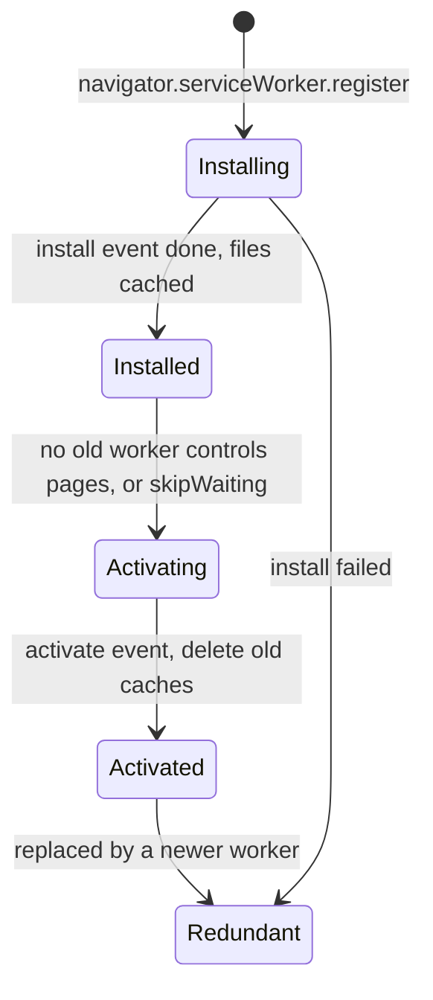
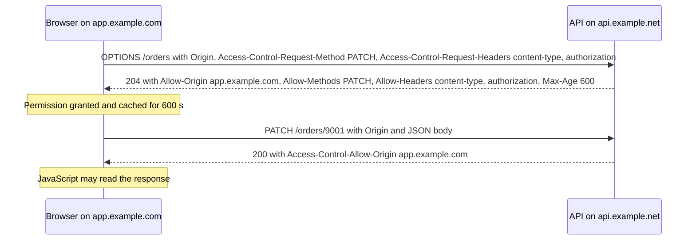
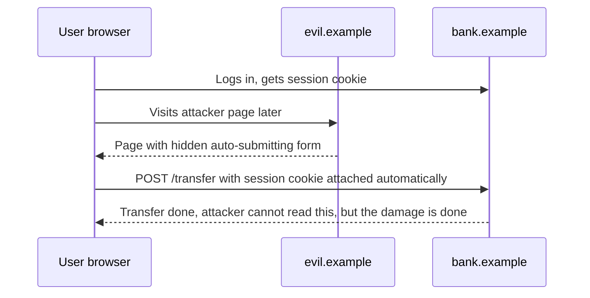

# Browser Storage and Web Security Basics

> In this document you will learn where a web app can keep data (cookies, localStorage, sessionStorage, IndexedDB, Cache API, memory), what an origin is, how the same-origin policy and CORS work, and the essential web attacks and defenses: XSS, CSRF and clickjacking. These are standard interview topics ("localStorage vs cookies?", "where do you store a JWT?", "does CORS protect the server?") and they decide whether your app is safe.

**Before this:** [HTTP, HTTPS and TLS](05-http-https-and-tls.md) · **Interview questions:** [jump to the interview section](#interview-questions)

## Table of contents

1. [Storage options at a glance](#storage-options-at-a-glance)
2. [Cookies from the browser side](#cookies-from-the-browser-side)
3. [localStorage and sessionStorage](#localstorage-and-sessionstorage)
4. [IndexedDB](#indexeddb)
5. [Service workers and the Cache API](#service-workers-and-the-cache-api)
6. [Where to store auth tokens](#where-to-store-auth-tokens)
7. [Origins and sites](#origins-and-sites)
8. [The same-origin policy](#the-same-origin-policy)
9. [CORS](#cors)
10. [HTTPS, secure contexts and mixed content](#https-secure-contexts-and-mixed-content)
11. [Third-party cookies and SameSite defaults](#third-party-cookies-and-samesite-defaults)
12. [XSS](#xss)
13. [CSRF](#csrf)
14. [Clickjacking](#clickjacking)
15. [How to explain this in an interview](#how-to-explain-this-in-an-interview)
16. [Interview questions](#interview-questions)
17. [Summary](#summary)
18. [References](#references)

---

## Storage options at a glance

| | Cookies | localStorage | sessionStorage | IndexedDB | Cache API | In-memory (JS variables, services, stores) |
| --- | --- | --- | --- | --- | --- | --- |
| Capacity | About 4 KB per cookie | About 5 MiB per origin | About 5 MiB per origin | Large (a share of free disk) | Large (same quota as IndexedDB) | RAM |
| Lifetime | Until `Max-Age`/`Expires`, or end of session | Until cleared | Until the tab closes | Until cleared | Until cleared | Until reload |
| Scope | Domain + path (+ SameSite rules) | Origin, shared by all tabs | Origin **and** one tab | Origin | Origin | One page |
| API | `document.cookie` (sync), Cookie Store API (async) | Sync | Sync | Async | Async (promises) | — |
| Sent to server automatically | **Yes**, on every matching request | No | No | No | No | No |
| Readable by JavaScript | Yes, unless `HttpOnly` | Yes | Yes | Yes | Yes | Yes |
| Data types | Strings | Strings | Strings | Almost any (objects, Blobs, Files) | Request/Response pairs | Anything |
| Available in workers | Cookie Store API only | No | No | Yes | Yes | — |

Rule of thumb:

- Small UI preferences (theme, collapsed sidebar) → **localStorage**.
- State for one tab only (a multi-step wizard draft) → **sessionStorage**.
- Large or structured data, offline data → **IndexedDB**.
- Cached files and HTTP responses for offline use → **Cache API** in a service worker.
- Session identity → an **HttpOnly cookie** set by the server.
- Everything else (current filters, loaded lists) → **memory** (component state, an Angular service, NgRx store).

All browser storage is **controlled by the user**. Anyone can open DevTools and change it. Never trust it for security decisions; the server must check everything.

---

## Cookies from the browser side

Cookies are explained from the HTTP side (attributes, `Set-Cookie`) in [HTTP, HTTPS and TLS](05-http-https-and-tls.md#statelessness-cookies-and-sessions). Here is what matters in browser code.

`document.cookie` is an old, awkward API: reading gives **one string** of all visible cookies; writing sets **one** cookie.

```js
// Browser
document.cookie = 'theme=dark; Path=/; Max-Age=31536000; SameSite=Lax; Secure';
document.cookie = 'lang=en; Path=/; SameSite=Lax; Secure';
console.log(document.cookie); // "theme=dark; lang=en" (HttpOnly cookies are NOT included)

// Delete a cookie: set the same name and path with Max-Age=0
document.cookie = 'lang=; Path=/; Max-Age=0';
```

Key points:

- `HttpOnly` cookies are invisible to `document.cookie`. That is the point: script cannot steal them.
- Every cookie for a domain is sent with **every** matching request, including image and API requests. Big cookies waste bandwidth. Keep them small and few.
- The newer **Cookie Store API** (`await cookieStore.get('theme')`) is asynchronous, works in service workers and became Baseline in 2025. It also cannot see `HttpOnly` cookies.

---

## localStorage and sessionStorage

Both are **Web Storage**: simple key–value stores of **strings**, per origin.

- **localStorage** survives browser restarts and is shared by all tabs of the same origin.
- **sessionStorage** belongs to one tab. It survives reloads, but closing the tab deletes it. Two tabs with the same site have separate sessionStorage. (Duplicating a tab copies it.)

### Everything becomes a string

```js
localStorage.setItem('count', 1);
console.log(typeof localStorage.getItem('count'), localStorage.getItem('count')); // string 1

localStorage.setItem('user', { name: 'Asha' });
console.log(localStorage.getItem('user')); // [object Object]

console.log(localStorage.getItem('missing')); // null

localStorage.setItem('flag', false);
console.log(localStorage.getItem('flag') ? 'truthy' : 'falsy'); // truthy  ("false" is a non-empty string)
```

(Verified with Node 22's experimental Web Storage: `node --experimental-webstorage --localstorage-file=./ls.db`. Browsers behave the same.)

### A safe helper

```js
const storage = {
  get(key, fallback) {
    try {
      const raw = localStorage.getItem(key);
      return raw === null ? fallback : JSON.parse(raw);
    } catch {
      return fallback; // storage blocked (privacy mode, policy) or corrupted JSON
    }
  },
  set(key, value) {
    try {
      localStorage.setItem(key, JSON.stringify(value));
    } catch (err) {
      console.warn('Could not save', key, err.name); // e.g. QuotaExceededError
    }
  },
};

storage.set('cart', [{ id: 1, qty: 2 }]);
console.log(storage.get('cart', [])[0].qty); // 2
```

### Syncing tabs with the storage event

When one tab changes localStorage, **other** tabs of the same origin get a `storage` event:

```js
// Browser: log out every open tab when one tab logs out
window.addEventListener('storage', (event) => {
  if (event.key === 'logout-at') {
    router.navigate(['/login']);
  }
});

function logout() {
  localStorage.setItem('logout-at', String(Date.now())); // other tabs react
}
```

(`BroadcastChannel` is a cleaner modern alternative for cross-tab messages.)

### Limits and gotchas

- **Synchronous:** every read and write blocks the main thread. Fine for small values; bad for megabytes in a loop.
- **About 5 MiB per origin.** Exceeding it throws `QuotaExceededError`.
- **Not available in workers.**
- **Readable by any script on the page**, including injected XSS code and third-party scripts. Never store secrets here.

---

## IndexedDB

**IndexedDB** is a real database in the browser: asynchronous, transactional, with **object stores** (like tables), **indexes** and **versioned schemas**. It stores almost any structured value (objects, arrays, Dates, Blobs, Files).

Use it for: offline drafts, a local copy of large lists, cached API data for offline-first apps, files waiting to upload.

The raw API is event-based and verbose. Many projects use a small promise wrapper such as the `idb` library. The raw version looks like this:

```js
// Browser
function openDb() {
  return new Promise((resolve, reject) => {
    const request = indexedDB.open('shop-db', 1);
    request.onupgradeneeded = () => {
      // Runs only when the version number increases: create the schema here
      const store = request.result.createObjectStore('drafts', { keyPath: 'id' });
      store.createIndex('byUpdatedAt', 'updatedAt');
    };
    request.onsuccess = () => resolve(request.result);
    request.onerror = () => reject(request.error);
  });
}

async function saveDraft(draft) {
  const db = await openDb();
  return new Promise((resolve, reject) => {
    const tx = db.transaction('drafts', 'readwrite');
    tx.objectStore('drafts').put({ ...draft, updatedAt: Date.now() });
    tx.oncomplete = resolve;
    tx.onerror = () => reject(tx.error);
  });
}

await saveDraft({ id: 'review-42', text: 'Great keyboard, but loud.' });
```

Quota and eviction: IndexedDB and the Cache API share one per-origin quota. Chromium lets an origin use up to about 60% of the disk; Firefox and Safari have their own rules. By default storage is **best-effort**: the browser may delete it under storage pressure. You can check usage and ask for persistence:

```js
const { usage, quota } = await navigator.storage.estimate();
const persisted = await navigator.storage.persist(); // true if the browser grants it
```

Safari, with its tracking prevention, can delete script-writable storage for sites the user has not interacted with for several days of browser use. Do not treat browser storage as the only copy of important data.

---

## Service workers and the Cache API

A **service worker** is a script that runs in the background, separate from the page, and acts like a **proxy between the page and the network**. Every request from pages in its scope goes through its `fetch` event, where it can answer from the **Cache API**, from the network, or both.

It enables offline apps, fast repeat loads and push notifications, which together make a **PWA (progressive web app)**, along with a web app manifest. Service workers only work in **secure contexts** (HTTPS or localhost).



A new version **waits** until all tabs using the old version close. This is why users sometimes see an old version of an app after a deploy.

```js
// sw.js — cache-first for static files, network-first for HTML
const CACHE = 'shop-static-v2';

self.addEventListener('install', (event) => {
  event.waitUntil(caches.open(CACHE).then((c) => c.addAll(['/', '/main.js', '/styles.css'])));
});

self.addEventListener('activate', (event) => {
  event.waitUntil(
    caches.keys().then((keys) => Promise.all(keys.filter((k) => k !== CACHE).map((k) => caches.delete(k))))
  );
});

self.addEventListener('fetch', (event) => {
  const { request } = event;
  if (request.mode === 'navigate') {
    // Network-first for pages: fresh when online, cached shell when offline
    event.respondWith(fetch(request).catch(() => caches.match('/')));
    return;
  }
  // Cache-first for static assets
  event.respondWith(caches.match(request).then((hit) => hit ?? fetch(request)));
});
```

Common strategies: **cache-first** (hashed static files), **network-first** (HTML, fresh data), **stale-while-revalidate** (answer from cache, update it in the background). Angular provides a configurable worker with `@angular/service-worker` (`ng add @angular/pwa`).

---

## Where to store auth tokens

There is no perfect place. Each choice trades XSS risk against CSRF risk and complexity.

| Option | XSS can steal it? | CSRF risk? | Notes |
| --- | --- | --- | --- |
| localStorage | **Yes** | No | Simple, survives reloads, but any injected script reads it |
| sessionStorage | **Yes** | No | Same, but per tab |
| Memory only (a variable or service) | Harder (no storage to read), but XSS can still call your APIs | No | Lost on reload; pair with a refresh mechanism |
| **HttpOnly, Secure, SameSite cookie** | **No** (script cannot read it) | Yes, because the browser sends it automatically → defend with SameSite + CSRF token | Common recommendation for browser apps |
| **BFF (backend-for-frontend)** | Tokens never reach the browser | Same as cookies | The server keeps OAuth tokens; the browser only has a session cookie |

A practical recommendation for most web apps:

1. Keep the session (or refresh token) in an **`HttpOnly; Secure; SameSite=Lax` (or `Strict`) cookie**, ideally with the `__Host-` prefix.
2. If you need an access token in JavaScript, keep it **in memory** with a short lifetime, and get a new one through the refresh cookie.
3. Add **CSRF protection** for state-changing requests.
4. Still prevent XSS: with XSS, the attacker can send requests **as the user** while the page is open, even if they cannot read the cookie.

Implementation and architecture: [Authentication and authorization in Node.js](../07-nodejs-backend/09-authentication-and-authorization.md), [Auth architecture and multi-tenancy](../09-system-design/06-auth-architecture-and-multi-tenancy.md).

---

## Origins and sites

An **origin** is **scheme + host + port**. Two URLs have the same origin only if all three match.

Compared with `https://shop.example.com/products`:

| URL | Same origin? | Why |
| --- | --- | --- |
| `https://shop.example.com/cart?x=1` | Yes | Only path and query differ |
| `http://shop.example.com/products` | No | Different scheme |
| `https://api.shop.example.com/products` | No | Different host |
| `https://shop.example.com:8443/products` | No | Different port |
| `https://shop.example.com:443/products` | Yes | 443 is the default port for https |

```js
const a = new URL('https://shop.example.com/products');
const b = new URL('https://shop.example.com:443/cart');
const c = new URL('https://api.shop.example.com/products');
console.log(a.origin);              // https://shop.example.com
console.log(a.origin === b.origin); // true
console.log(a.origin === c.origin); // false
```

### Site vs origin

A **site** is **scheme + registrable domain** (the domain you can buy, like `example.com`, also called eTLD+1). `https://shop.example.com` and `https://api.example.com` are **different origins** but the **same site**.

- **SameSite cookies** and **site isolation** use "site".
- The **same-origin policy**, **localStorage** and **CORS** use "origin".

So `SameSite=Lax` cookies are still sent on requests from `blog.example.com` to `shop.example.com`. A vulnerable subdomain can be a CSRF launch point.

---

## The same-origin policy

The **same-origin policy (SOP)** is the browser's core security rule: **scripts from one origin cannot read data from another origin**.

**Why it exists:** you are logged in to your bank in one tab. You open `evil.example` in another. Without SOP, `evil.example`'s JavaScript could `fetch('https://bank.example/api/accounts')` (the browser would attach your bank cookies) and **read** the response. SOP blocks the read.

What SOP restricts and allows:

| Action across origins | Allowed? |
| --- | --- |
| **Embedding**: ``, `<script src>`, `<link rel=stylesheet>`, `<video>`, `<iframe>` | Generally yes |
| **Sending** requests: links, form submissions, `fetch` (simple requests) | Generally yes (this is why CSRF exists) |
| **Reading** a `fetch`/XHR response | **No**, unless the server allows it with CORS |
| Accessing another window's or iframe's DOM | **No** |
| Reading another origin's localStorage, IndexedDB, cookies (via JS) | **No** |
| Reading pixels of a cross-origin image drawn on a canvas | **No** (the canvas becomes "tainted") |

Short version: **cross-origin writes and embeds are usually allowed; cross-origin reads are blocked.**

For safe cross-window communication, use `postMessage` and always check the origin:

```js
// Parent page (https://shop.example.com) receiving from a payment iframe
window.addEventListener('message', (event) => {
  // ✅ Correct: only accept messages from the expected origin
  if (event.origin !== 'https://pay.example.net') return;
  if (event.data?.type === 'payment-complete') showReceipt(event.data.orderId);
});

// ❌ Wrong: iframe.contentWindow.postMessage(data, '*') sends data to whatever page is loaded there
paymentFrame.contentWindow.postMessage({ type: 'start', amount: 49 }, 'https://pay.example.net');
```

---

## CORS

**CORS (Cross-Origin Resource Sharing)** is how a server **relaxes** the same-origin policy for specific origins. The browser asks; the server answers with headers; the browser decides whether the page may read the response.

### Simple requests

A `GET`, `HEAD` or `POST` with only "simple" headers and a `Content-Type` of `text/plain`, `multipart/form-data` or `application/x-www-form-urlencoded` is sent directly. The browser adds `Origin`, and checks the response:

```text
GET /api/products HTTP/1.1
Origin: https://app.example.com

HTTP/1.1 200 OK
Access-Control-Allow-Origin: https://app.example.com
```

If the header is missing or does not match, the request **still reached the server**, but the browser hides the response from JavaScript and shows a CORS error.

### Preflight requests

Other requests (`PUT`, `PATCH`, `DELETE`, `Content-Type: application/json`, an `Authorization` header, custom headers) need permission **first**:



### Credentials

To send cookies cross-origin, the client must opt in and the server must explicitly allow it:

```js
fetch('https://api.example.net/me', { credentials: 'include' }); // Angular: { withCredentials: true }
```

```text
Access-Control-Allow-Origin: https://app.example.com   (must be exact, "*" is not allowed with credentials)
Access-Control-Allow-Credentials: true
Vary: Origin
```

A minimal Node server with an allow-list:

```js
import http from 'node:http';

const allowed = new Set(['https://app.example.com', 'http://localhost:4200']);

http.createServer((req, res) => {
  const origin = req.headers.origin;
  if (origin && allowed.has(origin)) {
    res.setHeader('Access-Control-Allow-Origin', origin);
    res.setHeader('Access-Control-Allow-Credentials', 'true');
    res.setHeader('Vary', 'Origin');
  }
  if (req.method === 'OPTIONS') {
    res.setHeader('Access-Control-Allow-Methods', 'GET, POST, PATCH, DELETE');
    res.setHeader('Access-Control-Allow-Headers', 'Content-Type, Authorization');
    res.setHeader('Access-Control-Max-Age', '600');
    res.writeHead(204);
    return res.end();
  }
  res.setHeader('Content-Type', 'application/json');
  res.end(JSON.stringify({ ok: true }));
}).listen(3005);
```

### What CORS does NOT do

- It does **not protect your server**. `curl`, Postman, a Node script or an attacker's server ignore CORS completely. Your API still needs authentication and authorization.
- It does **not stop the request from being sent** for simple requests. So CORS is not a CSRF defense.
- Reflecting any `Origin` back together with `Allow-Credentials: true` is a serious bug: every website could read your users' data. Use an allow-list.
- In development, a dev-server proxy (Angular's `proxy.conf.json`) avoids CORS by making the API look same-origin.

---

## HTTPS, secure contexts and mixed content

A **secure context** is a page loaded over HTTPS (or from `http://localhost` / `127.0.0.1`, which browsers trust for development). Check it with `window.isSecureContext`.

Many powerful features work **only** in secure contexts: service workers, the Cache API, `crypto.subtle`, geolocation, camera and microphone, clipboard writes, the Cookie Store API, Web Bluetooth and more.

**Mixed content** is an HTTPS page that loads something over plain HTTP:

- **Upgradable content** (``, `<audio>`, `<video>`): modern browsers automatically try HTTPS instead, and the load fails if HTTPS is not available.
- **Blockable content** (scripts, stylesheets, iframes, `fetch`/XHR, fonts): **blocked**. An HTTP script on an HTTPS page could be modified by an attacker and would control the whole page.

Fix it by serving everything over HTTPS and using `https://` (or relative) URLs. The CSP directive `upgrade-insecure-requests` upgrades old hard-coded `http://` URLs automatically.

---

## Third-party cookies and SameSite defaults

A **third-party cookie** belongs to a different site than the one in the address bar, for example an ad network's cookie set inside an iframe on a news site. They were the classic tool for cross-site tracking. Current browser behavior, stated neutrally:

| Browser | Default for third-party cookies |
| --- | --- |
| Safari | Blocked by default (Intelligent Tracking Prevention) |
| Firefox | Partitioned by default (Total Cookie Protection): each top-level site gets a separate cookie jar |
| Chrome | Allowed by default; users can block them in settings (blocked in Incognito). Google announced in 2025 that it keeps this user-choice approach instead of deprecating them |

Tools for legitimate cross-site uses (embedded chat, payment widgets, SSO):

- **`Partitioned` cookies (CHIPS):** `Set-Cookie: __Host-widget=1; Secure; Path=/; SameSite=None; Partitioned` stores the cookie separately per top-level site.
- **Storage Access API:** an embedded iframe asks the user for access to its unpartitioned cookies.
- **Storage partitioning:** browsers also partition localStorage, IndexedDB and similar storage for third-party iframes.

**SameSite defaults:** Chrome and other Chromium browsers treat a cookie without `SameSite` as `Lax`. Firefox and Safari do not apply this default at the time of writing. Cross-site cookies need `SameSite=None; Secure`. Always set `SameSite` explicitly.

Design advice: do not build login or core features on third-party cookies. Put your app and API on the **same site** (for example `app.example.com` and `api.example.com`), so their cookies are first-party.

---

## XSS

### What it is

**Cross-site scripting (XSS)** happens when an attacker gets **their JavaScript to run in your page**, in your origin. Then the script can do anything the user can: read the DOM, read localStorage tokens, call your APIs with the user's cookies, change the page, capture keystrokes.

| Type | Where the payload comes from | Example |
| --- | --- | --- |
| **Stored** | Saved in your database and shown to other users | A product review containing `` |
| **Reflected** | Part of the request, echoed back by the server | `/search?q=<script>...</script>` rendered into the results page |
| **DOM-based** | Client-side JavaScript puts untrusted data into a dangerous sink | `element.innerHTML = location.hash.slice(1)` |

### The core defense: treat data as text, not code

```js
// Browser
const review = '';

// ❌ Wrong: the string is parsed as HTML, the onerror handler runs
reviewEl.innerHTML = review;

// ✅ Correct: the string is shown as text
reviewEl.textContent = review;
```

Dangerous sinks: `innerHTML`, `outerHTML`, `insertAdjacentHTML`, `document.write`, `eval`, `new Function`, `setTimeout` with a string, `href`/`src` set to `javascript:` URLs, and framework escape hatches (`bypassSecurityTrustHtml` in Angular, `dangerouslySetInnerHTML` in React).

Server-side, escaping by context is the same idea:

```js
function escapeHtml(text) {
  return text
    .replaceAll('&', '&amp;')
    .replaceAll('<', '&lt;')
    .replaceAll('>', '&gt;')
    .replaceAll('"', '&quot;')
    .replaceAll("'", '&#39;');
}
console.log(escapeHtml(''));
// &lt;img src=x onerror=&quot;steal()&quot;&gt;
```

(In real code, use your template engine's auto-escaping instead of hand-written helpers.)

### Defense in depth

1. **Use the framework's default binding.** Angular's `{{ value }}` and `[textContent]` escape; `[innerHTML]` is passed through Angular's sanitizer. React's `{value}` escapes. See [Angular security](../06-angular-16/15-security.md).
2. **Sanitize when you really must render HTML** (rich-text comments, CMS content) with a maintained library such as DOMPurify, with an allow-list of tags. Never write your own regex sanitizer.
3. **Validate URLs** you put in `href`/`src`: allow only `https:` (and maybe `mailto:`), never `javascript:`.
4. **Content Security Policy (CSP)**, a response header that limits what scripts may run:

   ```text
   Content-Security-Policy: default-src 'self'; script-src 'self' 'nonce-r4nd0m'; object-src 'none'; base-uri 'self'; frame-ancestors 'none'
   ```

   With this policy, inline scripts and injected `onerror=` handlers do not run unless they carry the right nonce, so many XSS bugs become harmless. Avoid `'unsafe-inline'` and `'unsafe-eval'` in `script-src`. Start with `Content-Security-Policy-Report-Only` to find breakage.
5. **HttpOnly cookies** so XSS cannot steal the session (it can still act within the page).
6. **Trusted Types** (Chromium, with growing support) can force all `innerHTML`-style assignments to go through a reviewed policy.

---

## CSRF

### What it is

**Cross-site request forgery (CSRF)** tricks a logged-in user's browser into sending a **state-changing request** to your site from another site. It works because browsers attach cookies automatically.

```html
<!-- On evil.example: the user just visits the page -->
<form action="https://bank.example/transfer" method="POST" id="f">
  <input type="hidden" name="to" value="attacker">
  <input type="hidden" name="amount" value="1000">
</form>
<script>document.getElementById('f').submit();</script>
```

If `bank.example` uses a cookie session without protection, the browser sends the cookie, and the bank sees a valid, logged-in request. The attacker cannot **read** the response (same-origin policy), but they do not need to: the transfer already happened.



### Defenses

1. **SameSite cookies.** `SameSite=Lax` or `Strict` stops the cookie from being sent on cross-site POSTs, iframes and fetches. This blocks most CSRF.
2. **CSRF tokens** (synchronizer token or double-submit cookie). The server gives the page a random token; state-changing requests must send it in a header or form field. The attacker's site cannot read it. Angular's `HttpClient` supports the double-submit pattern: it reads the `XSRF-TOKEN` cookie and sends it as the `X-XSRF-TOKEN` header on mutating same-origin requests.
3. **Check `Origin` (or `Sec-Fetch-Site`)** on state-changing requests and reject unexpected sites.
4. **Never change state with GET.**
5. Requiring `Content-Type: application/json` helps a little (a plain form cannot send it without a preflight), but do not rely on it alone.

APIs that use only an `Authorization: Bearer` header (no cookies) are not vulnerable to classic CSRF, because the attacker's page cannot add that header. They are more exposed to XSS token theft instead.

---

## Clickjacking

**Clickjacking** loads your site in an invisible `<iframe>` on an attacker's page and tricks the user into clicking real buttons ("Delete account", "Approve payment") placed under a fake "Win a prize" button.

Defense: tell the browser who may frame your pages.

```text
Content-Security-Policy: frame-ancestors 'none'              (nobody may frame this page)
Content-Security-Policy: frame-ancestors 'self' https://portal.example.com
X-Frame-Options: DENY                                        (older header, still useful for old browsers)
```

`frame-ancestors` must be sent as an HTTP header (it is ignored in a `<meta>` tag). Security headers are usually set in one place, for example Helmet in Express or the reverse proxy; see [Production Node.js](../07-nodejs-backend/14-production-nodejs.md). Desktop apps have their own rules: [Electron security](../08-electron-desktop/04-electron-security.md).

---

## How to explain this in an interview

### localStorage vs sessionStorage vs cookies

1. **Define it:** "All three store small strings in the browser. Cookies are sent to the server with requests; localStorage and sessionStorage are only for JavaScript."
2. **Why it exists:** "Cookies give HTTP a way to remember state, like a session. Web Storage gives the page a simple local key-value store without sending data on every request."
3. **How it works:** "Cookies are set by `Set-Cookie` or `document.cookie`, about 4 KB each, scoped by domain and path, with HttpOnly, Secure and SameSite. localStorage is about 5 MiB per origin and persists; sessionStorage is per tab and is cleared when the tab closes. Both Web Storage APIs are synchronous."
4. **Small example:** "Theme preference in localStorage, a wizard draft in sessionStorage, the session ID in an HttpOnly cookie."
5. **Where it is useful:** "Preferences, per-tab state, and authentication."
6. **Trade-offs / gotchas:** "Anything readable by JavaScript can be stolen by XSS, so no tokens in localStorage if I can avoid it. Cookies are sent automatically, which brings CSRF risk, so I use SameSite and CSRF tokens. For large data I use IndexedDB."

### Same-origin policy and CORS

1. **Define it:** "The same-origin policy stops scripts from one origin, scheme plus host plus port, from reading data from another origin. CORS is how a server explicitly allows specific origins to read its responses."
2. **Why it exists:** "Browsers attach the user's cookies to requests. Without SOP, any site I visit could read my bank's API responses using my session."
3. **How it works:** "Embeds and simple requests are allowed, but reading the response is blocked unless the server returns Access-Control-Allow-Origin for my origin. Non-simple requests, like JSON or with an Authorization header, get an OPTIONS preflight first."
4. **Small example:** "My Angular app on app.example.com calls api.example.net; the API must answer with that origin in Access-Control-Allow-Origin, and with Allow-Credentials if cookies are involved."
5. **Where it is useful:** "Any SPA that calls an API on another origin."
6. **Trade-offs / gotchas:** "CORS protects users in browsers, not the server. curl ignores it, so the API still needs auth. And reflecting every origin with credentials is a serious vulnerability."

---

## Interview questions

### Q1. What is the difference between localStorage, sessionStorage and cookies?

**What the interviewer is checking:** Capacity, lifetime, scope, server visibility and security.

**Short spoken answer (30–60 seconds):**
> Cookies are small, about 4 KB each, can be set by the server, and are sent automatically with every matching request, which makes them the natural place for a session ID. With HttpOnly, JavaScript cannot read them. localStorage and sessionStorage are only for JavaScript: about 5 MiB per origin, strings only, synchronous, and never sent to the server. localStorage persists until cleared and is shared by all tabs of the origin. sessionStorage is per tab and disappears when the tab closes. I use localStorage for preferences, sessionStorage for per-tab drafts, and an HttpOnly cookie for authentication.

**Follow-up questions:**
- **What does `localStorage.setItem('flag', false)` then `getItem('flag')` return?** — The string `"false"`, which is truthy. Store JSON and parse it.
- **How do two tabs stay in sync?** — The `storage` event fires in other tabs when localStorage changes; `BroadcastChannel` is an alternative.

**Common mistakes:** Saying localStorage is sent to the server. Forgetting that sessionStorage is per tab.

**Where this is used in real projects:** User preferences, cart drafts, login sessions.

### Q2. Where should you store a JWT in a browser app?

**What the interviewer is checking:** XSS vs CSRF trade-offs, not a single memorized answer.

**Short spoken answer (30–60 seconds):**
> There is a trade-off. In localStorage, the token survives reloads and has no CSRF risk, but any XSS can read it and send it to an attacker. In an HttpOnly, Secure, SameSite cookie, JavaScript cannot read it, so XSS cannot steal it, but the browser sends it automatically, so I need CSRF protection: SameSite plus a CSRF token or Origin checks. My usual choice is the refresh token or session in an HttpOnly SameSite cookie, and if the app needs an access token, a short-lived one kept only in memory. For high-security apps I prefer a backend-for-frontend, so OAuth tokens never reach the browser at all. And none of this replaces preventing XSS, because injected script can still call the API as the user.

**Follow-up questions:**
- **Does HttpOnly make XSS harmless?** — No. It stops token theft, but the attacker's script can still make authenticated requests while the page is open.
- **Why is a Bearer header not vulnerable to CSRF?** — The attacker's page cannot add a custom `Authorization` header to a cross-site request without CORS permission.

**Common mistakes:** "localStorage is always fine" or "cookies are always secure".

**Where this is used in real projects:** SPA login flows, OAuth/OIDC with PKCE, BFF architectures.

### Q3. What is an origin? Are `https://shop.example.com` and `https://api.shop.example.com` the same origin?

**Short answer:** An origin is scheme + host + port. These two have different hosts, so they are **different origins**, but they are the **same site** (same scheme and registrable domain `example.com`). That matters: CORS and localStorage are per origin, while SameSite cookies treat them as same-site. `https://shop.example.com:443` and `https://shop.example.com` are the same origin, because 443 is the default port.

### Q4. What is the same-origin policy, and what does it restrict?

**What the interviewer is checking:** Read vs write vs embed.

**Short spoken answer (30–60 seconds):**
> It is the browser rule that a script from one origin cannot read data from another origin. It exists because the browser attaches cookies to requests: without it, any site could read my bank's API responses using my session. It does not block everything. Embedding is allowed, like images, scripts, stylesheets and iframes from other origins, and sending requests like form posts and links is allowed. What is blocked is reading: reading a cross-origin fetch response unless CORS allows it, accessing another origin's iframe DOM, or reading its storage. For safe cross-window communication there is postMessage, where the receiver must check event.origin.

**Follow-up questions:**
- **Why is sending allowed if reading is blocked?** — The web was built on links and forms across sites. That is exactly why CSRF exists and needs its own defense.

**Common mistakes:** Thinking SOP blocks requests from being sent.

**Where this is used in real projects:** Embedded widgets, payment iframes, micro-frontends.

### Q5. How does CORS work, and what is a preflight?

**What the interviewer is checking:** Simple vs preflighted requests and credentials.

**Short spoken answer (30–60 seconds):**
> CORS lets a server allow other origins to read its responses. The browser adds an Origin header, and if the response has Access-Control-Allow-Origin matching that origin, the page can read it. Simple requests, like a GET or a form-style POST, are sent directly and only the response is checked. Anything else, like PUT, PATCH, DELETE, a JSON content type or an Authorization header, triggers a preflight: the browser first sends an OPTIONS request with Access-Control-Request-Method and Headers, and only sends the real request if the server allows them. With cookies, the client must use credentials include, and the server must return the exact origin, not a star, plus Allow-Credentials true.

**Follow-up questions:**
- **How do you reduce preflight cost?** — `Access-Control-Max-Age` caches the preflight result; or serve the API from the same origin (reverse proxy path like `/api`).
- **How do you fix a CORS error in local Angular development?** — Use the dev-server proxy (`proxy.conf.json`) or configure the API's allowed origins. Not by changing frontend request code.

**Common mistakes:** Trying to fix CORS by adding `Access-Control-Allow-Origin` to the request.

**Where this is used in real projects:** Any SPA calling an API on another domain.

### Q6. Does CORS protect your server?

**What the interviewer is checking:** A very common misconception.

**Short spoken answer (30–60 seconds):**
> No. CORS is enforced by browsers to protect users, by stopping other websites' JavaScript from reading responses with the user's credentials. It does nothing against curl, Postman, scripts or another server, which simply ignore the headers. For simple requests the request is even sent and processed before the browser decides whether the page may read the response, so CORS is not a CSRF defense either. The server still needs authentication, authorization, input validation, rate limiting and CSRF protection.

**Follow-up questions:**
- **What is a dangerous CORS misconfiguration?** — Reflecting any `Origin` header back with `Access-Control-Allow-Credentials: true`. Then any website can read logged-in users' data. Use an explicit allow-list.

**Common mistakes:** Calling CORS "API security".

**Where this is used in real projects:** API security reviews.

### Q7. What is XSS, and how do you prevent it?

**What the interviewer is checking:** Types, root cause and layered defenses.

**Short spoken answer (30–60 seconds):**
> XSS is when an attacker gets their JavaScript to run in my page, under my origin, so it can read data, call my APIs as the user, or change the page. Stored XSS comes from saved data like comments, reflected XSS from request data echoed into the page, and DOM-based XSS from client code putting untrusted data into sinks like innerHTML. The main defense is to always treat data as text: use textContent and the framework's normal bindings, which escape output. If I must render user HTML, I sanitize it with a maintained library like DOMPurify, and I never allow javascript URLs. As defense in depth, I add a strict Content Security Policy with nonces so injected scripts do not run, and HttpOnly cookies so the session cannot be stolen.

**Follow-up questions:**
- **Is Angular safe from XSS by default?** — Mostly: interpolation escapes, and `[innerHTML]` is sanitized. Risk comes from `bypassSecurityTrust*`, direct DOM access with `ElementRef.nativeElement.innerHTML`, and server-side template injection. See [Angular security](../06-angular-16/15-security.md).
- **Why is input validation alone not enough?** — The same data can be safe in one context and dangerous in another (HTML, attribute, URL, JavaScript). Escape on **output**, for the specific context.

**Common mistakes:** "We use HTTPS so we are safe." "We strip `<script>` tags" (payloads like `onerror` still work).

**Where this is used in real projects:** Comments, reviews, rich-text editors, search pages, CMS content.

### Q8. Predict the output and spot the risk

```js
const review = '';
reviewEl.innerHTML = review;   // line A
titleEl.textContent = review;  // line B
console.log(titleEl.textContent === review);
```

**Answer (browser):** Line A runs the attacker's code: the image fails to load and the `onerror` handler executes (`alert(1)`). Line B is safe: the text is displayed literally. The console prints `true`, because `textContent` stores the string unchanged as text. Note that a `<script>` tag inserted through `innerHTML` does **not** execute, which is why real attacks use event-handler attributes like `onerror` instead.

### Q9. What is CSRF, and how do you prevent it?

**What the interviewer is checking:** Why cookies cause it and which defenses work.

**Short spoken answer (30–60 seconds):**
> CSRF tricks a logged-in user's browser into sending a state-changing request to my site from another site, for example a hidden form on an attacker's page that posts to my transfer endpoint. It works because the browser attaches my session cookie automatically. The attacker cannot read the response, but the action already happened. Defenses: SameSite=Lax or Strict cookies, which stop the cookie on cross-site POSTs; CSRF tokens that the attacker cannot read, like Angular's XSRF-TOKEN cookie sent back as a header; checking the Origin or Sec-Fetch-Site header; and never changing state with GET. APIs that use only Bearer tokens in headers are not vulnerable to classic CSRF.

**Follow-up questions:**
- **Is SameSite enough?** — It blocks most cases, but "site" includes all subdomains, older browsers differ, and Chromium's Lax default has small exceptions, so tokens or Origin checks are still recommended for important actions.
- **Does CORS stop CSRF?** — No. A simple cross-site POST is sent without a preflight; CORS only hides the response.

**Common mistakes:** Confusing CSRF with XSS. Thinking POST-only endpoints are safe.

**Where this is used in real projects:** Cookie-based sessions, admin portals, banking actions.

### Q10. What is the difference between XSS and CSRF?

**Short answer:** XSS runs the attacker's code **inside** your site, so it can read and do anything the user can on your origin. CSRF runs no code on your site; it makes the user's browser **send** a request to your site from another site, without being able to read the response. Defenses differ: XSS → output escaping, sanitization, CSP; CSRF → SameSite cookies, CSRF tokens, Origin checks. Note: if you have XSS, CSRF tokens do not help, because the injected script can read the token.

### Q11. What is clickjacking, and how do you prevent it?

**Short answer:** The attacker loads your page in a transparent iframe and tricks the user into clicking real buttons. Prevent it with the `Content-Security-Policy: frame-ancestors 'none'` (or a list of allowed parent origins) response header, plus `X-Frame-Options: DENY` for older browsers. `frame-ancestors` does not work in a `<meta>` tag.

### Q12. What is a Content Security Policy?

**What the interviewer is checking:** CSP as defense in depth.

**Short spoken answer (30–60 seconds):**
> CSP is a response header that tells the browser which sources of scripts, styles, images, frames and connections are allowed on a page. A strict policy, like `script-src 'self' 'nonce-abc'`, means inline scripts and injected event handlers do not run unless they carry the server's random nonce, so many XSS bugs can no longer execute code. It also covers clickjacking with frame-ancestors and can upgrade insecure requests. It is defense in depth, not a replacement for escaping. I roll it out with Content-Security-Policy-Report-Only first, because a strict policy can break inline scripts and third-party tags.

**Follow-up questions:**
- **Why avoid `'unsafe-inline'` in `script-src`?** — It allows inline scripts and handlers, which removes most of CSP's XSS protection.

**Common mistakes:** Treating CSP as the main XSS fix.

**Where this is used in real projects:** Security headers via Helmet or the reverse proxy; Angular apps with nonce support.

### Q13. When would you use IndexedDB instead of localStorage?

**Short answer:** When the data is large (more than a few MB), structured (objects you want to query by index), binary (Blobs, Files), needed in a worker or service worker, or written often enough that synchronous localStorage would block the main thread. Examples: offline drafts and outbox queues, a local copy of a product catalog, cached API data for an offline-first app, files waiting to upload. Use a wrapper like `idb` to get promises, and handle quota errors and eviction.

### Q14. What is a service worker, and why does it require HTTPS?

**Short answer:** A background script that sits between your pages and the network: it intercepts requests in its scope through the `fetch` event and can answer from the Cache API, enabling offline support, fast repeat loads and push notifications. Because it can control every request of the site and persist across visits, an attacker who could inject one over plain HTTP could hijack the site long-term. So browsers require a secure context (HTTPS, or localhost for development). A new version waits until old tabs close, which is a common cause of "users still see the old version".

### Q15. Your users report they are logged out when your app is embedded in a partner's portal in an iframe. Why?

**Short answer:** Inside the partner's site, your app is a **third party**. Your session cookie is probably `SameSite=Lax` (or has no SameSite, which Chromium treats as Lax), so it is not sent in a cross-site iframe; and Safari blocks or Firefox partitions third-party cookies anyway. Options: set the cookie to `SameSite=None; Secure; Partitioned` (CHIPS) if a per-embed session is acceptable, use the Storage Access API to ask for unpartitioned access, or redesign the integration (top-level redirect login, a token handed over with `postMessage` after checking origins). Also make sure your `frame-ancestors` policy allows the partner origin.

---

## Summary

- Cookies (about 4 KB, sent automatically), localStorage (about 5 MiB, persistent, all tabs), sessionStorage (per tab), IndexedDB (large, async, structured), Cache API (responses, for service workers), memory (lost on reload).
- Web Storage stores only strings and is synchronous. Use `JSON.stringify`/`JSON.parse` and `try/catch`.
- Anything JavaScript can read, XSS can steal. Prefer HttpOnly, Secure, SameSite cookies for sessions, short-lived in-memory access tokens, or a BFF.
- Origin = scheme + host + port. Site = scheme + registrable domain. SOP and CORS use origins; SameSite uses sites.
- The same-origin policy blocks cross-origin **reads**; embeds and sends are generally allowed.
- CORS lets servers allow specific origins to read responses. Non-simple requests get an OPTIONS preflight. Credentials need an exact origin plus `Allow-Credentials: true`. CORS does not protect the server.
- Secure contexts (HTTPS, localhost) are required for service workers and many APIs. Mixed content: media is auto-upgraded, scripts and other active content are blocked.
- Safari blocks and Firefox partitions third-party cookies by default; Chrome allows them by default with user controls. Chromium treats missing SameSite as Lax. Always set it.
- XSS: untrusted data becomes code. Use text bindings, sanitize real HTML, validate URLs, add CSP and HttpOnly cookies.
- CSRF: the browser sends cookies on a forged cross-site request. Use SameSite, CSRF tokens, Origin checks and no state changes on GET.
- Clickjacking: invisible iframes. Use `frame-ancestors` (and `X-Frame-Options`).

## References

- [MDN: Web Storage API](https://developer.mozilla.org/en-US/docs/Web/API/Web_Storage_API)
- [MDN: Storage quotas and eviction criteria](https://developer.mozilla.org/en-US/docs/Web/API/Storage_API/Storage_quotas_and_eviction_criteria)
- [MDN: IndexedDB API](https://developer.mozilla.org/en-US/docs/Web/API/IndexedDB_API)
- [MDN: Service Worker API](https://developer.mozilla.org/en-US/docs/Web/API/Service_Worker_API)
- [MDN: Cookie Store API](https://developer.mozilla.org/en-US/docs/Web/API/Cookie_Store_API)
- [MDN: Same-origin policy](https://developer.mozilla.org/en-US/docs/Web/Security/Same-origin_policy)
- [MDN: Cross-Origin Resource Sharing (CORS)](https://developer.mozilla.org/en-US/docs/Web/HTTP/Guides/CORS)
- [MDN: Secure contexts](https://developer.mozilla.org/en-US/docs/Web/Security/Secure_Contexts) and [Mixed content](https://developer.mozilla.org/en-US/docs/Web/Security/Defenses/Mixed_content)
- [MDN: Third-party cookies](https://developer.mozilla.org/en-US/docs/Web/Privacy/Guides/Third-party_cookies) and [Set-Cookie](https://developer.mozilla.org/en-US/docs/Web/HTTP/Reference/Headers/Set-Cookie)
- [MDN: Content Security Policy](https://developer.mozilla.org/en-US/docs/Web/HTTP/Guides/CSP)
- [OWASP: Cross Site Scripting Prevention Cheat Sheet](https://cheatsheetseries.owasp.org/cheatsheets/Cross_Site_Scripting_Prevention_Cheat_Sheet.html)
- [OWASP: Cross-Site Request Forgery Prevention Cheat Sheet](https://cheatsheetseries.owasp.org/cheatsheets/Cross-Site_Request_Forgery_Prevention_Cheat_Sheet.html)
- [OWASP: Clickjacking Defense Cheat Sheet](https://cheatsheetseries.owasp.org/cheatsheets/Clickjacking_Defense_Cheat_Sheet.html)
- [Angular: Security guide](https://v16.angular.io/guide/security)
- [web.dev: SameSite cookies explained](https://web.dev/articles/samesite-cookies-explained)
