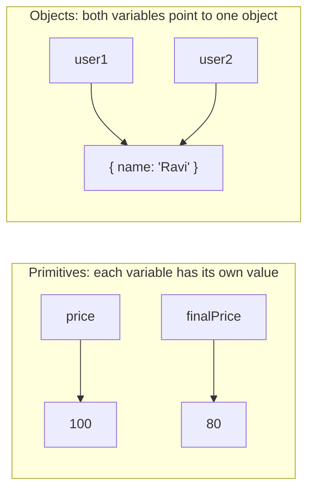
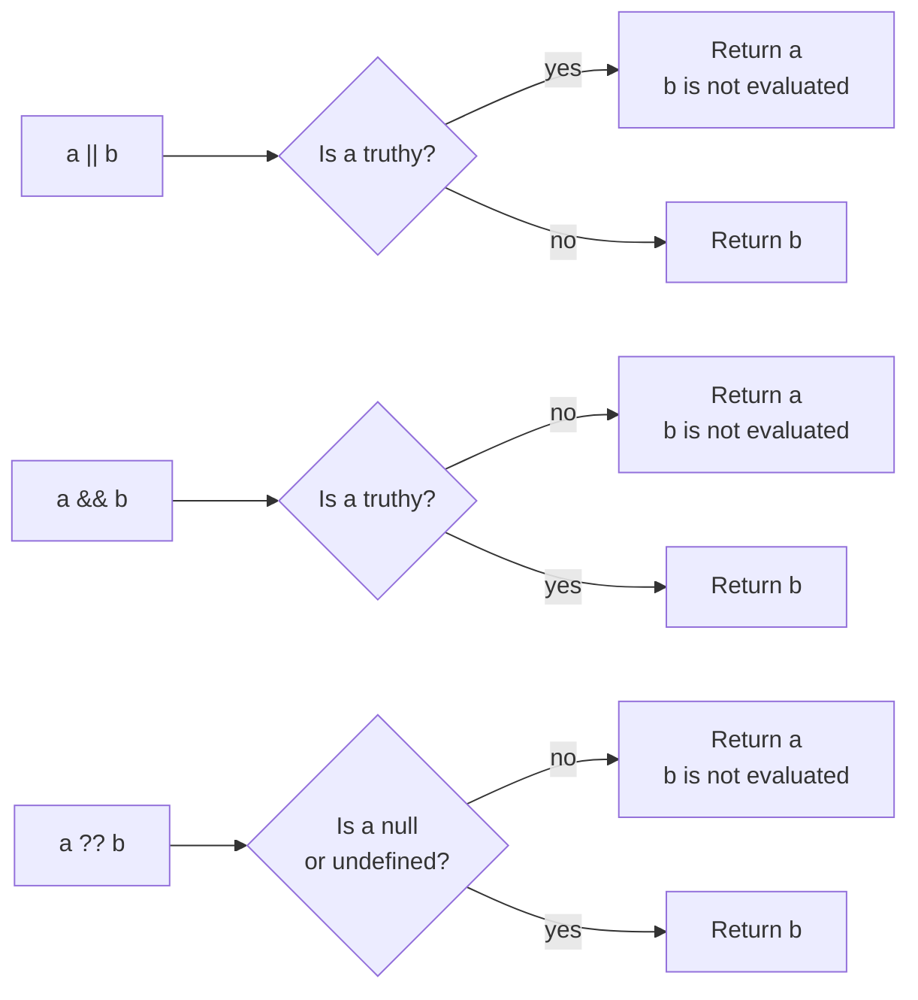
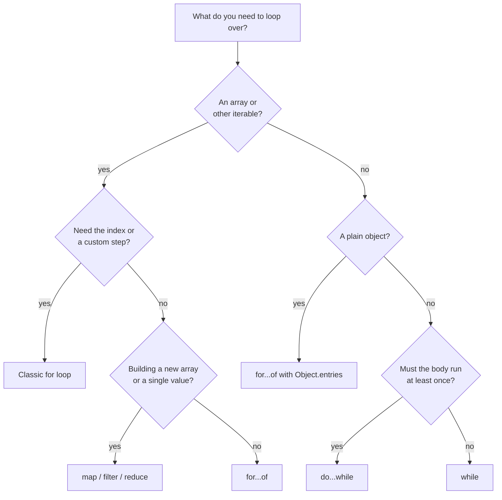

# JavaScript Basics: Variables, Types and Operators

> In this document you learn how JavaScript stores values, how `var`, `let` and `const` differ, what the data types are, how every important operator works, and how to control the flow of a program. These basics look easy, but interviewers use them to test whether you really know how the language behaves, especially with output-prediction questions.

**Before this:** [How programs run](../01-cs-and-web-fundamentals/01-how-programs-run.md) · **Interview questions:** [jump to the interview section](#interview-questions)

## Table of contents

1. [Variables with var, let and const](#variables-with-var-let-and-const)
2. [Data types](#data-types)
3. [The typeof operator](#the-typeof-operator)
4. [Primitives are immutable](#primitives-are-immutable)
5. [Value vs reference](#value-vs-reference)
6. [null vs undefined](#null-vs-undefined)
7. [Operators](#operators)
8. [Operator precedence](#operator-precedence)
9. [Truthy and falsy values](#truthy-and-falsy-values)
10. [Control flow](#control-flow)
11. [Strict mode](#strict-mode)
12. [How to explain this in an interview](#how-to-explain-this-in-an-interview)
13. [Interview questions](#interview-questions)
14. [Summary](#summary)
15. [References](#references)

---

## Variables with var, let and const

### What a variable is

A **variable** is a name that points to a value. You use the name to read the value later or to change it.

```js
let userName = "Asha";
console.log(userName); // Asha

userName = "Ravi";
console.log(userName); // Ravi
```

**Analogy:** a variable is like a label on a box. The label is the name. The thing inside the box is the value. You can move the label to another box (reassignment). The analogy breaks for objects: with objects, two labels can point to the *same* box. You will see this in [Value vs reference](#value-vs-reference).

JavaScript has three keywords to declare a variable:

| Keyword | Added in | Use it today? |
| --- | --- | --- |
| `var` | First version of JavaScript | Only in old code. Avoid it in new code. |
| `let` | ES2015 (ES6) | Yes, when the value must change. |
| `const` | ES2015 (ES6) | Yes, by default. |

### Scope: where the variable can be used

**Scope** is the part of the code where a variable is visible.

- `var` is **function-scoped**. It is visible in the whole function where it is declared. It ignores blocks like `if` and `for`.
- `let` and `const` are **block-scoped**. A **block** is any code between `{` and `}`. The variable exists only inside that block.

```js
function checkDiscount() {
  if (true) {
    var discountA = 10; // function-scoped
    let discountB = 20; // block-scoped
    const discountC = 30; // block-scoped
  }

  console.log(discountA); // 10
  console.log(typeof discountB); // undefined (discountB does not exist here)
  console.log(typeof discountC); // undefined
}

checkDiscount();
```

`var` leaks out of the `if` block. `let` and `const` stay inside. Scope has many more details (scope chain, hoisting, the temporal dead zone). They are covered in [Scope, hoisting and TDZ](./03-scope-hoisting-and-tdz.md).

### Reassignment and redeclaration

- **Reassignment** means giving an existing variable a new value: `x = 2`.
- **Redeclaration** means declaring the same name again in the same scope: `var x; var x;`.

```js
var city = "Pune";
var city = "Delhi"; // ✅ allowed with var (no error, which can hide bugs)
console.log(city); // Delhi

let country = "India";
country = "Japan"; // ✅ reassignment is allowed with let
console.log(country); // Japan

const PI = 3.14159;
try {
  PI = 3; // ❌ TypeError
} catch (error) {
  console.log(error.message); // Assignment to constant variable.
}
```

Redeclaring a `let` or `const` in the same scope is a **SyntaxError**. The code does not even start to run:

```text
let total = 1;
let total = 2; // SyntaxError: Identifier 'total' has already been declared
```

A `const` must also get a value when you declare it:

```text
const apiUrl; // SyntaxError: Missing initializer in const declaration
```

### const does not make the value immutable

This is the most common misunderstanding about `const`.

`const` protects the **binding** (the connection between the name and the value). It does **not** protect the **value**. If the value is an object or an array, you can still change what is inside it.

```js
const cart = { items: [], total: 0 };

cart.items.push("Laptop"); // ✅ changing the inside of the object is allowed
cart.total = 50000; // ✅ allowed
console.log(cart); // { items: ["Laptop"], total: 50000 }

try {
  cart = { items: [], total: 0 }; // ❌ pointing the name to a new object is not allowed
} catch (error) {
  console.log(error.name); // TypeError
}
```

If you really need an object that cannot change, use `Object.freeze`. Note that it is **shallow**: nested objects are still changeable.

```js
const settings = Object.freeze({ theme: "dark", layout: { sidebar: true } });

settings.theme = "light"; // ignored silently in sloppy mode (TypeError in strict mode)
settings.layout.sidebar = false; // nested object is NOT frozen

console.log(settings.theme); // dark
console.log(settings.layout.sidebar); // false
```

Deep freezing and copying are covered in [Objects and copying](./07-objects-and-copying.md).

### var problems you must know

`var` has three behaviors that cause bugs:

1. **It ignores block scope.** A `var` inside a `for` or `if` leaks into the whole function.
2. **It can be redeclared** without an error, so you can overwrite a variable by accident.
3. **It is hoisted and starts as `undefined`.** You can read it before its line, and you get `undefined` instead of an error.

```js
console.log(orderCount); // undefined (no error!)
var orderCount = 5;

for (var i = 0; i < 3; i++) {
  // loop body
}
console.log(i); // 3 (i leaked out of the loop)
```

With `let`, both cases would throw a `ReferenceError`. That is good: an error tells you about the bug immediately.

There is one more `var` problem, in browsers only. A top-level `var` in a classic `<script>` becomes a property of the global `window` object. A top-level `let` or `const` does not. Details are in [Scope, hoisting and TDZ](./03-scope-hoisting-and-tdz.md#the-global-object-and-globalthis).

### Comparison table

| Feature | `var` | `let` | `const` |
| --- | --- | --- | --- |
| Scope | Function | Block | Block |
| Can reassign | Yes | Yes | No |
| Can redeclare in same scope | Yes | No (SyntaxError) | No (SyntaxError) |
| Must initialize at declaration | No | No | Yes |
| Read before declaration line | `undefined` | ReferenceError (TDZ) | ReferenceError (TDZ) |
| Top-level in browser script creates `window` property | Yes | No | No |

### Variable naming rules

- A name can contain letters, digits, `_` and `$`. It cannot start with a digit.
- Names are case-sensitive: `user` and `User` are different variables.
- Reserved words (`class`, `return`, `function`, `const`...) cannot be used as names.
- Convention: `camelCase` for variables and functions, `PascalCase` for classes, `UPPER_SNAKE_CASE` for fixed configuration constants like `MAX_RETRIES`.

### Best practices for variables

- **Use `const` by default.** The reader immediately knows the name will not point to anything else.
- **Use `let` only when you must reassign** (counters, accumulators, values that change in a loop).
- **Do not use `var` in new code.** Block scope and the TDZ catch bugs early.
- **Always declare variables.** Assigning to an undeclared name creates a global variable in sloppy mode (see [Strict mode](#strict-mode)).
- **Declare variables close to where you use them.** Small scopes are easier to read.

---

## Data types

### What a data type is

A **data type** tells you what kind of value you have and what you can do with it. You can add numbers, join strings, and read properties of objects.

JavaScript is **dynamically typed**. This means the *variable* has no fixed type. The *value* has a type. The same variable can hold a number now and a string later.

```js
let value = 42;
console.log(typeof value); // number

value = "forty-two";
console.log(typeof value); // string
```

(TypeScript adds static types on top of JavaScript at compile time. See [TypeScript basics](../03-typescript/01-typescript-basics-and-types.md).)

### The 8 types

The ECMAScript specification defines **8 types**: **7 primitive types** and **Object**.

A **primitive** is a simple value that is not an object and has no methods of its own. Primitives cannot be changed.

| Type | Example values | Notes |
| --- | --- | --- |
| `undefined` | `undefined` | "No value was given." |
| `null` | `null` | "Empty on purpose." |
| `boolean` | `true`, `false` | |
| `number` | `42`, `3.14`, `-0`, `NaN`, `Infinity` | One type for integers and decimals (64-bit floating point). |
| `bigint` | `10n`, `BigInt("9007199254740993")` | Integers of any size. Added in ES2020. |
| `string` | `"hello"`, `'hi'`, `` `Hi ${name}` `` | Text. Immutable. |
| `symbol` | `Symbol("id")` | Unique value, often used as an object key. Added in ES2015. |
| `object` | `{}`, `[]`, functions, dates, maps, class instances | Everything that is not a primitive. |

Arrays, functions, dates, regular expressions, `Map`, `Set` and class instances are **all objects**. Functions are special objects that you can call.

### number

All normal numbers in JavaScript use one format: the 64-bit floating point format called **IEEE 754 double precision**. There is no separate integer type.

```js
console.log(10 / 4); // 2.5 (no integer division)
console.log(0.1 + 0.2); // 0.30000000000000004
console.log(Number.MAX_SAFE_INTEGER); // 9007199254740991
console.log(2 ** 53 === 2 ** 53 + 1); // true (past the safe range, numbers lose precision)
```

Special number values:

```js
console.log(5 / 0); // Infinity
console.log(-5 / 0); // -Infinity
console.log(0 / 0); // NaN
console.log("abc" * 2); // NaN
console.log(typeof NaN); // number
```

- **`NaN`** means "Not a Number". It is the result of a math operation that failed. It is still of type `number`.
- `NaN` is the only value that is not equal to itself: `NaN === NaN` is `false`. Use `Number.isNaN(value)` to check for it.
- **`-0`** exists. `-0 === 0` is `true`, but `Object.is(-0, 0)` is `false`.

You can write big numbers with **numeric separators** (ES2021) to make them readable: `const price = 1_000_000;`.

Floating point details, rounding, and money handling are in [Strings, numbers and dates](./11-strings-numbers-and-dates.md).

### bigint

A **BigInt** is an integer of any size. You create one with the `n` suffix or with `BigInt()`.

```js
const big = 9007199254740993n;
console.log(big + 1n); // 9007199254740994n
console.log(typeof big); // bigint
console.log(7n / 2n); // 3n (division drops the decimal part)

try {
  const mixed = 1n + 1; // ❌ cannot mix BigInt and number
} catch (error) {
  console.log(error.name); // TypeError
}
console.log(1n + BigInt(1)); // 2n ✅ convert explicitly
```

**Real-world use:** 64-bit IDs from databases or APIs (for example, IDs larger than `Number.MAX_SAFE_INTEGER`). A normal number would silently round them and point to the wrong record. Watch out: `JSON.stringify` throws a `TypeError` for BigInt values, so APIs usually send such IDs as strings.

### string

A **string** is text. You can use single quotes, double quotes, or backticks. Backticks create **template literals**, which allow `${expression}` and multi-line text.

```js
const firstName = "Asha";
const greeting = `Hello, ${firstName}! You have ${2 + 3} messages.`;
console.log(greeting); // Hello, Asha! You have 5 messages.
console.log(greeting.length); // 33
```

### boolean

A **boolean** is `true` or `false`. Comparisons return booleans: `5 > 3` is `true`.

### undefined and null

Both mean "no value", but they are used differently. They get their own section: [null vs undefined](#null-vs-undefined).

### symbol

A **symbol** is a unique value. Two symbols are never equal, even with the same description.

```js
const id1 = Symbol("id");
const id2 = Symbol("id");
console.log(id1 === id2); // false

const user = { name: "Asha", [id1]: 101 };
console.log(user[id1]); // 101
console.log(Object.keys(user)); // ["name"] (symbol keys are skipped)
console.log(JSON.stringify(user)); // {"name":"Asha"}
```

**Real-world use:** symbols let libraries add keys to objects without clashing with your keys. The language also uses **well-known symbols** such as `Symbol.iterator` to define behavior (see [Iterators and generators](./13-iterators-and-generators.md)).

### object

An **object** is a collection of properties (key-value pairs). Objects can be changed after creation.

```js
const product = {
  id: 7,
  title: "Keyboard",
  price: 1999,
  tags: ["electronics", "office"],
  getLabel() {
    return `${this.title} - Rs ${this.price}`;
  },
};

console.log(product.getLabel()); // Keyboard - Rs 1999
console.log(typeof product.tags); // object
```

Objects get a full document: [Objects and copying](./07-objects-and-copying.md).

---

## The typeof operator

`typeof` returns a **string** that names the type of a value.

```js
console.log(typeof undefined); // undefined
console.log(typeof true); // boolean
console.log(typeof 42); // number
console.log(typeof 42n); // bigint
console.log(typeof "hi"); // string
console.log(typeof Symbol()); // symbol
console.log(typeof {}); // object
console.log(typeof []); // object
console.log(typeof null); // object (historical bug)
console.log(typeof function () {}); // function
console.log(typeof class {}); // function
console.log(typeof notDeclaredAnywhere); // undefined (no error)
```

The full result table:

| Value | `typeof` result |
| --- | --- |
| `undefined` | `"undefined"` |
| `null` | `"object"` |
| `true` / `false` | `"boolean"` |
| any number, including `NaN` and `Infinity` | `"number"` |
| any BigInt | `"bigint"` |
| any string | `"string"` |
| any symbol | `"symbol"` |
| a function or a class | `"function"` |
| any other object (arrays, dates, `null` excluded) | `"object"` |

### Why typeof null is "object"

This is a bug from the first version of JavaScript in 1995. Values were stored with a small type tag. The tag for objects was `0`. `null` was represented as the null pointer, which was all zeros. So `typeof` read the tag `0` and said "object". A fix was proposed later, but it was rejected because it would break existing websites. So the bug stays forever.

### Why typeof function is "function"

Functions are objects. But `typeof` gives them their own answer, `"function"`, because it is useful to know if you can call something. Classes are functions under the hood, so `typeof` a class is also `"function"`.

### Checking types correctly

`typeof` alone is not enough for some checks. Use these instead:

```js
const items = [1, 2];
const nothing = null;
const result = Number("abc");

console.log(Array.isArray(items)); // true ✅ the correct array check
console.log(nothing === null); // true ✅ the correct null check
console.log(Number.isNaN(result)); // true ✅ the correct NaN check
console.log(Object.prototype.toString.call(new Date())); // [object Date]

// Check for "a real object, not null, not array"
function isPlainObject(value) {
  return typeof value === "object" && value !== null && !Array.isArray(value);
}
console.log(isPlainObject({ a: 1 })); // true
console.log(isPlainObject(null)); // false
console.log(isPlainObject([])); // false
```

`typeof` on a name that was never declared returns `"undefined"` instead of throwing. This was used to detect features safely: `if (typeof window !== "undefined") { /* browser */ }`. This is common in code that runs both in Node.js and in the browser (for example Angular server-side rendering). Note: `typeof` on a `let`/`const` variable *before its declaration line* does throw. See [Scope, hoisting and TDZ](./03-scope-hoisting-and-tdz.md#the-temporal-dead-zone).

---

## Primitives are immutable

**Immutable** means "cannot be changed". You cannot change a primitive value. You can only create a new value and point a variable to it.

```js
let message = "hello";
message[0] = "H"; // silently ignored (TypeError in strict mode)
console.log(message); // hello

const upper = message.toUpperCase(); // creates a NEW string
console.log(upper); // HELLO
console.log(message); // hello (unchanged)

message = message + "!"; // creates a new string and reassigns the variable
console.log(message); // hello!
```

Every string method (`toUpperCase`, `replace`, `slice`, `trim`) returns a new string. The original never changes.

### How can a primitive have methods?

If primitives are not objects, how does `"hello".toUpperCase()` work?

When you access a property on a primitive, JavaScript temporarily wraps it in a **wrapper object** (`String`, `Number`, `Boolean`, `Symbol` or `BigInt`). The method runs on the wrapper. Then the wrapper is thrown away. This is called **auto-boxing**. Engines optimize this, so it is fast.

```js
const word = "cat";
word.color = "black"; // set on a temporary wrapper, which is thrown away
console.log(word.color); // undefined
console.log(word.length); // 3 (read from a temporary wrapper)
```

Do not create wrapper objects yourself with `new`:

```js
const a = "text";
const b = new String("text"); // ❌ creates an object, not a primitive

console.log(typeof a); // string
console.log(typeof b); // object
console.log(a === b); // false
console.log(Boolean(new Boolean(false))); // true (every object is truthy!)
```

Calling `String(x)`, `Number(x)` or `Boolean(x)` *without* `new` is fine. It converts the value and returns a primitive.

---

## Value vs reference

This section explains one of the most tested ideas in JavaScript interviews.

### Copying primitives

When you assign a primitive to another variable, the value is copied. The two variables are independent.

```js
let price = 100;
let finalPrice = price; // copies 100

finalPrice = 80;
console.log(price); // 100 (unchanged)
console.log(finalPrice); // 80
```

### Copying objects

An object variable does not hold the object itself. It holds a **reference**: think of it as the address of the object in memory. When you assign an object variable to another variable, the *reference* is copied. Both variables now point to the **same object**.

```js
const user1 = { name: "Asha" };
const user2 = user1; // copies the reference, not the object

user2.name = "Ravi";
console.log(user1.name); // Ravi (same object!)
console.log(user1 === user2); // true (same reference)
```



**Analogy:** an object reference is like a home address written on a card. If you copy the card, you have two cards with the same address. If someone paints the house using one card, the person with the other card sees the new color too. But if you write a *new* address on your card, the other card does not change.

### Comparing objects

`===` on objects compares **references**, not contents. Two different objects with the same content are not equal.

```js
console.log({ id: 1 } === { id: 1 }); // false (two different objects)
console.log([1, 2] === [1, 2]); // false

const a = { id: 1 };
const b = a;
console.log(a === b); // true (same object)
```

To compare contents, you compare the properties yourself or use a deep-equal helper (for example in tests, `expect(a).toEqual(b)`).

### JavaScript always passes by value

When you call a function, each argument is copied into the parameter. **JavaScript always passes arguments by value.** For objects, the value that is copied is the reference. Some people call this **"call by sharing"**.

This leads to two different results:

- **Mutating** the object inside the function (changing its properties) is visible outside. Both references point to the same object.
- **Reassigning** the parameter inside the function is *not* visible outside. You only change the local copy of the reference.

```js
function applyDiscount(order) {
  order.total = order.total * 0.9; // mutation: visible to the caller
  order = { total: 0 }; // reassignment: only changes the local parameter
  order.total = 999; // changes the new local object, not the caller's
}

const myOrder = { total: 1000 };
applyDiscount(myOrder);
console.log(myOrder.total); // 900
```

**Step by step:**

1. `myOrder` holds a reference to the object `{ total: 1000 }`.
2. `applyDiscount(myOrder)` copies that reference into `order`. Now both point to the same object.
3. `order.total = order.total * 0.9` changes the shared object. Its total is now `900`.
4. `order = { total: 0 }` points the *local* `order` to a brand new object. `myOrder` still points to the old one.
5. `order.total = 999` changes the new object. The caller never sees it.
6. Back outside, `myOrder.total` is `900`.

If JavaScript were truly "pass by reference", step 4 would also change `myOrder`. It does not. That is the proof.

### Real-world impact

- **Angular `@Input()` and change detection.** With `OnPush`, Angular checks whether the input *reference* changed. If you mutate an array with `push`, the reference stays the same, and the view may not update. You must create a new array: `this.items = [...this.items, newItem]`. See [Change detection](../06-angular-16/10-change-detection-and-signals.md).
- **NgRx and Redux reducers** must return new objects instead of mutating state, for the same reason.
- **Shared default objects.** If two components get the same config object and one mutates it, the other sees the change. Copy first.

```js
// ❌ Wrong: mutates the caller's array
function addItemWrong(cart, item) {
  cart.push(item);
  return cart;
}

// ✅ Correct: returns a new array, original untouched
function addItem(cart, item) {
  return [...cart, item];
}

const cart = ["Pen"];
const newCart = addItem(cart, "Book");
console.log(cart); // ["Pen"]
console.log(newCart); // ["Pen", "Book"]
console.log(cart === newCart); // false
```

Shallow copy vs deep copy (`...spread`, `structuredClone`) are covered in [Objects and copying](./07-objects-and-copying.md).

---

## null vs undefined

Both mean "no value". The difference is **who** set it and **why**.

| | `undefined` | `null` |
| --- | --- | --- |
| Meaning | A value was never given. | "Empty" set on purpose by a developer. |
| Who sets it | Usually JavaScript itself. | Usually your code. |
| `typeof` | `"undefined"` | `"object"` (historical bug) |
| `Number(x)` | `NaN` | `0` |
| In JSON | Property is removed by `JSON.stringify` | Kept as `null` |
| Triggers default parameters | Yes | No |

### Where undefined comes from

```js
let notAssigned;
console.log(notAssigned); // undefined (declared, no value)

const user = { name: "Asha" };
console.log(user.email); // undefined (missing property)

function greet(name) {
  return name;
}
console.log(greet()); // undefined (missing argument)

function doNothing() {}
console.log(doNothing()); // undefined (no return statement)

const arr = [1, 2];
console.log(arr[5]); // undefined (index out of range)
console.log(void 0); // undefined
```

### Where null comes from

Your code uses `null` to say "there is intentionally no value here". Some APIs also return `null`:

```js
let selectedProduct = null; // nothing selected yet

function findUser(users, id) {
  return users.find((u) => u.id === id) ?? null; // explicit "not found"
}
console.log(findUser([{ id: 1 }], 2)); // null
```

Browser APIs return `null` too, for example `document.querySelector(".missing")` and `localStorage.getItem("missing")` (browser only).

### Behavior differences you must know

```js
console.log(null == undefined); // true (loose equality treats them as equal)
console.log(null === undefined); // false (different types)

console.log(null + 1); // 1 (null becomes 0)
console.log(undefined + 1); // NaN (undefined becomes NaN)

console.log(JSON.stringify({ a: undefined, b: null })); // {"b":null}

function setPageSize(size = 20) {
  return size;
}
console.log(setPageSize(undefined)); // 20 (default used)
console.log(setPageSize(null)); // null (default NOT used)
```

### Best practices

- Do not assign `undefined` yourself. Use `null` when you want to say "empty on purpose". This keeps the meaning clear.
- To check for "null or undefined", use `value == null` or `value ?? fallback`. This is one of the few good uses of `==`. See [Type coercion and equality](./02-type-coercion-and-equality.md).
- In TypeScript with `strictNullChecks`, `null` and `undefined` are separate types, and the compiler forces you to handle them.

---

## Operators

An **operator** is a symbol or keyword that does something with values. The values are called **operands**. In `5 + 3`, `+` is the operator and `5` and `3` are the operands.

- A **unary** operator has one operand: `-x`, `!isOpen`, `typeof value`.
- A **binary** operator has two operands: `a + b`, `a === b`.
- The **ternary** operator has three operands: `condition ? a : b`.

An **expression** is any piece of code that produces a value: `5 + 3`, `user.name`, `isAdmin ? "Admin" : "User"`. A **statement** is a complete instruction that does something: `let x = 5;`, `if (...) {...}`, `for (...) {...}`. Operators build expressions.

### Arithmetic operators

| Operator | Name | Example | Result |
| --- | --- | --- | --- |
| `+` | Addition (or string joining) | `5 + 2` | `7` |
| `-` | Subtraction | `5 - 2` | `3` |
| `*` | Multiplication | `5 * 2` | `10` |
| `/` | Division | `5 / 2` | `2.5` |
| `%` | Remainder | `5 % 2` | `1` |
| `**` | Exponentiation (ES2016) | `5 ** 2` | `25` |

```js
console.log(10 / 3); // 3.3333333333333335
console.log(10 % 3); // 1
console.log(-7 % 3); // -1 (the sign follows the left operand)
console.log(7 % -3); // 1
console.log(2 ** 10); // 1024
console.log(2 ** -1); // 0.5
```

`%` is the **remainder** operator, not a true "modulo". The result has the sign of the left number. If you need a positive result (for example, to wrap around a carousel index), use `((index % length) + length) % length`.

```js
function wrapIndex(index, length) {
  return ((index % length) + length) % length;
}
console.log(wrapIndex(-1, 5)); // 4 (going "back" from slide 0 shows the last slide)
console.log(wrapIndex(7, 5)); // 2
```

**The `+` operator is special.** If either operand is a string, `+` joins strings instead of adding numbers. All other arithmetic operators convert their operands to numbers.

```js
console.log(1 + 2); // 3
console.log("1" + 2); // 12 (the string "12")
console.log(1 + 2 + "3"); // 33 (1 + 2 = 3 first, then 3 + "3" = "33")
console.log("1" + 2 + 3); // 123
console.log("10" - 2); // 8 (minus always converts to numbers)
console.log("5" * "2"); // 10
```

The full conversion rules are in [Type coercion and equality](./02-type-coercion-and-equality.md).

### Assignment operators

| Operator | Example | Same as |
| --- | --- | --- |
| `=` | `x = 5` | |
| `+=` | `x += 3` | `x = x + 3` |
| `-=` | `x -= 3` | `x = x - 3` |
| `*=` | `x *= 3` | `x = x * 3` |
| `/=` | `x /= 3` | `x = x / 3` |
| `%=` | `x %= 3` | `x = x % 3` |
| `**=` | `x **= 3` | `x = x ** 3` |
| `\|\|=` | `x \|\|= 3` | `x \|\| (x = 3)` (ES2021) |
| `&&=` | `x &&= 3` | `x && (x = 3)` (ES2021) |
| `??=` | `x ??= 3` | `x ?? (x = 3)` (ES2021) |

The three **logical assignment operators** (ES2021) only assign when needed:

- `a ||= b` assigns `b` if `a` is falsy.
- `a &&= b` assigns `b` if `a` is truthy.
- `a ??= b` assigns `b` if `a` is `null` or `undefined`.

```js
const config = { retries: 0, timeout: null, name: "  api  " };

config.retries ||= 3; // 0 is falsy, so it becomes 3 (maybe not what you want!)
config.timeout ??= 5000; // null, so it becomes 5000
config.name &&= config.name.trim(); // name is truthy, so it is trimmed

console.log(config); // { retries: 3, timeout: 5000, name: "api" }
```

An assignment is also an expression. Its value is the assigned value. This allows chained assignment, but it hides a trap:

```js
function setup() {
  let a = (b = 5); // ❌ only a is declared; b becomes an implicit global (sloppy mode)
}
setup();
console.log(typeof b); // number (b leaked into the global scope)
```

`let a = b = 5` is read as `let a = (b = 5)`. Only `a` is declared with `let`. In strict mode, `b = 5` throws a `ReferenceError`. Declare each variable: `let a = 5, b = 5;` or two separate lines.

### Increment and decrement

`++` adds 1 and `--` subtracts 1. The position matters:

- **Prefix** `++x`: first increase, then return the **new** value.
- **Postfix** `x++`: return the **old** value, then increase.

```js
let count = 5;
console.log(count++); // 5 (returns old value, then count becomes 6)
console.log(count); // 6
console.log(++count); // 7 (count becomes 7, then returns 7)
```

A classic puzzle:

```js
let x = 5;
const result = x++ + ++x;
console.log(result); // 12
console.log(x); // 7
```

**Step by step:**

1. `x++` returns `5`. Now `x` is `6`.
2. `++x` makes `x` equal `7` and returns `7`.
3. `5 + 7` is `12`.

In real code, avoid using `++` inside bigger expressions. Write `count += 1` on its own line. It is clearer.

### Comparison operators

| Operator | Meaning |
| --- | --- |
| `===` / `!==` | Strict equal / not equal: no type conversion |
| `==` / `!=` | Loose equal / not equal: converts types first |
| `>` `<` `>=` `<=` | Greater / less than |

```js
console.log(5 === 5); // true
console.log(5 === "5"); // false (different types)
console.log(5 == "5"); // true (the string is converted to a number)
console.log("apple" < "banana"); // true (strings compare letter by letter)
console.log("10" < "9"); // true (string comparison: "1" comes before "9")
console.log(10 < 9); // false (number comparison)
```

Two strings are compared character by character using UTF-16 code unit values. That is why `"10" < "9"` is `true`, and why uppercase letters come before lowercase (`"Zebra" < "apple"` is `true`). For user-facing sorting, use `a.localeCompare(b)`.

Always use `===` unless you have a specific reason. The full `==` algorithm and all the puzzles are in [Type coercion and equality](./02-type-coercion-and-equality.md).

### Logical operators: && || !

Many developers think `&&` and `||` always return `true` or `false`. **They do not.** They return one of the **operands**.

- `a || b`: if `a` is truthy, return `a`. Otherwise return `b`.
- `a && b`: if `a` is falsy, return `a`. Otherwise return `b`.
- `!a`: always returns a boolean: `true` if `a` is falsy, `false` if `a` is truthy.

("Truthy" and "falsy" are explained in [Truthy and falsy values](#truthy-and-falsy-values).)

```js
console.log("Asha" || "Guest"); // Asha
console.log("" || "Guest"); // Guest
console.log(0 || null || "" || undefined); // undefined (all falsy, so the last one)

console.log("Asha" && "Welcome"); // Welcome
console.log(0 && "Welcome"); // 0
console.log(1 && 2 && 3); // 3 (all truthy, so the last one)
console.log(1 && 0 && 3); // 0 (stops at the first falsy)

console.log(!"hello"); // false
console.log(!!"hello"); // true (double NOT converts any value to a boolean)
```

**Short-circuit evaluation** means the right side is not evaluated if the left side already decides the result.

```js
function logAndReturn(value) {
  console.log("evaluated:", value);
  return value;
}

const r1 = true || logAndReturn("right side of ||"); // right side never runs
const r2 = false && logAndReturn("right side of &&"); // right side never runs
const r3 = false || logAndReturn("runs"); // prints "evaluated: runs"
console.log(r1, r2, r3); // true false runs
```



**Real-world uses:**

```js
const user = { name: "Asha", isAdmin: true };

// Run something only if a condition is true
user.isAdmin && console.log("Show admin menu"); // Show admin menu

// Default value (careful with 0 and "", see ??)
const displayName = user.nickname || user.name;
console.log(displayName); // Asha
```

**Precedence:** `&&` binds tighter than `||`. So `a || b && c` means `a || (b && c)`.

```js
console.log(true || false && false); // true (false && false runs first)
console.log((true || false) && false); // false
```

### Nullish coalescing: ??

`??` (ES2020) returns the right side **only when the left side is `null` or `undefined`**. Other falsy values like `0`, `""` and `false` are kept.

This fixes a common bug with `||`:

```js
const settings = { volume: 0, title: "", darkMode: false };

// ❌ Wrong: || replaces valid falsy values
console.log(settings.volume || 50); // 50 (the user chose 0!)
console.log(settings.title || "Untitled"); // Untitled
console.log(settings.darkMode || true); // true

// ✅ Correct: ?? only replaces null/undefined
console.log(settings.volume ?? 50); // 0
console.log(settings.title ?? "Untitled"); // "" (the empty string is kept)
console.log(settings.darkMode ?? true); // false
console.log(settings.missing ?? "fallback"); // fallback
```

| Left value | `left \|\| "x"` | `left ?? "x"` |
| --- | --- | --- |
| `null` | `"x"` | `"x"` |
| `undefined` | `"x"` | `"x"` |
| `0` | `"x"` | `0` |
| `""` | `"x"` | `""` |
| `false` | `"x"` | `false` |
| `NaN` | `"x"` | `NaN` |
| `"Asha"` | `"Asha"` | `"Asha"` |

**Rule:** you cannot mix `??` with `||` or `&&` without parentheses. It is a SyntaxError on purpose, to avoid confusion:

```text
const x = a || b ?? c;   // SyntaxError
const y = (a || b) ?? c; // OK
```

**When to use which:**

- Use `??` for default values when `0`, `""` or `false` are valid (page numbers, counts, volume, flags).
- Use `||` when *any* falsy value should be replaced (for example, an empty search string should use a default).

### Optional chaining: ?.

`?.` (ES2020) reads a property **only if the value on the left is not `null` or `undefined`**. If it is `null` or `undefined`, the whole expression stops and returns `undefined` instead of throwing an error.

```js
const order = {
  id: 1,
  customer: { name: "Asha", address: null },
  getTotal() {
    return 500;
  },
};

console.log(order.customer.address?.city); // undefined (no error)
console.log(order.shipping?.trackingId); // undefined
console.log(order.items?.[0]); // undefined (bracket form)
console.log(order.getTotal?.()); // 500 (call form: calls only if it exists)
console.log(order.getDiscount?.()); // undefined (method missing, not called)

try {
  const trackingId = order.shipping.trackingId; // ❌ without ?.
} catch (error) {
  console.log(error.message); // Cannot read properties of undefined (reading 'trackingId')
}
```

Three forms:

| Form | Example |
| --- | --- |
| Property | `user?.name` |
| Bracket | `user?.["first-name"]`, `items?.[0]` |
| Call | `callback?.()` |

**Short-circuit:** when `?.` finds `null`/`undefined`, *everything to the right* in the same chain is skipped.

```js
const profile = null;
let calls = 0;
const value = profile?.settings.theme.toUpperCase(calls++);
console.log(value); // undefined
console.log(calls); // 0 (calls++ never ran)
```

**Limits:**

- You cannot assign with it: `user?.name = "x"` is a SyntaxError.
- It only checks for `null`/`undefined`. If `order.items` is a number, `order.items?.[0]` gives `undefined` but `order.items?.map()` throws "is not a function".
- Do not overuse it. If a value *must* exist, let the code fail loudly so you find the bug. `user?.profile?.name?.first` everywhere hides real data problems.

**Real-world:** reading optional API fields (`response.data?.items ?? []`), optional callbacks (`options.onSuccess?.(result)`), and in Angular templates, where `user?.name` has been supported for a long time as the "safe navigation operator".

### The conditional (ternary) operator

`condition ? valueIfTrue : valueIfFalse` is an expression. It returns a value, so you can use it inside assignments, template literals and return statements.

```js
const age = 20;
const access = age >= 18 ? "allowed" : "denied";
console.log(access); // allowed

const items = 1;
console.log(`You have ${items} ${items === 1 ? "item" : "items"}`); // You have 1 item
```

Nested ternaries are hard to read. Prefer `if`/`else` or a lookup object when there are more than two branches.

```js
const score = 72;

// ❌ Hard to read
const gradeA = score >= 90 ? "A" : score >= 75 ? "B" : score >= 60 ? "C" : "F";

// ✅ Easier to read
function getGrade(value) {
  if (value >= 90) return "A";
  if (value >= 75) return "B";
  if (value >= 60) return "C";
  return "F";
}
console.log(gradeA, getGrade(score)); // C C
```

### Unary operators

| Operator | What it does | Example | Result |
| --- | --- | --- | --- |
| `+x` | Converts to a number | `+"42"` | `42` |
| `-x` | Converts to a number and negates | `-"3"` | `-3` |
| `!x` | Logical NOT (returns boolean) | `!""` | `true` |
| `typeof x` | Returns the type name as a string | `typeof 1` | `"number"` |
| `delete obj.prop` | Removes a property from an object | `delete user.age` | `true` |
| `void x` | Evaluates `x`, returns `undefined` | `void 0` | `undefined` |
| `++x`, `--x` | Prefix increment / decrement | | |

```js
console.log(+"42"); // 42
console.log(+" 42 "); // 42 (spaces are ignored)
console.log(+"4px"); // NaN
console.log(+""); // 0
console.log(+true); // 1
console.log(+[]); // 0
console.log(+{}); // NaN
console.log(typeof typeof 42); // string (typeof always returns a string)
```

**`delete`** removes a property from an object. It returns `true` if the property is gone (also when it never existed). It does **not** delete variables, and it does **not** free memory directly.

```js
const user = { name: "Asha", age: 30 };
console.log(delete user.age); // true
console.log(user); // { name: "Asha" }
console.log(delete user.missing); // true (nothing to delete, still true)

const scores = [10, 20, 30];
delete scores[1]; // ❌ leaves a hole, length does not change
console.log(scores); // [10, <1 empty item>, 30]
console.log(scores.length); // 3
scores.splice(1, 1); // ✅ use splice to really remove an array element
console.log(scores); // [10, 30]
```

In strict mode, `delete someVariable` is a SyntaxError, and deleting a non-configurable property (like `Object.prototype`) throws a `TypeError`.

**`void`** evaluates the expression and returns `undefined`. You may see it in old code as `href="javascript:void(0)"` or in `void someAsyncFunction()` to say "I intentionally ignore this promise".

### The exponentiation operator **

`**` (ES2016) raises a number to a power. It is the same as `Math.pow`, and it also works with BigInt.

Two rules make it special:

1. It is **right-associative**: `2 ** 3 ** 2` means `2 ** (3 ** 2)` = `2 ** 9` = `512`.
2. You cannot put a unary operator directly before the left operand. `-2 ** 2` is a SyntaxError, because it is not clear if you mean `(-2) ** 2` or `-(2 ** 2)`.

```js
console.log(2 ** 3 ** 2); // 512
console.log((2 ** 3) ** 2); // 64
console.log((-2) ** 2); // 4
console.log(-(2 ** 2)); // -4
```

### Bitwise operators

Bitwise operators work on the **binary bits** of numbers. First, they convert the numbers to **32-bit signed integers**. Then they work bit by bit. The result is converted back to a normal number.

| Operator | Name | Example | Result | Why |
| --- | --- | --- | --- | --- |
| `&` | AND | `5 & 3` | `1` | `0101 & 0011 = 0001` |
| `\|` | OR | `5 \| 3` | `7` | `0101 \| 0011 = 0111` |
| `^` | XOR | `5 ^ 3` | `6` | `0101 ^ 0011 = 0110` |
| `~` | NOT | `~5` | `-6` | `~x` is always `-(x + 1)` |
| `<<` | Left shift | `5 << 1` | `10` | Shift bits left, same as × 2 |
| `>>` | Right shift (keeps sign) | `-16 >> 2` | `-4` | Same as ÷ 4, rounded down |
| `>>>` | Unsigned right shift | `-1 >>> 0` | `4294967295` | Fills with zeros |

**Real-world use: permission flags.** Each permission is one bit. You combine them with `|`, check them with `&`, and remove them with `& ~`.

```js
const READ = 1; // 001
const WRITE = 2; // 010
const DELETE = 4; // 100

let permissions = READ | WRITE; // 011 = 3
console.log(permissions); // 3
console.log((permissions & WRITE) !== 0); // true (has WRITE)
console.log((permissions & DELETE) !== 0); // false (no DELETE)

permissions = permissions | DELETE; // add DELETE: 111 = 7
permissions = permissions & ~WRITE; // remove WRITE: 101 = 5
console.log(permissions); // 5
```

You see this pattern in framework internals, in Unix file permission numbers like `0o644` (used by Node's `fs` module), and in games.

**Trap: truncating with `| 0` or `~~`.** Old code uses `x | 0` or `~~x` to drop the decimal part. This works only inside the 32-bit range and silently breaks for big numbers.

```js
console.log(~~3.7); // 3
console.log(3.7 | 0); // 3
console.log(2147483648 | 0); // -2147483648 ❌ wrong for numbers above 2^31 - 1
console.log(Math.trunc(2147483648.5)); // 2147483648 ✅ use Math.trunc
```

### The comma operator

The **comma operator** evaluates each expression from left to right and returns the **last** one.

```js
const result = (1, 2, 3);
console.log(result); // 3

let a = 10;
let b = 5;
const level = ((a += b), (b -= 2), a * b > 20 ? "High" : "Low");
console.log(a, b, level); // 15 3 High
```

You mostly see it in `for` loops with two counters: `for (let i = 0, j = arr.length - 1; i < j; i++, j--)`. Note: the commas in `let a = 1, b = 2;` and in function arguments are *not* the comma operator. They are just separators.

### in and instanceof

- `"key" in object` checks whether a property exists (own or inherited).
- `value instanceof Constructor` checks whether `Constructor.prototype` is in the value's prototype chain.

```js
const product = { title: "Pen", price: undefined };
console.log("price" in product); // true (exists, even though the value is undefined)
console.log("stock" in product); // false
console.log([] instanceof Array); // true
console.log([] instanceof Object); // true (arrays are objects)
```

`instanceof` is explained fully in [Prototypes and inheritance](./08-prototypes-and-inheritance.md).

### Spread and rest: a first look

The three dots `...` do two opposite jobs depending on where you write them.

- **Spread** *expands* an array, string or object into separate items.
- **Rest** *collects* several items into one array or object.

```js
// Spread
const fruits = ["apple", "mango"];
const moreFruits = [...fruits, "banana"];
console.log(moreFruits); // ["apple", "mango", "banana"]
console.log(Math.max(...[4, 9, 2])); // 9

const base = { theme: "dark", lang: "en" };
const userPrefs = { ...base, lang: "hi" }; // later keys win
console.log(userPrefs); // { theme: "dark", lang: "hi" }

// Rest
function sum(...numbers) {
  return numbers.reduce((total, n) => total + n, 0);
}
console.log(sum(1, 2, 3, 4)); // 10

const [first, ...others] = [10, 20, 30];
console.log(first, others); // 10 [20, 30]

const { password, ...safeUser } = { id: 1, name: "Asha", password: "secret" };
console.log(safeUser); // { id: 1, name: "Asha" }
```

Spread makes a **shallow** copy (nested objects are still shared). Details: [Objects and copying](./07-objects-and-copying.md). Rest parameters: [Functions](./04-functions-and-functional-programming.md#parameters-and-arguments).

---

## Operator precedence

**Precedence** decides which operator runs first when there are no parentheses. Higher precedence runs first. **Associativity** decides the order when operators have the same precedence: most binary operators go left to right, while assignment, `**` and the ternary go right to left.

Here are the operators you will use most, from **highest** to **lowest** precedence:

| Level | Operators | Associativity |
| --- | --- | --- |
| 1 (highest) | `( ... )` grouping | |
| 2 | `.` `?.` `[]` function call `()` `new X()` | left to right |
| 3 | postfix `x++` `x--` | |
| 4 | `!` `~` unary `+` `-` prefix `++x` `--x` `typeof` `void` `delete` `await` | right to left |
| 5 | `**` | **right to left** |
| 6 | `*` `/` `%` | left to right |
| 7 | `+` `-` | left to right |
| 8 | `<<` `>>` `>>>` | left to right |
| 9 | `<` `<=` `>` `>=` `in` `instanceof` | left to right |
| 10 | `==` `!=` `===` `!==` | left to right |
| 11 | `&` | left to right |
| 12 | `^` | left to right |
| 13 | `\|` | left to right |
| 14 | `&&` | left to right |
| 15 | `\|\|` `??` | left to right |
| 16 | `? :` `=` `+=` and other assignments, `=>` `...` `yield` | right to left |
| 17 (lowest) | `,` comma | left to right |

```js
console.log(2 + 3 * 4); // 14 (* before +)
console.log((2 + 3) * 4); // 20
console.log(10 - 4 - 3); // 3 (left to right: (10 - 4) - 3)
console.log(2 + 3 * 4 ** 2); // 50 (4 ** 2 = 16, 3 * 16 = 48, 2 + 48 = 50)
console.log(1 < 2 < 3); // true
console.log(3 > 2 > 1); // false
```

**Step by step for `3 > 2 > 1`:**

1. Same precedence, left to right: `(3 > 2) > 1`.
2. `3 > 2` is `true`.
3. `true > 1` converts `true` to `1`. `1 > 1` is `false`.

`1 < 2 < 3` gives `true` only by luck: `(1 < 2)` is `true`, then `true < 3` is `1 < 3`. To check a range, write `min < x && x < max`.

**Best practice:** when an expression mixes several kinds of operators, add parentheses. Readers should not need the table.

---

## Truthy and falsy values

When JavaScript needs a boolean (in `if`, `while`, `&&`, `||`, `!`, the ternary), it converts the value to `true` or `false`.

- A **falsy** value becomes `false`.
- A **truthy** value becomes `true`.

There are exactly **8 falsy values**. Everything else is truthy.

| Falsy value | Type |
| --- | --- |
| `false` | boolean |
| `0` | number |
| `-0` | number |
| `0n` | bigint |
| `""` (empty string) | string |
| `null` | null |
| `undefined` | undefined |
| `NaN` | number |

(One browser oddity: the legacy `document.all` object is also falsy. It exists only for compatibility with very old websites.)

**Surprising truthy values:**

```js
console.log(Boolean("0")); // true (non-empty string)
console.log(Boolean("false")); // true (non-empty string)
console.log(Boolean(" ")); // true (a space is a character)
console.log(Boolean([])); // true (every object is truthy, even empty)
console.log(Boolean({})); // true
console.log(Boolean(function () {})); // true
console.log(Boolean(-1)); // true
console.log(Boolean(Infinity)); // true
console.log(Boolean(new Boolean(false))); // true (an object!)
```

### The common bug: checking for a value with if

```js
function showStock(count) {
  // ❌ Wrong: 0 is a valid stock count but it is falsy
  if (!count) {
    return "Stock unknown";
  }
  return `In stock: ${count}`;
}
console.log(showStock(0)); // Stock unknown (bug!)

function showStockFixed(count) {
  // ✅ Correct: check only for "missing"
  if (count == null) {
    return "Stock unknown";
  }
  return `In stock: ${count}`;
}
console.log(showStockFixed(0)); // In stock: 0
```

Other common traps:

- **Empty arrays are truthy.** `if (items)` is true for `[]`. Check `items.length > 0` instead.
- **Strings from forms, URLs, `localStorage` and environment variables** are strings. `"false"` and `"0"` are truthy. Compare explicitly: `process.env.DEBUG === "true"`.
- **Rendering `0`** in React: `{count && <Badge />}` renders `0` when `count` is `0`. Use `{count > 0 && <Badge />}`.

---

## Control flow

**Control flow** is the order in which statements run. By default, code runs from top to bottom. Conditions and loops change that order.

### if, else if, else

```js
function getShippingCost(orderTotal, isMember) {
  if (isMember) {
    return 0;
  } else if (orderTotal >= 500) {
    return 0;
  } else if (orderTotal >= 200) {
    return 40;
  } else {
    return 80;
  }
}

console.log(getShippingCost(100, true)); // 0
console.log(getShippingCost(300, false)); // 40
console.log(getShippingCost(100, false)); // 80
```

**Guard clauses** (early returns) keep code flat. Handle the special cases first and return, so the main logic is not deeply nested.

```js
// ❌ Deep nesting
function processOrderNested(order) {
  if (order) {
    if (order.items.length > 0) {
      if (order.isPaid) {
        return "Shipping";
      }
    }
  }
  return "Cannot ship";
}

// ✅ Guard clauses
function processOrder(order) {
  if (!order) return "Cannot ship";
  if (order.items.length === 0) return "Cannot ship";
  if (!order.isPaid) return "Cannot ship";
  return "Shipping";
}

const order = { items: ["Pen"], isPaid: true };
console.log(processOrderNested(order), processOrder(order)); // Shipping Shipping
```

### switch

`switch` compares one value against several `case` values.

```js
function getStatusLabel(status) {
  switch (status) {
    case "pending":
      return "Waiting for payment";
    case "paid":
      return "Preparing your order";
    case "shipped":
    case "out_for_delivery": // grouped cases share one block
      return "On the way";
    default:
      return "Unknown status";
  }
}

console.log(getStatusLabel("paid")); // Preparing your order
console.log(getStatusLabel("out_for_delivery")); // On the way
console.log(getStatusLabel("lost")); // Unknown status
```

Three rules you must know:

**1. `switch` uses strict comparison (`===`).** No type conversion.

```js
const selectedTab = "2"; // values from the DOM or URL are strings
switch (selectedTab) {
  case 2:
    console.log("number two"); // never runs
    break;
  case "2":
    console.log("string two"); // string two
    break;
}
```

**2. Without `break` (or `return`), execution "falls through" into the next case.** It does not check the next case's value. It just keeps running.

```js
const day = 3;
switch (day) {
  case 1:
    console.log("Mon");
  case 3:
    console.log("Wed"); // Wed
  case 4:
    console.log("Thu"); // Thu (fall-through: no break after case 3)
    break;
  default:
    console.log("Other");
}
```

**3. `default` can be anywhere.** It runs when no case matches. If it is not last and has no `break`, it also falls through.

```js
const code = 10;
switch (code) {
  default:
    console.log("default"); // default
  case 1:
    console.log("one"); // one (fall-through from default)
    break;
  case 2:
    console.log("two");
}
```

**Block scope in cases.** All cases share one block. Declaring the same `let` name in two cases is a SyntaxError. Wrap each case in braces:

```js
const action = { type: "add", amount: 5 };
let balance = 100;

switch (action.type) {
  case "add": {
    const newBalance = balance + action.amount; // scoped to this case
    balance = newBalance;
    break;
  }
  case "remove": {
    const newBalance = balance - action.amount; // no clash
    balance = newBalance;
    break;
  }
}
console.log(balance); // 105
```

This exact pattern appears in Redux and NgRx-style reducers.

**`switch (true)` for ranges.** Each `case` is an expression compared with `true`:

```js
const temperature = 32;
switch (true) {
  case temperature < 10:
    console.log("Cold");
    break;
  case temperature < 30:
    console.log("Pleasant");
    break;
  default:
    console.log("Hot"); // Hot
}
```

It works, but `if`/`else if` is usually clearer for ranges.

**Alternative: lookup objects.** For mapping a value to a result, an object or `Map` is often shorter than `switch`:

```js
const STATUS_LABELS = {
  pending: "Waiting for payment",
  paid: "Preparing your order",
  shipped: "On the way",
};
const label = STATUS_LABELS["paid"] ?? "Unknown status";
console.log(label); // Preparing your order
```

### for, while and do...while

```js
// for: when you know how many times to loop
for (let i = 0; i < 3; i++) {
  console.log(`Attempt ${i + 1}`); // Attempt 1 | Attempt 2 | Attempt 3
}

// while: loop while a condition is true (you may not know how many times)
let stock = 3;
while (stock > 0) {
  stock--;
}
console.log(stock); // 0

// do...while: the body runs at least once, the condition is checked after
let tries = 10;
do {
  console.log("Body ran"); // Body ran (once, even though tries < 5 is false)
} while (tries < 5);
```

The three parts of a `for` loop:

1. **Initialization** (`let i = 0`) runs once, before the loop.
2. **Condition** (`i < 3`) is checked before each iteration. If it is false, the loop stops.
3. **Update** (`i++`) runs after each iteration.

Use `do...while` when the body must run at least once. Example: try a request at least once, and keep retrying while it fails and retries remain.

**Infinite loops** happen when the condition never becomes false. In the browser, an infinite loop freezes the whole tab, because JavaScript runs on the main thread (see [Event loop](./16-event-loop.md)). In Node.js, it blocks every request.

### for...in vs for...of

These two look similar but do very different things.

| | `for...in` | `for...of` |
| --- | --- | --- |
| Loops over | **Keys** (property names) | **Values** |
| Works on | Any object | **Iterables**: arrays, strings, `Map`, `Set`, `arguments`, NodeList, generators |
| Key type | Always strings | The real values |
| Inherited properties | Includes inherited *enumerable* properties | Not relevant |
| Plain object `{}` | Works | TypeError: not iterable |
| Added in | First version | ES2015 |

```js
const colors = ["red", "green"];
colors.extra = "oops"; // extra property on the array

for (const key in colors) {
  console.log(key, typeof key); // 0 string | 1 string | extra string
}

for (const value of colors) {
  console.log(value); // red | green (only the elements)
}
```

**Rules:**

- Use `for...of` for arrays and other iterables.
- Use `for...in` only for plain objects, and remember it includes inherited enumerable properties. Better: use `Object.keys`, `Object.values` or `Object.entries` with `for...of`. They return only the object's own properties.

```js
const prices = { pen: 10, book: 250 };

for (const [item, price] of Object.entries(prices)) {
  console.log(`${item}: ${price}`); // pen: 10 | book: 250
}

try {
  for (const value of prices) {
    // plain objects are not iterable
  }
} catch (error) {
  console.log(error.name); // TypeError
}
```

**Property order** for `Object.keys`, `for...in` and friends: integer-like keys come first in ascending order, then the other string keys in insertion order.

```js
const mixed = { b: 1, 2: "two", a: 2, 1: "one" };
console.log(Object.keys(mixed)); // ["1", "2", "b", "a"]
```

### break, continue and labels

- `break` stops the loop (or `switch`) completely.
- `continue` skips the rest of the current iteration and goes to the next one.

```js
const orders = [120, -5, 300, 0, 999999, 50];
let total = 0;

for (const amount of orders) {
  if (amount <= 0) continue; // skip invalid amounts
  if (amount > 100000) break; // stop at a suspicious amount
  total += amount;
}
console.log(total); // 420 (120 + 300; the loop stopped at 999999)
```

A **label** gives a name to a loop. Then `break label` or `continue label` can control an *outer* loop from inside an inner loop.

```js
const grid = [
  [1, 2, 3],
  [4, 99, 6],
  [7, 8, 9],
];

let found = null;
search: for (let row = 0; row < grid.length; row++) {
  for (let col = 0; col < grid[row].length; col++) {
    if (grid[row][col] === 99) {
      found = { row, col };
      break search; // exits BOTH loops
    }
  }
}
console.log(found); // { row: 1, col: 1 }
```

Labels are rare in application code. Often, moving the nested loop into a function and using `return` is clearer.

**`forEach` cannot be stopped.** `break` and `continue` are syntax errors inside a `forEach` callback, and `return` only ends the current callback. If you need to stop early, use `for...of`, or `some`/`every`/`find`. See [Arrays and array methods](./10-arrays-and-array-methods.md).

### Which loop should you use?



---

## Strict mode

**Strict mode** is a safer version of JavaScript. It turns some silent mistakes into errors and removes some confusing features. It was added in ES5 (2009).

### How to turn it on

- Put `"use strict";` as the **first statement** of a script file or a function.
- **ES modules are always strict.** This includes Angular, React and modern Node.js code written with `import`/`export`.
- **Class bodies are always strict.**
- Node.js CommonJS files (`require`) are *not* strict unless you add `"use strict"`. TypeScript adds it to CommonJS output when the `strict` or `alwaysStrict` option is on.

```js
"use strict";

function createUser() {
  try {
    userCount = 1; // ❌ undeclared variable
  } catch (error) {
    console.log(error.name); // ReferenceError
  }
}
createUser();
```

### What strict mode changes

| Situation | Sloppy (non-strict) mode | Strict mode |
| --- | --- | --- |
| Assign to an undeclared variable | Creates a global variable | `ReferenceError` |
| Assign to a read-only property (frozen object, `NaN`, `undefined`) | Silently ignored | `TypeError` |
| `this` in a plain function call `fn()` | The global object | `undefined` |
| `delete variableName` | Returns `false` | `SyntaxError` |
| Delete a non-configurable property | Returns `false` | `TypeError` |
| Duplicate parameter names `function f(a, a)` | Allowed | `SyntaxError` |
| Legacy octal literal `010` | Means 8 | `SyntaxError` (use `0o10`) |
| `with` statement | Allowed | `SyntaxError` |
| `eval` creates variables in the surrounding scope | Yes | No (own scope) |
| Words like `let`, `static`, `implements`, `private` as names | Allowed | `SyntaxError` |

```js
"use strict";

const frozenConfig = Object.freeze({ apiUrl: "/api" });
try {
  frozenConfig.apiUrl = "/hack";
} catch (error) {
  console.log(error.name); // TypeError
}

function showThis() {
  return this;
}
console.log(showThis()); // undefined (in sloppy mode it would be the global object)
```

The `this` rule matters a lot. It is explained in [this, call, apply and bind](./06-this-call-apply-bind.md).

One more rule: a function with default, rest or destructured parameters cannot contain `"use strict"` in its body. It is a SyntaxError. Put the directive at the top of the file instead.

**Best practice:** write all new code as ES modules (or TypeScript), so it is strict automatically. Never rely on sloppy-mode behavior.

---

## How to explain this in an interview

**Question: "What is the difference between var, let and const?"**

1. **Define it:** "All three declare variables. `var` is the old way. `let` and `const` came in ES2015."
2. **Why it exists:** "`let` and `const` were added because `var` caused bugs. It ignores block scope, it can be redeclared, and you can read it before its declaration and get `undefined`."
3. **How it works:** "`var` is function-scoped. `let` and `const` are block-scoped. All three are hoisted, but `let` and `const` stay uninitialized until their line runs. That period is the temporal dead zone, and reading them there throws a ReferenceError. `const` cannot be reassigned, and it must be initialized."
4. **Small example:** "If I write `for (var i = 0; i < 3; i++)`, `i` is still visible after the loop with value 3. With `let`, `i` only exists inside the loop, and every iteration even gets its own copy."
5. **Where it is useful:** "I use `const` by default and `let` only for counters or values that really change. I don't use `var` in new code."
6. **Trade-offs / gotchas:** "`const` does not make objects immutable. It only stops reassignment of the name. I can still push into a `const` array. For real immutability I use `Object.freeze`, which is shallow, or immutable update patterns."

**Question: "Is JavaScript pass by value or pass by reference?"**

1. **Define it:** "JavaScript is always pass by value. For objects, the value that gets copied is a reference to the object."
2. **Why it matters:** "It explains why a function can change an object you pass in, but cannot replace it."
3. **How it works:** "When I pass an object, the parameter gets a copy of the reference. Both point to the same object. Mutating properties is visible outside. Reassigning the parameter only changes the local copy."
4. **Small example:** "If a function does `order.total = 0`, the caller sees 0. If it does `order = {}`, the caller still has the old object."
5. **Where it is useful:** "This is why in Angular with OnPush, or in NgRx reducers, I create a new array instead of pushing into the old one. Change detection compares references."
6. **Trade-offs / gotchas:** "Copying with spread is shallow. Nested objects are still shared, so I copy every level I change."

---

## Interview questions

### Q1. What is the difference between var, let and const?

**What the interviewer is checking:** whether you know scope, hoisting/TDZ, reassignment and redeclaration, and that `const` is about the binding, not the value.

**Short spoken answer (30–60 seconds):**
> "`var` is the original way to declare variables. It's function-scoped, so it ignores blocks like `if` and `for`. It can be redeclared, and if I read it before its declaration I get `undefined` because it's hoisted and initialized to undefined. `let` and `const` came in ES2015. They're block-scoped and can't be redeclared in the same scope. They're also hoisted, but they stay uninitialized until their declaration runs. That gap is the temporal dead zone, and reading them there throws a ReferenceError. The difference between `let` and `const` is that `const` can't be reassigned and must be initialized. But `const` doesn't freeze objects. I can still change properties. In practice I use `const` by default, `let` when I need to reassign, and never `var` in new code."

**Detailed explanation:**
See the [comparison table](#comparison-table). The main bug sources with `var` are block leaks (loop counters visible after the loop), silent redeclaration, and the `undefined` you get when reading early. In browser classic scripts, a top-level `var` also creates a property on `window`, which can clash with other scripts.

```js
function demo() {
  if (true) {
    var a = 1;
    let b = 2;
  }
  console.log(a); // 1
  console.log(typeof b); // undefined (b is block-scoped)
}
demo();
```

**Follow-up questions:**
- **Are let and const hoisted?** — Yes. Their bindings are created when the scope starts, but they are not initialized. Accessing them before the declaration throws a ReferenceError (TDZ). If they were not hoisted, an inner `let x` could not hide an outer `x` before its line, but it does. See [Scope, hoisting and TDZ](./03-scope-hoisting-and-tdz.md).
- **Why does `for (let i...)` with `setTimeout` print 0, 1, 2 but `var` prints 3, 3, 3?** — `let` creates a new binding for each iteration, so each callback captures its own `i`. `var` has one shared `i`, which is 3 when the callbacks run. Full walkthrough in [Closures](./05-closures.md).
- **When would you still see var?** — In legacy code, in old libraries, and in code compiled to ES5 by old build setups.

**Common mistakes:** saying `let`/`const` are "not hoisted"; saying `const` makes values immutable; forgetting that `var` is function-scoped, not global, when inside a function.

**Where this is used in real projects:** linters (ESLint `no-var`, `prefer-const`) enforce these rules in almost every modern codebase, including Angular CLI projects.

### Q2. Can you change an object declared with const?

**What the interviewer is checking:** binding vs value.

**Short spoken answer (30–60 seconds):**
> "Yes, I can change its properties. `const` only means the variable name can't be pointed to a different value. The object itself is still mutable, so `cart.items.push(x)` works, but `cart = {}` throws a TypeError. If I need the object itself to be read-only, I can use `Object.freeze`, but that's shallow, so nested objects can still change. In TypeScript, `readonly` and `as const` give compile-time protection, but nothing at runtime."

**Detailed explanation:**

```js
const team = { members: ["Asha"] };
team.members.push("Ravi"); // ✅ allowed
console.log(team.members); // ["Asha", "Ravi"]

const frozen = Object.freeze({ members: ["Asha"] });
frozen.members.push("Ravi"); // still allowed: the inner array is not frozen
console.log(frozen.members.length); // 2
```

**Follow-up questions:**
- **How do you deep-freeze an object?** — Recursively call `Object.freeze` on every nested object. Show the idea and point to [Objects and copying](./07-objects-and-copying.md).
- **Does `const` make code faster?** — Do not claim this. The real benefit is readability and preventing accidental reassignment.

**Common mistakes:** "const means constant value"; thinking `Object.freeze` is deep.

**Where this is used in real projects:** configuration objects, NgRx state (frozen in development by runtime checks), and constant lookup tables.

### Q3. What are the data types in JavaScript?

**What the interviewer is checking:** the exact list, including `bigint` and `symbol`, and understanding of primitive vs object.

**Short spoken answer (30–60 seconds):**
> "JavaScript has eight types: seven primitives and objects. The primitives are undefined, null, boolean, number, bigint, string and symbol. Everything else is an object, including arrays, functions, dates, maps and class instances. Primitives are immutable and are compared by value. Objects are mutable and compared by reference. A detail people miss is that there's only one number type, a 64-bit float, so there's no separate integer type. That's why BigInt was added in ES2020 for very large integers."

**Detailed explanation:** See [Data types](#data-types). Functions are objects that can be called. `typeof` returns `"function"` for them as a convenience, but there is no separate "function" type in the specification.

**Follow-up questions:**
- **Is an array a separate type?** — No. Arrays are objects with numeric keys and a special `length` property. `typeof []` is `"object"`. Use `Array.isArray`.
- **What is a symbol used for?** — Unique property keys that cannot clash with other keys, and well-known symbols like `Symbol.iterator` that customize language behavior.
- **When do you need BigInt?** — For integers larger than `Number.MAX_SAFE_INTEGER` (2^53 − 1), such as 64-bit database IDs or exact big-number math. You cannot mix BigInt and number in arithmetic.

**Common mistakes:** listing "array" or "function" as primitive types; forgetting `bigint` and `symbol`; saying `null` is an object because `typeof null` says so.

**Where this is used in real projects:** choosing correct checks in validation code, handling large IDs from APIs, and understanding why objects need copying in state management.

### Q4. Why does typeof null return "object"?

**What the interviewer is checking:** that you know it is a historical bug, and how to check for `null` correctly.

**Short spoken answer (30–60 seconds):**
> "It's a bug from the first JavaScript implementation. Values had a type tag, and objects had the tag zero. `null` was represented as the null pointer, which is all zeros, so `typeof` reported it as an object. Fixing it would break existing websites, so it stays. `null` is actually its own primitive type. To check for null I use `value === null`, and if I want a real object I check `typeof value === 'object' && value !== null`."

**Follow-up questions:**
- **How do you check for "null or undefined" in one step?** — `value == null`. It is true only for `null` and `undefined`.
- **What does `typeof` return for an undeclared variable?** — `"undefined"`, without an error. But for a `let`/`const` in its TDZ, it throws a ReferenceError.

**Common mistakes:** saying `null` is an object; using `typeof x === "object"` as an object check without excluding `null`.

**Where this is used in real projects:** type guard functions and validation helpers.

### Q5. Output: typeof puzzles

```js
console.log(typeof null);
console.log(typeof []);
console.log(typeof NaN);
console.log(typeof typeof undefined);
console.log(typeof function () {});
console.log(typeof class {});
console.log(typeof Symbol.iterator);
console.log(typeof notDeclared);
```

**Answer:**

```text
object
object
number
string
function
function
symbol
undefined
```

**Why:**

1. `null` → `"object"` (historical bug).
2. Arrays are objects → `"object"`.
3. `NaN` is a special *number* value → `"number"`.
4. `typeof undefined` is the string `"undefined"`. `typeof` of any string is `"string"`.
5. Functions → `"function"`.
6. Classes are functions → `"function"`.
7. `Symbol.iterator` is a well-known symbol → `"symbol"`.
8. `typeof` on an undeclared name returns `"undefined"` and does not throw.

### Q6. What is the difference between null and undefined?

**What the interviewer is checking:** meaning, origin, and the behavior differences that matter in real code.

**Short spoken answer (30–60 seconds):**
> "Both mean no value, but `undefined` usually means a value was never given. JavaScript gives you undefined for uninitialized variables, missing properties, missing arguments and functions without a return. `null` is something I assign on purpose to say 'this is empty'. They behave differently too: `typeof null` is 'object', `Number(null)` is 0 but `Number(undefined)` is NaN, JSON.stringify keeps null but drops undefined properties, and default parameters only kick in for undefined, not null. `null == undefined` is true, but with triple equals it's false."

**Detailed explanation:** See [null vs undefined](#null-vs-undefined).

```js
function connect(port = 8080) {
  return port;
}
console.log(connect(undefined), connect(null)); // 8080 null
console.log(JSON.stringify({ a: undefined, b: null })); // {"b":null}
```

**Follow-up questions:**
- **Which should an API return for "no value"?** — Be consistent. Many teams use `null` for "known to be empty" because it survives JSON, while a missing field means "not provided".
- **How do you default only null and undefined?** — Use `??`, or a default parameter for `undefined` only.

**Common mistakes:** saying they are "the same"; not knowing default parameters ignore `null`.

**Where this is used in real projects:** API contracts, form models (Angular reactive forms reset controls to `null`), and PATCH requests where `null` means "clear this field" and a missing field means "do not change it".

### Q7. Is JavaScript pass by value or pass by reference?

**What the interviewer is checking:** the precise mental model, proven with an example.

**Short spoken answer (30–60 seconds):**
> "It's always pass by value. For primitives, the value itself is copied. For objects, the value is a reference, so the reference is copied. That means if a function mutates the object, the caller sees it, because both references point to the same object. But if the function reassigns its parameter to a new object, the caller doesn't see that, because only the local copy of the reference changed. With true pass by reference, the reassignment would affect the caller too. Some people call this call by sharing."

**Detailed explanation:** See [JavaScript always passes by value](#javascript-always-passes-by-value).

**Code:**

```js
function update(list, label) {
  list.push(4); // mutation: visible outside
  label = "changed"; // primitive: local only
  list = [99]; // reassignment: local only
}

const nums = [1, 2, 3];
let tag = "original";
update(nums, tag);
console.log(nums, tag); // [1, 2, 3, 4] original
```

**Follow-up questions:**
- **How do you prevent a function from changing the caller's object?** — Copy before changing (`{ ...obj }`, `[...arr]`, `structuredClone` for deep copies), or freeze the object.
- **Why does Angular OnPush care about this?** — OnPush compares input references. A mutation keeps the same reference, so Angular may skip the update. A new object gives a new reference.

**Common mistakes:** saying "objects are passed by reference" without the reassignment detail.

**Where this is used in real projects:** immutable updates in NgRx/Redux reducers, avoiding side effects in utility functions, defensive copies of configuration.

### Q8. Output: reference copying

```js
let a = { score: 10 };
let b = a;
b.score = 20;
b = { score: 30 };
console.log(a.score, b.score);
```

**Answer:** `20 30`

**Why:**

1. `b = a` copies the reference. Both point to object #1.
2. `b.score = 20` changes object #1. So `a.score` is `20` too.
3. `b = { score: 30 }` points `b` to a new object #2. `a` still points to object #1.
4. `a.score` is `20`, `b.score` is `30`.

### Q9. What do && and || return?

**What the interviewer is checking:** that they return operands, not booleans, and short-circuit.

**Short spoken answer (30–60 seconds):**
> "They return one of the operands, not necessarily a boolean. `a || b` returns `a` if it's truthy, otherwise `b`. `a && b` returns `a` if it's falsy, otherwise `b`. They also short-circuit: the right side isn't even evaluated if the left side already decides the result. That's why `||` was used for defaults and `&&` for 'do this only if'. Only `!` always returns a boolean, and `!!` is a quick way to convert something to a boolean."

**Code:**

```js
console.log(null || 0 && "x" || "end"); // end
let c = 0;
const res = c++ || c++ || c++;
console.log(res, c); // 1 2
```

**Step by step for the first line:** `&&` runs first: `0 && "x"` → `0`. Then `null || 0 || "end"` → `null` is falsy, `0` is falsy, so the result is `"end"`.

**Step by step for the second:** the first `c++` returns `0` (falsy) and `c` becomes `1`. The second `c++` returns `1` (truthy) and `c` becomes `2`. `||` stops there, so the third `c++` never runs.

**Follow-up questions:**
- **What is the problem with `value || defaultValue`?** — It replaces valid falsy values like `0`, `""` and `false`. Use `??`.
- **Can you use `&&` to run a function conditionally?** — Yes (`isReady && start()`), but in statements an `if` is clearer. It is common in JSX expressions.

**Common mistakes:** saying `"a" || "b"` returns `true`.

**Where this is used in real projects:** default values, guards in templates and JSX, optional callbacks.

### Q10. What is the difference between ?? and ||? Fix the bug.

**What the interviewer is checking:** practical knowledge of falsy values vs nullish values.

```js
function createPager(options) {
  const page = options.page || 1;
  const pageSize = options.pageSize || 20;
  return { page, pageSize };
}
console.log(createPager({ page: 0, pageSize: 0 })); // { page: 1, pageSize: 20 }
```

**Short spoken answer (30–60 seconds):**
> "`||` falls back for any falsy value, so `0`, empty string and `false` get replaced. `??`, added in ES2020, only falls back for `null` or `undefined`. In this pager, if the API is zero-based and the caller passes page 0, `||` silently turns it into 1. The fix is `options.page ?? 1`. I use `??` whenever zero, empty string or false are valid values. One syntax rule: you can't mix `??` with `||` or `&&` without parentheses."

**Fixed code:**

```js
function createPager(options) {
  const page = options.page ?? 1;
  const pageSize = options.pageSize ?? 20;
  return { page, pageSize };
}
console.log(createPager({ page: 0, pageSize: 0 })); // { page: 0, pageSize: 0 }
console.log(createPager({})); // { page: 1, pageSize: 20 }
```

**Follow-up questions:**
- **What about destructuring defaults?** — `const { page = 1 } = options` also only replaces `undefined` (not even `null`).
- **What does `??=` do?** — Assigns only if the variable is `null` or `undefined`: `cache[key] ??= compute()`.

**Common mistakes:** thinking `??` checks for falsy values; trying `a || b ?? c` without parentheses.

**Where this is used in real projects:** reading optional config, query parameters and API fields where `0` or `false` are meaningful.

### Q11. Output: increment puzzles

```js
let x = 5;
console.log(x++ + ++x);
console.log(x);

let i = 1;
i = i++ + i--;
console.log(i);
```

**Answer:**

```text
12
7
3
```

**Why:**

1. `x++` returns `5`, `x` becomes `6`. `++x` makes `x` `7` and returns `7`. `5 + 7 = 12`. Then `x` is `7`.
2. `i++` returns `1`, `i` becomes `2`. `i--` returns `2`, `i` becomes `1`. The sum `1 + 2 = 3` is then assigned to `i`, overwriting the `1`.

### Q12. Which values are falsy?

**What the interviewer is checking:** the complete list and the surprising truthy values.

**Short spoken answer (30–60 seconds):**
> "There are eight falsy values: `false`, `0`, `-0`, `0n`, the empty string, `null`, `undefined` and `NaN`. Everything else is truthy, including the strings '0' and 'false', empty arrays and empty objects. The practical danger is writing `if (count)` when zero is a valid value, or `if (items)` expecting it to be false for an empty array. I check explicitly instead, like `count == null` or `items.length > 0`."

**Code:**

```js
console.log([] ? "yes" : "no"); // yes
console.log("0" ? "yes" : "no"); // yes
console.log(0n ? "yes" : "no"); // no
console.log(NaN ? "yes" : "no"); // no
```

**Follow-up questions:**
- **Is `new Boolean(false)` truthy?** — Yes. It is an object, and all objects are truthy.
- **Is `[] == false` true even though `[]` is truthy?** — Yes. `==` uses a different conversion (to number) than truthiness. See [Type coercion and equality](./02-type-coercion-and-equality.md).

**Common mistakes:** forgetting `-0`, `0n` and `NaN`; thinking `[]` or `"0"` are falsy.

**Where this is used in real projects:** conditional rendering, validation, feature flags read from environment variables (which are strings).

### Q13. Output: var vs let in blocks

```js
var score = 10;
if (true) {
  var score = 20;
}
console.log(score);

let level = 10;
if (true) {
  let level = 20;
}
console.log(level);

for (var k = 0; k < 3; k++) {}
console.log(k);
```

**Answer:**

```text
20
10
3
```

**Why:**

1. Both `var score` declarations are the same variable (function/global scope). The second assignment overwrites it.
2. The inner `let level` is a new variable that exists only in the `if` block. It **shadows** the outer one. The outer `level` is still `10`.
3. `var k` leaks out of the loop. The loop stops when `k` is `3`.

### Q14. Output: switch fall-through and strict comparison

```js
function check(value) {
  const out = [];
  switch (value) {
    case 1:
      out.push("one");
    case "2":
      out.push("two");
      break;
    case 2:
      out.push("number two");
    default:
      out.push("default");
  }
  return out.join(",");
}
console.log(check(1));
console.log(check(2));
console.log(check("2"));
console.log(check(3));
```

**Answer:**

```text
one,two
number two,default
two
default
```

**Why:**

1. `check(1)`: matches `case 1`, pushes `"one"`, no `break`, falls into `case "2"` and pushes `"two"`, then `break`.
2. `check(2)`: `2 === "2"` is false (strict). Matches `case 2`, pushes `"number two"`, falls into `default`.
3. `check("2")`: matches `case "2"`, pushes `"two"`, `break`.
4. `check(3)`: no match, runs `default`.

### Q15. What is the difference between for...in and for...of?

**What the interviewer is checking:** keys vs values, iterables, inherited properties.

**Short spoken answer (30–60 seconds):**
> "`for...in` loops over the enumerable property keys of an object, as strings, and it includes inherited enumerable properties. `for...of`, from ES2015, loops over the values of an iterable: arrays, strings, Maps, Sets, NodeLists, generators. On an array, `for...in` gives me the indexes as strings, plus any extra properties, which is usually not what I want. So I use `for...of` for arrays, and for objects I use `for...of` with `Object.entries`. Plain objects aren't iterable, so `for...of` on them throws a TypeError."

**Code:**

```js
const tags = ["js", "ts"];
for (const i in tags) console.log(i + 1); // 01 | 11 (keys are strings!)
for (const tag of tags) console.log(tag); // js | ts
```

**Follow-up questions:**
- **Why are the keys strings?** — Property keys are always strings (or symbols). Array indexes are string keys like `"0"`.
- **How do you make your own object work with for...of?** — Implement `[Symbol.iterator]()`. See [Iterators and generators](./13-iterators-and-generators.md).
- **Does for...in include symbol keys?** — No.

**Common mistakes:** using `for...in` on arrays and doing math with string indexes; using `for...of` on a plain object.

**Where this is used in real projects:** iterating API result arrays, `Map` caches, `Object.entries(formErrors)` to show validation messages.

### Q16. Output: precedence

```js
console.log(1 < 2 < 3);
console.log(3 > 2 > 1);
console.log(2 ** 3 ** 2);
console.log("3" + 4 + 5);
console.log(3 + 4 + "5");
console.log("3" - 4 + 5);
```

**Answer:**

```text
true
false
512
345
75
4
```

**Why:**

1. `(1 < 2) < 3` → `true < 3` → `1 < 3` → `true`.
2. `(3 > 2) > 1` → `true > 1` → `1 > 1` → `false`.
3. `**` is right-associative: `2 ** 9` = `512`.
4. Left to right: `"3" + 4` = `"34"`, then `"34" + 5` = `"345"`.
5. `3 + 4` = `7`, then `7 + "5"` = `"75"`.
6. `"3" - 4` = `-1` (minus converts to numbers), then `-1 + 5` = `4`.

**Follow-up:** **What is `-2 ** 2`?** — A SyntaxError. Write `(-2) ** 2` (4) or `-(2 ** 2)` (−4).

### Q17. What is optional chaining and when should you not use it?

**What the interviewer is checking:** behavior (returns `undefined`, short-circuits) and judgment.

**Short spoken answer (30–60 seconds):**
> "Optional chaining, `?.`, came in ES2020. It reads a property, an index or calls a function only if the thing on the left is not null or undefined. If it is, the whole chain stops and returns undefined instead of throwing. It has three forms: `a?.b`, `a?.[key]` and `fn?.()`. It pairs well with `??` for defaults, like `response.data?.items ?? []`. I don't use it everywhere, though. If a value must exist, I want the code to fail loudly, otherwise `?.` hides bugs. You also can't assign through it."

**Follow-up questions:**
- **What does `user?.getName()` do if `user` exists but `getName` doesn't?** — It throws "user.getName is not a function". Use `user?.getName?.()` if the method is optional.
- **Does `?.` check for falsy values?** — No, only `null` and `undefined`. `0?.toFixed(1)` works and returns `"0.0"`.

**Common mistakes:** thinking it catches all errors; chaining `?.` on values that must exist.

**Where this is used in real projects:** optional API fields, optional event callbacks, Angular template safe navigation (`user?.address?.city`).

### Q18. Find the bug: implicit global

```js
function calculateTotals(items) {
  let subtotal = (total = 0);
  for (const item of items) {
    subtotal += item.price;
  }
  return subtotal;
}
calculateTotals([{ price: 10 }]);
console.log(typeof total);
```

**Answer:** in sloppy mode it prints `number`. `total` was never declared. `let subtotal = (total = 0)` declares only `subtotal`, and the assignment `total = 0` creates a **global** variable. In strict mode (or an ES module) it throws `ReferenceError: total is not defined`.

**Fix:** declare each variable separately (`let subtotal = 0;`) and use strict mode or modules so the mistake throws immediately.

### Q19. What is strict mode and what does it change?

**What the interviewer is checking:** that you know it is automatic in modules/classes, and the main behavior changes.

**Short spoken answer (30–60 seconds):**
> "Strict mode is an opt-in, safer variant of JavaScript from ES5. You enable it with 'use strict' at the top of a file or function, and it's automatic in ES modules and class bodies, so modern Angular or TypeScript code is already strict. It turns silent mistakes into errors: assigning to an undeclared variable throws instead of creating a global, writing to a read-only property throws, and duplicate parameter names are a syntax error. It also changes `this` in a plain function call to undefined instead of the global object, and it removes `with` and legacy octal literals."

**Follow-up questions:**
- **Is Node.js code strict by default?** — ES modules (`.mjs`, or `"type": "module"`) are strict. CommonJS files are not, unless they contain `"use strict"`.
- **Can you turn strict mode off inside a module?** — No.
- **Why is `this` being `undefined` safer?** — In sloppy mode, calling a method without its object makes `this` the global object, so code can accidentally create or read globals. In strict mode, the bug throws quickly.

**Common mistakes:** thinking you must add `"use strict"` to ES module files; not knowing the `this` change.

**Where this is used in real projects:** every module-based app. Knowing the differences helps when maintaining old CommonJS or script-tag code.

### Q20. Output: delete and arrays

```js
const user = { name: "Asha", age: 30 };
console.log(delete user.age, user);

const list = [1, 2, 3];
delete list[0];
console.log(list.length, list[0]);

list.length = 0;
console.log(list);
```

**Answer:**

```text
true { name: 'Asha' }
3 undefined
[]
```

**Why:** `delete` removes the `age` property and returns `true`. On an array, `delete` leaves an empty slot, so `length` stays `3` and reading the slot gives `undefined`. Setting `length = 0` truncates the array.

### Q21. Primitives are immutable. So how does "hello".toUpperCase() work, and what does this print?

```js
let city = "pune";
city[0] = "P";
city.toUpperCase();
console.log(city);
```

**Answer:** `pune`.

**Short spoken answer (30–60 seconds):**
> "Strings are immutable primitives, so `city[0] = 'P'` does nothing. In strict mode it would even throw. And `toUpperCase` returns a new string, which here is thrown away, so `city` is unchanged. The method works because of auto-boxing. When I access a property on a primitive, JavaScript temporarily wraps it in a String object, calls the method and throws the wrapper away. To change the variable I must reassign: `city = city.toUpperCase()`."

**Follow-up:** **Should you use `new String("x")`?** — No. It creates an object, so `typeof` is `"object"`, `===` with a primitive fails, and `new Boolean(false)` is truthy.

### Q22. How would you store multiple boolean permissions in one number?

**What the interviewer is checking:** practical use of bitwise operators and awareness of their limits.

**Short spoken answer (30–60 seconds):**
> "I give each permission its own bit, like READ = 1, WRITE = 2, DELETE = 4. I combine them with bitwise OR, check one with bitwise AND, and remove one with AND NOT. It's compact and fast, and you see it in framework internals and Unix file modes. The limits are that bitwise operators convert to 32-bit integers, so I get at most 32 flags, and readability is lower than an array of role names. In application code I often prefer a Set of permission strings unless size matters."

**Code:**

```js
const Permission = { READ: 1, WRITE: 2, DELETE: 4 };
const has = (mask, flag) => (mask & flag) === flag;

let mask = Permission.READ | Permission.DELETE;
console.log(has(mask, Permission.DELETE)); // true
console.log(has(mask, Permission.WRITE)); // false
mask &= ~Permission.DELETE;
console.log(mask); // 1
```

**Follow-up:** **Why is `Math.floor(x)` safer than `x | 0`?** — `| 0` converts to a 32-bit integer, so numbers above 2,147,483,647 wrap around to negative values. It also truncates toward zero, not down. Use `Math.trunc` or `Math.floor`.

### Q23. Output: comma operator and labels

```js
let x = 10;
const y = (x += 5, x * 2);
console.log(x, y);

outer: for (let i = 0; i < 3; i++) {
  for (let j = 0; j < 3; j++) {
    if (j === 1) continue outer;
    if (i === 2) break outer;
    console.log(i, j);
  }
}
```

**Answer:**

```text
15 30
0 0
1 0
```

**Why:** the comma operator runs `x += 5` (x is 15), then returns `x * 2` (30). In the loops: for `i = 0`, `j = 0` prints `0 0`, then `j = 1` jumps to the next `i`. For `i = 1`, prints `1 0` and jumps again. For `i = 2`, `j = 0`: `j === 1` is false, `i === 2` is true, so `break outer` ends both loops.

### Q24. Code review: what would you change?

```js
var discount = 0;
function getPrice(product, user) {
  if (user.isPremium == true) {
    discount = 10;
  }
  var price = product.price || 100;
  return price - (price * discount) / 100;
}
```

**What the interviewer is checking:** whether you spot real problems, not only style.

**Answer:**

1. **Shared mutable global state.** `discount` is a module-level variable changed inside the function. After one premium user, every later user also gets 10% off. Make it a local `const`.
2. **`|| 100` replaces a valid price of `0`** (a free product). Use `??`, or better, validate that `price` exists.
3. **`== true`** is unnecessary and coercion-based. `user.isPremium == true` is false for the string `"true"` and true for `1`. Use `user.isPremium === true` or just `if (user.isPremium)` when it is a real boolean.
4. **`var`** → `const`.
5. `user` may be `undefined` for guests. Decide the contract: use `user?.isPremium` or require a user.

```js
function getPrice(product, user) {
  const discount = user?.isPremium === true ? 10 : 0;
  const price = product.price ?? 100;
  return price - (price * discount) / 100;
}
console.log(getPrice({ price: 0 }, { isPremium: true })); // 0
console.log(getPrice({ price: 200 }, undefined)); // 200
```

**Where this is used in real projects:** this is a typical pull-request review. Hidden shared state is a frequent cause of "it works for the first request only" bugs in Node.js servers.

---

## Summary

- Use `const` by default, `let` when you must reassign, and avoid `var` (function-scoped, redeclarable, reads as `undefined` before its line).
- `const` protects the binding, not the object. `Object.freeze` is shallow.
- There are 8 types: 7 primitives (`undefined`, `null`, `boolean`, `number`, `bigint`, `string`, `symbol`) and objects. Arrays and functions are objects.
- `typeof null` is `"object"` (old bug). Check arrays with `Array.isArray`, `NaN` with `Number.isNaN`, null with `=== null`.
- Primitives are immutable and copied by value. Objects are shared through references. JavaScript always passes by value; for objects the value is a reference.
- `undefined` = never given; `null` = empty on purpose. Defaults trigger only for `undefined`.
- `&&` and `||` return operands and short-circuit. `??` falls back only for `null`/`undefined`. `?.` stops at `null`/`undefined` and returns `undefined`.
- `+` joins strings if either side is a string; other math operators convert to numbers.
- There are 8 falsy values: `false`, `0`, `-0`, `0n`, `""`, `null`, `undefined`, `NaN`. Empty arrays and objects are truthy.
- `switch` uses `===` and falls through without `break`. Use braces for `let`/`const` inside cases.
- `for...in` gives string keys (including inherited ones); `for...of` gives values of iterables.
- Strict mode (automatic in modules and classes) turns silent errors into exceptions and makes `this` `undefined` in plain function calls.

## References

- MDN: JavaScript data types and data structures — https://developer.mozilla.org/en-US/docs/Web/JavaScript/Guide/Data_structures
- MDN: `let` — https://developer.mozilla.org/en-US/docs/Web/JavaScript/Reference/Statements/let
- MDN: `const` — https://developer.mozilla.org/en-US/docs/Web/JavaScript/Reference/Statements/const
- MDN: `var` — https://developer.mozilla.org/en-US/docs/Web/JavaScript/Reference/Statements/var
- MDN: `typeof` (includes the history of `typeof null`) — https://developer.mozilla.org/en-US/docs/Web/JavaScript/Reference/Operators/typeof
- MDN: Operator precedence — https://developer.mozilla.org/en-US/docs/Web/JavaScript/Reference/Operators/Operator_precedence
- MDN: Nullish coalescing operator (`??`) — https://developer.mozilla.org/en-US/docs/Web/JavaScript/Reference/Operators/Nullish_coalescing
- MDN: Optional chaining (`?.`) — https://developer.mozilla.org/en-US/docs/Web/JavaScript/Reference/Operators/Optional_chaining
- MDN: Falsy — https://developer.mozilla.org/en-US/docs/Glossary/Falsy
- MDN: `for...in` — https://developer.mozilla.org/en-US/docs/Web/JavaScript/Reference/Statements/for...in
- MDN: `for...of` — https://developer.mozilla.org/en-US/docs/Web/JavaScript/Reference/Statements/for...of
- MDN: Strict mode — https://developer.mozilla.org/en-US/docs/Web/JavaScript/Reference/Strict_mode
- ECMAScript 2025 Language Specification — https://tc39.es/ecma262/2025/
