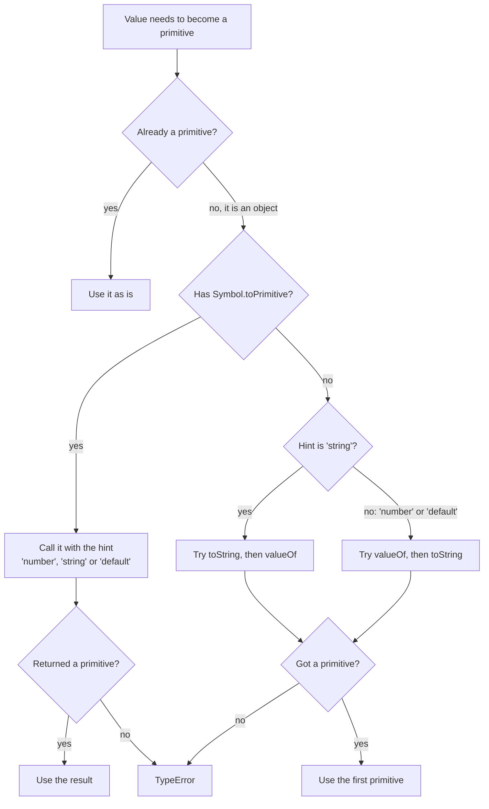
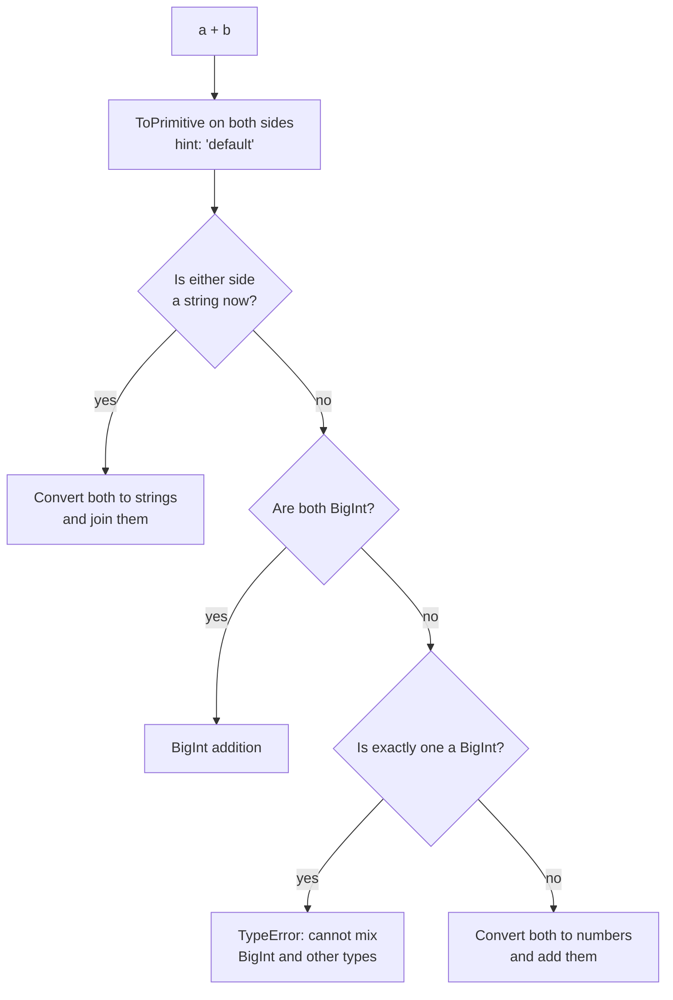
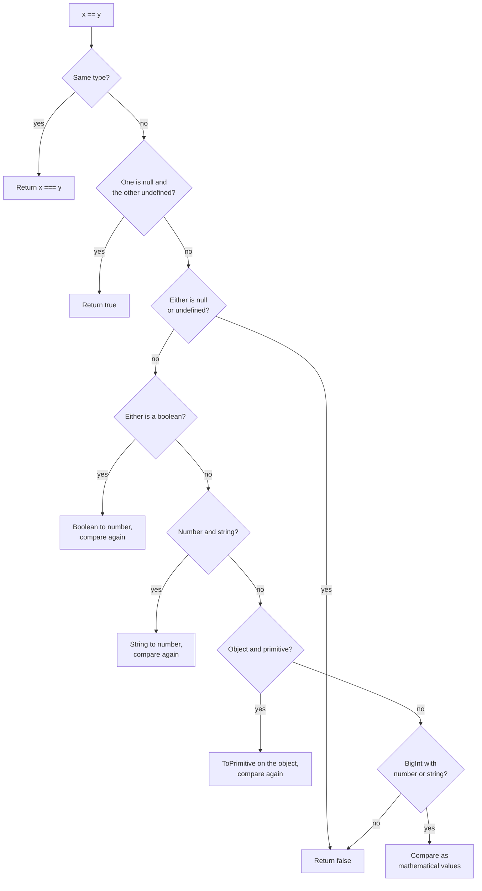

# Type Coercion and Equality

> In this document you learn how JavaScript converts values from one type to another, the exact rules behind `+`, `==`, `===`, `Object.is` and comparisons, and how to solve the famous "what does this print?" coercion puzzles step by step. Interviewers use these puzzles to see whether you reason from rules or just guess.

**Before this:** [Basics: variables, types and operators](./01-basics-variables-types-operators.md) · **Interview questions:** [jump to the interview section](#interview-questions)

## Table of contents

1. [What type conversion is](#what-type-conversion-is)
2. [The three basic conversions](#the-three-basic-conversions)
3. [Objects to primitives: ToPrimitive](#objects-to-primitives-toprimitive)
4. [The plus operator](#the-plus-operator)
5. [Other arithmetic operators](#other-arithmetic-operators)
6. [Relational comparison](#relational-comparison)
7. [Strict equality](#strict-equality)
8. [Loose equality step by step](#loose-equality-step-by-step)
9. [Object.is and SameValueZero](#objectis-and-samevaluezero)
10. [Classic coercion puzzles](#classic-coercion-puzzles)
11. [parseInt, parseFloat, Number and unary plus](#parseint-parsefloat-number-and-unary-plus)
12. [Checking for NaN and finite numbers](#checking-for-nan-and-finite-numbers)
13. [Coercion in real applications](#coercion-in-real-applications)
14. [Best practices](#best-practices)
15. [How to explain this in an interview](#how-to-explain-this-in-an-interview)
16. [Interview questions](#interview-questions)
17. [Summary](#summary)
18. [References](#references)

**A note on the comments in this document:** `console.log` prints strings without quotes. When it matters whether a result is a string or a number, the comment shows strings in quotes. So `// "12"` means "the string 12" and `// 12` means "the number 12".

---

## What type conversion is

**Type conversion** means changing a value from one type to another, for example from the string `"42"` to the number `42`.

There are two kinds:

- **Explicit conversion** (also called **type casting**): *you* ask for it in the code. `Number("42")`, `String(42)`, `Boolean(value)`.
- **Implicit conversion** (also called **type coercion**): *JavaScript* does it automatically, because an operator or a statement needs a different type. `"5" * 2`, `if ("hello")`, `"Total: " + 10`.

```js
// Explicit: you can see the conversion
const quantity = Number("3");
console.log(quantity + 1); // 4

// Implicit: JavaScript converts behind the scenes
console.log("3" * 2); // 6 ("3" became 3)
console.log("3" + 2); // "32" (2 became "2")
if ("hello") console.log("truthy"); // truthy ("hello" became true)
```

### Why coercion exists

JavaScript was designed in 1995 for small scripts in web pages. Values from HTML forms were always strings. Automatic conversion made simple scripts "just work" without type checks: `"5" * 2` gives `10`.

The cost is surprising results when the rules collide. `"5" + 2` gives `"52"`, not `7`. You cannot remove coercion from the language because millions of websites depend on it. So you must know the rules.

### Only three target types

This is the most useful fact in this whole document. **Coercion always ends in one of three primitive types:**

1. **string** (ToString)
2. **number** (ToNumber; or BigInt in some cases)
3. **boolean** (ToBoolean)

Objects are first turned into a primitive (ToPrimitive), and then into one of these three. If you know the three conversion tables and the ToPrimitive rule, you can solve every coercion puzzle.

**Analogy:** think of an airport with only three exits: "string", "number" and "boolean". Every value that needs converting must leave through one of these exits. Objects first go through a security check (ToPrimitive), which turns them into a primitive passenger. Each operator decides which exit to use.

The names ToString, ToNumber, ToBoolean and ToPrimitive come from the ECMAScript specification. They are internal operations. You cannot call them directly, but `String()`, `Number()` and `Boolean()` run them for you.

---

## The three basic conversions

### ToString

| Value | Result |
| --- | --- |
| `undefined` | `"undefined"` |
| `null` | `"null"` |
| `true` / `false` | `"true"` / `"false"` |
| `123` | `"123"` |
| `-0` | `"0"` (the sign is lost) |
| `1e21` | `"1e+21"` (large numbers use exponent form) |
| `0.0000005` | `"5e-7"` (very small numbers too) |
| `NaN` | `"NaN"` |
| `10n` | `"10"` |
| `Symbol("id")` | `String(sym)` gives `"Symbol(id)"`; **implicit** conversion throws `TypeError` |
| `[1, 2, 3]` | `"1,2,3"` (array `toString` joins with commas) |
| `[]` | `""` |
| `[null]`, `[undefined]` | `""` (null and undefined become empty strings inside arrays) |
| `[1, [2, 3]]` | `"1,2,3"` (nested arrays are flattened) |
| `{}` | `"[object Object]"` |
| a function | its source code text |

```js
console.log(String(null)); // "null"
console.log(String(-0)); // "0"
console.log(String([1, [2, 3]])); // "1,2,3"
console.log(String([undefined, null])); // ","
console.log(String({})); // "[object Object]"
console.log(String(0.0000005)); // "5e-7"
```

**`String(x)` vs `x.toString()` vs template literals:**

```js
const value = null;
console.log(String(value)); // "null" ✅ works for null and undefined
console.log(`${value}`); // "null" ✅ template literals also work

try {
  value.toString(); // ❌ null has no methods
} catch (error) {
  console.log(error.name); // TypeError
}
```

`String(x)` is the safest explicit conversion. It works for every value, even symbols.

### ToNumber

| Value | Result |
| --- | --- |
| `undefined` | `NaN` |
| `null` | `0` |
| `true` / `false` | `1` / `0` |
| `""` (empty) or only spaces/newlines | `0` |
| `"42"`, `"  42  "` | `42` (spaces and newlines around the number are ignored) |
| `"3.14"`, `".5"`, `"1e3"` | `3.14`, `0.5`, `1000` |
| `"0x1A"`, `"0o17"`, `"0b101"` | `26`, `15`, `5` (hex, octal, binary prefixes) |
| `"Infinity"`, `"-Infinity"` | `Infinity`, `-Infinity` |
| `"12px"`, `"abc"`, `"1_000"`, `"12.5.1"` | `NaN` (the whole string must be a valid number) |
| `10n` | `Number(10n)` gives `10`; **implicit** conversion (like `+10n`) throws `TypeError` |
| `Symbol()` | `TypeError` |
| `[]` | `0` (via `""`) |
| `[5]`, `["5"]` | `5` (via `"5"`) |
| `[1, 2]` | `NaN` (via `"1,2"`) |
| `{}` | `NaN` (via `"[object Object]"`) |
| `new Date(0)` | `0` (the timestamp) |

```js
console.log(Number("")); // 0
console.log(Number("  42  ")); // 42
console.log(Number("12px")); // NaN
console.log(Number("0x1A")); // 26
console.log(Number(null)); // 0
console.log(Number(undefined)); // NaN
console.log(Number([])); // 0
console.log(Number([5])); // 5
console.log(Number([1, 2])); // NaN
console.log(Number({})); // NaN
```

Two rows surprise people most:

- **`Number("")` is `0`**, not `NaN`. So an empty form field converted with `Number()` becomes `0`. Check for empty strings before converting.
- **`Number(null)` is `0`, but `Number(undefined)` is `NaN`.**

Objects follow the path "object → primitive → number". `[5]` becomes `"5"`, then `5`. You will see exactly how in [Objects to primitives](#objects-to-primitives-toprimitive).

### ToBoolean

ToBoolean is the simplest. It does **not** go through ToPrimitive. There are 8 falsy values; everything else, including every object, is `true`.

| Falsy (become `false`) | Everything else is truthy, for example |
| --- | --- |
| `false`, `0`, `-0`, `0n`, `""`, `null`, `undefined`, `NaN` | `"0"`, `"false"`, `" "`, `[]`, `{}`, `function(){}`, `-1`, `Infinity`, `new Boolean(false)` |

```js
console.log(Boolean("0")); // true
console.log(Boolean([])); // true
console.log(Boolean(0n)); // false
console.log(!!NaN); // false
```

ToBoolean is used by `if`, `while`, `for`, `!`, `&&`, `||` and the ternary operator. More examples are in [Truthy and falsy values](./01-basics-variables-types-operators.md#truthy-and-falsy-values).

**Important:** truthiness and `==` use *different* conversions. `[]` is truthy (ToBoolean), but `[] == false` is `true` (because `==` converts both to numbers: `0 == 0`). Never assume that "truthy" means "`== true`".

---

## Objects to primitives: ToPrimitive

When an operator needs a primitive but gets an object, JavaScript runs **ToPrimitive**. It is the "security check" from the analogy.

### The hint

ToPrimitive receives a **hint**: a word that says which type the operator would like.

| Hint | Used by |
| --- | --- |
| `"number"` | Unary `+`, `-`, `*`, `/`, `%`, `**`, `<`, `>`, `<=`, `>=`, `Number()`, `Math` functions |
| `"string"` | `String()`, template literals `` `${x}` ``, using an object as a property key `obj[x]` |
| `"default"` | Binary `+` and `==` (they accept both strings and numbers) |

### The steps

1. If the value is already a primitive, return it.
2. If the object has a `[Symbol.toPrimitive]` method, call it with the hint. If it returns a primitive, use it. If it returns an object, throw `TypeError`.
3. Otherwise use the "ordinary" order:
   - Hint `"string"`: call `toString()` first. If it does not return a primitive, call `valueOf()`.
   - Hint `"number"` or `"default"`: call `valueOf()` first. If it does not return a primitive, call `toString()`.
4. If neither returns a primitive, throw `TypeError: Cannot convert object to primitive value`.



### What the built-in objects return

- **Plain objects:** `valueOf()` returns the object itself (not a primitive), so `toString()` is used → `"[object Object]"`.
- **Arrays:** `valueOf()` returns the array itself, so `toString()` is used → elements joined with commas.
- **Dates:** a Date has its own `[Symbol.toPrimitive]`. It treats the `"default"` hint like `"string"`. So `date + 1` gives a string, but `date - 1` gives a number.
- **Functions:** `toString()` gives the source code.

```js
console.log([1, 2] + ""); // "1,2"
console.log({} + ""); // "[object Object]"

const date = new Date(0);
console.log(typeof (date + 1)); // string (default hint is treated as string for dates)
console.log(date - 1); // -1 (number hint: the timestamp 0 minus 1)
console.log(+date); // 0
```

### Custom conversion with valueOf and toString

You can control conversion of your own objects:

```js
const price = {
  amount: 100,
  valueOf() {
    console.log("valueOf called");
    return this.amount;
  },
  toString() {
    console.log("toString called");
    return `Rs ${this.amount}`;
  },
};

console.log(price + 1); // valueOf called, then 101 (default hint: valueOf first)
console.log(price * 2); // valueOf called, then 200 (number hint)
console.log(`${price}`); // toString called, then "Rs 100" (string hint: toString first)
console.log(price > 50); // valueOf called, then true
```

### Custom conversion with Symbol.toPrimitive

`Symbol.toPrimitive` (ES2015) gives you full control, because you receive the hint:

```js
const temperature = {
  celsius: 25,
  [Symbol.toPrimitive](hint) {
    if (hint === "number") return this.celsius;
    if (hint === "string") return `${this.celsius}°C`;
    return `default:${this.celsius}`; // hint === "default"
  },
};

console.log(+temperature); // 25 (number)
console.log(`${temperature}`); // "25°C" (string)
console.log(temperature + ""); // "default:25" (binary + uses "default")
console.log(temperature < 30); // true (number hint)
```

**Real-world use:** money or measurement classes that should print nicely in templates but still compare as numbers. In practice, an explicit method like `price.format()` is usually clearer than relying on coercion.

### Step by step: [] + {}

1. Binary `+` calls ToPrimitive on both sides with hint `"default"`.
2. `[]`: `valueOf()` returns the array (an object), so `toString()` is called → `""`.
3. `{}`: `valueOf()` returns the object, so `toString()` is called → `"[object Object]"`.
4. One side is a string, so `+` joins strings: `"" + "[object Object]"`.
5. Result: `"[object Object]"`.

---

## The plus operator

Binary `+` is the most confusing operator because it does two jobs: number addition and string joining.

### The rule

For `a + b`:

1. Convert both sides to primitives with ToPrimitive (hint `"default"`). The left side is converted first.
2. If **either** primitive is a **string**, convert the other to a string and **join** them.
3. Otherwise, convert both to numbers (or both must be BigInt) and **add** them.



```js
console.log(1 + 2); // 3
console.log("1" + 2); // "12"
console.log(1 + "2"); // "12"
console.log(true + 1); // 2 (true becomes 1)
console.log(true + "1"); // "true1"
console.log(null + 1); // 1 (null becomes 0)
console.log(undefined + 1); // NaN (undefined becomes NaN)
console.log(null + "1"); // "null1"
console.log([1] + [2]); // "12" (both arrays become strings)
console.log([] + 1); // "1" ([] becomes "")
console.log(1n + "1"); // "11"
```

### Left to right

`+` is evaluated left to right, one pair at a time. Once a string appears, everything after it is joined as text.

```js
console.log(1 + 2 + "3"); // "33" (1 + 2 = 3, then 3 + "3")
console.log("1" + 2 + 3); // "123" ("12", then "123")
console.log("1" + (2 + 3)); // "15" (parentheses first)
```

**Real-world bug:**

```js
const subtotal = "250"; // read from an input field, so it is a string
const shipping = 40;

// ❌ Wrong
console.log(subtotal + shipping); // "25040"

// ✅ Correct: convert first
console.log(Number(subtotal) + shipping); // 290
```

### Unary plus

Unary `+x` is different from binary `+`. It always converts to a **number** (hint `"number"`). It is a short form of `Number(x)`, except for BigInt: `+10n` throws a `TypeError`, while `Number(10n)` returns `10`.

```js
console.log(+"42"); // 42
console.log(+""); // 0
console.log(+"abc"); // NaN
console.log(+[]); // 0
console.log(+new Date(0)); // 0
```

---

## Other arithmetic operators

`-`, `*`, `/`, `%` and `**` have no string mode. They **always convert both sides to numbers** (hint `"number"`).

```js
console.log("10" - 2); // 8
console.log("6" / "2"); // 3
console.log("3" * "4"); // 12
console.log("a" - 1); // NaN
console.log([] - 1); // -1 ([] → "" → 0)
console.log([5] * 2); // 10 ([5] → "5" → 5)
console.log(null * 5); // 0
console.log(undefined * 5); // NaN
console.log("4" - "2" + "1"); // "21" (4 - 2 = 2, then 2 + "1")
console.log("4" + "2" - "1"); // 41 ("42" - "1" = 41)
```

That is why `x - 0` and `x * 1` also convert to numbers. Do not use these tricks in real code; write `Number(x)`.

The increment operators `++` and `--` also convert to numbers:

```js
let count = "5";
count++;
console.log(count); // 6 (a number now)
```

---

## Relational comparison

`<`, `>`, `<=` and `>=` follow these rules:

1. Convert both sides with ToPrimitive (hint `"number"`).
2. If **both** are strings, compare them **character by character** by UTF-16 code unit value (dictionary-like order, but uppercase letters come before lowercase).
3. Otherwise, convert both to numbers and compare. (A BigInt and a number are compared by their mathematical values.)
4. If either side becomes `NaN`, every comparison is `false`.

```js
console.log("10" < "9"); // true (both strings: "1" < "9")
console.log("2" > "12"); // true (both strings: "2" > "1")
console.log(10 < "9"); // false (one number: 10 < 9)
console.log(2 > "12"); // false (2 > 12)
console.log("B" < "a"); // true ("B" is 66, "a" is 97)
console.log([2] > 1); // true ([2] → "2" → 2)
console.log([1, 2] > 1); // false ([1,2] → "1,2" → NaN)
console.log("abc" < 1); // false ("abc" → NaN)
console.log(2n > 1); // true
```

**Real-world bug: sorting or comparing version numbers and prices as strings.** `"100" < "25"` is `true`. Convert to numbers first. Also, `Array.prototype.sort()` without a compare function converts elements to strings: `[10, 1, 5].sort()` gives `[1, 10, 5]`. See [Arrays and array methods](./10-arrays-and-array-methods.md).

### null and undefined in comparisons

This is the famous puzzle.

```js
console.log(null > 0); // false
console.log(null == 0); // false
console.log(null >= 0); // true (!)
console.log(undefined > 0); // false
console.log(undefined == 0); // false
console.log(undefined >= 0); // false
```

**Why `null >= 0` is `true` but `null == 0` is `false`:**

- **Relational operators convert `null` to a number.** `null` becomes `0`.
  - `null > 0` → `0 > 0` → `false`.
  - `null >= 0` is defined as "not (`null < 0`)". `0 < 0` is `false`, so the result is `true`.
- **`==` does not convert `null` to a number.** The `==` algorithm has a special rule: `null` is only loosely equal to `undefined` (and itself). So `null == 0` is `false`.

`undefined` becomes `NaN` in relational comparisons, and every comparison with `NaN` is `false`.

These are two different algorithms with different rules. That is the whole secret.

---

## Strict equality

`===` (strict equality) never converts types.

1. If the types are different, the result is `false`.
2. If both are numbers: equal if they have the same value. **Two exceptions:** `NaN === NaN` is `false`, and `+0 === -0` is `true`.
3. If both are strings, booleans, BigInts, `null` or `undefined`: equal if the values are the same.
4. If both are symbols: equal only if it is the same symbol.
5. If both are objects: equal only if they are **the same object** (same reference).

```js
console.log(5 === 5); // true
console.log(5 === "5"); // false (different types)
console.log(null === undefined); // false
console.log(NaN === NaN); // false
console.log(0 === -0); // true
console.log({} === {}); // false (two different objects)
console.log([1] === [1]); // false

const user = { id: 1 };
const sameUser = user;
console.log(user === sameUser); // true (same reference)
```

`!==` is simply the opposite of `===`.

---

## Loose equality step by step

`==` (loose equality) converts types when they differ. People often say "`==` converts everything to numbers". That is **not** exactly true. It follows a specific algorithm (called IsLooselyEqual in the specification).

### The algorithm for x == y

1. **Same type?** Use `===`.
2. **`null` and `undefined`?** `null == undefined` is `true`. Compared with *anything else*, `null` and `undefined` are `false`. (They are never converted.)
3. **Number and string?** Convert the string to a number. Compare again.
4. **BigInt and string?** Convert the string to a BigInt (if it is not a valid integer, the result is `false`). Compare again.
5. **One side is a boolean?** Convert the **boolean** to a number (`true` → 1, `false` → 0). Compare again.
6. **Object and a primitive (string, number, BigInt or symbol)?** Convert the object with ToPrimitive (hint `"default"`). Compare again.
7. **BigInt and number?** Compare their mathematical values (`1n == 1` is `true`).
8. **Anything else:** `false`.

"Compare again" means you go back to step 1 with the new values. A comparison can take several rounds.



(The diagram checks the boolean rule earlier than the specification lists it. The result is the same, because the other rules cannot apply while one side is still a boolean.)

### Worked examples

**`"" == 0`**

1. String and number → `Number("")` is `0`.
2. `0 == 0` → `true`.

**`"0" == false`**

1. Boolean → `false` becomes `0`. Now `"0" == 0`.
2. String and number → `"0"` becomes `0`. Now `0 == 0` → `true`.

**`false == "false"`**

1. Boolean → `0 == "false"`.
2. `Number("false")` is `NaN`. `0 == NaN` → `false`.

**`[1, 2] == "1,2"`**

1. Object and string → ToPrimitive(`[1, 2]`) is `"1,2"`.
2. `"1,2" == "1,2"` → same type → `true`.

**`null == false`**

1. Rule 2: `null` is only loosely equal to `undefined`. → `false`.

(Notice: the boolean rule never runs for `null`, because the null/undefined rule comes first in practice. `null` is never converted by `==`.)

**`[0] == false`**

1. Boolean → `[0] == 0`.
2. Object and number → ToPrimitive(`[0]`) is `"0"`. Now `"0" == 0`.
3. String and number → `0 == 0` → `true`.

So `[0]` is truthy, but `[0] == false` is `true`. Truthiness and `==` are different rules.

```js
console.log("" == 0); // true
console.log("0" == false); // true
console.log(false == "false"); // false
console.log([1, 2] == "1,2"); // true
console.log(null == false); // false
console.log(null == undefined); // true
console.log(undefined == 0); // false
console.log([0] == false); // true
console.log([] == ""); // true
console.log("0" == []); // false ("0" == "" after ToPrimitive)
console.log(1 == true); // true
console.log(2 == true); // false (true becomes 1, and 2 !== 1)
console.log(1n == 1); // true
console.log(new Number(1) == 1); // true (the wrapper object is unwrapped)
console.log(new String("a") == new String("a")); // false (two objects: compared by reference)
```

Note the last line. When *both* sides are objects, `==` does no conversion. It compares references, exactly like `===`.

### The == comparison table

| `x` | `y` | `x == y` | Why |
| --- | --- | --- | --- |
| `null` | `undefined` | `true` | Special rule |
| `null` | `0` | `false` | null is not converted |
| `null` | `false` | `false` | null is not converted |
| `undefined` | `""` | `false` | undefined is not converted |
| `NaN` | `NaN` | `false` | NaN is never equal |
| `0` | `""` | `true` | `""` → 0 |
| `0` | `"0"` | `true` | `"0"` → 0 |
| `""` | `"0"` | `false` | Both strings, different text |
| `false` | `"0"` | `true` | false → 0, `"0"` → 0 |
| `false` | `"false"` | `false` | false → 0, `"false"` → NaN |
| `false` | `[]` | `true` | false → 0, `[]` → `""` → 0 |
| `true` | `[1]` | `true` | true → 1, `[1]` → `"1"` → 1 |
| `true` | `"true"` | `false` | true → 1, `"true"` → NaN |
| `[]` | `[]` | `false` | Two different objects |
| `{}` | `"[object Object]"` | `true` | ToPrimitive({}) |

The pattern: `==` with a boolean almost never does what you expect, because the boolean becomes `0` or `1` first. **Never compare with `== true` or `== false`.**

---

## Object.is and SameValueZero

JavaScript has four ways to decide if two values are "the same". They differ only in a few edge cases.

| Algorithm | Used by | `NaN` vs `NaN` | `+0` vs `-0` | Converts types? |
| --- | --- | --- | --- | --- |
| Loose equality | `==` | `false` | `true` | Yes |
| Strict equality | `===`, `indexOf`, `lastIndexOf`, `switch` | `false` | `true` | No |
| **SameValueZero** | `includes`, `Map` keys, `Set` values | `true` | `true` | No |
| **SameValue** | `Object.is` | `true` | `false` | No |

### Object.is

`Object.is(a, b)` (ES2015) is like `===` with the two number exceptions fixed:

```js
console.log(Object.is(NaN, NaN)); // true
console.log(Object.is(0, -0)); // false
console.log(Object.is("a", "a")); // true
console.log(Object.is({}, {})); // false (still compares object references)
```

**Real-world use:** React uses `Object.is` to compare state values and hook dependencies (for example, to decide if a `useState` update should re-render). Angular signals also use `Object.is` in their default equality check, with one Angular 16 detail: in v16 (developer preview), the default check uses `Object.is` only for primitives and treats two objects or arrays as **always different**, so `set()` with the same object still notifies. Angular 17 changed the default to plain `Object.is`. The details are in [Change detection and signals](../06-angular-16/10-change-detection-and-signals.md).

### SameValueZero

**SameValueZero** is like `===`, except that `NaN` equals `NaN`. It is used by `Array.prototype.includes` (ES2016) and by `Map` and `Set`.

```js
console.log([NaN].includes(NaN)); // true (SameValueZero)
console.log([NaN].indexOf(NaN)); // -1 (strict equality)
console.log([0].includes(-0)); // true
console.log(new Set([NaN, NaN]).size); // 1
console.log(new Map([[0, "zero"]]).get(-0)); // zero
console.log([1, 2, 3].includes("2")); // false (no type conversion)
```

So, if you need to find `NaN` in an array, use `includes` or `findIndex(Number.isNaN)`, not `indexOf`.

---

## Classic coercion puzzles

Every puzzle below was run with Node.js. Solve each one with the same method:

1. Which operator runs first (precedence)?
2. Which conversion does that operator use (string, number, boolean, or the `==` algorithm)?
3. Do objects need ToPrimitive first?

### [] + []

```js
console.log([] + []); // ""
```

Both arrays → ToPrimitive → `""`. One side is a string, so join: `"" + ""` = `""`.

### [] + {} and {} + []

```js
console.log([] + {}); // "[object Object]"
console.log({} + []); // "[object Object]"
```

Inside `console.log(...)`, both are expressions. `[]` → `""` and `{}` → `"[object Object]"`. Joined, the result is `"[object Object]"` either way.

**But** if you type `{} + []` as a **statement on its own line** in a script, the result is `0`. Why?

When a line *starts* with `{`, the parser reads it as a **block statement** (like the body of an `if`), not as an object literal. So `{} + []` is parsed as two things:

1. `{}`: an empty block that does nothing.
2. `+[]`: a separate expression with **unary plus**. `+[]` → `+""` → `0`.

You can see this with `eval`, which evaluates code as statements:

```js
console.log(eval("{} + []")); // 0 (empty block, then +[])
console.log(eval("({} + [])")); // "[object Object]" (parentheses force an expression)
console.log(eval("{} + {}")); // NaN (empty block, then +{} → +"[object Object]")
```

Consoles can show different results for the same input. The Node.js REPL and modern browser consoles may wrap input that starts with `{` in parentheses, so they show `"[object Object]"`. That is a console feature, not a language rule. In an interview, explain both cases.

### [] == ![]

```js
console.log([] == ![]); // true
```

1. `!` has higher precedence. `![]`: `[]` is truthy (all objects are), so `![]` is `false`. Now: `[] == false`.
2. `==` with a boolean: `false` → `0`. Now: `[] == 0`.
3. Object and number: ToPrimitive(`[]`) → `""`. Now: `"" == 0`.
4. String and number: `Number("")` → `0`. Now: `0 == 0`.
5. Result: `true`.

An array is "equal to its own negation" because `!` uses ToBoolean while `==` uses ToNumber.

### "1" - - "1"

```js
console.log("1" - - "1"); // 2
```

1. The second `-` is **unary minus** (it has higher precedence): `-"1"` → `-1`.
2. Now `"1" - (-1)`. Binary minus converts to numbers: `1 - (-1)` = `2`.

### "b" + "a" + +"a" + "a"

```js
console.log("b" + "a" + +"a" + "a"); // "baNaNa"
console.log(("b" + "a" + +"a" + "a").toLowerCase()); // "banana"
```

1. `+"a"` (unary plus) runs first → `NaN`.
2. Left to right: `"b" + "a"` = `"ba"`, then `"ba" + NaN` = `"baNaN"`, then `+ "a"` = `"baNaNa"`.

### true + true + true and friends

```js
console.log(true + true + true); // 3 (1 + 1 + 1)
console.log(true + "1"); // "true1"
console.log([] + null + 1); // "null1" ("" + null = "null", then "null" + 1)
console.log([1, 2] + [3]); // "1,23"
console.log("5" + -"2"); // "5-2" (unary minus makes -2, then string joining)
```

### NaN

```js
console.log(NaN === NaN); // false
console.log(NaN == NaN); // false
console.log(NaN !== NaN); // true
console.log(Object.is(NaN, NaN)); // true
console.log(typeof NaN); // number
```

`NaN` is the only JavaScript value that is not equal to itself. The IEEE 754 floating-point standard defines it that way: "not a number" results do not compare equal, because two failed calculations are not necessarily "the same failure". That gives you a classic trick: `x !== x` is `true` only when `x` is `NaN`. In real code, use `Number.isNaN(x)`.

### Math.max() < Math.min()

```js
console.log(Math.max()); // -Infinity
console.log(Math.min()); // Infinity
console.log(Math.max() < Math.min()); // true
```

`Math.max()` with no arguments starts from the smallest possible value, `-Infinity`, and looks for anything bigger. `Math.min()` starts from `Infinity`. This is not coercion, but it often appears in the same puzzle set.

### 0.1 + 0.2 == 0.3

```js
console.log(0.1 + 0.2 == 0.3); // false
console.log(0.1 + 0.2); // 0.30000000000000004
console.log(Math.abs(0.1 + 0.2 - 0.3) < Number.EPSILON); // true
```

This is floating-point precision, not coercion. See [How programs run](../01-cs-and-web-fundamentals/01-how-programs-run.md) and [Strings, numbers and dates](./11-strings-numbers-and-dates.md).

---

## parseInt, parseFloat, Number and unary plus

There are several ways to turn a string into a number. They behave differently.

| Input | `Number(x)` | `+x` | `parseInt(x, 10)` | `parseFloat(x)` |
| --- | --- | --- | --- | --- |
| `"42"` | `42` | `42` | `42` | `42` |
| `"  42  "` | `42` | `42` | `42` | `42` |
| `"42px"` | `NaN` | `NaN` | `42` | `42` |
| `"3.99"` | `3.99` | `3.99` | `3` | `3.99` |
| `""` | `0` | `0` | `NaN` | `NaN` |
| `"abc42"` | `NaN` | `NaN` | `NaN` | `NaN` |
| `"0x1F"` | `31` | `31` | `0` | `0` |
| `"1e3"` | `1000` | `1000` | `1` | `1000` |
| `null` | `0` | `0` | `NaN` | `NaN` |
| `10n` | `10` | `TypeError` | `10` | `10` |

**The key difference:**

- `Number(x)` and `+x` are **strict**: the *whole* string must be a valid number (spaces around it are allowed).
- `parseInt` and `parseFloat` are **lenient**: they read from the start, stop at the first character they do not understand, and return what they have. They return `NaN` only if the very first non-space character is invalid.

```js
console.log(Number("12px")); // NaN
console.log(parseInt("12px", 10)); // 12
console.log(parseFloat("3.14abc")); // 3.14
console.log(parseInt("abc42", 10)); // NaN
```

### parseInt details

`parseInt(string, radix)`:

1. Converts the first argument **to a string** (this matters, see below).
2. Skips leading whitespace and reads an optional `+` or `-`.
3. Reads digits that are valid in the given **radix** (the number base, 2 to 36). It stops at the first invalid character.
4. If no digits were read, returns `NaN`. It never returns decimals.

```js
console.log(parseInt("101", 2)); // 5 (binary)
console.log(parseInt("ff", 16)); // 255 (hex)
console.log(parseInt("0x1F")); // 31 (no radix: the "0x" prefix means hex)
console.log(parseInt("08")); // 8 (modern engines: a leading 0 does NOT mean octal)
console.log(parseInt("-3.99", 10)); // -3 (stops at ".")
```

**Always pass the radix** (`parseInt(value, 10)`). Without it, a string starting with `0x` is read as hex. Very old engines (before ES5) even read `"08"` as octal. ESLint has a `radix` rule for this.

### Why parseInt(0.0000005) is 5

```js
console.log(parseInt(0.0000005)); // 5
console.log(String(0.0000005)); // "5e-7"
console.log(parseInt("0.0000005")); // 0
```

1. `parseInt` converts its argument to a string first.
2. `String(0.0000005)` is `"5e-7"` (very small numbers are written in exponent form).
3. `parseInt("5e-7")` reads `"5"` and stops at `"e"`.
4. Result: `5`.

The same happens with big numbers: `parseInt(1e21)` is `1`, because `String(1e21)` is `"1e+21"`. **Never use `parseInt` to round or truncate numbers.** Use `Math.trunc`, `Math.floor` or `Math.round`.

### ["1", "2", "3"].map(parseInt)

```js
console.log(["1", "2", "3"].map(parseInt)); // [1, NaN, NaN]
console.log(["10", "10", "10"].map(parseInt)); // [10, NaN, 2]
console.log(["1", "2", "3"].map(Number)); // [1, 2, 3] ✅
console.log(["1", "2", "3"].map((s) => parseInt(s, 10))); // [1, 2, 3] ✅
```

`map` calls its callback with **three** arguments: `(element, index, array)`. `parseInt` takes two: `(string, radix)`. So the index becomes the radix:

| Call | Radix | Result | Why |
| --- | --- | --- | --- |
| `parseInt("1", 0)` | 0 | `1` | Radix 0 means "not given" → base 10 |
| `parseInt("2", 1)` | 1 | `NaN` | Radix 1 is invalid (must be 2–36) |
| `parseInt("3", 2)` | 2 | `NaN` | `"3"` is not a binary digit |

For `["10", "10", "10"]`: `parseInt("10", 0)` = 10, `parseInt("10", 1)` = NaN, `parseInt("10", 2)` = 2 (binary 10).

**Lesson:** be careful when passing a function reference directly to `map`, `forEach` or `then`. It receives *all* the arguments, not only the first.

### Which one should you use?

- **Converting user input or API strings that must be numbers:** `Number(value)`, then check with `Number.isNaN` (and handle `""` separately, because it becomes `0`).
- **Reading a number from the start of a string like `"16px"`:** `parseInt(value, 10)` or `parseFloat(value)`.
- **Removing decimals from a number:** `Math.trunc` (or `Math.floor` / `Math.round`), never `parseInt`.
- **Short code in your own expressions:** `+value` is fine, but `Number(value)` is clearer for readers.

```js
function parseQuantity(input) {
  const text = String(input).trim();
  if (text === "") return null; // empty is "no value", not 0
  const value = Number(text);
  if (!Number.isInteger(value) || value < 0) return null;
  return value;
}

console.log(parseQuantity("3")); // 3
console.log(parseQuantity("")); // null
console.log(parseQuantity("3.5")); // null
console.log(parseQuantity("3 items")); // null
```

---

## Checking for NaN and finite numbers

There are two versions of `isNaN` and `isFinite`. The old global ones **coerce** their argument to a number first. The `Number.` versions (ES2015) **do not**.

```js
console.log(isNaN("abc")); // true ("abc" → NaN → true)
console.log(Number.isNaN("abc")); // false ("abc" is a string, not NaN)
console.log(isNaN(undefined)); // true
console.log(isNaN(null)); // false (null → 0)
console.log(Number.isNaN(NaN)); // true

console.log(isFinite("12")); // true ("12" → 12)
console.log(Number.isFinite("12")); // false (not a number type)
console.log(Number.isInteger(5.0)); // true (5.0 is the same number as 5)
console.log(Number.isSafeInteger(2 ** 53)); // false
```

| Function | Coerces? | `"abc"` | `NaN` | `"12"` |
| --- | --- | --- | --- | --- |
| `isNaN(x)` | Yes | `true` | `true` | `false` |
| `Number.isNaN(x)` | No | `false` | `true` | `false` |
| `isFinite(x)` | Yes | `false` | `false` | `true` |
| `Number.isFinite(x)` | No | `false` | `false` | `false` |

**Rule:** use the `Number.` versions. The global `isNaN` answers "would this become NaN if converted?", which is rarely the question you want to ask.

---

## Coercion in real applications

Most coercion bugs in real projects come from one fact: **data from the outside world usually arrives as strings.**

| Source | Type you get |
| --- | --- |
| DOM `input.value` (even `<input type="number">`) | string (use `input.valueAsNumber` for a number) |
| URL query parameters (`URLSearchParams.get`) | string or `null` |
| Angular route parameters (`paramMap.get("id")`) | string or `null` |
| Express `req.params`, `req.query` | strings (or arrays/objects for repeated or nested keys) |
| `localStorage.getItem` | string or `null` (everything is stored as a string) |
| `process.env.X` in Node.js | string or `undefined` |
| HTML `data-*` attributes (`dataset`) | string |
| JSON from an API | real numbers and booleans (but IDs are often sent as strings) |

### Bug 1: an ID that is never found

```js
const users = [
  { id: 1, name: "Asha" },
  { id: 2, name: "Ravi" },
];
const idFromRoute = "2"; // e.g. from this.route.snapshot.paramMap.get("id")

// ❌ Wrong: "2" === 2 is false
console.log(users.find((u) => u.id === idFromRoute)); // undefined

// ✅ Correct: convert once, at the boundary
const userId = Number(idFromRoute);
console.log(users.find((u) => u.id === userId)); // { id: 2, name: "Ravi" }
```

Some developers "fix" this with `==`. That hides the real problem: the data has the wrong type. Convert at the boundary (where data enters your app) and keep strict comparisons everywhere else.

### Bug 2: a feature flag that is always on

```js
process.env.ENABLE_BETA = "false"; // environment variables are strings

// ❌ Wrong: "false" is a non-empty string, so it is truthy
if (process.env.ENABLE_BETA) {
  console.log("Beta enabled (bug!)"); // Beta enabled (bug!)
}

// ✅ Correct: compare with the exact string
const betaEnabled = process.env.ENABLE_BETA === "true";
console.log(betaEnabled); // false
```

The same happens with `localStorage.setItem("darkMode", false)`. It stores the string `"false"`, and `if (localStorage.getItem("darkMode"))` is then always true. Store JSON (`JSON.stringify(false)`) and read it with `JSON.parse`, or compare strings explicitly.

### Bug 3: adding form values

```js
const formValues = { price: "499", quantity: "2", shipping: "40" };

// ❌ Wrong
console.log(formValues.price * formValues.quantity + formValues.shipping); // "99840"

// ✅ Correct
const total =
  Number(formValues.price) * Number(formValues.quantity) + Number(formValues.shipping);
console.log(total); // 1038
```

The `*` worked by accident (it converts to numbers), but the `+` joined strings. In Angular, `<input type="number">` with `formControlName` or `ngModel` gives you a number (or `null` when empty), because Angular's number value accessor converts the value. A plain `<input>` without `type="number"` gives a string.

### Bug 4: object keys are always strings

```js
const cache = {};
cache[1] = "one";
console.log(cache["1"]); // one (the number key became the string "1")

const objKeyA = { id: "a" };
const objKeyB = { id: "b" };
cache[objKeyA] = "A";
cache[objKeyB] = "B"; // both keys become "[object Object]"!
console.log(cache[objKeyA]); // B
console.log(Object.keys(cache)); // ["1", "[object Object]"]

const map = new Map();
map.set(objKeyA, "A").set(objKeyB, "B"); // ✅ Map keeps real keys
console.log(map.get(objKeyA)); // A
```

Property keys go through ToPropertyKey, which uses the string hint. Use a `Map` when keys are not strings. See [Map, Set, WeakMap and WeakSet](./12-map-set-weakmap-weakset.md).

### TypeScript helps, but only at compile time

TypeScript catches many coercion mistakes before the code runs:

```ts
const count: number = 5;
const label: string = "5";

// error TS2367: This comparison appears to be unintentional
// because the types 'number' and 'string' have no overlap.
if (count === label) {}

// error TS2362: The left-hand side of an arithmetic operation must be of type
// 'any', 'number', 'bigint' or an enum type.
const doubled = label * 2;
```

But TypeScript types disappear at runtime. If an API returns `"5"` while your interface says `id: number`, TypeScript cannot know. You need runtime validation at the boundary. See [Runtime validation and type-safe APIs](../03-typescript/11-runtime-validation-and-type-safe-apis.md).

---

## Best practices

1. **Use `===` and `!==` by default.** They are predictable. Readers do not need to run the `==` algorithm in their heads.
2. **`== null` is the one accepted exception.** `value == null` is `true` only for `null` and `undefined`. It is short and clear, and many style guides allow it. ESLint's `eqeqeq` rule supports this with the `"smart"` option or `{ "null": "ignore" }`.
3. **Convert explicitly, at the boundary.** Turn strings into numbers or booleans when the data enters your app (form submit, route params, API response, env config). After that, work with correct types.
4. **Use `Number(x)` to convert and `Number.isNaN` to check.** Handle the empty string separately.
5. **Always pass the radix to `parseInt`**, and never use `parseInt` to truncate numbers.
6. **Never compare with `== true` or `== false`.** Use the value directly (`if (isActive)`) or compare strictly.
7. **Do not rely on implicit conversion of objects.** If you need a string version of an object, call an explicit method (`format()`, `toJSON()`).
8. **Use `includes` (not `indexOf`) when the array may contain `NaN`**, and `Object.is` when `-0` matters.
9. **Let tools help.** Enable ESLint `eqeqeq`, and TypeScript `strict` mode.

---

## How to explain this in an interview

**Question: "What is the difference between == and ===?"**

1. **Define it:** "`===` is strict equality. It compares without converting types, so different types are always false. `==` is loose equality. If the types differ, it converts them first and then compares."
2. **Why it exists:** "`==` comes from the early days of JavaScript, when values from forms were strings and automatic conversion made small scripts easier. `===` was added later to give a predictable comparison."
3. **How it works:** "`==` follows a fixed algorithm. `null` and `undefined` are equal only to each other. Strings and numbers compare as numbers. A boolean is converted to a number first. An object is converted to a primitive with `valueOf` or `toString`. `===` has only two special cases: `NaN` is not equal to itself, and `+0` equals `-0`."
4. **Small example:** "`0 == ''` is true because the empty string becomes 0. `'0' == false` is true because both become 0. But `null == 0` is false, because null is never converted by `==`."
5. **Where it is useful:** "I use `===` everywhere. The one exception I accept is `value == null` to check for null or undefined in one step."
6. **Trade-offs / gotchas:** "Neither compares objects by content. Both compare object references. And if I need `NaN` to equal `NaN`, I use `Object.is` or `includes`, which uses SameValueZero."

**Question: "What is type coercion?"**

1. **Define it:** "Coercion is automatic type conversion. JavaScript converts a value to another type when an operator or statement needs it."
2. **Why it exists:** "JavaScript was designed to be forgiving with values from web pages, which were all strings."
3. **How it works:** "Every conversion ends in a string, a number or a boolean. Objects are first turned into primitives with ToPrimitive, using `Symbol.toPrimitive`, or `valueOf` and `toString`. Each operator decides the target: binary plus prefers strings if either side is a string, other math operators use numbers, and `if` uses booleans."
4. **Small example:** "`'5' * 2` is 10, but `'5' + 2` is `'52'`."
5. **Where it is useful:** "Template literals and `if (value)` checks are coercion I use every day."
6. **Trade-offs / gotchas:** "It causes real bugs with input values, query params and environment variables, which are strings. I convert explicitly at the boundary."

---

## Interview questions

### Q1. What is type coercion? What is the difference between explicit and implicit conversion?

**What the interviewer is checking:** that you can define coercion and know it always ends in string, number or boolean.

**Short spoken answer (30–60 seconds):**
> "Type conversion means changing a value from one type to another. If I do it on purpose, like `Number('42')` or `String(5)`, that's explicit conversion. If JavaScript does it automatically because an operator needs another type, that's implicit conversion, or coercion. For example `'5' * 2` gives 10 because multiplication needs numbers. Every conversion ends in one of three types: string, number or boolean. Objects are first turned into a primitive using `Symbol.toPrimitive`, `valueOf` or `toString`. I prefer explicit conversion in real code because it's easier to read and avoids surprises like `'5' + 2` being `'52'`."

**Detailed explanation:** See [What type conversion is](#what-type-conversion-is) and [The three basic conversions](#the-three-basic-conversions).

**Follow-up questions:**
- **Which operations coerce to boolean?** — `if`, `while`, `for` conditions, `!`, `&&`, `||` and the ternary. They use ToBoolean, which never calls `valueOf`/`toString`.
- **Is `${value}` coercion?** — Yes, implicit string conversion with the string hint. It throws for symbols.
- **Is coercion always bad?** — No. `if (items.length)` and template literals are normal, readable coercion. The problems come from `+` with mixed types and from `==`.

**Common mistakes:** saying JavaScript "has no types"; thinking coercion can produce an object.

**Where this is used in real projects:** reading form values, query params, env variables and `localStorage`, which are all strings.

### Q2. What is the difference between == and ===?

**What the interviewer is checking:** the conversion rule, the exceptions, and a sensible team practice.

**Short spoken answer (30–60 seconds):**
> "Triple equals compares without type conversion. If the types are different, it's false. Double equals converts types first, using a specific algorithm. For example `5 == '5'` is true but `5 === '5'` is false. The `==` rules have surprises: `'0' == false` is true, `null == 0` is false, and `[] == false` is true. So I use `===` by default. The only `==` I'm happy with is `value == null`, which checks for both null and undefined. Both operators compare objects by reference, so two different objects with the same content are never equal."

**Code:**

```js
console.log(5 == "5", 5 === "5"); // true false
console.log(null == undefined, null === undefined); // true false
console.log({ a: 1 } == { a: 1 }); // false
```

**Follow-up questions:**
- **Is `===` faster than `==`?** — Do not make performance claims. When the types are the same, both do the same work. Choose `===` for correctness and readability.
- **What does `===` get "wrong"?** — `NaN === NaN` is `false`, and `0 === -0` is `true`. `Object.is` fixes both.
- **How do you compare two objects by content?** — Compare the fields you care about, or use a deep-equal helper from a test library or utility library. `JSON.stringify` comparison breaks with key order, `undefined`, dates and cycles.

**Common mistakes:** saying `==` "only compares values" and `===` "compares values and types" without knowing the actual conversion rules; claiming `==` converts everything to strings.

**Where this is used in real projects:** linters enforce `===` (`eqeqeq`). Code reviews flag `==` except for `== null`.

### Q3. Explain step by step how == compares values of different types.

**What the interviewer is checking:** whether you know the real algorithm, not "it converts to numbers".

**Short spoken answer (30–60 seconds):**
> "If the types are the same, `==` behaves like `===`. If one side is null and the other undefined, it's true, and null or undefined compared with anything else is false, because they're never converted. If it's a number and a string, the string becomes a number. If either side is a boolean, the boolean becomes a number, 1 or 0, and then it compares again. If one side is an object and the other a primitive, the object goes through ToPrimitive, so arrays usually become strings. BigInt and number compare by mathematical value. Anything else is false."

**Detailed explanation:** See [Loose equality step by step](#loose-equality-step-by-step) and the diagram there.

**Follow-up questions:**
- **Why is `"true" == true` false?** — `true` becomes `1`, then `"true"` becomes `NaN`. `NaN == 1` is false.
- **Why is `null == false` false?** — `null` is only loosely equal to `undefined`. It is never converted to a number by `==`.
- **What happens with two objects?** — Same type, so it is a reference comparison like `===`. No conversion happens.

**Common mistakes:** applying the boolean rule as "convert the other side to boolean" (it is the opposite: the boolean becomes a number).

**Where this is used in real projects:** debugging legacy code that uses `==`, and explaining why `if (x == true)` fails for `2` or `"yes"`.

### Q4. Output: + with arrays and objects

```js
console.log([] + []);
console.log([] + {});
console.log([1, 2] + [3]);
console.log({} + "");
console.log([] + null + 1);
```

**Answer:**

```text

[object Object]
1,23
[object Object]
null1
```

(The first line is an empty string.)

**Why:**

1. `[]` → `""`. `"" + ""` = `""`.
2. `""` + `"[object Object]"`.
3. `[1, 2]` → `"1,2"`, `[3]` → `"3"`. Joined: `"1,23"`.
4. `{}` → `"[object Object]"` joined with `""`.
5. `[]` → `""`. `"" + null` = `"null"`. `"null" + 1` = `"null1"`.

### Q5. Why does {} + [] give 0 in some places and "[object Object]" in others?

**What the interviewer is checking:** parsing knowledge: block statement vs object literal.

**Short spoken answer (30–60 seconds):**
> "It depends on how the code is parsed, not on coercion rules. When a statement starts with a curly brace, JavaScript reads it as an empty block, not an object. So `{} + []` becomes an empty block followed by `+[]`, which is unary plus on an empty array: empty string, then 0. When the same code is in expression position, like inside `console.log` or parentheses, `{}` is an object literal, so we get empty object plus empty array, which is the string `'[object Object]'`. Some consoles wrap input in parentheses, so they show the second result."

**Code:**

```js
console.log(eval("{} + []")); // 0
console.log(eval("({} + [])")); // "[object Object]"
console.log({} + []); // "[object Object]"
```

**Follow-up questions:**
- **What is `{} + {}` as a statement?** — Empty block, then `+{}` → `+"[object Object]"` → `NaN`.
- **Where else does this block/object confusion appear?** — Arrow functions: `() => { id: 1 }` returns `undefined` because the braces are a function body with a label `id:`. Write `() => ({ id: 1 })`.

**Common mistakes:** saying `{} + []` "is always 0" or "is always `[object Object]`".

**Where this is used in real projects:** the arrow-function object literal mistake is very common in `map` callbacks.

### Q6. Output: [] == ![]

```js
console.log([] == ![]);
```

**Answer:** `true`.

**Why:**

1. `![]` → `[]` is truthy → `false`. Now `[] == false`.
2. Boolean → number: `[] == 0`.
3. Object → primitive: `"" == 0`.
4. String → number: `0 == 0` → `true`.

**Follow-up:** **Is `[]` truthy then?** — Yes. `if ([])` runs. Truthiness uses ToBoolean (all objects are true); `==` uses ToNumber. Different operations, different conversions.

### Q7. Output: null and undefined comparisons

```js
console.log(null > 0);
console.log(null == 0);
console.log(null >= 0);
console.log(undefined == null);
console.log(undefined >= 0);
console.log(null == false);
```

**Answer:**

```text
false
false
true
true
false
false
```

**What the interviewer is checking:** that relational operators and `==` are different algorithms.

**Short spoken answer (30–60 seconds):**
> "Relational operators like greater-than convert null to a number, which is 0. So `null > 0` is false, and `null >= 0` is true because it's defined as 'not less than'. But `==` has a special rule: null is only loosely equal to undefined, and it's never converted to a number. So `null == 0` is false, even though `null >= 0` is true. undefined becomes NaN in relational comparisons, and any comparison with NaN is false."

**Follow-up:** **How does this cause bugs?** — `if (value >= 0)` accepts `null` as valid. Validate that `value` is a number first: `typeof value === "number" && value >= 0`.

### Q8. Output: NaN

```js
console.log(NaN === NaN);
console.log(Object.is(NaN, NaN));
console.log([NaN].indexOf(NaN));
console.log([NaN].includes(NaN));
console.log(isNaN("hello"));
console.log(Number.isNaN("hello"));
```

**Answer:**

```text
false
true
-1
true
true
false
```

**Why:** `===` and `indexOf` use strict equality, where `NaN` is never equal to itself. `Object.is` (SameValue) and `includes` (SameValueZero) treat `NaN` as equal to `NaN`. The global `isNaN` converts `"hello"` to a number first (`NaN`), so it returns `true`. `Number.isNaN` does not convert; `"hello"` is a string, not `NaN`.

**Follow-up:** **How did people check for NaN before ES2015?** — `x !== x`, which is true only for `NaN`.

### Q9. What is Object.is and how is it different from ===? What is SameValueZero?

**What the interviewer is checking:** the four equality algorithms and where each is used.

**Short spoken answer (30–60 seconds):**
> "`Object.is` is like triple equals with two edge cases fixed. `Object.is(NaN, NaN)` is true, and `Object.is(0, -0)` is false. Triple equals gives the opposite for both. Objects are still compared by reference. There's also SameValueZero, which `includes`, `Map` and `Set` use. It's like `Object.is` except that `+0` and `-0` are equal. So `[NaN].includes(NaN)` is true, while `indexOf` returns -1. React uses `Object.is` to decide whether state changed."

**Follow-up questions:**
- **When does `-0` matter?** — Rarely: direction or sign in math (for example `1 / -0` is `-Infinity`), and some animation or coordinate code. `Object.is` is the way to detect it.
- **Which algorithm does `switch` use?** — Strict equality (`===`).

**Common mistakes:** thinking `Object.is` compares objects deeply.

**Where this is used in real projects:** React state/dependency comparison, `Map`/`Set` keys, and `includes` checks.

### Q10. Output: the + operator chain

```js
console.log(1 + 2 + "3");
console.log("1" + 2 + 3);
console.log("1" - - "1");
console.log("b" + "a" + +"a" + "a");
console.log(true + true + true);
console.log("4" + "2" - "1");
```

**Answer:**

```text
33
123
2
baNaNa
3
41
```

**Why:**

1. `1 + 2` = `3`, then `3 + "3"` = `"33"`.
2. `"1" + 2` = `"12"`, then `"123"`.
3. Unary minus: `-"1"` = `-1`. `"1" - (-1)` = `2`.
4. `+"a"` = `NaN`. `"ba" + NaN + "a"` = `"baNaNa"`.
5. `1 + 1 + 1` = `3`.
6. `"4" + "2"` = `"42"`. Then `"42" - "1"` = `41` (minus converts to numbers).

### Q11. Why does ["1", "2", "3"].map(parseInt) return [1, NaN, NaN]?

**What the interviewer is checking:** knowledge of `map`'s callback arguments and `parseInt`'s radix.

**Short spoken answer (30–60 seconds):**
> "`map` calls the callback with three arguments: the element, the index and the array. `parseInt` takes a string and a radix. So the index is used as the radix. The first call is `parseInt('1', 0)`, and radix 0 means default base 10, so it's 1. The second is `parseInt('2', 1)`, and radix 1 is invalid, so NaN. The third is `parseInt('3', 2)`, and 3 isn't a valid binary digit, so NaN. The fix is `map(Number)` or `map(s => parseInt(s, 10))`."

**Follow-up questions:**
- **What does `["10", "10", "10"].map(parseInt)` return?** — `[10, NaN, 2]`. The last is binary `"10"` = 2.
- **Are there other functions with the same risk?** — Any function with optional extra parameters passed directly as a callback. For example, `promise.then(console.log)` is fine, but `array.map(someFn)` passes index and array to `someFn` too.

**Common mistakes:** saying "parseInt is broken"; not knowing radix 0 means "auto".

**Where this is used in real projects:** parsing CSV rows or query strings with `map`. Always wrap the parser in an arrow function.

### Q12. What is the difference between parseInt, parseFloat, Number() and unary +?

**What the interviewer is checking:** strict vs lenient parsing and edge cases.

**Short spoken answer (30–60 seconds):**
> "`Number()` and unary plus are strict. The whole string must be a valid number, apart from surrounding spaces, otherwise you get NaN. They also turn an empty string into 0. `parseInt` and `parseFloat` are lenient. They read from the start and stop at the first invalid character, so `parseInt('12px')` is 12. `parseInt` only returns integers, takes a radix that I should always pass, and converts its argument to a string first. `parseFloat` handles decimals but no radix. For validating input I use `Number` plus `Number.isNaN`, and for values like '16px' I use `parseInt` or `parseFloat`."

**Follow-up questions:**
- **What does `Number("")` return and why is it dangerous?** — `0`. An empty required field silently becomes zero. Check for `""` first.
- **What is the one difference between `+x` and `Number(x)`?** — BigInt: `Number(10n)` is `10`, `+10n` throws `TypeError`.
- **What does `parseInt("0x1F")` return?** — `31`, because without a radix the `0x` prefix is read as hex.

**Common mistakes:** using `parseInt` to round numbers; forgetting the radix; thinking `Number("12px")` is 12.

**Where this is used in real projects:** form validation, parsing CSS values, query params.

### Q13. Output: parseInt surprises

```js
console.log(parseInt(0.0000005));
console.log(parseInt("0.0000005"));
console.log(parseInt(1e21));
console.log(parseInt(null, 36));
```

**Answer:**

```text
5
0
1
1112745
```

**Why:**

1. `parseInt` converts its argument to a string. `String(0.0000005)` is `"5e-7"`. It reads `5` and stops at `e`.
2. `"0.0000005"` is already a string. It reads `0` and stops at `.`.
3. `String(1e21)` is `"1e+21"`. It reads `1`.
4. `String(null)` is `"null"`. In base 36, the letters `n`, `u`, `l`, `l` are all valid digits, so `"null"` is read as a base-36 number: 1112745.

**Lesson:** never pass numbers or non-strings to `parseInt`. Use `Math.trunc` for numbers.

### Q14. How does JavaScript convert an object to a primitive?

**What the interviewer is checking:** ToPrimitive, hints, `valueOf`/`toString` order, `Symbol.toPrimitive`.

**Short spoken answer (30–60 seconds):**
> "It uses an internal step called ToPrimitive with a hint: 'number', 'string' or 'default'. First it checks for a `Symbol.toPrimitive` method. If it exists, it's called with the hint and must return a primitive. If not, for the string hint it tries `toString` first and then `valueOf`; for number and default it tries `valueOf` first and then `toString`. Plain objects and arrays return themselves from `valueOf`, so in practice `toString` wins, which is why arrays become comma-joined strings and objects become '[object Object]'. Dates are special: they treat the default hint as string."

**Code:**

```js
const money = {
  amount: 250,
  [Symbol.toPrimitive](hint) {
    return hint === "string" ? `Rs ${this.amount}` : this.amount;
  },
};
console.log(`${money}`); // "Rs 250"
console.log(money + 50); // 300
console.log(money * 2); // 500
```

**Follow-up questions:**
- **What if both `valueOf` and `toString` return objects?** — `TypeError: Cannot convert object to primitive value`. Same for `Object.create(null)` objects, which have neither method.
- **Which operators use the default hint?** — Binary `+` and `==`.
- **Why is `date + 1` a string but `date - 1` a number?** — `Date`'s `Symbol.toPrimitive` treats "default" as "string". Minus uses the "number" hint.

**Common mistakes:** saying "it always calls toString".

**Where this is used in real projects:** value objects (money, dates) that print nicely in templates; understanding why `${user}` prints `[object Object]` in logs.

### Q15. Make this print true: `a == 1 && a == 2 && a == 3`

**What the interviewer is checking:** that you understand `==` calls `valueOf` on objects each time.

**Short spoken answer (30–60 seconds):**
> "Because `==` with an object and a number converts the object with ToPrimitive each time, I can make `a` an object whose `valueOf` returns a bigger number on every call. The first comparison gets 1, the second 2, the third 3. This only works with `==`. With `===` there's no conversion, so an object is never equal to a number. It's a trick, but it shows that loose equality can run your own code."

**Code:**

```js
let calls = 0;
const a = {
  valueOf() {
    calls += 1;
    return calls;
  },
};
console.log(a == 1 && a == 2 && a == 3); // true
```

**Follow-up questions:**
- **Can you do it with `===`?** — Not with an object. You could use a getter on the global object (`Object.defineProperty(globalThis, "a", { get: ... })`), which changes the variable's value on each read. That is a hack nobody should ship.
- **What is the real lesson?** — Coercion can run arbitrary code (side effects), which is one more reason to avoid `==` with objects.

**Common mistakes:** trying to change `a` between the comparisons.

**Where this is used in real projects:** never in production. It is a teaching example of ToPrimitive and side effects.

### Q16. Output: string comparisons

```js
console.log("10" < "9");
console.log("2" > "12");
console.log(2 > "12");
console.log("B" < "a");
console.log([2] > 1);
console.log("abc" < 1);
```

**Answer:**

```text
true
true
false
true
true
false
```

**Why:** when **both** sides are strings, they are compared character by character by UTF-16 code unit: `"1"` < `"9"`, `"2"` > `"1"`, `"B"` (66) < `"a"` (97). When one side is a number, both are converted to numbers: `2 > 12` is false; `[2]` → `"2"` → `2 > 1` is true; `"abc"` → `NaN`, and comparisons with `NaN` are false.

**Follow-up:** **How do you sort strings for users?** — `a.localeCompare(b)` or `Intl.Collator`. For numbers, `arr.sort((a, b) => a - b)`.

### Q17. When is it acceptable to use ==?

**What the interviewer is checking:** practical judgment, not dogma.

**Short spoken answer (30–60 seconds):**
> "The common accepted case is `value == null`. It's true only for null and undefined, nothing else, so it's a clean one-step check for 'missing'. Many style guides and ESLint's eqeqeq rule allow it with the 'smart' or null-ignore option. Outside that, I use `===`. If I'm tempted to use `==` to compare a string ID with a number ID, the real fix is to convert the data where it enters the app."

**Code:**

```js
function isMissing(value) {
  return value == null;
}
console.log(isMissing(null), isMissing(undefined), isMissing(0), isMissing("")); // true true false false
```

**Follow-up:** **What is the modern alternative?** — `value ?? fallback` for defaults, and optional chaining `?.` for safe access. Both treat only `null` and `undefined` as missing.

### Q18. Scenario: a user details page shows "User not found" for every user

The Angular component reads the ID from the route and searches an array loaded from the API:

```js
const usersFromApi = [{ id: 7, name: "Asha" }];
const idParam = "7"; // this.route.snapshot.paramMap.get("id")
const user = usersFromApi.find((u) => u.id === idParam);
console.log(user); // undefined
```

**What the interviewer is checking:** debugging type mismatches at boundaries.

**Short spoken answer (30–60 seconds):**
> "Route params are always strings, but the API returns numeric IDs. So `7 === '7'` is false and `find` returns undefined. I wouldn't fix it with `==`. I'd convert at the boundary: `const id = Number(idParam)`, check that it isn't NaN, and maybe redirect to a 404 page if it's invalid. Then the strict comparison works. If the API sometimes sends IDs as strings, I'd normalize the data in the service, so the component always gets consistent types."

**Fixed code:**

```js
const id = Number(idParam);
const found = Number.isNaN(id) ? undefined : usersFromApi.find((u) => u.id === id);
console.log(found); // { id: 7, name: "Asha" }
```

**Follow-up:** **How can TypeScript help?** — `paramMap.get` returns `string | null`. If `id` in your interface is `number`, TypeScript flags `u.id === idParam` as a comparison with no overlap. Runtime validation (for example with a schema library) protects against wrong API data.

### Q19. Find the bug: feature flag from environment variables

```js
// Node.js, started with SEND_EMAILS=false
const config = {
  sendEmails: process.env.SEND_EMAILS || true,
};
```

**Answer:** `process.env.SEND_EMAILS` is the **string** `"false"`, which is truthy, so `config.sendEmails` is `"false"` (a truthy string). Any `if (config.sendEmails)` check sends emails. Even if the variable is missing, `|| true` turns it on.

**Fix:** parse the string explicitly and choose a safe default:

```js
function parseBoolean(value, defaultValue) {
  if (value === undefined) return defaultValue;
  return value.trim().toLowerCase() === "true";
}

process.env.SEND_EMAILS = "false";
const config = { sendEmails: parseBoolean(process.env.SEND_EMAILS, false) };
console.log(config.sendEmails); // false
```

**Where this is used in real projects:** every Node.js service reads env config. Validate all config once at startup and fail fast on bad values.

### Q20. Output: truthiness vs loose equality

```js
const values = [[], "0", 0, null];
for (const v of values) {
  console.log(Boolean(v), v == false);
}
```

**Answer:**

```text
true true
true true
false true
false false
```

**Why:** `[]` and `"0"` are truthy (non-empty string, object), but both are `== false` because `==` converts to numbers: `[]` → `""` → `0`, `"0"` → `0`. `0` is falsy and `0 == 0`. `null` is falsy, but `null == false` is `false`, because `null` is never converted by `==`.

**Lesson:** "truthy" does not mean "`== true`", and "falsy" does not mean "`== false`".

### Q21. Output: BigInt coercion

```js
console.log(1n == 1);
console.log(1n === 1);
console.log(1n + "1");
console.log(2n > 1);
try {
  console.log(1n + 1);
} catch (error) {
  console.log(error.name);
}
```

**Answer:**

```text
true
false
11
true
TypeError
```

**Why:** `==` compares BigInt and number by mathematical value. `===` sees different types. `+` with a string joins strings (`"11"`). Relational operators compare mathematical values. But arithmetic between BigInt and number throws, because silently converting could lose precision.

### Q22. Why does a template literal with a symbol throw?

```js
const id = Symbol("userId");
try {
  console.log(`ID: ${id}`);
} catch (error) {
  console.log(error.message); // Cannot convert a Symbol value to a string
}
console.log(`ID: ${String(id)}`); // ID: Symbol(userId)
console.log(id.description); // userId
```

**Answer:** symbols refuse **implicit** conversion to strings and numbers. This is on purpose: symbols are used as unique keys, and silently turning one into the string `"Symbol(userId)"` (for example, when used to build a property name) would create a normal string key and break the uniqueness. Explicit `String(sym)` and `sym.description` are allowed.

### Q23. Does TypeScript solve coercion problems?

**What the interviewer is checking:** compile-time vs runtime understanding.

**Short spoken answer (30–60 seconds):**
> "Partly. TypeScript catches many mistakes at compile time. It refuses arithmetic on strings, like `'5' * 2`, and it flags comparisons between types that can't overlap, like a number and a string. But types are erased when TypeScript compiles to JavaScript, so at runtime nothing checks them. If an API or a route param gives me a string where my interface says number, TypeScript can't know. So I still convert and validate at the boundaries, and TypeScript protects the code inside."

**Follow-up questions:**
- **Does TypeScript stop `"5" + 2`?** — No. String concatenation with `+` is valid TypeScript, and the result type is `string`.
- **How do you validate API data at runtime?** — Schema validation (for example Zod) or manual type guards. See [Runtime validation and type-safe APIs](../03-typescript/11-runtime-validation-and-type-safe-apis.md).

**Common mistakes:** "TypeScript makes JavaScript strongly typed at runtime."

**Where this is used in real projects:** every Angular app relies on TypeScript, but HTTP responses are typed with `http.get<User>()`, which is only a compile-time assertion, not a check.

### Q24. Output: dates and coercion

```js
const start = new Date(0);
console.log(typeof (start + 1));
console.log(start - 1);
console.log(+start);
console.log(new Date(2024, 0, 2) > new Date(2024, 0, 1));
```

**Answer:**

```text
string
-1
0
true
```

**Why:** `+` uses the "default" hint, and dates treat it as "string", so `start + 1` is a long date string followed by `1`. Minus, unary plus and `>` use the "number" hint, which gives the timestamp in milliseconds. That is why you can compare dates with `<` and `>` and subtract them to get a duration in milliseconds. But `===` compares references, so `new Date(0) === new Date(0)` is `false`. Compare `a.getTime() === b.getTime()` instead.

---

## Summary

- Coercion is automatic conversion. It always ends in a **string, number or boolean**.
- Objects first go through **ToPrimitive**: `Symbol.toPrimitive`, then `valueOf`/`toString` (order depends on the hint). Arrays become comma-joined strings, plain objects become `"[object Object]"`.
- **Binary `+`** joins strings if either side is a string after ToPrimitive. Other arithmetic operators always convert to numbers.
- **Relational operators** compare strings character by character when both sides are strings; otherwise they compare numbers. `NaN` makes every comparison false.
- **`===`** never converts. Exceptions: `NaN !== NaN`, `+0 === -0`.
- **`==`** follows a fixed algorithm: `null == undefined` only; strings become numbers; booleans become numbers first; objects become primitives.
- `null >= 0` is `true` but `null == 0` is `false`: different algorithms.
- **`Object.is`** treats `NaN` as equal and `+0`/`-0` as different. **`includes`, `Map` and `Set`** use SameValueZero (`NaN` equals `NaN`).
- `Number()` and unary `+` are strict (and `""` → 0); `parseInt`/`parseFloat` are lenient. Always pass a radix to `parseInt`, never use it to truncate numbers.
- Use `Number.isNaN` and `Number.isFinite`, not the coercing global versions.
- Outside data (inputs, URLs, env, storage) is strings. Convert explicitly at the boundary and use `===` everywhere else. `== null` is the one accepted `==`.

## References

- MDN: Type coercion — https://developer.mozilla.org/en-US/docs/Glossary/Type_coercion
- MDN: Equality comparisons and sameness — https://developer.mozilla.org/en-US/docs/Web/JavaScript/Guide/Equality_comparisons_and_sameness
- MDN: Equality (`==`) — https://developer.mozilla.org/en-US/docs/Web/JavaScript/Reference/Operators/Equality
- MDN: `Object.is()` — https://developer.mozilla.org/en-US/docs/Web/JavaScript/Reference/Global_Objects/Object/is
- MDN: `Symbol.toPrimitive` — https://developer.mozilla.org/en-US/docs/Web/JavaScript/Reference/Global_Objects/Symbol/toPrimitive
- MDN: Number coercion (in the `Number` reference) — https://developer.mozilla.org/en-US/docs/Web/JavaScript/Reference/Global_Objects/Number#number_coercion
- MDN: `parseInt()` — https://developer.mozilla.org/en-US/docs/Web/JavaScript/Reference/Global_Objects/parseInt
- MDN: Addition (`+`) — https://developer.mozilla.org/en-US/docs/Web/JavaScript/Reference/Operators/Addition
- ECMAScript 2025: IsLooselyEqual — https://tc39.es/ecma262/2025/#sec-islooselyequal
- ECMAScript 2025: ToPrimitive — https://tc39.es/ecma262/2025/#sec-toprimitive
- ESLint `eqeqeq` rule — https://eslint.org/docs/latest/rules/eqeqeq
