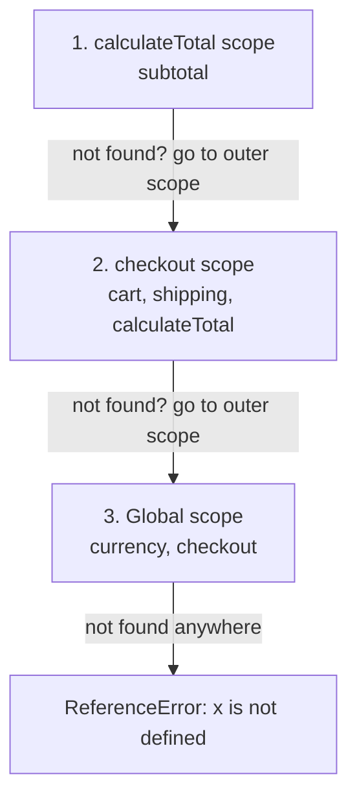
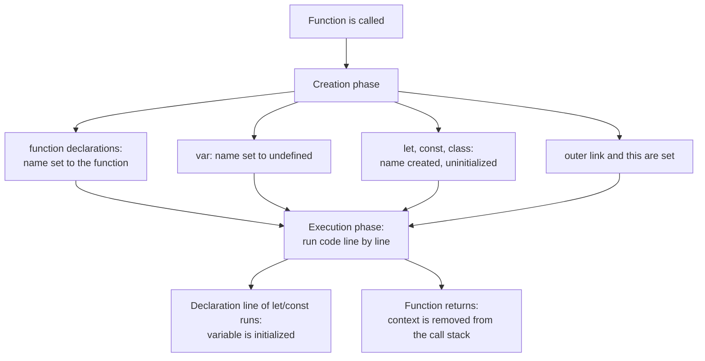
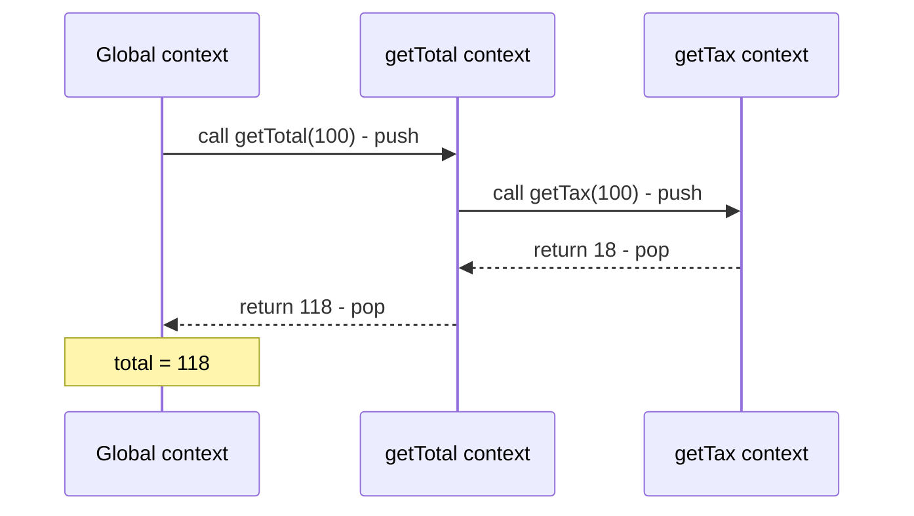
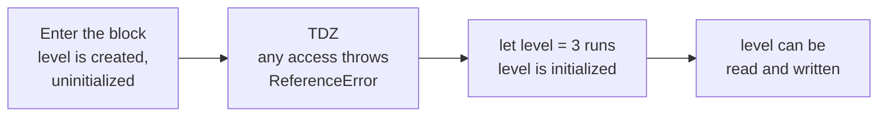

# Scope, Hoisting and the Temporal Dead Zone

> In this document you learn where variables are visible (scope), how JavaScript finds a variable (the scope chain), what really happens before your code runs (execution contexts and hoisting), and why `let` and `const` throw errors when used too early (the temporal dead zone). These ideas are the base for closures, `this` and modules, and they are the source of many output-prediction questions.

**Before this:** [Basics: variables, types and operators](./01-basics-variables-types-operators.md) · **Interview questions:** [jump to the interview section](#interview-questions)

## Table of contents

1. [What scope is](#what-scope-is)
2. [The four kinds of scope](#the-four-kinds-of-scope)
3. [Lexical scope](#lexical-scope)
4. [The scope chain](#the-scope-chain)
5. [Shadowing](#shadowing)
6. [Execution context](#execution-context)
7. [The call stack](#the-call-stack)
8. [Hoisting](#hoisting)
9. [The temporal dead zone](#the-temporal-dead-zone)
10. [The global object and globalThis](#the-global-object-and-globalthis)
11. [Implicit globals and strict mode](#implicit-globals-and-strict-mode)
12. [Scope in real projects](#scope-in-real-projects)
13. [Common mistakes](#common-mistakes)
14. [Best practices](#best-practices)
15. [How to explain this in an interview](#how-to-explain-this-in-an-interview)
16. [Interview questions](#interview-questions)
17. [Summary](#summary)
18. [References](#references)

---

## What scope is

**Scope** is the area of the code where a variable can be used. Outside its scope, the variable does not exist.

```js
function createOrder() {
  const orderId = 101; // orderId lives only inside createOrder
  console.log(orderId); // 101
}

createOrder();
console.log(typeof orderId); // undefined (not visible here)
```

### Why scope exists

Imagine a large app where every variable is visible everywhere. Two developers both name a variable `count` or `data`. One overwrites the other, and you get bugs that are very hard to find. Scope solves this:

- **No name clashes.** Two functions can each have their own `count`.
- **Privacy.** Code outside a function cannot touch the function's internal variables.
- **Memory.** When a scope is no longer needed, its variables can be garbage-collected (unless a closure still uses them).

**Analogy:** think of an office building. A **room** is a function or a block. Things on a desk inside a room are only visible to people in that room. People inside a room can also see things in the **corridor** (the outer scope) and in the **lobby** (the global scope). But people in the lobby cannot see inside the rooms. Where the analogy breaks: in JavaScript, the "rooms" are decided by where you *write* the code, not where a function is called from (see [Lexical scope](#lexical-scope)).

---

## The four kinds of scope

| Scope | Created by | Variables that live there |
| --- | --- | --- |
| **Global scope** | The top level of a classic script | Everything declared at the top level of a classic `<script>` |
| **Function scope** | Every function call | Parameters, `var`, `let`, `const`, inner function declarations |
| **Block scope** | `{ }` blocks: `if`, `for`, `while`, `switch`, `try/catch`, plain `{}` | `let`, `const`, `class` (not `var`) |
| **Module scope** | Each ES module file (and each CommonJS file in Node.js) | Top-level declarations of that module |

### Global scope

Variables declared at the top level of a classic script are **global**. Every function, in every script on the page, can see them.

```js
const appName = "ShopApp"; // global (in a classic script)

function showHeader() {
  console.log(`Welcome to ${appName}`); // Welcome to ShopApp
}
showHeader();
```

Globals are convenient but dangerous. Any code can change them, and names can clash between scripts and libraries. Keep globals to a minimum.

### Function scope

Every time a function runs, it gets a **new** function scope. Everything declared inside (including parameters) is local to that call.

```js
function calculateDiscount(price) {
  var rate = 0.1; // function-scoped
  const discount = price * rate; // function-scoped
  return discount;
}

console.log(calculateDiscount(500)); // 50
console.log(typeof rate, typeof discount, typeof price); // undefined undefined undefined
```

### Block scope

`let`, `const` and `class` declarations inside `{ }` exist only in that block. `var` ignores blocks.

```js
if (true) {
  var fromVar = "visible outside";
  let fromLet = "only inside";
  const fromConst = "only inside";
}

console.log(fromVar); // visible outside
console.log(typeof fromLet); // undefined
console.log(typeof fromConst); // undefined
```

A plain block `{ }` is useful to limit temporary variables:

```js
{
  const tempList = [3, 1, 2];
  const sorted = [...tempList].sort();
  console.log(sorted); // [1, 2, 3]
}
// tempList and sorted are gone here
```

**Loops get a new block scope for every iteration** when you use `let`:

```js
for (let i = 0; i < 3; i++) {
  setTimeout(() => console.log("let:", i)); // let: 0, let: 1, let: 2
}

for (var j = 0; j < 3; j++) {
  setTimeout(() => console.log("var:", j)); // var: 3, var: 3, var: 3
}
```

With `let`, each iteration has its own `i`. With `var`, there is only one `j` for the whole function, and it is `3` when the timers run. The full explanation, with all fixes, is in [Closures](./05-closures.md).

### Module scope

In an **ES module** (a file loaded with `import`, or `<script type="module">`), top-level declarations belong to that module only. Other files can use them only if they are exported and imported.

```text
// cart.js (ES module)
const TAX_RATE = 0.18;            // private to this module
export function addTax(amount) {  // visible to importers
  return amount * (1 + TAX_RATE);
}

// app.js
import { addTax } from "./cart.js";
console.log(addTax(100));         // 118
console.log(typeof TAX_RATE);     // "undefined" (not visible here)
```

Node.js **CommonJS** files (`require`) also have their own scope, because Node wraps each file in a function. See [The global object and globalThis](#the-global-object-and-globalthis) and [Modules: ESM and CommonJS](./14-modules-esm-and-commonjs.md).

---

## Lexical scope

**Lexical scope** (also called **static scope**) means: the scope of a variable is decided by **where the code is written** in the source file. It is *not* decided by where a function is called from.

"Lexical" means "related to the text of the code". The engine can see the scopes just by reading the code, before it runs.

```js
const theme = "light";

function getTheme() {
  return theme; // looks up where getTheme is WRITTEN: the global scope
}

function renderPage() {
  const theme = "dark";
  return getTheme(); // getTheme is CALLED here, but that does not matter
}

console.log(renderPage()); // light
```

`getTheme` is written at the top level, so its outer scope is the global scope. It finds `theme = "light"`. The `theme` inside `renderPage` is invisible to it.

Some other languages (old Lisp dialects, Bash) use **dynamic scope**, where the lookup follows the *call* chain. Under dynamic scope this code would print `dark`. JavaScript does **not** work like that.

Nested functions can see the variables of the functions they are written inside:

```js
function renderApp() {
  const theme = "dark";

  function renderButton() {
    return `button-${theme}`; // written inside renderApp, so it sees renderApp's theme
  }

  return renderButton();
}

console.log(renderApp()); // button-dark
```

### How it works inside

When the engine creates a function, it stores a hidden link to the scope where the function was **created**. The specification calls this the function's **[[Environment]]** internal slot. When the function later runs, its new scope gets this stored scope as its *outer* scope. This is why lexical scope works, and it is also exactly what makes **closures** possible: the function keeps its link to the outer scope even after the outer function has returned. See [Closures](./05-closures.md).

**One important exception:** `this` is *not* lexically scoped in regular functions. It depends on *how* the function is called. Arrow functions are different: they take `this` lexically. See [this, call, apply and bind](./06-this-call-apply-bind.md).

---

## The scope chain

When your code uses a variable name, the engine has to find it. It searches like this:

1. Look in the **current** scope.
2. If not found, look in the **outer** scope (the scope where the current function or block was written).
3. Keep going outward, one level at a time.
4. Stop at the **global** scope.
5. If the name is still not found, throw `ReferenceError: x is not defined`.

This chain of linked scopes is called the **scope chain**. The search only goes **outward**, never inward or sideways.

```js
const currency = "INR"; // global scope

function checkout(cart) {
  const shipping = 40; // checkout scope

  function calculateTotal() {
    const subtotal = cart.reduce((sum, item) => sum + item.price, 0); // calculateTotal scope
    return `${subtotal + shipping} ${currency}`; // subtotal: own; shipping: outer; currency: global
  }

  return calculateTotal();
}

console.log(checkout([{ price: 100 }, { price: 60 }])); // 200 INR
```



**Step by step for `currency` inside `calculateTotal`:**

1. Is `currency` in the `calculateTotal` scope? No.
2. Is it in the `checkout` scope? No.
3. Is it in the global scope? Yes: `"INR"`.

The lookup is fast in practice. Engines resolve most variable locations when they compile the function, so they do not search name by name at runtime.

**Outer scopes cannot see inner variables:**

```js
function outer() {
  function inner() {
    const secret = "inner only";
  }
  inner();
  try {
    console.log(secret);
  } catch (error) {
    console.log(error.message); // secret is not defined
  }
}
outer();
```

---

## Shadowing

**Shadowing** happens when an inner scope declares a variable with the **same name** as an outer one. Inside the inner scope, the inner variable "hides" the outer one. The outer variable is not changed.

```js
const status = "global";

function handleRequest() {
  const status = "processing"; // shadows the global status
  console.log(status); // processing

  if (true) {
    const status = "done"; // shadows handleRequest's status
    console.log(status); // done
  }

  console.log(status); // processing
}

handleRequest();
console.log(status); // global
```

Parameters shadow outer variables too:

```js
const user = { name: "Global user" };

function greet(user) {
  return `Hello, ${user.name}`; // the parameter, not the outer user
}

console.log(greet({ name: "Asha" })); // Hello, Asha
```

### Illegal shadowing

You cannot declare a `var` in an inner block if a `let` or `const` with the same name exists in an outer block **of the same function**. Because `var` ignores the block, it would try to declare the same name in the outer scope, where the `let` already lives. This is a **SyntaxError**:

```text
let price = 100;
{
  var price = 200; // SyntaxError: Identifier 'price' has already been declared
}
```

The opposite direction is fine:

```js
var price = 100;
{
  let price = 200; // ✅ legal: a new block-scoped variable
  console.log(price); // 200
}
console.log(price); // 100
```

Other combinations that are SyntaxErrors:

```text
function update(value) {
  let value = 1; // SyntaxError: 'value' has already been declared (same scope as the parameter)
}

try { /* ... */ } catch (err) {
  let err = 1;   // SyntaxError: the catch parameter and let are in the same block
}
```

But declaring a `let` in a *nested* block inside the function is fine, because it is a different scope:

```js
function update(value) {
  {
    let value = 1; // ✅ new block, new variable
    console.log(value); // 1
  }
  console.log(value); // 5
}
update(5);
```

**Is shadowing good or bad?** It is legal and sometimes useful (for example, a parameter named like a global). But shadowing can confuse readers, who may think they are using the outer variable. ESLint has a `no-shadow` rule that many teams enable.

---

## Execution context

To understand hoisting and the TDZ, you need a simple picture of what the engine does **before** and **while** it runs your code.

### What it is

An **execution context** is the environment in which a piece of code runs. It holds everything the engine needs to run that code:

- **Which variables exist** and their current values. The specification stores them in **environment records**. You can think of an environment record as a table: name → value.
- **A link to the outer environment** (the scope chain).
- **The value of `this`** for that code.

There are three kinds:

1. **Global execution context**: created once, when a script starts.
2. **Function execution context**: created **every time a function is called**.
3. **Eval execution context**: for code run by `eval` (avoid `eval`).

(ES modules also get a module environment, which works like a global context that is private to the file.)

### Two phases: creation and execution

Every execution context goes through two phases.

**1. Creation phase** (before any line runs):

- Create the environment record.
- Find every declaration in this scope and register its name:
  - `function` declarations: the name is created **and set to the function object** immediately.
  - `var`: the name is created and set to **`undefined`**.
  - `let`, `const`, `class`: the name is created but left **uninitialized**. Reading it is an error.
- Set the outer link to the scope where the function was written.
- Decide the value of `this`.

**2. Execution phase:**

- Run the code line by line.
- Assignments change values.
- When a `let`/`const`/`class` declaration line runs, that variable becomes initialized.



### Walkthrough

```js
function prepareInvoice(amount) {
  console.log(tax); // undefined
  console.log(typeof format); // function

  var tax = amount * 0.18;
  const total = amount + tax;

  function format(value) {
    return `Rs ${value}`;
  }

  return format(total);
}

console.log(prepareInvoice(100)); // Rs 118
```

**Creation phase of `prepareInvoice(100)`:**

| Name | Value after creation phase |
| --- | --- |
| `amount` | `100` (parameter) |
| `tax` | `undefined` (`var`) |
| `total` | uninitialized (`const`) |
| `format` | the function object |

**Execution phase:**

1. `console.log(tax)` → `undefined` (it exists, but has no value yet).
2. `console.log(typeof format)` → `"function"` (already created).
3. `tax = 100 * 0.18` → `18`.
4. `total` is initialized to `118`.
5. `format(total)` returns `"Rs 118"`.

This two-phase model explains every hoisting rule in the next sections.

**Note:** the engine does not really "move code to the top". The source stays the same. "Hoisting" is just a name for the effect of the creation phase: names exist before their line runs.

---

## The call stack

The **call stack** is the list of execution contexts that are active right now. It works like a stack of plates: the newest context is on top, and only the top one is running.

- When a script starts, the **global context** is pushed.
- When a function is called, a new context is **pushed** on top.
- When the function returns, its context is **popped** off. Execution continues in the context below.

```js
function getTax(amount) {
  return amount * 0.18;
}

function getTotal(price) {
  const tax = getTax(price);
  return price + tax;
}

const total = getTotal(100);
console.log(total); // 118
```



**Stack at its tallest moment (top first):**

```text
getTax(100)      <- running
getTotal(100)    <- waiting for getTax
global           <- waiting for getTotal
```

You can see the call stack in any error's stack trace, in `console.trace()`, and in the DevTools "Call Stack" panel when you pause at a breakpoint.

### Stack overflow

The stack has a size limit. If functions keep calling functions without returning (usually recursion without a correct base case), the stack fills up and the engine throws:

```js
function countDown(n) {
  return countDown(n - 1); // ❌ no base case
}

try {
  countDown(10);
} catch (error) {
  console.log(error.name, error.message); // RangeError Maximum call stack size exceeded
}
```

The exact limit depends on the engine and the size of each frame (with default settings, a very simple recursive function in Node.js 22 reaches roughly 10,000 to 12,000 calls; bigger functions reach fewer). Recursion and how to avoid deep stacks are covered in [Functions and functional programming](./04-functions-and-functional-programming.md#recursion).

### The call stack and asynchronous code

JavaScript has **one** call stack per thread. While a function is running, nothing else can run on that thread. Callbacks from timers, network requests and events wait in queues, and the **event loop** pushes them onto the stack only when it is empty. See [Event loop](./16-event-loop.md).

---

## Hoisting

**Hoisting** is the behavior where declarations are processed before the code runs (in the creation phase), so the names exist from the start of their scope. *How* usable they are before their line depends on the kind of declaration.

### Summary table

| Declaration | Name exists from scope start? | Value before its line | Using it before its line |
| --- | --- | --- | --- |
| `function` declaration | Yes | The function itself | ✅ Works (you can call it) |
| `var` | Yes | `undefined` | Gives `undefined` |
| `let` | Yes | Uninitialized | ❌ `ReferenceError` (TDZ) |
| `const` | Yes | Uninitialized | ❌ `ReferenceError` (TDZ) |
| `class` | Yes | Uninitialized | ❌ `ReferenceError` (TDZ) |
| Function expression or arrow in a `var` | Yes (as a `var`) | `undefined` | ❌ `TypeError: x is not a function` |
| Function expression or arrow in a `let`/`const` | Yes (TDZ) | Uninitialized | ❌ `ReferenceError` |
| `import` | Yes | Bound to the exported value | ✅ Works (imported modules run first) |

### Function declarations are fully hoisted

```js
console.log(formatPrice(250)); // Rs 250.00

function formatPrice(value) {
  return `Rs ${value.toFixed(2)}`;
}
```

This is useful: you can put the main logic at the top of a file and helper functions at the bottom.

### var is hoisted and set to undefined

```js
console.log(discount); // undefined
var discount = 20;
console.log(discount); // 20
```

The engine behaves as if you wrote:

```text
var discount;           // creation phase
console.log(discount);  // undefined
discount = 20;          // execution phase
console.log(discount);  // 20
```

`var` is hoisted to the top of its **function** (or the global scope), not the top of the block:

```js
function loadSettings(useCache) {
  console.log(cached); // undefined (hoisted to the function top, even from inside the if)
  if (useCache) {
    var cached = { theme: "dark" };
  }
  return cached;
}

console.log(loadSettings(false)); // undefined
console.log(loadSettings(true)); // { theme: "dark" }
```

### let, const and class are hoisted but not initialized

```js
try {
  console.log(cartTotal);
} catch (error) {
  console.log(error.message); // Cannot access 'cartTotal' before initialization
}
let cartTotal = 500;
```

Look at the error message: "Cannot access 'cartTotal' **before initialization**". It is *not* "cartTotal is not defined". The engine knows the variable exists. It just refuses to give you its value yet. That proves `let` is hoisted. The period where it exists but cannot be used is the **temporal dead zone**, covered in the next section.

`class` declarations behave the same way:

```js
try {
  const cart = new ShoppingCart();
} catch (error) {
  console.log(error.name); // ReferenceError
}

class ShoppingCart {}
console.log(typeof ShoppingCart); // function
```

### Function expressions and arrow functions follow their variable

Only function **declarations** are fully hoisted. A function **expression** or **arrow function** stored in a variable follows the rules of `var`, `let` or `const`.

```js
try {
  sendEmail(); // var sendEmail is undefined here
} catch (error) {
  console.log(error.message); // sendEmail is not a function
}
var sendEmail = function () {
  return "sent";
};

try {
  sendSms(); // const sendSms is in the TDZ here
} catch (error) {
  console.log(error.message); // Cannot access 'sendSms' before initialization
}
const sendSms = () => "sent";
```

Notice the two different errors:

- `var` version: **TypeError** "is not a function". The variable exists and is `undefined`, and you tried to call `undefined`.
- `const` version: **ReferenceError** "before initialization". You cannot even read the variable.

### Function declaration and var with the same name

In the creation phase, a function declaration wins over a `var` with the same name. In the execution phase, a later assignment overwrites it.

```js
console.log(typeof setup); // function (the declaration is ready)

var setup = "config";
function setup() {}

console.log(typeof setup); // string (the assignment ran)
```

**Step by step:**

1. Creation phase: `var setup` registers the name. `function setup` sets it to the function. The function wins.
2. First `console.log`: `"function"`.
3. `setup = "config"` runs (the `var` keyword is ignored at this point; only the assignment matters).
4. The function declaration line does nothing at execution time.
5. Second `console.log`: `"string"`.

Never write code like this. It is only an interview puzzle. Linters flag it (`no-redeclare`).

### Function declarations inside blocks

What happens with a function declared inside an `if` block?

- **In strict mode and modules** (all modern code): the function is **block-scoped**. It is hoisted to the top of its block, and it does not exist outside the block.
- **In sloppy mode** (old scripts): engines use special legacy rules (specified in Annex B of the ECMAScript specification). Browsers and Node.js both follow them. The function behaves partly like a `var` in the enclosing function: the outer name exists from the start as `undefined`, and it is set to the function only when the block runs.

```js
"use strict";

if (true) {
  function getLabel() {
    return "inside block";
  }
  console.log(getLabel()); // inside block
}

console.log(typeof getLabel); // undefined (block-scoped in strict mode)
```

In sloppy mode, the last line would print `"function"`, because the block ran. Before the block runs, `typeof getLabel` would be `"undefined"`.

**Best practice:** do not declare functions inside blocks. If you need a function only in a block, use `const getLabel = () => ...`. Its behavior is the same in every mode.

### Why hoisting exists

- **Function declarations** are hoisted so that functions can call each other in any order. This makes **mutual recursion** possible (`isEven` calls `isOdd`, which calls `isEven`) and lets you organize files top-down.
- **`var` hoisting** was a simple design in the first version of JavaScript (1995). The engine created all variables of a function when the function started.
- **`let`/`const` hoisting with a TDZ** (ES2015) keeps the correct scoping (an inner `let` hides an outer variable for the whole block) while turning "use before declaration" into an error instead of a silent `undefined`.

---

## The temporal dead zone

### What it is

The **temporal dead zone (TDZ)** is the time between **entering a scope** and **running the declaration line** of a `let`, `const` or `class` in that scope. During this time, the variable exists but is uninitialized. **Any** access (read, write or `typeof`) throws a `ReferenceError`.

```js
{
  // TDZ for `level` starts here (start of the block)
  try {
    console.log(level);
  } catch (error) {
    console.log(error.name); // ReferenceError
  }
  let level = 3; // TDZ ends here: level is initialized
  console.log(level); // 3
}
```



### "Temporal" means time, not position

The TDZ is about **when** code runs, not **where** it is written. A function can mention a `let` variable declared below it, as long as the function is *called* after the declaration has run.

```js
function getGreeting() {
  return `Hello, ${userName}`; // refers to a let declared later in the file
}

let userName = "Asha";
console.log(getGreeting()); // Hello, Asha (called after the declaration ran: OK)
```

```js
function getVersion() {
  return appVersion;
}

try {
  getVersion(); // called BEFORE the declaration ran
} catch (error) {
  console.log(error.message); // Cannot access 'appVersion' before initialization
}

let appVersion = "2.1.0";
```

Same code shape, different timing, different result. That is why it is called *temporal*.

### typeof is not safe in the TDZ

For a name that was **never declared**, `typeof` returns `"undefined"` without an error. But for a `let`/`const` in its TDZ, `typeof` throws.

```js
console.log(typeof neverDeclared); // undefined

try {
  console.log(typeof notYetReady);
} catch (error) {
  console.log(error.name); // ReferenceError
}
let notYetReady = true;
```

### Shadowing and the TDZ

An inner `let` shadows an outer variable **for the whole block**, including the lines before its declaration. So the outer variable is not reachable there, and the inner one is in its TDZ.

```js
let theme = "light";

function render() {
  try {
    console.log(theme); // which theme? The inner one, which is in its TDZ
  } catch (error) {
    console.log(error.message); // Cannot access 'theme' before initialization
  }
  let theme = "dark";
  return theme;
}

console.log(render()); // dark
```

Many developers expect the first line to print `"light"`. It does not. The inner `theme` exists from the start of the function body, and it hides the outer one.

### A variable cannot use itself in its own initializer

```js
try {
  let retries = retries + 1; // the right side reads retries while it is in the TDZ
} catch (error) {
  console.log(error.name); // ReferenceError
}
```

### Default parameters have a TDZ too

Parameters are initialized **left to right**. A default value can use parameters on its **left**, but not on its **right** (they are still in their TDZ).

```js
function createRange(start = 0, end = start + 10) {
  return [start, end];
}
console.log(createRange()); // [0, 10]
console.log(createRange(5)); // [5, 15]

function brokenRange(start = end, end = 10) {
  return [start, end];
}
try {
  brokenRange();
} catch (error) {
  console.log(error.message); // Cannot access 'end' before initialization
}
console.log(brokenRange(1)); // [1, 10] (no error: the default for start is not used)
```

### Why the TDZ exists

1. **To catch bugs.** Reading a variable before it has a meaningful value is almost always a mistake. With `var`, you silently get `undefined` and the bug shows up later, somewhere else. With the TDZ, you get an error at the exact line.
2. **To make `const` meaningful.** A `const` should only ever have one value. If it could be read as `undefined` before its declaration and as `5` after, it would effectively have two values.
3. **To keep block scoping consistent.** The inner variable owns the name for the whole block. Falling back to the outer variable for the first few lines would be confusing.

---

## The global object and globalThis

### What the global object is

The **global object** is a special object that is always available. It holds built-in values (`Math`, `JSON`, `setTimeout`, `console` and others) and acts as the top of the scope chain for classic scripts.

Its name depends on the environment:

| Environment | Name of the global object |
| --- | --- |
| Browser main thread | `window` (also `self` and `frames`) |
| Web Worker | `self` |
| Node.js | `global` |
| **Everywhere (ES2020)** | **`globalThis`** |

Use `globalThis` when code must run in several environments (for example, a library used in the browser and in Node.js, or Angular code that also runs during server-side rendering).

```js
console.log(typeof globalThis); // object
console.log(globalThis.Math === Math); // true
```

### var and function declarations become global object properties (classic scripts only)

In a **classic browser script** (a `<script>` without `type="module"`), top-level `var` declarations and function declarations become **properties of `window`**. Top-level `let`, `const` and `class` declarations are global variables too, but they are **not** properties of `window`.

```html
<script>
  var appName = "Shop";
  let version = 2;
  function helper() {}

  console.log(window.appName); // "Shop"
  console.log(window.version); // undefined (let is global, but not a window property)
  console.log(typeof window.helper); // "function"
  console.log(version); // 2 (still reachable by name)
</script>
<script>
  console.log(version); // 2 (all classic scripts share the global scope)
</script>
```

(This is browser behavior. You can reproduce it in Node.js with the `vm` module, which runs code as a classic script. Running a normal `.js` file with `node` does **not** show it, because Node wraps each file in a function.)

Why the difference? The global scope has two parts:

- An **object part** backed by the global object. `var` and function declarations go here.
- A **declarative part** that is not an object. `let`, `const` and `class` go here.

Both parts are searched when you use a name at the global level.

**Why this matters:**

- **Name clashes.** A top-level `var` can overwrite an existing `window` property. A famous browser example: `var name = 42;` at the top level of a classic script, then `typeof name` gives `"string"`. `window.name` already exists and always stores a string, so your number is converted.
- **Shared scope between scripts.** All classic scripts on a page share one global scope. Two scripts that both declare a top-level `let config` cause a SyntaxError in the second script.
- **Module code is safe.** ES modules do not have these problems. Their top-level declarations are module-scoped, so nothing leaks onto `window`.

### Node.js: each file has its own scope

In Node.js, a CommonJS file is wrapped in a function before it runs, roughly like this:

```text
(function (exports, require, module, __filename, __dirname) {
  // your file's code
});
```

That is why:

- Top-level `var` in a CommonJS file is **not** a property of `global`. It is local to the module.
- `require`, `module`, `exports`, `__filename` and `__dirname` look like globals but are actually **parameters** of this wrapper function.
- `this` at the top level of a CommonJS file is `module.exports` (an empty object at first).

```js
var moduleLevel = "local to this file";
console.log(globalThis.moduleLevel); // undefined (CommonJS file in Node.js)
console.log(this === module.exports); // true (CommonJS top-level this)
```

In ES modules (`.mjs` files or `"type": "module"` in `package.json`), there is no wrapper function, but the effect is similar: top-level declarations are module-scoped, and top-level `this` is `undefined`.

### Top-level this summary

| Where | Top-level `this` |
| --- | --- |
| Classic browser script | `window` |
| ES module (browser or Node.js) | `undefined` |
| Node.js CommonJS file | `module.exports` |

---

## Implicit globals and strict mode

If you **assign** to a name that was never declared, what happens depends on the mode:

- **Sloppy mode:** JavaScript walks the whole scope chain, does not find the name, and **creates a property on the global object**. This is an **implicit global**.
- **Strict mode** (and all ES modules and classes): it throws `ReferenceError: x is not defined`.

```js
let total = 0;

function addToCart(price) {
  totl = total + price; // ❌ typo: totl instead of total
}

addToCart(100);
console.log(total); // 0 (the real variable never changed)
console.log(globalThis.totl); // 100 (sloppy mode created a global)
```

This bug is silent in sloppy mode. In strict mode, the typo throws immediately:

```js
"use strict";

function addToCartStrict(price) {
  try {
    totalAmount = price; // never declared
  } catch (error) {
    console.log(error.message); // totalAmount is not defined
  }
}
addToCartStrict(100);
```

Implicit globals differ from `var` globals in one small way: an implicit global is a normal, deletable property of the global object (`delete globalThis.totl` returns `true`). A global created with `var` cannot be deleted.

**Reading** an undeclared name always throws a `ReferenceError`, in both modes. Only *assigning* differs.

---

## Scope in real projects

### Before modules: the IIFE module pattern

Before ES2015, JavaScript had no block scope (only `var`) and no modules. Every top-level `var` in every script became a global. Libraries protected their internals with an **IIFE** (immediately invoked function expression), which creates a private function scope:

```js
const counterModule = (function () {
  let count = 0; // private: not reachable from outside

  return {
    increment() {
      count += 1;
      return count;
    },
    reset() {
      count = 0;
    },
  };
})();

console.log(counterModule.increment()); // 1
console.log(counterModule.increment()); // 2
console.log(typeof count); // undefined
```

jQuery, for example, exposed just one global (`window.jQuery`, also `$`) and kept everything else inside function scopes. Today you use ES modules instead. IIFEs are explained in [Functions](./04-functions-and-functional-programming.md#iife-immediately-invoked-function-expressions), and the private-state part is explained in [Closures](./05-closures.md).

### Today: every file is a module

- **Angular, React and modern frontend code** is written as ES modules. Bundlers (Angular CLI with webpack or esbuild, Vite) keep each module's scope separate in the final bundle. You never accidentally create `window` properties from top-level code.
- **Node.js** gives each file its own scope (CommonJS wrapper or ES module).
- Real globals are rare and deliberate: `window`, `document`, `localStorage`, `process` in Node.js, or a global configuration object injected by the server.

### Block scope for safer code

```js
async function loadDashboard(api) {
  let widgets = [];

  try {
    const response = await api.getWidgets(); // only needed inside try
    widgets = response.items;
  } catch (error) {
    const message = `Could not load widgets: ${error.message}`; // only needed inside catch
    console.log(message);
  }

  return widgets;
}

loadDashboard({ getWidgets: async () => ({ items: ["sales", "traffic"] }) }).then((w) =>
  console.log(w) // ["sales", "traffic"]
);
```

`response` and `message` cannot be misused outside their blocks.

### Scope and memory

When a function returns, its scope is normally garbage-collected. But if an inner function that is still reachable (a callback, an event listener, a timer) refers to the scope, the scope stays in memory. This is how closures work, and it is also a common source of memory leaks. See [Closures](./05-closures.md) and [Memory management and garbage collection](./19-memory-management-and-garbage-collection.md).

---

## Common mistakes

1. **Thinking `let` and `const` are not hoisted.** They are hoisted but uninitialized. The error message ("before initialization") shows the engine knows about them.
2. **Expecting the outer variable before an inner `let`.** The inner declaration shadows the name for the whole block, including the lines above it.
3. **Using `typeof` as a safe check for `let`/`const` variables.** It throws in the TDZ.
4. **Calling a function expression before its line.** Only function declarations are fully hoisted.
5. **Using `var` in loops with async callbacks.** All callbacks share one variable.
6. **Assuming dynamic scope.** A function sees the variables where it was *written*, not where it is *called*.
7. **Creating implicit globals** with typos or with `let a = b = 0`.
8. **Expecting top-level `var` to be on `window` in modules or in Node.js.** That only happens in classic browser scripts.
9. **Declaring functions inside blocks** in code that may run in sloppy mode. The behavior is confusing and legacy-specific.

---

## Best practices

- **Use `const`, then `let`. Do not use `var`.** Block scope and the TDZ turn silent bugs into clear errors.
- **Declare variables at the top of their block, before use.** Then the TDZ never matters, and readers see the variables first.
- **Keep scopes small.** Declare a variable in the innermost block that needs it.
- **Write ES modules (or TypeScript)**, so code is strict and nothing leaks into the global scope.
- **Use `globalThis`** when you really need the global object in code that runs in several environments.
- **Avoid shadowing** when it can confuse readers. Consider ESLint's `no-shadow`.
- **Prefer function expressions in `const`** for functions defined inside blocks.
- **Enable linting rules** like `no-var`, `prefer-const`, `no-undef`, `no-use-before-define` and `block-scoped-var`.

---

## How to explain this in an interview

**Question: "What is hoisting?"**

1. **Define it:** "Hoisting means that declarations are processed before the code runs, so their names exist from the start of their scope."
2. **Why it exists:** "Before running a scope, the engine has a creation phase where it registers all declarations. That's what allows calling a function declaration before its line, for example for mutual recursion."
3. **How it works:** "Function declarations are hoisted with their full value. `var` is hoisted and initialized to `undefined`. `let`, `const` and `class` are hoisted too, but stay uninitialized until their line runs. That period is the temporal dead zone, and touching them there throws a ReferenceError."
4. **Small example:** "`console.log(a); var a = 5;` prints undefined. The same with `let` throws 'Cannot access a before initialization'. And calling a function expression stored in a `var` before its line gives 'is not a function', because the variable is still undefined."
5. **Where it matters:** "It explains many interview puzzles and real bugs, like reading a `var` that isn't set yet. It's also why I can put helper function declarations at the bottom of a file."
6. **Trade-offs / gotchas:** "Code isn't physically moved. It's just the creation phase. And hoisting is per scope: `var` goes to the top of the function, `let` to the top of the block."

**Question: "What is lexical scope and the scope chain?"**

1. **Define it:** "Lexical scope means a variable's visibility is decided by where the code is written, not where a function is called."
2. **Why it exists:** "It makes code predictable. You can tell which variable a name refers to just by reading the code."
3. **How it works:** "When a function is created, it remembers the scope it was created in. When it runs, a lookup checks the current scope, then that outer scope, then further out up to the global scope. If the name isn't found, it's a ReferenceError. That chain is the scope chain."
4. **Small example:** "If a function defined at the top level reads `theme`, and I call it from inside another function that has its own `theme`, it still reads the global `theme`."
5. **Where it is useful:** "It's the foundation of closures, module privacy and callbacks that use outer variables."
6. **Trade-offs / gotchas:** "`this` is the exception. In regular functions it depends on how the function is called. Arrow functions take `this` lexically."

---

## Interview questions

### Q1. What is scope? What kinds of scope does JavaScript have?

**What the interviewer is checking:** the four scope types and which declarations belong where.

**Short spoken answer (30–60 seconds):**
> "Scope is the region of code where a variable is visible. JavaScript has global scope, function scope, block scope and module scope. Every function call creates a new function scope, and `var` is scoped to the function. Since ES2015, `let`, `const` and `class` are block-scoped, so they live only inside the nearest curly braces, like an if or a loop body. ES modules give every file its own scope, so top-level variables aren't global unless exported. Scope prevents name clashes, keeps internals private, and lets memory be freed when a scope isn't needed anymore."

**Detailed explanation:** See [The four kinds of scope](#the-four-kinds-of-scope).

**Follow-up questions:**
- **Does a `for` loop with `let` create one scope or many?** — A new binding for every iteration. That is why closures in the loop each see their own value.
- **Is `catch (error)` block-scoped?** — Yes. The `error` parameter exists only inside the `catch` block.
- **Is a Node.js file global scope?** — No. CommonJS files are wrapped in a function, and ES modules have module scope.

**Common mistakes:** forgetting module scope; saying `var` is "global" (it is function-scoped when inside a function).

**Where this is used in real projects:** every Angular/TypeScript file is a module; block scope in loops and `try/catch`; avoiding globals in browser scripts.

### Q2. What is lexical scope?

**What the interviewer is checking:** that lookup depends on where code is written, not where it is called.

**Short spoken answer (30–60 seconds):**
> "Lexical scope means the scope of a variable is determined by its position in the source code. When a function is created, it keeps a reference to the scope it was written in. When it runs and needs a variable it doesn't have, it looks in that outer scope, not in the scope of whoever called it. So if a top-level function reads `theme` and I call it from inside another function that has its own `theme`, it still gets the top-level one. This is what makes closures work. The opposite is dynamic scope, which JavaScript doesn't use, except that `this` in regular functions behaves dynamically."

**Code:**

```js
let counter = 10;

function increment() {
  counter++; // lexically refers to the top-level counter
}

function run() {
  let counter = 0;
  increment();
  return counter;
}

console.log(run(), counter); // 0 11
```

**Step by step:** `increment` was written at the top level, so `counter` inside it is the top-level `counter`. Calling it from `run` does not change that. `run` returns its own `counter` (still `0`), and the top-level one became `11`.

**Follow-up questions:**
- **How is lexical scope related to closures?** — A closure is a function that keeps using its lexical (outer) scope after the outer function has returned.
- **Is `this` lexical?** — Not in regular functions (it depends on the call). In arrow functions, yes.

**Common mistakes:** answering "lexical scope means local variables"; mixing it up with `this`.

**Where this is used in real projects:** callbacks in `map`, event handlers, RxJS operators and Express middleware all read variables from where they were written.

### Q3. What is the scope chain?

**What the interviewer is checking:** the lookup algorithm and its direction.

**Short spoken answer (30–60 seconds):**
> "The scope chain is the list of scopes the engine searches when it resolves a variable name. It starts with the current scope, then the outer scope where the current function was defined, and continues outward until the global scope. The first match wins. If the name isn't found anywhere, reading it throws a ReferenceError. The search only goes outward, so outer code can never see inner variables. Each function stores a link to its defining scope, and those links form the chain."

**Detailed explanation and diagram:** See [The scope chain](#the-scope-chain).

**Follow-up questions:**
- **What happens when you assign to a name not found in the chain?** — Sloppy mode creates a global; strict mode throws a `ReferenceError`.
- **Is a deep scope chain slow?** — Not in a way you should worry about. Engines resolve most variable locations at compile time.

**Common mistakes:** describing the chain as following the call stack.

**Where this is used in real projects:** understanding which `config` or `logger` a nested function uses; debugging "x is not defined" errors.

### Q4. What is hoisting?

**What the interviewer is checking:** creation vs execution phase, and the different behavior per declaration type.

**Short spoken answer (30–60 seconds):**
> "Hoisting is the behavior where declarations are registered before any code in their scope runs, so the names exist from the start of the scope. Function declarations are hoisted with their whole body, so I can call them before their line. `var` is hoisted and set to undefined, so reading it early gives undefined. `let`, `const` and `class` are also hoisted, but they're not initialized, so accessing them before their line throws a ReferenceError. That's the temporal dead zone. Function expressions and arrow functions follow the rules of the variable they're assigned to. The code isn't physically moved. It's the result of the engine's creation phase."

**Detailed explanation:** See [Hoisting](#hoisting) and the [summary table](#summary-table).

**Follow-up questions:**
- **Where is a `var` hoisted to?** — The top of the enclosing function (or the global/module scope), not the top of the block.
- **Are imports hoisted?** — Yes. `import` declarations are processed before the module body runs, and imported modules are evaluated first.
- **Why are function declarations hoisted fully?** — So functions can call each other regardless of order, which allows mutual recursion and top-down file organization.

**Common mistakes:** "only `var` is hoisted"; "the code is moved to the top".

**Where this is used in real projects:** files that define helpers at the bottom; debugging `undefined` values from `var`; understanding TDZ errors after refactoring `var` to `let`.

### Q5. Output: var hoisting inside a function

```js
var x = 1;
function show() {
  console.log(x);
  var x = 2;
}
show();
```

**Answer:** `undefined`.

**Why:**

1. In the creation phase of `show`, the local `var x` is registered and set to `undefined`.
2. The local `x` shadows the global `x` for the whole function.
3. `console.log(x)` reads the local `x`, which is still `undefined`.
4. Only then is the local `x` set to `2`.

**Follow-up:** **What if the inner line were `let x = 2`?** — `ReferenceError: Cannot access 'x' before initialization`. The local `x` still shadows the global one, but now it is in its TDZ.

### Q6. Output: hoisting in an if (false) block

```js
var color = "red";
function paint() {
  if (false) {
    var color = "blue";
  }
  return color;
}
console.log(paint());
```

**Answer:** `undefined`.

**Why:** `var color` is hoisted to the top of `paint`, even though the block never runs. The declaration exists; the assignment never happens. The local `color` shadows the global one and stays `undefined`.

### Q7. Are let and const hoisted? What is the temporal dead zone?

**What the interviewer is checking:** the precise answer ("yes, but uninitialized") and the reason the TDZ exists.

**Short spoken answer (30–60 seconds):**
> "Yes, they're hoisted. Their names are created when the scope is entered, but they aren't initialized. The time between entering the scope and running the declaration line is the temporal dead zone. Any access in that window, even `typeof`, throws a ReferenceError that says 'cannot access before initialization'. You can prove they're hoisted with shadowing: if an inner block has `let x` lower down, reading `x` at the top of that block throws, instead of reading the outer `x`. The TDZ exists to catch use-before-initialization bugs and to make `const` mean a single value."

**Code:**

```js
let theme = "light";
{
  try {
    console.log(theme);
  } catch (error) {
    console.log(error.message); // Cannot access 'theme' before initialization
  }
  let theme = "dark";
}
```

**Follow-up questions:**
- **Why is it called "temporal"?** — Because it depends on time of execution, not position. A function that reads a `let` declared later works if it is called after the declaration ran.
- **Does the TDZ apply to `class`?** — Yes. `new MyClass()` before the class declaration throws a `ReferenceError`.
- **Does it apply to default parameters?** — Yes. A default can only use parameters to its left.

**Common mistakes:** "let and const are not hoisted"; "the TDZ is the lines above the declaration" (it is a time window).

**Where this is used in real projects:** refactoring `var` to `let` can expose code that relied on reading `undefined` early; circular imports in ES modules can hit TDZ errors when one module reads another's `const` before it is initialized.

### Q8. Output: typeof and the TDZ

```js
console.log(typeof undeclaredThing);

try {
  console.log(typeof laterValue);
} catch (error) {
  console.log(error.name);
}

let laterValue = 1;
```

**Answer:**

```text
undefined
ReferenceError
```

**Why:** `typeof` on a name that does not exist anywhere returns `"undefined"`. But `laterValue` *does* exist (it is hoisted), and it is in its TDZ, so even `typeof` throws.

### Q9. Output: let and var in the same function

```js
function test() {
  console.log(a, b);
  var a = 1;
  let b = 2;
}

try {
  test();
} catch (error) {
  console.log(error.name, error.message);
}
```

**Answer:** `ReferenceError Cannot access 'b' before initialization`

**Why:** the arguments of `console.log` are evaluated left to right. `a` is `undefined` (no problem), but reading `b` throws before `console.log` is called. So nothing is logged from inside `test`. Only the `catch` prints.

### Q10. Output: default parameters

```js
function createRange(start = end, end = 10) {
  return [start, end];
}

console.log(createRange(1));

try {
  createRange();
} catch (error) {
  console.log(error.message);
}
```

**Answer:**

```text
[ 1, 10 ]
Cannot access 'end' before initialization
```

**Why:** parameters are initialized left to right. In `createRange(1)`, the default for `start` is not used, so `end` is never read early. In `createRange()`, the default for `start` reads `end`, which is still in its TDZ.

### Q11. Output: function declaration vs function expression

```js
console.log(typeof declared);
console.log(typeof expressed);

try {
  expressed();
} catch (error) {
  console.log(error.name);
}

try {
  arrow();
} catch (error) {
  console.log(error.name);
}

function declared() {}
var expressed = function () {};
const arrow = () => {};
```

**Answer:**

```text
function
undefined
TypeError
ReferenceError
```

**Why:**

1. Function declarations are hoisted with their value → `"function"`.
2. `var expressed` is hoisted as `undefined`; the function is assigned later → `"undefined"`.
3. Calling `undefined` → `TypeError: expressed is not a function`.
4. `const arrow` is in its TDZ → `ReferenceError`.

**Follow-up:** **Which style do you prefer?** — Both are fine. Function declarations allow top-down ordering and give good names in stack traces. `const` arrow functions avoid accidental reassignment and make "define before use" explicit. Many teams use declarations for top-level functions and arrows for callbacks.

### Q12. Output: function and var with the same name

```js
console.log(typeof setup);
var setup = "config";
function setup() {}
console.log(typeof setup);

function foo() {
  return bar;
  var bar = 1;
  function bar() {}
}
console.log(typeof foo());
```

**Answer:**

```text
function
string
function
```

**Why:** in the creation phase, the function declaration sets the name to a function (a `var` with the same name does not overwrite it). In the execution phase, `setup = "config"` replaces it. In `foo`, `return bar` runs before `bar = 1`, so `bar` is still the hoisted function.

### Q13. What is an execution context?

**What the interviewer is checking:** the creation/execution model behind hoisting, scope and `this`.

**Short spoken answer (30–60 seconds):**
> "An execution context is the environment the engine creates to run a piece of code. There's one global context, and a new function context for every function call. Each context has an environment record with the variables, a link to the outer environment, which forms the scope chain, and a `this` value. It's created in two phases. In the creation phase, the engine registers declarations: function declarations get their function, `var` gets undefined, and `let`, `const` and `class` are created but uninitialized. Then in the execution phase, code runs line by line. Contexts are managed on the call stack."

**Detailed explanation and diagram:** See [Execution context](#execution-context).

**Follow-up questions:**
- **What is the difference between a lexical environment and an execution context?** — The lexical environment (environment record plus outer link) is the *variables* part. The execution context also tracks things like the current `this`, the running code and the realm. Each context points to its current lexical environment, and blocks create new lexical environments inside the same execution context.
- **Does a block create a new execution context?** — No. A block creates a new lexical environment (for `let`/`const`) inside the same execution context.

**Common mistakes:** confusing execution context with scope or with `this`; saying blocks create execution contexts.

**Where this is used in real projects:** reading stack traces and debugger panels ("Scope" and "Call Stack" in DevTools show exactly these structures).

### Q14. What is the call stack, and what causes a stack overflow?

**What the interviewer is checking:** stack mechanics and the link to recursion and the event loop.

**Short spoken answer (30–60 seconds):**
> "The call stack is how the engine keeps track of which function is running and where to return to. When a function is called, its execution context is pushed on top. When it returns, it's popped, and the function below continues. JavaScript has one call stack per thread, so only one function runs at a time. A stack overflow happens when the stack gets too deep, usually because of recursion without a proper base case. The engine then throws a RangeError, 'Maximum call stack size exceeded'. Async callbacks don't run until the stack is empty, which is how the event loop fits in."

**Follow-up questions:**
- **How do you fix deep recursion on large input?** — Convert it to a loop with an explicit stack or queue, or process the data in chunks. Do not rely on tail-call optimization: only Safari implements it.
- **Where do you see the call stack?** — In error stack traces, `console.trace()`, and the DevTools Call Stack panel.

**Common mistakes:** thinking `setTimeout` callbacks are added to the stack immediately.

**Where this is used in real projects:** debugging stack traces; recursive tree rendering (menus, comments, file trees) on very deep data.

### Q15. What is shadowing? What is illegal shadowing?

**What the interviewer is checking:** shadowing rules across `var`/`let`.

**Short spoken answer (30–60 seconds):**
> "Shadowing is when an inner scope declares a variable with the same name as an outer one. Inside the inner scope, the inner variable hides the outer one, and the outer one is unchanged. It's legal with `let` inside a `var` scope, or `let` inside another `let` block. Illegal shadowing is declaring a `var` inside a block when a `let` with the same name exists in an outer block of the same function. Because `var` escapes the block, it would collide with the `let`, so it's a SyntaxError. Declaring a `let` with the same name as a parameter in the function body is also an error."

**Code:**

```js
var price = 100;
{
  let price = 200; // ✅ legal shadowing
  console.log(price); // 200
}
console.log(price); // 100
```

```text
let total = 100;
{
  var total = 200; // ❌ SyntaxError: Identifier 'total' has already been declared
}
```

**Follow-up:** **Why might a team ban shadowing?** — It makes code harder to read, because the same name means different things in nearby lines. ESLint's `no-shadow` rule reports it.

**Common mistakes:** thinking shadowing modifies the outer variable.

**Where this is used in real projects:** callback parameters like `.map((user) => ...)` inside a function that also has a `user` variable.

### Q16. What is the difference between a top-level var and a top-level let in a browser script? What is globalThis?

**What the interviewer is checking:** the global object, its two parts, and environment differences.

**Short spoken answer (30–60 seconds):**
> "In a classic browser script, both are global variables, but a top-level `var` also becomes a property of `window`, while a top-level `let` or `const` doesn't. The global scope has an object part, backed by `window`, for `var` and function declarations, and a separate declarative part for `let`, `const` and `class`. That's why `var` can clash with existing window properties. In ES modules and in Node.js files, neither becomes a global property, because those files have their own scope. `globalThis`, added in ES2020, is the standard way to reach the global object in any environment: it's `window` in browsers, `self` in workers and `global` in Node."

**Follow-up questions:**
- **What is a famous `var` clash?** — `var name = 42;` at the top of a classic script. `window.name` already exists and always stores a string, so `typeof name` is `"string"`.
- **What is `this` at the top level?** — `window` in a classic script, `undefined` in an ES module, `module.exports` in a CommonJS file.

**Common mistakes:** thinking `let` at the top level is not global at all.

**Where this is used in real projects:** universal code (Angular SSR, libraries) uses `globalThis` or `typeof window !== "undefined"` checks; legacy script-tag apps suffer from global clashes.

### Q17. What happens when you assign to a variable that was never declared?

**What the interviewer is checking:** implicit globals and strict mode.

**Short spoken answer (30–60 seconds):**
> "In sloppy mode, JavaScript doesn't find the name in the scope chain, so it creates a property on the global object. That's an implicit global, and it's usually a typo that silently creates a bug. In strict mode, which is automatic in ES modules and classes, it throws a ReferenceError instead. Reading an undeclared variable always throws, in both modes. The classic trap is `let a = b = 0` inside a function, which declares `a` but makes `b` an implicit global."

**Follow-up:** **Can you delete an implicit global?** — Yes, it is a normal configurable property (`delete globalThis.b` is `true`). A global created with `var` cannot be deleted.

**Common mistakes:** thinking it throws in all modes; not knowing modules are strict.

**Where this is used in real projects:** legacy scripts with leaking variables; data shared by accident between requests in a Node.js server through an implicit global.

### Q18. Output: var and let in a loop with setTimeout

```js
for (var i = 0; i < 3; i++) {
  setTimeout(() => console.log("var", i));
}
for (let j = 0; j < 3; j++) {
  setTimeout(() => console.log("let", j));
}
```

**Answer:**

```text
var 3
var 3
var 3
let 0
let 1
let 2
```

**Why:** there is one function-scoped `i`. The callbacks run after both loops finish, when `i` is `3`. With `let`, each iteration has its own `j` binding, and each callback remembers its own. The callbacks run in the order the timers were created. This is the classic closure question; the full explanation and all fixes are in [Closures](./05-closures.md).

### Q19. What happens when a function is declared inside a block?

**What the interviewer is checking:** strict vs sloppy differences and good judgment.

**Short spoken answer (30–60 seconds):**
> "In strict mode and modules, a function declared in a block is block-scoped. It's hoisted to the top of that block and doesn't exist outside it. In sloppy mode, engines follow legacy web-compatibility rules: the name also gets a `var`-like binding in the enclosing function, which is undefined until the block runs and then holds the function. Because the behavior differs between modes, I avoid declaring functions in blocks. If I need one, I use `const fn = () => {}`, which behaves the same everywhere."

**Follow-up:** **Is this part of the standard?** — Yes. The sloppy-mode behavior is specified in Annex B of the ECMAScript specification ("additional features for web browsers"), for compatibility with old websites.

**Common mistakes:** assuming a block function is always visible outside the block.

**Where this is used in real projects:** legacy code inside `if` statements; linters (`no-inner-declarations`) flag it.

### Q20. Output: lexical scope with a returned function

```js
function outer() {
  var x = 10;
  function inner() {
    console.log(x);
  }
  return inner;
}

var x = 99;
outer()();
```

**Answer:** `10`.

**Why:** `inner` was written inside `outer`, so its outer scope is `outer`'s scope, where `x` is `10`. It does not matter that `inner` is called from the global scope where another `x` is `99`. `inner` keeps its link to `outer`'s scope even after `outer` returned: that is a closure.

### Q21. How is scope different in a classic script, an ES module and a CommonJS file?

**What the interviewer is checking:** practical knowledge of module systems and globals.

**Short spoken answer (30–60 seconds):**
> "In a classic browser script, top-level declarations are global and shared with every other classic script on the page, and top-level `var` and functions even become `window` properties. In an ES module, every file has its own module scope. Nothing is global unless I attach it to `globalThis` on purpose, modules are always strict, and top-level `this` is undefined. In a Node CommonJS file, Node wraps the code in a function, so top-level variables are local to the file, `require` and `module` are actually function parameters, and top-level `this` is `module.exports`."

**Follow-up questions:**
- **Why can you use `__dirname` in CommonJS but not in ES modules?** — In CommonJS it is a parameter of the module wrapper. ES modules have no wrapper; use `import.meta.dirname` (available in recent Node.js versions, including 22) or `fileURLToPath(import.meta.url)`.
- **Do two ES modules that both declare `const config` conflict?** — No. Each has its own module scope.

**Common mistakes:** thinking Node.js top-level `var` creates a global.

**Where this is used in real projects:** migrating from CommonJS to ESM in Node.js; Angular/TypeScript code is always ESM-based. See [Modules: ESM and CommonJS](./14-modules-esm-and-commonjs.md).

### Q22. Scenario: two scripts on a legacy page break each other

A legacy admin page includes `reports.js` and `charts.js` with plain `<script>` tags. After a new release, the charts show report data, and sometimes the console shows "Identifier 'config' has already been declared". What is going on and how do you fix it?

**What the interviewer is checking:** applying global-scope knowledge to a real bug.

**Short spoken answer (30–60 seconds):**
> "Classic scripts share one global scope. If both files declare a top-level `config`, with `var` the second silently overwrites the first, so charts read report settings. With `let` or `const`, the second script fails with a SyntaxError and doesn't run at all. The quick fix is to wrap each file in an IIFE or a block so its variables are private, and expose only one namespaced global if needed. The real fix is to convert the files to ES modules with `type="module"` or bundle them, so each file has its own scope and shares data only through imports and exports."

**Follow-up:** **How would you find all accidental globals?** — Turn on strict mode and ESLint `no-undef`/`no-implicit-globals`, and compare `Object.keys(window)` before and after the scripts load.

**Where this is used in real projects:** migrating old jQuery-era pages, embedding third-party widgets, and micro-frontends that load several apps into one page.

### Q23. Code review: what would you change?

```js
function getActiveUsers(users) {
  for (var i = 0; i < users.length; i++) {
    var user = users[i];
    if (user.active) {
      result = result || [];
      result.push(user);
    }
  }
  console.log("checked", i, "users, last:", user && user.name);
  return result;
}
```

**What the interviewer is checking:** spotting scope bugs, not only style.

**Answer:**

1. **`result` is never declared.** In sloppy mode it becomes an implicit global, so results from previous calls **accumulate** across calls (a serious bug, especially in a Node.js server where the global is shared by all requests). In strict mode, it throws.
2. **If no user is active, the function returns `undefined`** (or a stale global array) instead of an empty array.
3. **`var i` and `var user` leak** outside the loop. The `console.log` only works because of that, which hides intent.
4. The loop can be replaced by `filter`.

```js
function getActiveUsers(users) {
  const result = users.filter((user) => user.active);
  console.log("checked", users.length, "users");
  return result;
}

console.log(getActiveUsers([{ name: "Asha", active: true }, { name: "Ravi", active: false }]).length); // 1
```

**Where this is used in real projects:** this exact "global accumulator" bug appears in legacy code and causes data from one user's request to show up in another's.

---

## Summary

- **Scope** is where a variable is visible: global, function, block (`let`/`const`/`class`) and module.
- JavaScript uses **lexical scope**: lookup depends on where code is written, not where it is called. Functions remember their defining scope (the base of closures).
- The **scope chain** searches the current scope, then outer scopes, up to the global scope; not found means `ReferenceError`.
- **Shadowing**: an inner declaration hides an outer one for the whole inner scope. `var` inside a block cannot shadow an outer-block `let` of the same function (SyntaxError).
- Each function call creates an **execution context** with a creation phase (register declarations) and an execution phase (run code). Contexts live on the **call stack**; too deep means `RangeError`.
- **Hoisting**: function declarations get their value early; `var` starts as `undefined`; `let`/`const`/`class` are hoisted but uninitialized.
- The **TDZ** is the time from entering the scope until the declaration runs. Any access, even `typeof`, throws. It also applies to default parameters (left to right).
- Function expressions and arrows follow their variable's rules: `TypeError` with `var`, `ReferenceError` with `let`/`const`.
- In classic browser scripts, top-level `var` and functions become `window` properties; `let`/`const` do not. Modules and Node.js files have their own scope. Use `globalThis` for the global object.
- Assigning to an undeclared name creates an implicit global in sloppy mode and throws in strict mode.
- Use `const`/`let`, declare before use, keep scopes small, and write modules.

## References

- MDN: Scope (glossary) — https://developer.mozilla.org/en-US/docs/Glossary/Scope
- MDN: Hoisting (glossary) — https://developer.mozilla.org/en-US/docs/Glossary/Hoisting
- MDN: `let` and the temporal dead zone — https://developer.mozilla.org/en-US/docs/Web/JavaScript/Reference/Statements/let#temporal_dead_zone_tdz
- MDN: `var` — https://developer.mozilla.org/en-US/docs/Web/JavaScript/Reference/Statements/var
- MDN: Function declarations (block-level functions) — https://developer.mozilla.org/en-US/docs/Web/JavaScript/Reference/Statements/function
- MDN: `globalThis` — https://developer.mozilla.org/en-US/docs/Web/JavaScript/Reference/Global_Objects/globalThis
- MDN: Call stack (glossary) — https://developer.mozilla.org/en-US/docs/Glossary/Call_stack
- MDN: Closures (lexical scoping section) — https://developer.mozilla.org/en-US/docs/Web/JavaScript/Closures
- ECMAScript 2025: Environment Records — https://tc39.es/ecma262/2025/#sec-environment-records
- ECMAScript 2025: Execution Contexts — https://tc39.es/ecma262/2025/#sec-execution-contexts
- ECMAScript 2025: Annex B.3.2 Block-Level Function Declarations Web Legacy Compatibility Semantics — https://tc39.es/ecma262/2025/#sec-block-level-function-declarations-web-legacy-compatibility-semantics
- Node.js: The module wrapper — https://nodejs.org/api/modules.html#the-module-wrapper
