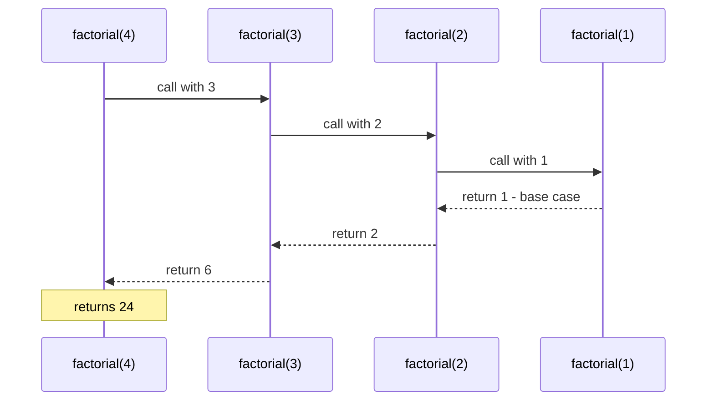

# Functions and Functional Programming

> In this document you learn every way to create a function in JavaScript, how arrow functions really differ from regular functions, how parameters work, and the core ideas of functional programming: higher-order functions, pure functions, immutability, currying, composition and memoization. Interviewers test these with "arrow vs regular", "implement curry/compose" and output questions.

**Before this:** [Scope, hoisting and TDZ](./03-scope-hoisting-and-tdz.md) · **Interview questions:** [jump to the interview section](#interview-questions)

## Table of contents

1. [What a function is](#what-a-function-is)
2. [Ways to create a function](#ways-to-create-a-function)
3. [Arrow functions in depth](#arrow-functions-in-depth)
4. [Parameters and arguments](#parameters-and-arguments)
5. [Return values](#return-values)
6. [First-class and higher-order functions](#first-class-and-higher-order-functions)
7. [IIFE: immediately invoked function expressions](#iife-immediately-invoked-function-expressions)
8. [Function properties: name and length](#function-properties-name-and-length)
9. [Recursion](#recursion)
10. [Pure functions and side effects](#pure-functions-and-side-effects)
11. [Immutability](#immutability)
12. [Currying and partial application](#currying-and-partial-application)
13. [Compose and pipe](#compose-and-pipe)
14. [Memoization](#memoization)
15. [call, apply and bind in one minute](#call-apply-and-bind-in-one-minute)
16. [Functional programming in real projects](#functional-programming-in-real-projects)
17. [How to explain this in an interview](#how-to-explain-this-in-an-interview)
18. [Interview questions](#interview-questions)
19. [Summary](#summary)
20. [References](#references)

---

## What a function is

A **function** is a reusable block of code with a name (or without one). You give it inputs (**arguments**), it does some work, and it can give back an output (a **return value**).

```js
function calculateTax(amount, rate) {
  return amount * rate;
}

console.log(calculateTax(1000, 0.18)); // 180
console.log(calculateTax(250, 0.05)); // 12.5
```

- `amount` and `rate` are **parameters**: the names in the definition.
- `1000` and `0.18` are **arguments**: the real values passed in the call.

### Why functions exist

- **Reuse:** write the logic once, call it many times.
- **Naming:** `calculateTax(...)` tells the reader *what* happens without showing *how*.
- **Isolation:** a function has its own scope, so its variables do not clash with others.
- **Testing:** a small function with clear inputs and outputs is easy to test.

### Functions are objects

In JavaScript, a function is a special kind of **object** that can be called. You can store it in a variable, pass it to another function, return it, and even add properties to it.

```js
function greet() {
  return "hi";
}
greet.callCount = 0; // functions can have properties
greet.callCount++;

console.log(typeof greet); // function
console.log(greet instanceof Object); // true
console.log(greet.callCount); // 1
```

This idea, **functions are values**, is the base of everything in the functional programming part of this document.

---

## Ways to create a function

### 1. Function declaration

```js
function formatPrice(value) {
  return `Rs ${value.toFixed(2)}`;
}
console.log(formatPrice(99)); // Rs 99.00
```

- Starts with the `function` keyword as a statement.
- Must have a name.
- **Fully hoisted**: you can call it before its line (see [Hoisting](./03-scope-hoisting-and-tdz.md#hoisting)).

### 2. Function expression

A function created inside an expression, usually assigned to a variable.

```js
const formatDate = function (date) {
  return date.toISOString().slice(0, 10);
};
console.log(formatDate(new Date(Date.UTC(2024, 0, 15)))); // 2024-01-15
```

- Not hoisted with its value. It follows the variable's rules (`const` → TDZ, `var` → `undefined`).
- The function can be **anonymous** (no name after `function`).

### 3. Named function expression

A function expression *with* a name:

```js
const factorial = function fact(n) {
  return n <= 1 ? 1 : n * fact(n - 1); // the name "fact" works inside
};

console.log(factorial(5)); // 120
console.log(typeof fact); // undefined (the name is visible only inside the function)
```

Why name a function expression?

- **Safe recursion:** the inner name always points to this function, even if the outer variable is reassigned.
- **Better stack traces:** errors show `fact` instead of an anonymous function. (Modern engines also infer names from the variable, see [Function properties](#function-properties-name-and-length).)

### 4. Arrow function (ES2015)

```js
const double = (n) => n * 2;
const add = (a, b) => a + b;
const getUser = () => ({ id: 1, name: "Asha" }); // returning an object needs parentheses

console.log(double(4)); // 8
console.log(add(2, 3)); // 5
console.log(getUser()); // { id: 1, name: "Asha" }
```

Shorter syntax, and important behavior differences. See [Arrow functions in depth](#arrow-functions-in-depth).

### 5. Method shorthand (ES2015)

```js
const cart = {
  items: [100, 250],
  total() {
    return this.items.reduce((sum, price) => sum + price, 0);
  },
};
console.log(cart.total()); // 350
```

Methods defined this way can use `super` and are not constructors.

### 6. Constructor function (old style for creating objects)

A regular function called with `new` creates a new object and sets `this` to it:

```js
function Product(title, price) {
  this.title = title;
  this.price = price;
}

const pen = new Product("Pen", 10);
console.log(pen.title, pen instanceof Product); // Pen true
```

Today you would use a `class` instead. Classes are covered in [Classes](./09-classes.md), and how `new` and prototypes work in [Prototypes and inheritance](./08-prototypes-and-inheritance.md).

### 7. Others you should recognize

| Form | Example | Covered in |
| --- | --- | --- |
| Class (special function) | `class Cart {}` | [Classes](./09-classes.md) |
| Generator function | `function* ids() { yield 1; }` | [Iterators and generators](./13-iterators-and-generators.md) |
| Async function | `async function load() {}` | [Async/await](./18-async-await.md) |
| `Function` constructor | `new Function("a", "b", "return a + b")` | Avoid: it compiles strings to code, like `eval`, and is blocked by strict Content Security Policies |

### Declaration vs expression: comparison

| | Declaration | Expression | Arrow |
| --- | --- | --- | --- |
| Hoisted with value | Yes | No (variable rules) | No (variable rules) |
| Own `this` | Yes (depends on call) | Yes (depends on call) | No (lexical) |
| Own `arguments` | Yes | Yes | No |
| Can be called with `new` | Yes | Yes | No (TypeError) |
| Has `prototype` property | Yes | Yes | No |
| Can be a generator | Yes (`function*`) | Yes | No |

---

## Arrow functions in depth

### Syntax variants

```js
const square = (x) => x * x; // one parameter (parentheses optional: x => x * x)
const sum = (a, b) => a + b; // several parameters need parentheses
const now = () => Date.now() > 0; // no parameters: empty parentheses
const processOrder = (order) => {
  // a body with braces needs an explicit return
  const total = order.qty * order.price;
  return total;
};
const toUser = (name) => ({ name, active: true }); // object literal: wrap in parentheses

console.log(square(3), sum(1, 2), now(), processOrder({ qty: 2, price: 50 }), toUser("Ravi")); // 9 3 true 100 { name: "Ravi", active: true }
```

**The object literal trap:**

```js
const makeWrong = () => { id: 1 }; // ❌ braces are a function body; "id:" is a label
const makeRight = () => ({ id: 1 }); // ✅

console.log(makeWrong()); // undefined
console.log(makeRight()); // { id: 1 }
```

### What arrow functions do NOT have

1. **No own `this`.** An arrow uses the `this` of the scope where it was written (lexical `this`).
2. **No own `arguments` object.** Use rest parameters instead.
3. **No `super` and no `new.target`** of their own.
4. **Cannot be used with `new`.** `new arrowFn()` throws `TypeError: arrowFn is not a constructor`.
5. **No `prototype` property.**
6. **Cannot be generators** (no `yield`).

```js
const arrowFn = () => {};
function regularFn() {}

console.log(arrowFn.prototype); // undefined
console.log(typeof regularFn.prototype); // object

try {
  new arrowFn();
} catch (error) {
  console.log(error.message); // arrowFn is not a constructor
}
```

### Lexical this: the main difference

```js
const timerWidget = {
  seconds: 0,
  startRegular() {
    // A regular callback gets its own `this`, which is NOT timerWidget
    [1].forEach(function () {
      console.log(this === timerWidget); // false
    });
  },
  startArrow() {
    // An arrow callback uses startArrow's `this`, which IS timerWidget
    [1].forEach(() => {
      console.log(this === timerWidget); // true
    });
  },
};

timerWidget.startRegular();
timerWidget.startArrow();
```

Before arrow functions, people wrote `const self = this;` or used `.bind(this)` to solve this. Full rules in [this, call, apply and bind](./06-this-call-apply-bind.md).

```js
const counter = {
  count: 0,
  incrementLater() {
    setTimeout(() => {
      this.count++; // `this` is counter, thanks to the arrow
      console.log(this.count); // 1
    }, 0);
  },
};
counter.incrementLater();
```

### Arrow functions do not have arguments

```js
function outer() {
  const inner = () => arguments[0]; // `arguments` of outer, not of inner
  return inner("ignored");
}
console.log(outer("from outer")); // from outer

const sumAll = (...numbers) => numbers.reduce((a, b) => a + b, 0); // ✅ use rest
console.log(sumAll(1, 2, 3)); // 6
```

### When NOT to use an arrow function

```js
// ❌ As an object method that uses `this`
const shop = {
  name: "BookShop",
  getNameArrow: () => this?.name, // `this` is the outer (module/global) this, not shop
  getName() {
    return this.name; // ✅
  },
};
console.log(shop.getNameArrow()); // undefined
console.log(shop.getName()); // BookShop
```

Also avoid arrows:

- As **prototype methods** (`Cart.prototype.total = () => ...` cannot use `this`).
- As **DOM event handlers that need `this` to be the element** (`button.addEventListener("click", function () { this.disabled = true; })`). With an arrow, use `event.currentTarget` instead.
- As **constructors**.

### Arrow functions as class fields

In Angular and React class components, you sometimes see arrow functions as class fields:

```js
class SearchBox {
  query = "";
  onInput = (value) => {
    this.query = value; // `this` is always the instance, even when passed as a callback
  };
}

const box = new SearchBox();
const handler = box.onInput; // detached from the object
handler("laptop");
console.log(box.query); // laptop
```

Trade-off: each instance gets its own copy of the function (more memory than a prototype method), and it cannot be overridden with `super.onInput()` in a subclass. Use it for callbacks you pass around.

---

## Parameters and arguments

### Missing and extra arguments

JavaScript does not check the number of arguments.

- **Missing** arguments are `undefined`.
- **Extra** arguments are ignored (but still available through `arguments` or rest parameters).

```js
function describe(name, role) {
  return `${name} (${role})`;
}
console.log(describe("Asha")); // Asha (undefined)
console.log(describe("Asha", "admin", "extra")); // Asha (admin)
```

### Default parameters (ES2015)

```js
function createPage(page = 1, size = 20) {
  return { page, size };
}

console.log(createPage()); // { page: 1, size: 20 }
console.log(createPage(3)); // { page: 3, size: 20 }
console.log(createPage(undefined, 50)); // { page: 1, size: 50 }
console.log(createPage(null, 50)); // { page: null, size: 50 }
```

Rules:

1. A default is used **only when the argument is `undefined`** (missing or explicitly `undefined`). `null`, `0` and `""` do not trigger it.
2. Defaults are **evaluated at call time**, every call. So a default object or array is new each time (unlike Python).
3. A default can use **earlier** parameters (left to right), but not later ones (TDZ).

```js
function addItem(item, list = []) {
  list.push(item);
  return list;
}
console.log(addItem("a")); // ["a"]
console.log(addItem("b")); // ["b"] (a fresh array every call)

function buildUrl(path, base = "https://api.example.com", url = `${base}/${path}`) {
  return url;
}
console.log(buildUrl("users")); // https://api.example.com/users
```

### Rest parameters (ES2015)

`...name` collects the remaining arguments into a **real array**. It must be the **last** parameter.

```js
function logMessage(level, ...parts) {
  return `[${level}] ${parts.join(" ")}`;
}
console.log(logMessage("INFO", "User", "logged", "in")); // [INFO] User logged in
```

### The arguments object

Regular functions (not arrows) have an `arguments` object: an **array-like** list of all arguments.

```js
function oldSum() {
  console.log(arguments.length); // 3
  console.log(Array.isArray(arguments)); // false (array-like, not an array)
  return Array.from(arguments).reduce((a, b) => a + b, 0);
}
console.log(oldSum(1, 2, 3)); // 6
```

"Array-like" means it has `length` and numeric indexes but no array methods like `map`. Convert with `Array.from(arguments)` or `[...arguments]`.

A legacy oddity: in sloppy mode functions with simple parameters, `arguments[0]` and the first parameter are **linked**; changing one changes the other. In strict mode, or when the function uses defaults/rest/destructuring, they are not linked.

```js
function linked(a) {
  arguments[0] = 99;
  return a;
}
console.log(linked(1)); // 99 (sloppy mode: linked)

function notLinked(a) {
  "use strict";
  arguments[0] = 99;
  return a;
}
console.log(notLinked(1)); // 1
```

**Best practice:** use rest parameters in new code. They give a real array, work in arrow functions, and make the signature clear.

### Destructured parameters

Very common for "options objects":

```js
function createUser({ name, role = "viewer", active = true } = {}) {
  return `${name}:${role}:${active}`;
}

console.log(createUser({ name: "Asha" })); // Asha:viewer:true
console.log(createUser({ name: "Ravi", role: "admin" })); // Ravi:admin:true
console.log(createUser()); // undefined:viewer:true (the "= {}" prevents a crash)
```

Without `= {}`, calling `createUser()` would throw `TypeError: Cannot destructure property 'name' of 'undefined'`.

**Why options objects?** With many parameters, positional calls like `createUser("Asha", undefined, false)` are hard to read. Named options are self-documenting and order-independent.

### Primitives vs objects as arguments

Arguments are passed by value; for objects, the value is a reference. Mutating a passed object is visible to the caller; reassigning the parameter is not. See [Value vs reference](./01-basics-variables-types-operators.md#value-vs-reference).

---

## Return values

- `return value` ends the function and gives back the value.
- A function without `return` (or with a bare `return;`) returns **`undefined`**.
- Arrow functions with an expression body return that expression automatically (**implicit return**).

```js
function logOnly(message) {
  message.toUpperCase();
}
console.log(logOnly("hi")); // undefined
```

### The automatic semicolon insertion trap

If you put a line break right after `return`, JavaScript inserts a semicolon there:

```js
function getConfig() {
  return // ❌ a semicolon is inserted here
  {
    debug: true
  };
}
console.log(getConfig()); // undefined
```

Always start the returned value on the same line as `return`: `return {`.

### Returning several values

Return an object (named) or an array (positional), then destructure:

```js
function getStats(numbers) {
  const min = Math.min(...numbers);
  const max = Math.max(...numbers);
  return { min, max, range: max - min };
}

const { min, max, range } = getStats([4, 9, 1]);
console.log(min, max, range); // 1 9 8
```

React's `useState` returns an array `[value, setValue]` so you can name both items freely.

---

## First-class and higher-order functions

### First-class functions

A language has **first-class functions** when functions are values like any other. In JavaScript you can:

```js
// 1. Store a function in a variable or a data structure
const handlers = {
  add: (a, b) => a + b,
  multiply: (a, b) => a * b,
};
console.log(handlers.multiply(3, 4)); // 12

// 2. Pass a function as an argument
function runTwice(fn) {
  fn();
  fn();
}
let clicks = 0;
runTwice(() => clicks++);
console.log(clicks); // 2

// 3. Return a function from a function
function createGreeter(greeting) {
  return (name) => `${greeting}, ${name}!`;
}
const sayHello = createGreeter("Hello");
console.log(sayHello("Asha")); // Hello, Asha!
```

### Higher-order functions

A **higher-order function (HOF)** is a function that **takes a function as an argument**, **returns a function**, or both.

A **callback** is the function you pass in.

Built-in higher-order functions you use every day:

| HOF | What the callback does |
| --- | --- |
| `array.map(fn)` | Transforms each element |
| `array.filter(fn)` | Decides which elements to keep |
| `array.reduce(fn, init)` | Combines elements into one value |
| `array.sort(compareFn)` | Compares two elements |
| `array.find(fn)`, `some`, `every` | Tests elements |
| `setTimeout(fn, ms)` | Runs later (browser/Node API, not language) |
| `element.addEventListener("click", fn)` | Runs on an event (DOM API) |
| `promise.then(fn)` | Runs when the promise settles |

```js
const products = [
  { title: "Pen", price: 10, inStock: true },
  { title: "Laptop", price: 50000, inStock: false },
  { title: "Book", price: 300, inStock: true },
];

const affordableTitles = products
  .filter((p) => p.inStock)
  .filter((p) => p.price < 1000)
  .map((p) => p.title);

console.log(affordableTitles); // ["Pen", "Book"]
```

### Writing your own higher-order functions

**A function that takes a function** (here, a retry helper):

```js
function retry(operation, attempts) {
  let lastError;
  for (let i = 1; i <= attempts; i++) {
    try {
      return operation(i);
    } catch (error) {
      lastError = error;
    }
  }
  throw lastError;
}

const result = retry((attempt) => {
  if (attempt < 3) throw new Error("flaky");
  return `succeeded on attempt ${attempt}`;
}, 5);
console.log(result); // succeeded on attempt 3
```

**A function that returns a function** (a decorator that adds logging):

```js
function withLogging(fn, label) {
  return function (...args) {
    const output = fn(...args);
    console.log(`${label}(${args.join(", ")}) = ${output}`);
    return output;
  };
}

const loggedAdd = withLogging((a, b) => a + b, "add");
loggedAdd(2, 3); // prints: add(2, 3) = 5
```

This "wrap a function to add behavior" pattern is everywhere: Express middleware, React higher-order components, Angular's RxJS operators, and the `debounce`/`throttle` helpers in [Debounce, throttle and performance](./20-debounce-throttle-and-performance.md).

### Synchronous vs asynchronous callbacks

- A **synchronous** callback runs immediately, during the HOF call: `map`, `filter`, `forEach`.
- An **asynchronous** callback runs later: `setTimeout`, event listeners, `then`.

```js
const order = [];
[1, 2].forEach((n) => order.push(`sync ${n}`));
setTimeout(() => {
  order.push("async");
  console.log(order); // ["sync 1", "sync 2", "after", "async"]
}, 0);
order.push("after");
```

Callback-based async code and its problems are in [Callbacks and promises](./17-callbacks-and-promises.md).

---

## IIFE: immediately invoked function expressions

An **IIFE** is a function expression that is called right where it is defined.

```js
(function () {
  const secret = "only inside";
  console.log("IIFE ran"); // IIFE ran
})();

(() => {
  console.log("arrow IIFE ran"); // arrow IIFE ran
})();
```

### Why the parentheses?

If a line starts with `function`, the parser reads it as a **function declaration**, and `function () {}()` is a SyntaxError (declarations need a name and cannot be called in place). Wrapping the function in `( )` makes it an **expression**, which can be called immediately. Other operators also force an expression: `!function () {}()` or `void function () {}()`.

### Why IIFEs were used

Before ES2015 there was no block scope and there were no modules. Every top-level `var` became a global. IIFEs solved three problems:

1. **Private scope:** variables inside are not global.
2. **Avoiding name clashes** between scripts and libraries.
3. **Private state with a public API** (the module pattern):

```js
const cartModule = (function () {
  const items = []; // private

  return {
    add(item) {
      items.push(item);
      return items.length;
    },
    count() {
      return items.length;
    },
  };
})();

cartModule.add("Pen");
console.log(cartModule.count()); // 1
console.log(cartModule.items); // undefined (not exposed)
```

### Are IIFEs still used?

Mostly replaced by **ES modules** (file-level privacy) and **block scope** (`{ const x = ... }`). You still see them:

- As an **async IIFE** to use `await` at the top of a CommonJS file or in older setups: `(async () => { const data = await load(); })();`. (ES modules support top-level `await` directly since ES2022.)
- To **compute a value with several statements** inside an expression: `const config = (() => { ... return result; })();`.
- In **bundler output** and in UMD library builds.

---

## Function properties: name and length

### name

Every function has a `name` property. It is used in stack traces and debugging.

```js
function namedDeclaration() {}
const anonymousExpression = function () {};
const namedExpression = function innerName() {};
const arrow = () => {};
const service = { save() {} };

console.log(namedDeclaration.name); // namedDeclaration
console.log(anonymousExpression.name); // anonymousExpression (inferred from the variable, ES2015)
console.log(namedExpression.name); // innerName
console.log(arrow.name); // arrow
console.log(service.save.name); // save
console.log(namedDeclaration.bind(null).name); // bound namedDeclaration
```

### length

`length` is the number of parameters **before the first one with a default value or a rest parameter**. A destructured parameter counts as one.

```js
console.log(function (a, b, c) {}.length); // 3
console.log(function (a, b = 2, c) {}.length); // 1 (stops at the first default)
console.log(((a, ...rest) => {}).length); // 1 (rest not counted)
console.log(function ({ x }, [y]) {}.length); // 2
```

The generic `curry` function below uses `fn.length` to know how many arguments to wait for. That is why currying breaks for functions with defaults or rest parameters.

---

## Recursion

### What it is

**Recursion** is when a function calls itself. Every recursive function needs:

1. A **base case**: a condition where it returns without calling itself.
2. A **recursive case**: it calls itself with a **smaller** problem, moving toward the base case.

```js
function factorial(n) {
  if (n <= 1) return 1; // base case
  return n * factorial(n - 1); // recursive case
}
console.log(factorial(5)); // 120
```

**Step by step for `factorial(4)`:**

1. `factorial(4)` needs `4 * factorial(3)` → waits.
2. `factorial(3)` needs `3 * factorial(2)` → waits.
3. `factorial(2)` needs `2 * factorial(1)` → waits.
4. `factorial(1)` hits the base case → returns `1`.
5. `factorial(2)` returns `2 * 1 = 2`.
6. `factorial(3)` returns `3 * 2 = 6`.
7. `factorial(4)` returns `4 * 6 = 24`.



Each waiting call is a frame on the **call stack** (see [The call stack](./03-scope-hoisting-and-tdz.md#the-call-stack)).

### Fibonacci: why naive recursion can be slow

```js
let calls = 0;
function fib(n) {
  calls++;
  if (n < 2) return n;
  return fib(n - 1) + fib(n - 2);
}

console.log(fib(20)); // 6765
console.log(calls); // 21891 (the same values are computed again and again)
```

Naive `fib` is **O(2^n)** (exponential). `fib(n - 1)` and `fib(n - 2)` recompute the same subproblems. Fixes: memoization (see [Memoization](#memoization)) or a simple loop:

```js
function fibLoop(n) {
  let previous = 0;
  let current = 1;
  for (let i = 0; i < n; i++) {
    [previous, current] = [current, previous + current];
  }
  return previous;
}
console.log(fibLoop(20)); // 6765
console.log(fibLoop(50)); // 12586269025
```

### Real-world recursion: trees

Recursion is natural for tree-shaped data: nested menus, comment threads, folder structures, the DOM, JSON.

```js
const menu = [
  { label: "Products", children: [
    { label: "Laptops", children: [] },
    { label: "Phones", children: [{ label: "Android", children: [] }] },
  ] },
  { label: "About", children: [] },
];

function countItems(items) {
  let count = 0;
  for (const item of items) {
    count += 1 + countItems(item.children); // base case: empty children → loop does nothing
  }
  return count;
}

function flattenLabels(items, depth = 0) {
  return items.flatMap((item) => [
    `${"-".repeat(depth)}${item.label}`,
    ...flattenLabels(item.children, depth + 1),
  ]);
}

console.log(countItems(menu)); // 5
console.log(flattenLabels(menu)); // ["Products", "-Laptops", "-Phones", "--Android", "About"]
```

In Angular, a recursive component (a component that uses itself in its own template) renders this kind of tree.

### Stack overflow and tail calls

Each recursive call adds a stack frame. Very deep recursion throws `RangeError: Maximum call stack size exceeded`.

ES2015 specified **proper tail calls**: if the recursive call is the very last action (`return f(n - 1, acc)`), the engine could reuse the frame. **In practice, only Safari (JavaScriptCore) implements this.** V8 (Chrome, Node.js, Electron) and Firefox do not. So **do not rely on tail-call optimization** in JavaScript.

```js
function sumTo(n, acc = 0) {
  if (n === 0) return acc;
  return sumTo(n - 1, acc + n); // a tail call, but V8 still adds a frame
}

try {
  sumTo(100000);
} catch (error) {
  console.log(error.name); // RangeError (in Node.js)
}

function sumToLoop(n) {
  let acc = 0;
  for (let i = 1; i <= n; i++) acc += i;
  return acc;
}
console.log(sumToLoop(100000)); // 5000050000
```

**Rule:** use recursion when the depth is small and known (UI trees, parsing small structures). Use a loop with an explicit stack or queue when the depth could be large (user-provided data, long linked lists).

```js
function countItemsIterative(items) {
  const stack = [...items];
  let count = 0;
  while (stack.length > 0) {
    const item = stack.pop();
    count++;
    stack.push(...item.children);
  }
  return count;
}
console.log(countItemsIterative(menu)); // 5
```

---

## Pure functions and side effects

### What a pure function is

A **pure function**:

1. Returns the **same output for the same inputs**, every time.
2. Has **no side effects**: it does not change anything outside itself.

A **side effect** is any observable change outside the function, or any dependency on changing outside state:

- Changing a variable outside the function, or **mutating an argument**.
- Writing to the DOM, `localStorage`, a file or a database.
- Network requests.
- Logging with `console.log`.
- Reading changing values: `Date.now()`, `Math.random()`, global variables, user input.

```js
// ✅ Pure
function calculateTotal(items, taxRate) {
  const subtotal = items.reduce((sum, item) => sum + item.price * item.qty, 0);
  return subtotal * (1 + taxRate);
}

// ❌ Impure: depends on outside state that can change
let currentTaxRate = 0.18;
function calculateTotalImpure(items) {
  return items.reduce((sum, item) => sum + item.price * item.qty, 0) * (1 + currentTaxRate);
}

// ❌ Impure: mutates its argument
function addDiscountImpure(order) {
  order.total = order.total * 0.9;
  return order;
}

// ✅ Pure version: returns a new object
function addDiscount(order) {
  return { ...order, total: order.total * 0.9 };
}

const items = [{ price: 100, qty: 2 }];
console.log(calculateTotal(items, 0.18)); // 236
console.log(calculateTotalImpure(items)); // 236 (today; tomorrow currentTaxRate may change)

const order = { id: 1, total: 1000 };
const discounted = addDiscount(order);
console.log(order.total, discounted.total); // 1000 900
```

### Referential transparency

An expression is **referentially transparent** if you can replace it with its result without changing the program's behavior. Calls to pure functions have this property: `calculateTotal(items, 0.18)` can be replaced by `236` everywhere. That is what makes caching (memoization) safe.

### Why pure functions matter

- **Easy to test:** no setup, no mocks. Input in, output out.
- **Easy to reason about:** you only read the function, not the whole program.
- **Safe to cache** (memoize) and safe to run in parallel or in any order.
- **Framework features depend on purity:**
  - **NgRx / Redux reducers** must be pure: `(state, action) => newState`.
  - **Angular pure pipes** (the default, `pure: true`) are re-run only when the input value changes (a new primitive value or a new object reference). If the pipe's `transform` were impure, the screen would show stale data.
  - **React components** should be pure with respect to props and state; React may render them more than once (Strict Mode does this on purpose in development).

### Functional core, imperative shell

Real programs need side effects (saving data, showing the UI). The practical approach is:

- Keep business rules in **pure functions** (the "core").
- Do side effects at the **edges** (components, services, controllers).

```js
// Pure core
function applyCoupon(cart, coupon) {
  if (coupon.minTotal > cart.total) return { ...cart, error: "Minimum not reached" };
  return { ...cart, total: cart.total - coupon.amount, error: null };
}

// Imperative shell (side effects at the edge)
function onApplyCouponClick(cart, coupon, render) {
  const updated = applyCoupon(cart, coupon); // pure, easy to unit test
  render(updated); // side effect: update the UI
}

onApplyCouponClick({ total: 500 }, { minTotal: 300, amount: 50 }, (c) => console.log(c)); // { total: 450, error: null }
```

---

## Immutability

**Immutability** means you do not change existing data. You create new data with the change.

```js
const cart = { items: ["Pen"], total: 10 };

// ❌ Mutation
// cart.items.push("Book");

// ✅ Immutable update
const updatedCart = {
  ...cart,
  items: [...cart.items, "Book"],
  total: cart.total + 300,
};

console.log(cart.items); // ["Pen"]
console.log(updatedCart.items); // ["Pen", "Book"]
console.log(cart === updatedCart, cart.items === updatedCart.items); // false false
```

### Non-mutating array methods

| Mutating (changes the array) | Non-mutating alternative |
| --- | --- |
| `push`, `unshift` | `[...arr, x]`, `[x, ...arr]`, `concat` |
| `pop`, `shift`, `splice` | `slice`, `filter`, `toSpliced` (ES2023) |
| `sort` | `toSorted` (ES2023), or `[...arr].sort()` |
| `reverse` | `toReversed` (ES2023) |
| `arr[i] = x` | `arr.with(i, x)` (ES2023), or `map` |

```js
const scores = [30, 10, 20];
console.log(scores.toSorted((a, b) => a - b)); // [10, 20, 30]
console.log(scores.with(0, 99)); // [99, 10, 20]
console.log(scores); // [30, 10, 20] (unchanged)
```

### Object.freeze

`Object.freeze` makes an object's own properties read-only at runtime. It is **shallow**. TypeScript's `readonly` is compile-time only and also shallow.

### Why immutability matters

- **Change detection by reference** (`===`) becomes cheap and correct. Angular `OnPush`, NgRx selectors, React `memo` and `useState` all depend on new references for changed data.
- **No surprise changes** from shared references.
- **Undo/redo and time-travel debugging** are easy when old states are kept.

Trade-off: creating new objects costs allocations. For huge arrays in hot loops, measure first; local mutation inside a function (on data nobody else sees) is fine and keeps the function pure from the outside.

Deep copies and structural sharing are covered in [Objects and copying](./07-objects-and-copying.md).

---

## Currying and partial application

### Currying

**Currying** turns a function that takes several arguments into a chain of functions that each take **one** argument.

```js
// Normal function
function add(a, b, c) {
  return a + b + c;
}

// Curried version
const curriedAdd = (a) => (b) => (c) => a + b + c;

console.log(add(1, 2, 3)); // 6
console.log(curriedAdd(1)(2)(3)); // 6

const addOne = curriedAdd(1); // a function waiting for b
const addOneAndTwo = addOne(2); // a function waiting for c
console.log(addOneAndTwo(10)); // 13
```

Each inner function remembers the earlier arguments through a **closure** (see [Closures](./05-closures.md)).

### Why currying is useful

It lets you create **specialized functions** from general ones, by fixing the first arguments:

```js
const formatCurrency = (currency) => (amount) =>
  `${currency} ${amount.toFixed(2)}`;

const formatINR = formatCurrency("INR");
const formatUSD = formatCurrency("USD");

console.log(formatINR(1500)); // INR 1500.00
console.log([5, 12.5].map(formatUSD)); // ["USD 5.00", "USD 12.50"]
```

Notice how `formatUSD` fits directly into `map`, because it takes exactly one argument. That is the main practical benefit: curried functions **compose** well and fit into callbacks.

Real-world examples of the same idea:

```js
// Express-style middleware factory: configure first, use later
const requireRole = (role) => (req, res, next) => {
  if (req.user?.role === role) return next();
  res.status = 403;
};

const checkAdmin = requireRole("admin");
const res = {};
checkAdmin({ user: { role: "viewer" } }, res, () => {});
console.log(res.status); // 403

// Event handler factory in a UI
const handleFieldChange = (field) => (event) => ({ [field]: event.target.value });
console.log(handleFieldChange("email")({ target: { value: "a@b.com" } })); // { email: "a@b.com" }
```

### A generic curry function

Interviewers often ask you to write `curry(fn)`: it returns a function that collects arguments until it has as many as `fn.length`, then calls `fn`.

```js
function curry(fn) {
  return function curried(...args) {
    if (args.length >= fn.length) {
      return fn.apply(this, args); // enough arguments: call the original
    }
    return (...moreArgs) => curried.apply(this, [...args, ...moreArgs]); // wait for more
  };
}

function volume(length, width, height) {
  return length * width * height;
}

const curriedVolume = curry(volume);
console.log(curriedVolume(2)(3)(4)); // 24
console.log(curriedVolume(2, 3)(4)); // 24
console.log(curriedVolume(2)(3, 4)); // 24
console.log(curriedVolume(2, 3, 4)); // 24
```

**Step by step for `curriedVolume(2)(3)(4)`:**

1. `curried(2)`: 1 argument, `volume.length` is 3 → returns a function remembering `[2]`.
2. That function is called with `3` → `curried(2, 3)`: 2 < 3 → returns a function remembering `[2, 3]`.
3. Called with `4` → `curried(2, 3, 4)`: 3 >= 3 → calls `volume(2, 3, 4)` = `24`.

**Limits:** it relies on `fn.length`, so it does not work for functions with default or rest parameters (their `length` is smaller). Variadic currying like `sum(1)(2)(3)()` needs a different design (call with no arguments to finish). A fuller set of implementations is in [Polyfills and implementations](../11-coding-interviews/04-javascript-polyfills-and-implementations.md).

### Partial application

**Partial application** means fixing **some** arguments of a function and getting back a function that takes the **rest**. Unlike currying, the result can take several arguments at once.

```js
function sendEmail(from, to, subject) {
  return `${from} -> ${to}: ${subject}`;
}

// With bind (the first argument is the `this` value; null because we do not need it)
const sendFromSupport = sendEmail.bind(null, "support@shop.com");
console.log(sendFromSupport("asha@mail.com", "Order shipped")); // support@shop.com -> asha@mail.com: Order shipped

// With a small helper
const partial = (fn, ...fixed) => (...rest) => fn(...fixed, ...rest);
const sendSupportToAsha = partial(sendEmail, "support@shop.com", "asha@mail.com");
console.log(sendSupportToAsha("Refund done")); // support@shop.com -> asha@mail.com: Refund done
```

| | Currying | Partial application |
| --- | --- | --- |
| Result | Chain of one-argument functions | One function taking the remaining arguments |
| Call style | `f(a)(b)(c)` | `g(b, c)` after `g = partial(f, a)` |
| Number of steps | One per argument | Usually one |

In conversation, people often use "currying" loosely for both. Knowing the difference is a good signal in an interview.

---

## Compose and pipe

**Function composition** means combining small functions into a bigger one, where the output of one is the input of the next.

- **`compose(f, g, h)(x)`** = `f(g(h(x)))`: applies functions **right to left** (the mathematical order).
- **`pipe(f, g, h)(x)`** = `h(g(f(x)))`: applies functions **left to right** (reading order). Most people find `pipe` easier to read.

```js
const compose = (...fns) => (input) => fns.reduceRight((value, fn) => fn(value), input);
const pipe = (...fns) => (input) => fns.reduce((value, fn) => fn(value), input);

const trim = (s) => s.trim();
const toLower = (s) => s.toLowerCase();
const replaceSpaces = (s) => s.replace(/\s+/g, "-");

const slugify = pipe(trim, toLower, replaceSpaces);
const slugifyCompose = compose(replaceSpaces, toLower, trim); // same, written right to left

console.log(slugify("  Hello World From JS  ")); // hello-world-from-js
console.log(slugifyCompose("  Hello World From JS  ")); // hello-world-from-js
```


**Step by step for `pipe(trim, toLower, replaceSpaces)("  Hello World From JS  ")`:**

1. `reduce` starts with the input string.
2. `trim` → `"Hello World From JS"`.
3. `toLower` → `"hello world from js"`.
4. `replaceSpaces` → `"hello-world-from-js"`.

### A realistic pipeline

```js
const orders = [
  { id: 1, status: "paid", amount: 1200 },
  { id: 2, status: "cancelled", amount: 500 },
  { id: 3, status: "paid", amount: 300 },
];

const onlyPaid = (list) => list.filter((o) => o.status === "paid");
const sortByAmount = (list) => list.toSorted((a, b) => b.amount - a.amount);
const toSummary = (list) => list.map((o) => `#${o.id}: Rs ${o.amount}`);

const buildReport = pipe(onlyPaid, sortByAmount, toSummary);
console.log(buildReport(orders)); // ["#1: Rs 1200", "#3: Rs 300"]
```

Each step is small, pure and testable on its own.

**Where you see this idea:** RxJS `observable.pipe(map(...), filter(...))` in Angular, lodash/fp `flow`, Redux middleware composition, and Unix shell pipes. (A native pipeline operator `|>` has been proposed for JavaScript but is not part of the language.)

**Trade-offs:** compositions of many tiny functions can be harder to debug (stack traces show generic `reduce` frames) and harder to read for people new to the style. Each step creates an intermediate array; for very large data a single loop may be faster. Measure before optimizing.

---

## Memoization

**Memoization** is caching the results of a function: if it is called again with the same arguments, it returns the saved result instead of computing again.

It is only safe for **pure** functions. If the result depends on time, randomness or outside state, a cached value can be wrong.

### The core idea

```js
function memoize(fn) {
  const cache = new Map();
  return function (arg) {
    if (cache.has(arg)) {
      return cache.get(arg); // cache hit
    }
    const result = fn(arg);
    cache.set(arg, result);
    return result;
  };
}

let computeCount = 0;
const slowSquare = (n) => {
  computeCount++;
  return n * n;
};

const fastSquare = memoize(slowSquare);
console.log(fastSquare(9)); // 81
console.log(fastSquare(9)); // 81 (from cache)
console.log(computeCount); // 1
```

Two details interviewers look for:

- Use `cache.has(key)`, not `if (cache.get(key))`. Otherwise results like `0`, `""` or `false` are never treated as cached.
- Use a `Map`, not a plain object. Object keys are converted to strings, so `1` and `"1"` would collide.

### Memoized Fibonacci

```js
const memoFib = memoize((n) => (n < 2 ? n : memoFib(n - 1) + memoFib(n - 2)));
console.log(memoFib(50)); // 12586269025 (fast: each n is computed once)
```

This works because the recursive calls go through the memoized `memoFib`. The cost drops from O(2^n) to O(n).

### Things to decide for real memoization

- **Cache key for several arguments:** `JSON.stringify(args)` is a quick approach but fails for functions, `undefined`, `BigInt`, cyclic objects and different key orders. Objects as arguments are compared by reference.
- **Memory:** an unbounded cache grows forever. Real caches use a size limit (LRU) or expiry (TTL). A `WeakMap` can cache by object without keeping the object alive.
- **Scope:** if a result depends on the current user or tenant, the key must include it.

A complete implementation (multiple arguments, custom key resolver, LRU limit) is in [Polyfills and implementations](../11-coding-interviews/04-javascript-polyfills-and-implementations.md). Caching at the server level is in [Caching](../07-nodejs-backend/11-caching.md).

**Real-world memoization:** NgRx `createSelector` and Reselect memoize selectors by input references; React's `useMemo` and `React.memo`; Angular pure pipes behave like a memoized function of their inputs.

---

## call, apply and bind in one minute

Every regular function has three methods that control what `this` is inside it:

```js
function introduce(greeting, punctuation) {
  return `${greeting}, I am ${this.name}${punctuation}`;
}
const user = { name: "Asha" };

console.log(introduce.call(user, "Hi", "!")); // Hi, I am Asha! (arguments one by one)
console.log(introduce.apply(user, ["Hello", "."])); // Hello, I am Asha. (arguments as an array)

const boundIntroduce = introduce.bind(user, "Hey"); // returns a NEW function, does not call it
console.log(boundIntroduce("?")); // Hey, I am Asha?
```

- `call` and `apply` call the function immediately with a given `this`.
- `bind` returns a new function with `this` (and optionally some arguments) fixed: that is partial application.

The full rules for `this` and how to implement `bind` are in [this, call, apply and bind](./06-this-call-apply-bind.md).

---

## Functional programming in real projects

**Functional programming (FP)** is a style of writing programs mostly with pure functions, immutable data and function composition. JavaScript is not a purely functional language, but it supports the style very well. Most modern codebases mix FP with objects and classes.

### Pipelines instead of loops

```js
const users = [
  { name: "Asha", age: 31, active: true },
  { name: "Ravi", age: 17, active: true },
  { name: "Meera", age: 45, active: false },
];

// Imperative: how to do it, step by step
const namesLoop = [];
for (const u of users) {
  if (u.active && u.age >= 18) namesLoop.push(u.name.toUpperCase());
}

// Declarative/functional: what you want
const namesFp = users
  .filter((u) => u.active && u.age >= 18)
  .map((u) => u.name.toUpperCase());

console.log(namesLoop, namesFp); // ["ASHA"] ["ASHA"]
```

`reduce` builds any single value from a list, for example grouping:

```js
const transactions = [
  { type: "credit", amount: 500 },
  { type: "debit", amount: 200 },
  { type: "credit", amount: 300 },
];

const totals = transactions.reduce((acc, t) => {
  return { ...acc, [t.type]: (acc[t.type] ?? 0) + t.amount };
}, {});
console.log(totals); // { credit: 800, debit: 200 }
```

(For large arrays, spreading the accumulator on each step copies it every time, which is O(n²). Mutating a fresh accumulator that you created inside `reduce` is acceptable, because no outside code can see it. ES2024 also adds `Object.groupBy` for grouping.)

All array methods are covered in [Arrays and array methods](./10-arrays-and-array-methods.md).

### In Angular

- **Pure pipes** (`@Pipe({ name: "currencyFormat" })`, `pure` is `true` by default): `transform` should be a pure function of its inputs. Angular calls it again only when an input changes by value (primitives) or by reference (objects). Mutating an array that a pure pipe receives will not refresh the output.

```ts
import { Pipe, PipeTransform } from "@angular/core";

@Pipe({ name: "initials" })
export class InitialsPipe implements PipeTransform {
  transform(fullName: string): string {
    return fullName
      .split(" ")
      .filter(Boolean)
      .map((part) => part[0].toUpperCase())
      .join("");
  }
}
// Template: {{ user.fullName | initials }}
```

- **RxJS operators** (`map`, `filter`, `switchMap`) take callbacks that should be pure transformations; side effects go in `tap` or in `subscribe`. See [RxJS](../06-angular-16/09-rxjs.md).
- **NgRx reducers and selectors** are pure functions. See [State management and NgRx](../06-angular-16/11-state-management-and-ngrx.md).

### In React

Components are functions of props and state. Pure rendering, immutable state updates (`setItems([...items, item])`) and memoization (`useMemo`, `React.memo`) all come from FP ideas. See [React essentials](../05-frontend-engineering/08-react-essentials.md).

### In Node.js

Middleware factories (`requireRole("admin")`), pure validation and mapping functions between the HTTP layer and the database layer, and composition of handlers.

### Advantages and disadvantages of the FP style

| Advantages | Disadvantages |
| --- | --- |
| Pure functions are easy to test and reuse | Too many tiny functions can hurt readability |
| Fewer bugs from shared mutable state | Immutable updates allocate new objects (usually fine; measure in hot paths) |
| Reference-based change detection becomes reliable | Deep recursion is risky in JavaScript (no tail-call optimization in V8) |
| Composition builds complex logic from simple steps | Point-free style (`pipe(f, g)`) can confuse newcomers and make debugging harder |

**Best practice:** use FP where it makes code clearer: data transformations, reducers, validation, formatting. Keep I/O at the edges. Do not force everything into curried one-liners.

---

## How to explain this in an interview

**Question: "What is the difference between an arrow function and a regular function?"**

1. **Define it:** "Arrow functions are a shorter function syntax from ES2015, but they also behave differently from regular functions."
2. **Why it exists:** "They were added mainly to fix the `this` problem in callbacks, where a regular callback gets its own `this` and loses the outer one."
3. **How it works:** "An arrow function has no own `this`, `arguments`, `super` or `new.target`. It uses the ones from the surrounding scope, lexically. It can't be called with `new` and has no `prototype`. Regular functions get `this` from how they're called."
4. **Small example:** "Inside a class method, `setTimeout(() => this.count++)` works because the arrow uses the method's `this`. With a regular function callback, `this` would be undefined or the global object."
5. **Where it is useful:** "I use arrows for callbacks: `map`, promises, RxJS operators, event handlers that don't need the element as `this`."
6. **Trade-offs / gotchas:** "I don't use arrows as object methods or prototype methods that need `this`, or as constructors. And to return an object literal I wrap it in parentheses."

**Question: "What is a pure function?"**

1. **Define it:** "A pure function always returns the same output for the same input and has no side effects."
2. **Why it exists:** "Purity makes code predictable. You can understand and test a function by itself."
3. **How it works:** "It only uses its arguments, doesn't mutate them, and doesn't read or write outside state like globals, the DOM, the network, the clock or random numbers."
4. **Small example:** "`(items) => items.reduce(...)` is pure. A function that pushes into its input array or calls `Date.now()` is not."
5. **Where it is useful:** "NgRx reducers, Angular pure pipes, React rendering and memoization all rely on purity. I put business rules in pure functions and keep side effects in services and components."
6. **Trade-offs / gotchas:** "A real app needs side effects, so the goal is to isolate them, not remove them. And immutable updates allocate new objects, which is usually fine."

---

## Interview questions

### Q1. What is the difference between a function declaration and a function expression?

**What the interviewer is checking:** hoisting, naming and when each is used.

**Short spoken answer (30–60 seconds):**
> "A function declaration is a statement that starts with the `function` keyword and has a name. It's fully hoisted, so I can call it before its line. A function expression creates a function as part of an expression, usually assigned to a variable. It follows the hoisting rules of that variable: with `const` it's in the TDZ before its line, with `var` it's undefined, so calling it early throws. Expressions can be anonymous or named. A named function expression's name is only visible inside the function, which is useful for recursion and stack traces. I use declarations for top-level helpers and expressions or arrows for callbacks and values."

**Code:**

```js
console.log(typeof declared); // function
console.log(typeof expressed); // undefined

function declared() {}
var expressed = function () {};
```

**Follow-up questions:**
- **What error do you get calling a `var` function expression early?** — `TypeError: x is not a function`, because the variable is `undefined`. With `let`/`const` it is a `ReferenceError`.
- **Why name a function expression?** — For recursion that does not depend on the outer variable, and for clearer stack traces.
- **Is `const fn = function () {}` named?** — Its `name` property is inferred as `"fn"` (ES2015), but there is no inner binding called `fn` that is protected from reassignment.

**Common mistakes:** saying function expressions are "not hoisted at all" (the variable is hoisted; the value is not).

**Where this is used in real projects:** helper declarations at the bottom of a file; `const handler = () => {}` in components.

### Q2. What are the differences between arrow functions and regular functions?

**What the interviewer is checking:** the full list, especially `this`, and when not to use arrows.

**Short spoken answer (30–60 seconds):**
> "Besides shorter syntax, arrow functions don't have their own `this`, `arguments`, `super` or `new.target`. They take them from the enclosing scope, which is called lexical `this`. They can't be used as constructors, so `new` throws, and they have no `prototype` property. They can't be generators either. That makes them great for callbacks, because they keep the outer `this`. But they're wrong for object methods or prototype methods that rely on `this`, and for DOM handlers that need `this` to be the element. One syntax gotcha: to return an object literal I need parentheses."

**Code:**

```js
const account = {
  owner: "Asha",
  regularMethod() {
    return this.owner;
  },
  arrowMethod: () => typeof this,
  delayed() {
    return [1].map(() => this.owner); // arrow keeps the method's this
  },
};

console.log(account.regularMethod()); // Asha
console.log(account.arrowMethod()); // object (the outer this of the file, not account)
console.log(account.delayed()); // ["Asha"]
```

(In a Node.js CommonJS file, the outer `this` is `module.exports`, an object. In an ES module it would be `undefined`.)

**Follow-up questions:**
- **Can you change an arrow function's `this` with `call` or `bind`?** — No. The `this` argument is ignored for arrow functions; only the other arguments are passed.
- **Arrow functions as class fields: pros and cons?** — Pro: `this` is always the instance, so they are safe to pass as callbacks. Con: each instance has its own function (more memory), and subclasses cannot call them with `super`.
- **How do you access arguments in an arrow function?** — Use rest parameters: `(...args) => args.length`.

**Common mistakes:** "arrow functions bind `this` to the object they are defined in" (they use the surrounding *scope's* `this`, not the object literal).

**Where this is used in real projects:** RxJS `subscribe(value => this.items = value)` in Angular components, promise chains, React event handlers.

### Q3. Output: arrow functions and this

```js
const team = {
  name: "Platform",
  members: ["Asha", "Ravi"],
  listRegular() {
    return this.members.map(function (m) {
      return `${m} - ${this?.name}`;
    });
  },
  listArrow() {
    return this.members.map((m) => `${m} - ${this.name}`);
  },
};

console.log(team.listRegular());
console.log(team.listArrow());
```

**Answer:**

```text
[ 'Asha - undefined', 'Ravi - undefined' ]
[ 'Asha - Platform', 'Ravi - Platform' ]
```

**Why:** the regular callback is called by `map` as a plain function, so its `this` is `undefined` in strict mode (modules, classes) or the global object in sloppy mode. In both cases here `this?.name` is `undefined`. (In a sloppy browser script the global object is `window`, and `window.name` is an empty string, so you would see `"Asha - "` instead. Another reason to write modules.) The arrow callback uses the `this` of `listArrow`, which is `team`. (`map` also accepts a `thisArg` second argument, but arrows are the modern solution.)

### Q4. What is a higher-order function? Give examples.

**What the interviewer is checking:** definition plus practical examples you wrote yourself.

**Short spoken answer (30–60 seconds):**
> "A higher-order function either takes a function as an argument, returns a function, or both. It's possible because functions in JavaScript are first-class values. Built-in examples are `map`, `filter`, `reduce`, `sort` with a comparator, `setTimeout` and `addEventListener`. I also write my own, for example a `withRetry` wrapper that retries an operation, a `debounce` that returns a delayed version of a function, or a middleware factory like `requireRole('admin')`. HOFs let me separate the 'what to do' from the 'how to repeat or wrap it'."

**Code:**

```js
const withTiming = (fn) => (...args) => {
  const start = Date.now();
  const result = fn(...args);
  const ms = Date.now() - start;
  return { result, tookMs: ms >= 0 };
};
console.log(withTiming((a, b) => a * b)(6, 7)); // { result: 42, tookMs: true }
```

**Follow-up questions:**
- **What is a callback?** — The function you pass to another function, to be called by it later (synchronously like `map`, or asynchronously like `setTimeout`).
- **What is the danger of passing a function reference directly?** — It receives all arguments: `["1","2","3"].map(parseInt)` gives `[1, NaN, NaN]`, and a method passed as a callback loses its `this`.

**Common mistakes:** only naming built-ins without showing one you could write.

**Where this is used in real projects:** decorators/wrappers (logging, caching, retry), Express middleware, RxJS operators, React HOCs.

### Q5. What is a pure function? Is this function pure?

```js
let discountRate = 0.1;
function finalPrice(price) {
  console.log("calculating");
  return price - price * discountRate;
}
```

**What the interviewer is checking:** both conditions of purity and recognizing hidden impurity.

**Short spoken answer (30–60 seconds):**
> "A pure function returns the same output for the same input and has no side effects. This one is not pure, for two reasons. It reads `discountRate`, an outside variable that can change, so the same price can give different results. And `console.log` is a side effect. To make it pure, I'd pass the rate as a parameter and move logging to the caller. Pure functions are easy to test, safe to cache, and they're required by things like NgRx reducers and Angular pure pipes."

**Fixed code:**

```js
function finalPricePure(price, discountRate) {
  return price - price * discountRate;
}
console.log(finalPricePure(200, 0.1)); // 180
```

**Follow-up questions:**
- **Is a function that uses a local variable and mutates it pure?** — Yes, if the mutation is invisible from outside (the variable is created inside the function). Purity is about observable behavior.
- **Is `Math.max` pure?** — Yes. `Math.random` and `Date.now` are not.
- **Is a function that throws an error pure?** — If it always throws for the same input, many people still treat it as pure; the key is no outside state changes and deterministic behavior.

**Common mistakes:** forgetting that reading changing outside state also breaks purity (not only writing).

**Where this is used in real projects:** reducers, selectors, pipes, validation and formatting utilities.

### Q6. Implement a curry function.

**What the interviewer is checking:** closures, `fn.length`, `apply` and handling partial argument groups.

**Short spoken answer (30–60 seconds):**
> "Curry takes a function and returns a new function that collects arguments. Every time it's called, I check if the number of collected arguments is at least `fn.length`. If yes, I call the original function with all of them. If not, I return another function that remembers what I have so far and waits for more. The remembered arguments live in a closure. My version supports calling with one or several arguments at a time. The limitation is that `fn.length` doesn't count defaults or rest parameters, so those functions need an explicit arity."

**Code:**

```js
function curry(fn, arity = fn.length) {
  return function curried(...args) {
    if (args.length >= arity) {
      return fn.apply(this, args);
    }
    return (...next) => curried.apply(this, [...args, ...next]);
  };
}

const sum3 = curry((a, b, c) => a + b + c);
console.log(sum3(1)(2)(3), sum3(1, 2)(3), sum3(1)(2, 3), sum3(1, 2, 3)); // 6 6 6 6

const withDefault = curry((a, b = 10) => a + b, 2); // explicit arity because length is 1
console.log(withDefault(1)(2)); // 3
```

**Follow-up questions:**
- **Implement an infinite `sum(1)(2)(3)()` that ends with an empty call.**

```js
function sum(a) {
  return (b) => (b === undefined ? a : sum(a + b));
}
console.log(sum(1)(2)(3)()); // 6
```

- **What is the difference between currying and partial application?** — Currying gives a chain of one-argument functions. Partial application fixes some arguments and returns one function for the rest (for example with `bind`).
- **Why use `apply(this, ...)`?** — To keep the `this` value if the curried function is used as a method.

**Common mistakes:** hard-coding three levels of nesting; losing collected arguments by sharing one array across calls (each call must create a new array, as `[...args, ...next]` does).

**Where this is used in real projects:** configuration factories, functional libraries (Ramda, lodash/fp), point-free pipelines.

### Q7. Implement compose and pipe.

**What the interviewer is checking:** `reduce`/`reduceRight` and order of application.

**Short spoken answer (30–60 seconds):**
> "Both take a list of functions and return one function. `pipe` applies them left to right: the output of the first is the input of the second. I implement it with `reduce`, starting from the input value. `compose` applies them right to left, which is the math order, `f(g(x))`, so I use `reduceRight`. These work with single-argument functions, which is why currying fits well with composition. RxJS `pipe` in Angular follows the same left-to-right idea."

**Code:**

```js
const pipe = (...fns) => (x) => fns.reduce((acc, fn) => fn(acc), x);
const compose = (...fns) => (x) => fns.reduceRight((acc, fn) => fn(acc), x);

const add10 = (n) => n + 10;
const double = (n) => n * 2;

console.log(pipe(add10, double)(5)); // 30 ((5 + 10) * 2)
console.log(compose(add10, double)(5)); // 20 ((5 * 2) + 10)
```

**Follow-up questions:**
- **What does `pipe()` with no functions return?** — The identity function: the input unchanged, because `reduce` with an initial value and an empty array returns the initial value.
- **How would you support async steps?** — Chain promises: `(x) => fns.reduce((p, fn) => p.then(fn), Promise.resolve(x))`.
- **How do you let the first function take several arguments?** — `(...args) => rest.reduce((acc, fn) => fn(acc), first(...args))`.

**Common mistakes:** mixing up the directions; forgetting the initial value in `reduce`.

**Where this is used in real projects:** data transformation pipelines, middleware chains, RxJS.

### Q8. What is memoization? Implement a simple memoize.

**What the interviewer is checking:** caching logic, correct cache checks and awareness of limits.

**Short spoken answer (30–60 seconds):**
> "Memoization caches a function's results by its arguments, so repeated calls with the same input return the saved result. It only makes sense for pure functions, otherwise the cache can return stale results. My implementation returns a wrapper with a `Map` in a closure. I build a key from the arguments, check `cache.has(key)`, which also handles results like 0 or false, and otherwise compute and store. In production I'd think about the key strategy, since objects compare by reference and JSON keys have limits, and about memory: an unbounded cache can leak, so I'd add a size limit or expiry."

**Code:**

```js
function memoize(fn, resolveKey = (...args) => JSON.stringify(args)) {
  const cache = new Map();
  return function (...args) {
    const key = resolveKey(...args);
    if (cache.has(key)) return cache.get(key);
    const result = fn.apply(this, args);
    cache.set(key, result);
    return result;
  };
}

let calls = 0;
const priceWithTax = memoize((price, rate) => {
  calls++;
  return price * (1 + rate);
});

priceWithTax(100, 0.18);
priceWithTax(100, 0.18);
priceWithTax(200, 0.18);
console.log(calls); // 2
```

**Follow-up questions:**
- **What is wrong with `if (cache[key])`?** — Falsy results (`0`, `""`, `false`, `null`) are never treated as cached, and plain objects have inherited keys like `"constructor"`.
- **How do you memoize async functions?** — Cache the promise, so parallel calls share one request; remove the entry if the promise rejects.
- **When is memoization a bad idea?** — Cheap functions, low repeat rate, huge results, impure functions, or arguments that are new objects every time.

**Common mistakes:** memoizing impure functions; unbounded caches in long-running servers.

**Where this is used in real projects:** NgRx selectors, `useMemo`, expensive formatting or calculations, caching HTTP requests. Full version: [Polyfills and implementations](../11-coding-interviews/04-javascript-polyfills-and-implementations.md).

### Q9. Output: default parameters

```js
function greet(name = "Guest", greeting = `Hello, ${name}`) {
  return greeting;
}

console.log(greet());
console.log(greet("Asha"));
console.log(greet(null));
console.log(greet(undefined, "Hi"));
```

**Answer:**

```text
Hello, Guest
Hello, Asha
Hello, null
Hi
```

**Why:** defaults apply only for `undefined`. The second default can use the first parameter. `null` is a real value, so `name` is `null` and the template turns it into `"null"`.

### Q10. Output: function length and name

```js
function a(x, y = 1, z) {}
const b = (...args) => {};
const c = function namedC(p, q) {};

console.log(a.length, b.length, c.length);
console.log(c.name, b.name, a.bind(null).name);
```

**Answer:**

```text
1 0 2
namedC b bound a
```

**Why:** `length` counts parameters before the first default or rest parameter. `name` prefers the function's own name (`namedC`) over the variable name; anonymous arrows get the variable name (`b`); bound functions get the prefix `"bound "`.

### Q11. Output: return and automatic semicolon insertion

```js
function getUser() {
  return
  ({ name: "Asha" });
}
console.log(getUser());
```

**Answer:** `undefined`.

**Why:** a line break after `return` triggers automatic semicolon insertion, so the function is `return;`. The object on the next line is unreachable code. Always put the value on the same line as `return`.

### Q12. What is an IIFE and why was it used?

**What the interviewer is checking:** syntax, the scope problem it solved, and modern alternatives.

**Short spoken answer (30–60 seconds):**
> "An IIFE is an immediately invoked function expression: a function wrapped in parentheses and called right away, like `(function () { ... })()`. The parentheses make it an expression, because a line starting with `function` would be parsed as a declaration. Before ES2015 there was no block scope and no modules, so IIFEs were the way to create a private scope and avoid polluting globals. Combined with closures they gave the module pattern: private variables with a returned public API. Today ES modules and block scope replace most uses. I still see async IIFEs for top-level await in CommonJS, and IIFEs to compute a value with several statements."

**Follow-up questions:**
- **Write an async IIFE.** — `(async () => { const data = await loadData(); console.log(data); })();`. Add a `.catch` or try/catch, or unhandled rejections may crash a Node.js process.
- **What is the module pattern?** — An IIFE that keeps state in local variables and returns an object of functions that use them (see the example in [IIFE](#iife-immediately-invoked-function-expressions)).
- **Why do you sometimes see `;(function () {})()` with a leading semicolon?** — To protect against a previous file or line without a semicolon, which would otherwise try to call the previous expression.

**Common mistakes:** thinking IIFEs make code faster.

**Where this is used in real projects:** legacy libraries and UMD bundles, bundler output, async start-up scripts in Node.js.

### Q13. Explain recursion. How do you avoid stack overflow?

**What the interviewer is checking:** base case, call stack, and awareness of JavaScript's lack of TCO.

**Short spoken answer (30–60 seconds):**
> "Recursion is when a function calls itself to solve a smaller version of the same problem. It needs a base case that stops the recursion, and each call must move toward that base case. Every call adds a frame to the call stack, so very deep recursion throws 'Maximum call stack size exceeded'. ES2015 specified proper tail calls, but only Safari implements them, so in Chrome and Node I can't rely on that. For data that could be very deep, I convert the recursion to a loop with an explicit stack or queue. Recursion is natural for trees, like nested menus, comments or the DOM."

**Code:**

```js
function flatten(arr) {
  return arr.reduce(
    (acc, item) => (Array.isArray(item) ? acc.concat(flatten(item)) : acc.concat(item)),
    []
  );
}
console.log(flatten([1, [2, [3, [4]], 5]])); // [1, 2, 3, 4, 5]
```

**Follow-up questions:**
- **What is the time complexity of naive Fibonacci, and how do you fix it?** — O(2^n). Use memoization or a loop for O(n).
- **What is a tail call?** — A call that is the last action of a function (`return f(x)`), so the current frame is no longer needed.
- **Is there a built-in for flattening?** — `arr.flat(Infinity)` (ES2019).

**Common mistakes:** missing base case; base case that is never reached for some inputs (for example negative numbers in `factorial`).

**Where this is used in real projects:** tree components, deep cloning, walking JSON or file system structures, parsing.

### Q14. Output: closures in a function factory

```js
function createMultiplier(factor) {
  return (n) => n * factor;
}

const double = createMultiplier(2);
const triple = createMultiplier(3);

console.log(double(5), triple(5));
console.log([1, 2, 3].map(triple));
```

**Answer:**

```text
10 15
[ 3, 6, 9 ]
```

**Why:** each call to `createMultiplier` creates a new scope with its own `factor`. The returned arrow remembers that scope (a closure). `triple` works directly as a `map` callback because it takes one argument and ignores the index.

### Q15. What is the difference between currying and partial application?

**What the interviewer is checking:** precise terminology.

**Short spoken answer (30–60 seconds):**
> "Currying transforms a function of N arguments into N nested functions of one argument each, so `f(a, b, c)` becomes `f(a)(b)(c)`. Partial application fixes some arguments now and returns a function that takes the remaining ones, possibly several at once. `bind` with extra arguments is partial application. Both rely on closures to remember the fixed values. In practice, generic `curry` helpers often allow passing several arguments per call, which blurs the line, but the concepts are different."

**Code:**

```js
const area = (w, h) => w * h;
const curriedArea = (w) => (h) => w * h;
const partialArea = area.bind(null, 5);

console.log(curriedArea(5)(4), partialArea(4)); // 20 20
```

**Where this is used in real projects:** event handler factories, preconfigured loggers (`createLogger("orders")`), middleware factories.

### Q16. What are side effects, and how do you handle them in a functional style?

**What the interviewer is checking:** practical architecture thinking.

**Short spoken answer (30–60 seconds):**
> "A side effect is anything a function does besides computing its return value: changing outside variables, mutating arguments, writing to the DOM, storage or a database, network calls, logging, or reading things that change like the clock. Real apps need side effects, so the idea isn't to remove them but to isolate them. I keep a pure core of business logic, and push effects to the edges: components, services, controllers or effect handlers. In Angular with NgRx, reducers stay pure and effects classes do the HTTP calls. In RxJS, I keep `map` and `filter` pure and put side effects in `tap` or `subscribe`."

**Follow-up:** **How do you test code with side effects?** — Inject the dependencies (HTTP client, clock, storage) so tests can pass fakes. See [Dependency inversion and injection](../04-oop-solid-design-patterns/05-dependency-inversion-and-injection.md).

**Where this is used in real projects:** NgRx effects, Redux thunks/sagas, service layers in Node.js.

### Q17. Why does immutability matter in Angular and React?

**What the interviewer is checking:** connecting FP to change detection.

**Short spoken answer (30–60 seconds):**
> "Both frameworks often decide whether something changed by comparing references, because comparing deep contents would be slow. In Angular, `OnPush` components re-check when an input reference changes, and pure pipes re-run only when their input reference or primitive value changes. NgRx selectors are memoized by reference. In React, `useState` and `React.memo` compare with `Object.is`. If I mutate an array with `push`, the reference stays the same, so the framework thinks nothing changed and the UI goes stale. So I create a new array or object with spread, `map`, `filter` or the ES2023 methods like `toSorted`."

**Code:**

```js
const state = { todos: [{ id: 1, done: false }] };

// ❌ Mutation: same references
// state.todos[0].done = true;

// ✅ Immutable update: new references only along the changed path
const next = {
  ...state,
  todos: state.todos.map((t) => (t.id === 1 ? { ...t, done: true } : t)),
};
console.log(state.todos[0].done, next.todos[0].done, state === next); // false true false
```

**Common mistakes:** deep-cloning the whole state every time (expensive and breaks memoization for unchanged parts).

**Where this is used in real projects:** every NgRx reducer, Angular `OnPush` components, React state updates. See [Change detection and signals](../06-angular-16/10-change-detection-and-signals.md).

### Q18. Find the bug: callbacks and lost context

```js
class Uploader {
  constructor() {
    this.uploaded = 0;
  }
  onFileDone() {
    this.uploaded++;
  }
  start(files) {
    files.forEach(this.onFileDone);
  }
}

try {
  new Uploader().start(["a.png", "b.png"]);
} catch (error) {
  console.log(error.name); // TypeError
}
```

**Answer:** `this.onFileDone` is passed as a plain function reference. When `forEach` calls it, `this` is `undefined` (class bodies are strict), so `this.uploaded++` throws `TypeError: Cannot read properties of undefined`.

**Fixes:**

```js
class UploaderFixed {
  uploaded = 0;
  onFileDone = () => {
    this.uploaded++; // arrow class field: this is always the instance
  };
  start(files) {
    files.forEach(this.onFileDone);
    // or: files.forEach(() => this.onFileDone());
    // or: files.forEach(this.onFileDone.bind(this));
  }
}

const uploader = new UploaderFixed();
uploader.start(["a.png", "b.png"]);
console.log(uploader.uploaded); // 2
```

**Where this is used in real projects:** passing component methods to event listeners, timers, RxJS `subscribe`, or array methods. See [this, call, apply and bind](./06-this-call-apply-bind.md).

### Q19. Output: arguments vs rest parameters

```js
function regular() {
  return arguments.length;
}
const viaRest = (...args) => args.length;

console.log(regular(1, 2, 3));
console.log(viaRest(1, 2, 3));
console.log(Array.isArray((function () { return arguments; })()));
```

**Answer:**

```text
3
3
false
```

**Why:** `arguments` is array-like, not an array. Rest parameters give a real array and are the only option in arrow functions.

### Q20. Code review: improve this function

```js
function processUsers(users) {
  for (var i = 0; i < users.length; i++) {
    users[i].name = users[i].name.trim().toUpperCase();
    if (users[i].age < 18) {
      users.splice(i, 1);
    }
  }
  return users;
}
```

**What the interviewer is checking:** spotting mutation bugs and applying FP improvements.

**Answer:**

1. **It mutates the input array and the user objects.** The caller's data changes, which surprises other code (and breaks reference-based change detection).
2. **`splice` inside a forward loop skips elements.** After removing index `i`, the next user moves into index `i`, but the loop moves on to `i + 1`. Two minors in a row means the second one is kept.
3. **`var`** leaks `i`.

```js
function processUsers(users) {
  return users
    .filter((user) => user.age >= 18)
    .map((user) => ({ ...user, name: user.name.trim().toUpperCase() }));
}

const input = [
  { name: " asha ", age: 31 },
  { name: "kid1", age: 10 },
  { name: "kid2", age: 12 },
];
console.log(processUsers(input)); // [{ name: "ASHA", age: 31 }]
console.log(input.length); // 3 (input unchanged)
```

**Where this is used in real projects:** typical data-mapping code in services; the splice-in-loop bug is a classic review finding.

### Q21. What is "first-class functions" and what does it enable?

**Short spoken answer (30–60 seconds):**
> "It means functions are values. I can store them in variables, arrays and objects, pass them as arguments, return them from other functions, and even add properties to them, because functions are objects. This enables callbacks, higher-order functions, closures, currying, composition, and patterns like strategy maps, where I store different handlers in an object and pick one by key instead of writing a big switch."

**Code:**

```js
const shippingStrategies = {
  standard: (weight) => 40 + weight * 5,
  express: (weight) => 100 + weight * 8,
};
const cost = (type, weight) => (shippingStrategies[type] ?? shippingStrategies.standard)(weight);
console.log(cost("express", 2), cost("unknown", 2)); // 116 50
```

### Q22. Scenario: an Angular pure pipe does not update

A component pushes a new item into `this.items` and the template uses `{{ items | totalPrice }}` (a pure pipe). The total on screen does not change. Why, and what are the options?

**Short spoken answer (30–60 seconds):**
> "A pure pipe is treated like a pure function of its input. Angular only calls `transform` again when the input changes: a new primitive value or a new object reference. `push` mutates the same array, so the reference is unchanged and Angular reuses the old result. The best fix is an immutable update: `this.items = [...this.items, newItem]`. Other options are making the pipe impure with `pure: false`, which runs it on every change detection cycle and can hurt performance, or computing the total in the component, for example as a getter, or as a `computed()` signal (a developer preview in Angular 16, stable from Angular 17). I prefer the immutable update because it also works well with OnPush."

**Where this is used in real projects:** shopping carts, tables with totals, any pure pipe over arrays. See [Directives and pipes](../06-angular-16/03-directives-and-pipes.md).

---

## Summary

- Functions are first-class objects: store them, pass them, return them.
- **Declarations** are fully hoisted; **expressions** and **arrows** follow their variable's rules. Named function expressions help recursion and stack traces.
- **Arrow functions** have no own `this`, `arguments`, `super`, `new.target` or `prototype`, and cannot be constructors. Use them for callbacks, not for methods that need `this`.
- **Defaults** apply only for `undefined`, are evaluated per call, and can use earlier parameters. **Rest parameters** give a real array; `arguments` is array-like and missing in arrows.
- A function without `return` returns `undefined`. A line break after `return` returns `undefined`.
- **Higher-order functions** take or return functions: `map`, `filter`, `reduce`, decorators, middleware factories.
- **IIFEs** created private scopes before modules; today modules and block scope replace them.
- **Recursion** needs a base case; V8 has no tail-call optimization, so use loops for deep data.
- **Pure functions** are deterministic and side-effect free; isolate effects at the edges. **Immutability** makes reference-based change detection reliable.
- **Currying** = one argument at a time; **partial application** = fix some arguments. **pipe** runs left to right, **compose** right to left.
- **Memoization** caches pure results; use `Map` and `has`, and bound the cache.

## References

- MDN: Functions guide — https://developer.mozilla.org/en-US/docs/Web/JavaScript/Guide/Functions
- MDN: Arrow function expressions — https://developer.mozilla.org/en-US/docs/Web/JavaScript/Reference/Functions/Arrow_functions
- MDN: Default parameters — https://developer.mozilla.org/en-US/docs/Web/JavaScript/Reference/Functions/Default_parameters
- MDN: Rest parameters — https://developer.mozilla.org/en-US/docs/Web/JavaScript/Reference/Functions/rest_parameters
- MDN: The `arguments` object — https://developer.mozilla.org/en-US/docs/Web/JavaScript/Reference/Functions/arguments
- MDN: IIFE (glossary) — https://developer.mozilla.org/en-US/docs/Glossary/IIFE
- MDN: `Function.prototype.length` — https://developer.mozilla.org/en-US/docs/Web/JavaScript/Reference/Global_Objects/Function/length
- MDN: `Function.prototype.name` — https://developer.mozilla.org/en-US/docs/Web/JavaScript/Reference/Global_Objects/Function/name
- MDN: Pure function (glossary) — https://developer.mozilla.org/en-US/docs/Glossary/Pure_function
- MDN: `Array.prototype.toSorted()` (ES2023 change-array-by-copy methods) — https://developer.mozilla.org/en-US/docs/Web/JavaScript/Reference/Global_Objects/Array/toSorted
- Angular v16: Pipes (pure and impure) — https://v16.angular.io/guide/pipes
- WebKit: ECMAScript 6 proper tail calls in WebKit — https://webkit.org/blog/6240/ecmascript-6-proper-tail-calls-in-webkit/
- ECMAScript 2025 Language Specification — https://tc39.es/ecma262/2025/
