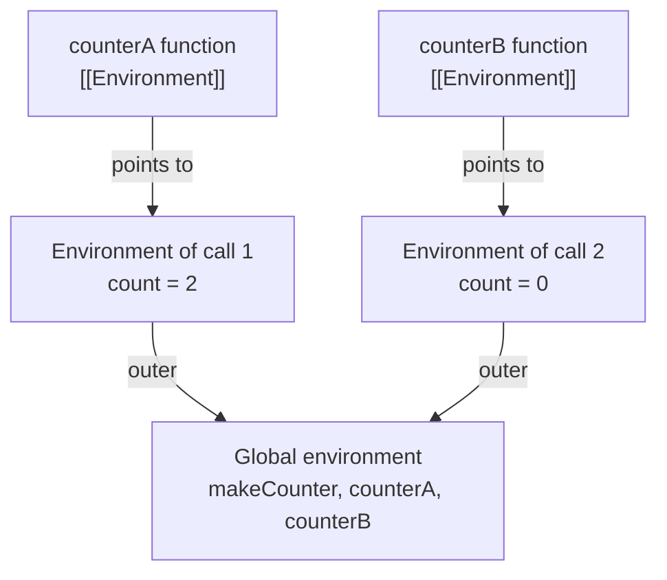
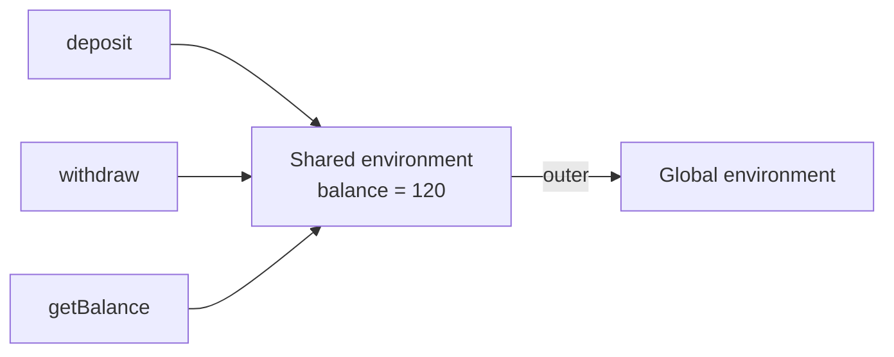
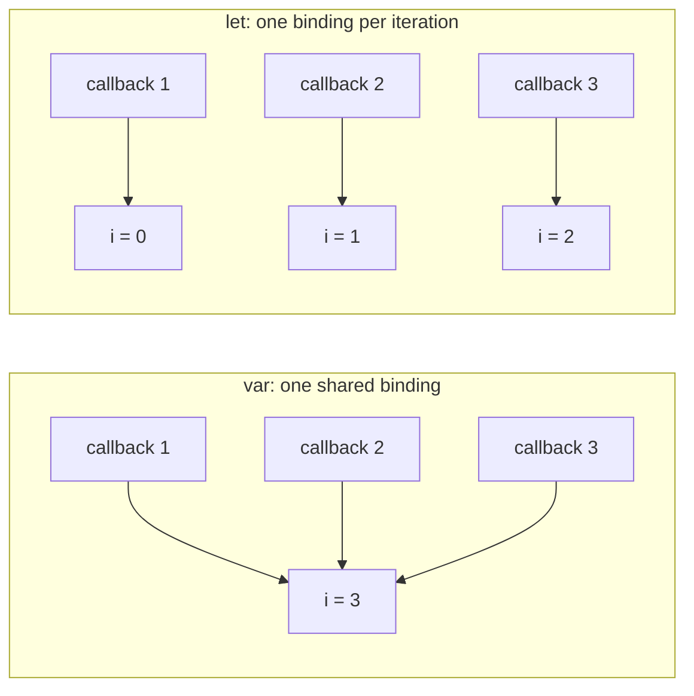
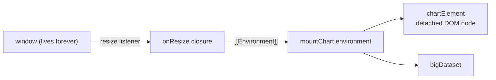

# Closures

> In this document you will learn what a closure is, how it works inside the JavaScript engine, and how closures power counters, private state, factories, `once`, memoization, debounce and middleware. Closures appear in almost every JavaScript interview, usually as output puzzles and "implement this function" tasks, so you will also practice how to explain them out loud.

**Before this:** [Scope, hoisting and TDZ](03-scope-hoisting-and-tdz.md) · [Functions and functional programming](04-functions-and-functional-programming.md) · **Interview questions:** [jump to the interview section](#interview-questions)

## Table of contents

1. [What a closure is](#what-a-closure-is)
2. [Lexical scope recap](#lexical-scope-recap)
3. [How closures work inside](#how-closures-work-inside)
4. [Classic closure patterns](#classic-closure-patterns)
5. [Several closures sharing one environment](#several-closures-sharing-one-environment)
6. [The loop and closure problem](#the-loop-and-closure-problem)
7. [Stale closures](#stale-closures)
8. [Closures and memory](#closures-and-memory)
9. [Closures vs classes vs private fields](#closures-vs-classes-vs-private-fields)
10. [Closures in real projects](#closures-in-real-projects)
11. [Advantages and disadvantages](#advantages-and-disadvantages)
12. [Common mistakes](#common-mistakes)
13. [Best practices](#best-practices)
14. [How to explain closures in an interview](#how-to-explain-closures-in-an-interview)
15. [Interview questions](#interview-questions)
16. [Summary](#summary)
17. [References](#references)

---

## What a closure is

A **closure** is a function that remembers the variables from the place where it was created. Even after the outer function has finished, the inner function can still read and change those variables.

Here is the smallest useful example:

```js
function makeGreeter(greeting) {
  // `greeting` is a local variable of makeGreeter
  return function (name) {
    return `${greeting}, ${name}!`;
  };
}

const sayHello = makeGreeter("Hello");
const sayNamaste = makeGreeter("Namaste");

console.log(sayHello("Asha"));   // Hello, Asha!
console.log(sayNamaste("Ravi")); // Namaste, Ravi!
```

What is surprising here?

- `makeGreeter("Hello")` runs and **finishes**. Normally its local variables would be gone.
- But the returned function still uses `greeting` later, when we call `sayHello("Asha")`.
- So the inner function must have "kept" `greeting` somewhere. That "keeping" is the closure.

One important detail: the closure remembers the **variable itself**, not a copy of its value. If the variable changes later, the closure sees the new value.

```js
let discount = 10;
const getDiscount = () => discount; // closure over `discount`

discount = 25;
console.log(getDiscount()); // 25, not 10
```

### Why closures exist

In JavaScript, functions are **values**. You can store them in variables, pass them to other functions, return them, and call them much later (for example, after a click or after a network response).

A function body usually needs variables from around it. If those variables disappeared when the outer function returned, every callback would break. Closures solve this: a function always keeps access to the variables of the place where it was written.

Without closures you could not write normal code like this:

```js
function setupSaveButton(button, documentId) {
  button.addEventListener("click", () => {
    saveDocument(documentId); // documentId is used long after setupSaveButton returned
  });
}
```

### Analogy: the backpack

Think of a function as a person who goes on a trip. Before leaving home (the place where the function was created), the person packs a **backpack** with the variables they may need. Wherever the person goes, they carry the backpack.

Where the analogy breaks down:

- The backpack does not hold **copies** of the variables. It holds a live connection to the original variables. If someone changes a variable at home, the person on the trip sees the change.
- Two functions created in the same function call share **one** backpack. If one function changes a variable, the other sees it.

### Is every function a closure?

Technically, yes. In the ECMAScript specification, every function object stores a reference to the environment where it was created (an internal slot called `[[Environment]]`). So every function "closes over" its surrounding scope.

In everyday talk and in interviews, people say "closure" when a function **uses outer variables** and **is used outside the place where it was created** (returned, stored, or passed as a callback). That is when closures become visible and interesting.

---

## Lexical scope recap

**Scope** is the area of code where a variable can be used. JavaScript uses **lexical scope**: the scope of a variable is decided by **where the code is written**, not by where a function is called.

```js
const level = "global";

function printLevel() {
  console.log(level); // looks in its own scope, then where it was WRITTEN
}

function run() {
  const level = "local";
  printLevel(); // called from here, but this does not matter
}

run(); // global
```

`printLevel` was written at the top level, so it sees the top-level `level`. The `level` inside `run` is invisible to it. Closures are the natural result of lexical scope: a function carries its "written-in" scope with it.

The **scope chain** is the list of scopes the engine checks when it looks up a variable: first the current function, then the function around it, and so on, until the global scope. If the name is not found anywhere, you get a `ReferenceError`.

```js
const appName = "Shop";               // global scope

function createCartService() {
  const currency = "INR";             // createCartService scope

  return function formatTotal(total) {
    const rounded = total.toFixed(2); // formatTotal scope
    // lookup order: formatTotal → createCartService → global
    return `${appName}: ${rounded} ${currency}`;
  };
}

const formatTotal = createCartService();
console.log(formatTotal(99.5)); // Shop: 99.50 INR
```

For the full story of scope, hoisting, `var`/`let`/`const` and the temporal dead zone, see [Scope, hoisting and TDZ](03-scope-hoisting-and-tdz.md).

---

## How closures work inside

To really understand closures, you need a simple model of what the engine does. This model follows the ECMAScript specification, simplified.

### Step 1: every call creates an environment

When a function is **called**, the engine creates a new **environment record**. Think of it as a small object that holds the function's local variables and parameters. It also has a link to the **outer environment**.

### Step 2: every function remembers where it was created

When a function is **created** (when the engine evaluates a function declaration, function expression or arrow function), the new function object gets a hidden reference called `[[Environment]]`. It points to the environment that was active at that moment.

### Step 3: calling a function links the environments

When you later call that function, the engine creates a fresh environment for the call. The outer link of that fresh environment is set to the function's `[[Environment]]`. This is why lookup follows the place where the function was **written**.

### Step 4: garbage collection keeps what is reachable

An environment is just data in memory. The garbage collector frees data that nothing can reach anymore. After a normal call, nothing points to the call's environment, so it is freed. But if an inner function still exists and its `[[Environment]]` points to that environment, the environment stays alive.

That is the whole secret. **A closure is not a special object.** It is a normal function plus the normal rule that memory stays alive while something still references it.

### Diagram



### Step-by-step walkthrough

```js
function makeCounter() {
  let count = 0;
  return function () {
    count = count + 1;
    return count;
  };
}

const counterA = makeCounter();
const counterB = makeCounter();

console.log(counterA()); // 1
console.log(counterA()); // 2
console.log(counterB()); // 1
```

1. The script starts. The global environment holds `makeCounter`, `counterA` and `counterB` (the last two are not initialized yet).
2. `makeCounter()` is called the first time. The engine creates **environment 1** with `count = 0`.
3. Inside, the anonymous function is created. Its `[[Environment]]` points to environment 1.
4. `makeCounter` returns that function. It is stored in `counterA`. Environment 1 stays alive, because `counterA` references it.
5. `makeCounter()` is called a second time. A **new** environment 2 is created with its own `count = 0`. The new inner function points to environment 2 and is stored in `counterB`.
6. `counterA()` runs. It creates a small environment for this call (no local variables). Lookup for `count` goes to environment 1. `count` becomes `1`. It prints `1`.
7. `counterA()` runs again. Environment 1's `count` becomes `2`. It prints `2`.
8. `counterB()` runs. Lookup goes to environment 2. Its `count` becomes `1`. It prints `1`.

Two key rules come out of this:

- **Each call of the outer function creates a new, separate set of variables.** `counterA` and `counterB` do not share `count`.
- **Functions created in the same call share the same variables.** (More in [Several closures sharing one environment](#several-closures-sharing-one-environment).)

### What engines really do (V8 detail)

The specification model says "the whole environment is kept". Real engines are smarter. V8 (the engine in Chrome, Node.js and Electron) looks at the code before running it:

- Variables that **no inner function uses** can live in a fast, temporary place (on the stack or in registers). They are thrown away when the function returns.
- Variables that **some inner function uses** are placed in a heap object called a **context**. All inner functions created in that scope share this one context object.

So in practice, a closure usually keeps only the variables that inner functions actually use. This is an optimization. You should not depend on it, and there is one surprising side effect (all closures in a scope share one context). You will see that side effect in [Closures and memory](#closures-and-memory).

A related detail: if a function contains a direct call to `eval`, the engine cannot know which variables the `eval` code will read. It then keeps all variables. This is one more reason to avoid `eval`.

### Closures capture variables, not values

This is the most important behavior to remember for output puzzles.

```js
function createMessages() {
  let text = "first";
  const read = () => text;
  text = "second";      // changed AFTER the closure was created
  return read;
}

console.log(createMessages()()); // second
```

`read` does not store the string `"first"`. It stores a link to the environment that has the variable `text`. When `read` runs, it looks up the **current** value of `text`, which is `"second"`.

---

## Classic closure patterns

These patterns come up again and again in real code and in interviews. Learn them well; many interview tasks are small variations of them.

### Counter with private state

```js
function createCounter(start = 0) {
  let count = start; // private: no code outside can touch it directly

  return {
    increment() { count += 1; return count; },
    decrement() { count -= 1; return count; },
    reset()     { count = start; return count; },
    get value() { return count; },
  };
}

const likes = createCounter();
likes.increment();
likes.increment();
console.log(likes.value);     // 2
likes.decrement();
console.log(likes.value);     // 1
console.log(likes.reset());   // 0
console.log(likes.count);     // undefined — there is no such property
```

Why this is useful: nobody can set `count` to `-500` or `"hello"` by mistake. The only way to change it is through the methods you choose to expose. This idea is called **encapsulation**.

Notice: the methods use `count` directly, not `this.count`. They do not depend on `this`, so you can pass `likes.increment` as a callback safely. (The getter `value` also works without `this`.)

### Private variables and the module pattern

Before ES modules existed (before 2015), JavaScript files shared one global scope. To keep variables private, developers used an **IIFE** (Immediately Invoked Function Expression): a function that is created and called at once. Its variables are private, and it returns only the public parts. This is called the **module pattern**.

```js
const cartModule = (function () {
  // private state
  const items = [];
  const TAX_RATE = 0.18;

  // private helper
  function subtotal() {
    return items.reduce((sum, item) => sum + item.price * item.qty, 0);
  }

  // public API
  return {
    add(name, price, qty = 1) {
      items.push({ name, price, qty });
    },
    total() {
      return Math.round(subtotal() * (1 + TAX_RATE));
    },
    count() {
      return items.length;
    },
  };
})();

cartModule.add("Keyboard", 1000);
cartModule.add("Mouse", 500, 2);
console.log(cartModule.count()); // 2
console.log(cartModule.total()); // 2360
console.log(cartModule.items);   // undefined
```

A variation is the **revealing module pattern**: you write all functions as private functions, then "reveal" some of them in the returned object (`return { add, total, count };`).

Today, ES modules give you the same privacy for free: top-level variables in a module are private unless you `export` them. You still see the module pattern in old code, in some libraries, and in interview questions. See [Modules: ESM and CommonJS](14-modules-esm-and-commonjs.md).

### Function factories

A **function factory** is a function that creates and returns other functions, each configured with its own data.

```js
function createMultiplier(factor) {
  return (value) => value * factor;
}

const double = createMultiplier(2);
const triple = createMultiplier(3);
console.log(double(5)); // 10
console.log(triple(5)); // 15
```

A more realistic factory: an API client that remembers its base URL and token.

```js
function createApiClient(baseUrl, getToken) {
  return async function request(path, options = {}) {
    const response = await fetch(`${baseUrl}${path}`, {
      ...options,
      headers: {
        ...options.headers,
        Authorization: `Bearer ${getToken()}`,
      },
    });
    if (!response.ok) throw new Error(`HTTP ${response.status} for ${path}`);
    return response.json();
  };
}

const ordersApi = createApiClient("https://api.example.com/orders", () => session.token);
// later: const order = await ordersApi("/42");
```

Each client remembers its own `baseUrl` and `getToken`. You configure once and call many times.

Another factory you will write often is a logger with a prefix:

```js
function createLogger(prefix) {
  return (message) => console.log(`[${prefix}] ${message}`);
}

const authLog = createLogger("auth");
const paymentLog = createLogger("payment");
authLog("User logged in");      // [auth] User logged in
paymentLog("Payment captured"); // [payment] Payment captured
```

### once: run a function only one time

`once(fn)` returns a new function that calls `fn` the first time and then just returns the first result again. It is useful for initialization, analytics "first view" events, or a "Pay now" handler that must not run twice.

```js
function once(fn) {
  let called = false;
  let result;

  return function (...args) {
    if (!called) {
      called = true;
      result = fn.apply(this, args); // keep `this` and arguments
    }
    return result;
  };
}

const initApp = once(() => {
  console.log("Connecting to database...");
  return { connected: true };
});

console.log(initApp()); // Connecting to database...  then { connected: true }
console.log(initApp()); // { connected: true }  (no second "Connecting")
```

The variables `called` and `result` live in the closure. Each call to `once(...)` creates its own pair of them.

Why use `function (...args)` and `fn.apply(this, args)` instead of an arrow? Because then `once` also works for methods: the caller's `this` is passed through. See [this, call, apply and bind](06-this-call-apply-bind.md).

### Memoize: cache results

**Memoization** means storing the results of a function so that the next call with the same input returns the stored result instead of computing again. The cache lives in a closure.

```js
function memoize(fn) {
  const cache = new Map(); // private cache, one per memoized function

  return function (arg) {
    if (cache.has(arg)) {
      return cache.get(arg);
    }
    const result = fn(arg);
    cache.set(arg, result);
    return result;
  };
}

let calls = 0;
const slowSquare = (n) => { calls++; return n * n; };
const fastSquare = memoize(slowSquare);

console.log(fastSquare(9)); // 81
console.log(fastSquare(9)); // 81 (from cache)
console.log(calls);         // 1
```

Notes:

- Use `cache.has(arg)` and not `if (cache.get(arg))`. Otherwise results like `0`, `""` or `undefined` would be computed again every time.
- This simple version supports one argument. A multi-argument version needs a cache key (for example `JSON.stringify(args)` for simple values) or nested maps. The full version, with multiple arguments and size limits, is in [JavaScript polyfills and implementations](../11-coding-interviews/04-javascript-polyfills-and-implementations.md).
- Memoize only **pure** functions (same input → same output, no side effects). Memoizing `getCurrentUser()` would return stale data.

### Partial application

**Partial application** means fixing some arguments of a function now and providing the rest later. A closure keeps the fixed arguments.

```js
function partial(fn, ...presetArgs) {
  return (...laterArgs) => fn(...presetArgs, ...laterArgs);
}

function calculatePrice(taxRate, discount, basePrice) {
  return basePrice * (1 - discount) * (1 + taxRate);
}

const indiaPrice = partial(calculatePrice, 0.18);     // taxRate fixed
const indiaSalePrice = partial(calculatePrice, 0.18, 0.5); // taxRate and discount fixed

console.log(indiaPrice(0, 1000));  // 1180
console.log(indiaSalePrice(1000)); // 590
```

`Function.prototype.bind` can also do partial application (`calculatePrice.bind(null, 0.18)`). Currying, `compose` and `pipe` are covered in [Functions and functional programming](04-functions-and-functional-programming.md).

---

## Several closures sharing one environment

All functions created **during the same call** share the **same** environment. When one of them changes a variable, all of them see the change.

```js
function createBankAccount(initialBalance) {
  let balance = initialBalance;

  function deposit(amount) {
    if (amount <= 0) throw new Error("Deposit must be positive");
    balance += amount;
    return balance;
  }

  function withdraw(amount) {
    if (amount > balance) throw new Error("Insufficient funds");
    balance -= amount;
    return balance;
  }

  function getBalance() {
    return balance;
  }

  return { deposit, withdraw, getBalance };
}

const account = createBankAccount(100);
account.deposit(50);
account.withdraw(30);
console.log(account.getBalance()); // 120
```

`deposit`, `withdraw` and `getBalance` are three different functions, but they all point to the same environment with one `balance`.



A second call creates a completely separate account:

```js
const savings = createBankAccount(1000);
console.log(savings.getBalance()); // 1000
console.log(account.getBalance()); // 120 (unchanged)
```

This "shared within one call, separate between calls" rule explains most closure puzzles. Ask yourself two questions:

1. **Which call created this function?** That decides which environment it uses.
2. **Is the variable shared with other functions from the same call?** If yes, changes are visible to all of them.

---

## The loop and closure problem

This is the most famous closure puzzle. You must be able to explain it step by step.

### The problem

```js
for (var i = 0; i < 3; i++) {
  setTimeout(() => {
    console.log(i);
  }, 100);
}
// Output after 100 ms:
// 3
// 3
// 3
```

Many people expect `0 1 2`. Why do we get `3 3 3`?

### Step-by-step walkthrough

1. `var i` is **function-scoped** (or global here). There is only **one** variable `i` for the whole loop.
2. Iteration 1: `i` is `0`. `setTimeout` schedules a callback. The callback is a closure over the variable `i` (not over the value `0`).
3. Iteration 2: `i` becomes `1`. A second callback is scheduled. It closes over the **same** `i`.
4. Iteration 3: `i` becomes `2`. A third callback is scheduled, same `i` again.
5. `i++` makes `i` equal to `3`. The condition `3 < 3` is false. The loop ends.
6. The synchronous code is finished. About 100 ms later, the timer callbacks run one by one (see [Event loop](16-event-loop.md)).
7. Each callback looks up `i`. There is only one `i`, and its value is now `3`. So each prints `3`.

Two separate facts create the bug:

- The callbacks run **later** (after the loop is done).
- All callbacks share **one** variable.

Changing only the first fact (for example `setTimeout(..., 0)`) does not fix it. You must give each callback its **own** variable.

The same problem happens without timers. Any function stored for later use has it:

```js
var handlers = [];
for (var i = 0; i < 3; i++) {
  handlers.push(() => i);
}
console.log(handlers[0](), handlers[1](), handlers[2]()); // 3 3 3
```

### Fix 1: use `let` (the modern fix)

```js
for (let i = 0; i < 3; i++) {
  setTimeout(() => console.log(i), 100);
}
// 0
// 1
// 2
```

Why does this work? A `let` declared in the head of a `for` loop gets **a new binding (a new variable) for each iteration**. The specification does this on purpose:

1. Before the first iteration, a new environment with `i = 0` is created.
2. The body runs. The callback closes over **this iteration's** `i`.
3. Before the next iteration, the engine creates a **new** environment and **copies** the current value of `i` into it. Then it runs `i++` on the new copy.
4. So iteration 2 has its own `i = 1`, iteration 3 has its own `i = 2`.

Each callback remembers a different variable, so each prints a different number.



Two twists that show you really understand it:

```js
// Twist 1: `let` declared OUTSIDE the loop → only one binding again
let j;
for (j = 0; j < 3; j++) {
  setTimeout(() => console.log(j));
}
// 3
// 3
// 3
```

The per-iteration copy only happens for a `let` declared **in the loop head**. Here `j` is declared once, outside.

```js
// Twist 2: changing the per-iteration variable inside the body
for (let k = 0; k < 3; k++) {
  setTimeout(() => console.log(k));
  k++;
}
// 1
// 3
```

Walkthrough: in iteration 1, `k` starts at `0`, the callback is scheduled, then `k++` makes this iteration's `k` equal to `1`. For iteration 2, the engine copies `1` into a new binding, then runs the loop's `k++` → `2`. `2 < 3`, so the body runs: a callback is scheduled, then `k++` makes it `3`. The next copy is `3`, the loop's `k++` makes `4`, and `4 < 3` is false. The two callbacks print the final values of their own bindings: `1` and `3`.

### Fix 2: an IIFE (the pre-2015 fix)

```js
for (var i = 0; i < 3; i++) {
  (function (index) {
    setTimeout(() => console.log(index), 100);
  })(i);
}
// 0 1 2
```

Each IIFE call creates a new environment with its own parameter `index`. The current value of `i` is **copied** into `index` when the IIFE is called. The callback closes over `index`, not `i`.

### Fix 3: pass the value as an extra argument

`setTimeout` (in browsers and in Node.js) passes extra arguments to the callback:

```js
for (var i = 0; i < 3; i++) {
  setTimeout((index) => console.log(index), 100, i);
}
// 0 1 2
```

The value of `i` is read **now**, when `setTimeout` is called, and passed later as `index`.

### Fix 4: `bind`

`bind` stores the arguments at the time you call it:

```js
for (var i = 0; i < 3; i++) {
  setTimeout(console.log.bind(console, i), 100);
}
// 0 1 2
```

### Fix 5: use array methods

`forEach` calls your function once per item. Each call has its own parameter, so each closure has its own variable.

```js
[0, 1, 2].forEach((index) => {
  setTimeout(() => console.log(index), 100);
});
// 0 1 2
```

### Which fix to choose

| Fix | When to use it |
| --- | --- |
| `let` in the loop head | Default choice in modern code. Clear and short. |
| Array method (`forEach`, `map`) | When you already loop over an array of items. |
| Extra argument / `bind` | When you pass an existing function and want to fix its argument. |
| IIFE | Only when you must keep `var` (very old code, old build targets). |

### The same bug in real UI code

Old jQuery or vanilla code often had this bug when attaching click handlers in a loop:

```js
// ❌ Wrong: every button alerts the last index
var buttons = document.querySelectorAll(".tab");
for (var i = 0; i < buttons.length; i++) {
  buttons[i].addEventListener("click", function () {
    showTab(i); // i is buttons.length when any click happens
  });
}

// ✅ Correct
buttons.forEach((button, index) => {
  button.addEventListener("click", () => showTab(index));
});
```

The click happens long after the loop ends, so the `var` version always sees the final value.

---

## Stale closures

A **stale closure** is a closure that keeps reading a variable from an **old** environment, so it sees old data. The closure works exactly as designed. The problem is that it captured the wrong environment for what you wanted.

Stale closures happen when a **new environment is created for each update** (for example, each render in React), but an old function keeps pointing to an earlier one.

### The idea in plain JavaScript

```js
let currentCount = 0;

function render() {
  const count = currentCount; // each render gets its OWN `count`
  return function handleClick() {
    console.log("handler sees", count);
  };
}

const firstHandler = render();
currentCount = 5;
const secondHandler = render();

firstHandler();  // handler sees 0   ← stale
secondHandler(); // handler sees 5
```

Each call to `render()` creates a new environment with its own `const count`. `firstHandler` is tied forever to the first environment. Changing `currentCount` later does not change the `count` that `firstHandler` sees, because `count` was a separate variable that got a copy of the value.

Compare this with [closures capture variables, not values](#closures-capture-variables-not-values). There is no contradiction: the closure does see the latest value **of its own variable**. But its own variable never changes. The new data went into a **new** variable in a **new** environment.

### Stale closure with setInterval

```js
function startStatusPolling(config) {
  const { endpoint } = config; // copied ONCE when polling starts
  return setInterval(() => {
    console.log("Polling", endpoint);
  }, 1000);
}

let config = { endpoint: "/api/v1/status" };
const timerId = startStatusPolling(config);
config = { endpoint: "/api/v2/status" }; // the timer still polls /api/v1/status
```

The interval callback closed over the local `endpoint` from the first call. Replacing `config` later creates a new object, but the callback does not know about it.

Fixes:

- Read the current value at the time of use. For example, pass a getter function: `startStatusPolling(() => config.endpoint)` and call it inside the callback.
- Restart the timer when the configuration changes (clear the old interval, start a new one).

### Stale closures in React hooks

In React function components, **every render is a new function call**. Every render has its own props, its own state variables, and its own event handlers. This is the classic stale closure:

```js
function Timer() {
  const [count, setCount] = useState(0);

  useEffect(() => {
    const id = setInterval(() => {
      setCount(count + 1); // ❌ Wrong: `count` is always 0 here
    }, 1000);
    return () => clearInterval(id);
  }, []); // effect runs only after the first render

  return <p>{count}</p>;
}
```

What happens:

1. First render: `count` is `0`. The effect runs and creates the interval callback. The callback closes over the first render's `count` (`0`).
2. After one second, the callback runs `setCount(0 + 1)`. The state becomes `1`.
3. React re-renders. The new render has a new `count` (`1`), but the effect does not run again (empty dependency array), so the interval still uses the old callback.
4. The old callback keeps calling `setCount(0 + 1)`. The counter is stuck at `1`.

Fixes:

```js
// ✅ Fix 1: functional update — React passes the latest state
setCount((previous) => previous + 1);

// ✅ Fix 2: list the dependency so the effect (and the closure) is recreated
useEffect(() => {
  const id = setInterval(() => setCount(count + 1), 1000);
  return () => clearInterval(id);
}, [count]);

// ✅ Fix 3: keep the latest value in a ref (a mutable box that survives renders)
const countRef = useRef(count);
countRef.current = count;
// inside the interval: console.log(countRef.current);
```

Fix 1 is usually the best. The React ESLint rule `react-hooks/exhaustive-deps` warns about missing dependencies. More in [React essentials](../05-frontend-engineering/08-react-essentials.md).

### Stale closures in Angular

Angular components are class instances. Templates and methods usually read `this.someField` at the moment they run, so they see the current value. Stale closures appear when you **copy a value into a local constant** and then use it in a long-lived callback:

```ts
@Component({ selector: "app-orders", template: "..." })
export class OrdersComponent implements OnInit {
  pageSize = 20;
  private refresh$ = new Subject<void>();

  ngOnInit(): void {
    const pageSize = this.pageSize; // ❌ copied once
    this.refresh$.subscribe(() => this.loadOrders(pageSize)); // always 20
  }

  private loadOrders(size: number): void { /* ... */ }
}
```

If the user changes `this.pageSize` to `50`, the subscription still loads 20 orders. Fixes: read `this.pageSize` inside the callback, or make page size an observable and combine it (`combineLatest([this.refresh$, this.pageSize$])`).

### How to spot a stale closure

- A callback is created **once** (on start, on first render, in `ngOnInit`) and runs **many times** later.
- It uses a value that **changes** over time.
- That value was stored in a variable that belongs to the **old** call or render.

---

## Closures and memory

### What a closure keeps alive

A closure keeps its environment alive. The environment keeps alive every object its variables point to. So a tiny function can keep a huge array, a DOM element or a whole component in memory.

```js
function createReportPrinter() {
  const rows = new Array(1_000_000).fill("row data"); // large
  return () => console.log(`Report has ${rows.length} rows`);
}

const printReport = createReportPrinter();
// `rows` stays in memory as long as `printReport` exists.
```

This is **not a leak** if you still need `printReport`. Memory that is used on purpose is fine.

A **memory leak** is memory that your program no longer needs but cannot be freed, because something long-lived still references it. With closures, the "long-lived thing" is usually:

- a **global variable** or a module-level cache,
- an **event listener** on `window`, `document` or a long-lived element,
- a **timer** (`setInterval`) that is never cleared,
- a **subscription** (RxJS, WebSocket, Node.js `EventEmitter`) that is never removed,
- a cache (`Map`) that only grows.

### Leak example: a listener added by a component

```js
function mountChart(chartElement, data) {
  const bigDataset = prepareDataset(data); // large object

  function onResize() {
    redrawChart(chartElement, bigDataset);
  }

  window.addEventListener("resize", onResize);
  // ❌ Wrong: nothing ever removes the listener
}
```

When the user leaves this part of the page, the chart element is removed from the DOM. But `window` still holds `onResize`. `onResize` holds its environment. The environment holds `chartElement` (now a **detached** DOM node: removed from the page but still in memory) and `bigDataset`. Nothing can be freed.



The fix is to remove the listener when the component goes away. Return a cleanup function (another closure):

```js
function mountChart(chartElement, data) {
  const bigDataset = prepareDataset(data);
  const onResize = () => redrawChart(chartElement, bigDataset);

  window.addEventListener("resize", onResize);

  // ✅ Correct: the caller calls this when the chart is destroyed
  return function unmount() {
    window.removeEventListener("resize", onResize); // same function reference
  };
}
```

A modern alternative uses `AbortController`. One `abort()` call removes all listeners registered with that signal:

```js
function mountChart(chartElement, data) {
  const controller = new AbortController();
  const bigDataset = prepareDataset(data);

  window.addEventListener("resize", () => redrawChart(chartElement, bigDataset), {
    signal: controller.signal,
  });
  document.addEventListener("visibilitychange", () => pauseAnimations(chartElement), {
    signal: controller.signal,
  });

  return () => controller.abort(); // removes both listeners
}
```

### Leak example: timers

```js
function startClock(element) {
  const formatter = new Intl.DateTimeFormat("en-IN", { timeStyle: "medium" });
  const id = setInterval(() => {
    element.textContent = formatter.format(new Date());
  }, 1000);
  return () => clearInterval(id); // ✅ always give a way to stop it
}
```

An interval that is never cleared keeps its callback, and everything that callback can reach, alive forever.

### Leak example: Angular subscriptions

In Angular, a subscription callback is a closure that usually captures `this` (the component). If a long-lived observable (for example, a service's `BehaviorSubject` or `interval()`) keeps the subscription, the destroyed component cannot be freed.

```ts
import { Component, DestroyRef, OnInit, inject } from "@angular/core";
import { takeUntilDestroyed } from "@angular/core/rxjs-interop";
import { interval } from "rxjs";

@Component({ selector: "app-live-price", template: "{{ price }}" })
export class LivePriceComponent implements OnInit {
  price = 0;
  private destroyRef = inject(DestroyRef);

  ngOnInit(): void {
    interval(5000)
      .pipe(takeUntilDestroyed(this.destroyRef)) // ✅ unsubscribes on destroy
      .subscribe(() => this.refreshPrice());
  }

  private refreshPrice(): void { /* ... */ }
}
```

`DestroyRef` and `takeUntilDestroyed` arrived in Angular 16 (`takeUntilDestroyed` is a developer preview there). Other options: the `async` pipe (it unsubscribes for you), or the older `takeUntil(this.destroy$)` pattern with `ngOnDestroy`. See [RxJS in Angular](../06-angular-16/09-rxjs.md).

### Surprise: closures in the same scope share one context (V8)

As explained in [what engines really do](#what-engines-really-do-v8-detail), V8 stores captured variables in **one context object per scope**, shared by all closures created there. This can keep data alive that you did not expect:

```js
function setupWidget() {
  const hugeReport = { rows: new Array(1_000_000).fill("row") };

  const logSize = () => console.log(hugeReport.rows.length); // uses hugeReport
  // logSize is never returned or stored

  return () => "tick"; // does NOT use hugeReport
}

const tick = setupWidget();
// In V8, hugeReport is still alive while `tick` exists.
```

Why? `logSize` uses `hugeReport`, so V8 puts `hugeReport` in the shared context. The returned arrow function points to the same context. So `hugeReport` stays alive, even though the function you kept never uses it. (This was checked in Node.js 22 with a `WeakRef` and a forced garbage collection: the object stayed alive. When no inner function used `hugeReport`, it was collected.)

This is engine behavior, not language behavior. The lesson is simple:

- Do not rely on the engine to free variables that are "probably unused".
- Keep long-lived closures small. Create them in a scope that does not hold big temporary data, or set the big variable to `null` when you are done with it.

### How to find closure leaks with DevTools

In Chrome DevTools (the same tools work for Node.js and Electron, which also use V8):

1. Open the **Memory** panel and take a **Heap snapshot**.
2. Do the action that you suspect leaks (open and close a dialog, navigate away and back) a few times.
3. Take a second snapshot. Choose the **Comparison** view to see which objects were added and not freed.
4. Type `Detached` in the class filter to find DOM nodes that are removed from the page but still in memory.
5. Click a suspicious object. The **Retainers** section at the bottom shows the chain of references that keeps it alive. A closure shows up as a function, and its saved variables show up as its `context`. Follow the chain until you find the long-lived root (a listener, a timer, a global, a cache).

Other helpful tools:

- In the **Sources** panel, when you pause on a breakpoint, the **Scope** section lists `Closure (functionName)` with the captured variables.
- `console.dir(someFunction)` in the Chrome console shows an internal `[[Scopes]]` entry with the captured environments.
- For Node.js: run `node --inspect app.js` and open `chrome://inspect`, or call `v8.writeHeapSnapshot()` and load the file in DevTools.

More in [Memory management and garbage collection](19-memory-management-and-garbage-collection.md) and [Debugging and code review](../11-coding-interviews/06-debugging-and-code-review.md).

---

## Closures vs classes vs private fields

You can keep private state in three main ways. Here is the same bank account written three ways.

### Version 1: closure (factory function)

```js
function createAccount(owner) {
  let balance = 0; // truly private

  return {
    owner,
    deposit(amount) { balance += amount; return balance; },
    getBalance() { return balance; },
  };
}

const a1 = createAccount("Asha");
a1.deposit(100);
console.log(a1.getBalance()); // 100
console.log(a1.balance);      // undefined
```

### Version 2: class with a private field

```js
class Account {
  #balance = 0; // truly private, enforced by the language (ES2022)

  constructor(owner) {
    this.owner = owner;
  }

  deposit(amount) { this.#balance += amount; return this.#balance; }
  getBalance() { return this.#balance; }
}

const a2 = new Account("Ravi");
a2.deposit(100);
console.log(a2.getBalance()); // 100
console.log(a2.balance);      // undefined
// a2.#balance → SyntaxError: you cannot even write this outside the class
```

### Version 3: class with a naming convention

```js
class LegacyAccount {
  constructor(owner) {
    this.owner = owner;
    this._balance = 0; // "please do not touch" — but anyone can
  }
}

const a3 = new LegacyAccount("Meera");
a3._balance = 1_000_000; // allowed: no real privacy
```

### Comparison

| Topic | Closure factory | Class with `#private` | Class with `_convention` |
| --- | --- | --- | --- |
| Real privacy at runtime | Yes | Yes | No |
| Methods shared between instances | No: each object gets new method functions | Yes: methods live on the prototype | Yes |
| Memory for 10,000 objects | Higher (methods × objects) | Lower | Lower |
| Depends on `this` | No: methods are safe to pass as callbacks | Yes: needs `bind` or an arrow wrapper when passed | Yes |
| Inheritance with `extends` | Not natural (use composition) | Natural | Natural |
| `instanceof` checks | No | Yes | Yes |
| Seen in DevTools | Under `[[Scopes]]` / closure scope | Shown as `#balance` on the object | Shown as a normal property |

TypeScript's `private` keyword is a fourth option you will see in Angular code. It is checked **only at compile time**. At runtime it is a normal property, so it is not real privacy. See [Classes](09-classes.md#private-vs-typescript-private-vs-closures).

### When to choose which

- **Closure factory:** small objects, few instances, functional style, when you want methods that never lose `this` (for example, objects passed around as callbacks), or when you return just one function.
- **Class with `#private`:** many instances, inheritance, framework code (Angular services and components are classes), or when you want `instanceof`.
- **ES module scope:** a single shared instance for the whole app. Module-level variables are private unless exported.

---

## Closures in real projects

You use closures every day, often without noticing.

### Event handlers

```js
function renderProductList(products, container) {
  for (const product of products) {
    const button = document.createElement("button");
    button.textContent = `Add ${product.name}`;
    button.addEventListener("click", () => {
      addToCart(product.id); // closure over `product` of THIS iteration
    });
    container.append(button);
  }
}
```

`for...of` with `const` creates a new binding per iteration (like `let` in a classic `for` loop), so each handler remembers its own product.

### Debounce and throttle

**Debounce** waits until the user stops doing something (for example, typing) for some time, then runs the function once. It must remember the timer between calls, so it uses a closure.

```js
function debounce(fn, delayMs) {
  let timerId; // remembered between calls

  return function (...args) {
    clearTimeout(timerId);
    timerId = setTimeout(() => fn.apply(this, args), delayMs);
  };
}

const searchInput = document.querySelector("#search");
const onSearch = debounce((event) => fetchSuggestions(event.target.value), 300);
searchInput.addEventListener("input", onSearch);
```

Each call to `debounce(...)` creates its own `timerId`. All calls of the returned function share it, so each new keystroke cancels the previous timer. **Throttle** works the same way but remembers the last run time instead. Full versions (leading/trailing options, `cancel`) are in [Debounce, throttle and performance](20-debounce-throttle-and-performance.md) and [JavaScript polyfills and implementations](../11-coding-interviews/04-javascript-polyfills-and-implementations.md).

### Express middleware factories

In Node.js with Express, a **middleware factory** is a function that takes options and returns a middleware function. The middleware is a closure over the options.

```js
function requireRole(...allowedRoles) {
  return function (req, res, next) {
    if (!req.user) return res.status(401).json({ error: "Not logged in" });
    if (!allowedRoles.includes(req.user.role)) {
      return res.status(403).json({ error: "Forbidden" });
    }
    next();
  };
}

app.delete("/api/products/:id", requireRole("admin"), deleteProduct);
app.get("/api/reports", requireRole("admin", "manager"), getReports);
```

A simple in-memory rate limiter is a closure over a `Map`:

```js
function rateLimit({ windowMs, max }) {
  const hits = new Map(); // ip -> { count, windowStart }

  return function (req, res, next) {
    const now = Date.now();
    const entry = hits.get(req.ip);

    if (!entry || now - entry.windowStart > windowMs) {
      hits.set(req.ip, { count: 1, windowStart: now });
      return next();
    }
    if (entry.count >= max) {
      return res.status(429).json({ error: "Too many requests" });
    }
    entry.count += 1;
    next();
  };
}

app.use("/api/login", rateLimit({ windowMs: 60_000, max: 5 }));
```

Be careful in production: this `Map` grows with every new IP and is never cleaned, and each server process has its own `Map`. Real systems use a shared store such as Redis. See [HTTP servers and Express](../07-nodejs-backend/06-http-servers-and-express.md) and [Caching](../07-nodejs-backend/11-caching.md).

### RxJS operator callbacks in Angular

Every arrow function you pass to an RxJS operator is a closure. It usually captures `this` (the component or service) and sometimes local variables.

```ts
@Component({ selector: "app-product-search", templateUrl: "./product-search.component.html" })
export class ProductSearchComponent {
  private productService = inject(ProductService);
  searchControl = new FormControl("", { nonNullable: true });
  maxPrice = 5000;

  results$ = this.searchControl.valueChanges.pipe(
    debounceTime(300),
    distinctUntilChanged(),
    switchMap((term) => this.productService.search(term)), // closure over `this`
    map((products) => products.filter((p) => p.price <= this.maxPrice)), // reads the current maxPrice
  );
}
```

A custom operator is a closure factory too:

```ts
function onlyCategory(category: string) {
  return (source: Observable<Product[]>) =>
    source.pipe(map((products) => products.filter((p) => p.category === category)));
}

// usage: this.products$.pipe(onlyCategory("laptops"))
```

Angular functional route guards (supported in Angular 16) are often written as factories:

```ts
export function roleGuard(role: string): CanActivateFn {
  return () => inject(AuthService).hasRole(role); // closure over `role`
}

// routes: { path: "admin", canActivate: [roleGuard("admin")], loadChildren: ... }
```

### The module pattern and ES modules

Module-level variables in an ES module behave like closure variables: functions in the module can use them, and outside code cannot (unless they are exported).

```js
// featureFlags.js (ES module)
const flags = new Map(); // private to this module

export function setFlag(name, enabled) {
  flags.set(name, enabled);
}

export function isEnabled(name) {
  return flags.get(name) ?? false;
}
```

### Node.js and Electron callbacks

```js
// Node.js: a per-request logger captured by later callbacks
function handleUpload(req, res) {
  const requestId = crypto.randomUUID();
  const log = (message) => console.log(`[${requestId}] ${message}`);

  req.on("data", (chunk) => log(`received ${chunk.length} bytes`));
  req.on("end", () => {
    log("upload finished");
    res.end("ok");
  });
}
```

```js
// Electron main process: the handler closes over the database connection
function registerIpcHandlers(db) {
  ipcMain.handle("orders:list", async () => {
    return db.query("SELECT id, total FROM orders ORDER BY id DESC LIMIT 50");
  });
}
```

---

## Advantages and disadvantages

**Advantages**

- **Real privacy.** Variables in a closure cannot be read or changed from outside.
- **State without globals.** Each factory call has its own state, so code does not collide.
- **Configuration.** Factories and partial application let you configure a function once and reuse it.
- **Natural callbacks.** Event handlers, timers and promise callbacks can use local data easily.
- **No `this` problems.** Closure-based methods do not depend on `this`, so they are safe to pass around.

**Disadvantages**

- **Memory.** Captured variables live as long as the closure. Long-lived closures can keep big objects or detached DOM nodes alive.
- **Per-object functions.** A factory creates new method functions for every object. For thousands of objects, classes are lighter.
- **Hidden state.** Private state is harder to inspect in tests and while debugging. You can only test through the public functions.
- **Stale values.** A closure created at one moment can keep reading old data.
- **Harder to read when nested deeply.** Many levels of nested callbacks are hard to follow.

### Alternatives

| Need | Alternative to a closure | When to choose it |
| --- | --- | --- |
| Private state for many objects | Class with `#private` fields | Many instances, inheritance, framework classes |
| One shared state for the app | ES module-level variables | A single instance is enough |
| Private data attached to objects | `WeakMap` keyed by the object | Data for objects you do not own, without leaks |
| Pass configuration | Plain parameters or an options object | No need to configure once and reuse |
| State across renders (React) | `useState`, `useRef` | UI state in React components |
| Values that change over time (Angular) | RxJS streams, signals | The value must stay fresh for all readers |

---

## Common mistakes

**1. Thinking a closure copies values.**

```js
let user = { name: "Asha" };
const greet = () => `Hi ${user.name}`;
user = { name: "Ravi" };
console.log(greet()); // Hi Ravi — it reads the variable when it runs
```

**2. Using `var` in loops with async callbacks.** All callbacks share one variable. Use `let` or array methods. See [The loop and closure problem](#the-loop-and-closure-problem).

**3. Expecting separate state from one factory call.**

```js
// ❌ Wrong: one counter shared by two widgets
const counter = createCounter();
widgetA.onIncrement = counter.increment;
widgetB.onIncrement = counter.increment;

// ✅ Correct: call the factory once per independent counter
const counterA = createCounter();
const counterB = createCounter();
```

**4. Creating a new function when removing a listener.**

```js
// ❌ Wrong: bind creates a NEW function each time, so removal does nothing
element.addEventListener("click", this.onClick.bind(this));
element.removeEventListener("click", this.onClick.bind(this));

// ✅ Correct: keep one reference
this.boundOnClick = this.onClick.bind(this);
element.addEventListener("click", this.boundOnClick);
element.removeEventListener("click", this.boundOnClick);
```

**5. Forgetting cleanup.** Every `addEventListener`, `setInterval`, `subscribe` or `emitter.on(...)` that lives longer than its owner needs a matching cleanup.

**6. Capturing big data in long-lived closures.** Extract only what you need:

```js
// ❌ Keeps the whole report alive as long as the button exists
const report = await fetchHugeReport();
button.onclick = () => showTitle(report.meta.title);

// ✅ Keeps only a short string alive
const { title } = (await fetchHugeReport()).meta;
button.onclick = () => showTitle(title);
```

**7. Memoizing impure functions, or using a cache that grows forever.** Add a size limit or an expiry (for example, an LRU cache; see [Map, Set, WeakMap and WeakSet](12-map-set-weakmap-weakset.md)).

---

## Best practices

- **Prefer `let`/`const` and array methods in loops.** Reason: each iteration then gets its own variable, so closures behave as you expect.
- **Always pair "subscribe" with "unsubscribe".** Return a cleanup function from setup code, or use `AbortController`, `takeUntilDestroyed`, or the `async` pipe. Reason: long-lived roots are the real source of closure leaks.
- **Keep long-lived closures small.** Capture only the data they need. Reason: everything captured stays in memory (and in V8, everything captured by any closure in the same scope).
- **Use closures for small, focused state; use classes for many instances.** Reason: closures create new functions per object; classes share methods on the prototype.
- **Read changing values at the time of use.** Inside timers and subscriptions, read from a live source (a getter, a ref, `this.field`, an observable) instead of a copied local constant. Reason: this avoids stale closures.
- **Name long-lived inner functions** (`function onResize() {}` instead of an anonymous arrow). Reason: names show up in stack traces and heap snapshots, so debugging is easier.
- **Limit caches.** Give memoization caches and per-key maps a maximum size or an expiry. Reason: an unlimited `Map` inside a closure is a slow leak.

---

## How to explain closures in an interview

1. **Define it:** "A closure is a function together with the variables from the scope where it was created. The function can still use those variables after the outer function has returned."
2. **Why it exists:** "Functions in JavaScript are values. We pass them around and call them later, for example in event handlers and timers. They need their surrounding variables at that later time, so the language keeps them."
3. **How it works:** "When a function is created, it stores a hidden reference to its surrounding environment. When the outer function returns, that environment is not garbage collected, because the inner function still references it. The closure holds the variable itself, not a copy of the value."
4. **Small example:** "A `createCounter` function has `let count = 0` and returns a function that does `count++`. Each call to `createCounter` creates a separate `count`, and only the returned function can change it."
5. **Where it is useful:** "Private state and the module pattern, function factories, `once` and memoize, debounce and throttle, event handlers, Express middleware factories, and every callback we pass to RxJS operators in Angular."
6. **Trade-offs / gotchas:** "The classic bug is `var` in a loop with `setTimeout`: it prints the final value because all callbacks share one variable, and `let` fixes it with a new binding per iteration. Closures also keep memory alive, so long-lived listeners and timers must be cleaned up. In React, closures can become stale if they capture an old render's state."

---

## Interview questions

### Q1. What is a closure?

**What the interviewer is checking:** Whether you can define a closure clearly, explain *why* it exists, and give a real use, instead of reciting "a function inside a function".

**Short spoken answer (30–60 seconds):**
> A closure is a function that remembers the variables from the scope where it was created. Even after the outer function has returned, the inner function can still read and update those variables. It exists because in JavaScript we pass functions around and call them later — in event handlers, timers, promise callbacks — and they still need their surrounding data. A simple example is a `createCounter` function with a local `count` that returns a function doing `count++`. Each call to `createCounter` gets its own private `count`. We use closures for private state, function factories, memoization, debounce, and middleware factories. The main thing to watch is memory: whatever the closure captures stays alive as long as the closure is alive.

**Detailed explanation:**
Every function object stores a hidden reference to the environment where it was created. When the outer function returns, its environment is normally garbage collected. But if an inner function that is still reachable references that environment, the garbage collector keeps it. The closure keeps the *variable binding*, not a snapshot of the value, so later changes are visible.

**Code:**

```js
function createCounter() {
  let count = 0;
  return () => ++count;
}

const next = createCounter();
console.log(next()); // 1
console.log(next()); // 2
```

**Follow-up questions:**
- **Does a closure copy the variable's value?** — No. It keeps a reference to the variable. If the variable changes after the closure is created, the closure sees the new value.
- **When is a closure created?** — Every time a function is created (when the function expression or declaration is evaluated). Each call of the outer function creates new inner functions and a new environment.
- **Is a function that uses only global variables a closure?** — Technically yes, every function closes over its scope. But in practice we use the word when a function uses variables of an outer *function* and outlives that call.
- **Name three places you used closures at work.** — For example: an Express `requireRole("admin")` middleware factory, a `debounce` wrapper for a search box, and arrow callbacks in RxJS `map` and `switchMap` that read `this` from an Angular component.

**Common mistakes:** Saying "a closure is a function inside another function" (that is nesting, not the key idea). Saying the closure "copies" variables. Not mentioning that the outer function has already returned.

**Where this is used in real projects:** Event handlers, debounce/throttle, memoization caches, middleware factories, React hooks, RxJS callbacks, the module pattern.

---

### Q2. How do closures work internally? Where are the captured variables stored?

**What the interviewer is checking:** Whether you understand environments, the `[[Environment]]` reference and garbage collection, and not just the surface behavior.

**Short spoken answer (30–60 seconds):**
> Every time a function is called, the engine creates an environment record for its local variables, with a link to the outer environment. When a function is created, it stores a hidden reference — `[[Environment]]` in the spec — to the environment it was created in. When you call it later, its new environment links to that saved one, which is why lookup follows where the code was written. Environments are just objects in memory, so as long as some function still references one, the garbage collector keeps it. In V8, variables used by inner functions are put in a heap "context" object, and all closures from the same scope share that context. Variables that no inner function uses can be dropped.

**Detailed explanation:**
- **Spec model:** environment records + outer links + `[[Environment]]` slot on each function. Lookup walks the chain.
- **Engine model (V8):** before running, V8 analyzes which variables inner functions use. Those are context-allocated on the heap; the rest stay on the stack. All closures created in one scope share one context object. A direct `eval` forces the engine to keep everything.
- **Garbage collection:** the environment is freed when no reachable function references it.

**Code or diagram:** see the diagram in [How closures work inside](#how-closures-work-inside).

**Follow-up questions:**
- **Do two functions returned from the same call share variables?** — Yes. They point to the same environment, so a change made by one is visible to the other.
- **Can a closure keep a variable alive that it does not use?** — In the spec model, the whole environment is kept. In V8, if *another* closure from the same scope uses that variable, it is in the shared context and stays alive. So yes, it can happen.
- **Is the closure stored on the stack or the heap?** — Captured variables must outlive the call, so engines store them on the heap. Only non-captured locals can live on the stack.

**Common mistakes:** Saying "the function copies its outer variables into itself". Claiming closures are a special object type you create on purpose.

**Where this is used in real projects:** Understanding this helps you debug memory leaks in heap snapshots, where closure variables appear as the function's `context`.

---

### Q3. What does this print?

```js
for (var i = 0; i < 3; i++) {
  setTimeout(() => console.log(i), 0);
}
```

**What the interviewer is checking:** The difference between `var` and `let` scoping, that closures capture variables, and that timer callbacks run after the synchronous loop.

**Answer:**

```text
3
3
3
```

**Short spoken answer (30–60 seconds):**
> It prints 3 three times. `var` is function-scoped, so the whole loop has only one `i`. Each arrow function closes over that same variable. The `setTimeout` callbacks run only after the loop has finished, and at that point `i` is 3 — the value that made the condition false. So all three callbacks read 3.

**Step by step:**
1. The loop runs synchronously. It schedules three timer callbacks. All three close over the single `i`.
2. After the last `i++`, `i` is `3`. `3 < 3` is false, so the loop stops.
3. The call stack becomes empty. The event loop runs the timer callbacks.
4. Each callback reads the same `i`, which is `3`.

**Follow-up questions:**
- **What if the delay is `0`? Does it run immediately?** — No. Even with `0`, the callback is a task that runs after the current synchronous code finishes. See [Event loop](16-event-loop.md).
- **What if we change the loop to `i <= 3`?** — It prints `4` four times.
- **Does the same happen without `setTimeout`?** — Yes, with any function stored for later: pushing `() => i` into an array and calling them after the loop gives `3, 3, 3`.

**Common mistakes:** Answering `0 1 2`. Explaining it only as "because of the event loop" without mentioning the single shared variable.

**Where this is used in real projects:** Old code that attaches click handlers inside a `var` loop has exactly this bug.

---

### Q4. How do you fix the previous loop? Why does `let` fix it?

**What the interviewer is checking:** Whether you know several fixes and the actual reason `let` works (a new binding per iteration).

**Short spoken answer (30–60 seconds):**
> The modern fix is to use `let` in the loop head. For `let`, the language creates a new binding of `i` for every iteration. Before each new iteration, it copies the current value into a fresh variable and then increments that. So each callback closes over its own `i`, and we get 0, 1, 2. Older fixes are an IIFE that takes `i` as a parameter, passing `i` as the third argument of `setTimeout`, or using `bind`. All of them work for the same reason: each callback gets its own variable instead of sharing one.

**Code:**

```js
// 1. let — new binding per iteration
for (let i = 0; i < 3; i++) setTimeout(() => console.log(i), 0);

// 2. IIFE — the parameter is a new variable per call
for (var i = 0; i < 3; i++) {
  ((index) => setTimeout(() => console.log(index), 0))(i);
}

// 3. extra setTimeout argument — value read now, passed later
for (var i = 0; i < 3; i++) setTimeout((index) => console.log(index), 0, i);

// 4. bind — arguments stored at bind time
for (var i = 0; i < 3; i++) setTimeout(console.log.bind(console, i), 0);

// 5. forEach — each callback call has its own parameter
[0, 1, 2].forEach((index) => setTimeout(() => console.log(index), 0));
```

Each version prints `0`, `1`, `2`.

**Follow-up questions:**
- **If I declare `let i` before the loop and write `for (i = 0; ...)`, does it still work?** — No. The per-iteration copy only happens for `let` declared in the loop head. With one outer `let i`, it prints `3 3 3`.
- **Does `const` work in a classic `for` loop?** — Not with `i++`, because you cannot reassign a `const` (TypeError after the first iteration). `const` works in `for...of` and `for...in`, where each iteration gets a fresh binding anyway.
- **Is creating a binding per iteration slow?** — Engines optimize it well. In real code the difference is not measurable; correctness is more important.

**Common mistakes:** Saying "`let` is block-scoped, so it works" without explaining that the loop creates a *new* binding each iteration (a block-scoped variable declared once would still be shared).

**Where this is used in real projects:** Rendering lists of buttons, scheduling retries, creating per-item handlers.

---

### Q5. What does this print?

```js
function createCounter() {
  let count = 0;
  return () => ++count;
}

const a = createCounter();
const b = createCounter();
a();
a();
console.log(a(), b());
```

**Answer:** `3 1`

Each call to `createCounter` creates its own `count`. `a` was called twice before the log, so the third call returns `3`. `b` has its own `count`, so its first call returns `1`.

---

### Q6. What does this print?

```js
function setup() {
  let status = "loading";
  const getStatus = () => status;
  status = "ready";
  return getStatus;
}

console.log(setup()());
```

**Answer:** `ready`

The closure holds the variable `status`, not the value it had when the closure was created. By the time `getStatus` runs, `status` is `"ready"`.

---

### Q7. What does this print?

```js
for (let k = 0; k < 3; k++) {
  setTimeout(() => console.log(k));
  k++;
}
```

**What the interviewer is checking:** A precise understanding of how per-iteration bindings are copied.

**Answer:**

```text
1
3
```

**Step by step:**
1. Iteration 1: binding `k = 0`. A callback is scheduled for this binding. `k++` in the body makes this binding `1`.
2. Before iteration 2, a new binding is created and gets the copied value `1`. The loop's `k++` makes it `2`. `2 < 3` is true.
3. Iteration 2: a callback is scheduled for this binding. The body's `k++` makes it `3`.
4. A new binding gets `3`, the loop's `k++` makes it `4`. `4 < 3` is false. The loop ends.
5. The callbacks run. The first reads binding 1 (value `1`), the second reads binding 2 (value `3`).

**Follow-up questions:**
- **How many callbacks were scheduled?** — Two, because the body ran only twice.
- **What would `var` print here?** — `4` and `4`: one shared variable whose final value is `4`.

**Common mistakes:** Assuming each callback "freezes" the value at scheduling time. It does not; it sees the final value of its own iteration's binding.

---

### Q8. What does this print?

```js
function createStore() {
  let value = 0;
  return {
    increment: () => ++value,
    read: () => value,
  };
}

const store1 = createStore();
const store2 = createStore();
store1.increment();
store1.increment();
store2.increment();
console.log(store1.read(), store2.read());
```

**Answer:** `2 1`

`increment` and `read` from the same call share one `value`. `store1` and `store2` come from different calls, so they have different `value` variables.

---

### Q9. What does this print?

```js
var fns = [];
for (var i = 0; i < 3; i++) {
  fns.push(((j) => () => j * 10)(i));
}
fns.push(() => i * 10);
console.log(fns.map((fn) => fn()));
```

**Answer:** `[ 0, 10, 20, 30 ]`

**Step by step:**
1. In each iteration, the outer arrow `(j) => ...` is called immediately with the current `i`. Each call creates a new `j` (0, then 1, then 2) and returns a closure over that `j`.
2. After the loop, `i` is `3`.
3. The last pushed function closes over the shared `var i`, so it returns `3 * 10 = 30`.

---

### Q10. What does this print?

```js
let x = 1;

function outer() {
  let x = 2;
  return function inner() {
    x++;
    return x;
  };
}

const f = outer();
console.log(f(), f(), x);
```

**Answer:** `3 4 1`

`inner` uses the closest `x`, which is the `x` inside `outer` (it **shadows** the global `x`). The first call makes it `3`, the second `4`. The global `x` is a different variable and stays `1`.

---

### Q11. Implement `once(fn)`.

**What the interviewer is checking:** Using closure state correctly, keeping the first result, and passing `this` and arguments through.

**Short spoken answer (30–60 seconds):**
> `once` returns a wrapper function. In the closure I keep two variables: a `called` flag and the first `result`. When the wrapper runs the first time, it sets the flag, calls the original with the same `this` and arguments using `apply`, and stores the result. Every later call just returns the stored result. I use a regular function for the wrapper, not an arrow, so that it also works as a method. A typical use is an initialization function or a payment button handler that must never run twice.

**Code:**

```js
function once(fn) {
  let called = false;
  let result;

  return function (...args) {
    if (!called) {
      called = true;          // set BEFORE calling, so re-entrant calls do not run fn again
      result = fn.apply(this, args);
    }
    return result;
  };
}

const pay = once((amount) => {
  console.log(`Charging ${amount}`);
  return "payment-123";
});

console.log(pay(500)); // Charging 500   then payment-123
console.log(pay(500)); // payment-123
```

**Follow-up questions:**
- **What if `fn` throws the first time?** — With this version, `called` is already `true`, so later calls return `undefined` and never retry. If you want a retry after failure, set `called = true` only after `fn` succeeds, or reset it in a `catch` block.
- **How would you free memory after the first call?** — Set `fn = null` after calling it (a parameter can be reassigned like a `let` variable), so the original function and anything it captured can be garbage collected.
- **How would you make it work for async functions?** — The same code works: the first call stores the promise, and later calls return the same promise. If the promise rejects and you want retries, reset the state in a `.catch`.
- **Why not use an arrow function for the wrapper?** — Arrow functions do not have their own `this`, so `obj.method = once(fn)` would lose `obj` as `this`.

**Common mistakes:** Storing the flag outside the factory (shared by all `once` wrappers). Using `if (!result)` instead of a separate flag (fails when the result is falsy). Forgetting to return the cached result.

**Where this is used in real projects:** Lazy initialization of SDKs, one-time analytics events, preventing double form submission, `{ once: true }` in `addEventListener` (the browser's built-in version for listeners).

---

### Q12. Implement a counter with `increment`, `decrement`, `reset` and `getValue`, where the count cannot be changed from outside.

**What the interviewer is checking:** Encapsulation with closures and clean API design.

**Short spoken answer (30–60 seconds):**
> I write a factory `createCounter` that takes an initial value and a step. The count is a local `let` variable, so it lives only in the closure. The factory returns an object with four methods that read and change that variable. Nothing else can reach it — `counter.count` is just `undefined`. Each factory call creates an independent counter. Because the methods do not use `this`, I can pass them directly as callbacks, for example as a button click handler.

**Code:**

```js
function createCounter({ initial = 0, step = 1 } = {}) {
  let count = initial;

  return Object.freeze({
    increment: () => (count += step),
    decrement: () => (count -= step),
    reset: () => (count = initial),
    getValue: () => count,
  });
}

const cartItems = createCounter({ step: 1 });
cartItems.increment();
cartItems.increment();
cartItems.decrement();
console.log(cartItems.getValue()); // 1
cartItems.count = 99;              // frozen object: ignored in sloppy mode, TypeError in strict mode
console.log(cartItems.getValue()); // 1 (the real count is in the closure anyway)
console.log(cartItems.reset());    // 0
```

**Follow-up questions:**
- **Why `Object.freeze` on the returned object?** — So nobody can replace the methods (for example `cartItems.increment = () => 1000`). It protects the API, while the count itself is already private.
- **How would you add a minimum value of 0?** — In `decrement`: `count = Math.max(minimum, count - step)`.
- **How would you notify listeners on change?** — Keep a `Set` of listener functions in the closure, add `subscribe(fn)` that returns an unsubscribe function, and call all listeners after each change.
- **How is this different from a class with `#count`?** — Both are truly private. The class shares methods on the prototype (less memory for many instances), but its methods depend on `this`. The closure version creates new functions per counter but never loses `this`.

**Common mistakes:** Returning `count` as a property (`return { count, increment }`): that copies the number once and it never updates. Using `this.count`, which makes the value public.

**Where this is used in real projects:** Small stores, retry counters, rate limit counters, UI widgets.

---

### Q13. Implement `memoize(fn)`.

**What the interviewer is checking:** Closure-held caches, cache keys, correctness with falsy results, and awareness of memory growth.

**Short spoken answer (30–60 seconds):**
> `memoize` returns a wrapper that keeps a `Map` in its closure. When the wrapper is called, it builds a key from the arguments. If the key is in the cache, it returns the stored result. Otherwise it calls the original function, stores the result and returns it. I use `cache.has` rather than checking the value, so results like 0 or undefined are cached too. For multiple primitive arguments, I build a key with `JSON.stringify`. In production I would also limit the cache size, because an unlimited cache inside a closure is a memory leak. And I only memoize pure functions.

**Code:**

```js
function memoize(fn, { getKey = (args) => JSON.stringify(args) } = {}) {
  const cache = new Map();

  return function (...args) {
    const key = getKey(args);
    if (cache.has(key)) return cache.get(key);
    const result = fn.apply(this, args);
    cache.set(key, result);
    return result;
  };
}

let computeCount = 0;
const shippingCost = memoize((weightKg, zone) => {
  computeCount++;
  return weightKg * (zone === "metro" ? 40 : 70);
});

console.log(shippingCost(2, "metro")); // 80
console.log(shippingCost(2, "metro")); // 80 (cached)
console.log(shippingCost(2, "rural")); // 140
console.log(computeCount);             // 2
```

**Follow-up questions:**
- **What is wrong with `JSON.stringify` as a key?** — Different objects with the same content get the same key; functions and `undefined` disappear; key order matters (`{a:1,b:2}` vs `{b:2,a:1}`); it is slow for large inputs. For object arguments, use a `WeakMap` keyed by the object identity.
- **How do you stop the cache from growing forever?** — Use an LRU cache (a `Map` where you delete the oldest entry when the size passes a limit), or add an expiry time per entry.
- **How do you memoize an async function?** — Cache the promise, not the result, so parallel calls share one request. Delete the entry if the promise rejects, so a failure is not cached forever.
- **Can recursive functions benefit?** — Yes, if the recursive calls go through the memoized version (for example `const fib = memoize((n) => n < 2 ? n : fib(n - 1) + fib(n - 2))`).

**Common mistakes:** `if (cache[key])` (falsy results are recomputed); using a plain object as cache with keys like `"__proto__"`; memoizing impure functions; ignoring memory growth.

**Where this is used in real projects:** Expensive selectors (NgRx `createSelector` and Reselect memoize the last result), formatting functions, Angular pure pipes (which cache per input), API request de-duplication. The full version with LRU is in [JavaScript polyfills and implementations](../11-coding-interviews/04-javascript-polyfills-and-implementations.md).

---

### Q14. Implement a private bank account using closures.

**What the interviewer is checking:** Encapsulation, validation (protecting invariants), and not leaking private data through references.

**Short spoken answer (30–60 seconds):**
> I write a `createBankAccount` factory. The balance and the transaction history are local variables, so only the returned methods can reach them. `deposit` and `withdraw` validate the amount and protect the rule that the balance can never go negative. One subtle point: if I return the history array directly, a caller could push fake transactions into it. So `getHistory` returns a copy. This gives real privacy at runtime, unlike TypeScript's `private` keyword.

**Code:**

```js
function createBankAccount(owner, openingBalance = 0) {
  let balance = openingBalance;
  const history = [];

  function record(type, amount) {
    history.push({ type, amount, balanceAfter: balance, at: new Date().toISOString() });
  }

  return {
    owner,
    deposit(amount) {
      if (!Number.isFinite(amount) || amount <= 0) throw new RangeError("Invalid amount");
      balance += amount;
      record("deposit", amount);
      return balance;
    },
    withdraw(amount) {
      if (!Number.isFinite(amount) || amount <= 0) throw new RangeError("Invalid amount");
      if (amount > balance) throw new Error("Insufficient funds");
      balance -= amount;
      record("withdraw", amount);
      return balance;
    },
    getBalance: () => balance,
    getHistory: () => history.map((entry) => ({ ...entry })), // copies, not the real array
  };
}

const account = createBankAccount("Asha", 1000);
account.deposit(500);
account.withdraw(200);
console.log(account.getBalance());        // 1300
console.log(account.getHistory().length); // 2

account.getHistory().push({ type: "fake", amount: 1e9 });
console.log(account.getHistory().length); // 2 (the real history is safe)

try {
  account.withdraw(5000);
} catch (error) {
  console.log(error.message); // Insufficient funds
}
```

**Follow-up questions:**
- **How would you write this with a class?** — Use `#balance` and `#history` private fields and the same methods. Methods then live on the prototype and are shared.
- **Why store money as a plain number here?** — For a real system, store integer minor units (paise/cents) to avoid floating-point errors. See [Strings, numbers and dates](11-strings-numbers-and-dates.md).
- **Is the `owner` property private?** — No. It was copied into the returned object as a normal property, so callers can change it. If it must be read-only, use a getter or `Object.freeze` on the returned object.

**Common mistakes:** Returning the internal array or object (callers can mutate private state through the reference). Missing validation. Putting `balance` on the returned object.

**Where this is used in real projects:** Any module that must protect invariants — a cart, a wallet, a session store, a token cache.

---

### Q15. What is a stale closure? How do you fix it?

**What the interviewer is checking:** Real-world closure experience, usually with React hooks, timers or subscriptions.

**Short spoken answer (30–60 seconds):**
> A stale closure is a callback that keeps reading a variable from an old scope, so it sees old data. It happens when the callback is created once but the data lives in a new variable each time — the classic case is React, where every render has its own state variables. If a `setInterval` created in a `useEffect` with an empty dependency array uses `count`, it always sees the `count` of the first render. Fixes are: use a functional update like `setCount(c => c + 1)`, add the variable to the dependency array so the closure is recreated, or read from a ref. The same idea applies elsewhere: read the latest value at the time of use instead of capturing a copy.

**Detailed explanation:**
The closure is not broken; it correctly reads its own variable. The issue is that new data goes into *new* variables (a new render, a new function call), and the old callback still points to the old one.

**Code:**

```js
let currentCount = 0;
function render() {
  const count = currentCount;
  return () => count;
}
const oldHandler = render();
currentCount = 5;
console.log(oldHandler()); // 0 — stale
console.log(render()());   // 5
```

**Follow-up questions:**
- **Why does `setCount(c => c + 1)` fix it?** — The callback no longer reads `count` from the closure. React passes the latest state into the updater function.
- **Can stale closures happen in Angular?** — Less often, because component state is read through `this` at call time. It happens when you copy `this.value` into a local `const` and use it inside a long-lived subscription, or in `setTimeout` callbacks with captured locals.
- **What does `useCallback` have to do with it?** — `useCallback` keeps the same function between renders. If you forget a dependency, that cached function is a stale closure.

**Common mistakes:** Saying "the closure did not update" without explaining that each render creates new variables. Disabling the lint rule instead of fixing dependencies.

**Where this is used in real projects:** Timers in React components, WebSocket handlers registered once, event listeners added in `ngOnInit` that use copied values.

---

### Q16. Can closures cause memory leaks? How do you find and fix them?

**What the interviewer is checking:** Understanding of reachability, typical leak sources, and practical debugging skills.

**Short spoken answer (30–60 seconds):**
> A closure itself is not a leak, but it keeps its captured variables alive as long as the closure is reachable. The leak happens when a long-lived object holds a closure we no longer need — a listener on `window`, a `setInterval` that is never cleared, an RxJS subscription that is never unsubscribed, or a cache that only grows. Then the closure keeps big data or detached DOM nodes alive. To find it, I take heap snapshots in Chrome DevTools before and after repeating the action, compare them, filter for detached nodes, and follow the retainers chain to the listener or timer. To fix it, I remove listeners with the same function reference or with an `AbortController`, clear timers, and in Angular use `takeUntilDestroyed` or the `async` pipe.

**Detailed explanation:**
Garbage collection is based on **reachability** from roots (global object, active stack, active timers and listeners). A closure is reachable if a root can reach it, and then everything in its environment is reachable too. In V8, closures created in the same scope share one context, so one closure can keep variables alive that only another closure used.

**Code:**

```js
// ❌ Leak: the interval keeps `cache` and the element alive forever
function startWidget(element) {
  const cache = new Map();
  setInterval(() => {
    element.textContent = String(cache.size);
  }, 1000);
}

// ✅ Fix: return a cleanup function
function startWidgetSafe(element) {
  const cache = new Map();
  const id = setInterval(() => {
    element.textContent = String(cache.size);
  }, 1000);
  return () => clearInterval(id);
}
```

**Follow-up questions:**
- **Is a cycle between a closure and an object a leak?** — No. Modern garbage collectors are mark-and-sweep based, so unreachable cycles are collected. Only *reachable* unneeded data leaks.
- **Why does removing the DOM element not free the closure?** — If `window` or another live object still holds the listener, the listener's closure still references the element.
- **How do you check for leaks in Node.js?** — Watch `process.memoryUsage().heapUsed` over time, take heap snapshots with `node --inspect` or `v8.writeHeapSnapshot()`, and compare them.

**Common mistakes:** Saying "closures always leak" or "set everything to null". Not knowing how to use heap snapshots.

**Where this is used in real projects:** Single-page apps where users open and close many views, long-running Node.js servers, Electron apps that stay open for days.

---

### Q17. Find the bug: the scroll listener is never removed.

```js
class InfiniteList {
  constructor(container) {
    this.container = container;
  }
  onScroll() {
    if (this.container.scrollTop > 1000) this.loadMore();
  }
  mount() {
    window.addEventListener("scroll", this.onScroll.bind(this));
  }
  unmount() {
    window.removeEventListener("scroll", this.onScroll.bind(this));
  }
  loadMore() { /* ... */ }
}
```

**What the interviewer is checking:** That `bind` creates a new function each time, and that removal requires the same reference.

**Answer:** Each call to `bind` returns a **new** function. `removeEventListener` receives a different function than the one that was added, so nothing is removed. The listener (a closure over `this`) keeps the whole `InfiniteList` and its container alive and keeps running after unmount.

**Fix:**

```js
class InfiniteList {
  constructor(container) {
    this.container = container;
    this.onScroll = this.onScroll.bind(this); // bind once, keep the reference
  }
  onScroll() {
    if (this.container.scrollTop > 1000) this.loadMore();
  }
  mount() {
    window.addEventListener("scroll", this.onScroll);
  }
  unmount() {
    window.removeEventListener("scroll", this.onScroll);
  }
  loadMore() { /* ... */ }
}
```

Other fixes: a class field arrow (`onScroll = () => { ... }`), or an `AbortController` whose `abort()` is called in `unmount`.

**Follow-up questions:**
- **What does `this` point to if you do not bind at all?** — Inside a DOM listener written as a normal function, `this` is the element the listener is attached to (`event.currentTarget`), here `window`. So `this.container` would be `undefined`. See [this, call, apply and bind](06-this-call-apply-bind.md).

---

### Q18. Scenario: a rate limiter blocks searches after a few failed logins. Why?

```js
const limiter = rateLimit({ windowMs: 60_000, max: 5 });
app.use("/api/login", limiter);
app.use("/api/search", limiter);
```

**What the interviewer is checking:** Understanding that one factory call means one shared closure state.

**Answer:** `rateLimit(...)` was called **once**, so there is **one** `hits` map in **one** closure. Both routes use the same middleware function and therefore the same counters. Login attempts and searches from the same IP add up together. Fix: call the factory once per route (or per policy):

```js
app.use("/api/login", rateLimit({ windowMs: 60_000, max: 5 }));
app.use("/api/search", rateLimit({ windowMs: 60_000, max: 100 }));
```

**Follow-up questions:**
- **What other problems does an in-memory closure limiter have?** — The map grows with every IP and needs cleanup; and with several server instances (cluster, Kubernetes), each process has its own map, so the real limit is multiplied. Use a shared store like Redis. See [Caching](../07-nodejs-backend/11-caching.md).

---

### Q19. Closures or classes with `#private` fields for private state — which do you choose?

**What the interviewer is checking:** Trade-off thinking: memory, `this`, inheritance, tooling, team conventions.

**Short spoken answer (30–60 seconds):**
> Both give real runtime privacy. With a closure factory, each object gets its own copies of the methods, which costs more memory for many instances, but the methods never depend on `this`, so they are safe to pass as callbacks. With a class and `#private` fields, methods are shared on the prototype, I get `instanceof` and inheritance, and it fits frameworks like Angular where services and components are classes. So for a few objects or a functional codebase I like closures; for many instances, inheritance or framework code I use classes. TypeScript `private` is only a compile-time check, so it is not real privacy.

**Follow-up questions:**
- **How much more memory does the closure approach use?** — Each object holds its own function objects for every method plus its environment. With 3 methods and 10,000 objects, that is 30,000 function objects instead of 3 shared ones. It matters only at large scale.
- **Can subclasses access `#private` fields of the parent?** — No. `#private` is visible only inside the class body that declares it. Subclasses must use public or protected-by-convention methods.
- **What about `WeakMap` for privacy?** — Before `#private`, a module-level `WeakMap` keyed by the instance was a common way to store private data per object without leaks.

**Common mistakes:** Claiming `_name` is private. Claiming TypeScript `private` protects data at runtime.

**Where this is used in real projects:** Angular services (classes), small utility modules (closures), library internals (`#private` or `WeakMap`).

---

### Q20. What is the module pattern? Is it still relevant?

**What the interviewer is checking:** History of JavaScript modularity and understanding closures as the mechanism behind it.

**Short spoken answer (30–60 seconds):**
> The module pattern uses an IIFE — a function that runs immediately — to create a private scope. Variables inside are private, and the function returns an object with only the public methods, which close over the private variables. Before ES modules, all scripts shared one global scope, so this was the main way to avoid global name collisions and hide internals. Today ES modules give each file its own scope, so the pattern is mostly seen in legacy code and in library bundles. But it is still a great example of closures, and the idea — expose a small public API and hide the rest — is exactly what modules do.

**Code:**

```js
const authStore = (function () {
  let token = null;
  return {
    login(newToken) { token = newToken; },
    logout() { token = null; },
    isLoggedIn: () => token !== null,
  };
})();

authStore.login("abc");
console.log(authStore.isLoggedIn()); // true
console.log(authStore.token);        // undefined
```

**Follow-up questions:**
- **What is the revealing module pattern?** — You write all functions as private functions and return an object that maps public names to some of them: `return { login, logout, isLoggedIn };`.
- **Why are there parentheses around the function?** — So the parser treats it as a function *expression*, which can be called immediately. A statement starting with `function` would be a declaration, and `function () {}()` is a syntax error.

---

### Q21. Implement `sum` so that `sum(1)(2)(3)()` returns `6`.

**What the interviewer is checking:** Closures that accumulate state across calls.

**Answer:** Each call returns a new function that remembers the running total. Calling with no argument ends the chain.

```js
function sum(a) {
  return function next(b) {
    if (b === undefined) return a;
    return sum(a + b);
  };
}

console.log(sum(1)(2)(3)());    // 6
console.log(sum(10)(-5)());     // 5
console.log(sum(4)());          // 4
```

Each call creates a new closure with a new `a`, so partial chains can be reused safely: `const plus10 = sum(10); plus10(1)(); plus10(2)();` returns `11` and `12`. More currying patterns are in [Functions and functional programming](04-functions-and-functional-programming.md).

---

### Q22. Is every function a closure? Do arrow functions create closures?

**Answer:** Technically, every function in JavaScript stores a reference to the environment where it was created, so every function is a closure — arrow functions, function declarations and methods alike. Arrow functions additionally take `this`, `arguments`, `super` and `new.target` from the surrounding scope, which is also lexical lookup. In interviews, "closure" usually means a function that uses outer variables after the outer function has returned. One small exception: functions created with `new Function("...")` close over the **global** scope only, not the scope where they were created.

---

### Q23. What does this print?

```js
const callbacks = [];
for (let i = 0; i < 3; i++) {
  const item = { id: i };
  callbacks.push(() => item.id);
  item.id = i * 100;
}
console.log(callbacks.map((cb) => cb()));
```

**Answer:** `[ 0, 100, 200 ]`

Each iteration has its own `item` (block-scoped `const`). Each closure holds its own `item`. The object is changed after the closure is created (`item.id = i * 100`), and the closure reads the current state of the object when it runs. So the results are `0 * 100`, `1 * 100`, `2 * 100`.

---

### Q24. Do closures have a performance cost? When would you avoid creating them?

**What the interviewer is checking:** Senior-level judgment: knowing the real costs without micro-optimizing.

**Short spoken answer (30–60 seconds):**
> Creating a closure means allocating a function object and keeping the captured variables on the heap, so there is a small cost in memory and garbage collection. For normal code, it does not matter, and readability wins. It starts to matter in hot paths: creating new functions inside a tight loop that runs millions of times, creating many objects with per-instance methods, or creating new callback functions on every render in React, which breaks memoized children. In those cases I hoist the function out, put methods on a prototype or class, or use `useCallback`. The bigger real-world issue is not speed but retention — long-lived closures holding large data.

**Follow-up questions:**
- **Why does a new function on every render matter in React?** — `React.memo` children compare props by reference. A new function each render is a new reference, so the child re-renders. `useCallback` keeps the same reference between renders.
- **Is there a similar concern in Angular?** — Calling methods in templates (`{{ formatPrice(item) }}`) runs them on every change detection cycle. It is not a closure issue but a "work per cycle" issue; pure pipes or precomputed values fix it. See [Angular performance](../06-angular-16/12-performance.md).

**Common mistakes:** Saying "closures are slow, avoid them" (wrong in general). Ignoring memory retention.

---

### Q25. How does `debounce` use a closure?

**Answer:** `debounce(fn, delay)` returns a new function. The timer id lives in the closure of that returned function, so it survives between calls. Each call clears the previous timer and starts a new one. Only when calls stop for `delay` milliseconds does `fn` finally run. Each `debounce(...)` call creates its own timer variable, so two debounced functions never interfere.

```js
function debounce(fn, delayMs) {
  let timerId;
  return function (...args) {
    clearTimeout(timerId);
    timerId = setTimeout(() => fn.apply(this, args), delayMs);
  };
}
```

Follow-up: **What is the difference from throttle?** Debounce runs once after the activity stops (search box). Throttle runs at most once per interval while the activity continues (scroll position tracking). Details in [Debounce, throttle and performance](20-debounce-throttle-and-performance.md).

---

## Summary

- A **closure** is a function plus the variables of the scope where it was created. It can use them after the outer function has returned.
- Scope is **lexical**: what a function can see depends on where it was written, not where it is called.
- Inside, every function stores a reference to its creation environment (`[[Environment]]`). The environment stays in memory while a reachable function references it.
- Closures capture **variables, not values**. Later changes are visible.
- Each call of the outer function creates **new** variables. Functions created in the **same** call share them.
- The `var` loop bug prints the final value because all callbacks share one variable. `let` in the loop head creates a new binding per iteration. IIFE, extra `setTimeout` arguments, `bind` and `forEach` also work.
- Classic patterns: counters, private state, module pattern, factories, `once`, `memoize`, partial application, debounce, middleware factories.
- **Stale closures** read an old scope's variable (React renders, copied locals in long-lived callbacks). Read the latest value at the time of use.
- Closures keep memory alive. Leaks come from long-lived roots: listeners, timers, subscriptions, unlimited caches. Clean up and use heap snapshots to find retainers.
- Closure factories give privacy without `this`; classes with `#private` share methods and support inheritance. TypeScript `private` is compile-time only.

## References

- MDN: Closures — https://developer.mozilla.org/en-US/docs/Web/JavaScript/Guide/Closures
- MDN: `let` (per-iteration bindings in loops) — https://developer.mozilla.org/en-US/docs/Web/JavaScript/Reference/Statements/let
- MDN: Memory management — https://developer.mozilla.org/en-US/docs/Web/JavaScript/Guide/Memory_management
- MDN: `EventTarget.addEventListener()` (`signal` and `once` options) — https://developer.mozilla.org/en-US/docs/Web/API/EventTarget/addEventListener
- ECMAScript 2025 specification: Environment Records and ordinary function objects — https://tc39.es/ecma262/2025/#sec-environment-records
- ECMAScript specification: ForBodyEvaluation and CreatePerIterationEnvironment — https://tc39.es/ecma262/#sec-createperiterationenvironment
- V8 blog: Blazingly fast parsing, part 2: lazy parsing (how V8 decides which variables are context-allocated) — https://v8.dev/blog/preparser
- Chrome DevTools: Fix memory problems — https://developer.chrome.com/docs/devtools/memory-problems
- Chrome DevTools: Record heap snapshots — https://developer.chrome.com/docs/devtools/memory-problems/heap-snapshots
- React: Removing Effect dependencies / updater functions — https://react.dev/reference/react/useState#updating-state-based-on-the-previous-state
- Angular: `takeUntilDestroyed` and `DestroyRef` (v16) — https://v16.angular.io/api/core/rxjs-interop/takeUntilDestroyed
