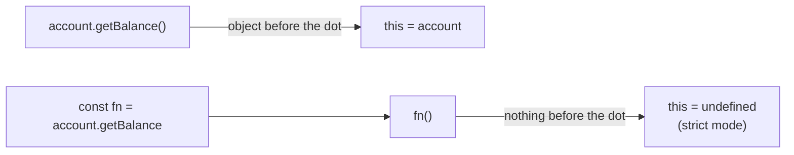
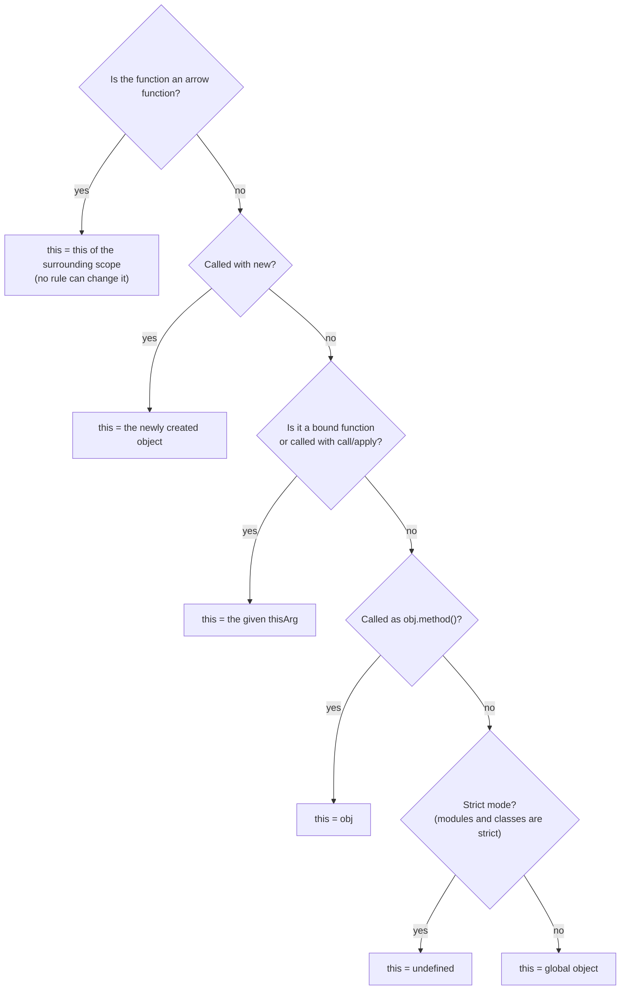

# this, call, apply and bind

> In this document you will learn how JavaScript decides the value of `this`, why methods "lose" `this` when you pass them around, and how `call`, `apply`, `bind` and arrow functions control it. Many JavaScript output puzzles test `this`, and the bugs they describe (callbacks that crash with "Cannot read properties of undefined") happen in real Angular, React and Node.js code every day.

**Before this:** [Functions and functional programming](04-functions-and-functional-programming.md) · [Closures](05-closures.md) · **Interview questions:** [jump to the interview section](#interview-questions)

## Table of contents

1. [What this is](#what-this-is)
2. [The four binding rules](#the-four-binding-rules)
3. [Rule precedence](#rule-precedence)
4. [Arrow functions and lexical this](#arrow-functions-and-lexical-this)
5. [Losing this and how to fix it](#losing-this-and-how-to-fix-it)
6. [call, apply and bind in depth](#call-apply-and-bind-in-depth)
7. [this in every context](#this-in-every-context)
8. [How to find this step by step](#how-to-find-this-step-by-step)
9. [Implementing call, apply and bind](#implementing-call-apply-and-bind)
10. [this in Angular, React and Node.js](#this-in-angular-react-and-nodejs)
11. [Common mistakes](#common-mistakes)
12. [Best practices](#best-practices)
13. [How to explain this in an interview](#how-to-explain-this-in-an-interview)
14. [Interview questions](#interview-questions)
15. [Summary](#summary)
16. [References](#references)

> **Note about strict mode:** most examples in this document assume **strict mode**. Strict mode is on automatically inside ES modules and class bodies, which is how most modern code runs (Angular, React, Node.js ESM). When sloppy (non-strict) mode behaves differently, the text says so.

---

## What this is

`this` is a special keyword that every **normal function** (not an arrow function) gets when it is called. It usually points to the object that the function is working on.

```js
const user = {
  name: "Asha",
  greet() {
    return `Hi, I am ${this.name}`;
  },
};

console.log(user.greet()); // Hi, I am Asha
```

Inside `greet`, `this` is `user`, because we called it as `user.greet()`.

### Why this exists

`this` lets **one function work with many objects**. You write the method once and reuse it.

```js
function describe() {
  return `${this.name} costs ${this.price}`;
}

const laptop = { name: "Laptop", price: 50000, describe };
const phone = { name: "Phone", price: 20000, describe };

console.log(laptop.describe()); // Laptop costs 50000
console.log(phone.describe());  // Phone costs 20000
```

The same `describe` function gives different results, because `this` is different in each call. This is also how prototype methods work: one `greet` function on a prototype serves thousands of objects (see [Prototypes and inheritance](08-prototypes-and-inheritance.md)).

### The one sentence to remember

> For normal functions, **`this` is decided by how the function is called, not by where it is written.**

This is the opposite of closures and variables, which follow where the code is written (lexical scope). That difference is why `this` confuses people.

Arrow functions are the exception: they do **not** have their own `this`. They use the `this` of the surrounding code, like a normal variable. More in [Arrow functions and lexical this](#arrow-functions-and-lexical-this).

### Analogy

Think of `this` as the word **"me"** in a sentence. The meaning of "me" depends on **who is speaking**, not on who wrote the sentence. If Asha reads "Me: Asha's best friend", "me" means Asha. If Ravi reads the same sentence, "me" means Ravi.

Where the analogy breaks down: with `bind` and arrow functions, the "speaker" is fixed in advance, no matter who reads the sentence later.

---

## The four binding rules

When a normal function is called, the engine picks `this` using one of four rules. You find the rule by looking at the **call site**: the exact place where the function is called.

### Rule 1: default binding (a plain function call)

When you call a function on its own, with nothing before the dot:

```js
"use strict";

function showThis() {
  return this;
}

console.log(showThis()); // undefined
```

- In **strict mode**, `this` is `undefined`.
- In **sloppy mode**, `this` is the **global object** (`window` in browsers, `globalThis` in Node.js).

```js
// sloppy mode (classic browser script, no "use strict")
function showThis() {
  return this;
}
console.log(showThis() === window); // true (in a browser)
```

Strict mode made this safer. In sloppy mode, code like `this.count = 0` inside a plain function silently creates a **global variable**. In strict mode, it throws a `TypeError` right away, so you find the bug.

### Rule 2: implicit binding (a method call)

When you call a function **as a property of an object** (`object.method()`), `this` is the object **before the dot**.

```js
const cart = {
  items: ["pen", "book"],
  count() {
    return this.items.length;
  },
};

console.log(cart.count()); // 2
```

Only the **last** object before the call matters:

```js
const company = {
  name: "Acme",
  team: {
    name: "Platform",
    getName() {
      return this.name;
    },
  },
};

console.log(company.team.getName()); // Platform  (this = company.team)
```

Bracket notation and optional chaining count as method calls too:

```js
console.log(cart["count"]()); // 2
console.log(cart?.count());   // 2
```

### Rule 3: explicit binding (`call`, `apply`, `bind`)

You can choose `this` yourself:

```js
function introduce(greeting, punctuation) {
  return `${greeting}, I am ${this.name}${punctuation}`;
}

const ravi = { name: "Ravi" };

console.log(introduce.call(ravi, "Hello", "!"));    // Hello, I am Ravi!
console.log(introduce.apply(ravi, ["Hi", "."]));    // Hi, I am Ravi.

const raviIntro = introduce.bind(ravi, "Hey");      // does NOT call yet
console.log(raviIntro("?"));                        // Hey, I am Ravi?
```

- `call(thisArg, arg1, arg2, ...)` calls now, arguments one by one.
- `apply(thisArg, [args])` calls now, arguments as an array.
- `bind(thisArg, arg1, ...)` returns a **new function** with `this` (and optionally some arguments) fixed forever.

Details in [call, apply and bind in depth](#call-apply-and-bind-in-depth).

### Rule 4: `new` binding

When you call a function with `new`, the engine creates a **brand new object** and uses it as `this`.

```js
function Product(name, price) {
  // this = a new empty object, linked to Product.prototype
  this.name = name;
  this.price = price;
  // the new object is returned automatically
}

const keyboard = new Product("Keyboard", 1500);
console.log(keyboard.name);  // Keyboard
console.log(keyboard.price); // 1500
```

What `new` does, in short:

1. Creates a new empty object.
2. Sets its prototype to `Product.prototype`.
3. Calls `Product` with `this` set to the new object.
4. Returns the new object (unless the function returns another object).

The full steps, and how to write your own `new`, are in [Prototypes and inheritance](08-prototypes-and-inheritance.md). Classes use the same rule: inside a `constructor`, `this` is the new instance.

### The four rules in one table

| Call site | Rule | `this` value |
| --- | --- | --- |
| `fn()` | Default | `undefined` (strict) / global object (sloppy) |
| `obj.fn()`, `obj["fn"]()`, `obj?.fn()` | Implicit | `obj` |
| `fn.call(x)`, `fn.apply(x)`, `fn.bind(x)()` | Explicit | `x` (see notes on `null` and primitives below) |
| `new Fn()` | `new` | The newly created object |
| Arrow function, any call | Lexical | `this` of the surrounding code |

---

## Rule precedence

Sometimes more than one rule seems to apply. The order of strength is:

1. **`new`** (strongest)
2. **Explicit** (`bind`, `call`, `apply`)
3. **Implicit** (method call)
4. **Default** (weakest)

Arrow functions are outside this list: no rule can change an arrow function's `this`.

### Explicit beats implicit

```js
function getName() {
  return this.name;
}

const asha = { name: "Asha" };
const meera = { name: "Meera", getName: getName.bind(asha) };

console.log(meera.getName()); // Asha — the bound this wins over the method call
```

### `new` beats `bind`

```js
function Person(name) {
  this.name = name;
}

const BoundPerson = Person.bind({ ignored: true }, "Ravi");
const ravi = new BoundPerson();

console.log(ravi.name);    // Ravi — bound ARGUMENTS are kept
console.log(ravi.ignored); // undefined — bound THIS is ignored with new
console.log(ravi instanceof Person); // true
```

With `new`, the engine creates a new object and ignores the bound `this`. The pre-filled arguments still apply.

### `bind` beats `call` and another `bind`

```js
function whoAmI() {
  return this.name;
}

const first = { name: "first" };
const second = { name: "second" };

const bound = whoAmI.bind(first);
console.log(bound.call(second));        // first
console.log(bound.bind(second)());      // first — you cannot re-bind
```

A bound function remembers its `this` permanently. `call`, `apply` and a second `bind` cannot change it. (A second `bind` can still add more arguments.)

---

## Arrow functions and lexical this

Arrow functions **do not have their own `this`**. When you use `this` inside an arrow function, the engine looks it up in the surrounding scope, exactly like a normal variable. This is called **lexical `this`**.

```js
const timer = {
  seconds: 0,
  start() {
    // `this` here is `timer` (method call)
    setInterval(() => {
      this.seconds++; // arrow: uses start's `this`, which is `timer`
    }, 1000);
  },
};
```

If the callback were a normal function, `setInterval` would call it with its own `this` (the `window` object in browsers, a `Timeout` object in Node.js), and `this.seconds` would not be the timer's property.

### Before arrow functions: `self = this`

Before ES2015, developers saved `this` in a variable so the inner function could use it through a closure:

```js
const timer = {
  seconds: 0,
  start() {
    const self = this; // closure variable
    setInterval(function () {
      self.seconds++;
    }, 1000);
  },
};
```

Arrow functions do the same thing automatically.

### You cannot change an arrow's this

```js
const getThis = () => this;

const target = { name: "target" };
console.log(getThis.call(target) === target);    // false
console.log(getThis.bind(target)() === target);  // false
```

`call`, `apply` and `bind` ignore the `this` argument for arrow functions. (`bind` can still pre-fill arguments.) You also cannot use `new` with an arrow function: it throws `TypeError: ... is not a constructor`.

### Arrow functions also lack arguments, super and new.target

Arrow functions take `this`, `arguments`, `super` and `new.target` from the surrounding function. They also have no `prototype` property. See [Functions and functional programming](04-functions-and-functional-programming.md).

### The trap: arrow functions as object methods

```js
const shop = {
  name: "Book Shop",
  getName: () => this.name, // ❌ Wrong: arrow takes `this` from OUTSIDE the object
};

console.log(shop.getName()); // undefined in Node.js CommonJS; TypeError in an ES module (never "Book Shop")
```

The object literal `{ ... }` is **not** a scope. The arrow function looks outside, at the module or script level:

- In an **ES module**, top-level `this` is `undefined`, so `this.name` throws a `TypeError`.
- In **Node.js CommonJS**, top-level `this` is `module.exports` (an empty object), so you get `undefined`.
- In a **classic browser script**, top-level `this` is `window`, so you get `window.name` (usually an empty string).

None of these is the shop. Use method shorthand instead:

```js
const shop = {
  name: "Book Shop",
  getName() { // ✅ Correct: a normal method
    return this.name;
  },
};
console.log(shop.getName()); // Book Shop
```

### When to use which

| Situation | Use |
| --- | --- |
| Object method or class method that uses `this` | Normal method (`method() {}`) |
| Callback **inside** a method that needs the method's `this` | Arrow function |
| Event handler that needs the element (`this === element`) | Normal function (or use `event.currentTarget`) |
| Constructor | Class or normal function, never an arrow |
| Function that must be re-targeted with `call`/`apply` | Normal function |

---

## Losing this and how to fix it

"Losing `this`" means a method is called **without its object**, so `this` falls back to the default rule (`undefined` in strict mode). This is the most common `this` bug.

### Why it happens

A method is just a function stored in a property. When you take it out of the object, you get the bare function. The object is not attached to it.

```js
"use strict";

const account = {
  balance: 500,
  getBalance() {
    return this.balance;
  },
};

const getBalance = account.getBalance; // just the function
getBalance(); // ❌ TypeError: Cannot read properties of undefined (reading 'balance')
```

The call `getBalance()` has nothing before the dot. Default rule. `this` is `undefined`.



### Case 1: passing a method as a callback

```js
class Logger {
  prefix = "[app]";
  log(message) {
    console.log(`${this.prefix} ${message}`);
  }
}

const logger = new Logger();
["started", "ready"].forEach(logger.log); // ❌ TypeError: this is undefined
```

`forEach` receives only the function. It calls it as a plain function.

### Case 2: `setTimeout` and `setInterval`

```js
const notifier = {
  message: "Saved!",
  show() {
    console.log(this.message);
  },
};

setTimeout(notifier.show, 1000); // ❌ prints undefined
```

The timer calls the function without `notifier`. In browsers the timer uses `window` as `this` for normal functions. In Node.js it uses the internal `Timeout` object. Either way, it is not `notifier`.

### Case 3: destructuring a method

```js
const { show } = notifier;
show(); // ❌ this is undefined in strict mode
```

Destructuring copies the function out of the object, same as `const show = notifier.show`.

### Case 4: DOM event listeners

For a **normal function** listener, the browser sets `this` to the element the listener is attached to (`event.currentTarget`).

```js
class SearchBox {
  constructor(input) {
    this.input = input;
    this.query = "";
    input.addEventListener("input", this.onInput); // ❌ this = input element
  }
  onInput(event) {
    this.query = event.target.value; // sets input.query, not SearchBox.query!
  }
}
```

This does not even throw an error. It silently writes `query` onto the DOM element. Bugs like this are hard to find.

Sometimes the element as `this` is what you want:

```js
document.querySelectorAll(".delete-btn").forEach((button) => {
  button.addEventListener("click", function () {
    this.disabled = true; // `this` is the clicked button
  });
});
```

Modern code usually prefers `event.currentTarget`, which works with arrow functions too.

### The fixes

**Fix 1: wrap in an arrow function** (simple and clear)

```js
["started", "ready"].forEach((message) => logger.log(message));
setTimeout(() => notifier.show(), 1000);
```

The arrow calls `logger.log(...)` as a method call, so `this` is correct.

**Fix 2: `bind`**

```js
["started", "ready"].forEach(logger.log.bind(logger));
setTimeout(notifier.show.bind(notifier), 1000);
```

**Fix 3: bind once in the constructor** (classic React class component style)

```js
class SearchBox {
  constructor(input) {
    this.query = "";
    this.onInput = this.onInput.bind(this); // own property holding a bound function
    input.addEventListener("input", this.onInput);
  }
  onInput(event) {
    this.query = event.target.value;
  }
}
```

**Fix 4: class field with an arrow function**

```js
class SearchBox {
  query = "";
  onInput = (event) => {
    this.query = event.target.value; // `this` is always the instance
  };
}
```

A class field initializer runs inside the constructor, where `this` is the new instance. The arrow function captures that `this` forever.

**Fix 5: use the `thisArg` parameter** that many array methods accept:

```js
["started", "ready"].forEach(logger.log, logger); // second argument = this for the callback
```

`forEach`, `map`, `filter`, `some`, `every`, `find`, `findIndex` and `Array.from` all accept a `thisArg`.

### Trade-off: arrow class fields vs prototype methods

| | Prototype method (`onInput() {}`) | Arrow class field (`onInput = () => {}`) |
| --- | --- | --- |
| Where it lives | Once, on the prototype, shared by all instances | A new function on **every** instance |
| Memory for 10,000 instances | 1 function | 10,000 functions |
| Safe to pass as a callback | No (needs bind/arrow wrapper) | Yes |
| Can be overridden with `super.method()` in a subclass | Yes | No (`super.onInput` does not exist, because it is not on the parent prototype) |
| Easy to spy on in tests (`jest.spyOn(Class.prototype, ...)`) | Yes | No (exists only per instance) |

For a few UI components, arrow fields are fine and convenient. For classes with many instances, or classes meant to be extended, prefer prototype methods and bind only where needed. More in [Classes](09-classes.md).

---

## call, apply and bind in depth

All three are methods on `Function.prototype`, so every normal function has them.

### call

```js
function formatPrice(currency, decimals) {
  return `${this.name}: ${this.price.toFixed(decimals)} ${currency}`;
}

const book = { name: "JS Guide", price: 499 };
console.log(formatPrice.call(book, "INR", 2)); // JS Guide: 499.00 INR
```

### apply

Same as `call`, but the arguments come as an array (or any array-like object).

```js
console.log(formatPrice.apply(book, ["USD", 1])); // JS Guide: 499.0 USD
```

A classic use of `apply` was passing an array to a function that expects separate arguments:

```js
const scores = [72, 95, 88];
console.log(Math.max.apply(null, scores)); // 95
console.log(Math.max(...scores));          // 95 — modern spread syntax does the same
```

Today, spread (`...`) replaces most uses of `apply`. One difference: for very large arrays (hundreds of thousands of items), both spread and `apply` can hit the engine's argument limit and throw a `RangeError`. Use a loop or `reduce` for huge arrays.

Memory trick: **A**pply takes an **A**rray; **C**all takes **C**ommas.

### bind

`bind` does not call the function. It returns a **bound function**: a new function that always calls the original with the fixed `this` and any fixed leading arguments.

```js
const bookPriceInr = formatPrice.bind(book, "INR");
console.log(bookPriceInr(0)); // JS Guide: 499 INR
console.log(bookPriceInr(2)); // JS Guide: 499.00 INR
```

### Partial application with bind

Pass `null` (or any value) as `this` when the function does not use `this`, and pre-fill arguments:

```js
function calculateTax(rate, amount) {
  return amount * rate;
}

const gst18 = calculateTax.bind(null, 0.18);
console.log(gst18(1000)); // 180
```

### Facts about bound functions

```js
function greet(greeting, name) {
  return `${greeting}, ${name}`;
}

const hello = greet.bind(null, "Hello");

console.log(hello.name);   // bound greet
console.log(hello.length); // 1  (2 parameters minus 1 bound argument)
console.log("prototype" in hello); // false — bound functions have no prototype property
console.log(hello === greet.bind(null, "Hello")); // false — every bind creates a new function
```

- A bound function cannot be re-bound to another `this`.
- With `new`, the bound `this` is ignored, but bound arguments are used, and `instanceof` checks against the original function.
- Every `bind` call returns a **new** function. This matters for `removeEventListener` and for change detection (for example, React props and Angular inputs compare by reference).

### this with null, undefined and primitives

```js
function showThis() {
  return this;
}
```

| Call | Strict mode | Sloppy mode |
| --- | --- | --- |
| `showThis.call(null)` | `null` | global object |
| `showThis.call(undefined)` | `undefined` | global object |
| `showThis.call(5)` | `5` (a primitive) | a `Number` wrapper object |
| `showThis.call("hi")` | `"hi"` | a `String` wrapper object |

Sloppy mode "fixes" `this` into an object. Strict mode passes the value exactly as given.

### Comparison table

| | `call` | `apply` | `bind` |
| --- | --- | --- | --- |
| Calls the function now? | Yes | Yes | No, returns a new function |
| How arguments are passed | One by one | As one array | One by one (pre-filled) |
| Return value | The function's result | The function's result | A bound function |
| Typical use | Borrowing a method once | Arguments already in an array (older code) | Callbacks, event handlers, partial application |

### Method borrowing

You can use a method from one object on another object with `call`:

```js
function listArgs() {
  // `arguments` is array-like but not an array
  return Array.prototype.join.call(arguments, " | ");
}
console.log(listArgs("a", "b", "c")); // a | b | c

const hasOwn = Object.prototype.hasOwnProperty;
const config = Object.create(null); // has no hasOwnProperty method of its own
config.debug = true;
console.log(hasOwn.call(config, "debug")); // true
```

Modern code often has simpler options (`Array.from(arguments)`, rest parameters, `Object.hasOwn`), but you will see method borrowing in libraries and interview questions.

---

## this in every context

This section lists every place where `this` can appear and what it means there.

### Top level (outside any function)

The value depends on **how the file is loaded**:

| Where the code runs | Top-level `this` |
| --- | --- |
| Classic browser script (`<script>`) | `window` |
| ES module (`<script type="module">`, `.mjs`, `"type": "module"`) | `undefined` |
| Node.js CommonJS file (`.cjs`, or `.js` without `"type": "module"`) | `module.exports` (starts as `{}`) |
| Node.js REPL, browser DevTools console | the global object |

```js
// file: report.cjs (CommonJS)
console.log(this === module.exports); // true

// file: report.mjs (ES module)
console.log(this); // undefined
```

Why is CommonJS different? Node.js wraps every CommonJS file in a function and calls it with `module.exports` as `this`. See [Modules: ESM and CommonJS](14-modules-esm-and-commonjs.md).

### globalThis

Before ES2020, there was no single name for the global object: `window` in browsers, `self` in workers, `global` in Node.js. **`globalThis`** (ES2020) works everywhere. Use it instead of relying on top-level `this`.

```js
console.log(typeof globalThis.setTimeout); // function (browsers and Node.js)
```

### Plain function calls

```js
function plain() { return this; }
plain(); // strict: undefined · sloppy: global object
```

### Methods

`this` is the object before the dot **at call time**. It does not matter where the function was defined or whether it is inherited.

```js
const animal = {
  describe() {
    return `I am ${this.name}`;
  },
};

const cat = Object.create(animal); // cat inherits describe from animal
cat.name = "Kitty";

console.log(cat.describe()); // I am Kitty — this = cat, not animal
```

This is why prototype methods work: one shared function, a different `this` for every object.

### Nested normal functions inside a method

A normal function inside a method does **not** inherit the method's `this`. It gets its own `this`, based on how **it** is called.

```js
"use strict";

const team = {
  name: "Core",
  members: ["Asha", "Ravi"],
  list() {
    return this.members.map(function (member) {
      return `${member} @ ${this.name}`; // ❌ this is undefined here
    });
  },
};

team.list(); // TypeError: Cannot read properties of undefined (reading 'name')
```

`map` calls the inner function as a plain function. The fix is an arrow function, which uses `list`'s `this`:

```js
const team = {
  name: "Core",
  members: ["Asha", "Ravi"],
  list() {
    return this.members.map((member) => `${member} @ ${this.name}`); // ✅
  },
};

console.log(team.list()); // [ 'Asha @ Core', 'Ravi @ Core' ]
```

### Arrow functions in an object literal

Covered above in [the trap](#the-trap-arrow-functions-as-object-methods): an arrow function defined directly as a property takes `this` from outside the object, never the object itself.

### Classes

Class bodies always run in **strict mode**.

```js
class Order {
  status = "new";                   // field initializer: this = the new instance
  label = `Order (${this.status})`; // fields can use earlier fields through this

  constructor(id) {
    this.id = id;                   // constructor: this = the new instance
  }

  ship() {
    this.status = "shipped";        // method: this = whatever object it was called on
    return this;                    // returning this allows chaining
  }
}

const order = new Order(7);
console.log(order.label);           // Order (new)
console.log(order.ship().status);   // shipped

const { ship } = order;
// ship(); → TypeError: Cannot set properties of undefined (class bodies are strict)
```

### Static methods, static fields and static blocks

Inside `static` members, `this` is the **class itself** (the constructor function). When called on a subclass, `this` is the subclass.

```js
class Model {
  static tableName = "models";

  static create() {
    return new this(); // `this` is whichever class create() was called on
  }

  static describe() {
    return `Table: ${this.tableName}`;
  }
}

class User extends Model {
  static tableName = "users";
}

console.log(User.create() instanceof User); // true
console.log(User.describe());               // Table: users
console.log(Model.describe());              // Table: models
```

This "polymorphic `this`" in static methods is how ORMs such as Sequelize let you write `User.findAll()` with logic defined once on a base class.

### Getters and setters

In a getter or setter, `this` is the object the property was read from (the **receiver**), even when the getter is inherited.

```js
const personProto = {
  get fullName() {
    return `${this.first} ${this.last}`;
  },
};

const person = Object.create(personProto);
person.first = "Asha";
person.last = "Rao";
console.log(person.fullName); // Asha Rao
```

### super method calls

`super.method()` calls the parent's method, but `this` stays the **current** instance:

```js
class Animal {
  speak() {
    return `${this.name} makes a sound`;
  }
}

class Dog extends Animal {
  constructor(name) {
    super();
    this.name = name;
  }
  speak() {
    return `${super.speak()} (woof)`; // parent method, this = the dog
  }
}

console.log(new Dog("Rex").speak()); // Rex makes a sound (woof)
```

### DOM event listeners

| Listener type | `this` inside |
| --- | --- |
| `el.addEventListener("click", function () {})` | `el` (same as `event.currentTarget`) |
| `el.addEventListener("click", () => {})` | `this` of the surrounding code |
| `el.onclick = function () {}` | `el` |
| Inline HTML `onclick="console.log(this)"` | the element |

`event.currentTarget` is the element the listener is attached to. `event.target` is the element that was actually clicked (it can be a child, because events bubble). See [DOM and events](../05-frontend-engineering/03-dom-and-events.md).

### Callbacks: timers, promises and array methods

The code that calls your callback decides `this`:

| Who calls the callback | `this` for a normal function callback |
| --- | --- |
| `setTimeout` / `setInterval` in browsers | `window` |
| `setTimeout` / `setInterval` in Node.js | the `Timeout` object |
| Promise `.then` / `.catch` / `.finally` handlers | `undefined` (global object in sloppy mode) |
| `arr.forEach(fn)` / `map` / `filter` without `thisArg` | `undefined` (global object in sloppy mode) |
| `arr.forEach(fn, thisArg)` | `thisArg` |
| Node.js `emitter.on("event", function () {})` | the emitter |

In practice you rarely want any of these. Use an arrow function to keep the surrounding `this`.

### Chaining with `return this` (fluent APIs)

Returning `this` from a method lets callers chain calls. Query builders, jQuery and test assertion libraries use this pattern.

```js
const query = {
  filters: [],
  where(condition) {
    this.filters.push(condition);
    return this;
  },
  build() {
    return this.filters.join(" AND ");
  },
};

console.log(query.where("price > 100").where("inStock = true").build());
// price > 100 AND inStock = true
```

---

## How to find this step by step

When you see `this` in a puzzle or a bug, ask these questions in this order:



Two extra checks for callbacks:

- If **you** do not call the function (a library, timer or the DOM calls it), find out how **they** call it.
- If the function was **taken out** of an object (assigned, destructured, passed as an argument), the object is gone.

### Tricky call-site forms

The engine looks at the **exact expression** you call:

```js
"use strict";

const obj = {
  name: "obj",
  show() {
    return this?.name;
  },
};

console.log(obj.show());                // obj        — method call
console.log((obj.show)());              // obj        — parentheses do not change the reference
console.log((0, obj.show)());           // undefined  — comma operator returns the bare function
console.log((obj.show = obj.show)());   // undefined  — assignment returns the bare function
console.log((obj.show || null)());      // undefined  — logical operator returns the bare function
```

`(obj.show)` is still a property reference, so the object is kept. But the comma operator, assignment and `||` produce a **value** (just the function). Calling a bare value is a plain call. Bundlers sometimes emit `(0, module.fn)()` on purpose, so that `this` is `undefined` inside imported functions.

---

## Implementing call, apply and bind

You may be asked to write these in an interview. The core trick for `call`: **temporarily make the function a method of the target object**, then call it as a method, so the implicit rule sets `this`.

### myCall

```js
Function.prototype.myCall = function (thisArg, ...args) {
  if (typeof this !== "function") {
    throw new TypeError("myCall must be called on a function");
  }
  // null/undefined → global object; primitives → wrapper objects (sloppy-mode behavior)
  const context = thisArg === null || thisArg === undefined ? globalThis : Object(thisArg);
  const key = Symbol("fn"); // unique key, cannot clash with existing properties
  context[key] = this;      // `this` here is the function being called
  try {
    return context[key](...args); // method call → this = context
  } finally {
    delete context[key];    // clean up even if the function throws
  }
};

function introduce(greeting, punctuation) {
  return `${greeting}, I am ${this.name}${punctuation}`;
}

const ravi = { name: "Ravi" };
console.log(introduce.myCall(ravi, "Hello", "!")); // Hello, I am Ravi!
console.log(Object.keys(ravi));                    // [ 'name' ] — no leftover key
```

### myApply

```js
Function.prototype.myApply = function (thisArg, args = []) {
  return this.myCall(thisArg, ...args);
};

console.log(introduce.myApply(ravi, ["Hi", "."])); // Hi, I am Ravi.
```

### myBind

```js
Function.prototype.myBind = function (thisArg, ...boundArgs) {
  const originalFn = this;

  return function bound(...args) {
    if (new.target) {
      // called with new: ignore thisArg, keep the bound arguments
      return new originalFn(...boundArgs, ...args);
    }
    return originalFn.apply(thisArg, [...boundArgs, ...args]);
  };
};

const raviIntro = introduce.myBind(ravi, "Hey");
console.log(raviIntro("?")); // Hey, I am Ravi?
```

Limitations of these short versions (good to mention in an interview):

- `myCall` adds a temporary property, so it fails on frozen or non-extensible objects, and it boxes primitives even in strict mode (the real `call` passes `5` as `5`).
- `myBind` does not set the `name` (`"bound introduce"`) and `length` properties like the real `bind`.

Complete versions with all edge cases are in [JavaScript polyfills and implementations](../11-coding-interviews/04-javascript-polyfills-and-implementations.md).

---

## this in Angular, React and Node.js

### Angular

**Template event bindings are safe.** In `(click)="save()"`, Angular calls `save` on the component instance, so `this` is the component.

**Passing a method reference is not safe.** These lose the component as `this`:

```ts
@Component({ selector: "app-orders", templateUrl: "./orders.component.html" })
export class OrdersComponent implements OnInit {
  orders: Order[] = [];
  private orderService = inject(OrderService);

  ngOnInit(): void {
    // ❌ Wrong: the function is passed alone; `this` inside is not the component
    this.orderService.getOrders().subscribe(this.handleOrders);

    // ❌ Wrong: the timer calls it as a plain function
    setTimeout(this.refresh, 5000);
  }

  handleOrders(orders: Order[]): void {
    this.orders = orders;
  }

  refresh(): void { /* ... */ }
}
```

```ts
// ✅ Correct: arrow wrappers keep the component as `this`
this.orderService.getOrders().subscribe((orders) => this.handleOrders(orders));
setTimeout(() => this.refresh(), 5000);
```

**Passing a callback to a child component** through an `@Input` is a subtle case:

```ts
// parent.component.ts
export class PriceListComponent {
  currency = "INR";
  formatPrice(value: number): string {
    return `${value} ${this.currency}`;
  }
}
// parent template: <app-price-cell [formatter]="formatPrice"></app-price-cell>

// child calls: this.formatter(this.value)
```

The child calls `this.formatter(...)`, which is a method call on the **child**. So inside `formatPrice`, `this` is the child component, and `this.currency` reads the child's property (probably `undefined`). Fixes: make it an arrow field in the parent (`formatPrice = (value: number) => ...`), or, better, avoid passing functions down and use an `@Output()` event or a pipe.

### React

**Class components** (older code) had the classic problem: `onClick={this.handleClick}` passes the bare method, so `this` is `undefined` when React calls it. The two standard fixes were binding in the constructor and class field arrows:

```js
class SaveButton extends React.Component {
  state = { saving: false };

  handleClick = () => {           // arrow class field: this is always the component
    this.setState({ saving: true });
  };

  render() {
    return <button onClick={this.handleClick}>Save</button>;
  }
}
```

**Function components** (modern React 18/19) do not use `this` at all. They use closures and hooks instead. See [React essentials](../05-frontend-engineering/08-react-essentials.md).

### Node.js

**EventEmitter:** a normal function listener gets the emitter as `this`. An arrow listener keeps the outer `this`.

```js
const { EventEmitter } = require("node:events");
const orders = new EventEmitter();

orders.on("created", function () {
  console.log(this === orders); // true
});
orders.emit("created");
```

**Class-based Express controllers** lose `this` when you pass a method as a route handler:

```js
class ProductController {
  constructor(productService) {
    this.productService = productService;
  }
  async list(req, res) {
    res.json(await this.productService.findAll()); // ❌ this is undefined when Express calls it
  }
}

const controller = new ProductController(productService);
app.get("/api/products", controller.list);                       // ❌ Wrong
app.get("/api/products", (req, res) => controller.list(req, res)); // ✅ Correct
app.get("/api/products", controller.list.bind(controller));        // ✅ Also correct
```

The same applies to Electron: `ipcMain.handle("orders:list", this.listOrders)` loses `this`. Wrap it in an arrow function or bind it.

---

## Common mistakes

**1. Thinking `this` is the function itself or its scope.** `this` is not the function, and it is not the set of local variables. Inside `function counter() { this.count++ }`, `this.count` is not a local variable.

**2. Thinking `this` is decided where the function is written.** That is true only for arrow functions. For normal functions, look at the call site.

**3. Arrow functions as object methods.**

```js
const user = { name: "Asha", greet: () => `Hi ${this.name}` }; // ❌
const user2 = { name: "Asha", greet() { return `Hi ${this.name}`; } }; // ✅
```

**4. Passing methods as callbacks without binding.**

```js
button.addEventListener("click", this.save);        // ❌ this = button
button.addEventListener("click", () => this.save()); // ✅
```

**5. Binding inside `removeEventListener`.** Each `bind` creates a new function, so the listener is never removed. Store the bound function once.

**6. Using arrow functions where you need a dynamic `this`.** For example, Mocha test functions use `this.timeout(5000)`, and jQuery's `$(".item").each(function () { $(this) ... })` relies on `this`. Arrow functions break these APIs.

**7. Forgetting `new`** with an old-style constructor function:

```js
function Product(name) { this.name = name; }
const p = Product("Pen"); // ❌ no new: strict → TypeError; sloppy → creates a global `name`!
```

Classes protect you: calling a class without `new` always throws a `TypeError`.

**8. Expecting `bind` to work twice.** `fn.bind(a).bind(b)` keeps `a`.

---

## Best practices

- **Use method shorthand for methods and arrow functions for callbacks inside methods.** Reason: methods need a dynamic `this`; inner callbacks need the method's `this`.
- **Prefer arrow wrappers over passing method references.** `items.forEach((item) => this.add(item))` is clear and always correct. Reason: the call site keeps the object.
- **Write code in strict mode (modules, classes).** Reason: a lost `this` becomes `undefined` and fails loudly, instead of silently using the global object.
- **Use `event.currentTarget` instead of `this` in DOM listeners.** Reason: it works with arrow functions and makes the intent obvious.
- **Choose arrow class fields only when you pass the method around often.** Reason: they cost one function per instance and cannot be called with `super`.
- **Bind once, reuse the reference.** Reason: you can remove listeners and avoid breaking memoization (React `memo`, Angular `OnPush` inputs).
- **Use `globalThis` instead of top-level `this`** to reach the global object. Reason: top-level `this` differs between scripts, modules and CommonJS.
- **Avoid designing new APIs that depend on callers setting `this`.** Pass data as parameters instead. Reason: explicit parameters are easier to read, test and type.

---

## How to explain this in an interview

1. **Define it:** "`this` is a value that a normal function receives when it is called. It usually refers to the object the function is working on."
2. **Why it exists:** "It lets one function be shared by many objects — for example, a method on a prototype that works for every instance."
3. **How it works:** "For normal functions, `this` depends on the call site. There are four rules, from strongest to weakest: `new` creates a fresh object; `call`, `apply` and `bind` set it explicitly; a method call `obj.fn()` uses `obj`; and a plain call `fn()` gives `undefined` in strict mode or the global object in sloppy mode. Arrow functions are different: they have no own `this` and use the `this` of the surrounding scope."
4. **Small example:** "If `user.greet()` uses `this.name`, it works. But `const greet = user.greet; greet()` loses the object, so `this` is `undefined` and it throws."
5. **Where it is useful:** "Class methods, prototype methods, fluent APIs that return `this`, and DOM listeners where `this` is the element."
6. **Trade-offs / gotchas:** "The common bug is passing a method as a callback — to `setTimeout`, `addEventListener`, `subscribe` or an Express route — and losing `this`. I fix it with an arrow wrapper or `bind`. Arrow class fields also fix it, but they create one function per instance and cannot be called with `super`. And I never use arrow functions as object methods."

---

## Interview questions

### Q1. What is `this` in JavaScript?

**What the interviewer is checking:** Whether you know that `this` is decided at call time for normal functions, and that arrow functions are different.

**Short spoken answer (30–60 seconds):**
> `this` is a value that a normal function receives each time it is called. It usually points to the object the function is working on. The key point is that for normal functions it is decided by *how* the function is called, not where it is written. If I call `user.greet()`, `this` is `user`. If I take the same function out and call it alone, `this` is `undefined` in strict mode. I can also set it explicitly with `call`, `apply` or `bind`, and with `new` it is a brand-new object. Arrow functions don't have their own `this` at all — they use the `this` of the surrounding code. That is why arrows are great for callbacks inside methods, but wrong as object methods.

**Detailed explanation:**
`this` exists so that one function can serve many objects, which is how prototype and class methods work. The engine sets `this` when the call happens, using four rules (default, implicit, explicit, `new`). Arrow functions resolve `this` lexically, like a variable.

**Code:**

```js
"use strict";
const user = {
  name: "Asha",
  greet() { return `Hi, I am ${this.name}`; },
};

console.log(user.greet()); // Hi, I am Asha
const greet = user.greet;
greet(); // TypeError: Cannot read properties of undefined (reading 'name')
```

**Follow-up questions:**
- **Is `this` the function itself?** — No. Inside a function, `this` is not the function object and not its local scope. To refer to the function itself, use its name.
- **What is `this` in a plain function call in sloppy mode?** — The global object (`window` in browsers, `globalThis` in Node.js). That is why accidental globals were common before strict mode.
- **Does an object literal create a new `this`?** — No. Only function calls set `this`. An arrow function defined in an object literal uses the `this` outside the object.

**Common mistakes:** Saying `this` refers to "the object where the function is defined". Forgetting the arrow function exception. Not mentioning strict vs sloppy mode.

**Where this is used in real projects:** Every class method in Angular services and components, Node.js classes, fluent query builders, DOM handlers.

---

### Q2. Explain the rules that decide `this`, and their precedence.

**What the interviewer is checking:** A complete, ordered mental model you can apply to any code.

**Short spoken answer (30–60 seconds):**
> There are four rules for normal functions, and I check them from strongest to weakest. First, `new`: if the function is called with `new`, `this` is the new object being created. Second, explicit binding: `call` and `apply` set `this` for one call, and `bind` returns a function with `this` fixed forever. Third, implicit binding: if it is called as `obj.method()`, `this` is `obj`. Fourth, default binding: a plain call gives `undefined` in strict mode or the global object in sloppy mode. `new` even beats `bind` — a bound function used with `new` ignores the bound `this` but keeps the bound arguments. Arrow functions are outside these rules: they always use the surrounding `this`.

**Code:**

```js
function getName() { return this.name; }

const asha = { name: "Asha" };
const meera = { name: "Meera", getName: getName.bind(asha) };
console.log(meera.getName()); // Asha  — explicit beats implicit

function Person(name) { this.name = name; }
const Bound = Person.bind({ name: "ignored" }, "Ravi");
console.log(new Bound().name); // Ravi — new beats bind
```

**Follow-up questions:**
- **Can `call` override a bound function's `this`?** — No. Once bound, `this` is fixed. `call`, `apply` and another `bind` cannot change it.
- **What does `new` do with an object returned from the constructor?** — If the constructor returns an object, `new` returns that object instead of the new `this`. If it returns a primitive, the return value is ignored.
- **Where do arrow functions fit in the precedence?** — Nowhere. No rule can change an arrow's `this`, not even `new` (arrows cannot be called with `new`).

**Common mistakes:** Getting the order wrong (thinking implicit beats bind). Forgetting the `new` rule.

**Where this is used in real projects:** Debugging callbacks in frameworks; understanding why `bind` in a constructor fixes React class handlers.

---

### Q3. What does this print?

```js
"use strict";
const user = {
  name: "Asha",
  greet() {
    return `Hi, I am ${this.name}`;
  },
};

const greet = user.greet;
console.log(user.greet());
console.log(greet());
```

**What the interviewer is checking:** That detaching a method loses `this`.

**Answer:**

```text
Hi, I am Asha
TypeError: Cannot read properties of undefined (reading 'name')
```

**Step by step:**
1. `user.greet()` is a method call. `this = user`. It prints `Hi, I am Asha`.
2. `const greet = user.greet` copies only the function reference. The object is not attached.
3. `greet()` is a plain call in strict mode, so `this` is `undefined`. Reading `undefined.name` throws a `TypeError`.

**Follow-up questions:**
- **What happens in sloppy mode in a browser?** — `this` is `window`, so it prints `Hi, I am ` plus `window.name`, which is usually an empty string. No error — which is worse, because the bug is hidden.
- **How do you fix it?** — `const greet = user.greet.bind(user)` or `const greet = () => user.greet()`.

---

### Q4. What does this print when run as an ES module?

```js
const shop = {
  name: "Book Shop",
  getName: () => this.name,
  getNameMethod() {
    return this.name;
  },
};

console.log(shop.getNameMethod());
console.log(shop.getName());
```

**What the interviewer is checking:** That arrow functions take `this` from the surrounding scope, and that an object literal is not a scope.

**Answer:**

```text
Book Shop
TypeError: Cannot read properties of undefined (reading 'name')
```

**Step by step:**
1. `getNameMethod` is a normal method. Called as `shop.getNameMethod()`, `this = shop`.
2. `getName` is an arrow function. It does not get a `this` from the call. It uses the `this` of the code around the object literal, which is the module's top level.
3. In an ES module, top-level `this` is `undefined`. So `this.name` throws.

**Follow-up questions:**
- **What would it print in a Node.js CommonJS file?** — `undefined`, because top-level `this` there is `module.exports`, an empty object.
- **And in a classic browser script?** — `window.name`, usually an empty string.
- **Can `shop.getName.call(shop)` fix it?** — No. `call` cannot change an arrow function's `this`.

---

### Q5. What does this print?

```js
"use strict";
const counter = {
  count: 10,
  getRegular() {
    return function () {
      return this?.count;
    };
  },
  getArrow() {
    return () => this?.count;
  },
};
const other = { count: 99 };

console.log(counter.getRegular()());
console.log(counter.getArrow()());
console.log(counter.getRegular().call(other));
console.log(counter.getArrow().call(other));

const detached = counter.getArrow;
console.log(detached()());
```

**What the interviewer is checking:** Arrow `this` is captured when the arrow is **created**, from the function that created it; normal functions get `this` when **called**.

**Answer:**

```text
undefined
10
99
10
undefined
```

**Step by step:**
1. `counter.getRegular()` returns a normal function. Calling it with `()` is a plain call → `this` is `undefined` → `undefined`.
2. `counter.getArrow()` runs with `this = counter`. The arrow captures that `this`. → `10`.
3. The normal function called with `.call(other)` → `this = other` → `99`.
4. The arrow ignores `.call(other)` → still `counter` → `10`.
5. `detached()` calls `getArrow` as a plain function, so `getArrow`'s `this` is `undefined`. The arrow created inside captures `undefined` → `undefined`.

**Follow-up questions:**
- **So is an arrow's `this` fixed "where it is written"?** — More precisely: it is the `this` of the enclosing function **call** that created the arrow. The same arrow source code can capture different `this` values in different calls (line 2 vs line 5).

---

### Q6. What does this print in a browser, and what changes in Node.js?

```js
const notifier = {
  message: "Saved!",
  show() {
    console.log(this.message);
  },
};

setTimeout(notifier.show, 0);
setTimeout(() => notifier.show(), 0);
```

**Answer (browser):**

```text
undefined
Saved!
```

**Explanation:** The first timer receives only the function and calls it without `notifier`. Browsers call timer callbacks with `this` set to `window`, so `this.message` is `window.message` → `undefined`. The second timer calls an arrow function, which calls `notifier.show()` as a method → `Saved!`.

**In Node.js** the output is the same, but for a different reason: Node.js calls timer callbacks with `this` set to the internal `Timeout` object, which has no `message` property.

**Follow-up questions:**
- **What are the three ways to fix the first line?** — `setTimeout(() => notifier.show(), 0)`, `setTimeout(notifier.show.bind(notifier), 0)`, or making `show` an arrow function that closes over `notifier` (rarely a good idea for object methods).

---

### Q7. What does this print?

```js
function whoAmI() {
  return this.name;
}

const first = { name: "first" };
const second = { name: "second" };

const bound = whoAmI.bind(first);
console.log(bound.call(second));
console.log(bound.bind(second)());
console.log(bound.apply(second));
```

**Answer:** `first`, `first`, `first`

A bound function keeps its `this` permanently. `call`, `apply` and a second `bind` cannot change it. Inside, the bound function always calls the original with `first`.

---

### Q8. What does this print?

```js
const factory = {
  create: function (name) {
    this.name = name;
  },
};

const item = new factory.create("pen");
console.log(item.name, factory.name);
```

**Answer:** `pen undefined`

`new` beats implicit binding. Even though the expression looks like a method call, `new` creates a fresh object and uses it as `this`. So `name` is set on the new object, not on `factory`.

**Follow-up:** **What if `create` were written as method shorthand (`create(name) { ... }`)?** — Then `new factory.create("pen")` throws `TypeError: factory.create is not a constructor`. Method shorthand functions, class methods and arrow functions are not constructors.

---

### Q9. What does this print in a classic (non-module) browser script?

```js
var length = 10;

function fn() {
  console.log(this.length);
}

const obj = {
  length: 5,
  method(callback) {
    callback();
    arguments[0]();
  },
};

obj.method(fn, 1);
```

**What the interviewer is checking:** Default binding in sloppy mode, top-level `var` creating a global property, and the rarely known fact that `arguments[0]()` is a method call on the `arguments` object.

**Answer:**

```text
10
2
```

**Step by step:**
1. In a classic script, top-level `var length = 10` sets the global property `window.length` to `10`. (`window.length` normally holds the number of frames, but browsers allow it to be replaced, so the assignment works.)
2. `callback()` is a plain call in sloppy mode → `this = window` → prints `10`.
3. `arguments[0]()` is a property access followed by a call, just like `obj.method()`. The object before the "dot" is `arguments`, so `this = arguments`. `arguments.length` is the number of arguments passed to `method`, which is `2` (`fn` and `1`).

**Note:** In a Node.js CommonJS file, `var length` is local to the module, so the first line prints `undefined` (the global object has no `length`). In an ES module, the first call throws because `this` is `undefined`. This puzzle is about classic browser scripts.

---

### Q10. What does this print?

```js
"use strict";
const obj = {
  name: "obj",
  show() {
    return this?.name;
  },
};

console.log((obj.show)());
console.log((0, obj.show)());
console.log((obj.show = obj.show)());
```

**Answer:**

```text
obj
undefined
undefined
```

**Explanation:** Parentheses alone keep the **property reference**, so the call is still a method call. The comma operator and the assignment operator evaluate to the **function value**, losing the object. Calling the bare value is a plain call, so `this` is `undefined` in strict mode.

---

### Q11. What does this print?

```js
class Base {
  static who() {
    return this.name;
  }
  whoAmI() {
    return this.constructor.name;
  }
}
class Child extends Base {}

console.log(Base.who(), Child.who(), new Child().whoAmI());
```

**Answer:** `Base Child Child`

In a static method, `this` is the class the method was called on. `Child.who()` runs the inherited static method with `this = Child`, and `Child.name` is `"Child"`. In the instance method, `this` is the instance, and `this.constructor` is `Child`.

---

### Q12. What is the difference between `call`, `apply` and `bind`?

**What the interviewer is checking:** Precise knowledge, plus when to use each.

**Short spoken answer (30–60 seconds):**
> All three let me choose `this` for a normal function. `call` and `apply` invoke the function immediately: `call` takes the arguments one by one, `apply` takes them as an array. `bind` doesn't call anything — it returns a new function with `this` and optionally some leading arguments fixed. I use `bind` for callbacks and event handlers, or for partial application. `apply` used to be common for passing arrays to functions like `Math.max`, but spread syntax replaces that now. One detail: a bound function can't be re-bound, and each `bind` call creates a new function, which matters when removing event listeners.

**Code:**

```js
function format(prefix, suffix) {
  return `${prefix}${this.value}${suffix}`;
}
const price = { value: 499 };

console.log(format.call(price, "₹", "/-"));    // ₹499/-
console.log(format.apply(price, ["₹", "/-"])); // ₹499/-
const formatRupees = format.bind(price, "₹");
console.log(formatRupees(" only"));           // ₹499 only
```

**Follow-up questions:**
- **What does `bind` return when used with `new`?** — The bound `this` is ignored; a new object is created. Bound arguments still apply, and `instanceof` works with the original constructor.
- **What is `fn.bind(null, 1).length` if `fn` has three parameters?** — `2`. The bound function's `length` is the original `length` minus the number of bound arguments (never below 0).
- **Do `call`/`apply`/`bind` work on arrow functions?** — They run, and `bind` can pre-fill arguments, but the `this` argument is ignored.

**Common mistakes:** Saying `bind` calls the function. Mixing up which one takes an array.

**Where this is used in real projects:** `bind` in React class constructors and Node.js controllers; `call` for borrowing `Object.prototype.hasOwnProperty`; `apply` in older library code.

---

### Q13. Implement `Function.prototype.bind` (and the core of `call`).

**What the interviewer is checking:** Understanding of closures, rest/spread, `this`, and the `new` edge case.

**Short spoken answer (30–60 seconds):**
> For `bind`, I return a new function that closes over the original function, the `thisArg` and the pre-filled arguments. When the new function is called, it calls the original with `apply`, passing `thisArg` and the bound arguments followed by the new ones. For the `new` case, I check `new.target`: if the bound function is called with `new`, I ignore `thisArg` and construct the original instead. For `call`, the trick is to temporarily attach the function to the target object under a unique `Symbol` key, call it as a method so the implicit rule sets `this`, and then delete the key in a `finally` block.

**Code:**

```js
Function.prototype.myBind = function (thisArg, ...boundArgs) {
  if (typeof this !== "function") throw new TypeError("Bind must be called on a function");
  const originalFn = this;

  return function bound(...args) {
    if (new.target) return new originalFn(...boundArgs, ...args);
    return originalFn.apply(thisArg, [...boundArgs, ...args]);
  };
};

Function.prototype.myCall = function (thisArg, ...args) {
  const context = thisArg === null || thisArg === undefined ? globalThis : Object(thisArg);
  const key = Symbol("fn");
  context[key] = this;
  try {
    return context[key](...args);
  } finally {
    delete context[key];
  }
};

function Person(name, city) {
  this.name = name;
  this.city = city;
}
const PersonInPune = Person.myBind({ ignored: true }, "Asha");
const asha = new PersonInPune("Pune");
console.log(asha.name, asha.city, asha instanceof Person); // Asha Pune true
```

**Follow-up questions:**
- **Why use a `Symbol` key in `myCall`?** — So the temporary property cannot overwrite an existing property with the same name, and it does not show up in `Object.keys` or `for...in`.
- **What does your `myBind` not handle?** — It does not set `name` (`"bound Person"`) or `length`, and the returned function has a `prototype` property while the real bound function has none. Mention these limits; the full version is in [JavaScript polyfills and implementations](../11-coding-interviews/04-javascript-polyfills-and-implementations.md).
- **How would you implement `apply` using `call`?** — `Function.prototype.myApply = function (thisArg, args = []) { return this.myCall(thisArg, ...args); }`.

**Common mistakes:** Forgetting to pass the later arguments. Using an arrow function for the returned function and then trying to use `new` with it. Forgetting to delete the temporary property.

---

### Q14. Why do methods lose `this` when passed as callbacks, and how do you fix it?

**What the interviewer is checking:** Root-cause understanding and practical fixes with their trade-offs.

**Short spoken answer (30–60 seconds):**
> A method is just a function stored on an object. When I pass `obj.method` to `setTimeout`, `addEventListener`, `subscribe` or an Express route, I pass only the function — the object isn't attached. The code that later calls it calls it as a plain function, or with its own `this`, like the DOM element or the `Timeout` object in Node. So `this` isn't my object anymore. To fix it, I either wrap it in an arrow — `() => obj.method()` — which keeps the method-call form, or I `bind` it once and reuse that reference. In classes, I can also define the method as an arrow class field, but that creates a function per instance.

**Code:**

```js
class Uploader {
  constructor() {
    this.uploaded = 0;
  }
  onFileDone() {
    this.uploaded++;
  }
}

const uploader = new Uploader();
const files = ["a.png", "b.png"];

// files.forEach(uploader.onFileDone);        // ❌ TypeError
files.forEach(() => uploader.onFileDone());    // ✅ arrow wrapper
files.forEach(uploader.onFileDone, uploader);  // ✅ thisArg
console.log(uploader.uploaded);                // 4
```

**Follow-up questions:**
- **Which fix do you prefer and why?** — An arrow wrapper at the call site for one-off use, because it is explicit. For listeners that must be removed later, a bound function stored once (or an arrow class field), so I can pass the same reference to `removeEventListener`.
- **Does TypeScript catch this?** — Partly. With `noImplicitThis` and a declared `this` parameter (`function (this: Uploader)`), TypeScript can report some cases, but class methods passed as callbacks are usually not flagged. ESLint's `@typescript-eslint/unbound-method` rule catches many of them.

**Common mistakes:** Binding inside `render()` or inside a template (creates a new function every time). Using `bind` in both `add` and `remove` listener calls.

**Where this is used in real projects:** RxJS `subscribe`, Angular `setTimeout` calls, Node.js class-based controllers, Electron IPC handlers.

---

### Q15. Arrow functions vs normal functions regarding `this`. When should you not use an arrow function?

**What the interviewer is checking:** Knowing when lexical `this` helps and when it hurts.

**Short spoken answer (30–60 seconds):**
> A normal function gets its `this` from the call. An arrow function has no own `this` — it uses the `this` of the code around it, and `call`, `apply` or `bind` can't change that. So arrows are perfect for callbacks inside methods, like `this.items.map(item => this.format(item))`. I don't use arrows for object literal methods, because they would take the `this` from outside the object. I also avoid them for constructors — arrows can't be used with `new` — for prototype methods, and for APIs that set `this` on purpose, like a DOM listener that uses `this` as the element, or Mocha tests that call `this.timeout()`.

**Follow-up questions:**
- **Do arrow functions have `arguments`?** — No. They use the `arguments` of the enclosing normal function. Use rest parameters (`...args`) instead.
- **Is an arrow function inside a class method safe?** — Yes, it captures the method's `this`, which is the instance when the method is called correctly.

**Common mistakes:** Saying arrows "bind `this` to the object they are in". They bind to the enclosing **scope's** `this`, and an object literal is not a scope.

---

### Q16. Arrow class fields vs prototype methods — what are the trade-offs?

**What the interviewer is checking:** Senior-level thinking about memory, inheritance and testing.

**Short spoken answer (30–60 seconds):**
> A prototype method is defined once on the class prototype and shared by all instances. An arrow class field is created in the constructor for every instance, and it captures that instance as `this`. So the arrow field is always safe to pass as a callback, but it costs one function per instance. It also can't be overridden and called with `super.method()`, because it's not on the prototype, and it's harder to spy on in tests with `jest.spyOn(MyClass.prototype, 'method')`. For a handful of UI components that pass handlers around, arrow fields are fine. For many instances or classes meant to be extended, I keep prototype methods and bind where needed.

**Code:**

```js
class Widget {
  handleArrow = () => this;     // per instance
  handleMethod() { return this; } // shared on the prototype
}

const w1 = new Widget();
const w2 = new Widget();
console.log(w1.handleArrow === w2.handleArrow);   // false
console.log(w1.handleMethod === w2.handleMethod); // true
console.log(Object.hasOwn(Widget.prototype, "handleArrow")); // false
```

**Follow-up questions:**
- **What happens if a subclass defines a prototype method with the same name as a parent's arrow field?** — The parent's field is an **own property** on the instance, so it shadows the subclass's prototype method. The subclass method is never called through `instance.method()`. This surprises people.
- **Does TypeScript's `useDefineForClassFields` matter here?** — It controls whether fields are created with define semantics (the standard behavior) or assignment. It can change behavior when fields interact with parent accessors. See [Classes](09-classes.md).

---

### Q17. What is `this` inside a DOM event listener?

**Answer:** For a **normal function** listener, `this` is the element the listener is attached to — the same as `event.currentTarget`. For an **arrow function** listener, `this` is the surrounding code's `this`. `event.target` is different: it is the element that started the event (it can be a child, because events bubble).

```js
list.addEventListener("click", function (event) {
  console.log(this === list);                 // true
  console.log(event.currentTarget === list);  // true
  console.log(event.target);                  // the clicked <li>, maybe
});
```

Prefer `event.currentTarget`. It works the same in arrow and normal functions and makes the code easier to read.

---

### Q18. What is top-level `this` in a browser script, an ES module and a CommonJS file?

**Answer:**

- Classic browser script: `window`.
- ES module (browser or Node.js): `undefined`.
- Node.js CommonJS: `module.exports` (an empty object at the start).

Use `globalThis` when you need the global object, because it works the same everywhere.

---

### Q19. Debugging: the Express route crashes with "Cannot read properties of undefined (reading 'findAll')". Why?

```js
class ProductController {
  constructor(service) {
    this.service = service;
  }
  async list(req, res) {
    res.json(await this.service.findAll());
  }
}

const controller = new ProductController(productService);
app.get("/api/products", controller.list);
```

**What the interviewer is checking:** Recognizing the lost-`this` pattern in back-end code.

**Answer:** `controller.list` passes the bare function to Express. Express calls it as a plain function (`handler(req, res, next)`), and class bodies are strict, so `this` is `undefined`. `this.service` throws.

**Fix:**

```js
app.get("/api/products", (req, res) => controller.list(req, res));
// or
app.get("/api/products", controller.list.bind(controller));
// or define list as an arrow class field: list = async (req, res) => { ... }
```

**Follow-up:** **Why does the error appear only when the route is hit, not at startup?** — `this` is decided at call time. Registering the route does not call the function.

---

### Q20. Debugging: an Angular child component formats prices with the wrong currency. Why?

```ts
// parent
export class CartComponent {
  currency = "INR";
  formatPrice(value: number) {
    return `${value} ${this.currency}`;
  }
}
// parent template: <app-line-item [formatter]="formatPrice"></app-line-item>

// child
export class LineItemComponent {
  @Input() formatter!: (value: number) => string;
  currency = "USD";
  value = 100;
  get label() {
    return this.formatter(this.value);
  }
}
```

**Answer:** The template passes the **bare function**. The child calls `this.formatter(...)`, which is a method call on the **child**. So inside `formatPrice`, `this` is the child, and `this.currency` is `"USD"`. The label shows `100 USD`.

**Fix:** In the parent, make it an arrow field (`formatPrice = (value: number) => \`${value} ${this.currency}\`;`) so it captures the parent. A cleaner design is to pass data, not behavior: pass `currency` as an input, or use a shared pipe.

---

### Q21. What does this print?

```js
function showType() {
  return typeof this;
}

function showTypeStrict() {
  "use strict";
  return typeof this;
}

console.log(showType.call(5), showTypeStrict.call(5));
console.log(showType.call(null) === "object", showTypeStrict.call(undefined));
```

**Answer:**

```text
object number
true undefined
```

In sloppy mode, primitives are wrapped into objects (`5` becomes a `Number` object) and `null`/`undefined` become the global object, so `typeof` is `"object"`. Strict mode passes the value as it is.

---

### Q22. Can you call a class method or an object shorthand method with `new`?

**Answer:** No. Only normal `function` declarations/expressions and classes are constructors. Class methods, object method shorthand (`{ save() {} }`), arrow functions, getters/setters, generator functions and async functions are **not** constructors. `new` on them throws `TypeError: ... is not a constructor`. A class itself can only be called **with** `new`; calling it without `new` throws `TypeError: Class constructor X cannot be invoked without 'new'`.

---

### Q23. Why does this code work in a component's template but break in `setTimeout`?

```ts
// template: <button (click)="refresh()">Refresh</button>
// code:
ngOnInit() {
  setTimeout(this.refresh, 30_000);
}
refresh() {
  this.loading = true;
  // ...
}
```

**Answer:** In the template, Angular evaluates `refresh()` against the component instance, which is a method call, so `this` is the component. `setTimeout(this.refresh, ...)` passes the bare function; the browser calls it with `this = window`, so `this.loading = true` sets a property on `window` and the component never updates. Fix: `setTimeout(() => this.refresh(), 30_000)`, and clear the timer in `ngOnDestroy`.

---

## Summary

- For **normal functions**, `this` is decided by **how the function is called** (the call site), not where it is written.
- Four rules, strongest first: **`new`** (new object) → **explicit** (`bind`, `call`, `apply`) → **implicit** (`obj.method()` → `obj`) → **default** (`undefined` in strict mode, global object in sloppy mode).
- **Arrow functions** have no own `this`. They use the surrounding scope's `this`, and nothing can change it. Do not use them as object or prototype methods.
- Passing a method as a callback, destructuring it, or giving it to `setTimeout` **loses `this`**. Fix with an arrow wrapper, `bind` (once), `thisArg`, or an arrow class field.
- `call` (comma-separated args) and `apply` (array of args) call immediately; `bind` returns a new, permanently bound function. Bound `this` cannot be re-bound but is ignored by `new`.
- Top-level `this`: `window` (classic script), `undefined` (ES module), `module.exports` (CommonJS). Use `globalThis` for the global object.
- Static methods: `this` is the class it was called on. Getters, inherited methods and `super.method()` calls keep the current object as `this`.
- In DOM listeners, a normal function's `this` is `event.currentTarget`; prefer `event.currentTarget` explicitly.
- Arrow class fields are safe callbacks but cost one function per instance and cannot be used with `super`.
- Real-world: Angular `subscribe`/`setTimeout`, React class handlers, Express class controllers and Electron IPC handlers are the usual places where `this` gets lost.

## References

- MDN: `this` — https://developer.mozilla.org/en-US/docs/Web/JavaScript/Reference/Operators/this
- MDN: `Function.prototype.call()` — https://developer.mozilla.org/en-US/docs/Web/JavaScript/Reference/Global_Objects/Function/call
- MDN: `Function.prototype.apply()` — https://developer.mozilla.org/en-US/docs/Web/JavaScript/Reference/Global_Objects/Function/apply
- MDN: `Function.prototype.bind()` — https://developer.mozilla.org/en-US/docs/Web/JavaScript/Reference/Global_Objects/Function/bind
- MDN: Arrow function expressions — https://developer.mozilla.org/en-US/docs/Web/JavaScript/Reference/Functions/Arrow_functions
- MDN: `globalThis` — https://developer.mozilla.org/en-US/docs/Web/JavaScript/Reference/Global_Objects/globalThis
- MDN: Strict mode — https://developer.mozilla.org/en-US/docs/Web/JavaScript/Reference/Strict_mode
- ECMAScript 2025 specification: OrdinaryCallBindThis and function calls — https://tc39.es/ecma262/2025/#sec-ordinarycallbindthis
- HTML Living Standard: timer initialization steps (callback `this` value) — https://html.spec.whatwg.org/multipage/timers-and-user-prompts.html#timers
- Node.js docs: Passing arguments and `this` to listeners (EventEmitter) — https://nodejs.org/docs/latest-v22.x/api/events.html#passing-arguments-and-this-to-listeners
- Node.js docs: The module wrapper — https://nodejs.org/docs/latest-v22.x/api/modules.html#the-module-wrapper
