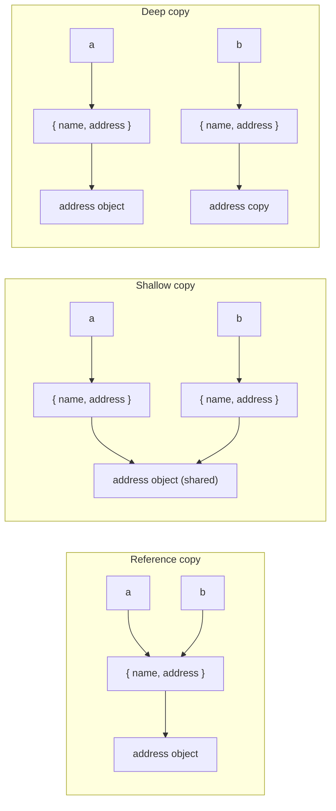
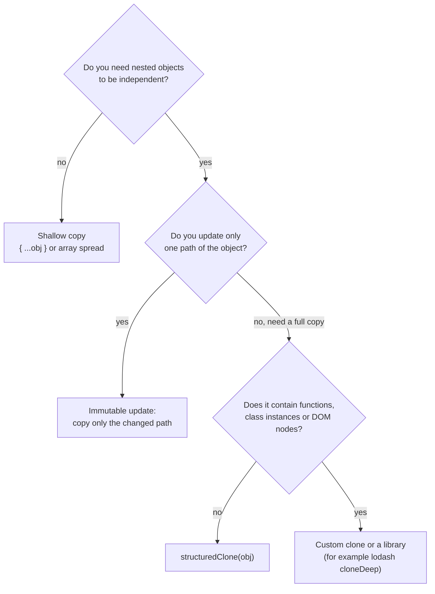
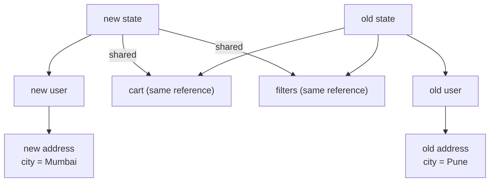

# Objects and copying

> In this document you will learn how JavaScript objects really work: how to create them, how properties are stored and ordered, how descriptors, `freeze` and `seal` control them, and — most important for interviews — why objects are shared by reference and how to copy them correctly (shallow copy, `structuredClone`, JSON pitfalls). You will also learn the immutable update patterns that Angular `OnPush`, NgRx and React depend on.

**Before this:** [Basics: variables, types and operators](01-basics-variables-types-operators.md) · [this, call, apply and bind](06-this-call-apply-bind.md) · **Interview questions:** [jump to the interview section](#interview-questions)

## Table of contents

1. [What an object is](#what-an-object-is)
2. [Creating objects](#creating-objects)
3. [Working with properties](#working-with-properties)
4. [Property order](#property-order)
5. [Listing and checking properties](#listing-and-checking-properties)
6. [Property descriptors, getters and setters](#property-descriptors-getters-and-setters)
7. [Freeze, seal and preventExtensions](#freeze-seal-and-preventextensions)
8. [Reference semantics and equality](#reference-semantics-and-equality)
9. [Copying objects](#copying-objects)
10. [Destructuring and spread](#destructuring-and-spread)
11. [Optional chaining and nullish coalescing](#optional-chaining-and-nullish-coalescing)
12. [JSON in depth](#json-in-depth)
13. [Shallow and deep equality](#shallow-and-deep-equality)
14. [Symbols, fromEntries and groupBy](#symbols-fromentries-and-groupby)
15. [Immutable update patterns](#immutable-update-patterns)
16. [Common mistakes](#common-mistakes)
17. [Best practices](#best-practices)
18. [How to explain copying in an interview](#how-to-explain-copying-in-an-interview)
19. [Interview questions](#interview-questions)
20. [Summary](#summary)
21. [References](#references)

---

## What an object is

An **object** is a collection of **properties**. Each property has a **key** (a name) and a **value**.

```js
const user = {
  id: 42,
  name: "Asha",
  isAdmin: false,
  address: { city: "Pune", pin: "411001" },
  greet() {
    return `Hi, ${this.name}`;
  },
};
```

- Keys are always **strings** or **symbols**. If you use a number as a key, it is converted to a string (`user[1]` is the same as `user["1"]`).
- Values can be anything: numbers, strings, other objects, arrays, functions.
- A property whose value is a function is called a **method**.

Everything that is not a primitive (string, number, bigint, boolean, undefined, null, symbol) is an object in JavaScript: arrays, functions, dates, maps, class instances, DOM elements.

Every object also has a hidden link to another object called its **prototype**. When a property is not found on the object itself, JavaScript looks at the prototype. That is how `user.toString()` works even though you never wrote `toString`. Prototypes have their own document: [Prototypes and inheritance](08-prototypes-and-inheritance.md).

---

## Creating objects

### 1. Object literal (most common)

```js
const product = { name: "Keyboard", price: 1500 };
```

Short, clear, fast. Use this by default.

### 2. Constructor function with `new`

```js
function Product(name, price) {
  this.name = name;
  this.price = price;
}
Product.prototype.withTax = function () {
  return this.price * 1.18;
};

const keyboard = new Product("Keyboard", 1500);
console.log(keyboard.withTax()); // 1770
```

This was the standard way to create many similar objects before classes (ES2015). See [Prototypes and inheritance](08-prototypes-and-inheritance.md#constructor-functions-and-what-new-does).

### 3. Class

```js
class Order {
  constructor(id, items) {
    this.id = id;
    this.items = items;
  }
  get itemCount() {
    return this.items.length;
  }
}

const order = new Order(1, ["pen", "book"]);
console.log(order.itemCount); // 2
```

Classes are covered in [Classes](09-classes.md).

### 4. `Object.create(proto)`

Creates a new object whose prototype is `proto`.

```js
const baseLogger = {
  log(message) {
    console.log(`[${this.prefix}] ${message}`);
  },
};

const apiLogger = Object.create(baseLogger);
apiLogger.prefix = "api";
apiLogger.log("request sent"); // [api] request sent
```

`Object.create(null)` creates an object with **no prototype** at all — useful for safe dictionaries. See [Object.create and Object.create(null)](08-prototypes-and-inheritance.md#objectcreate-and-objectcreatenull).

### 5. Factory function

A normal function that returns a new object literal. No `new`, no `this` problems.

```js
function createUser(name, role = "viewer") {
  return {
    name,
    role,
    canEdit() {
      return role === "editor" || role === "admin";
    },
  };
}

console.log(createUser("Ravi", "editor").canEdit()); // true
```

### 6. `new Object()`

```js
const settings = new Object(); // same as {}
settings.theme = "dark";
```

Valid but longer. Nobody uses it in modern code.

### Which one to choose

| Way | Use it when |
| --- | --- |
| Object literal | One-off objects, configuration, data from APIs |
| Factory function | You need several objects with private state (closures) |
| Class | Many instances with shared methods, inheritance, framework code (Angular) |
| `Object.create` | You need a specific prototype, or no prototype (`null`) |
| Constructor function | Legacy code; prefer classes for new code |

---

## Working with properties

### Dot vs bracket notation

```js
const user = { name: "Asha", "favourite color": "blue", 2024: "joined" };

console.log(user.name);               // Asha        — dot: fixed, valid identifier names
console.log(user["favourite color"]); // blue        — bracket: any string, spaces allowed
console.log(user[2024]);              // joined      — the number becomes the string "2024"

const field = "name";
console.log(user[field]);             // Asha        — bracket: dynamic key from a variable
console.log(user.field);              // undefined   — looks for a property literally named "field"
```

Rules:

- Use **dot** for fixed names that are valid identifiers.
- Use **bracket** for dynamic keys, keys with spaces or dashes, keys that start with a digit, and symbols.

### Computed keys

Use `[expression]` in an object literal to compute the key:

```js
const field = "status";
const filter = {
  [field]: "active",
  [`${field}UpdatedAt`]: "2024-05-01",
};
console.log(filter); // { status: 'active', statusUpdatedAt: '2024-05-01' }
```

A realistic use: one change handler for many form fields.

```js
function updateField(form, fieldName, value) {
  return { ...form, [fieldName]: value };
}

const form = { email: "", password: "" };
console.log(updateField(form, "email", "asha@example.com"));
// { email: 'asha@example.com', password: '' }
```

### Shorthand properties and methods

```js
const name = "Asha";
const age = 30;

// Instead of { name: name, age: age, greet: function () { ... } }
const person = {
  name,
  age,
  greet() {
    return `Hi, ${this.name}`;
  },
};
```

### Adding, changing and deleting

```js
const cart = { items: 2 };
cart.total = 450;    // add
cart.items = 3;      // change
delete cart.total;   // remove the property completely
console.log(cart);   // { items: 3 }
console.log(cart.total); // undefined
```

`delete` removes the property. Setting `cart.total = undefined` keeps the key with the value `undefined`, which still shows up in `Object.keys`. Note that `delete` can make V8's internal object layout slower in hot code; in most application code this does not matter. For immutable code, use rest destructuring instead (shown later).

### Keys are converted to strings

```js
const lookup = {};
const keyA = { id: 1 };
const keyB = { id: 2 };

lookup[keyA] = "first";
lookup[keyB] = "second";

console.log(lookup[keyA]);       // second
console.log(Object.keys(lookup)); // [ '[object Object]' ]
```

Both objects become the same string `"[object Object]"`, so the second assignment overwrites the first. If you need objects as keys, use a `Map` or `WeakMap`. See [Map, Set, WeakMap and WeakSet](12-map-set-weakmap-weakset.md).

---

## Property order

Many people think object properties have no order. They do. Since ES2015 (and fully for `for...in` and `Object.keys` since ES2020), own keys follow this order:

1. **Integer-like keys** (array index style: `"0"`, `"1"`, `"42"`) in **ascending numeric order**.
2. **Other string keys** in **insertion order** (the order you added them).
3. **Symbol keys** in insertion order (only methods that return symbols show them).

```js
const id = Symbol("id");
const record = { b: 1, 2: "two", a: 2, 1: "one", [id]: 3, "-1": "neg", "01": "zero-one" };

console.log(Object.keys(record));
// [ '1', '2', 'b', 'a', '-1', '01' ]

console.log(Reflect.ownKeys(record));
// [ '1', '2', 'b', 'a', '-1', '01', Symbol(id) ]
```

Why are `"-1"` and `"01"` not first? Only **canonical non-negative integers** count as integer-like. `"-1"` is negative and `"01"` has a leading zero, so they are treated as normal strings in insertion order.

Real-world impact: if an API returns `{ "10": ..., "2": ..., "1": ... }` keyed by ID and you show the keys in a dropdown, they will be sorted numerically, not in the order the server sent them. If order matters, use an array or a `Map` (which keeps insertion order for all keys).

---

## Listing and checking properties

### Object.keys, Object.values, Object.entries

```js
const stock = { pens: 10, books: 4, bags: 0 };

console.log(Object.keys(stock));    // [ 'pens', 'books', 'bags' ]
console.log(Object.values(stock));  // [ 10, 4, 0 ]
console.log(Object.entries(stock)); // [ [ 'pens', 10 ], [ 'books', 4 ], [ 'bags', 0 ] ]

// A realistic use: build a query string
const params = { page: 2, size: 20, sort: "price" };
const query = Object.entries(params)
  .map(([key, value]) => `${key}=${encodeURIComponent(value)}`)
  .join("&");
console.log(query); // page=2&size=20&sort=price

// Find out-of-stock items
const outOfStock = Object.entries(stock)
  .filter(([, count]) => count === 0)
  .map(([item]) => item);
console.log(outOfStock); // [ 'bags' ]
```

All three return only **own**, **enumerable**, **string** keys.

### for...in includes inherited properties

`for...in` loops over own **and inherited** enumerable string keys.

```js
const defaults = { theme: "light" };
const settings = Object.create(defaults); // settings inherits from defaults
settings.language = "en";

for (const key in settings) {
  console.log(key); // language, then theme (inherited!)
}

console.log(Object.keys(settings)); // [ 'language' ]
```

Because of this, `for...in` is risky. Prefer `Object.keys/values/entries` with `for...of`. If you must use `for...in`, check `Object.hasOwn(obj, key)` inside the loop.

### hasOwnProperty vs Object.hasOwn vs in

```js
const settings = Object.create({ theme: "light" });
settings.language = "en";

console.log("language" in settings);              // true  — own
console.log("theme" in settings);                 // true  — inherited counts for `in`
console.log(Object.hasOwn(settings, "theme"));    // false — only own properties
console.log(settings.hasOwnProperty("language")); // true  — older way
```

| Check | Own properties | Inherited properties | Safe on any object |
| --- | --- | --- | --- |
| `key in obj` | Yes | Yes | Yes |
| `obj.hasOwnProperty(key)` | Yes | No | No (see below) |
| `Object.hasOwn(obj, key)` (ES2022) | Yes | No | Yes |
| `obj[key] !== undefined` | — | — | Wrong when the value is really `undefined` |

Why `hasOwnProperty` is not always safe:

```js
const dictionary = Object.create(null); // no prototype → no hasOwnProperty method
dictionary.word = "meaning";
// dictionary.hasOwnProperty("word"); // TypeError: dictionary.hasOwnProperty is not a function

const tricky = { hasOwnProperty: () => true }; // someone overrode it
console.log(tricky.hasOwnProperty("anything")); // true (wrong)

console.log(Object.hasOwn(dictionary, "word"));   // true
console.log(Object.hasOwn(tricky, "anything"));   // false
```

Use **`Object.hasOwn`** in modern code.

### Seeing every kind of key

| Method | Own | Inherited | Non-enumerable | Symbols |
| --- | --- | --- | --- | --- |
| `Object.keys` / `values` / `entries` | Yes | No | No | No |
| `for...in` | Yes | Yes | No | No |
| `Object.getOwnPropertyNames` | Yes | No | Yes | No |
| `Object.getOwnPropertySymbols` | Yes | No | Yes | Only symbols |
| `Reflect.ownKeys` | Yes | No | Yes | Yes |
| `JSON.stringify` | Yes | No | No | No |
| Spread `{ ...obj }` / `Object.assign` | Yes | No | No | Yes |

---

## Property descriptors, getters and setters

### What a descriptor is

Every property has hidden settings called **attributes**. The object that describes them is a **property descriptor**.

A **data property** has:

- `value` — the stored value.
- `writable` — can the value be changed?
- `enumerable` — does it show up in `Object.keys`, `for...in`, spread and `JSON.stringify`?
- `configurable` — can the property be deleted, or its attributes changed?

```js
const user = { name: "Asha" };
console.log(Object.getOwnPropertyDescriptor(user, "name"));
// { value: 'Asha', writable: true, enumerable: true, configurable: true }
```

Properties created normally (literal or assignment) have all three flags `true`.

### Object.defineProperty

`Object.defineProperty` creates or changes a property with exact attributes. **Any flag you do not mention defaults to `false`.**

```js
"use strict";

const order = { total: 500 };
Object.defineProperty(order, "id", { value: 7 }); // writable/enumerable/configurable all false

console.log(order.id);              // 7
console.log(Object.keys(order));    // [ 'total' ] — id is not enumerable
console.log(JSON.stringify(order)); // {"total":500}

order.id = 8;    // TypeError: Cannot assign to read only property 'id'
delete order.id; // TypeError: Cannot delete property 'id'
```

In sloppy mode, the failed assignment and delete are silently ignored instead of throwing. That is another reason to use strict mode.

Realistic uses:

- Hide internal metadata from `JSON.stringify` and loops (`enumerable: false`).
- Make an ID read-only (`writable: false`).
- Libraries use it to add non-enumerable helper methods.

`Object.defineProperties(obj, { a: {...}, b: {...} })` defines many at once.

### Getters and setters (accessor properties)

An **accessor property** has `get` and/or `set` functions instead of `value`/`writable`. It looks like a normal property from outside, but runs code when read or written.

```js
const temperature = {
  celsius: 25,
  get fahrenheit() {
    return this.celsius * 1.8 + 32;
  },
  set fahrenheit(value) {
    this.celsius = (value - 32) / 1.8;
  },
};

console.log(temperature.fahrenheit); // 77
temperature.fahrenheit = 212;
console.log(temperature.celsius);    // 100
```

A realistic use is validation:

```js
class Product {
  #price = 0;

  get price() {
    return this.#price;
  }

  set price(value) {
    if (typeof value !== "number" || value < 0) {
      throw new RangeError("Price must be a non-negative number");
    }
    this.#price = value;
  }
}

const pen = new Product();
pen.price = 20;
console.log(pen.price); // 20
// pen.price = -5;      // RangeError
```

Notes:

- A getter without a setter makes a read-only property (assignment fails: silently in sloppy mode, `TypeError` in strict mode).
- Getters run every time you read the property. Keep them cheap. Do not call them in tight loops if they do heavy work.
- In Angular templates, a getter that does heavy work runs on every change detection cycle. Prefer precomputed values or pure pipes. See [Angular performance](../06-angular-16/12-performance.md).

---

## Freeze, seal and preventExtensions

These three methods lock an object at different levels.

```js
"use strict";

const config = Object.freeze({ apiUrl: "/api", retries: 3 });
config.retries = 5;   // TypeError: Cannot assign to read only property 'retries'
config.timeout = 100; // TypeError: Cannot add property timeout, object is not extensible
delete config.apiUrl; // TypeError: Cannot delete property 'apiUrl'

const draft = Object.seal({ title: "Draft" });
draft.title = "Final";  // OK — existing properties can change
// draft.author = "A";  // TypeError — cannot add
// delete draft.title;  // TypeError — cannot delete

const profile = Object.preventExtensions({ name: "Asha" });
profile.name = "Ravi";  // OK
delete profile.name;    // OK — deleting is allowed
// profile.age = 30;    // TypeError — cannot add
```

| Method | Add new properties | Delete properties | Change values | Check with |
| --- | --- | --- | --- | --- |
| `Object.preventExtensions` | No | Yes | Yes | `Object.isExtensible` |
| `Object.seal` | No | No | Yes | `Object.isSealed` |
| `Object.freeze` | No | No | No | `Object.isFrozen` |

In sloppy mode, all the forbidden operations fail **silently** (no error). In strict mode, they throw a `TypeError`.

### All three are shallow

```js
const settings = Object.freeze({
  theme: "dark",
  shortcuts: ["ctrl+s", "ctrl+p"],
});

settings.shortcuts.push("ctrl+z"); // works! The array itself is not frozen
console.log(settings.shortcuts);   // [ 'ctrl+s', 'ctrl+p', 'ctrl+z' ]
```

`freeze` locks only the top level. Nested objects are still mutable. To freeze everything, freeze recursively:

```js
function deepFreeze(object) {
  for (const key of Reflect.ownKeys(object)) {
    const value = object[key];
    if (value && typeof value === "object" && !Object.isFrozen(value)) {
      deepFreeze(value);
    }
  }
  return Object.freeze(object);
}

const appConfig = deepFreeze({ features: { darkMode: true }, roles: ["admin"] });
console.log(Object.isFrozen(appConfig.features)); // true
console.log(Object.isFrozen(appConfig.roles));    // true
```

The `!Object.isFrozen(value)` check also stops infinite loops when objects reference each other (cycles).

### const is not freeze

```js
const user = { name: "Asha" };
user.name = "Ravi"; // allowed: const protects the VARIABLE, not the object
// user = {};       // TypeError: Assignment to constant variable
```

`const` means the variable always points to the same object. The object itself can still change. `Object.freeze` protects the object, not the variable.

### Where freezing is used

- Configuration objects and constants (`Object.freeze(ORDER_STATUSES)`).
- Protection for state. NgRx has runtime checks (`strictStateImmutability`, `strictActionImmutability`) that freeze state and actions in development mode, so accidental mutations throw an error. Immer (used inside Redux Toolkit) freezes the state objects it produces.
- Deep freezing has a cost (it walks the whole object), which is why NgRx runs these checks only in development builds.

---

## Reference semantics and equality

### Variables hold references to objects

A variable does not contain the object itself. It contains a **reference**: something like the address of the object in memory. When you assign the variable to another variable, you copy the **reference**, not the object.

```js
const original = { name: "Asha", score: 10 };
const alias = original;   // copies the reference — both point to ONE object

alias.score = 99;
console.log(original.score); // 99
console.log(alias === original); // true
```

Analogy: an object is a house, and a variable holds the house's address on a piece of paper. Copying the variable copies the paper, not the house. Two papers, one house. If someone paints the house using one paper, the other paper's owner sees the new color.

### Passing objects to functions

JavaScript always passes arguments **by value**. For objects, the value that is passed **is the reference**. So:

- The function **can change the object** (both references point to the same house).
- The function **cannot replace** the caller's variable (reassigning the parameter changes only the local copy of the reference).

```js
function applyDiscount(product) {
  product.price = product.price * 0.9; // changes the shared object
  product = { name: "Other", price: 0 }; // only changes the local parameter
  return product;
}

const pen = { name: "Pen", price: 100 };
const result = applyDiscount(pen);
console.log(pen);    // { name: 'Pen', price: 90 }   — mutated
console.log(result); // { name: 'Other', price: 0 }  — the new local object
```

This is the source of many bugs: a helper function "accidentally" changes data that other parts of the app also use. That is why many teams write functions that **return new objects** instead of changing their inputs. See [Basics: variables, types and operators](01-basics-variables-types-operators.md) for primitives vs objects.

### Object equality compares references

`===` (and `==`) on two objects is `true` only if both sides are **the same object**:

```js
const a = { id: 1 };
const b = { id: 1 };
const c = a;

console.log(a === b); // false — same content, different objects
console.log(a === c); // true  — same reference
console.log({} === {}); // false
```

To compare **content**, you need a shallow or deep equality function. See [Shallow and deep equality](#shallow-and-deep-equality).

---

## Copying objects

There are three levels of "copy":

| Level | What you get | Nested objects |
| --- | --- | --- |
| Reference copy (`b = a`) | No new object at all | Shared |
| **Shallow copy** | A new top-level object | Still shared |
| **Deep copy** | New objects at every level | Not shared |



### Shallow copy with spread or Object.assign

```js
const user = { name: "Asha", address: { city: "Pune" } };

const copy1 = { ...user };              // spread (ES2018)
const copy2 = Object.assign({}, user);  // Object.assign (ES2015)

copy1.name = "Ravi";                    // top level: independent
console.log(user.name);                 // Asha

copy1.address.city = "Mumbai";          // nested: SHARED
console.log(user.address.city);         // Mumbai  ← the original changed too
console.log(copy1.address === user.address); // true
```

Both copy only **own enumerable** properties (string and symbol keys). Things a shallow copy does **not** keep:

- The **prototype**. A copied class instance becomes a plain object (its methods are gone).
- **Getters and setters**. The getter is **called**, and its current result is stored as a normal value.
- **Non-enumerable** properties.
- Property attributes (`writable: false` becomes a normal writable property).

```js
class Cart {
  items = ["pen"];
  get count() { return this.items.length; }
}

const cart = new Cart();
const cartCopy = { ...cart };
console.log(cartCopy);                  // { items: [ 'pen' ] }  — no count, no Cart prototype
console.log(cartCopy instanceof Cart);  // false
```

If you really need an exact shallow clone with prototype, getters and attributes:

```js
const exactClone = Object.create(
  Object.getPrototypeOf(cart),
  Object.getOwnPropertyDescriptors(cart),
);
console.log(exactClone instanceof Cart); // true
console.log(exactClone.count);           // 1
```

### Spread vs Object.assign

| | `{ ...source }` | `Object.assign(target, source)` |
| --- | --- | --- |
| Creates a new object | Yes | No — it **mutates** `target` and returns it |
| Triggers setters on the target | No (defines new properties) | Yes (uses assignment) |
| Typical use | Immutable copies and merges | Adding properties to an existing object |

```js
const defaults = { theme: "light", pageSize: 20 };
const userPrefs = { pageSize: 50 };

const settings = { ...defaults, ...userPrefs }; // later sources win
console.log(settings); // { theme: 'light', pageSize: 50 }

// ❌ Common mistake: mutates `defaults`
Object.assign(defaults, userPrefs);
// ✅ Correct: start with a new empty object
const settings2 = Object.assign({}, defaults, userPrefs);
```

### Deep copy with structuredClone

`structuredClone(value)` creates a real deep copy. It is a global function in all modern browsers (since 2022) and in Node.js 17+. It uses the **structured clone algorithm**, the same one used to send data to Web Workers with `postMessage`.

```js
const order = {
  id: 7,
  createdAt: new Date("2024-03-01T10:00:00Z"),
  items: [{ sku: "PEN", qty: 2 }],
  tags: new Set(["gift"]),
  meta: new Map([["source", "web"]]),
};
order.self = order; // a cycle

const clone = structuredClone(order);

clone.items[0].qty = 10;
console.log(order.items[0].qty);           // 2 — not shared
console.log(clone.createdAt instanceof Date); // true — Date kept
console.log(clone.tags.has("gift"));       // true — Set kept
console.log(clone.self === clone);         // true — cycle kept correctly
```

What `structuredClone` **can** copy: plain objects, arrays, primitives (except symbols), `Date`, `RegExp`, `Map`, `Set`, `ArrayBuffer`, typed arrays, `Blob`/`File` (browsers), `Error` objects, and circular references.

What it **cannot** copy, or copies differently:

| Value | Result |
| --- | --- |
| Functions (including methods on the object) | Throws `DataCloneError` |
| DOM nodes | Throws `DataCloneError` |
| Class instances | Copied as **plain objects** — the prototype and methods are lost |
| Getters/setters | The getter's current value is copied as a normal property |
| Non-enumerable properties | Skipped |
| Symbol-keyed properties | Skipped |
| Property attributes (`writable`, etc.) | Lost — all copies are plain writable properties |

```js
try {
  structuredClone({ save() {} });
} catch (error) {
  console.log(error.name); // DataCloneError
}

class User {
  constructor(name) { this.name = name; }
  greet() { return `Hi ${this.name}`; }
}
const copy = structuredClone(new User("Asha"));
console.log(copy instanceof User, copy); // false { name: 'Asha' }
```

### Deep copy with JSON (and why it is risky)

Before `structuredClone`, people used `JSON.parse(JSON.stringify(obj))`. It works only for **plain JSON data**:

```js
const source = {
  createdAt: new Date(0),
  discount: undefined,
  format() {},
  price: NaN,
  limit: Infinity,
  tags: new Set(["a"]),
  lookup: new Map([["x", 1]]),
  list: [undefined, () => 1],
};

console.log(JSON.parse(JSON.stringify(source)));
// {
//   createdAt: '1970-01-01T00:00:00.000Z',   ← Date became a STRING
//   price: null,                              ← NaN became null
//   limit: null,                              ← Infinity became null
//   tags: {},                                 ← Set became an empty object
//   lookup: {},                               ← Map became an empty object
//   list: [ null, null ]                      ← undefined/functions in arrays became null
// }
// discount and format disappeared completely
```

It also **throws** for cycles (`TypeError: Converting circular structure to JSON`) and for `BigInt` values (`TypeError: Do not know how to serialize a BigInt`).

Use JSON cloning only when you know the data is plain JSON (for example, a response you just received from an API). For everything else, use `structuredClone`.

### Custom deep clone (core idea)

You may be asked to write a deep clone in an interview. The core idea: recurse into objects and arrays, copy primitives as they are, and use a `WeakMap` to remember already-copied objects so cycles do not loop forever.

```js
function deepClone(value, seen = new WeakMap()) {
  if (value === null || typeof value !== "object") return value; // primitives and functions
  if (seen.has(value)) return seen.get(value);                     // cycle: reuse the copy
  if (value instanceof Date) return new Date(value.getTime());

  const copy = Array.isArray(value) ? [] : Object.create(Object.getPrototypeOf(value));
  seen.set(value, copy);

  for (const key of Reflect.ownKeys(value)) {
    copy[key] = deepClone(value[key], seen);
  }
  return copy;
}

const team = { name: "Core", lead: { name: "Asha" }, joined: new Date(0) };
team.self = team;

const teamCopy = deepClone(team);
teamCopy.lead.name = "Ravi";
console.log(team.lead.name);               // Asha
console.log(teamCopy.self === teamCopy);   // true
console.log(teamCopy.joined instanceof Date); // true
```

This version keeps the prototype and symbol keys, which `structuredClone` does not. It does not handle `Map`, `Set`, typed arrays or getters. The full version with all cases is in [JavaScript polyfills and implementations](../11-coding-interviews/04-javascript-polyfills-and-implementations.md).

### Which copy to use



Notice the middle branch. In real apps, you rarely need a full deep copy. You usually need to change **one** nested value without mutating the original. That is an [immutable update](#immutable-update-patterns), which copies only the path that changes and shares everything else (cheaper and faster).

---

## Destructuring and spread

### Object destructuring

**Destructuring** pulls properties out of an object into variables.

```js
const response = {
  status: 200,
  data: { user: { id: 7, name: "Asha", email: null } },
  headers: { "content-type": "application/json" },
};

// basic
const { status } = response;

// rename
const { status: httpStatus } = response;

// nested
const { data: { user: { name } } } = response;

// default values
const { timeout = 5000 } = response;

// rename + default
const { retries: maxRetries = 3 } = response;

// rest: collect the remaining properties
const { headers, ...withoutHeaders } = response;

console.log(status, httpStatus, name, timeout, maxRetries); // 200 200 Asha 5000 3
console.log(Object.keys(withoutHeaders)); // [ 'status', 'data' ]
```

**Defaults apply only for `undefined`**, not for `null`:

```js
const { a = 1, b = 2, c = 3 } = { a: undefined, b: null };
console.log(a, b, c); // 1 null 3
```

Destructuring `null` or `undefined` itself throws:

```js
function render({ title } = {}) { // default {} protects against render() with no argument
  return title ?? "Untitled";
}
console.log(render());                  // Untitled
console.log(render({ title: "Home" })); // Home
// const { title } = null;              // TypeError: Cannot destructure property 'title' of 'null'
```

Destructuring in function parameters is the standard way to accept **options objects**:

```js
function fetchProducts({ page = 1, size = 20, sort = "name" } = {}) {
  return `/api/products?page=${page}&size=${size}&sort=${sort}`;
}

console.log(fetchProducts({ size: 50 })); // /api/products?page=1&size=50&sort=name
```

### Removing a key without mutation

Rest destructuring is the immutable way to "delete" a property:

```js
const user = { id: 1, name: "Asha", password: "secret" };
const { password, ...safeUser } = user;

console.log(safeUser); // { id: 1, name: 'Asha' }
console.log(user);     // unchanged, still has password
```

This is a common pattern before sending user objects to the client.

### Object spread

```js
const base = { theme: "light", fontSize: 14 };

const merged = { ...base, fontSize: 16 };        // override
const withNew = { ...base, language: "en" };     // add
const order = { fontSize: 16, ...base };         // ORDER MATTERS: base overwrites fontSize

console.log(merged.fontSize, withNew.language, order.fontSize); // 16 en 14
```

Spreading `null` or `undefined` is allowed and adds nothing: `{ ...null }` is `{}`. That makes conditional properties easy:

```js
const includeDebug = false;
const options = { url: "/api", ...(includeDebug && { debug: true }) };
console.log(options); // { url: '/api' }
```

---

## Optional chaining and nullish coalescing

**Optional chaining** (`?.`, ES2020) stops and returns `undefined` if the value on the left is `null` or `undefined`, instead of throwing.

```js
const user = { profile: null, getName: undefined };

console.log(user.profile?.name);       // undefined (no TypeError)
console.log(user.settings?.theme);     // undefined
console.log(user.getName?.());         // undefined — call only if the function exists
console.log(user.tags?.[0]);           // undefined — bracket access
```

**Nullish coalescing** (`??`, ES2020) gives a default only for `null` or `undefined`. `||` gives a default for **any falsy** value (`0`, `""`, `false`, `NaN`), which is often wrong:

```js
const settings = { pageSize: 0, title: "", darkMode: false };

console.log(settings.pageSize || 20);   // 20  ❌ 0 was a valid value
console.log(settings.pageSize ?? 20);   // 0   ✅
console.log(settings.title ?? "Untitled"); // ""
console.log(settings.theme ?? "light"); // light
```

Combined, they make reading API data safe:

```js
const response = { data: { orders: [] } };
const firstOrderTotal = response.data?.orders?.[0]?.total ?? 0;
console.log(firstOrderTotal); // 0
```

Also useful: `??=` (ES2021) assigns only if the current value is `null` or `undefined`:

```js
const options = { retries: 0 };
options.retries ??= 3; // stays 0
options.timeout ??= 5000;
console.log(options);  // { retries: 0, timeout: 5000 }
```

Do not overuse `?.`. If a value **must** exist (for example, `user.id` after login), let the code fail loudly. Hiding real bugs with `?.` makes them harder to find. More on these operators in [Basics: variables, types and operators](01-basics-variables-types-operators.md).

---

## JSON in depth

**JSON** (JavaScript Object Notation) is a text format for data. `JSON.stringify` turns a value into a JSON string. `JSON.parse` turns a JSON string back into a value.

### JSON.stringify rules

| Value | In an object | In an array | At the top level |
| --- | --- | --- | --- |
| `undefined`, functions, symbols | Property is **skipped** | Becomes `null` | Returns `undefined` (not a string) |
| `NaN`, `Infinity`, `-Infinity` | `null` | `null` | `"null"` |
| `Date` | ISO string (via `toJSON`) | ISO string | ISO string |
| `Map`, `Set` | `{}` | `{}` | `"{}"` |
| `BigInt` | Throws `TypeError` | Throws | Throws |
| Circular reference | Throws `TypeError` | Throws | — |
| Non-enumerable or symbol keys | Skipped | — | — |

### The replacer argument

The second argument filters or transforms values.

```js
const account = { name: "Asha", password: "secret", age: 30 };

// array replacer: keep only these keys
console.log(JSON.stringify(account, ["name", "age"])); // {"name":"Asha","age":30}

// function replacer: return undefined to drop a value
console.log(JSON.stringify(account, (key, value) => (key === "password" ? undefined : value)));
// {"name":"Asha","age":30}
```

A function replacer is a simple way to hide secrets in logs.

### The space argument (pretty printing)

```js
console.log(JSON.stringify({ id: 1, tags: ["a", "b"] }, null, 2));
// {
//   "id": 1,
//   "tags": [
//     "a",
//     "b"
//   ]
// }
```

### toJSON: control how your object is serialized

If an object has a `toJSON` method, `JSON.stringify` uses its return value. That is how `Date` becomes an ISO string.

```js
class Money {
  constructor(amount, currency) {
    this.amount = amount;
    this.currency = currency;
  }
  toJSON() {
    return `${this.amount} ${this.currency}`;
  }
}

console.log(JSON.stringify({ total: new Money(500, "INR") })); // {"total":"500 INR"}
```

### The reviver argument

`JSON.parse(text, reviver)` lets you transform values while parsing. A common use is turning ISO strings back into `Date` objects:

```js
const json = '{"id":1,"createdAt":"2024-01-15T10:00:00.000Z"}';

const order = JSON.parse(json, (key, value) =>
  key === "createdAt" ? new Date(value) : value,
);

console.log(order.createdAt instanceof Date); // true
console.log(order.createdAt.getUTCFullYear()); // 2024
```

### Safety notes

- `JSON.parse` throws a `SyntaxError` on invalid input. Always wrap parsing of external data (local storage, messages, files) in `try/catch`.
- `JSON.parse` only creates data; it never runs code. But parsed data can still be dangerous when merged carelessly. For example, `JSON.parse('{"__proto__": {"isAdmin": true}}')` creates an **own** property named `__proto__`. If a naive deep-merge function later copies it with normal assignment, it can change the prototype of objects (**prototype pollution**). Validate input and use safe merge functions. See [Web security](../01-cs-and-web-fundamentals/08-browser-storage-and-web-security-basics.md) and [Runtime validation](../03-typescript/11-runtime-validation-and-type-safe-apis.md).

---

## Shallow and deep equality

### Shallow equality

Two objects are **shallowly equal** if they have the same keys and each value is `===` (or `Object.is`) equal. Nested objects are compared by reference.

```js
function shallowEqual(a, b) {
  if (Object.is(a, b)) return true;
  if (typeof a !== "object" || typeof b !== "object" || a === null || b === null) return false;

  const keysA = Object.keys(a);
  const keysB = Object.keys(b);
  if (keysA.length !== keysB.length) return false;

  return keysA.every((key) => Object.hasOwn(b, key) && Object.is(a[key], b[key]));
}

const address = { city: "Pune" };
console.log(shallowEqual({ id: 1, address }, { id: 1, address }));               // true
console.log(shallowEqual({ id: 1, address }, { id: 1, address: { city: "Pune" } })); // false
```

React uses shallow comparison for `React.memo` props and for some state checks. NgRx `createSelector` compares inputs by reference to decide whether to recompute.

### Deep equality

**Deep equality** compares nested content recursively.

```js
function deepEqual(a, b) {
  if (Object.is(a, b)) return true;
  if (typeof a !== "object" || typeof b !== "object" || a === null || b === null) return false;
  if (Array.isArray(a) !== Array.isArray(b)) return false;

  const keysA = Object.keys(a);
  const keysB = Object.keys(b);
  if (keysA.length !== keysB.length) return false;

  return keysA.every((key) => Object.hasOwn(b, key) && deepEqual(a[key], b[key]));
}

console.log(deepEqual({ id: 1, tags: ["a"] }, { id: 1, tags: ["a"] })); // true
console.log(deepEqual({ id: 1 }, { id: 1, extra: undefined }));         // false
```

This version handles plain objects and arrays. It does not handle `Date`, `Map`, `Set` or cycles. For tests, use your framework's helpers (Jest/Vitest `toEqual`, Node.js `assert.deepStrictEqual`). Node.js also has `util.isDeepStrictEqual(a, b)`.

### Why JSON.stringify is a bad equality check

```js
console.log(JSON.stringify({ a: 1, b: 2 }) === JSON.stringify({ b: 2, a: 1 })); // false
```

Same content, different key order → different strings. It also ignores `undefined` values, functions and symbol keys, and treats `NaN` as `null`.

---

## Symbols, fromEntries and groupBy

### Symbols as keys

A **symbol** is a unique value, often used as a property key that cannot clash with other keys.

```js
const internalId = Symbol("internalId");
const product = { name: "Pen", [internalId]: "p-001" };

console.log(product[internalId]);                    // p-001
console.log(Object.keys(product));                   // [ 'name' ]
console.log(JSON.stringify(product));                // {"name":"Pen"}
console.log(Object.getOwnPropertySymbols(product));  // [ Symbol(internalId) ]
```

Symbol keys are skipped by `Object.keys`, `for...in` and `JSON.stringify`, but **copied by spread and `Object.assign`**. They are hidden from casual code, not private: `Reflect.ownKeys` shows them. Well-known symbols like `Symbol.iterator` and `Symbol.toPrimitive` let you customize language behavior (see [Iterators and generators](13-iterators-and-generators.md) and [Type coercion and equality](02-type-coercion-and-equality.md)).

### Object.fromEntries

`Object.fromEntries` (ES2019) is the reverse of `Object.entries`. Together they let you "map over an object":

```js
const prices = { pen: 10, book: 250, bag: 900 };

const withTax = Object.fromEntries(
  Object.entries(prices).map(([item, price]) => [item, Math.round(price * 1.18)]),
);
console.log(withTax); // { pen: 12, book: 295, bag: 1062 }

const expensive = Object.fromEntries(
  Object.entries(prices).filter(([, price]) => price > 100),
);
console.log(expensive); // { book: 250, bag: 900 }

// It also accepts a Map or URLSearchParams
const params = new URLSearchParams("page=2&sort=price");
console.log(Object.fromEntries(params)); // { page: '2', sort: 'price' }
```

### Object.groupBy (ES2024)

`Object.groupBy(items, callback)` groups items into an object of arrays, keyed by whatever the callback returns. It is available in modern browsers and Node.js 21+.

```js
const orders = [
  { id: 1, status: "paid", total: 500 },
  { id: 2, status: "pending", total: 200 },
  { id: 3, status: "paid", total: 300 },
];

const byStatus = Object.groupBy(orders, (order) => order.status);
console.log(byStatus.paid.map((o) => o.id));    // [ 1, 3 ]
console.log(byStatus.pending.map((o) => o.id)); // [ 2 ]
console.log(Object.getPrototypeOf(byStatus));   // null
```

Note: the result has a **`null` prototype**, so it has no `toString` or `hasOwnProperty` methods. Use `Object.hasOwn(byStatus, "paid")` to check keys. `Map.groupBy` does the same but returns a `Map` (useful when keys are objects).

Before ES2024, you would write the same with `reduce`:

```js
const grouped = orders.reduce((groups, order) => {
  (groups[order.status] ??= []).push(order);
  return groups;
}, {});
```

---

## Immutable update patterns

**Immutable update** means: never change an existing object; create a new object with the change. Unchanged parts are **shared** (not copied), so this is cheap.

### Why frameworks need it

Frameworks detect changes by checking **references**, because comparing references is very fast and comparing content deeply is slow.

- **Angular `OnPush`:** a component with `ChangeDetectionStrategy.OnPush` is checked when one of its `@Input` **references** changes (or an event happens inside it, or an `async` pipe emits, or you mark it for check). If the parent mutates an array in place, the reference is the same, so the child does not update.
- **NgRx:** reducers must return a **new** state object. Selectors created with `createSelector` are memoized by input reference. Mutating state breaks both.
- **React:** `setState` with the same reference is ignored (`Object.is` check). `React.memo` and `useMemo` compare by reference.

See [Angular change detection](../06-angular-16/10-change-detection-and-signals.md), [NgRx](../06-angular-16/11-state-management-and-ngrx.md) and [Components and state management](../05-frontend-engineering/06-components-and-state-management.md).

### The patterns

```js
const state = {
  user: { id: 1, name: "Asha", address: { city: "Pune", pin: "411001" } },
  cart: [
    { id: "p1", name: "Pen", qty: 1 },
    { id: "p2", name: "Book", qty: 2 },
  ],
  filters: { inStock: true },
};

// 1. Update a nested property: copy every object on the path
const moved = {
  ...state,
  user: {
    ...state.user,
    address: { ...state.user.address, city: "Mumbai" },
  },
};

// 2. Add an item to an array
const added = { ...state, cart: [...state.cart, { id: "p3", name: "Bag", qty: 1 }] };

// 3. Update one item in an array by id
const updated = {
  ...state,
  cart: state.cart.map((item) => (item.id === "p2" ? { ...item, qty: item.qty + 1 } : item)),
};

// 4. Remove an item from an array
const removed = { ...state, cart: state.cart.filter((item) => item.id !== "p1") };

// 5. Remove a key from an object
const { inStock, ...otherFilters } = state.filters;
const noStockFilter = { ...state, filters: otherFilters };

console.log(state.user.address.city);         // Pune — original untouched
console.log(moved.user.address.city);         // Mumbai
console.log(moved.cart === state.cart);       // true — unchanged parts are shared
console.log(updated.cart[1].qty, state.cart[1].qty); // 3 2
console.log(updated.cart[0] === state.cart[0]);      // true — untouched item shared
console.log(removed.cart.length, added.cart.length); // 1 3
console.log(noStockFilter.filters);           // {}
```

The rule: **copy every object on the path from the root to the change; share everything else.**



ES2023 also added **change-by-copy** array methods that return new arrays: `toSorted`, `toReversed`, `toSpliced` and `with(index, value)`. See [Arrays and array methods](10-arrays-and-array-methods.md).

### In an NgRx reducer (Angular 16)

```ts
export const cartReducer = createReducer(
  initialState,
  on(CartActions.increaseQuantity, (state, { productId }) => ({
    ...state,
    items: state.items.map((item) =>
      item.id === productId ? { ...item, qty: item.qty + 1 } : item,
    ),
  })),
);
```

### Libraries that help

Deep spreads get long. **Immer** lets you write "mutating" code on a draft and produces an immutable result for you (Redux Toolkit uses it inside). Angular signals work best with new references too. In Angular 16 (developer preview), the default equality check treats every object as changed, so even a mutated object notifies readers. From Angular 17 the check is `Object.is`, so a mutated object with the same reference does **not** notify. Creating a new object in `set` or `update` works correctly in both versions.

---

## Common mistakes

**1. Thinking spread makes a deep copy.** It copies only the top level. Nested objects are shared.

**2. Mutating inputs in functions.**

```js
// ❌ Wrong: changes the caller's object
function addTax(order) {
  order.total = order.total * 1.18;
  return order;
}

// ✅ Correct: return a new object
function addTaxSafe(order) {
  return { ...order, total: order.total * 1.18 };
}
```

**3. Using `JSON.parse(JSON.stringify())` on data with dates, `undefined`, `Map`, `Set` or class instances.** Dates become strings; the others are lost or broken. Use `structuredClone`.

**4. Using `Object.assign(existing, ...)` when you wanted a new object.** It mutates `existing`. Use `Object.assign({}, ...)` or spread.

**5. Comparing objects with `===` to check content.** It compares references.

**6. Using `||` for defaults when `0`, `""` or `false` are valid.** Use `??`.

**7. Using `for...in` without an own-property check.** It also loops over inherited enumerable keys.

**8. Expecting `Object.freeze` or `const` to protect nested data.** Both are shallow / about the variable.

**9. Using objects as dictionaries for user-controlled keys.** Keys like `"__proto__"`, `"constructor"` or `"toString"` collide with built-in behavior. Use `Map` or `Object.create(null)`.

**10. Mutating state in Angular `OnPush` components or NgRx reducers.** The UI does not update, or selectors return stale results.

---

## Best practices

- **Default to object literals and immutable updates.** Reason: predictable data flow and correct change detection in Angular, NgRx and React.
- **Use `structuredClone` for real deep copies of data.** Reason: it handles dates, maps, sets and cycles; JSON cloning silently corrupts them.
- **Copy only the changed path instead of deep-cloning everything.** Reason: it is faster and keeps unchanged references stable, which helps memoization.
- **Use `Object.hasOwn` for own-property checks.** Reason: it works on null-prototype objects and cannot be overridden.
- **Use `??` and `?.` for optional data, but not for required data.** Reason: required data that is missing is a bug and should fail loudly.
- **Use `Map` for dynamic keys** (IDs, user input, object keys). Reason: no prototype collisions, any key type, insertion order for all keys.
- **Freeze configuration and constants.** Reason: accidental writes then throw in strict mode instead of silently changing behavior.
- **Validate parsed JSON from outside your app.** Reason: `JSON.parse` gives you untyped data; TypeScript types do not exist at runtime.

---

## How to explain copying in an interview

1. **Define it:** "Objects are stored by reference. Assigning an object to another variable copies the reference, not the object. A shallow copy creates a new top-level object but shares nested objects. A deep copy creates new objects at every level."
2. **Why it matters:** "If two parts of the app share a reference, a change in one place changes the other. And frameworks like Angular `OnPush`, NgRx and React detect changes by reference, so mutating in place can stop the UI from updating."
3. **How it works:** "Spread and `Object.assign` copy own enumerable properties one level deep. `structuredClone` uses the structured clone algorithm to copy deeply, including dates, maps, sets and cycles, but it throws on functions and loses class prototypes. `JSON.parse(JSON.stringify())` only works for plain JSON: dates become strings, and `undefined`, functions, maps and sets are lost."
4. **Small example:** "If I spread a user with a nested address and change `copy.address.city`, the original changes too, because the address object is shared."
5. **Where it is useful:** "In state updates I copy only the path that changes — new state, new user, new address — and share the rest. That is cheap and gives new references exactly where something changed."
6. **Trade-offs / gotchas:** "Deep cloning everything is slow and breaks reference equality for memoization. `Object.freeze` and `const` are shallow. And copying class instances with spread or `structuredClone` loses their methods."

---

## Interview questions

### Q1. What is the difference between a shallow copy and a deep copy?

**What the interviewer is checking:** Understanding of references, nested objects, and the practical tools for each kind of copy.

**Short spoken answer (30–60 seconds):**
> Objects are stored by reference, so `b = a` doesn't copy anything — both variables point to the same object. A shallow copy, like `{ ...obj }` or `Object.assign({}, obj)`, creates a new top-level object, but nested objects are still shared, so changing `copy.address.city` also changes the original. A deep copy creates new objects at every level, so nothing is shared. For a deep copy I use `structuredClone`, which handles dates, maps, sets and circular references. In state management, though, I usually don't deep copy at all — I copy only the path that changes and share the rest.

**Detailed explanation:**
Spread and `Object.assign` copy own enumerable properties one level deep; they lose prototypes and turn getters into plain values. `structuredClone` copies deeply but throws for functions and DOM nodes and drops prototypes, symbol keys and non-enumerable properties. `JSON.parse(JSON.stringify())` only works for plain JSON data.

**Code:**

```js
const user = { name: "Asha", address: { city: "Pune" } };

const shallow = { ...user };
shallow.address.city = "Mumbai";
console.log(user.address.city); // Mumbai — shared nested object

const deep = structuredClone(user);
deep.address.city = "Delhi";
console.log(user.address.city); // Mumbai — not affected
```

**Follow-up questions:**
- **Is array spread `[...arr]` shallow or deep?** — Shallow. The new array holds the same object references as the old one.
- **When is a shallow copy enough?** — When the object is flat, or when you will not change nested values (or you will replace them with new objects instead of mutating them).
- **Why not always deep copy to be safe?** — It costs time and memory, and it creates new references for everything, which breaks reference-based memoization (`OnPush`, `createSelector`, `React.memo`). Copy only what changes.

**Common mistakes:** Calling spread a deep copy. Saying `const` makes objects immutable. Not knowing `structuredClone`.

**Where this is used in real projects:** Reducers, form models, undo/redo snapshots, caching API responses before editing them.

---

### Q2. How do you deep clone an object? Compare `structuredClone`, JSON and a custom function.

**What the interviewer is checking:** Knowing the limits of each approach, not just one trick.

**Short spoken answer (30–60 seconds):**
> My default is `structuredClone`. It is built into browsers and Node 17+, it copies nested objects, arrays, dates, maps, sets, regex and typed arrays, and it handles circular references. Its limits: it throws for functions and DOM nodes, and class instances come back as plain objects without their methods. The JSON trick only works for plain JSON data: dates become strings, `undefined` and functions disappear, `NaN` becomes `null`, maps and sets become empty objects, and cycles or BigInt throw. If I must keep prototypes or special types, I write a custom recursive clone with a `WeakMap` for cycles, or use a library like lodash `cloneDeep`.

**Code:**

```js
const data = { when: new Date(0), tags: new Set(["a"]), note: undefined };

console.log(structuredClone(data));
// { when: 1970-01-01T00:00:00.000Z, tags: Set(1) { 'a' }, note: undefined }

console.log(JSON.parse(JSON.stringify(data)));
// { when: '1970-01-01T00:00:00.000Z', tags: {} }
```

**Follow-up questions:**
- **How does a custom clone handle circular references?** — Keep a `WeakMap` from original objects to their copies. Before copying an object, check the map; if it is there, return the existing copy.
- **Why a `WeakMap` and not a `Map`?** — Both work for one clone call. A `WeakMap` does not keep the originals alive if the map outlives the call, and it only accepts object keys, which is exactly what you store.
- **Can `structuredClone` copy an `Error`?** — Yes. Error objects are supported (name and message are kept).

**Common mistakes:** Recommending JSON cloning for everything. Forgetting cycles in a custom clone.

**Where this is used in real projects:** Snapshots for undo, sending data to Web Workers (`postMessage` uses the same algorithm), isolating test fixtures.

---

### Q3. What does this print?

```js
const original = { name: "Asha", skills: ["js"] };
const copy = { ...original };

copy.name = "Ravi";
copy.skills.push("ts");

console.log(original.name);
console.log(original.skills);
```

**Answer:**

```text
Asha
[ 'js', 'ts' ]
```

`name` is a primitive, copied by value into the new object. `skills` is an array; the shallow copy holds the **same** array reference, so `push` changes the array that both objects share.

---

### Q4. What does this print?

```js
const record = { b: 1, 2: "two", a: 2, 1: "one", "-1": "neg" };
console.log(Object.keys(record));
```

**What the interviewer is checking:** Knowledge of property order rules.

**Answer:** `[ '1', '2', 'b', 'a', '-1' ]`

Integer-like keys come first in ascending numeric order (`"1"`, `"2"`). Other string keys follow in insertion order (`"b"`, `"a"`, `"-1"`). `"-1"` is not a canonical non-negative integer, so it is treated as a normal string.

**Follow-up:** **How would you keep the server's order for numeric IDs?** — Use an array of entries or a `Map`. A `Map` keeps insertion order for every key type.

---

### Q5. What does this print?

```js
const cache = {};
const keyA = { id: 1 };
const keyB = { id: 2 };

cache[keyA] = "first";
cache[keyB] = "second";

console.log(cache[keyA]);
console.log(Object.keys(cache));
```

**Answer:**

```text
second
[ '[object Object]' ]
```

Object keys must be strings or symbols. Both objects are converted to the string `"[object Object]"`, so they are the **same key**. The second assignment overwrites the first. Use a `Map` (or `WeakMap`) for object keys.

---

### Q6. What does this print?

```js
const a = { id: 1 };
const b = { id: 1 };
const c = a;
c.id = 2;

console.log(a === b, a === c, a.id);
```

**Answer:** `false true 2`

`a` and `b` are different objects, so `===` is `false` even before the change. `c` holds the same reference as `a`, so `a === c` is `true`, and changing `c.id` changes the one shared object.

---

### Q7. What is the difference between `in`, `hasOwnProperty` and `Object.hasOwn`?

**What the interviewer is checking:** Own vs inherited properties and safe checks.

**Short spoken answer (30–60 seconds):**
> `in` returns true if the property exists on the object **or anywhere on its prototype chain**. `hasOwnProperty` and `Object.hasOwn` check only the object's own properties. The difference between those two is safety: `hasOwnProperty` is a method inherited from `Object.prototype`, so it doesn't exist on objects created with `Object.create(null)`, and it can be overridden by a property with the same name. `Object.hasOwn`, added in ES2022, is a static function, so it works on any object. I use `Object.hasOwn` in new code.

**Code:**

```js
const settings = Object.create({ theme: "light" });
settings.language = "en";

console.log("theme" in settings);               // true (inherited)
console.log(Object.hasOwn(settings, "theme"));  // false
console.log(Object.hasOwn(settings, "language")); // true
```

**Follow-up questions:**
- **Why not just check `obj.key !== undefined`?** — A property can exist with the value `undefined`, and an inherited property also returns a value. Neither case is detected correctly.
- **What did people use before `Object.hasOwn`?** — `Object.prototype.hasOwnProperty.call(obj, key)`, which borrows the method so it works even on null-prototype objects.

---

### Q8. Why is `for...in` risky? What should you use instead?

**Answer:** `for...in` loops over own **and inherited** enumerable string keys. If any library added an enumerable property to a prototype (or to `Object.prototype`), it shows up in every loop. It also visits array indices as strings and may include extra properties added to an array. Prefer `Object.keys(obj)`, `Object.values(obj)` or `Object.entries(obj)` with `for...of`, which return only own enumerable keys. If you must use `for...in`, guard it with `Object.hasOwn(obj, key)`.

```js
const parent = { inherited: true };
const child = Object.create(parent);
child.own = 1;

for (const key in child) console.log(key); // own, inherited
for (const [key, value] of Object.entries(child)) console.log(key, value); // own 1
```

---

### Q9. Compare `Object.freeze`, `Object.seal` and `Object.preventExtensions`. Is `freeze` deep?

**What the interviewer is checking:** Exact differences and the shallow behavior.

**Short spoken answer (30–60 seconds):**
> All three stop you from adding new properties. `preventExtensions` stops only that — you can still change and delete existing properties. `seal` also stops deleting, but you can still change values. `freeze` stops everything: no add, no delete, no change. In strict mode, forbidden changes throw a `TypeError`; in sloppy mode they fail silently. And all three are shallow: a frozen object's nested arrays and objects can still be changed. For a fully frozen structure I write a recursive `deepFreeze`.

**Code:**

```js
function deepFreeze(object) {
  for (const key of Reflect.ownKeys(object)) {
    const value = object[key];
    if (value && typeof value === "object" && !Object.isFrozen(value)) {
      deepFreeze(value);
    }
  }
  return Object.freeze(object);
}

const config = deepFreeze({ api: { url: "/api" }, roles: ["admin"] });
console.log(Object.isFrozen(config.api), Object.isFrozen(config.roles)); // true true
```

**Follow-up questions:**
- **Does `Object.freeze` affect `#private` class fields?** — No. Private fields are not properties, so a frozen instance can still change its `#private` fields through its methods.
- **Can you unfreeze an object?** — No. Freezing is permanent. Make a copy instead (`{ ...frozen }` is not frozen).
- **Is freezing slow?** — Freezing itself is cheap for one object, but deep freezing walks the whole structure. That is why NgRx's immutability checks run only in development mode.

**Common mistakes:** Saying freeze is deep. Confusing `const` with `freeze`. Forgetting the strict vs sloppy mode difference.

**Where this is used in real projects:** Constants and enums, configuration, development-time state protection (NgRx runtime checks, Immer).

---

### Q10. What does this print (in strict mode)?

```js
"use strict";
const settings = Object.freeze({ theme: "dark", tags: ["a"] });

settings.tags.push("b");
console.log(settings.tags);

try {
  settings.theme = "light";
} catch (error) {
  console.log(error.constructor.name);
}
console.log(settings.theme);
```

**Answer:**

```text
[ 'a', 'b' ]
TypeError
dark
```

`freeze` is shallow, so the nested array accepts `push`. Assigning to a frozen property throws a `TypeError` in strict mode, and the value stays `"dark"`.

---

### Q11. What are property descriptors? What does this print?

```js
const product = { name: "Pen" };
Object.defineProperty(product, "sku", { value: "P-001" });

console.log(Object.keys(product));
console.log(JSON.stringify(product));
console.log(Object.getOwnPropertyDescriptor(product, "sku"));
```

**What the interviewer is checking:** That `defineProperty` defaults every flag to `false`.

**Answer:**

```text
[ 'name' ]
{"name":"Pen"}
{ value: 'P-001', writable: false, enumerable: false, configurable: false }
```

A **property descriptor** describes a property's attributes: `value`, `writable`, `enumerable`, `configurable` for data properties, or `get`/`set` for accessor properties. Properties created normally have all flags `true`. `Object.defineProperty` defaults any flag you do not pass to `false`, so `sku` is hidden from `Object.keys` and `JSON.stringify`, read-only and cannot be deleted.

**Follow-up questions:**
- **What can `configurable: false` prevent?** — Deleting the property and changing its attributes (except changing `writable` from `true` to `false`, which is still allowed).
- **Where are descriptors used in practice?** — Hiding metadata, defining read-only constants, libraries adding non-enumerable helpers, and frameworks that implement reactivity with getters and setters (Vue 2 used `defineProperty`).

---

### Q12. What does this print?

```js
console.log(JSON.stringify({
  name: "Asha",
  age: undefined,
  greet() {},
  joined: new Date(0),
  score: NaN,
  tags: [undefined, "js"],
}));
```

**Answer:**

```text
{"name":"Asha","joined":"1970-01-01T00:00:00.000Z","score":null,"tags":[null,"js"]}
```

**Step by step:**
1. `age: undefined` and the method `greet` are skipped in objects.
2. `Date` has a `toJSON` method that returns an ISO string.
3. `NaN` becomes `null`.
4. Inside arrays, `undefined` becomes `null` (arrays cannot skip positions).

**Follow-up:** **How do you hide a password when logging an object?** — Use a replacer: `JSON.stringify(user, (key, value) => (key === "password" ? undefined : value))`, or pick only safe fields with an array replacer.

---

### Q13. What does this print?

```js
const { a = 1, b = 2, c = 3 } = { a: undefined, b: null };
console.log(a, b, c);
```

**Answer:** `1 null 3`

Default values in destructuring apply only when the value is `undefined` (missing or explicitly `undefined`). `null` is a real value, so `b` stays `null`. The same rule applies to default function parameters.

---

### Q14. What does this print?

```js
const settings = { pageSize: 0, title: "", theme: null };

console.log(settings.pageSize || 20);
console.log(settings.pageSize ?? 20);
console.log(settings.title || "Untitled");
console.log(settings.theme ?? "light");
console.log(settings.profile?.name ?? "Guest");
```

**Answer:**

```text
20
0
Untitled
light
Guest
```

`||` falls back for any falsy value (`0`, `""`), so it replaces valid values. `??` falls back only for `null`/`undefined`. `settings.profile?.name` is `undefined` because `profile` does not exist, so `??` gives `"Guest"`.

---

### Q15. Implement a deep clone function.

**What the interviewer is checking:** Recursion, type checks, cycle handling, and awareness of edge cases.

**Short spoken answer (30–60 seconds):**
> I write a recursive function. Primitives and functions are returned as they are. For objects, I first check a `WeakMap` of already-cloned objects, so circular references return the existing copy instead of looping forever. Dates get a new `Date` with the same time. For arrays I create a new array, and for other objects I create a new object with the same prototype. Then I store the copy in the `WeakMap` before recursing, and copy every own key, including symbols, by cloning each value. In production I'd just use `structuredClone` unless I need to keep prototypes.

**Code:**

```js
function deepClone(value, seen = new WeakMap()) {
  if (value === null || typeof value !== "object") return value;
  if (seen.has(value)) return seen.get(value);
  if (value instanceof Date) return new Date(value.getTime());
  if (value instanceof Map) {
    const mapCopy = new Map();
    seen.set(value, mapCopy);
    value.forEach((v, k) => mapCopy.set(deepClone(k, seen), deepClone(v, seen)));
    return mapCopy;
  }

  const copy = Array.isArray(value) ? [] : Object.create(Object.getPrototypeOf(value));
  seen.set(value, copy); // register BEFORE recursing, so cycles find it

  for (const key of Reflect.ownKeys(value)) {
    copy[key] = deepClone(value[key], seen);
  }
  return copy;
}

const project = { name: "Shop", owners: [{ name: "Asha" }], meta: new Map([["v", 1]]) };
project.self = project;

const projectCopy = deepClone(project);
projectCopy.owners[0].name = "Ravi";
console.log(project.owners[0].name);         // Asha
console.log(projectCopy.self === projectCopy); // true
console.log(projectCopy.meta.get("v"));      // 1
```

**Follow-up questions:**
- **Why register the copy in the map before recursing?** — If a child refers back to the parent, the recursive call must find the parent's copy already in the map. Registering after recursing would loop forever.
- **What does this version not handle?** — `Set`, typed arrays, `RegExp`, getters/setters (they are read as values), non-enumerable attributes and property descriptors. The full version is in [JavaScript polyfills and implementations](../11-coding-interviews/04-javascript-polyfills-and-implementations.md).
- **What is the complexity?** — O(n) time and O(n) extra space, where n is the number of values in the structure.

**Common mistakes:** Forgetting cycles (stack overflow). Treating arrays as plain objects (the result is not an array). Forgetting that `typeof null === "object"`.

---

### Q16. Implement a function that checks deep equality of two objects.

**What the interviewer is checking:** Recursion, key comparison, and edge cases like `NaN` and arrays vs objects.

**Short spoken answer (30–60 seconds):**
> First I check `Object.is(a, b)` — that handles identical references, primitives, and `NaN`. If either value is not an object, or is null, they're not equal. I check that both are arrays or both are not. Then I compare the number of own keys, and for every key in `a`, I check that `b` has it as an own property and that the values are deeply equal, recursively. This handles plain objects and arrays; for dates, maps, sets and cycles I'd add special cases or use a tested utility like Node's `util.isDeepStrictEqual`.

**Code:**

```js
function deepEqual(a, b) {
  if (Object.is(a, b)) return true;
  if (typeof a !== "object" || typeof b !== "object" || a === null || b === null) return false;
  if (Array.isArray(a) !== Array.isArray(b)) return false;

  const keysA = Object.keys(a);
  const keysB = Object.keys(b);
  if (keysA.length !== keysB.length) return false;

  return keysA.every((key) => Object.hasOwn(b, key) && deepEqual(a[key], b[key]));
}

console.log(deepEqual({ a: [1, { b: 2 }] }, { a: [1, { b: 2 }] })); // true
console.log(deepEqual({ a: 1 }, { a: 1, b: undefined }));           // false
console.log(deepEqual([1, 2], { 0: 1, 1: 2 }));                     // false
console.log(deepEqual(NaN, NaN));                                   // true
```

**Follow-up questions:**
- **Why not compare with `JSON.stringify`?** — Key order changes the string, `undefined` and functions are dropped, `NaN` becomes `null`, and cycles throw.
- **How would you support cycles?** — Keep a `WeakMap` of pairs already being compared; if you meet the same pair again, treat it as equal for now.

---

### Q17. How do you update a nested property immutably? Why does it matter in Angular and React?

**What the interviewer is checking:** Practical immutable updates and the link to change detection.

**Short spoken answer (30–60 seconds):**
> I copy every object on the path from the root to the value I change, and share everything else. To change `state.user.address.city`, I create a new state, a new user and a new address, but the cart and other branches keep their old references. This matters because Angular `OnPush` components, NgRx selectors and React all detect changes by comparing references, which is fast. If I mutate the object in place, the reference stays the same, so the framework thinks nothing changed and the UI doesn't update. Copying only the changed path is also cheaper than a deep clone and keeps memoized parts stable.

**Code:**

```js
const state = {
  user: { name: "Asha", address: { city: "Pune" } },
  cart: [{ id: "p1", qty: 1 }],
};

const next = {
  ...state,
  user: { ...state.user, address: { ...state.user.address, city: "Mumbai" } },
};

console.log(state.user.address.city); // Pune
console.log(next.user.address.city);  // Mumbai
console.log(next.cart === state.cart); // true — unchanged branch is shared
```

**Follow-up questions:**
- **How do you update one item in an array immutably?** — `items.map((item) => (item.id === id ? { ...item, qty: item.qty + 1 } : item))`.
- **How do you remove a key immutably?** — Rest destructuring: `const { removed, ...rest } = obj;`.
- **What tools make this easier?** — Immer (write mutating code on a draft, get an immutable result), NgRx Entity adapters for collections, and the ES2023 array methods `toSorted`, `toSpliced`, `with`.

**Common mistakes:** Spreading only the top level and mutating the nested object. Deep-cloning the whole state for every change.

**Where this is used in real projects:** NgRx reducers, React `useState`/`useReducer`, Angular `OnPush` inputs, Redux.

---

### Q18. Scenario: an Angular `OnPush` child component does not show a newly added item. Why?

```ts
// parent
addProduct(product: Product) {
  this.products.push(product); // mutates the existing array
}
// parent template: <app-product-list [products]="products"></app-product-list>
// ProductListComponent uses ChangeDetectionStrategy.OnPush
```

**What the interviewer is checking:** Connecting reference equality to `OnPush` behavior.

**Answer:** `OnPush` re-checks the child when an `@Input` **reference** changes (or an event starts inside the child, or an `async` pipe in it emits, or it is marked for check). `push` changes the array's content but keeps the **same reference**, so Angular does not see a new input value and skips the child.

**Fix:** create a new array.

```ts
addProduct(product: Product) {
  this.products = [...this.products, product];
}
```

**Follow-up questions:**
- **Could you call `ChangeDetectorRef.markForCheck()` instead?** — It works, but it hides the real problem. Immutable updates keep the data flow predictable and also work with memoized selectors.
- **Would the default change detection strategy show the item?** — Yes. Default strategy checks the component's template on every change detection cycle, so the mutation would be rendered. That is why this bug appears only after switching to `OnPush`.

See [Angular change detection](../06-angular-16/10-change-detection-and-signals.md).

---

### Q19. Transform an API response: group orders by status and compute the total per status.

**What the interviewer is checking:** Fluency with `Object.groupBy`, `Object.entries` and `Object.fromEntries`.

**Answer:**

```js
const orders = [
  { id: 1, status: "paid", total: 500 },
  { id: 2, status: "pending", total: 200 },
  { id: 3, status: "paid", total: 300 },
];

// ES2024
const byStatus = Object.groupBy(orders, (order) => order.status);
const totals = Object.fromEntries(
  Object.entries(byStatus).map(([status, list]) => [
    status,
    list.reduce((sum, order) => sum + order.total, 0),
  ]),
);
console.log(totals); // { paid: 800, pending: 200 }

// Works everywhere (before ES2024)
const totals2 = orders.reduce((acc, { status, total }) => {
  acc[status] = (acc[status] ?? 0) + total;
  return acc;
}, {});
console.log(totals2); // { paid: 800, pending: 200 }
```

**Follow-up:** **What is special about the object returned by `Object.groupBy`?** — It has a `null` prototype, so it has no inherited methods like `hasOwnProperty`. That avoids collisions with keys such as `"constructor"`, but you must use `Object.hasOwn` to check keys.

---

### Q20. Why can using plain objects as dictionaries be dangerous? What are the alternatives?

**What the interviewer is checking:** Awareness of prototype keys and prototype pollution.

**Answer:** A plain object inherits from `Object.prototype`. Lookups like `counts["constructor"]` or `counts["toString"]` find inherited functions, and `"__proto__"` is special: assigning `obj["__proto__"] = value` changes the object's prototype instead of creating a key. If keys come from user input, this causes wrong results and can enable **prototype pollution** when combined with naive merge code.

```js
const wordCounts = {};
for (const word of ["constructor", "hello"]) {
  wordCounts[word] = (wordCounts[word] ?? 0) + 1;
}
console.log(typeof wordCounts.constructor); // string — "function Object() {...}1": broken!
```

Here `wordCounts["constructor"]` started as the inherited `Object` function, not `undefined`, so `?? 0` did not apply and the result is a string.

Alternatives:
- `Map`: any key type, no inherited keys, has `size`, keeps insertion order. Best for dynamic keys.
- `Object.create(null)`: an object with no prototype. Good when you need a plain object (for example, for JSON).
- Validate keys and use safe merge functions.

See [Map, Set, WeakMap and WeakSet](12-map-set-weakmap-weakset.md) and [Prototypes and inheritance](08-prototypes-and-inheritance.md#objectcreate-and-objectcreatenull).

---

### Q21. What is the difference between spread and `Object.assign`?

**Answer:** Both make shallow copies of own enumerable properties (including symbol keys), with later sources overwriting earlier ones. The differences:

- `Object.assign(target, ...sources)` **mutates and returns `target`**. Spread always creates a **new** object.
- `Object.assign` uses normal assignment, so it **triggers setters** on the target. Spread **defines** new properties and never calls setters.
- Because of that, `Object.assign({}, source)` with an own `__proto__` key (for example, from `JSON.parse`) runs the `__proto__` setter and changes the copy's prototype, while spread creates a normal own property named `__proto__`.

```js
const target = {
  set price(value) {
    console.log("setter called with", value);
  },
};
Object.assign(target, { price: 10 }); // setter called with 10
const copy = { ...{ price: 10 } };   // no setter involved
```

Use spread for immutable copies. Use `Object.assign` when you intentionally want to add properties to an existing object.

---

### Q22. What does this print?

```js
function rename(person) {
  person.name = "Ravi";
  person = { name: "Meera" };
  person.name = "Kiran";
}

const user = { name: "Asha" };
rename(user);
console.log(user.name);
```

**Answer:** `Ravi`

The function receives a copy of the **reference**. The first line changes the shared object to `"Ravi"`. The second line points the local parameter at a brand-new object; the caller's `user` is not affected. The third line changes only that new object. JavaScript passes everything by value; for objects, the value is a reference.

---

## Summary

- An object is a collection of properties with **string or symbol keys**. Other key types (numbers, objects) are converted to strings.
- Create objects with literals (default), factories, classes, `Object.create` or constructor functions.
- Key order: integer-like keys ascending, then other strings in insertion order, then symbols.
- `Object.keys/values/entries` return own enumerable string keys; `for...in` also includes inherited ones. Use `Object.hasOwn` for own-property checks.
- Descriptors control `writable`, `enumerable`, `configurable`; `defineProperty` defaults them to `false`. Getters/setters run code on read/write.
- `preventExtensions` < `seal` < `freeze`, and **all are shallow**. `const` protects the variable, not the object.
- Objects are shared **by reference**; `===` compares references. Functions receive a copy of the reference.
- Shallow copy: spread / `Object.assign` (nested objects shared, prototypes and getters lost). Deep copy: `structuredClone` (no functions, DOM nodes or prototypes). JSON cloning breaks dates, `undefined`, maps, sets, cycles and BigInt.
- Destructuring defaults apply only to `undefined`; use `??` instead of `||` when `0` or `""` are valid; use `?.` for optional data.
- `JSON.stringify` has replacer, space and `toJSON`; `JSON.parse` has a reviver. Validate parsed external data.
- Immutable updates copy only the changed path and share the rest. Angular `OnPush`, NgRx and React rely on new references to detect changes.

## References

- MDN: Working with objects — https://developer.mozilla.org/en-US/docs/Web/JavaScript/Guide/Working_with_objects
- MDN: `Object.defineProperty()` — https://developer.mozilla.org/en-US/docs/Web/JavaScript/Reference/Global_Objects/Object/defineProperty
- MDN: `Object.freeze()` — https://developer.mozilla.org/en-US/docs/Web/JavaScript/Reference/Global_Objects/Object/freeze
- MDN: `Object.hasOwn()` — https://developer.mozilla.org/en-US/docs/Web/JavaScript/Reference/Global_Objects/Object/hasOwn
- MDN: `Object.groupBy()` — https://developer.mozilla.org/en-US/docs/Web/JavaScript/Reference/Global_Objects/Object/groupBy
- MDN: `structuredClone()` — https://developer.mozilla.org/en-US/docs/Web/API/Window/structuredClone
- MDN: The structured clone algorithm — https://developer.mozilla.org/en-US/docs/Web/API/Web_Workers_API/Structured_clone_algorithm
- MDN: `JSON.stringify()` — https://developer.mozilla.org/en-US/docs/Web/JavaScript/Reference/Global_Objects/JSON/stringify
- MDN: Destructuring assignment — https://developer.mozilla.org/en-US/docs/Web/JavaScript/Reference/Operators/Destructuring_assignment
- MDN: Optional chaining — https://developer.mozilla.org/en-US/docs/Web/JavaScript/Reference/Operators/Optional_chaining
- ECMAScript 2025 specification: OrdinaryOwnPropertyKeys (property order) — https://tc39.es/ecma262/2025/#sec-ordinaryownpropertykeys
- Node.js docs: `structuredClone` global — https://nodejs.org/docs/latest-v22.x/api/globals.html#structuredclonevalue-options
- Angular: `ChangeDetectionStrategy.OnPush` (v16) — https://v16.angular.io/api/core/ChangeDetectionStrategy
- NgRx: Runtime checks — https://ngrx.io/guide/store/configuration/runtime-checks
