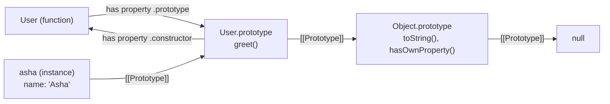
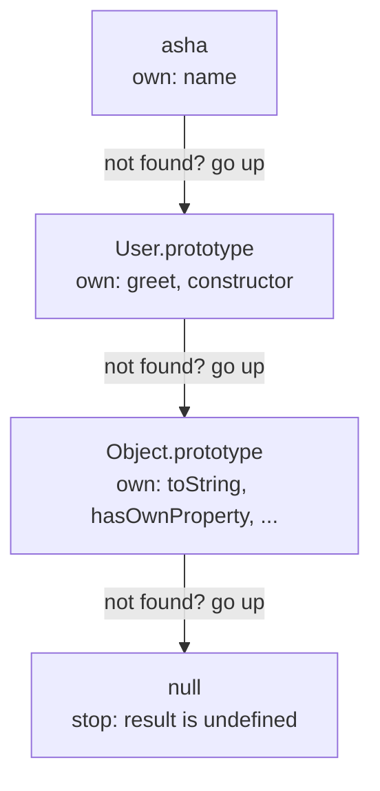
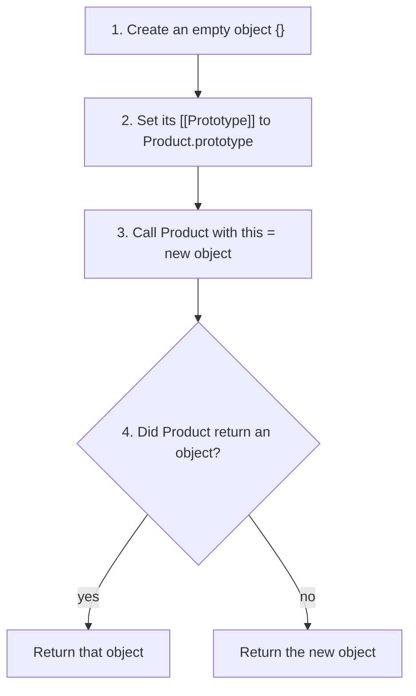
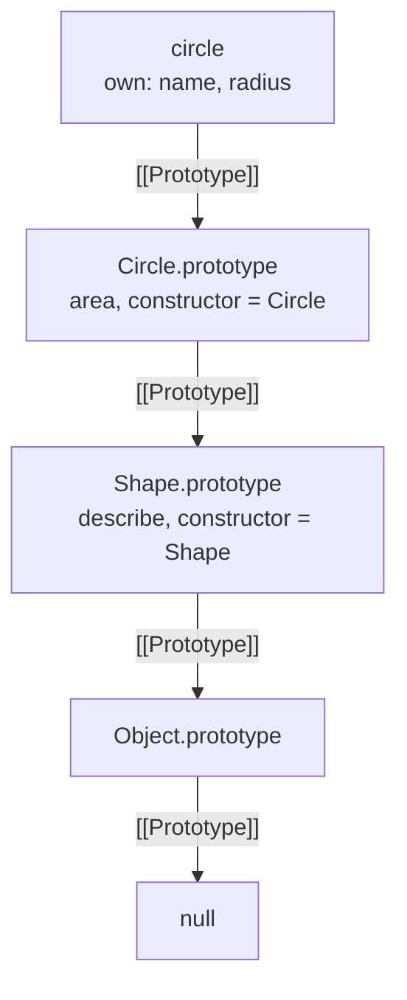
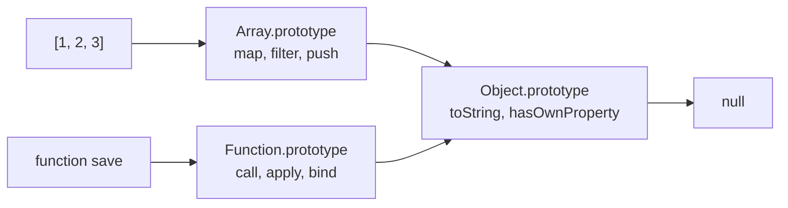
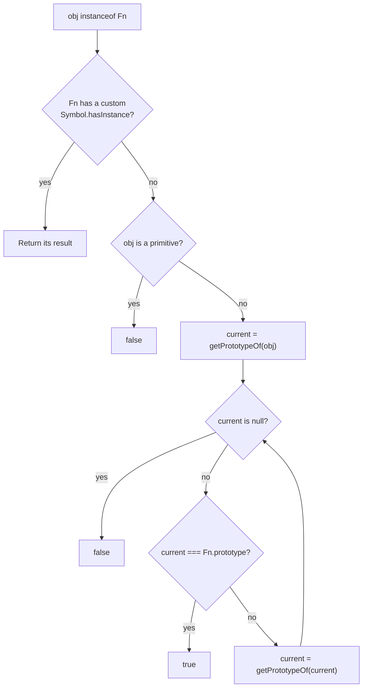
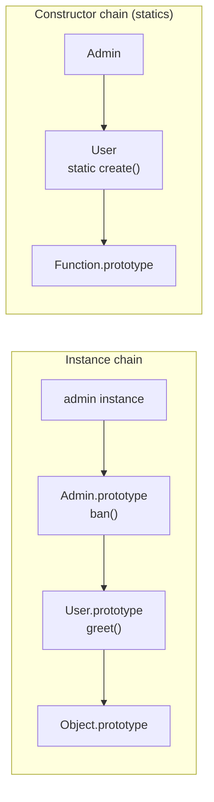

# Prototypes and inheritance

> In this document you will learn how JavaScript objects share behavior through prototypes: what `[[Prototype]]`, `.prototype` and `__proto__` mean, how property lookup walks the prototype chain, what `new` really does, how `instanceof` works, and how classes are built on top of all this. Prototype questions test whether you understand the language itself, not just its syntax.

**Before this:** [Objects and copying](07-objects-and-copying.md) · [this, call, apply and bind](06-this-call-apply-bind.md) · **Interview questions:** [jump to the interview section](#interview-questions)

## Table of contents

1. [What a prototype is](#what-a-prototype-is)
2. [Three names: Prototype slot, prototype property and proto accessor](#three-names-prototype-slot-prototype-property-and-proto-accessor)
3. [The prototype chain](#the-prototype-chain)
4. [Constructor functions and what new does](#constructor-functions-and-what-new-does)
5. [Inheritance with constructor functions](#inheritance-with-constructor-functions)
6. [Object.create and Object.create(null)](#objectcreate-and-objectcreatenull)
7. [Built-in prototypes and polyfills](#built-in-prototypes-and-polyfills)
8. [instanceof and isPrototypeOf](#instanceof-and-isprototypeof)
9. [Classes and prototypes](#classes-and-prototypes)
10. [Performance: hidden classes and prototype changes](#performance-hidden-classes-and-prototype-changes)
11. [Prototypes in real projects](#prototypes-in-real-projects)
12. [Advantages, disadvantages and alternatives](#advantages-disadvantages-and-alternatives)
13. [Common mistakes](#common-mistakes)
14. [Best practices](#best-practices)
15. [How to explain prototypes in an interview](#how-to-explain-prototypes-in-an-interview)
16. [Interview questions](#interview-questions)
17. [Summary](#summary)
18. [References](#references)

---

## What a prototype is

Every JavaScript object has a hidden link to another object. That other object is called its **prototype**. When you read a property that the object does not have, JavaScript automatically looks for it on the prototype.

```js
const animal = {
  eats: true,
  describe() {
    return `${this.name} eats: ${this.eats}`;
  },
};

const rabbit = Object.create(animal); // rabbit's prototype is animal
rabbit.name = "Bunny";

console.log(rabbit.name);       // Bunny       — own property
console.log(rabbit.eats);       // true        — found on the prototype
console.log(rabbit.describe()); // Bunny eats: true
console.log(Object.keys(rabbit)); // [ 'name' ] — eats is NOT copied into rabbit
```

`rabbit` does not contain `eats` or `describe`. It only has a link to `animal`. When you ask for `rabbit.eats`, the engine does not find it on `rabbit`, follows the link, and finds it on `animal`.

### Why prototypes exist

Prototypes let many objects **share** the same methods without copying them.

Imagine 10,000 product objects, each needing a `formatPrice` method. If each object had its own copy of the function, you would have 10,000 identical functions in memory. With a prototype, all 10,000 objects link to **one** shared object that holds **one** `formatPrice` function.

```js
const productMethods = {
  formatPrice() {
    return `₹${this.price.toFixed(2)}`;
  },
};

const pen = Object.create(productMethods);
pen.price = 20;

const book = Object.create(productMethods);
book.price = 350;

console.log(pen.formatPrice());  // ₹20.00
console.log(book.formatPrice()); // ₹350.00
console.log(Object.getPrototypeOf(pen) === Object.getPrototypeOf(book)); // true — one shared object
```

Inside a shared method, `this` is the object you called it on (`pen` or `book`), so the same function works for every object. See [this, call, apply and bind](06-this-call-apply-bind.md#methods).

### Analogy

Think of a prototype as a **reference book on a shared shelf**. Each student (object) has a small personal notebook (own properties). When a student needs an answer that is not in their notebook, they look in the shared reference book. If it is not there either, they check the next book the reference book points to, and so on.

Where the analogy breaks down: if the shared book is changed, **every** student immediately sees the new answer. And if a student writes an answer in their own notebook, it **hides** the book's answer for that student only.

### Prototype-based vs class-based languages

In Java or C#, classes are **blueprints**. An object is created from a class and the class defines its shape; the relationship is fixed at compile time.

JavaScript is **prototype-based**. Objects inherit directly from other objects at runtime. There is no separate "class" thing in the engine. Even the `class` keyword (ES2015) creates constructor functions and prototype objects under the hood. You will see exactly how in [Classes and prototypes](#classes-and-prototypes).

---

## Three names: Prototype slot, prototype property and proto accessor

These three names confuse almost everyone. They are related but different.

### 1. `[[Prototype]]` — the hidden link every object has

`[[Prototype]]` is an **internal slot** of every object. It points to the object's prototype (or to `null`). You cannot write `obj.[[Prototype]]` in code. You read and change it with:

```js
const proto = { greet() { return "hi"; } };
const obj = Object.create(proto);

console.log(Object.getPrototypeOf(obj) === proto); // true — the standard way to READ it
Object.setPrototypeOf(obj, {});                    // the standard way to CHANGE it (slow, avoid)
```

### 2. `Fn.prototype` — a normal property on functions

Most functions (normal `function` functions and classes) have a property literally named `prototype`. It is a plain object. It is **not** the function's own prototype. It is the object that will become the `[[Prototype]]` of **objects created with `new Fn()`**.

```js
function User(name) {
  this.name = name;
}
User.prototype.greet = function () {
  return `Hi, ${this.name}`;
};

const asha = new User("Asha");

console.log(Object.getPrototypeOf(asha) === User.prototype); // true
console.log(Object.getPrototypeOf(User) === User.prototype); // false!
console.log(Object.getPrototypeOf(User) === Function.prototype); // true — User itself is a function
```

So `User.prototype` is "the prototype **for instances** of `User`", not "the prototype **of** `User`".

The `prototype` object automatically gets a `constructor` property that points back to the function:

```js
console.log(User.prototype.constructor === User); // true
console.log(asha.constructor === User);           // true — found through the chain
```

Functions that **do not** have a `prototype` property: arrow functions, object method shorthand (`{ save() {} }`), class methods, async functions and bound functions. None of them can be used with `new`.

### 3. `__proto__` — a legacy accessor for `[[Prototype]]`

`obj.__proto__` is a **getter/setter** defined on `Object.prototype`. It reads or writes the object's `[[Prototype]]`.

```js
console.log(asha.__proto__ === User.prototype); // true
```

It is old, non-standard for many years, and now kept in the specification only for web compatibility. Avoid it in real code:

- It does not exist on objects that do not inherit from `Object.prototype` (for example `Object.create(null)`).
- An object can have an own property named `__proto__` that hides the accessor.
- It is a common target in **prototype pollution** attacks.

Use `Object.getPrototypeOf`, `Object.setPrototypeOf` and `Object.create` instead.

One special case you will still see: `__proto__` **inside an object literal** sets the prototype of the new object. This literal syntax is fine to read and widely supported:

```js
const base = { inherited: 1 };
const literal = { __proto__: base, own: 2 };
console.log(literal.inherited, Object.keys(literal)); // 1 [ 'own' ]
```

### The relationship in one picture



### Summary table

| Name | What it is | Who has it | How to use it |
| --- | --- | --- | --- |
| `[[Prototype]]` | Hidden link to the prototype | Every object | `Object.getPrototypeOf(obj)`, `Object.create(proto)` |
| `Fn.prototype` | Normal property: the prototype for objects made by `new Fn()` | Normal functions and classes | Put shared methods on it |
| `obj.__proto__` | Legacy getter/setter for `[[Prototype]]` | Objects that inherit from `Object.prototype` | Avoid; use the `Object` methods |

---

## The prototype chain

A prototype is a normal object, so it has its own prototype. This creates a **prototype chain**: a linked list of objects that ends with `null`.

### How property lookup works

When you read `obj.prop`:

1. Check whether `obj` has an **own** property `prop`. If yes, return it.
2. If not, go to `obj`'s `[[Prototype]]` and check there.
3. Repeat up the chain.
4. If you reach `null` without finding it, the result is `undefined` (no error).

```js
function User(name) {
  this.name = name;
}
User.prototype.greet = function () {
  return `Hi, ${this.name}`;
};

const asha = new User("Asha");

console.log(asha.name);       // Asha — own property (step 1)
console.log(asha.greet());    // Hi, Asha — found on User.prototype (step 2)
console.log(asha.toString()); // [object Object] — found on Object.prototype (step 3)
console.log(asha.fly);        // undefined — not found anywhere (step 4)
```



Step-by-step for `asha.toString()`:

1. Does `asha` have an own `toString`? No (it only has `name`).
2. Does `User.prototype` have an own `toString`? No (it has `greet` and `constructor`).
3. Does `Object.prototype` have an own `toString`? Yes. Call it with `this = asha`.

Every object created from a literal or a class ends up at `Object.prototype`, and `Object.prototype`'s prototype is `null`:

```js
console.log(Object.getPrototypeOf(Object.prototype)); // null
```

The chain cannot have cycles. The engine refuses to create one:

```js
const a = {};
const b = Object.create(a);
// Object.setPrototypeOf(a, b); // TypeError: Cyclic __proto__ value
```

### Shadowing: own properties hide inherited ones

If an object has an own property with the same name as an inherited one, the own property **shadows** (hides) the inherited one.

```js
const p1 = new User("A");
const p2 = new User("B");

p1.greet = function () {
  return "custom greeting";
};

console.log(p1.greet()); // custom greeting — own property wins
console.log(p2.greet()); // Hi, B — still uses the prototype

delete p1.greet;         // remove the own property
console.log(p1.greet()); // Hi, A — the inherited method is visible again
```

### Reading goes up the chain; writing usually does not

This is the most important rule about prototypes, and a classic interview trap.

- **Reading** a property walks up the chain.
- **Assigning** a property (`obj.x = value`) normally creates or updates an **own** property on `obj`. It never changes the prototype's property.

```js
const defaults = { theme: "light" };
const settings = Object.create(defaults);

settings.theme = "dark";  // creates an OWN property on settings

console.log(settings.theme);  // dark
console.log(defaults.theme);  // light — the prototype is unchanged
console.log(Object.hasOwn(settings, "theme")); // true
```

There are two exceptions, where assignment looks at the inherited property first:

1. **Inherited setter:** if the prototype has a setter for that name, the setter is called (with `this` = your object). No own property with that name is created.
2. **Inherited read-only property:** if the prototype has that name with `writable: false`, the assignment fails (silently in sloppy mode, `TypeError` in strict mode).

```js
"use strict";

const base = {
  set level(value) {
    this._level = value * 10;
  },
};
Object.defineProperty(base, "id", { value: 1, writable: false });

const item = Object.create(base);

item.level = 2;
console.log(item._level, Object.hasOwn(item, "level")); // 20 false — the setter ran

// item.id = 2; // TypeError: Cannot assign to read only property 'id' of object
```

If you really need an own property in that case, use `Object.defineProperty(item, "id", { value: 2, writable: true, enumerable: true, configurable: true })`.

### Mutating an inherited object is not assignment

Changing an object **through** an inherited reference does modify the shared object, because you are not assigning a property on your object, you are calling a method on the shared value:

```js
function Team() {}
Team.prototype.members = []; // ❌ a shared array on the prototype

const frontend = new Team();
const backend = new Team();

frontend.members.push("Asha"); // reads `members` (inherited), then mutates the shared array
console.log(backend.members);  // [ 'Asha' ] — surprise!
```

That is why **data belongs on the instance** (set in the constructor) and only **methods** (and true constants) belong on the prototype.

```js
function TeamFixed() {
  this.members = []; // ✅ each instance gets its own array
}
```

### Looking up is fast, but long chains cost a little

Engines cache lookups (see [Performance](#performance-hidden-classes-and-prototype-changes)), so normal chains of 2–4 levels are fast. Very deep inheritance chains make code harder to understand more than they make it slow.

---

## Constructor functions and what new does

Before classes, the standard way to create many similar objects was a **constructor function**: a normal function, named with a capital letter by convention, called with `new`.

```js
function Product(name, price) {
  this.name = name;
  this.price = price;
}

Product.prototype.withTax = function (rate = 0.18) {
  return Math.round(this.price * (1 + rate));
};

const keyboard = new Product("Keyboard", 1500);
console.log(keyboard.withTax()); // 1770
console.log(keyboard instanceof Product); // true
```

### What `new Product("Keyboard", 1500)` does, step by step

1. **Create** a new empty object.
2. **Link** it: set the new object's `[[Prototype]]` to `Product.prototype`.
3. **Call** `Product` with `this` set to the new object and the given arguments. The function body adds `name` and `price`.
4. **Return**: if the function returns an **object** (or a function), `new` returns that. Otherwise (no return, or a primitive return), `new` returns the new object from step 1.



### Implement your own new

```js
function myNew(Constructor, ...args) {
  // steps 1 and 2: create an object linked to Constructor.prototype
  const instance = Object.create(Constructor.prototype);

  // step 3: run the constructor with this = instance
  const result = Constructor.apply(instance, args);

  // step 4: an explicit object return wins
  const isObject = result !== null && (typeof result === "object" || typeof result === "function");
  return isObject ? result : instance;
}

const mouse = myNew(Product, "Mouse", 500);
console.log(mouse.withTax());            // 590
console.log(mouse instanceof Product);   // true
```

### The return value rule

```js
function ReturnsObject() {
  this.a = 1;
  return { b: 2 };     // an object: replaces the new instance
}

function ReturnsPrimitive() {
  this.a = 1;
  return 42;           // a primitive: ignored
}

console.log(new ReturnsObject());    // { b: 2 }
console.log(new ReturnsPrimitive()); // ReturnsPrimitive { a: 1 }
```

This rule allows patterns like returning a cached instance from a constructor (a singleton), but it is confusing. Avoid returning objects from constructors in normal code.

### Forgetting new

```js
function Order(id) {
  this.id = id;
}

const order = Order(7); // ❌ no new
```

- In **sloppy mode**, `this` is the global object, so this creates a **global variable** `id` and `order` is `undefined`.
- In **strict mode**, `this` is `undefined`, so it throws `TypeError: Cannot set properties of undefined`.

Classes fix this completely: calling a class without `new` always throws. Before classes, libraries used a guard with `new.target` (ES2015) or `instanceof`:

```js
function SafeOrder(id) {
  if (!new.target) return new SafeOrder(id); // called without new → fix it
  this.id = id;
}

console.log(SafeOrder(7).id); // 7
```

---

## Inheritance with constructor functions

Before `class ... extends`, inheritance needed three manual steps. You will meet this code in older libraries, in transpiled output, and in interviews ("implement inheritance without `class`").

```js
// Parent
function Shape(name) {
  this.name = name;
}
Shape.prototype.describe = function () {
  return `${this.name} with area ${this.area().toFixed(2)}`;
};

// Child
function Circle(radius) {
  Shape.call(this, "Circle");   // step 1: run the parent constructor on this object
  this.radius = radius;
}

Circle.prototype = Object.create(Shape.prototype); // step 2: link the prototypes
Circle.prototype.constructor = Circle;             // step 3: fix the constructor property

Circle.prototype.area = function () {
  return Math.PI * this.radius ** 2;
};

const circle = new Circle(2);
console.log(circle.describe());          // Circle with area 12.57
console.log(circle instanceof Circle);   // true
console.log(circle instanceof Shape);    // true
console.log(circle.constructor.name);    // Circle
console.log(Object.keys(circle));        // [ 'name', 'radius' ]
```

What each step does:

1. **`Shape.call(this, "Circle")`** — runs the parent constructor with the child's `this`, so the parent's **own properties** (`name`) are created on the new circle. This is like `super(...)` in a class.
2. **`Circle.prototype = Object.create(Shape.prototype)`** — makes a new object whose prototype is `Shape.prototype`, and uses it as `Circle.prototype`. Now circles can reach `Shape` methods through the chain.
3. **`Circle.prototype.constructor = Circle`** — step 2 replaced the default `Circle.prototype`, which had `constructor: Circle`. Without this fix, `circle.constructor` would find `Shape.prototype.constructor`, which is `Shape`.



Step-by-step for `circle.describe()`:

1. `circle` has no own `describe` → go to `Circle.prototype`.
2. `Circle.prototype` has `area` and `constructor`, but no `describe` → go to `Shape.prototype`.
3. `Shape.prototype.describe` is found. It is called with `this = circle`.
4. Inside, `this.area()` starts a **new** lookup from `circle` → finds `Circle.prototype.area`. That is **polymorphism**: the parent method calls the child's version.

### Details that interviewers like

- The original `prototype` object had a **non-enumerable** `constructor`. A plain assignment (`Circle.prototype.constructor = Circle`) creates an **enumerable** one, so it shows up in `for...in`. To match the original exactly:

  ```js
  Object.defineProperty(Circle.prototype, "constructor", {
    value: Circle,
    writable: true,
    enumerable: false,
    configurable: true,
  });
  ```

- Methods added with `X.prototype.method = function () {}` are also **enumerable**, so `for...in` over an instance lists them. Class methods are non-enumerable. This is one of the real differences between classes and constructor functions.

- **Do not** write `Circle.prototype = Shape.prototype`. Then both names point to the **same** object, and adding `area` to `Circle.prototype` also adds it to every `Shape`. See [Q16](#q16-debugging-after-adding-a-method-to-circle-every-shape-also-has-it-why).

- **Do not** write `Circle.prototype = new Shape()`. It works in simple cases, but it runs the parent constructor at setup time (with no arguments), and puts parent instance data (`name: undefined`) on the shared prototype. This was common in very old code.

- Node.js has a legacy helper `util.inherits(Child, Parent)` that does step 2. The Node.js docs recommend using `class` and `extends` instead.

### The same thing with Object.setPrototypeOf

`Object.setPrototypeOf(Circle.prototype, Shape.prototype)` changes the prototype of the **existing** `Circle.prototype` object instead of replacing it. Advantage: the original `constructor` stays correct. It is acceptable at setup time (before any instances exist), but changing prototypes of objects that are already in use is slow (see [Performance](#performance-hidden-classes-and-prototype-changes)).

---

## Object.create and Object.create(null)

### Object.create(proto, descriptors?)

`Object.create(proto)` creates a new, empty object whose `[[Prototype]]` is `proto`. It is the most direct way to do prototypal inheritance: no constructor function and no `new` needed.

```js
const vehicle = {
  start() {
    return `${this.model} started`;
  },
};

const car = Object.create(vehicle);
car.model = "Nexon";
console.log(car.start()); // Nexon started

// optional second argument: property descriptors
const bike = Object.create(vehicle, {
  model: { value: "Pulsar", enumerable: true },
});
console.log(bike.start()); // Pulsar started
```

`Object.create` is also what `class extends` and `new` do internally to link objects (step 2 of `new`).

### Object.create(null): objects with no prototype

`Object.create(null)` makes an object with **no** prototype at all. It does not inherit `toString`, `hasOwnProperty`, `constructor` or `__proto__`.

```js
const dictionary = Object.create(null);
dictionary.apple = "a fruit";
dictionary.__proto__ = "just a normal key now";

console.log(Object.keys(dictionary));            // [ 'apple', '__proto__' ]
console.log(Object.getPrototypeOf(dictionary));  // null
console.log(typeof dictionary.toString);         // undefined
console.log(dictionary instanceof Object);       // false
console.log("constructor" in dictionary);        // false
```

Why it is useful:

- **Safe dictionaries:** keys like `"constructor"`, `"toString"` or `"__proto__"` are just normal keys. With a normal `{}`, `"constructor" in obj` is already `true` before you add anything.
- **Protection against prototype pollution:** if your code builds objects from user-controlled keys, a null-prototype object cannot have its prototype changed through `__proto__`.

Things to remember:

- Use `Object.hasOwn(dict, key)` (or `key in dict`), not `dict.hasOwnProperty(key)` — that method does not exist here.
- Converting it to a string (`` `${dict}` ``) throws a `TypeError` because there is no `toString`.
- `Object.groupBy` returns null-prototype objects for exactly these reasons.
- For most dynamic key-value data, a `Map` is an even better choice. See [Map, Set, WeakMap and WeakSet](12-map-set-weakmap-weakset.md).

---

## Built-in prototypes and polyfills

All built-in objects use the same prototype system.

```js
const list = [1, 2, 3];
console.log(Object.getPrototypeOf(list) === Array.prototype);            // true
console.log(Object.getPrototypeOf(Array.prototype) === Object.prototype); // true

function save() {}
console.log(Object.getPrototypeOf(save) === Function.prototype);          // true
```

So `list.map(...)` is found on `Array.prototype`, `save.call(...)` is found on `Function.prototype`, and both can still use `Object.prototype.hasOwnProperty`.



### Primitives borrow methods through wrapper objects

`"hello".toUpperCase()` works even though strings are primitives, not objects. When you access a property on a primitive, the engine temporarily treats it as a wrapper object (`String`, `Number`, `Boolean`, `Symbol`, `BigInt`) and looks up the method on `String.prototype` and so on.

```js
console.log(Object.getPrototypeOf("hi") === String.prototype); // true
console.log((5).toFixed(1));                                   // 5.0
```

Engines optimize this heavily; no real object is created in most cases.

### A classic puzzle: Function and Object

```js
console.log(Function instanceof Object); // true
console.log(Object instanceof Function); // true
```

`Object` is a function (a constructor), so its prototype is `Function.prototype`, so `Object instanceof Function` is `true`. `Function.prototype` is an object whose prototype is `Object.prototype`, so `Function instanceof Object` is `true`. There is no contradiction: both checks walk the chain and meet in the middle.

### Why you should not extend built-in prototypes

You **can** add methods to built-in prototypes:

```js
// ❌ Do not do this in application code
Array.prototype.last = function () {
  return this[this.length - 1];
};
console.log([1, 2, 3].last()); // 3
```

This is called **monkey patching**. It is a bad idea because:

1. **Global effect.** Every array in the app (and in every library) now has `last`. Two libraries that add the same name with different behavior break each other.
2. **Future conflicts.** If the language later adds a method with the same name but different behavior, your code or the web breaks. This really happened: an old library (MooTools) added `Array.prototype.flatten`, so when TC39 wanted to standardize `flatten`, shipping it would have broken websites. The standard method was renamed to `flat` (ES2019) because of that conflict.
3. **Enumeration surprises.** A method added by assignment is enumerable, so `for...in` over any array now lists `last`.

Safer alternatives: a plain helper function (`last(array)`), a utility module, or a subclass (`class Stack extends Array`).

### Polyfills: the one acceptable exception

A **polyfill** adds a **standard** method to old environments that do not have it yet, with the exact standard behavior. It only adds the method if it is missing:

```js
// Simplified polyfill for Array.prototype.at (ES2022)
if (!Array.prototype.at) {
  Object.defineProperty(Array.prototype, "at", {
    value: function at(index) {
      const length = this.length;
      const relative = Math.trunc(index) || 0;
      const k = relative >= 0 ? relative : length + relative;
      return k < 0 || k >= length ? undefined : this[k];
    },
    writable: true,
    enumerable: false, // like real built-in methods
    configurable: true,
  });
}

console.log([10, 20, 30].at(-1)); // 30
```

In real projects you do not write polyfills by hand. Tools like **core-js** (used by Babel) add tested polyfills based on your browser targets. Angular CLI projects list polyfills in the `polyfills` option of `angular.json` (Angular 15+; older projects used a `polyfills.ts` file). Interview questions about polyfills for `map`, `bind`, `Promise.all` and others are in [JavaScript polyfills and implementations](../11-coding-interviews/04-javascript-polyfills-and-implementations.md).

---

## instanceof and isPrototypeOf

### What instanceof checks

`obj instanceof Fn` answers: **"Is `Fn.prototype` somewhere in `obj`'s prototype chain?"** It does not check how the object was created or which constructor was called.

The algorithm (simplified from the specification):

1. If `Fn` has a `Symbol.hasInstance` method, call it and use its result.
2. Otherwise (the default for all functions): if `Fn` is a bound function, use the original function.
3. If `obj` is not an object (a primitive), return `false`.
4. Take `proto = Fn.prototype` (throw a `TypeError` if it is not an object).
5. Walk `obj`'s chain: for each prototype in the chain, if it is `proto`, return `true`. If you reach `null`, return `false`.



### Implement instanceof

```js
function myInstanceof(obj, Constructor) {
  if (obj === null || (typeof obj !== "object" && typeof obj !== "function")) return false;
  const target = Constructor.prototype;
  let current = Object.getPrototypeOf(obj);
  while (current !== null) {
    if (current === target) return true;
    current = Object.getPrototypeOf(current);
  }
  return false;
}

class Animal {}
class Dog extends Animal {}
const rex = new Dog();

console.log(myInstanceof(rex, Dog), myInstanceof(rex, Animal), myInstanceof(rex, Array)); // true true false
console.log(myInstanceof(5, Number)); // false — primitives are not instances
```

### Surprising results that follow from the algorithm

```js
// 1. Replacing the prototype AFTER creating an instance breaks instanceof
function Car() {}
const car = new Car();
Car.prototype = { wheels: 4 };
console.log(car instanceof Car); // false — car is linked to the OLD prototype object
console.log(car.wheels);         // undefined

// 2. An object can be an "instance" without the constructor ever running
const fake = Object.create(Dog.prototype);
console.log(fake instanceof Dog); // true

// 3. Null-prototype objects are not instances of Object
console.log(Object.create(null) instanceof Object); // false

// 4. Primitives are not instances of their wrappers
console.log(5 instanceof Number, new Number(5) instanceof Number); // false true

// 5. Custom behavior with Symbol.hasInstance
class EvenNumber {
  static [Symbol.hasInstance](value) {
    return Number.isInteger(value) && value % 2 === 0;
  }
}
console.log(4 instanceof EvenNumber, 5 instanceof EvenNumber); // true false
```

### instanceof across realms

A **realm** is a separate global environment: each iframe, each Node.js `vm` context, and each Electron renderer (with context isolation, the preload world and the page world) has its own set of built-ins. An array created in an iframe has the iframe's `Array.prototype`, which is a **different object** from the main page's `Array.prototype`.

```js
// in a browser page with an iframe
// const iframeArray = iframe.contentWindow.eval("[1, 2]");
// iframeArray instanceof Array → false
// Array.isArray(iframeArray)   → true
```

That is why `Array.isArray` exists, and why libraries prefer **duck typing** (checking for the methods you need) or `Symbol.toStringTag` / `Object.prototype.toString.call(value)` checks over `instanceof` for values that may come from another realm.

### isPrototypeOf

`proto.isPrototypeOf(obj)` asks the same question as `instanceof`, but you give it the prototype object directly instead of a constructor. It works for objects that were created with `Object.create` and have no constructor function.

```js
const vehicle = { start() {} };
const car2 = Object.create(vehicle);

console.log(vehicle.isPrototypeOf(car2));             // true
console.log(Animal.prototype.isPrototypeOf(rex));     // true — same as rex instanceof Animal
```

---

## Classes and prototypes

### Classes build the same structure

A `class` declaration creates a **constructor function** and a **prototype object** with the methods, linked exactly like the constructor function version.

```js
class User {
  constructor(name) {
    this.name = name;
  }
  greet() {
    return `Hi, ${this.name}`;
  }
  static create(name) {
    return new User(name);
  }
}

const asha = new User("Asha");

console.log(typeof User);                                   // function
console.log(Object.getPrototypeOf(asha) === User.prototype); // true
console.log(Object.hasOwn(User.prototype, "greet"));        // true — methods live on the prototype
console.log(Object.hasOwn(asha, "greet"));                  // false
console.log(Object.hasOwn(User, "create"));                 // true — static methods live on the function
```

### extends builds two chains

`class Admin extends User` links **two** prototype chains:

1. **Instances:** `Admin.prototype` → `User.prototype`. So admins inherit instance methods.
2. **Constructors:** `Admin` → `User`. So `Admin` inherits **static** methods.

```js
class Admin extends User {
  ban(otherUser) {
    return `${this.name} banned ${otherUser.name}`;
  }
}

const root = Admin.create("Root"); // static method inherited from User... but see below
console.log(Object.getPrototypeOf(Admin.prototype) === User.prototype); // true
console.log(Object.getPrototypeOf(Admin) === User);                     // true
console.log(root instanceof Admin); // false — User.create calls `new User`, not `new this`
```

(The last line shows why static factory methods should use `new this(...)`: then `Admin.create()` would build an `Admin`. See [this in static methods](06-this-call-apply-bind.md#static-methods-static-fields-and-static-blocks).)



### "Classes are just syntactic sugar" — true and false

The **mechanism** is the same: prototypes, constructor functions and the chain. But classes are not *only* a nicer way to write the old code. They add real behavior that the old pattern does not have:

| Difference | Class | Constructor function |
| --- | --- | --- |
| Calling without `new` | Always throws `TypeError` | Runs as a normal function (bugs, accidental globals) |
| Hoisting | Hoisted but in the **TDZ** — using it before the declaration throws | Function declarations are fully hoisted |
| Strict mode | Class body is always strict | Only if you opt in |
| Methods enumerable? | No (`for...in` does not list them) | Yes, when added by assignment |
| Methods constructible? | No — methods have no `prototype` and cannot be used with `new` | Assigned functions can be used with `new` |
| `super` | `super(...)` and `super.method()` work (via each method's **home object**) | Manual: `Parent.call(this)` and `Parent.prototype.method.call(this)` |
| Derived constructor `this` | Not available until `super()` is called; the **parent** creates the object | `this` exists from the start |
| Extending built-ins (`Array`, `Error`, `Map`) | Works correctly (the built-in creates the object) | Very hard to do correctly |
| Private fields `#x`, static blocks, field declarations | Supported | Not available (use closures or `WeakMap`) |
| Static inheritance | Automatic (`Admin` → `User`) | Manual (`Object.setPrototypeOf(Child, Parent)`) |

A good interview answer: "Classes use prototypes under the hood, but they are more than sugar: they add `new`-only calls, TDZ, strict mode, non-enumerable methods, `super` through home objects, correct subclassing of built-ins, and private fields."

### What super really does

Every method defined in a class (or in an object literal with method shorthand) remembers the object it was defined on. This hidden link is called its **home object** (`[[HomeObject]]`). `super.method()` means: "look up `method` starting from the **prototype of my home object**, and call it with the current `this`."

```js
const parentObject = {
  hello() {
    return "parent hello";
  },
};

const childObject = {
  __proto__: parentObject,
  hello() {
    return `${super.hello()} + child`; // super works in object literal methods too
  },
};

console.log(childObject.hello()); // parent hello + child

const borrowed = { hello: childObject.hello };
console.log(borrowed.hello()); // parent hello + child — super still uses the ORIGINAL home object
```

The home object is fixed when the method is created. Copying the method to another object does not change where `super` looks. This is why `super` is not dynamic like `this`.

Class syntax details (fields, private members, static blocks, `super()` rules) are in [Classes](09-classes.md).

---

## Performance: hidden classes and prototype changes

You do not need engine internals for most interviews, but senior roles may ask why some prototype operations are discouraged.

### Hidden classes (shapes)

JavaScript objects can gain and lose properties at any time, so engines cannot use fixed memory layouts like C structs. To make property access fast anyway, V8 gives each object a hidden **shape** (V8 calls it a **map**, also known as a hidden class). Objects created the same way, with the same properties added in the same order, share the same shape. The shape records where each property is stored.

**Inline caches** remember, at each property access in your code, "for objects of this shape, the property is at this position" — or "this method is found on that prototype object". The next time an object with the same shape passes through, the lookup is almost free.

### Why changing prototypes is slow

`Object.setPrototypeOf(obj, newProto)` (and assigning `obj.__proto__`) on an object that is already in use:

- changes the object's shape and invalidates optimizations that assumed the old chain;
- can make the engine treat the object (and code that touches it) as "unpredictable", which slows down later accesses.

MDN warns that changing an object's `[[Prototype]]` is a very slow operation in every engine, and that the slowdown can spread to any code that accesses the object. Recommended instead: create objects with the right prototype from the start, using `Object.create(proto)` or `class`.

### Practical rules

- Set up prototypes **once**, at startup (class definitions, `Object.create`), not while objects are in use.
- Initialize all instance properties in the **constructor**, in the same order, so instances share one shape.
- Avoid `delete` on hot objects; set the property to `undefined` or use a `Map` for truly dynamic keys.
- Keep inheritance chains shallow. It helps readability more than speed, but both improve.

---

## Prototypes in real projects

- **Every class you write** — Angular components, services, guards, pipes; Node.js services; Electron main-process managers — uses prototypes. One method on the prototype is shared by all instances.
- **Angular dependency injection** creates one instance of a service (per injector) with `new`. Its methods are prototype methods, which is why passing `this.service.method` as a callback loses `this`.
- **Node.js core** is built on prototypes: `http.Server` inherits from `net.Server`, which inherits from `EventEmitter`. Your own classes often `extend EventEmitter`. Older code used `util.inherits`.
- **Polyfills** (core-js through Babel or the Angular CLI) patch built-in prototypes with standard methods for older browsers.
- **Null-prototype objects** are used for caches and lookup tables (for example, results of `Object.groupBy`, and internal caches in libraries).
- **Mixins** copy methods onto a class prototype (`Object.assign(Target.prototype, mixin)`) to share behavior without a deep hierarchy. See [Composition, inheritance and mixins](../04-oop-solid-design-patterns/02-composition-inheritance-and-mixins.md).
- **Security**: prototype pollution vulnerabilities in deep-merge and query-string libraries come from writing to `__proto__` or `constructor.prototype`. See [Web security](../01-cs-and-web-fundamentals/08-browser-storage-and-web-security-basics.md).

---

## Advantages, disadvantages and alternatives

**Advantages**

- **Memory sharing.** One method serves every instance.
- **Dynamic.** You can add a method to a prototype and all existing instances get it (useful for polyfills).
- **Simple model.** Everything is objects linked to objects; there is no separate class system.
- **Flexible.** `Object.create` lets any object be a prototype; you do not need a class hierarchy.

**Disadvantages**

- **Shared mutable state.** Data on a prototype (like an array) is shared by all instances — a common bug.
- **Confusing names.** `[[Prototype]]`, `.prototype` and `__proto__` are easy to mix up.
- **Global risk.** Changing built-in prototypes affects all code in the realm.
- **Deep hierarchies are fragile.** Changing a base prototype can break many children (the "fragile base class" problem).

**Alternatives**

| Approach | When to choose it |
| --- | --- |
| `class` and `extends` | Default for inheritance in modern code; clearer and safer than manual prototypes |
| Composition (objects that contain or delegate to other objects) | When "has-a" fits better than "is-a"; avoids deep hierarchies |
| Factory functions + closures | Small objects with private state, no need for `instanceof` |
| Mixins | Sharing a few behaviors across unrelated classes |
| `Object.create(proto)` | Simple delegation without constructors; null-prototype dictionaries |

The design side (when to prefer composition over inheritance) is covered in [Composition, inheritance and mixins](../04-oop-solid-design-patterns/02-composition-inheritance-and-mixins.md).

---

## Common mistakes

**1. Confusing `Fn.prototype` with the function's own prototype.** `User.prototype` is the prototype of **instances**. The prototype of `User` itself is `Function.prototype`.

**2. Putting mutable data on the prototype.**

```js
// ❌ shared by every instance
function Cart() {}
Cart.prototype.items = [];

// ✅ one array per instance
function CartFixed() {
  this.items = [];
}
```

**3. `Child.prototype = Parent.prototype`.** Both names point to one object, so child methods leak into the parent. Use `Object.create(Parent.prototype)`.

**4. Forgetting to fix `constructor`** after replacing `Child.prototype`. `instance.constructor` then points to the parent.

**5. Forgetting `Parent.call(this, ...)`** in the child constructor. The parent's own properties are never created.

**6. Replacing `Fn.prototype` after creating instances.** Existing instances keep the old prototype, and `instanceof` returns `false` for them.

**7. Extending built-in prototypes** in application code.

**8. Using `__proto__` in code.** Use `Object.getPrototypeOf` / `Object.create`.

**9. Using `instanceof` for values from other realms** (iframes, `vm`, worker messages). Use `Array.isArray` or duck typing.

**10. Arrow functions as prototype methods.**

```js
function Timer() { this.seconds = 0; }
Timer.prototype.tick = () => { this.seconds++; }; // ❌ `this` is not the instance
```

---

## Best practices

- **Use `class` for new code.** Reason: it builds the same prototypes with fewer mistakes (no missing `new`, correct `constructor`, non-enumerable methods, `super`).
- **Methods on the prototype, data on the instance.** Reason: shared methods save memory; per-instance data avoids shared-state bugs.
- **Use `Object.getPrototypeOf`, `Object.create` and `Object.hasOwn`.** Reason: they are standard, clear and work on null-prototype objects.
- **Use `Object.create(null)` or `Map` for dictionaries with untrusted keys.** Reason: no inherited keys, no prototype pollution through `__proto__`.
- **Never modify built-in prototypes, except through standard polyfills.** Reason: global side effects and future conflicts.
- **Do not change prototypes of live objects.** Reason: it de-optimizes engine fast paths.
- **Prefer shallow hierarchies and composition.** Reason: deep chains are hard to read and fragile to change.

---

## How to explain prototypes in an interview

1. **Define it:** "Every JavaScript object has a hidden link, `[[Prototype]]`, to another object called its prototype. If a property isn't found on the object, JavaScript looks it up on the prototype, then the prototype's prototype, until it reaches `null`. That's the prototype chain."
2. **Why it exists:** "It lets many objects share behavior without copying it. Ten thousand instances can share one method on their prototype."
3. **How it works:** "Reading a property walks up the chain; assigning a property creates an own property on the object, which shadows the inherited one. When I call `new User()`, JavaScript creates an object, links its `[[Prototype]]` to `User.prototype`, runs the constructor with `this` as that object, and returns it. `instanceof` just checks whether `User.prototype` is somewhere in the object's chain."
4. **Small example:** "`asha.greet()` isn't on `asha` — it's on `User.prototype`. `asha.toString()` is one step further, on `Object.prototype`. `Object.prototype`'s prototype is `null`, which ends the chain."
5. **Where it is useful:** "Every class in Angular or Node uses this — methods live on the prototype. Polyfills patch built-in prototypes, and `Object.create(null)` gives safe dictionaries."
6. **Trade-offs / gotchas:** "Don't confuse `User.prototype` — the prototype for instances — with the prototype of `User` itself. Don't put mutable data on a prototype, don't extend built-ins, and don't change prototypes at runtime because it's slow. Classes use prototypes too, but they add strictness, `super`, TDZ and private fields, so they're more than sugar."

---

## Interview questions

### Q1. What is a prototype? Explain the prototype chain.

**What the interviewer is checking:** Whether you can explain lookup delegation clearly, including where the chain ends and what happens on writes.

**Short spoken answer (30–60 seconds):**
> Every object in JavaScript has a hidden link, called `[[Prototype]]`, to another object — its prototype. When I read a property and the object doesn't have it, the engine follows that link and looks on the prototype, then on the prototype's prototype, and so on until it finds the property or reaches `null`, in which case I get `undefined`. That linked list is the prototype chain. It's how objects share methods: an array finds `map` on `Array.prototype` and `hasOwnProperty` on `Object.prototype`. One important detail: reading goes up the chain, but assigning a property normally creates an own property on the object, which shadows the inherited one.

**Code:**

```js
const base = { greet() { return `Hi, ${this.name}`; } };
const user = Object.create(base);
user.name = "Asha";

console.log(user.greet());                         // Hi, Asha — found on base
console.log(Object.getPrototypeOf(base) === Object.prototype); // true
console.log(Object.getPrototypeOf(Object.prototype));          // null — end of chain
```

**Follow-up questions:**
- **What happens if the property is not found anywhere?** — The result is `undefined`. No error is thrown (an error happens only if you then call it or read a property of it).
- **Does assignment ever walk the chain?** — It checks the chain for a setter or a read-only property with that name. A setter is called; a read-only property makes the assignment fail. Otherwise an own property is created.
- **Can the chain have cycles?** — No. `Object.setPrototypeOf` throws `TypeError: Cyclic __proto__ value`.

**Common mistakes:** Saying properties are "copied" from the prototype. Not knowing the chain ends at `null`.

**Where this is used in real projects:** Every class method call, every built-in method call, polyfills, debugging "why does this object have this property".

---

### Q2. What is the difference between `__proto__` and `prototype`?

**What the interviewer is checking:** The most common prototype confusion.

**Short spoken answer (30–60 seconds):**
> `prototype` is a normal property that exists on functions and classes. It's the object that will become the prototype of instances created with `new`. `__proto__` is a legacy getter and setter on `Object.prototype` that exposes any object's own hidden `[[Prototype]]` link. So for `const asha = new User()`, `asha.__proto__ === User.prototype`. But `User.__proto__` is `Function.prototype`, because `User` itself is a function. In real code I don't use `__proto__`; I use `Object.getPrototypeOf` and `Object.create`.

**Code:**

```js
function User() {}
const asha = new User();

console.log(asha.__proto__ === User.prototype);         // true
console.log(User.__proto__ === Function.prototype);     // true
console.log(User.prototype.constructor === User);       // true
console.log(asha.prototype);                            // undefined — normal objects have no .prototype
```

**Follow-up questions:**
- **Which functions have no `prototype` property?** — Arrow functions, method shorthand and class methods, async functions and bound functions. None of them can be called with `new`.
- **Why avoid `__proto__`?** — It is legacy, missing on null-prototype objects, can be shadowed by an own property, and is the usual entry point for prototype pollution.

**Common mistakes:** Saying `User.prototype` is "the prototype of User".

---

### Q3. What does `new` do? Implement it.

**What the interviewer is checking:** Exact steps, including the return rule.

**Short spoken answer (30–60 seconds):**
> `new` does four things. It creates an empty object. It sets that object's `[[Prototype]]` to the constructor's `prototype` property. It calls the constructor with `this` bound to the new object and the given arguments. Finally, if the constructor returned an object, `new` returns that object; otherwise it returns the new one. I can implement it with `Object.create(Constructor.prototype)`, then `Constructor.apply(instance, args)`, then that return check.

**Code:**

```js
function myNew(Constructor, ...args) {
  const instance = Object.create(Constructor.prototype);
  const result = Constructor.apply(instance, args);
  const isObject = result !== null && (typeof result === "object" || typeof result === "function");
  return isObject ? result : instance;
}

function Person(name) { this.name = name; }
Person.prototype.greet = function () { return `Hi, ${this.name}`; };

const ravi = myNew(Person, "Ravi");
console.log(ravi.greet(), ravi instanceof Person); // Hi, Ravi true
```

**Follow-up questions:**
- **What if the constructor returns `42`?** — Primitives are ignored; you get the new object.
- **Can `myNew` construct a class?** — No. `Constructor.apply` on a class throws, because class constructors cannot be called without `new`. You would use `Reflect.construct(Constructor, args)`.
- **What is `new.target`?** — Inside a function, it is the constructor that `new` was called on, or `undefined` for a normal call. It lets a function detect a missing `new`.

**Common mistakes:** Forgetting the prototype link (using `{}`). Forgetting the return-object rule.

---

### Q4. Implement inheritance without `class`.

**What the interviewer is checking:** The three manual steps and why each is needed.

**Short spoken answer (30–60 seconds):**
> In the child constructor, I call the parent constructor with `Parent.call(this, ...args)` so the parent's own properties are created on the child instance. Then I set `Child.prototype = Object.create(Parent.prototype)` so child instances can reach parent methods through the chain. Replacing the prototype loses the `constructor` property, so I set it back to `Child`, ideally as a non-enumerable property. Then I add child methods on `Child.prototype`. That's exactly what `class Child extends Parent` does for me.

**Code:**

```js
function Animal(name) {
  this.name = name;
}
Animal.prototype.speak = function () {
  return `${this.name} makes a sound`;
};

function Dog(name, breed) {
  Animal.call(this, name);
  this.breed = breed;
}
Dog.prototype = Object.create(Animal.prototype);
Object.defineProperty(Dog.prototype, "constructor", {
  value: Dog, writable: true, enumerable: false, configurable: true,
});
Dog.prototype.speak = function () {
  return `${Animal.prototype.speak.call(this)} — woof`; // like super.speak()
};

const rex = new Dog("Rex", "Labrador");
console.log(rex.speak());                        // Rex makes a sound — woof
console.log(rex instanceof Animal, rex.constructor === Dog); // true true
```

**Follow-up questions:**
- **How do you inherit static methods?** — `Object.setPrototypeOf(Dog, Animal)`. Classes do this automatically.
- **Why not `Dog.prototype = new Animal()`?** — It runs the parent constructor at setup time without proper arguments and puts instance data on the shared prototype.

**Common mistakes:** `Dog.prototype = Animal.prototype` (shared object). Forgetting `Animal.call(this)`.

---

### Q5. How does `instanceof` work? Implement it.

**What the interviewer is checking:** That `instanceof` is a chain walk, plus its edge cases.

**Short spoken answer (30–60 seconds):**
> `obj instanceof Fn` checks whether `Fn.prototype` appears anywhere in `obj`'s prototype chain. First it checks if `Fn` defines a custom `Symbol.hasInstance`; if not, it walks the chain from `Object.getPrototypeOf(obj)` upward, comparing each prototype with `Fn.prototype`, and returns false when it hits `null`. Primitives always give false. Because it only looks at the chain, replacing `Fn.prototype` later breaks it for old instances, and objects from another realm, like an iframe, fail the check — that's why we use `Array.isArray`.

**Code:**

```js
function myInstanceof(obj, Constructor) {
  if (obj === null || (typeof obj !== "object" && typeof obj !== "function")) return false;
  let current = Object.getPrototypeOf(obj);
  while (current !== null) {
    if (current === Constructor.prototype) return true;
    current = Object.getPrototypeOf(current);
  }
  return false;
}

console.log(myInstanceof([], Array), myInstanceof([], Object), myInstanceof({}, Array)); // true true false
```

**Follow-up questions:**
- **What is `Object.create(null) instanceof Object`?** — `false`; its chain has no `Object.prototype`.
- **How is `isPrototypeOf` different?** — `Proto.isPrototypeOf(obj)` takes the prototype object directly, so it works without a constructor function.
- **Can you customize `instanceof`?** — Yes, with `static [Symbol.hasInstance](value)` on the class.

---

### Q6. Are JavaScript classes just syntactic sugar over prototypes?

**What the interviewer is checking:** A nuanced answer, not a slogan.

**Short spoken answer (30–60 seconds):**
> Mostly the mechanism is the same: a class creates a constructor function, methods go on its `prototype`, and `extends` links both the instance chain and the static chain. But it's more than sugar. Class constructors throw if called without `new`. Class declarations are in the temporal dead zone until they run. The body is always strict. Methods are non-enumerable and can't be used as constructors. `super` works through a home object. In a derived class the parent constructor creates the object, which is why `this` isn't available before `super()` and why extending `Array` or `Error` works correctly. And classes have private fields and static blocks, which have no old equivalent.

**Follow-up questions:**
- **Show that a class is a function.** — `typeof class {}` is `"function"`, and `Object.getPrototypeOf(new User()) === User.prototype`.
- **Why can't constructor functions extend `Array` properly?** — `Array.call(this)` ignores `this` and returns a new array, so you never get an exotic array object with your prototype. With `class extends Array`, the `Array` constructor creates the object and gives it your prototype through `new.target`.

**Common mistakes:** Saying "classes are exactly the same as functions" or "JavaScript now has real classes like Java".

---

### Q7. What is `Object.create(null)` and when do you use it?

**Answer:** It creates an object whose `[[Prototype]]` is `null`, so it inherits nothing: no `toString`, no `hasOwnProperty`, no `__proto__` accessor. Use it for dictionaries whose keys come from data or users, so keys like `"constructor"` or `"__proto__"` behave like normal keys and cannot reach `Object.prototype`. Check keys with `Object.hasOwn` or `in`. A `Map` is often an even better choice.

```js
const counts = Object.create(null);
for (const word of ["constructor", "hello", "constructor"]) {
  counts[word] = (counts[word] ?? 0) + 1;
}
console.log(counts.constructor); // 2 — works correctly; with {} this would break
```

---

### Q8. What does this print?

```js
function User(name) { this.name = name; }
User.prototype.role = "viewer";

const asha = new User("Asha");
const ravi = new User("Ravi");

asha.role = "admin";
console.log(asha.role, ravi.role);

delete asha.role;
console.log(asha.role);

delete asha.role;
console.log(asha.role);
```

**Answer:**

```text
admin viewer
viewer
viewer
```

Assignment created an own `role` on `asha` that shadows the prototype's. Deleting it exposes the inherited value again. The second `delete` targets an own property that no longer exists, so it does nothing — `delete` never removes properties from the prototype through an instance.

---

### Q9. What does this print?

```js
function Car() {}
const first = new Car();

Car.prototype.drive = function () { return "driving"; };
console.log(first.drive());

Car.prototype = { fly() { return "flying"; } };
const second = new Car();

console.log(typeof first.fly, second.fly());
console.log(first instanceof Car, second instanceof Car);
```

**Answer:**

```text
driving
undefined flying
false true
```

**Step by step:**
1. Adding a method to the existing prototype object is seen by existing instances (they link to that object).
2. Replacing `Car.prototype` with a new object affects only instances created afterwards. `first` still links to the old object, which has no `fly`.
3. `instanceof` compares with the **current** `Car.prototype`, which is not in `first`'s chain.

---

### Q10. What does this print?

```js
function Team() {}
Team.prototype.members = [];

const frontend = new Team();
const backend = new Team();

frontend.members.push("Asha");
backend.members = ["Ravi"];

console.log(frontend.members, backend.members, Team.prototype.members);
```

**Answer:** `[ 'Asha' ] [ 'Ravi' ] [ 'Asha' ]`

`frontend.members.push` reads the inherited array and mutates the **shared** array on the prototype. `backend.members = [...]` is an assignment, so it creates an own property on `backend` and leaves the prototype alone. Fix: create the array in the constructor (`this.members = []`).

---

### Q11. What does this print?

```js
"use strict";
const base = {};
Object.defineProperty(base, "id", { value: 1, writable: false });
Object.defineProperty(base, "size", { get() { return "M"; } });

const item = Object.create(base);
try { item.id = 2; } catch (e) { console.log(e.constructor.name); }
try { item.size = "L"; } catch (e) { console.log(e.constructor.name); }
console.log(item.id, item.size, Object.keys(item).length);
```

**Answer:**

```text
TypeError
TypeError
1 M 0
```

An inherited read-only property blocks creating an own property by assignment, and an inherited getter without a setter does the same. In strict mode both throw. No own properties are created.

---

### Q12. What does this print?

```js
console.log(typeof Object.getPrototypeOf(function () {}));
console.log(Function instanceof Object, Object instanceof Function);
console.log(Object.getPrototypeOf(Function) === Function.prototype);
```

**Answer:**

```text
function
true true
true
```

`Function.prototype` is itself a (special) function, so `typeof` gives `"function"`. `Object` is a function, so its chain contains `Function.prototype`; `Function.prototype`'s prototype is `Object.prototype`, so `Function` is also an instance of `Object`. `Function` is a function too, so its prototype is `Function.prototype`.

---

### Q13. Why should you not extend built-in prototypes? What about polyfills?

**What the interviewer is checking:** Engineering judgment and knowledge of real history.

**Short spoken answer (30–60 seconds):**
> Changing `Array.prototype` or `Object.prototype` affects every piece of code in the page or process, including libraries. Two libraries can add the same method name with different behavior, methods added by assignment show up in `for...in` loops, and when the language later adds a method with that name, the web can break. That actually happened: an old library added `Array.prototype.flatten`, so the standard method had to be named `flat`. A polyfill is the exception: it adds a standard method, with standard behavior, only when it's missing, and non-enumerable. In practice I let core-js or the build tool add polyfills based on browser targets.

**Follow-up questions:**
- **What is the safe alternative to a custom array method?** — A helper function or module (`last(items)`), or a subclass.
- **Why should a polyfill be non-enumerable?** — To behave like the real built-in and not appear in `for...in` loops.

---

### Q14. What does this print?

```js
function Shape() {}
function Square() {}
Square.prototype = Object.create(Shape.prototype);

const square = new Square();
console.log(square.constructor === Square, square.constructor === Shape);
console.log(square instanceof Square, square instanceof Shape);
```

**Answer:**

```text
false true
true true
```

Replacing `Square.prototype` removed the original `constructor: Square`. Lookup for `constructor` continues to `Shape.prototype`, which has `constructor: Shape`. `instanceof` does not use `constructor`; it checks the chain, so both are `true`. This is why you restore `constructor` after `Object.create`.

---

### Q15. Implement a helper `inherit(Child, Parent)` that sets up both instance and static inheritance.

**Answer:**

```js
function inherit(Child, Parent) {
  Child.prototype = Object.create(Parent.prototype, {
    constructor: { value: Child, writable: true, enumerable: false, configurable: true },
  });
  Object.setPrototypeOf(Child, Parent); // static members
}

function Model() {}
Model.tableName = "models";
Model.describe = function () { return `Table: ${this.tableName}`; };

function Product() {}
inherit(Product, Model);
Product.tableName = "products";

console.log(Product.describe());                     // Table: products
console.log(new Product() instanceof Model);         // true
console.log(Object.keys(Product.prototype).length);  // 0 — constructor is non-enumerable
```

The child constructor must still call `Parent.call(this, ...)` for instance data.

---

### Q16. Debugging: after adding a method to Circle, every Shape also has it. Why?

```js
function Shape() {}
function Circle() {}
Circle.prototype = Shape.prototype;
Circle.prototype.roll = function () { return "rolling"; };

console.log(new Shape().roll()); // rolling — unexpected
```

**What the interviewer is checking:** Understanding that prototypes are shared objects, not copies.

**Answer:** `Circle.prototype = Shape.prototype` does not create a child prototype; both constructors now share **one** object. Adding `roll` to it adds it for every `Shape`. Also `Circle.prototype.constructor` is now `Shape`. Fix: `Circle.prototype = Object.create(Shape.prototype)` (and restore `constructor`), or use `class Circle extends Shape`.

---

### Q17. What is prototype pollution?

**What the interviewer is checking:** Security awareness connected to prototypes.

**Short spoken answer (30–60 seconds):**
> Prototype pollution is an attack where user-controlled input adds or changes properties on `Object.prototype`, usually through a key like `__proto__` or `constructor.prototype` in a naive deep-merge or "set by path" function. Because almost every object inherits from `Object.prototype`, the injected property suddenly appears on every object — for example, an `isAdmin: true` that an authorization check reads. To defend, I validate input with a schema, block those keys in merge utilities, use `Map` or `Object.create(null)` for user-keyed data, check with `Object.hasOwn` instead of plain reads, and keep dependencies updated, since many advisories in merge and query-string libraries are this bug.

**Code:**

```js
function unsafeMerge(target, source) {
  for (const key in source) {
    if (typeof source[key] === "object" && source[key] !== null) {
      target[key] ??= {};
      unsafeMerge(target[key], source[key]);
    } else {
      target[key] = source[key];
    }
  }
  return target;
}

unsafeMerge({}, JSON.parse('{"__proto__": {"isAdmin": true}}'));
console.log({}.isAdmin); // true — every object is now "admin"
delete Object.prototype.isAdmin; // clean up
```

`target["__proto__"]` reads the accessor and returns `Object.prototype`, so the recursive merge writes into it.

**Follow-up questions:**
- **How do you fix `unsafeMerge`?** — Skip `__proto__`, `constructor` and `prototype` keys, loop with `Object.keys` (own keys only), or use `structuredClone`/a vetted library; validate input first.
- **Does `Object.freeze(Object.prototype)` help?** — It blocks pollution, and some hardened environments do it, but it can break libraries that patch prototypes (including polyfills), so test carefully.

More in [Web security](../01-cs-and-web-fundamentals/08-browser-storage-and-web-security-basics.md) and [Authentication and authorization](../07-nodejs-backend/09-authentication-and-authorization.md).

---

### Q18. Why is `Object.setPrototypeOf` discouraged?

**What the interviewer is checking:** Senior-level knowledge of engine optimizations.

**Short spoken answer (30–60 seconds):**
> Engines like V8 optimize property access with hidden classes — shapes — and inline caches that remember where a property or method was found for objects of a given shape, including along the prototype chain. Changing an object's prototype after it's in use invalidates those assumptions; the object can move to slower representations, and code that touches it can be de-optimized. MDN explicitly warns it's slow in every engine. So I create objects with the right prototype from the start, with `class` or `Object.create`, and only touch prototypes at setup time.

**Follow-up:** **Is reading inherited methods slow then?** — No. Normal prototype lookups are cached and fast; only *changing* the chain is the expensive part.

---

### Q19. Prototypal inheritance vs classical inheritance — what is the difference?

**Answer:** In **classical** inheritance (Java, C#), classes are compile-time blueprints, and an object's structure is fixed by its class; inheritance relates classes. In **prototypal** inheritance (JavaScript), objects delegate directly to other live objects at runtime; there is no separate class entity in the engine. Consequences in JavaScript: you can create objects that inherit from any object (`Object.create(config)`), add methods to a prototype later and all instances see them, and check "type" only by chain membership (`instanceof`) or by duck typing. JavaScript's `class` keyword gives a classical-looking syntax on top of this prototypal model.

---

### Q20. When would you use `Object.create`, `new` with a constructor function, or `class`?

**Answer:**
- `class`: the default for types with many instances, inheritance, private fields, framework code (Angular services and components).
- `Object.create(proto)`: simple delegation from an existing object (for example, settings that fall back to defaults), creating null-prototype dictionaries, or setting up prototypes manually in libraries.
- Constructor functions with `new`: mainly legacy code or very old targets; there is no reason to prefer them for new code.

---

## Summary

- Every object has a hidden `[[Prototype]]` link. Property **reads** walk this **prototype chain** until found or `null`.
- **Assignment** creates an own property (shadowing), unless the chain has a setter or a read-only property with that name.
- `Fn.prototype` is the prototype **for instances** made by `new Fn()`; `__proto__` is a legacy accessor — use `Object.getPrototypeOf`, `Object.setPrototypeOf`, `Object.create`.
- `new`: create object → link to `Fn.prototype` → run `Fn` with `this` → return it (unless the constructor returns an object).
- Manual inheritance: `Parent.call(this)`, `Child.prototype = Object.create(Parent.prototype)`, restore `constructor`, and `Object.setPrototypeOf(Child, Parent)` for statics.
- Methods belong on the prototype; data belongs on the instance. Shared arrays on prototypes are a classic bug.
- `instanceof` checks whether `Fn.prototype` is in the chain (or uses `Symbol.hasInstance`); it fails across realms and after replacing `Fn.prototype`.
- `Object.create(null)` gives prototype-free dictionaries; useful against key collisions and prototype pollution.
- Do not extend built-in prototypes, except with standard, non-enumerable polyfills.
- Classes use the same prototypes but add `new`-only calls, TDZ, strict mode, non-enumerable methods, `super` via home objects, correct built-in subclassing and private fields.
- Changing prototypes of live objects is slow because it breaks hidden-class optimizations.

## References

- MDN: Inheritance and the prototype chain — https://developer.mozilla.org/en-US/docs/Web/JavaScript/Inheritance_and_the_prototype_chain
- MDN: `Object.create()` — https://developer.mozilla.org/en-US/docs/Web/JavaScript/Reference/Global_Objects/Object/create
- MDN: `Object.setPrototypeOf()` (performance warning) — https://developer.mozilla.org/en-US/docs/Web/JavaScript/Reference/Global_Objects/Object/setPrototypeOf
- MDN: `Object.prototype.__proto__` — https://developer.mozilla.org/en-US/docs/Web/JavaScript/Reference/Global_Objects/Object/proto
- MDN: `new` operator — https://developer.mozilla.org/en-US/docs/Web/JavaScript/Reference/Operators/new
- MDN: `instanceof` — https://developer.mozilla.org/en-US/docs/Web/JavaScript/Reference/Operators/instanceof
- MDN: `Symbol.hasInstance` — https://developer.mozilla.org/en-US/docs/Web/JavaScript/Reference/Global_Objects/Symbol/hasInstance
- ECMAScript 2025 specification: OrdinaryHasInstance — https://tc39.es/ecma262/2025/#sec-ordinaryhasinstance
- ECMAScript 2025 specification: OrdinaryGet and OrdinarySet (property lookup and assignment) — https://tc39.es/ecma262/2025/#sec-ordinaryget
- V8 blog: Fast properties in V8 (hidden classes) — https://v8.dev/blog/fast-properties
- V8 docs: Hidden classes — https://v8.dev/docs/hidden-classes
- Node.js docs: `util.inherits` (legacy) — https://nodejs.org/docs/latest-v22.x/api/util.html#utilinheritsconstructor-superconstructor
- OWASP: Prototype Pollution Prevention Cheat Sheet — https://cheatsheetseries.owasp.org/cheatsheets/Prototype_Pollution_Prevention_Cheat_Sheet.html
