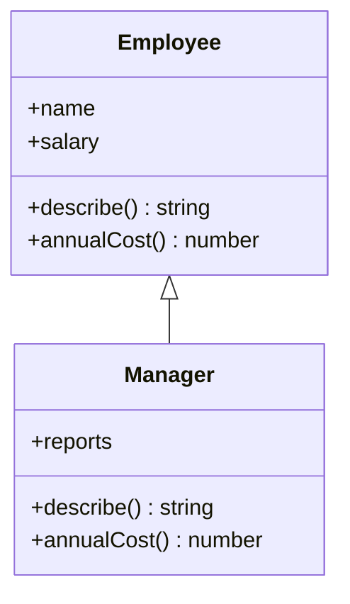
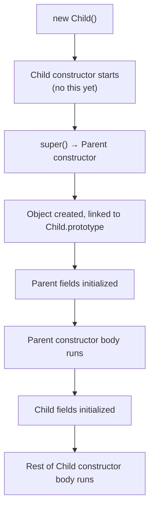

# Classes

> In this document you will learn the full JavaScript `class` syntax: constructors, methods, public and `#private` fields, static members and static blocks, getters and setters, inheritance with `extends` and `super`, extending built-ins like `Array` and `Error`, and how classes differ from constructor functions. Angular components and services, Node.js services and custom errors are all classes, and interviews test these rules with small code puzzles.

**Before this:** [Prototypes and inheritance](08-prototypes-and-inheritance.md) · [this, call, apply and bind](06-this-call-apply-bind.md) · **Interview questions:** [jump to the interview section](#interview-questions)

## Table of contents

1. [What a class is](#what-a-class-is)
2. [Class syntax basics](#class-syntax-basics)
3. [Getters, setters and computed method names](#getters-setters-and-computed-method-names)
4. [Private fields and methods](#private-fields-and-methods)
5. [Static members and static blocks](#static-members-and-static-blocks)
6. [Inheritance with extends and super](#inheritance-with-extends-and-super)
7. [Initialization order](#initialization-order)
8. [Extending built-ins](#extending-built-ins)
9. [Classes vs constructor functions](#classes-vs-constructor-functions)
10. [Private vs TypeScript private vs closures](#private-vs-typescript-private-vs-closures)
11. [Arrow function fields vs prototype methods](#arrow-function-fields-vs-prototype-methods)
12. [new.target and abstract classes](#newtarget-and-abstract-classes)
13. [Mixins](#mixins)
14. [Classes in real projects](#classes-in-real-projects)
15. [Common mistakes](#common-mistakes)
16. [Best practices](#best-practices)
17. [How to explain classes in an interview](#how-to-explain-classes-in-an-interview)
18. [Interview questions](#interview-questions)
19. [Summary](#summary)
20. [References](#references)

---

## What a class is

A **class** is a template for creating objects that have the same shape (fields) and behavior (methods). You create an object from a class with `new`. That object is called an **instance**.

```js
class Product {
  constructor(name, price) {
    this.name = name;
    this.price = price;
  }

  withTax(rate = 0.18) {
    return Math.round(this.price * (1 + rate));
  }
}

const keyboard = new Product("Keyboard", 1500);
const mouse = new Product("Mouse", 500);

console.log(keyboard.withTax()); // 1770
console.log(mouse.withTax());    // 590
console.log(keyboard instanceof Product); // true
```

### Why classes exist

Before ES2015, JavaScript developers built the same thing by hand with constructor functions and `Fn.prototype` (see [Prototypes and inheritance](08-prototypes-and-inheritance.md#constructor-functions-and-what-new-does)). That worked, but it was easy to get wrong: forgetting `new`, forgetting to fix `constructor`, writing inheritance in three manual steps. Classes give one clear syntax for the same model, and add safety features (strict mode, `new`-only calls, `super`, private fields).

### Analogy

A class is like a **cookie cutter**, and instances are the cookies. Each cookie has its own decoration (its own field values), but all cookies get their shape from the same cutter.

Where the analogy breaks down: the methods are not stamped into each cookie. All instances **share** one set of methods stored on `Product.prototype`. If you add a method to the prototype later, every existing instance can use it.

### What a class really creates

A class is a special kind of **function**. Its methods go on its `prototype` object, exactly as in the hand-written version.

```js
console.log(typeof Product);                                  // function
console.log(Object.getPrototypeOf(keyboard) === Product.prototype); // true
console.log(Object.hasOwn(Product.prototype, "withTax"));    // true — shared method
console.log(Object.hasOwn(keyboard, "withTax"));             // false
console.log(Object.keys(keyboard));                          // [ 'name', 'price' ]
```

The details of this mechanism are in [Prototypes and inheritance](08-prototypes-and-inheritance.md#classes-and-prototypes). This document focuses on the class syntax and its rules. Object-oriented design (encapsulation, SOLID, when to use inheritance) is covered in [OOP four pillars](../04-oop-solid-design-patterns/01-oop-four-pillars.md).

---

## Class syntax basics

```js
class ShoppingCart {
  // public fields (ES2022): created on every instance
  items = [];
  currency = "INR";

  // constructor: runs once per `new`
  constructor(ownerId) {
    this.ownerId = ownerId;
  }

  // methods: stored once on ShoppingCart.prototype
  add(name, price, qty = 1) {
    this.items.push({ name, price, qty });
    return this; // allows chaining
  }

  total() {
    return this.items.reduce((sum, item) => sum + item.price * item.qty, 0);
  }
}

const cart = new ShoppingCart("user-7");
cart.add("Pen", 20, 3).add("Book", 350);
console.log(cart.total());      // 410
console.log(cart.items.length); // 2
```

### The constructor

- `constructor` is a special method that runs when you call `new ShoppingCart(...)`.
- Inside it, `this` is the new instance.
- A class can have **only one** `constructor`. JavaScript has no constructor overloading; use default parameters or an options object instead.
- If you do not write one, JavaScript adds an empty one for you (`constructor() {}`, or `constructor(...args) { super(...args); }` in a subclass).

```js
class HttpClient {
  constructor({ baseUrl = "/api", timeoutMs = 5000, retries = 2 } = {}) {
    this.baseUrl = baseUrl;
    this.timeoutMs = timeoutMs;
    this.retries = retries;
  }
}

const client = new HttpClient({ timeoutMs: 10_000 });
console.log(client.baseUrl, client.timeoutMs, client.retries); // /api 10000 2
```

### Public fields

**Class fields** (ES2022) declare instance properties directly in the class body. Each instance gets its own copy.

```js
class Counter {
  count = 0;           // initializer runs for every new instance
  createdAt = Date.now();
  step;                // declared without a value → undefined
}

const a = new Counter();
const b = new Counter();
a.count++;
console.log(a.count, b.count); // 1 0 — separate values
```

Fields are a good place for default values. They also make the shape of the object visible at the top of the class.

Note: a field initializer like `items = []` creates a **new array for each instance**. That is the safe way to have per-instance arrays (compare the shared-array bug in [Prototypes and inheritance](08-prototypes-and-inheritance.md#mutating-an-inherited-object-is-not-assignment)).

### Methods

Methods written in the class body:

- live on the **prototype** and are shared by all instances;
- are **non-enumerable** (they do not appear in `for...in` or `Object.keys`);
- cannot be used with `new`;
- run in **strict mode**, so a lost `this` is `undefined`, not the global object.

### Class declarations and class expressions

```js
// declaration
class Logger {}

// anonymous class expression
const Formatter = class {
  format(value) { return String(value); }
};

// named class expression: the name is visible only inside the class
const Parser = class JsonParser {
  describe() { return JsonParser.name; }
};

console.log(Formatter.name);            // Formatter
console.log(new Parser().describe());   // JsonParser
console.log(typeof JsonParser);         // undefined — not visible outside
```

Class expressions are useful when you build classes dynamically, for example in [mixins](#mixins).

---

## Getters, setters and computed method names

### Getters and setters

A **getter** runs when a property is read. A **setter** runs when it is assigned. From outside they look like normal properties.

```js
class Temperature {
  #celsius = 0;

  get celsius() {
    return this.#celsius;
  }

  set celsius(value) {
    if (typeof value !== "number" || value < -273.15) {
      throw new RangeError("Temperature below absolute zero");
    }
    this.#celsius = value;
  }

  get fahrenheit() {        // read-only computed property (no setter)
    return this.#celsius * 1.8 + 32;
  }
}

const room = new Temperature();
room.celsius = 25;
console.log(room.fahrenheit); // 77
// room.celsius = -300;       // RangeError
// room.fahrenheit = 100;     // TypeError in strict mode: only a getter exists
```

Getters and setters live on the prototype, like methods. Use them for:

- **validation** (protect the object's rules, called **invariants**),
- **computed values** (`fahrenheit`, `fullName`, `isEmpty`),
- **read-only views** of private data.

Keep getters cheap. In Angular templates, a getter is re-evaluated on every change detection cycle.

### Computed method names

Method names can be computed with `[expression]`, like computed keys in object literals. This is how classes implement well-known symbols such as `Symbol.iterator`.

```js
const fieldName = "fullName";

class Person {
  constructor(first, last) {
    this.first = first;
    this.last = last;
  }

  get [fieldName]() {
    return `${this.first} ${this.last}`;
  }

  *[Symbol.iterator]() {    // makes instances iterable
    yield this.first;
    yield this.last;
  }
}

const person = new Person("Asha", "Rao");
console.log(person.fullName); // Asha Rao
console.log([...person]);     // [ 'Asha', 'Rao' ]
```

See [Iterators and generators](13-iterators-and-generators.md) for `Symbol.iterator`.

---

## Private fields and methods

Names that start with `#` are **private** (ES2022). They can be used **only inside the class body** that declares them. This privacy is enforced by the JavaScript engine at runtime.

```js
class BankAccount {
  #balance = 0;              // private field
  static #accountCount = 0;  // private static field

  constructor(owner) {
    this.owner = owner;
    BankAccount.#accountCount++;
  }

  deposit(amount) {
    this.#validate(amount);
    this.#balance += amount;
    return this.#balance;
  }

  withdraw(amount) {
    this.#validate(amount);
    if (amount > this.#balance) throw new Error("Insufficient funds");
    this.#balance -= amount;
    return this.#balance;
  }

  get balance() {            // public read-only view
    return this.#balance;
  }

  #validate(amount) {        // private method
    if (!Number.isFinite(amount) || amount <= 0) {
      throw new RangeError("Amount must be a positive number");
    }
  }

  static get count() {
    return BankAccount.#accountCount;
  }
}

const account = new BankAccount("Asha");
account.deposit(500);
account.withdraw(200);
console.log(account.balance);        // 300
console.log(BankAccount.count);      // 1
console.log(Object.keys(account));   // [ 'owner' ] — private fields are not properties
console.log(JSON.stringify(account)); // {"owner":"Asha"}
// account.#balance;                 // SyntaxError: cannot even be written outside the class
```

### How private fields behave

- **Not properties.** They do not appear in `Object.keys`, `for...in`, `JSON.stringify`, spread or `Reflect.ownKeys`. They are not on the prototype either.
- **Syntax error outside.** Writing `obj.#x` outside the class is a **compile-time** `SyntaxError`, not a runtime check.
- **Brand check.** Each instance created by the class gets the private fields when it is constructed. Calling a method on an object that does not have them throws a `TypeError`:

  ```js
  const fake = { owner: "Mallory" };
  // BankAccount.prototype.deposit.call(fake, 10);
  // TypeError: Cannot read private member #balance from an object whose class did not declare it
  ```

- **Not inherited for access.** A subclass cannot read the parent's `#balance`. Subclass code must use the parent's public (or "protected by convention") methods. A subclass can declare its own `#balance`; it is a completely separate field.
- **Not affected by `Object.freeze`.** Freezing an instance does not stop its methods from changing private fields.
- **Proxies do not forward them.** If you wrap an instance in a `Proxy`, calling a method through the proxy uses the proxy as `this`, which has no private fields, so it throws. This matters for libraries that use proxies (for example, some reactive state libraries).
- **DevTools show them** for debugging, but your code cannot access them.

### Checking for a private field: `#x in obj`

ES2022 added **ergonomic brand checks**: `#field in obj` returns `true` if `obj` has that private field. It is a reliable "is this really one of my instances?" check, more robust than `instanceof` (which can be fooled by `Object.create(BankAccount.prototype)` and fails across realms).

```js
class Money {
  #cents;
  constructor(cents) {
    this.#cents = cents;
  }
  static isMoney(value) {
    return #cents in value;
  }
  equals(other) {
    return Money.isMoney(other) && this.#cents === other.#cents;
  }
}

console.log(Money.isMoney(new Money(100)));                  // true
console.log(Money.isMoney(Object.create(Money.prototype)));  // false — instanceof would say true
console.log(new Money(100).equals(new Money(100)));          // true
```

Note that `equals` reads `other.#cents`. Private fields are **class-private**, not instance-private: code inside the class can read the private fields of **any** instance of the same class.

---

## Static members and static blocks

**Static** members belong to the **class itself**, not to instances. Use them for factory methods, constants, caches and utilities related to the class.

```js
class Temperature {
  static ABSOLUTE_ZERO = -273.15; // static field

  static fromFahrenheit(f) {      // static factory method
    return new this((f - 32) / 1.8);
  }

  constructor(celsius) {
    if (celsius < Temperature.ABSOLUTE_ZERO) throw new RangeError("Too cold");
    this.celsius = celsius;
  }
}

const boiling = Temperature.fromFahrenheit(212);
console.log(boiling.celsius);              // 100
console.log(Temperature.ABSOLUTE_ZERO);    // -273.15
console.log(boiling.ABSOLUTE_ZERO);        // undefined — not on instances
console.log(boiling.constructor.ABSOLUTE_ZERO); // -273.15 — reach the class through the instance
```

Rules:

- Inside a static method, `this` is the class it was called on (so `new this(...)` builds a subclass when called on a subclass). See [this in static methods](06-this-call-apply-bind.md#static-methods-static-fields-and-static-blocks).
- Static members are **inherited** by subclasses, because `Subclass` has the parent class as its prototype. The inherited static field is read through the chain; it is not copied.

```js
class Animal {
  static kingdom = "Animalia";
}
class Dog extends Animal {}

console.log(Dog.kingdom);                // Animalia (inherited)
console.log(Object.hasOwn(Dog, "kingdom")); // false
```

- `static` methods can call each other with `this.otherStatic()` and can use `super.staticMethod()` to call the parent's static method.

### Static initialization blocks

A **static block** (ES2022) runs once, when the class is defined. Use it for setup logic that needs statements (loops, `try/catch`) or access to private static fields.

```js
class FeatureFlags {
  static #flags = new Map();

  static {
    // runs once, at class definition time
    const defaults = { darkMode: true, betaCheckout: false };
    for (const [name, enabled] of Object.entries(defaults)) {
      this.#flags.set(name, enabled); // `this` is the class
    }
  }

  static isEnabled(name) {
    return FeatureFlags.#flags.get(name) ?? false;
  }
}

console.log(FeatureFlags.isEnabled("darkMode"));      // true
console.log(FeatureFlags.isEnabled("betaCheckout"));  // false
```

### A static counter example

```js
class Ticket {
  static #nextId = 1;
  id = Ticket.#nextId++; // each instance takes the next id
}

console.log(new Ticket().id, new Ticket().id); // 1 2
```

When should something be static? If it does not need an instance (`this`), it may be static. But many "utility" statics are better as plain module functions, which are easier to tree-shake and test. Static methods shine for **factories** (`User.fromJson(json)`), **constants tied to the class**, and **registries** of instances.

---

## Inheritance with extends and super

`class Child extends Parent` makes `Child` inherit `Parent`'s instance methods **and** static methods.

```js
class Employee {
  constructor(name, salary) {
    this.name = name;
    this.salary = salary;
  }

  describe() {
    return `${this.name} earns ${this.salary}`;
  }

  annualCost() {
    return this.salary * 12;
  }
}

class Manager extends Employee {
  constructor(name, salary, reports = []) {
    super(name, salary);        // call the parent constructor FIRST
    this.reports = reports;     // now `this` can be used
  }

  describe() {                  // override
    return `${super.describe()} and manages ${this.reports.length} people`;
  }

  annualCost() {
    return super.annualCost() + 50_000; // extend the parent's logic
  }
}

const lead = new Manager("Asha", 100_000, ["Ravi", "Meera"]);
console.log(lead.describe());   // Asha earns 100000 and manages 2 people
console.log(lead.annualCost()); // 1250000
console.log(lead instanceof Manager, lead instanceof Employee); // true true
```



### The rules of super()

1. In a **derived class** (a class with `extends`), the constructor **must call `super(...)`** before it uses `this`. Using `this` first throws a `ReferenceError`.
2. A derived constructor must call `super()` (or return an object) before it ends. Otherwise `new` throws a `ReferenceError`.
3. `super(...)` can be called only in a derived class constructor.
4. If you do not write a constructor in a derived class, JavaScript creates `constructor(...args) { super(...args); }`.

```js
class Base {}

class Broken extends Base {
  constructor() {
    this.ready = true; // ❌ ReferenceError: Must call super constructor in derived class
    super();           //    before accessing 'this' or returning from derived constructor
  }
}

class AlsoBroken extends Base {
  constructor() {}     // ❌ ReferenceError when you call new AlsoBroken()
}
```

**Why does this rule exist?** In a derived class, the **parent** constructor creates the object. Until `super()` runs, the object does not exist yet, so there is no `this`. This is what makes extending built-ins like `Array` work: the `Array` constructor creates a real array object, and then your subclass adds to it.

### super.method()

`super.method(...)` calls the parent's version of a method, with `this` still pointing to the current instance. It works in instance methods, getters/setters, static methods (calling parent statics) and even object literal methods. It is resolved through the method's **home object**, not through `this`, as explained in [What super really does](08-prototypes-and-inheritance.md#what-super-really-does).

```js
class Repository {
  static create() {
    return "base repository";
  }
}
class UserRepository extends Repository {
  static create() {
    return `${super.create()} → user repository`;
  }
}
console.log(UserRepository.create()); // base repository → user repository
```

### Overriding

A child class **overrides** a method by defining one with the same name. Lookup finds the child's version first (shadowing on the prototype chain). The parent method is still reachable with `super.method()`.

When the **parent** calls `this.someMethod()`, it runs the **child's** override if there is one. This is **polymorphism**, and it is the basis of the Template Method pattern:

```js
class Report {
  generate() {
    return [this.header(), this.body(), "-- end --"].join("\n");
  }
  header() {
    return "REPORT";
  }
  body() {
    throw new Error("body() must be implemented by a subclass");
  }
}

class SalesReport extends Report {
  body() {
    return "Sales: 42 orders";
  }
}

console.log(new SalesReport().generate());
// REPORT
// Sales: 42 orders
// -- end --
```

### JavaScript has single inheritance

A class can `extend` only **one** class. To combine behaviors from several sources, use composition or [mixins](#mixins). Prefer **shallow** hierarchies (one or two levels). Design guidance is in [Composition, inheritance and mixins](../04-oop-solid-design-patterns/02-composition-inheritance-and-mixins.md).

### extends works with any constructor

`extends` accepts any expression that produces a constructor (or `null`):

```js
function LegacyWidget(id) {   // an old constructor function
  this.id = id;
}
LegacyWidget.prototype.render = function () {
  return `<div id="${this.id}"></div>`;
};

class ModernWidget extends LegacyWidget {
  render() {
    return super.render().replace("div", "section").replace("div", "section");
  }
}
console.log(new ModernWidget("cart").render()); // <section id="cart"></section>
```

---

## Initialization order

Knowing exactly when fields and constructors run solves many puzzles and real bugs.

For `new Child()` where `Child extends Parent`:

1. `Child`'s constructor starts. Code before `super()` runs (it may not use `this`).
2. `super(...)` calls `Parent`'s constructor.
3. The object is created (by the base class) and linked to `Child.prototype`.
4. **`Parent`'s fields** are initialized (in the order they are written).
5. **`Parent`'s constructor body** runs.
6. Back in `Child`: right after `super()` returns, **`Child`'s fields** are initialized.
7. The rest of **`Child`'s constructor body** runs.



### The classic trap: parent constructor calls an overridden method

```js
class Base {
  name = "base";
  constructor() {
    console.log("Base sees:", this.name, "|", this.describe());
  }
  describe() {
    return "base describe";
  }
}

class Derived extends Base {
  name = "derived";
  extra = "x";
  constructor() {
    super();
    console.log("Derived sees:", this.name);
  }
  describe() {
    return `derived describe, extra=${this.extra}`;
  }
}

new Derived();
// Base sees: base | derived describe, extra=undefined
// Derived sees: derived
```

Step by step:

1. `super()` runs `Base`. `Base`'s field `name = "base"` is set.
2. `Base`'s constructor reads `this.name` → `"base"` (the `Derived` field is not set yet).
3. It calls `this.describe()`. Method lookup starts at the instance, whose prototype is `Derived.prototype`, so the **override** runs.
4. The override reads `this.extra`, which is **not initialized yet** → `undefined`.
5. Back in `Derived`, its fields run: `name` becomes `"derived"`, `extra` becomes `"x"`.

Lesson: **do not call overridable methods from a constructor.** The subclass is not ready yet. Angular uses lifecycle hooks (`ngOnInit`) partly for this reason: inputs and child setup are not ready in the constructor.

### Fields are defined, not assigned

A class field creates the property with **define** semantics (like `Object.defineProperty`), not with normal assignment. So a field in a subclass **does not call a setter** from the parent class:

```js
class Parent {
  set value(v) {
    console.log("parent setter called", v);
  }
}
class Child extends Parent {
  value = 5; // defines an own property; the setter is NOT called
}

const child = new Child();
console.log(Object.hasOwn(child, "value"), child.value); // true 5
```

This matters in TypeScript: the `useDefineForClassFields` compiler option chooses between standard define semantics and the older assignment behavior. It defaults to `true` when the target is ES2022 or newer. Angular CLI projects (v15+) set `"useDefineForClassFields": false` in `tsconfig.json` to keep the older behavior that Angular code relied on. See [TypeScript functions and classes](../03-typescript/04-functions-and-classes.md).

---

## Extending built-ins

Classes can extend built-in constructors like `Array`, `Map`, `Error` and `EventTarget`. This did not work properly with old constructor functions.

### Extending Array

```js
class Stack extends Array {
  peek() {
    return this[this.length - 1];
  }
  isEmpty() {
    return this.length === 0;
  }
}

const stack = Stack.from([1, 2, 3]);
console.log(stack.peek());               // 3
console.log(stack.length);               // 3 — real array behavior
console.log(Array.isArray(stack));       // true
console.log(stack.map((n) => n * 2) instanceof Stack); // true
```

Built-in methods like `map`, `filter` and `slice` return instances of your subclass (they use the constructor through `Symbol.species`). That is convenient, but it also means your constructor is called by those methods, so keep its signature compatible with `Array`'s. In practice, **composition** (a class that has a private array) is often simpler than extending `Array`.

### Extending Error (very common)

Custom error classes let callers handle different failures differently.

```js
class AppError extends Error {
  constructor(message, { code = "APP_ERROR", status = 500, cause } = {}) {
    super(message, { cause });   // ES2022: `cause` keeps the original error
    this.name = this.constructor.name; // so stack traces show the right name
    this.code = code;
    this.status = status;
  }
}

class NotFoundError extends AppError {
  constructor(resource, id) {
    super(`${resource} ${id} not found`, { code: "NOT_FOUND", status: 404 });
    this.resource = resource;
  }
}

class ValidationError extends AppError {
  constructor(field, message, cause) {
    super(message, { code: "VALIDATION", status: 400, cause });
    this.field = field;
  }
}

try {
  throw new NotFoundError("Order", 42);
} catch (error) {
  console.log(error instanceof NotFoundError, error instanceof AppError, error instanceof Error); // true true true
  console.log(error.name, error.status, error.message); // NotFoundError 404 Order 42 not found
  console.log(String(error)); // NotFoundError: Order 42 not found
}
```

Tips:

- Always call `super(message)` so `message` and `stack` are set.
- Set `this.name`; otherwise it stays `"Error"`.
- Use `instanceof` or a `code` property to decide how to handle the error. In an Express error middleware, map `error.status` to the HTTP status. See [Error handling](15-error-handling.md) and [Validation and error handling in Node.js](../07-nodejs-backend/08-validation-and-error-handling.md).
- Old TypeScript targets (ES5) broke `instanceof` for subclassed errors; with ES2015+ targets this works correctly.

---

## Classes vs constructor functions

| Feature | Class | Constructor function |
| --- | --- | --- |
| Call without `new` | Throws `TypeError: Class constructor X cannot be invoked without 'new'` | Runs as a normal function (bug) |
| Hoisting | Hoisted but in the **temporal dead zone** (TDZ) | Function declarations are fully hoisted |
| Strict mode | Always | Only if you opt in |
| Methods enumerable? | No | Yes, if assigned to `prototype` |
| Methods usable with `new`? | No | Yes |
| Inheritance | `extends` + `super` | Manual (`Parent.call`, `Object.create`, fix `constructor`) |
| Static inheritance | Automatic | Manual (`Object.setPrototypeOf`) |
| Extend `Array`, `Error`, `Map` | Works | Practically impossible to do correctly |
| Fields, `#private`, static blocks | Yes | No |
| `typeof` | `"function"` | `"function"` |

### Class TDZ

Class declarations are hoisted like `let`: the name exists from the start of the scope, but you cannot use it until the declaration has run.

```js
try {
  new Invoice();
} catch (error) {
  console.log(error.name, error.message); // ReferenceError Cannot access 'Invoice' before initialization
}

class Invoice {}
```

With a function declaration, `new Invoice()` before the declaration would work. The TDZ helps because classes can depend on code above them (for example, `extends` an expression or static fields that call functions). See [Scope, hoisting and TDZ](03-scope-hoisting-and-tdz.md).

---

## Private vs TypeScript private vs closures

There are four common ways to hide data in a class-based codebase:

```js
// 1. JavaScript #private (runtime-enforced)
class TokenStoreA {
  #token = null;
  set(token) { this.#token = token; }
  has() { return this.#token !== null; }
}

// 2. Naming convention (not private at all)
class TokenStoreB {
  _token = null; // "please do not touch"
}

// 3. Closure (factory function)
function createTokenStore() {
  let token = null;
  return {
    set: (value) => { token = value; },
    has: () => token !== null,
  };
}

// 4. WeakMap keyed by instance (the pre-2022 way to get real privacy in classes)
const tokens = new WeakMap();
class TokenStoreD {
  constructor() { tokens.set(this, null); }
  set(token) { tokens.set(this, token); }
  has() { return tokens.get(this) !== null; }
}
```

And in TypeScript:

```ts
class TokenStoreTs {
  private token: string | null = null; // checked ONLY by the compiler
}
const store = new TokenStoreTs();
// store.token;                       // compile error
// (store as any).token;              // works at runtime: it is a normal property
```

| | `#private` | TypeScript `private` | `_convention` | Closure | `WeakMap` |
| --- | --- | --- | --- | --- | --- |
| Enforced at runtime | Yes | No (compile time only) | No | Yes | Yes |
| Visible in `Object.keys` / JSON | No | Yes | Yes | No | No |
| Subclass access | No | No (`protected` allows it, compile time only) | Yes | No | Yes, if the WeakMap is in scope |
| Methods shared on prototype | Yes | Yes | Yes | No | Yes |
| Works with Proxy-wrapped instances | No | Yes | Yes | Yes | No (the proxy is a different `WeakMap` key) |
| Typical use | Libraries, invariants that must hold | Angular apps (DI constructor params) | Legacy code | Small objects, functional style | Older libraries |

Practical guidance:

- In **Angular 16** code you will mostly see TypeScript's `private`, `protected` and `readonly` — for example `constructor(private http: HttpClient) {}` (a **parameter property**). That is fine for application code: the goal is a clean API for your team, and the compiler enforces it.
- Use **`#private`** when privacy must hold at runtime: published libraries, security-sensitive state, objects passed to code you do not control.
- TypeScript supports `#private` too; with an ES2022 target it is emitted as-is.

Closures are compared in more depth in [Closures](05-closures.md#closures-vs-classes-vs-private-fields).

---

## Arrow function fields vs prototype methods

Class methods lose `this` when passed as callbacks (see [Losing this](06-this-call-apply-bind.md#losing-this-and-how-to-fix-it)). A common fix is an **arrow function field**:

```js
class SearchBox {
  query = "";

  // prototype method: shared, but loses `this` when passed alone
  onInputMethod(event) {
    this.query = event.target.value;
  }

  // arrow field: a new function per instance, `this` is always the instance
  onInput = (event) => {
    this.query = event.target.value;
  };
}

const box = new SearchBox();
const handler = box.onInput;
handler({ target: { value: "laptop" } });
console.log(box.query); // laptop
```

| | Prototype method | Arrow function field |
| --- | --- | --- |
| Memory | One function shared by all instances | One function **per instance** |
| Safe to pass as callback | No (needs `bind` or an arrow wrapper) | Yes |
| Overridable + `super.method()` | Yes | No — it is an own property, not on the prototype |
| Mockable with `jest.spyOn(Class.prototype, "m")` | Yes | No |
| Visible in `Object.keys(instance)` | No | Yes |

A surprising consequence: an arrow field in a **parent** class shadows a **method** with the same name in a child class, because own properties win over prototype methods.

```js
class Button {
  onClick = () => "parent field";
}
class IconButton extends Button {
  onClick() {
    return "child method";
  }
}
console.log(new IconButton().onClick()); // parent field
```

Rule of thumb: use prototype methods by default; use arrow fields for event handlers that are passed around often, in classes that are not extended and do not have thousands of instances.

---

## new.target and abstract classes

JavaScript has no `abstract` keyword (TypeScript does, at compile time only). You can emulate an abstract class with **`new.target`**, which is the constructor that `new` was directly called on.

```js
class Shape {
  constructor() {
    if (new.target === Shape) {
      throw new TypeError("Shape is abstract; create a subclass");
    }
  }

  area() {
    throw new Error(`${this.constructor.name} must implement area()`);
  }

  describe() {
    return `${this.constructor.name} with area ${this.area().toFixed(2)}`;
  }
}

class Square extends Shape {
  constructor(side) {
    super();
    this.side = side;
  }
  area() {
    return this.side ** 2;
  }
}

try {
  new Shape();
} catch (error) {
  console.log(error.message); // Shape is abstract; create a subclass
}
console.log(new Square(3).describe()); // Square with area 9.00
```

Inside `Shape`'s constructor, `new.target` is `Square` when you call `new Square(...)`, and `Shape` when you call `new Shape()`. In a normal function call (no `new`), `new.target` is `undefined`.

In TypeScript you would write `abstract class Shape { abstract area(): number; }`, and the compiler stops you from instantiating it or forgetting to implement `area`. That check disappears at runtime; the `new.target` guard still works at runtime.

---

## Mixins

A **mixin** adds a set of methods to a class without making it the single parent. In JavaScript, a common form is a function that takes a base class and returns a subclass:

```js
const Serializable = (Base) =>
  class extends Base {
    toJSON() {
      return { ...this, type: this.constructor.name };
    }
  };

const Timestamped = (Base) =>
  class extends Base {
    touch() {
      this.updatedAt = new Date(0).toISOString(); // fixed date for the example
      return this;
    }
  };

class Entity {
  constructor(id) {
    this.id = id;
  }
}

class Order extends Serializable(Timestamped(Entity)) {}

const order = new Order(5).touch();
console.log(JSON.stringify(order));
// {"id":5,"updatedAt":"1970-01-01T00:00:00.000Z","type":"Order"}
```

Each mixin adds one layer to the prototype chain. Mixins solve "share behavior across unrelated classes", but too many layers make code hard to follow. The design trade-offs (mixins vs composition vs inheritance) are in [Composition, inheritance and mixins](../04-oop-solid-design-patterns/02-composition-inheritance-and-mixins.md).

---

## Classes in real projects

### Angular components and services (Angular 16)

Angular is built around classes with decorators. Decorators add metadata; the class itself is a normal JavaScript class.

```ts
@Injectable({ providedIn: "root" })
export class CartService {
  private readonly items: CartItem[] = [];          // TypeScript private (compile time)

  add(item: CartItem): void {
    this.items.push(item);
  }

  get total(): number {                            // getter
    return this.items.reduce((sum, i) => sum + i.price * i.qty, 0);
  }
}

@Component({
  selector: "app-cart-summary",
  template: `<p>Total: {{ cart.total }}</p><button (click)="checkout()">Checkout</button>`,
})
export class CartSummaryComponent {
  protected cart = inject(CartService);            // field initializer with inject() (v14+)

  checkout(): void {                               // prototype method; template calls are safe
    /* ... */
  }
}
```

- Angular's injector creates service and component instances with `new`.
- Constructor injection (`constructor(private cart: CartService) {}`) and the `inject()` function (usable in field initializers since Angular 14) both work in Angular 16.
- Do not put heavy work or input-dependent logic in the constructor; inputs are not set yet. Use `ngOnInit`. See [Lifecycle hooks](../06-angular-16/04-lifecycle-hooks.md) and [Dependency injection](../06-angular-16/05-dependency-injection.md).

### Custom errors

As shown in [Extending Error](#extending-error-very-common): `NotFoundError`, `ValidationError`, `AuthError` let error middleware and `ErrorHandler` implementations make decisions with `instanceof` or `code`.

### Node.js: extending EventEmitter

Many Node.js objects (streams, servers, sockets) are classes that extend `EventEmitter`. Your own services can do the same:

```js
import { EventEmitter } from "node:events";

class OrderQueue extends EventEmitter {
  #orders = [];

  add(order) {
    this.#orders.push(order);
    this.emit("added", order);
  }

  get size() {
    return this.#orders.length;
  }
}

const queue = new OrderQueue();
queue.on("added", (order) => console.log("added order", order.id));
queue.add({ id: 1 }); // added order 1
console.log(queue.size); // 1
```

See [Core modules: fs, path, events, buffer](../07-nodejs-backend/04-core-modules-fs-path-events-buffer.md).

### Electron

Main-process code often wraps windows and services in classes (`class WindowManager { #windows = new Map(); ... }`). IPC handlers registered with class methods need `bind` or arrow wrappers, because Electron calls them as plain functions. See [IPC and preload scripts](../08-electron-desktop/03-ipc-and-preload-scripts.md).

---

## Common mistakes

**1. Using `this` before `super()`** in a derived constructor → `ReferenceError`.

**2. Calling overridable methods in the constructor.** Subclass fields are not initialized yet.

**3. Passing methods as callbacks** (`setTimeout(this.refresh, 1000)`, `app.get("/", controller.list)`) → `this` is lost. Use arrow wrappers, `bind`, or arrow fields.

**4. Thinking TypeScript `private` is real privacy.** It disappears at runtime.

**5. Accessing static members through an instance.** `instance.MAX` is `undefined`; use `ClassName.MAX` or `this.constructor.MAX`.

**6. Forgetting `this.name` in custom errors**, so logs show just `Error`.

**7. Using a class when a function would do.** A class with only static methods, or a class with one method and no state, is often better as a module of functions.

**8. Deep inheritance hierarchies.** Five levels of `extends` make behavior hard to trace and fragile to change. Prefer composition.

**9. Arrow fields everywhere.** They cost memory per instance and break `super` and prototype spying.

**10. Using a class before its declaration** (TDZ), for example in circular imports between modules where one class extends another.

---

## Best practices

- **Initialize all fields** (with field declarations or in the constructor). Reason: the object's shape is clear and stable, which helps readers and the engine.
- **Keep constructors light.** Assign dependencies and defaults; do work in methods or lifecycle hooks. Reason: constructors cannot be async, and subclasses are not ready yet.
- **Use static factories for async creation.** `static async create(config) { const db = await connect(config); return new Service(db); }`. Reason: a constructor cannot `await`.
- **Use `#private` for invariants that must hold at runtime**, TypeScript `private`/`readonly` for team-level API boundaries.
- **Favor composition over deep inheritance.** Reason: smaller, replaceable parts; fewer surprises from overrides.
- **Prefer prototype methods; use arrow fields only for handlers that are passed around.** Reason: memory and overridability.
- **Name custom errors and give them codes.** Reason: reliable handling and readable logs.
- **Use `#x in obj` for brand checks** when values may be faked or come from elsewhere. Reason: more reliable than `instanceof`.

---

## How to explain classes in an interview

1. **Define it:** "A class is a template for creating objects with the same fields and methods. `new MyClass()` creates an instance."
2. **Why it exists:** "Before ES2015 we built the same thing manually with constructor functions and prototypes. Classes give one clear syntax and add safety: strict mode, `new`-only calls, `super`, and private fields."
3. **How it works:** "A class is a function. Methods go on `MyClass.prototype` and are shared by all instances; fields are created on each instance. With `extends`, the child's prototype links to the parent's prototype, and the child class links to the parent class, so static methods are inherited too. In a derived constructor, `super()` must run before `this`, because the parent creates the object."
4. **Small example:** "A `Manager extends Employee` calls `super(name, salary)`, adds `reports`, and overrides `describe()` while reusing the parent's with `super.describe()`."
5. **Where it is useful:** "Angular components and services, custom error hierarchies, Node services that extend `EventEmitter`, and domain models with invariants like a `BankAccount` with a `#balance`."
6. **Trade-offs / gotchas:** "Methods lose `this` when passed as callbacks. Fields of a subclass are initialized after the parent constructor, so calling overridden methods from a constructor reads `undefined`. TypeScript `private` is compile-time only, while `#private` is enforced at runtime. And I keep hierarchies shallow and prefer composition."

---

## Interview questions

### Q1. What is a class in JavaScript, and how is it related to prototypes?

**What the interviewer is checking:** That you know classes are built on prototypes, and what they add.

**Short spoken answer (30–60 seconds):**
> A class is a template for creating objects with shared behavior. Under the hood it's a special function: methods defined in the class body go on its `prototype` object and are shared by every instance, while fields and anything assigned in the constructor become own properties of each instance. `extends` links the child's prototype to the parent's, and also links the child class to the parent class so statics are inherited. But classes aren't only sugar: they must be called with `new`, they're in the TDZ before their declaration, their bodies are strict, methods are non-enumerable, and they support `super`, private `#` fields and static blocks.

**Code:**

```js
class User {
  constructor(name) { this.name = name; }
  greet() { return `Hi, ${this.name}`; }
}
console.log(typeof User);                                  // function
console.log(Object.hasOwn(User.prototype, "greet"));      // true
console.log(Object.getPrototypeOf(new User("A")) === User.prototype); // true
```

**Follow-up questions:**
- **What happens if you call `User("A")` without `new`?** — `TypeError: Class constructor User cannot be invoked without 'new'`.
- **Where do static methods live?** — On the class (constructor function) itself, not on the prototype.

**Common mistakes:** "JavaScript classes work like Java classes" or "classes are exactly the same as constructor functions".

---

### Q2. What are the rules for `super()` in a constructor, and why do they exist?

**What the interviewer is checking:** Derived-class construction semantics.

**Short spoken answer (30–60 seconds):**
> In a class that uses `extends`, the constructor must call `super()` before it touches `this`, and it must call it before returning, unless it returns its own object. Using `this` first throws a ReferenceError. The reason is that in a derived class the parent constructor is the one that actually creates the object; until `super()` runs, there's no object, so there's no `this`. That design is also what makes extending built-ins like `Array` or `Error` work: the built-in creates a real array or error object, linked to my subclass prototype.

**Code:**

```js
class Animal {
  constructor(name) { this.name = name; }
}
class Dog extends Animal {
  constructor(name, breed) {
    super(name);       // must come first
    this.breed = breed;
  }
}
console.log(new Dog("Rex", "Lab")); // Dog { name: 'Rex', breed: 'Lab' }
```

**Follow-up questions:**
- **What if a derived class has no constructor?** — JavaScript adds `constructor(...args) { super(...args); }`.
- **Can you run code before `super()`?** — Yes, as long as it does not use `this` (for example, validating arguments).

---

### Q3. What does this print?

```js
class Base {
  name = "base";
  constructor() {
    console.log(this.name, this.describe());
  }
  describe() { return "base"; }
}

class Derived extends Base {
  name = "derived";
  label = "D";
  describe() { return `derived ${this.label}`; }
}

const d = new Derived();
console.log(d.name);
```

**What the interviewer is checking:** Field initialization order and polymorphic calls in constructors.

**Answer:**

```text
base derived undefined
derived
```

**Step by step:**
1. `Derived` has no constructor, so the default one calls `super()`.
2. In `Base`, `Base`'s fields run first: `name = "base"`.
3. `Base`'s constructor logs `this.name` → `"base"`.
4. `this.describe()` finds the **override** on `Derived.prototype` (the instance is a `Derived`). It reads `this.label`, which is not initialized yet → `"derived undefined"`.
5. After `super()` returns, `Derived`'s fields run: `name = "derived"`, `label = "D"`. So `d.name` is `"derived"`.

**Follow-up:** **How do you avoid this bug?** — Do not call overridable methods from constructors; use an explicit `init()` step or framework lifecycle hooks such as `ngOnInit`.

---

### Q4. What are private class fields? How are they different from TypeScript `private`?

**What the interviewer is checking:** Runtime vs compile-time privacy.

**Short spoken answer (30–60 seconds):**
> Private fields use a `#` prefix, like `#balance`. They're enforced by the JavaScript engine: code outside the class body can't even write `obj.#balance` — it's a syntax error — and they don't show up in `Object.keys`, JSON or spread. A method that reads a private field throws a TypeError if `this` isn't a real instance. TypeScript's `private` keyword is only checked by the compiler; at runtime it's a normal property, so `(obj as any).secret` or `JSON.stringify` exposes it. In Angular apps, TypeScript `private` is usually fine for team boundaries; I use `#private` when privacy must hold at runtime, like in a library.

**Code:**

```js
class Wallet {
  #balance = 100;
  get balance() { return this.#balance; }
  static isWallet(value) { return #balance in value; }
}
const wallet = new Wallet();
console.log(wallet.balance, Object.keys(wallet), JSON.stringify(wallet)); // 100 [] {}
console.log(Wallet.isWallet(wallet), Wallet.isWallet({})); // true false
```

**Follow-up questions:**
- **Can a subclass access the parent's `#field`?** — No. Only code inside the declaring class body can. A subclass can declare its own `#field` with the same name; it is a separate field.
- **Can one instance read another instance's private field?** — Yes, inside the class body. Privacy is per class, not per instance (useful for `equals(other)`).
- **What is a downside of `#private`?** — Methods that use them fail on `Proxy`-wrapped instances, and you cannot reach them in tests (test through the public API instead).

---

### Q5. What does this print?

```js
class Counter {
  static count = 0;
  constructor() {
    Counter.count++;
  }
}
class SpecialCounter extends Counter {}

new Counter();
new SpecialCounter();
const s = new SpecialCounter();

console.log(Counter.count, SpecialCounter.count, s.count);
console.log(Object.hasOwn(SpecialCounter, "count"));
```

**Answer:**

```text
3 3 undefined
false
```

All constructors increment `Counter.count` (the code names `Counter` explicitly). `SpecialCounter.count` is found through the static prototype chain (`SpecialCounter` → `Counter`), so it is the same value. Instances do not see static members, so `s.count` is `undefined`.

**Follow-up:** **What if the constructor used `this.constructor.count++` instead?** — Then the output would be `1 3 undefined` and `true`. For the first `SpecialCounter`, `this.constructor` is `SpecialCounter`: `count++` reads the inherited value (`1`) and **assigns** `2` as a new own static property on `SpecialCounter`. The next one makes it `3`. `Counter.count` stays `1`. Assigning on a subclass shadows the parent's static, exactly like assigning on an instance shadows a prototype property.

---

### Q6. How do you create a custom error class correctly?

**What the interviewer is checking:** Practical class inheritance with built-ins.

**Short spoken answer (30–60 seconds):**
> I extend `Error`, call `super(message, { cause })` so the message, stack and the original cause are set, and set `this.name` to the class name so logs and stack traces show it. I usually add a `code` or an HTTP `status`, and I build a small hierarchy — `AppError`, then `NotFoundError`, `ValidationError`. Then error handlers can use `instanceof` or the code to decide what to do — for example, Express error middleware maps `status` to the response.

**Code:**

```js
class AppError extends Error {
  constructor(message, { status = 500, code = "APP_ERROR", cause } = {}) {
    super(message, { cause });
    this.name = this.constructor.name;
    this.status = status;
    this.code = code;
  }
}
class NotFoundError extends AppError {
  constructor(resource, id) {
    super(`${resource} ${id} not found`, { status: 404, code: "NOT_FOUND" });
  }
}

const error = new NotFoundError("User", 7);
console.log(error instanceof AppError, error.name, error.status, String(error));
// true NotFoundError 404 NotFoundError: User 7 not found
```

**Follow-up questions:**
- **What is `cause` for?** — It keeps the original lower-level error (ES2022) when you wrap it, so logs show the full chain.
- **Why did `instanceof` fail for custom errors in some old TypeScript projects?** — Compiling classes to ES5 could not subclass `Error` properly; the fix was `Object.setPrototypeOf(this, new.target.prototype)` in the constructor. With ES2015+ targets it works.

---

### Q7. What is the difference between a class and a constructor function?

**Answer:** Both create objects linked to a `prototype`. Classes additionally: throw when called without `new`; are in the TDZ before the declaration (not usable early); always run in strict mode; have non-enumerable, non-constructible methods; support `extends`/`super` (including static inheritance and correct subclassing of built-ins); and support fields, `#private` members and static blocks. Constructor functions are fully hoisted and can be called without `new` (a common bug). See the table in [Classes vs constructor functions](#classes-vs-constructor-functions).

---

### Q8. What does this print?

```js
class Button {
  label = "Save";
  handleArrow = () => this.label;
  handleMethod() {
    return this?.label;
  }
}

const button = new Button();
const { handleArrow, handleMethod } = button;
console.log(handleArrow());
console.log(handleMethod());
console.log(button.handleArrow === new Button().handleArrow);
console.log(button.handleMethod === new Button().handleMethod);
```

**Answer:**

```text
Save
undefined
false
true
```

The arrow field captured the instance as `this` when it was created, so destructuring does not break it. The prototype method is called as a plain function in strict mode (class bodies are strict), so `this` is `undefined`. Each instance has its own arrow function, but all share one prototype method.

---

### Q9. When would you use static methods? Give examples.

**Answer:** Static methods belong to the class, not to instances. Use them when the operation does not need instance state but is closely tied to the class:
- **Factories:** `User.fromJson(json)`, `Temperature.fromFahrenheit(212)`, `static async create(config)` for async initialization (constructors cannot be async).
- **Validation and brand checks:** `Money.isMoney(value)` using `#cents in value`.
- **Constants and registries:** `HttpStatus.NOT_FOUND`, a static map of created instances.

Use `new this(...)` inside static factories so subclasses get instances of the subclass. If a class has *only* static methods, it is usually better as a plain module of functions.

---

### Q10. How do you emulate an abstract class in JavaScript?

**Answer:** Throw in the constructor when `new.target` is the base class itself, and make "abstract" methods throw until a subclass overrides them.

```js
class Notifier {
  constructor() {
    if (new.target === Notifier) throw new TypeError("Notifier is abstract");
  }
  send(message) {
    throw new Error(`${this.constructor.name}.send() not implemented`);
  }
}
class EmailNotifier extends Notifier {
  send(message) { return `email: ${message}`; }
}
console.log(new EmailNotifier().send("Order shipped")); // email: Order shipped
```

TypeScript's `abstract` keyword gives compile-time checks; the `new.target` guard gives a runtime check.

---

### Q11. What does this print?

```js
class Parent {
  set value(v) {
    console.log("setter", v);
  }
}
class Child extends Parent {
  value = 10;
}

const child = new Child();
console.log(child.value, Object.hasOwn(child, "value"));
```

**Answer:** `10 true` (the setter is **not** called)

Class fields are created with define semantics, like `Object.defineProperty`, not by assignment. So the field becomes an own data property and the inherited setter never runs. In TypeScript, `useDefineForClassFields: false` changes this to assignment semantics, and then the setter would run; Angular CLI projects set that flag to `false`.

---

### Q12. Can a constructor be async? How do you initialize a class that needs async work?

**What the interviewer is checking:** Practical patterns and language limits.

**Short spoken answer (30–60 seconds):**
> No. `constructor` can't be `async`, because `new` must return the instance synchronously, not a promise. The usual pattern is a private or light constructor plus a static async factory: `static async create(config)` does the async work — connecting to a database, loading settings — then calls `new` with the results and returns the ready instance. Another option is an explicit `init()` method, but then callers can forget to call it, so I prefer the factory.

**Code:**

```js
class ReportService {
  #db;
  constructor(db) {
    this.#db = db;
  }

  static async create(connect) {
    const db = await connect();
    return new ReportService(db);
  }

  count() {
    return this.#db.rows.length;
  }
}

// top-level await: run this as an ES module (or inside an async function)
const service = await ReportService.create(async () => ({ rows: [1, 2, 3] }));
console.log(service.count()); // 3
```

**Follow-up:** **How does Angular handle this?** — Services are created synchronously by the injector. Async setup goes into methods returning observables/promises, `APP_INITIALIZER` for app start-up work, or route resolvers.

---

### Q13. Implement a `Stack` class with `push`, `pop`, `peek`, `size` and no way to corrupt its data from outside.

**Answer:**

```js
class Stack {
  #items = [];

  push(...values) {
    this.#items.push(...values);
    return this;
  }

  pop() {
    if (this.#items.length === 0) throw new RangeError("Stack is empty");
    return this.#items.pop();
  }

  peek() {
    return this.#items.at(-1);
  }

  get size() {
    return this.#items.length;
  }

  toArray() {
    return [...this.#items]; // a copy, not the private array
  }
}

const history = new Stack().push("home", "products", "cart");
console.log(history.peek(), history.size); // cart 3
console.log(history.pop(), history.size);  // cart 2
history.toArray().push("hacked");
console.log(history.size);                 // 2 — internal data is safe
```

Composition (a private array) is simpler and safer than `class Stack extends Array`, which would expose every array method (`splice`, `length = 0`) and let callers break the stack rules.

---

### Q14. Should you extend `Array`? What happens with `map` on a subclass?

**Answer:** You can: `class Stack extends Array` creates real arrays (`Array.isArray` is `true`, `length` works). Built-in methods like `map`, `filter` and `slice` return instances of the subclass, because they create results through the constructor (`Symbol.species`). That means your constructor will be called with array-style arguments, which can break if your constructor expects different parameters. Also, the subclass exposes all array methods, so it cannot protect its own rules. In most real code, composition (a class that holds a private array) is the better design.

```js
class Tags extends Array {}
const tags = Tags.from(["js", "ts"]);
console.log(tags.map((t) => t.toUpperCase()) instanceof Tags); // true
```

---

### Q15. What does this print?

```js
console.log(typeof Invoice);
class Invoice {}
```

**Answer:** It throws `ReferenceError: Cannot access 'Invoice' before initialization`.

Class declarations are hoisted but stay in the temporal dead zone until the declaration runs. Even `typeof`, which is safe for undeclared names, throws for a binding in the TDZ. A function declaration in the same position would print `"function"`.

---

### Q16. Scenario: a junior developer built a 5-level class hierarchy (`BaseComponent` → `TableComponent` → `EditableTable` → `ProductTable` → `AdminProductTable`). Every change breaks something. What do you suggest?

**What the interviewer is checking:** Design judgment, not syntax.

**Short spoken answer (30–60 seconds):**
> Deep hierarchies create tight coupling: a change in a base class affects every child, and overrides that call `super` at different points are hard to follow — the fragile base class problem. I'd flatten it. Shared behavior like sorting, paging or inline editing becomes separate pieces that the table *uses* — services, helper classes, directives in Angular, or configuration passed in — instead of layers it *is*. I'd keep at most one level of inheritance where there's a real "is-a" relationship, and move toward composition for the rest, adding tests around the current behavior before refactoring.

**Follow-up questions:**
- **When is inheritance still a good fit?** — For true "is-a" relationships with a stable base: error hierarchies, framework base classes designed for extension, a small template-method base.
- **What does composition look like in Angular?** — Directives for behavior (`appSortable`), injectable services for shared state and logic, and content projection or inputs for configuration.

See [Composition, inheritance and mixins](../04-oop-solid-design-patterns/02-composition-inheritance-and-mixins.md).

---

### Q17. What does this print?

```js
class A {
  #secret = "A";
  readA() { return this.#secret; }
}
class B extends A {
  #secret = "B";
  readB() { return this.#secret; }
}

const b = new B();
console.log(b.readA(), b.readB());
```

**Answer:** `A B`

Each class has its **own** private name. `A`'s `#secret` and `B`'s `#secret` are two different private fields stored on the same object. Code in `A` sees `A`'s field; code in `B` sees `B`'s field. There is no overriding of private fields.

---

### Q18. Why do Angular class methods sometimes lose `this`, while template calls never do?

**Answer:** In a template, `(click)="save()"` is evaluated by Angular against the component instance, which is a method call (`component.save()`), so `this` is correct. When you pass the method **reference** somewhere else — `setTimeout(this.save, 1000)`, `.subscribe(this.handle)`, `addEventListener("scroll", this.onScroll)` — the receiver is lost, because class methods are normal prototype functions and class bodies are strict, so `this` becomes `undefined` (or whatever the caller chooses). Fix with an arrow wrapper (`() => this.save()`), `bind` (store the bound function if you must remove a listener), or an arrow function field. Details in [this, call, apply and bind](06-this-call-apply-bind.md#this-in-angular-react-and-nodejs).

---

## Summary

- A `class` is a special function. Methods (and getters/setters) go on `Class.prototype` and are shared; fields and constructor assignments are own properties of each instance.
- Public fields (`items = []`) give each instance its own value. Methods are strict, non-enumerable and not constructible.
- `#private` fields and methods are enforced at runtime; `#x in obj` is a reliable brand check. TypeScript `private` is compile-time only.
- `static` members belong to the class, are inherited through the class chain, and `this` in a static method is the class it was called on. Static blocks run once at definition time.
- In a derived class, call `super()` before using `this`; the parent creates the object. `super.method()` calls the parent's method with the current `this`.
- Initialization order: parent fields → parent constructor body → child fields → rest of child constructor. Do not call overridable methods from a constructor.
- Fields use define semantics, so they do not trigger parent setters (TypeScript's `useDefineForClassFields` controls this; Angular CLI sets it to `false`).
- Classes can extend built-ins: `Error` (custom errors with `name`, `code`, `cause`) is the most common; prefer composition over extending `Array`.
- Classes are in the TDZ before their declaration and throw without `new`.
- Arrow function fields fix lost `this` but cost one function per instance and cannot be used with `super`.
- Emulate abstract classes with `new.target`; share behavior across classes with mixins or, better, composition. Keep hierarchies shallow.

## References

- MDN: Classes — https://developer.mozilla.org/en-US/docs/Web/JavaScript/Reference/Classes
- MDN: Private properties — https://developer.mozilla.org/en-US/docs/Web/JavaScript/Reference/Classes/Private_properties
- MDN: Public class fields — https://developer.mozilla.org/en-US/docs/Web/JavaScript/Reference/Classes/Public_class_fields
- MDN: Static initialization blocks — https://developer.mozilla.org/en-US/docs/Web/JavaScript/Reference/Classes/Static_initialization_blocks
- MDN: `extends` — https://developer.mozilla.org/en-US/docs/Web/JavaScript/Reference/Classes/extends
- MDN: `super` — https://developer.mozilla.org/en-US/docs/Web/JavaScript/Reference/Operators/super
- MDN: `new.target` — https://developer.mozilla.org/en-US/docs/Web/JavaScript/Reference/Operators/new.target
- MDN: `Error` (custom error types, `cause`) — https://developer.mozilla.org/en-US/docs/Web/JavaScript/Reference/Global_Objects/Error
- ECMAScript 2025 specification: Class definitions — https://tc39.es/ecma262/2025/#sec-class-definitions
- TypeScript handbook: Classes — https://www.typescriptlang.org/docs/handbook/2/classes.html
- TypeScript TSConfig reference: `useDefineForClassFields` — https://www.typescriptlang.org/tsconfig/#useDefineForClassFields
- Angular: Dependency injection in action / `inject()` (v16) — https://v16.angular.io/api/core/inject
- Node.js docs: Events (`EventEmitter`) — https://nodejs.org/docs/latest-v22.x/api/events.html
