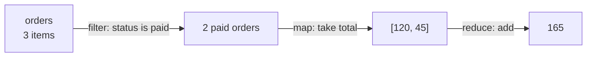
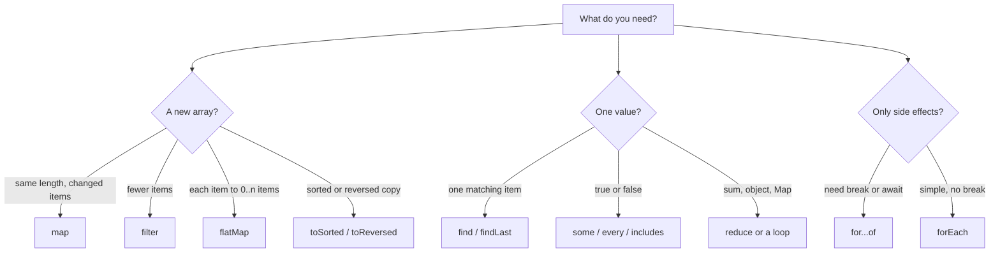

# Arrays and Array Methods

> In this document you will learn how JavaScript arrays really work, every array method you need in daily work, and the common tasks (remove duplicates, group by, chunk, flatten) that appear in coding interviews. Array questions test both language knowledge and problem solving.

**Before this:** [Functions and functional programming](./04-functions-and-functional-programming.md) · [Objects and copying](./07-objects-and-copying.md) · **Interview questions:** [jump to questions](#interview-questions)

## Table of contents

1. [What an array is](#what-an-array-is)
2. [Creating arrays](#creating-arrays)
3. [The length property](#the-length-property)
4. [Holes and sparse arrays](#holes-and-sparse-arrays)
5. [Array-like objects and Array.from](#array-like-objects-and-arrayfrom)
6. [Mutating vs non-mutating methods](#mutating-vs-non-mutating-methods)
7. [Adding and removing items](#adding-and-removing-items)
8. [forEach, map and filter](#foreach-map-and-filter)
9. [reduce and reduceRight](#reduce-and-reduceright)
10. [Searching and testing](#searching-and-testing)
11. [Slicing, joining and reshaping](#slicing-joining-and-reshaping)
12. [Sorting and reversing](#sorting-and-reversing)
13. [Change-by-copy methods ES2023](#change-by-copy-methods-es2023)
14. [Destructuring and spread](#destructuring-and-spread)
15. [Looping and breaking out](#looping-and-breaking-out)
16. [Common array tasks](#common-array-tasks)
17. [Performance notes](#performance-notes)
18. [How map, filter and reduce work inside](#how-map-filter-and-reduce-work-inside)
19. [Typed arrays in brief](#typed-arrays-in-brief)
20. [How to explain this in an interview](#how-to-explain-this-in-an-interview)
21. [Interview questions](#interview-questions)
22. [Summary](#summary)
23. [References](#references)

---

## What an array is

An **array** is an ordered list of values. Each value has a position called an **index**. The first index is `0`.

```js
const fruits = ["apple", "banana", "cherry"];

console.log(fruits[0]); // apple
console.log(fruits[2]); // cherry
console.log(fruits.length); // 3
```

### Arrays are objects

In JavaScript, an array is a special kind of object. The indexes are really property keys. `fruits[0]` reads the property named `"0"`.

```js
const fruits = ["apple", "banana"];

console.log(typeof fruits); // object
console.log(Object.keys(fruits)); // [ '0', '1' ]
console.log(fruits["1"]); // banana
```

What makes an array special is the `length` property. JavaScript keeps `length` in sync with the indexes for you. You will see how in the next sections.

Because `typeof` says `"object"`, you need another way to check for an array:

```js
console.log(Array.isArray([1, 2])); // true
console.log(Array.isArray({ length: 2 })); // false
```

### Arrays can hold any type

One array can hold numbers, strings, objects, functions and even other arrays.

```js
const mixed = [42, "hello", true, null, { id: 1 }, [1, 2]];

console.log(mixed[4].id); // 1
console.log(mixed[5][1]); // 2
```

In real code, keep one type per array (for example, an array of `User` objects). It is easier to read, TypeScript can type it, and engines like V8 can optimize it better.

### Arrays inside arrays

An array of arrays is a simple way to model a grid or a table.

```js
const board = [
  ["X", "O", "X"],
  ["O", "X", "O"],
  ["O", "X", "X"],
];

console.log(board[1][2]); // O  (row 1, column 2)
```

### How arrays are stored (simple model)

The language specification does not say how an array is stored in memory. Engines choose. V8 (Chrome, Node.js, Electron) keeps **dense** arrays (no gaps, values of similar type) in a fast, compact layout. It switches to a slower, dictionary-like layout for very **sparse** arrays (big gaps). This is why it helps to avoid gaps and to keep values of one type.

---

## Creating arrays

There are several ways to create an array. Use the literal form most of the time.

| Way | Example | Result |
|---|---|---|
| Array literal | `[1, 2, 3]` | `[1, 2, 3]` |
| `Array.of` | `Array.of(3)` | `[3]` |
| `Array.from` with length | `Array.from({ length: 3 }, (_, i) => i)` | `[0, 1, 2]` |
| `new Array(n)` | `new Array(3)` | 3 empty slots (holes) |
| `new Array(a, b)` | `new Array(3, 4)` | `[3, 4]` |
| `fill` | `new Array(3).fill(0)` | `[0, 0, 0]` |
| Spread an iterable | `[..."abc"]` | `["a", "b", "c"]` |

### The `new Array` trap

`new Array` behaves differently depending on its arguments. With one number, it creates an empty array of that length. With anything else, it creates an array of those values.

```js
console.log(new Array(3)); // [ <3 empty items> ]
console.log(new Array(3, 4)); // [ 3, 4 ]
console.log(new Array("3")); // [ '3' ]
console.log(Array.of(3)); // [ 3 ]
```

`Array.of` was added (ES2015) to fix this confusion. It always creates an array of its arguments.

### Creating a list of numbers

This is a very common need: "give me `[0, 1, 2, ..., n-1]`".

```js
// ❌ Wrong: map skips empty slots, so nothing happens
const wrong = new Array(3).map((_, i) => i);
console.log(wrong); // [ <3 empty items> ]

// ✅ Correct: Array.from creates real undefined values first
const ids = Array.from({ length: 3 }, (_, i) => i);
console.log(ids); // [ 0, 1, 2 ]

// ✅ Also correct
const ids2 = [...Array(3).keys()];
console.log(ids2); // [ 0, 1, 2 ]
```

You will understand why the first one fails in the section on [holes](#holes-and-sparse-arrays).

### The `fill` trap with objects

`fill` puts the **same value** in every slot. If that value is an object or array, every slot points to the same object.

```js
// ❌ Wrong: all rows are the same array
const grid = new Array(2).fill([]);
grid[0].push("x");
console.log(grid); // [ [ 'x' ], [ 'x' ] ]

// ✅ Correct: the callback creates a new array for each row
const grid2 = Array.from({ length: 2 }, () => []);
grid2[0].push("x");
console.log(grid2); // [ [ 'x' ], [] ]
```

---

## The length property

`length` is one more than the highest index. It is not "the number of values you put in". Usually these are the same, but not always.

```js
const items = ["a", "b", "c"];
console.log(items.length); // 3

items[5] = "f";
console.log(items.length); // 6
console.log(items); // [ 'a', 'b', 'c', <2 empty items>, 'f' ]
```

Writing to index `5` made the length `6` and left two empty slots at indexes `3` and `4`.

### You can write to length

Setting `length` to a smaller number **deletes** the values at the end. Setting it larger adds empty slots.

```js
const numbers = [1, 2, 3, 4, 5];

numbers.length = 2;
console.log(numbers); // [ 1, 2 ]

numbers.length = 4;
console.log(numbers); // [ 1, 2, <2 empty items> ]
```

### Emptying an array: two ways with different results

```js
let cart = ["book", "pen"];
const sameCart = cart;

cart = []; // creates a NEW array; the old one is untouched
console.log(sameCart); // [ 'book', 'pen' ]

let order = ["book", "pen"];
const sameOrder = order;

order.length = 0; // empties the SAME array
console.log(sameOrder); // []
```

- `cart = []` only changes what the variable points to. Other references still see the old array.
- `order.length = 0` (or `order.splice(0)`) empties the array object itself. Every reference sees an empty array.

Choose based on what you want. In Angular `OnPush` components or React state, you usually want a **new** array so the framework notices the change.

---

## Holes and sparse arrays

A **hole** (also called an empty slot) is an index that has no value at all. It is different from an index that holds `undefined`.

A **sparse array** is an array with holes. A **dense array** has no holes.

```js
const sparse = [1, , 3]; // index 1 is a hole
const dense = [1, undefined, 3]; // index 1 holds undefined

console.log(sparse[1], dense[1]); // undefined undefined
console.log(1 in sparse); // false  (the property does not exist)
console.log(1 in dense); // true   (the property exists)
```

Reading a hole gives `undefined`, so they look the same. But methods treat them differently.

### How methods treat holes

| Behavior | Methods |
|---|---|
| **Skip** the hole (callback is not called) | `forEach`, `map`, `filter`, `reduce`, `some`, `every`, `flat` |
| `map` keeps the hole in the result | `map` |
| `filter` and `flat` remove the hole | `filter`, `flat` |
| Treat the hole as `undefined` | `for...of`, spread `[...a]`, `Array.from`, `find`, `findIndex`, `includes`, `entries`, `toSorted`, `with` |
| Treat the hole as an empty string | `join` |
| Move holes to the end | `sort` |

```js
const sparse = [1, , 3];

console.log(sparse.map((x) => x * 2)); // [ 2, <1 empty item>, 6 ]
console.log(sparse.filter(() => true)); // [ 1, 3 ]
console.log(sparse.includes(undefined)); // true
console.log(sparse.indexOf(undefined)); // -1
console.log([...sparse]); // [ 1, undefined, 3 ]
console.log(sparse.join("-")); // 1--3

let calls = 0;
sparse.forEach(() => calls++);
console.log(calls); // 2
```

Notice `includes(undefined)` is `true` but `indexOf(undefined)` is `-1`. `indexOf` skips holes. `includes` reads every index.

### Why you should avoid holes

- Results are surprising, as the table shows.
- Engines optimize dense arrays better.
- JSON turns holes into `null`: `JSON.stringify([1, , 3])` gives `"[1,null,3]"`.

**Best practice:** do not create holes on purpose. Use `Array.from({ length: n }, fn)` or `fill` instead of `new Array(n)` alone. Do not use `delete arr[i]`, because it leaves a hole. Use `splice` or `filter` instead.

```js
const tags = ["js", "ts", "css"];

// ❌ Wrong: delete leaves a hole and keeps the length
delete tags[1];
console.log(tags); // [ 'js', <1 empty item>, 'css' ]

// ✅ Correct: filter creates a new array without the item
const tags2 = ["js", "ts", "css"].filter((t) => t !== "ts");
console.log(tags2); // [ 'js', 'css' ]
```

---

## Array-like objects and Array.from

An **array-like** object has a `length` property and indexed elements (`0`, `1`, ...). But it is not a real array, so it does not have array methods like `map`.

Common array-likes:

- `arguments` inside a regular function.
- `NodeList` from `document.querySelectorAll` (browser). Modern browsers give `NodeList` a `forEach` method, but not `map` or `filter`.
- `HTMLCollection` from `element.children` (browser).
- Strings (they have `length` and indexes).

An **iterable** is different. It is any object that has a `Symbol.iterator` method, so `for...of` and spread can use it. Arrays, strings, `Map`, `Set` and `NodeList` are iterable. A plain object with `length` is array-like but **not** iterable. See [Iterators and generators](./13-iterators-and-generators.md).

### Converting to a real array

| Tool | Works with iterables | Works with array-likes | Can map at the same time |
|---|---|---|---|
| `Array.from(x)` | Yes | Yes | Yes (`Array.from(x, fn)`) |
| `[...x]` | Yes | No (throws if not iterable) | No |
| `Array.prototype.slice.call(x)` | No | Yes | No (old style, still seen in legacy code) |

```js
const arrayLike = { length: 2, 0: "a", 1: "b" };

console.log(Array.from(arrayLike)); // [ 'a', 'b' ]
console.log(Array.from("hey")); // [ 'h', 'e', 'y' ]
console.log(Array.from(new Set([1, 1, 2]))); // [ 1, 2 ]
console.log(Array.from([1, 2, 3], (n) => n * 10)); // [ 10, 20, 30 ]

try {
  [...arrayLike];
} catch (error) {
  console.log(error.name); // TypeError  (plain object is not iterable)
}
```

A realistic browser example (this code needs a DOM, so it runs in a browser, not in Node.js):

```js
// Collect the text of all selected checkboxes
const selected = Array.from(
  document.querySelectorAll("input[type=checkbox]:checked"),
  (input) => input.value
);
```

And with `arguments` in old-style code:

```js
function sumAll() {
  // arguments is array-like; convert it before using reduce
  return Array.from(arguments).reduce((total, n) => total + n, 0);
}

console.log(sumAll(1, 2, 3)); // 6
```

In modern code, use rest parameters (`function sumAll(...numbers)`), which give you a real array directly.

> **Newer feature:** `Array.fromAsync()` (ES2026, available in Node.js 22+ and current browsers) is like `Array.from` for async iterables. It returns a promise of an array. See [Iterators and generators](./13-iterators-and-generators.md).

---

## Mutating vs non-mutating methods

This is the most important table in this document. A **mutating** method changes the original array. A **non-mutating** method leaves the original alone and returns something new.

| Mutating (changes the original) | Non-mutating (returns new value) |
|---|---|
| `push`, `pop` | `concat` |
| `shift`, `unshift` | `slice` |
| `splice` | `toSpliced` (ES2023) |
| `sort` | `toSorted` (ES2023) |
| `reverse` | `toReversed` (ES2023) |
| `fill` | `with` (ES2023) instead of `arr[i] = x` |
| `copyWithin` | `map`, `filter`, `flat`, `flatMap` |
| `arr[i] = x`, `arr.length = n` | `reduce`, `find`, `some`, `every`, `join`, `includes`, `indexOf`, `at` |

Two things to remember:

1. `sort` and `reverse` mutate **and** return the same array. This tricks people into thinking they return a copy.
2. Non-mutating methods make **shallow** copies. The new array is new, but the objects inside are the same objects. See [Objects and copying](./07-objects-and-copying.md).

```js
const scores = [30, 10, 20];
const sorted = scores.sort((a, b) => a - b);

console.log(sorted); // [ 10, 20, 30 ]
console.log(scores); // [ 10, 20, 30 ]  (original changed too!)
console.log(sorted === scores); // true  (same array)
```

### Why this matters in real apps

Frameworks often detect changes by comparing **references** (`oldArray === newArray`).

- Angular `OnPush` components check if an `@Input()` reference changed.
- NgRx reducers must return new state objects.
- React compares state with `Object.is`. If you mutate and set the same array, React may skip the re-render.

```js
// A reducer-style update: never mutate the existing state
const state = { todos: [{ id: 1, done: false }] };

// ❌ Wrong: mutates the old array and the old object
// state.todos[0].done = true;

// ✅ Correct: new array, new object for the changed item
const newState = {
  ...state,
  todos: state.todos.map((todo) =>
    todo.id === 1 ? { ...todo, done: true } : todo
  ),
};

console.log(state.todos[0].done); // false
console.log(newState.todos[0].done); // true
```

---

## Adding and removing items

### push and pop (the end)

- `push(...items)` adds items to the end and **returns the new length**.
- `pop()` removes the last item and **returns it** (or `undefined` if the array is empty).

```js
const stack = ["a"];

console.log(stack.push("b", "c")); // 3  (new length, not the array)
console.log(stack.pop()); // c
console.log(stack); // [ 'a', 'b' ]
console.log([].pop()); // undefined
```

`push` + `pop` make an array behave like a **stack** (last in, first out). An undo history is a good real example.

### shift and unshift (the start)

- `unshift(...items)` adds items to the start and returns the new length.
- `shift()` removes the first item and returns it.

```js
const queue = ["task1", "task2"];

queue.unshift("urgent");
console.log(queue); // [ 'urgent', 'task1', 'task2' ]
console.log(queue.shift()); // urgent
console.log(queue); // [ 'task1', 'task2' ]
```

`push` + `shift` make an array behave like a **queue** (first in, first out).

**Performance warning:** `shift` and `unshift` must move every other item one position. That is O(n) work. For a big queue that you process often, use a head index or a real queue structure. See [Performance notes](#performance-notes).

---

## forEach, map and filter

These three methods take a **callback**. The callback receives `(element, index, array)`.

### forEach: do something for each item

`forEach` runs the callback for every item. It **always returns `undefined`**. Use it for side effects such as logging or updating the DOM.

```js
const users = ["Asha", "Ben"];

users.forEach((name, index) => {
  console.log(`${index}: ${name}`);
});
// 0: Asha
// 1: Ben
```

### map: transform each item into a new array

`map` returns a **new array of the same length**. Each item is whatever the callback returns.

```js
const prices = [100, 250, 80];
const withTax = prices.map((price) => price * 1.1);

console.log(withTax.map((n) => Math.round(n))); // [ 110, 275, 88 ]
console.log(prices); // [ 100, 250, 80 ]  (unchanged)
```

A common bug: using curly braces in an arrow function and forgetting `return`.

```js
// ❌ Wrong: the braces make a function body; nothing is returned
const doubled = [1, 2, 3].map((x) => { x * 2; });
console.log(doubled); // [ undefined, undefined, undefined ]

// ✅ Correct
const doubled2 = [1, 2, 3].map((x) => x * 2);
console.log(doubled2); // [ 2, 4, 6 ]

// ✅ Returning an object literal needs parentheses
const objs = [1, 2].map((id) => ({ id }));
console.log(objs); // [ { id: 1 }, { id: 2 } ]
```

### filter: keep only some items

`filter` returns a new array with the items where the callback returns a **truthy** value.

```js
const products = [
  { name: "Laptop", price: 900, inStock: true },
  { name: "Mouse", price: 20, inStock: false },
  { name: "Monitor", price: 200, inStock: true },
];

const available = products.filter((p) => p.inStock);
console.log(available.map((p) => p.name)); // [ 'Laptop', 'Monitor' ]

// Remove all falsy values (0, "", null, undefined, NaN, false)
console.log([0, "a", null, "b", undefined].filter(Boolean)); // [ 'a', 'b' ]
```

Be careful with `filter(Boolean)`: it also removes `0` and `""`, which may be real data.

### Chaining: a data pipeline

Because `map` and `filter` return arrays, you can chain them. Read the chain top to bottom like steps in a recipe.

```js
const orders = [
  { id: 1, status: "paid", total: 120 },
  { id: 2, status: "cancelled", total: 80 },
  { id: 3, status: "paid", total: 45 },
];

const paidTotals = orders
  .filter((order) => order.status === "paid") // keep paid orders
  .map((order) => order.total); // take only the totals

console.log(paidTotals); // [ 120, 45 ]
```



### The callback's extra arguments

Every callback also gets `index` and the whole `array`. You rarely need the third one, but the index is useful.

```js
const letters = ["a", "b", "c"];
console.log(letters.map((letter, index) => `${index + 1}.${letter}`)); // [ '1.a', '2.b', '3.c' ]
```

There is also an optional second argument to these methods: `thisArg`. It sets `this` inside a regular-function callback. With arrow functions it has no effect, so it is rarely used today.

---

## reduce and reduceRight

### What it is

`reduce` walks through the array and **combines all items into one value**. The value can be anything: a number, a string, an object, a `Map`, even another array.

```js
array.reduce((accumulator, currentItem, index, array) => newAccumulator, initialValue);
```

- The **accumulator** is the "running result".
- Each step returns the new accumulator.
- `initialValue` is the accumulator before the first step.

### Simple example: sum

```js
const numbers = [5, 10, 15];
const sum = numbers.reduce((total, n) => total + n, 0);
console.log(sum); // 30
```

Step by step:

| Step | `total` (before) | `n` | Returned |
|---|---|---|---|
| 1 | `0` (initial value) | `5` | `5` |
| 2 | `5` | `10` | `15` |
| 3 | `15` | `15` | `30` |

The final returned value, `30`, is the result.

### The initial value pitfall

If you do not pass an initial value, `reduce` uses the **first item** as the starting accumulator and begins at index 1. This causes three problems:

1. On an **empty array**, it throws a `TypeError`.
2. On a **one-item array**, it returns that item without calling your callback.
3. When the accumulator type differs from the item type (for example, summing `price` fields of objects), the first step uses an object as the total.

```js
try {
  [].reduce((a, b) => a + b);
} catch (error) {
  console.log(error.message); // Reduce of empty array with no initial value
}

console.log([].reduce((a, b) => a + b, 0)); // 0

const cart = [{ price: 10 }, { price: 20 }];

// ❌ Wrong: the first accumulator is the object { price: 10 }
const badTotal = cart.reduce((total, item) => total + item.price);
console.log(badTotal); // [object Object]20

// ✅ Correct: start from 0
const total = cart.reduce((sum, item) => sum + item.price, 0);
console.log(total); // 30
```

**Rule:** always pass an initial value. It makes the code correct for empty input and easier to read.

### Realistic examples

Build a lookup object (index by id). This turns repeated O(n) searches into O(1) lookups.

```js
const users = [
  { id: "u1", name: "Asha" },
  { id: "u2", name: "Ben" },
];

const usersById = users.reduce((acc, user) => {
  acc[user.id] = user;
  return acc;
}, {});

console.log(usersById.u2.name); // Ben
```

Count by category:

```js
const tickets = ["bug", "feature", "bug", "bug", "question"];

const counts = tickets.reduce((acc, type) => {
  acc[type] = (acc[type] ?? 0) + 1;
  return acc;
}, {});

console.log(counts); // { bug: 3, feature: 1, question: 1 }
```

Run async steps in order (a classic pattern before `for...of` + `await` was common):

```js
const steps = [1, 2, 3];

const done = steps.reduce(
  (chain, step) => chain.then(() => console.log("step", step)),
  Promise.resolve()
);
done.then(() => console.log("all done"));
// step 1
// step 2
// step 3
// all done
```

Today, a `for...of` loop with `await` is clearer for this. See [Async/await](./18-async-await.md).

### When not to use reduce

`reduce` is powerful, but it can be hard to read. If you write a `reduce` that is really a `map` or a `filter`, use `map` or `filter`. If the logic is long, a plain loop is often easier for your teammates. Readability beats cleverness.

### reduceRight

`reduceRight` is the same as `reduce`, but it goes from the **last item to the first**. It is useful for function composition, where the rightmost function runs first.

```js
const compose = (...fns) => (value) => fns.reduceRight((acc, fn) => fn(acc), value);

const trim = (s) => s.trim();
const upper = (s) => s.toUpperCase();
const exclaim = (s) => s + "!";

const shout = compose(exclaim, upper, trim); // trim runs first
console.log(shout("  hi  ")); // HI!
```

---

## Searching and testing

### find and findIndex

- `find(fn)` returns the **first item** where `fn` returns truthy, or `undefined`.
- `findIndex(fn)` returns the **index** of that item, or `-1`.
- Both **stop** as soon as they find a match.

```js
const users = [
  { id: 1, name: "Asha", role: "admin" },
  { id: 2, name: "Ben", role: "user" },
  { id: 3, name: "Chen", role: "admin" },
];

console.log(users.find((u) => u.role === "admin").name); // Asha
console.log(users.findIndex((u) => u.id === 3)); // 2
console.log(users.find((u) => u.id === 99)); // undefined
console.log(users.findIndex((u) => u.id === 99)); // -1
```

### findLast and findLastIndex (ES2023)

These search **from the end**. Useful for "the most recent matching event".

```js
const events = [
  { type: "login", at: 1 },
  { type: "click", at: 2 },
  { type: "login", at: 3 },
];

console.log(events.findLast((e) => e.type === "login").at); // 3
console.log(events.findLastIndex((e) => e.type === "logout")); // -1
```

### indexOf, lastIndexOf and includes

These look for a **value**, not a condition.

- `indexOf(value)` returns the first index, or `-1`. It uses strict equality (`===`).
- `lastIndexOf(value)` searches from the end.
- `includes(value)` returns `true` or `false`. It uses **SameValueZero**, which is like `===` except that `NaN` equals `NaN`.

```js
const values = [1, 2, NaN, 2];

console.log(values.indexOf(2)); // 1
console.log(values.lastIndexOf(2)); // 3
console.log(values.includes(NaN)); // true
console.log(values.indexOf(NaN)); // -1  (NaN === NaN is false)
```

For objects, these compare **references**, not content.

```js
const admin = { id: 1 };
const team = [admin];

console.log(team.includes(admin)); // true  (same object)
console.log(team.includes({ id: 1 })); // false (different object with same content)
```

To find an object by content, use `find`/`some` with a condition.

### some and every

- `some(fn)` returns `true` if **at least one** item passes. It stops at the first `true`.
- `every(fn)` returns `true` if **all** items pass. It stops at the first `false`.

```js
const ages = [17, 22, 35];

console.log(ages.some((age) => age < 18)); // true
console.log(ages.every((age) => age >= 18)); // false
```

Empty arrays are a classic trick question:

```js
console.log([].every((x) => x > 100)); // true
console.log([].some((x) => x > 100)); // false
```

Why? `every` asks "is there any item that fails?" With no items, nothing fails, so the answer is `true`. This is called **vacuous truth** in logic. `some` asks "is there any item that passes?" With no items, the answer is `false`.

This matters in real code: `selectedItems.every(isValid)` returns `true` when nothing is selected. If "nothing selected" should be invalid, check the length too.

```js
const selectedItems = [];
const canSubmit = selectedItems.length > 0 && selectedItems.every((item) => item.valid);
console.log(canSubmit); // false
```

### Which search method to use

| You want | Use |
|---|---|
| The first item that matches a condition | `find` |
| Its position | `findIndex` |
| The last matching item | `findLast` |
| Whether a primitive value exists | `includes` |
| Whether any item matches a condition | `some` |
| Whether all items match | `every` |
| Many lookups in a big list | Build a `Set` or `Map` once, then use `has`/`get` |

---

## Slicing, joining and reshaping

### slice: copy a part

`slice(start, end)` returns a **new array** from `start` up to, but **not including**, `end`. Negative numbers count from the end. It does not change the original.

```js
const letters = ["a", "b", "c", "d", "e"];

console.log(letters.slice(1, 3)); // [ 'b', 'c' ]
console.log(letters.slice(2)); // [ 'c', 'd', 'e' ]
console.log(letters.slice(-2)); // [ 'd', 'e' ]
console.log(letters.slice(1, -1)); // [ 'b', 'c', 'd' ]
console.log(letters.slice()); // [ 'a', 'b', 'c', 'd', 'e' ]  (shallow copy)
console.log(letters); // [ 'a', 'b', 'c', 'd', 'e' ]  (unchanged)
```

### splice: remove, insert or replace in place

`splice(start, deleteCount, ...itemsToInsert)` **changes the original array**. It returns an array of the **removed** items.

```js
const months = ["Jan", "Feb", "Apr", "May"];

// Insert: at index 2, remove 0, insert "Mar"
months.splice(2, 0, "Mar");
console.log(months); // [ 'Jan', 'Feb', 'Mar', 'Apr', 'May' ]

// Remove: at index 3, remove 2 items
const removed = months.splice(3, 2);
console.log(removed); // [ 'Apr', 'May' ]
console.log(months); // [ 'Jan', 'Feb', 'Mar' ]

// Replace: at index 0, remove 1, insert "January"
months.splice(0, 1, "January");
console.log(months); // [ 'January', 'Feb', 'Mar' ]

// No deleteCount: remove everything from the index
const tail = [1, 2, 3, 4];
console.log(tail.splice(1)); // [ 2, 3, 4 ]
console.log(tail); // [ 1 ]
```

**Memory trick:** slice is like taking a **photo** of part of the array (the original stays the same). Splice is like **surgery** on the array (the original changes).

### concat: join arrays into a new one

`concat` returns a new array. It spreads array arguments **one level**.

```js
console.log([1, 2].concat(3, [4, 5], [[6]])); // [ 1, 2, 3, 4, 5, [ 6 ] ]
```

Spread does the same and is more common today: `[...a, ...b]`.

### join: array to string

`join(separator)` turns the array into a string. The default separator is a comma. `null` and `undefined` become empty strings.

```js
console.log(["2024", "01", "15"].join("-")); // 2024-01-15
console.log([1, null, undefined, 2].join("-")); // 1---2
console.log(["a", "b"].join()); // a,b
console.log(String([1, [2, 3]])); // 1,2,3  (nested arrays are flattened by toString)
```

The opposite of `join` is the string method `split`. See [Strings, numbers and dates](./11-strings-numbers-and-dates.md).

### flat and flatMap

`flat(depth)` flattens nested arrays into one array. The default depth is `1`. Use `Infinity` to flatten everything.

```js
const nested = [1, [2, [3, [4]]]];

console.log(nested.flat()); // [ 1, 2, [ 3, [ 4 ] ] ]
console.log(nested.flat(2)); // [ 1, 2, 3, [ 4 ] ]
console.log(nested.flat(Infinity)); // [ 1, 2, 3, 4 ]
```

`flatMap(fn)` is `map(fn)` followed by `flat(1)`. It is useful when each item becomes zero, one or many items.

```js
const sentences = ["hello world", "good morning"];
console.log(sentences.flatMap((s) => s.split(" "))); // [ 'hello', 'world', 'good', 'morning' ]

// Return [] to drop an item, [x] to keep it, [x, y] to expand it
const cartLines = [
  { sku: "A", qty: 2 },
  { sku: "B", qty: 0 },
];
const units = cartLines.flatMap((line) => Array(line.qty).fill(line.sku));
console.log(units); // [ 'A', 'A' ]
```

`flatMap` only flattens one level: `[1, 2].flatMap((x) => [[x]])` gives `[[1], [2]]`.

### at: read by position, including from the end (ES2022)

```js
const history = ["/home", "/products", "/cart"];

console.log(history.at(-1)); // /cart  (last item)
console.log(history.at(0)); // /home
console.log(history[history.length - 1]); // /cart  (the old way)
console.log(history[-1]); // undefined  (looks for a property named "-1")
```

### fill

`fill(value, start, end)` changes items in place.

```js
console.log([1, 2, 3, 4].fill(0, 1, 3)); // [ 1, 0, 0, 4 ]
console.log(new Array(3).fill("-")); // [ '-', '-', '-' ]
```

### keys, values and entries

These return **iterators**. `entries` is handy when you need the index in a `for...of` loop.

```js
const steps = ["cart", "payment", "done"];

for (const [index, step] of steps.entries()) {
  console.log(index, step);
}
// 0 cart
// 1 payment
// 2 done
```

---

## Sorting and reversing

### The default sort sorts as strings

This is the most famous array surprise. Without a comparator, `sort` converts every item to a **string** and compares the strings character by character (by UTF-16 code unit).

```js
console.log([10, 1, 5, 2, 100].sort()); // [ 1, 10, 100, 2, 5 ]
console.log(["banana", "apple", "Cherry"].sort()); // [ 'Cherry', 'apple', 'banana' ]
```

- `"10"` comes before `"2"` because the character `"1"` comes before `"2"`.
- `"Cherry"` comes first because uppercase letters have smaller codes than lowercase letters.

### The comparator function

Pass a function `(a, b) => number`:

| Comparator returns | Meaning |
|---|---|
| A negative number | `a` goes before `b` |
| A positive number | `b` goes before `a` |
| `0` | Keep their current order |

```js
const nums = [10, 1, 5, 2, 100];

console.log([...nums].sort((a, b) => a - b)); // [ 1, 2, 5, 10, 100 ]  (ascending)
console.log([...nums].sort((a, b) => b - a)); // [ 100, 10, 5, 2, 1 ]  (descending)
```

Why does `a - b` work? If `a` is smaller, `a - b` is negative, so `a` goes first.

**Common bug:** returning a boolean.

```js
// ❌ Wrong: true/false becomes 1/0, never negative; results are unreliable
// [3, 1, 2].sort((a, b) => a > b);

// ✅ Correct
console.log([3, 1, 2].sort((a, b) => a - b)); // [ 1, 2, 3 ]
```

A comparator must be **consistent**: if it says `a < b`, it must also say `b > a`. A boolean comparator breaks this rule. The result then depends on the engine's sort algorithm and can be wrong.

### Sorting strings correctly

Use `localeCompare` for human text. It handles uppercase/lowercase and accents according to language rules.

```js
const names = ["émile", "Zoe", "adam"];

console.log([...names].sort()); // [ 'Zoe', 'adam', 'émile' ]
console.log([...names].sort((a, b) => a.localeCompare(b))); // [ 'adam', 'émile', 'Zoe' ]
```

For many comparisons (big lists), create one `Intl.Collator` and reuse its `compare` method. It is faster than calling `localeCompare` every time.

```js
const collator = new Intl.Collator("en", { sensitivity: "base", numeric: true });
const files = ["file10.txt", "File2.txt", "file1.txt"];

console.log(files.sort(collator.compare)); // [ 'file1.txt', 'File2.txt', 'file10.txt' ]
```

The `numeric: true` option sorts `"file2"` before `"file10"` ("natural sort").

### Sorting objects by a key

```js
const employees = [
  { name: "Ravi", dept: "IT", salary: 70 },
  { name: "Asha", dept: "HR", salary: 50 },
  { name: "Ben", dept: "IT", salary: 50 },
];

// By number
const bySalary = employees.toSorted((a, b) => a.salary - b.salary);
console.log(bySalary.map((e) => e.name)); // [ 'Asha', 'Ben', 'Ravi' ]

// By string
const byName = employees.toSorted((a, b) => a.name.localeCompare(b.name));
console.log(byName.map((e) => e.name)); // [ 'Asha', 'Ben', 'Ravi' ]

// By two keys: dept ascending, then salary descending
const byDeptThenSalary = employees.toSorted(
  (a, b) => a.dept.localeCompare(b.dept) || b.salary - a.salary
);
console.log(byDeptThenSalary.map((e) => e.name)); // [ 'Asha', 'Ravi', 'Ben' ]
```

The `||` trick works because `0` is falsy: if the departments are equal, the second comparison decides.

### Sort is stable (since ES2019)

A **stable** sort keeps the original order of items that compare as equal. Since ES2019, the specification requires `Array.prototype.sort` to be stable. Before that, some engines (old V8 for arrays longer than 10 items) were not stable.

```js
const tasks = [
  { title: "Write tests", priority: 2 },
  { title: "Fix bug", priority: 1 },
  { title: "Update docs", priority: 2 },
  { title: "Deploy", priority: 1 },
];

const byPriority = tasks.toSorted((a, b) => a.priority - b.priority);
console.log(byPriority.map((t) => t.title));
// [ 'Fix bug', 'Deploy', 'Write tests', 'Update docs' ]
```

"Fix bug" stays before "Deploy", and "Write tests" stays before "Update docs", because that was their original order. Stability lets you sort by one column and then another in a table UI without losing the earlier order.

### How sort handles undefined and holes

`undefined` values always go to the end (the comparator is not called for them). Holes go after the `undefined` values.

```js
console.log([3, undefined, 1, 2].sort()); // [ 1, 2, 3, undefined ]
```

### What algorithm does sort use?

The specification does not say. V8 uses **TimSort** (a mix of merge sort and insertion sort). It is stable, O(n log n) in the worst case, and very fast on data that is already partly sorted.

### reverse

`reverse()` reverses the array **in place** and returns it. Use `toReversed()` or `[...arr].reverse()` if you need to keep the original.

```js
const steps = [1, 2, 3];
const reversedCopy = steps.toReversed();

console.log(reversedCopy); // [ 3, 2, 1 ]
console.log(steps); // [ 1, 2, 3 ]
```

---

## Change-by-copy methods ES2023

ES2023 added four methods that do the same job as mutating methods but **return a new array** instead. They are supported in all modern browsers and Node.js 20+.

| Mutating method | Copying version (ES2023) |
|---|---|
| `arr.sort(fn)` | `arr.toSorted(fn)` |
| `arr.reverse()` | `arr.toReversed()` |
| `arr.splice(start, count, ...items)` | `arr.toSpliced(start, count, ...items)` |
| `arr[index] = value` | `arr.with(index, value)` |

```js
const original = [3, 1, 2];

console.log(original.toSorted()); // [ 1, 2, 3 ]
console.log(original.toReversed()); // [ 2, 1, 3 ]
console.log(original.toSpliced(1, 1)); // [ 3, 2 ]
console.log(original.with(0, 99)); // [ 99, 1, 2 ]
console.log(original.with(-1, 0)); // [ 3, 1, 0 ]  (negative index allowed)
console.log(original); // [ 3, 1, 2 ]  (never changed)
```

Details worth knowing:

- `with(index, value)` throws a `RangeError` if the index is out of range. Normal assignment (`arr[10] = x`) would silently create holes instead.
- These methods treat holes as `undefined`, so the result is always dense.
- They make **shallow** copies, like `slice`.
- Before ES2023, people wrote `[...arr].sort()` or `arr.slice().reverse()`. That still works and is fine.

Realistic Angular example: a sortable table with an `OnPush` child component.

```ts
// Angular 16 component (TypeScript)
sortBy(column: keyof Product): void {
  // A new array reference, so the OnPush child table updates
  this.products = this.products.toSorted((a, b) =>
    String(a[column]).localeCompare(String(b[column]))
  );
}
```

> **Note for TypeScript:** the types for `toSorted` and friends need `"lib": ["ES2023"]` (or newer) in `tsconfig.json`.

---

## Destructuring and spread

### Array destructuring

**Destructuring** pulls values out of an array into variables, by position.

```js
const point = [10, 20, 30];

const [x, y] = point;
console.log(x, y); // 10 20

// Skip items with empty commas
const [, , z] = point;
console.log(z); // 30

// Default values (used only when the value is undefined)
const [first, second, third, fourth = 0] = point;
console.log(fourth); // 0

// Rest: collect the remaining items
const [head, ...tail] = point;
console.log(head, tail); // 10 [ 20, 30 ]
```

Swap two variables without a temp variable:

```js
let a = 1;
let b = 2;
[a, b] = [b, a];
console.log(a, b); // 2 1
```

Destructuring works with **any iterable**, not only arrays.

```js
const [firstChar] = "hello";
console.log(firstChar); // h

const [[key, value]] = new Map([["theme", "dark"]]);
console.log(key, value); // theme dark
```

Functions that return several values often return an array (React's `useState` returns `[value, setValue]`):

```js
function minMax(numbers) {
  return [Math.min(...numbers), Math.max(...numbers)];
}

const [min, max] = minMax([4, 9, 1]);
console.log(min, max); // 1 9
```

### Spread

**Spread** (`...`) expands an iterable into individual items.

```js
const base = [1, 2];
const more = [3, 4];

const copy = [...base]; // shallow copy
const merged = [...base, ...more]; // [1, 2, 3, 4]
const withNew = [0, ...base, 3]; // [0, 1, 2, 3]

console.log(copy, merged, withNew); // [ 1, 2 ] [ 1, 2, 3, 4 ] [ 0, 1, 2, 3 ]
console.log(Math.max(...more)); // 4
```

Spread makes a **shallow** copy. Nested objects are shared.

```js
const teams = [{ name: "Alpha", members: 3 }];
const teamsCopy = [...teams];

teamsCopy[0].members = 10;
console.log(teams[0].members); // 10  (same object inside both arrays)
```

For deep copies use `structuredClone`. See [Objects and copying](./07-objects-and-copying.md).

**Limit:** `Math.max(...hugeArray)` passes every item as a function argument. With hundreds of thousands of items, this can throw `RangeError: Maximum call stack size exceeded` (the exact limit depends on the engine). For very large arrays, use a loop or `reduce`.

---

## Looping and breaking out

### The ways to loop

| Loop | Can `break`? | Works with `await` inside? | Notes |
|---|---|---|---|
| `for (let i = 0; ...)` | Yes | Yes | Full control: index, step, direction |
| `for...of` | Yes | Yes | Clean; works on any iterable |
| `forEach` | No | No (does not wait) | Returns `undefined`; for side effects only |
| `map`/`filter`/`reduce` | No | No (returns promises) | Use when you build a new value |
| `some`/`every`/`find` | Yes, by returning a value | No | Stop early |
| `for...in` | Yes | Yes | **Do not use for arrays**: keys are strings and inherited enumerable properties appear |

### Breaking out of forEach

You cannot `break` or `return` out of `forEach`. A `return` inside the callback only ends **that one call** of the callback.

```js
const numbers = [1, 2, 3, 4];

// ❌ Wrong: return only skips the current item; the loop continues
numbers.forEach((n) => {
  if (n === 2) return;
  console.log("forEach", n);
});
// forEach 1
// forEach 3
// forEach 4

// ✅ Correct: use for...of with break
for (const n of numbers) {
  if (n === 2) break;
  console.log("for...of", n);
}
// for...of 1

// ✅ Also correct: some stops when the callback returns true
numbers.some((n) => {
  if (n === 2) return true; // stop
  console.log("some", n);
  return false;
});
// some 1
```

You *can* stop `forEach` by throwing an exception, but that is a hack. Do not do it.

### The async forEach pitfall

`forEach` ignores the value your callback returns. An `async` callback returns a promise, and `forEach` does not wait for it.

```js
const delay = (ms) => new Promise((resolve) => setTimeout(resolve, ms));

async function saveAll(ids) {
  // ❌ Wrong: forEach starts all callbacks and returns immediately
  ids.forEach(async (id) => {
    await delay(10);
    console.log("saved", id);
  });
  console.log("forEach finished");
}

saveAll([1, 2]);
// forEach finished
// saved 1
// saved 2
```

"forEach finished" prints **first**, before anything is saved. If code after it expects the saves to be done, it is a bug. Also, an error in one callback becomes an **unhandled rejection** because nobody awaits the promise.

The fixes:

```js
const delay = (ms) => new Promise((resolve) => setTimeout(resolve, ms));

// ✅ Sequential: one after another (use when order matters or the server is fragile)
async function saveSequential(ids) {
  for (const id of ids) {
    await delay(10);
    console.log("saved", id);
  }
  console.log("sequential finished");
}

// ✅ Parallel: start all, wait for all (faster)
async function saveParallel(ids) {
  await Promise.all(
    ids.map(async (id) => {
      await delay(10);
      console.log("saved", id);
    })
  );
  console.log("parallel finished");
}

await saveSequential([1, 2]);
await saveParallel([3, 4]);
// saved 1
// saved 2
// sequential finished
// saved 3
// saved 4
// parallel finished
```

(This last example uses top-level `await`, so it must run as an ES module, for example a `.mjs` file.)

For thousands of items, neither "one at a time" nor "all at once" is ideal. You want a concurrency limit. See [Async/await](./18-async-await.md) and [Callbacks and promises](./17-callbacks-and-promises.md).

### Why not for...in for arrays

```js
const list = ["a", "b"];
list.extra = "oops";

for (const key in list) {
  console.log(key, typeof key);
}
// 0 string
// 1 string
// extra string
```

`for...in` gives string keys, includes non-index properties, and also includes inherited enumerable properties (for example, if a library added a method to `Array.prototype`). Use `for...of` or a classic `for` loop for arrays.

---

## Common array tasks

These come up in interviews and real work all the time. For each task, the first solution is the one to use in real code. The other solutions show the thinking an interviewer may ask for.

### Remove duplicates

```js
const tags = ["js", "css", "js", "html", "css"];

// ✅ Best for primitives: Set keeps the first occurrence order
console.log([...new Set(tags)]); // [ 'js', 'css', 'html' ]

// With filter + indexOf (O(n²), fine for small arrays, good to explain)
console.log(tags.filter((tag, index) => tags.indexOf(tag) === index)); // [ 'js', 'css', 'html' ]
```

For objects, a `Set` compares references, so you must choose a **key**:

```js
const users = [
  { id: 1, name: "Asha" },
  { id: 2, name: "Ben" },
  { id: 1, name: "Asha (duplicate)" },
];

// Keep the first user for each id
function uniqueBy(items, getKey) {
  const seen = new Set();
  return items.filter((item) => {
    const key = getKey(item);
    if (seen.has(key)) return false;
    seen.add(key);
    return true;
  });
}

console.log(uniqueBy(users, (u) => u.id).map((u) => u.name)); // [ 'Asha', 'Ben' ]

// Keep the LAST user for each id (Map overwrites earlier values)
const lastWins = [...new Map(users.map((u) => [u.id, u])).values()];
console.log(lastWins.map((u) => u.name)); // [ 'Asha (duplicate)', 'Ben' ]
```

### Group by

`Object.groupBy` and `Map.groupBy` (ES2024, Node.js 21+, all modern browsers) do this directly.

```js
const orders = [
  { id: 1, status: "paid" },
  { id: 2, status: "pending" },
  { id: 3, status: "paid" },
];

const byStatus = Object.groupBy(orders, (order) => order.status);
console.log(byStatus.paid.map((o) => o.id)); // [ 1, 3 ]
console.log(byStatus.pending.map((o) => o.id)); // [ 2 ]

// The same thing with reduce (works everywhere, and you may be asked to write it)
const byStatus2 = orders.reduce((groups, order) => {
  (groups[order.status] ??= []).push(order);
  return groups;
}, {});
console.log(Object.keys(byStatus2)); // [ 'paid', 'pending' ]
```

Two details:

- `Object.groupBy` returns an object with a **null prototype**. It has no `toString` or `hasOwnProperty` methods. This avoids clashes with keys like `"constructor"`.
- `Map.groupBy` returns a `Map`. Use it when the group keys are not strings (for example, objects or numbers you want to keep as numbers).

### Chunk (split into groups of size n)

Useful for batching API calls or database inserts.

```js
function chunk(items, size) {
  const result = [];
  for (let i = 0; i < items.length; i += size) {
    result.push(items.slice(i, i + size));
  }
  return result;
}

console.log(chunk([1, 2, 3, 4, 5], 2)); // [ [ 1, 2 ], [ 3, 4 ], [ 5 ] ]
console.log(chunk([], 3)); // []
```

A realistic Node.js use: insert 10,000 rows in batches of 500 so one query is not too big.

```js
async function insertInBatches(rows, db) {
  for (const batch of chunk(rows, 500)) {
    await db.insertMany(batch); // one round trip per 500 rows
  }
}
```

### Flatten a nested array

```js
const nested = [1, [2, [3, [4, 5]]], 6];

// ✅ Built in
console.log(nested.flat(Infinity)); // [ 1, 2, 3, 4, 5, 6 ]

// Recursive version (a common interview request)
function flatten(items) {
  const result = [];
  for (const item of items) {
    if (Array.isArray(item)) {
      result.push(...flatten(item));
    } else {
      result.push(item);
    }
  }
  return result;
}
console.log(flatten(nested)); // [ 1, 2, 3, 4, 5, 6 ]

// Iterative version with a stack (no recursion depth limit)
function flattenIterative(items) {
  const stack = [...items];
  const result = [];
  while (stack.length > 0) {
    const next = stack.pop();
    if (Array.isArray(next)) {
      stack.push(...next);
    } else {
      result.push(next);
    }
  }
  return result.reverse();
}
console.log(flattenIterative(nested)); // [ 1, 2, 3, 4, 5, 6 ]
```

### Intersection, difference and union

```js
const a = [1, 2, 3, 4];
const b = [3, 4, 5];

const setB = new Set(b); // build once: O(m)

const intersection = a.filter((x) => setB.has(x)); // in both
const difference = a.filter((x) => !setB.has(x)); // in a but not in b
const union = [...new Set([...a, ...b])]; // in either

console.log(intersection); // [ 3, 4 ]
console.log(difference); // [ 1, 2 ]
console.log(union); // [ 1, 2, 3, 4, 5 ]
```

Using `b.includes(x)` inside `filter` would be O(n × m). The `Set` makes it O(n + m). Modern JavaScript also has `Set` methods like `union` and `intersection` (ES2025). See [Map, Set, WeakMap and WeakSet](./12-map-set-weakmap-weakset.md).

### Frequency count (and the most frequent item)

```js
const words = ["a", "b", "a", "c", "b", "a"];

const freq = new Map();
for (const word of words) {
  freq.set(word, (freq.get(word) ?? 0) + 1);
}
console.log(freq); // Map(3) { 'a' => 3, 'b' => 2, 'c' => 1 }

let topWord = null;
let topCount = 0;
for (const [word, count] of freq) {
  if (count > topCount) {
    topWord = word;
    topCount = count;
  }
}
console.log(topWord, topCount); // a 3
```

A `Map` is safer than a plain object for counting arbitrary strings, because a word like `"constructor"` or `"__proto__"` can clash with object prototype properties.

### Sum, average, min and max

```js
const temps = [21, 25, 19, 30];

const sum = temps.reduce((total, t) => total + t, 0);
const average = temps.length ? sum / temps.length : 0;
const min = Math.min(...temps);
const max = Math.max(...temps);

console.log(sum, average, min, max); // 95 23.75 19 30
console.log(Math.max(...[])); // -Infinity  (careful with empty arrays)
```

For very large arrays, use a loop for min/max instead of spread (see the spread limit above).

### Find the object with the highest value

```js
const players = [
  { name: "Ana", score: 40 },
  { name: "Raj", score: 75 },
  { name: "Li", score: 60 },
];

const best = players.reduce((top, p) => (p.score > top.score ? p : top));
console.log(best.name); // Raj
```

Here no initial value is fine **only if** the array is never empty. Guard it if it can be empty.

### Move an item (reorder in a drag-and-drop list)

```js
function moveItem(list, fromIndex, toIndex) {
  const copy = [...list];
  const [item] = copy.splice(fromIndex, 1); // remove it
  copy.splice(toIndex, 0, item); // insert it at the new place
  return copy;
}

console.log(moveItem(["a", "b", "c", "d"], 0, 2)); // [ 'b', 'c', 'a', 'd' ]
```

### Zip two arrays and build an object

```js
const keys = ["name", "age"];
const values = ["Asha", 30];

const pairs = keys.map((key, i) => [key, values[i]]);
console.log(pairs); // [ [ 'name', 'Asha' ], [ 'age', 30 ] ]
console.log(Object.fromEntries(pairs)); // { name: 'Asha', age: 30 }
```

### Rotate an array by k positions

```js
function rotateRight(items, k) {
  if (items.length === 0) return [];
  const shift = k % items.length; // handle k bigger than length
  return [...items.slice(-shift), ...items.slice(0, -shift)];
}

console.log(rotateRight([1, 2, 3, 4, 5], 2)); // [ 4, 5, 1, 2, 3 ]
console.log(rotateRight([1, 2, 3], 3)); // [ 1, 2, 3 ]
```

Careful: when `shift` is `0`, `slice(-0)` is `slice(0)`, which returns the whole array, and `slice(0, -0)` returns `[]`. So the result is correct. Test edge cases like this in interviews and say them out loud.

### Choosing the right method



---

## Performance notes

### Complexity of common operations

| Operation | Time | Why |
|---|---|---|
| `arr[i]`, `arr.at(i)`, `length` | O(1) | Direct access |
| `push`, `pop` | O(1) amortized | Usually just writes at the end. Sometimes the engine grows the storage, but on average it stays O(1). |
| `shift`, `unshift` | O(n) | Every item moves by one position |
| `splice` in the middle | O(n) | Items after the position move |
| `indexOf`, `includes`, `find`, `some` | O(n) | Linear scan in the worst case |
| `map`, `filter`, `forEach`, `reduce` | O(n) | One pass (plus your callback's cost) |
| `slice`, spread, `concat` | O(n) | Copies items |
| `sort`, `toSorted` | O(n log n) | Comparison sort |
| `Set.has`, `Map.get` | O(1) average | Hash table |

**Amortized O(1)** means "O(1) on average over many operations". A single `push` can be slow when the engine copies the array into bigger storage, but this happens rarely, so the average stays constant.

### Practical rules

1. **Use a `Set` or `Map` for repeated lookups.** Checking `bigArray.includes(x)` inside a loop is O(n × m). Build a `Set` once.

```js
const blockedIds = [3, 7, 9]; // imagine 50,000 ids
const blocked = new Set(blockedIds);

const visible = [1, 3, 5, 7].filter((id) => !blocked.has(id));
console.log(visible); // [ 1, 5 ]
```

2. **Avoid `shift` in a hot loop over a big array.** Use a read index instead.

```js
// Simple queue with a head index: dequeue is O(1)
class Queue {
  #items = [];
  #head = 0;
  enqueue(item) { this.#items.push(item); }
  dequeue() {
    if (this.#head >= this.#items.length) return undefined;
    const item = this.#items[this.#head];
    this.#items[this.#head] = undefined; // let the item be garbage collected
    this.#head++;
    return item;
  }
  get size() { return this.#items.length - this.#head; }
}

const q = new Queue();
q.enqueue("a");
q.enqueue("b");
console.log(q.dequeue(), q.size); // a 1
```

(A production version would also compact the array from time to time so it does not grow forever.)

3. **Chaining has a cost, but usually a small one.** `arr.filter(...).map(...)` makes an extra array. For a few thousand items, this does not matter. Prefer readable chains. For millions of items in a hot path, measure first, then consider one loop or one `reduce`.

4. **Avoid holes and mixed types in big numeric arrays.** In V8, an array has an internal "elements kind" (for example: only small integers, only doubles, or anything). Holes or mixed types move the array to a more general, slower kind, and V8 does not move it back. For normal app code this rarely matters. For heavy number crunching, use [typed arrays](#typed-arrays-in-brief).

5. **Copying is not free.** `toSorted`, spread and `slice` copy the whole array. In immutable state updates this is usually fine. In a tight loop that runs thousands of times per second, mutate a local array instead (mutation of a local variable that nobody else sees is safe).

---

## How map, filter and reduce work inside

You may be asked to write your own version of `map`, `filter` or `reduce`. This shows you understand callbacks, `this`, and edge cases. Here is the core idea. The full versions with all spec details (holes, `thisArg`, type checks) are in [JavaScript polyfills and implementations](../11-coding-interviews/04-javascript-polyfills-and-implementations.md).

```js
// map: call fn for each existing index, collect the results
Array.prototype.myMap = function (callback, thisArg) {
  const result = new Array(this.length);
  for (let i = 0; i < this.length; i++) {
    if (i in this) {
      // skip holes, like the real map
      result[i] = callback.call(thisArg, this[i], i, this);
    }
  }
  return result;
};

// filter: keep the item when the callback returns truthy
Array.prototype.myFilter = function (callback, thisArg) {
  const result = [];
  for (let i = 0; i < this.length; i++) {
    if (i in this && callback.call(thisArg, this[i], i, this)) {
      result.push(this[i]);
    }
  }
  return result;
};

// reduce: handle the "no initial value" case
Array.prototype.myReduce = function (callback, ...rest) {
  let i = 0;
  let acc;
  if (rest.length > 0) {
    acc = rest[0];
  } else {
    while (i < this.length && !(i in this)) i++; // find the first real item
    if (i >= this.length) {
      throw new TypeError("Reduce of empty array with no initial value");
    }
    acc = this[i++];
  }
  for (; i < this.length; i++) {
    if (i in this) acc = callback(acc, this[i], i, this);
  }
  return acc;
};

console.log([1, 2, 3].myMap((x) => x * 2)); // [ 2, 4, 6 ]
console.log([1, 2, 3, 4].myFilter((x) => x % 2 === 0)); // [ 2, 4 ]
console.log([1, 2, 3].myReduce((a, b) => a + b)); // 6
console.log([1, 2, 3].myReduce((a, b) => a + b, 10)); // 16
```

Things to point out when you write this in an interview:

- The method uses a regular `function`, not an arrow, so `this` is the array.
- `rest.length > 0` distinguishes "no initial value" from "initial value is `undefined`".
- The `i in this` check skips holes, like the real methods.
- In real projects, **do not add methods to built-in prototypes**. It can clash with future standard methods. (This actually happened: a library's `Array.prototype.flatten` forced the standard to name the method `flat`.)

---

## Typed arrays in brief

A **typed array** is an array-like view over raw binary memory. Every item has the same numeric type and the length is fixed.

| Type | Each item | Range |
|---|---|---|
| `Uint8Array` | 8-bit unsigned integer | 0 to 255 |
| `Uint8ClampedArray` | 8-bit, clamped | 0 to 255 (values outside are clamped, used for canvas pixels) |
| `Int16Array` | 16-bit signed integer | -32768 to 32767 |
| `Int32Array` | 32-bit signed integer | about ±2.1 billion |
| `Float32Array` | 32-bit float | single precision |
| `Float64Array` | 64-bit float | same as a normal JS number |
| `BigInt64Array` | 64-bit signed BigInt | very large integers |

The memory itself is an `ArrayBuffer`. A typed array is a **view** that reads that memory as numbers of one type. Several views can share one buffer.

```js
const bytes = new Uint8Array(4);
bytes[0] = 255;
bytes[1] = 256; // too big: wraps around to 0
bytes[2] = -1; // wraps around to 255

console.log(bytes); // Uint8Array(4) [ 255, 0, 255, 0 ]
console.log(bytes.length); // 4  (fixed; push does not exist)

const clamped = new Uint8ClampedArray([300, -5]);
console.log(clamped); // Uint8ClampedArray(2) [ 255, 0 ]

// Two views over the same memory
const buffer = new ArrayBuffer(4);
const asInt32 = new Int32Array(buffer);
const asBytes = new Uint8Array(buffer);
asInt32[0] = 1;
console.log(asBytes); // Uint8Array(4) [ 1, 0, 0, 0 ]  (on little-endian machines, which is almost all)
```

Typed arrays have most array methods (`map`, `filter`, `slice`, `sort`, `at`, `toSorted`...). They do not have `push`, `pop`, `splice` or `concat`, because their length is fixed. Their `sort()` sorts **numerically** by default.

Where you meet them:

- **Node.js:** `Buffer` is a subclass of `Uint8Array`. File and network data come as bytes.
- **Browser:** `fetch(...).then((r) => r.arrayBuffer())`, `FileReader`, WebSockets with binary data, canvas `ImageData` (`Uint8ClampedArray`), WebGL, Web Audio.
- **Electron:** reading binary files and passing bytes over IPC.
- **Performance:** big numeric datasets (charts with millions of points) use less memory as `Float64Array` than as a normal array of numbers.

---

## How to explain this in an interview

Use this when asked "explain `map` vs `forEach`" or "what array methods do you use and how?"

1. **Define it:** "Array methods are built-in functions on `Array.prototype`. Most take a callback with `(item, index, array)`. Some return a new array, some return a single value, and some change the array in place."
2. **Why it exists:** "They replace hand-written loops with named intentions. When I see `filter`, I know the code selects items. When I see `map`, I know it transforms each item one to one."
3. **How it works:** "`map` calls the callback for each index and puts the return values into a new array of the same length. `filter` keeps items where the callback returns truthy. `reduce` carries an accumulator through the array. `forEach` just calls the callback and returns `undefined`."
4. **Small example:** "To get the names of active users, I write `users.filter(u => u.active).map(u => u.name)`. The original `users` array is not changed."
5. **Where it is useful:** "In Angular or React, I update state immutably with `map`, `filter` and spread, so `OnPush` change detection or React's `Object.is` check sees a new reference. In Node, I group and transform rows from the database."
6. **Trade-offs / gotchas:** "`sort`, `reverse` and `splice` mutate, so I use `toSorted` or a copy. Default `sort` compares strings. `forEach` cannot `break` and does not wait for `async` callbacks. `reduce` needs an initial value. For many lookups, I build a `Set` or `Map` instead of calling `includes` in a loop."

---

## Interview questions

### Q1. What is the difference between `map` and `forEach`?

**What the interviewer is checking:** whether you know the return values, when to use each, and the async/early-exit limits.

**Short spoken answer (30–60 seconds):**
> Both call a callback once for every item. The difference is the result. `map` returns a new array of the same length, built from what the callback returns. `forEach` returns `undefined`; it is only for side effects like logging or updating the DOM. So I use `map` when I want to transform data, for example turning users into user names. I use `forEach`, or more often `for...of`, when I just need to do something with each item. Neither can stop early with `break`, and neither waits for `async` callbacks. If I need that, I use `for...of`, or `Promise.all` with `map` for parallel work.

**Detailed explanation:**
- `map` always creates a new array. If you do not use the result, you are wasting memory and confusing readers. Linters (for example, the `array-callback-return` rule in ESLint) can catch a `map` callback that returns nothing.
- `forEach` cannot be chained because it returns `undefined`.
- Both skip holes. `map` keeps holes in its output at the same positions.
- Speed is about the same. Choose by intent, not by micro-benchmarks.

**Code:**

```js
const users = [{ name: "Asha" }, { name: "Ben" }];

const names = users.map((u) => u.name);
console.log(names); // [ 'Asha', 'Ben' ]

const result = users.forEach((u) => u.name);
console.log(result); // undefined
```

**Follow-up questions:**
- **Can you break out of `forEach`?** — No. `return` only ends the current callback call. Use `for...of` with `break`, or `some`/`every`/`find`, which stop early by design. Throwing an exception works but is a hack.
- **What happens with `async` callbacks in `forEach`?** — `forEach` does not wait for the returned promises. Code after the loop runs before the async work finishes, and errors become unhandled rejections. Use `for...of` with `await` (sequential) or `await Promise.all(items.map(async ...))` (parallel).
- **Is `map` with side effects wrong?** — It works, but it is misleading. A reader expects `map` to be a pure transformation. Use `forEach` or a loop for side effects.

**Common mistakes:** saying `forEach` "modifies the array" (it does not, unless your callback does); using `map` only for side effects and ignoring the result; forgetting `return` in a `map` callback with braces.

**Where this is used in real projects:** transforming API responses into view models with `map`; sending analytics events with `forEach`.

### Q2. What is the difference between `slice` and `splice`?

**What the interviewer is checking:** mutation awareness and the exact arguments.

**Short spoken answer (30–60 seconds):**
> `slice` copies part of an array and returns it, and it does not change the original. It takes a start index and an end index, and the end is not included. `splice` changes the original array. It takes a start index, how many items to delete, and optional items to insert. It returns the items it removed. I remember it as: slice is a photo, splice is surgery. In immutable code, like Angular OnPush or NgRx reducers, I use `slice`, spread or the ES2023 method `toSpliced` instead of `splice`.

**Detailed explanation:**
- `slice(start, end)`: both arguments optional; negative values count from the end; `slice()` makes a shallow copy.
- `splice(start, deleteCount, ...items)`: if `deleteCount` is missing, it removes everything from `start` to the end. It returns an array of removed items, even if empty.
- `toSpliced` (ES2023) has the same arguments as `splice` but returns a new array and leaves the original alone.

**Code:**

```js
const list = ["a", "b", "c", "d"];

console.log(list.slice(1, 3)); // [ 'b', 'c' ]
console.log(list); // [ 'a', 'b', 'c', 'd' ]

console.log(list.splice(1, 2, "X")); // [ 'b', 'c' ]
console.log(list); // [ 'a', 'X', 'd' ]

console.log(list.toSpliced(0, 1)); // [ 'X', 'd' ]
console.log(list); // [ 'a', 'X', 'd' ]
```

**Follow-up questions:**
- **How do you remove one item by index without mutation?** — `list.toSpliced(i, 1)`, or `list.filter((_, index) => index !== i)`, or `[...list.slice(0, i), ...list.slice(i + 1)]`.
- **What does `splice` return when you only insert?** — An empty array, because nothing was removed.
- **Is `slice` a deep copy?** — No. It is shallow. Objects inside are shared.

**Common mistakes:** thinking `slice` includes the end index; using `splice` on a state array in a reducer; mixing up the second argument (`slice` takes an end index, `splice` takes a count).

**Where this is used in real projects:** pagination of an in-memory list with `slice(page * size, (page + 1) * size)`; removing an item from a list in a component with `toSpliced` or `filter`.

### Q3. What does this print?

```js
const numbers = [10, 1, 5, 2, 100];
console.log(numbers.sort()); // [ 1, 10, 100, 2, 5 ]
```

**Answer:** `[ 1, 10, 100, 2, 5 ]`

**Why:**
1. `sort()` without a comparator converts each item to a string: `"10"`, `"1"`, `"5"`, `"2"`, `"100"`.
2. It compares strings character by character. `"1"` < `"2"` < `"5"`, so everything starting with `"1"` comes first.
3. Among `"1"`, `"10"`, `"100"`, a shorter string that is a prefix comes first.
4. The array is sorted **in place**, and the same array is returned.

Fix: `numbers.sort((a, b) => a - b)` gives `[1, 2, 5, 10, 100]`.

### Q4. How does the `sort` comparator work, and why is `sort` stability important?

**What the interviewer is checking:** whether you can write correct comparators (including multi-key) and know the ES2019 stability guarantee.

**Short spoken answer (30–60 seconds):**
> The comparator gets two items, `a` and `b`, and returns a number. Negative means `a` goes first, positive means `b` goes first, and zero means keep their order. For numbers, `a - b` sorts ascending and `b - a` descending. For strings, I use `localeCompare` or an `Intl.Collator`. For several keys, I chain comparisons with `||`, because zero is falsy. Since ES2019, sort must be stable, which means equal items keep their original order. That lets me sort a table by one column and keep the previous order inside equal groups.

**Detailed explanation:**
- The comparator must be consistent. Returning a boolean (`a > b`) is a bug because it never returns a negative number.
- `undefined` items are always moved to the end and never passed to the comparator.
- `sort` mutates. Use `toSorted` for a copy.
- Engines are free to choose the algorithm. V8 uses TimSort, which is stable and O(n log n).

**Code:**

```js
const people = [
  { name: "Zed", age: 30 },
  { name: "Amy", age: 25 },
  { name: "Bob", age: 30 },
];

const sorted = people.toSorted((a, b) => b.age - a.age || a.name.localeCompare(b.name));
console.log(sorted.map((p) => p.name)); // [ 'Bob', 'Zed', 'Amy' ]
```

**Follow-up questions:**
- **How would you sort dates?** — Compare their timestamps: `(a, b) => a.createdAt - b.createdAt` works for `Date` objects because subtraction converts them to numbers. For ISO strings (`"2024-01-15T..."`) in the same format and time zone, plain string comparison also works.
- **How do you sort in a "natural" way so `file2` comes before `file10`?** — `new Intl.Collator(undefined, { numeric: true }).compare`.
- **What is the time complexity?** — O(n log n) comparisons. The comparator runs many times, so keep it cheap. For expensive keys, compute them once first (the "decorate-sort-undecorate" or "Schwartzian transform" pattern).

**Common mistakes:** boolean comparators; forgetting that `sort` changes the original (a bug when the array is component input or Redux/NgRx state); sorting strings with `a - b` (gives `NaN`).

**Where this is used in real projects:** sortable data tables, leaderboards, sorting search results by relevance then date.

### Q5. What does this print, and why?

```js
const items = [{ price: 10 }, { price: 20 }, { price: 30 }];

const total = items.reduce((sum, item) => sum + item.price);
console.log(total); // [object Object]2030
```

**Answer:** `[object Object]2030`

**Why:**
1. No initial value, so the first accumulator is the first item: the object `{ price: 10 }`.
2. Step 1: `{ price: 10 } + 20`. An object plus a number converts the object to a string, `"[object Object]"`, then concatenates: `"[object Object]20"`.
3. Step 2: `"[object Object]20" + 30` gives `"[object Object]2030"`.

**Fix:** pass `0` as the initial value: `items.reduce((sum, item) => sum + item.price, 0)` gives `60`. Also, without an initial value, an empty array throws `TypeError: Reduce of empty array with no initial value`.

**Follow-up:**
- **When is it okay to skip the initial value?** — When the accumulator has the same type as the items and the array can never be empty, for example finding the max object in a list you just checked is non-empty. Even then, many teams always pass one for clarity.

### Q6. Why does `[NaN].includes(NaN)` return `true` but `[NaN].indexOf(NaN)` return `-1`?

**Short answer:** `indexOf` uses strict equality (`===`), and `NaN === NaN` is `false`. `includes` (ES2016) uses the **SameValueZero** algorithm, which treats `NaN` as equal to `NaN`. Both treat `+0` and `-0` as equal. Also, `includes` treats holes as `undefined`, while `indexOf` skips them.

```js
console.log([NaN].includes(NaN)); // true
console.log([NaN].indexOf(NaN)); // -1
console.log([-0].includes(0)); // true
```

Use `includes` when you only need a yes/no answer. Use `findIndex(Number.isNaN)` if you need the index of a `NaN`.

### Q7. What does this print?

```js
const a = new Array(3);
const b = Array.from({ length: 3 });

console.log(a.map(() => "x")); // [ <3 empty items> ]
console.log(b.map(() => "x")); // [ 'x', 'x', 'x' ]
console.log(a.length === b.length); // true
```

**Answer:** the first `map` returns 3 empty slots, the second returns `['x', 'x', 'x']`, and the lengths are equal.

**Why:**
1. `new Array(3)` creates an array with `length` 3 but **no index properties**. These are holes.
2. `map` only calls the callback for indexes that exist (`i in array`). So the callback never runs, and the result keeps the holes.
3. `Array.from({ length: 3 })` reads indexes `0`, `1`, `2` from the object. They are missing, so it stores `undefined` in each. Now the indexes exist.
4. `map` runs on all three.

**Follow-up:**
- **How do you create `[0, 1, ..., n-1]`?** — `Array.from({ length: n }, (_, i) => i)` or `[...Array(n).keys()]`.

### Q8. What does this print?

```js
const fruits = ["apple", "banana", "cherry"];
const alias = fruits;

alias.length = 1;
fruits.push("mango");

console.log(fruits); // [ 'apple', 'mango' ]
console.log(alias === fruits); // true
```

**Answer:** `[ 'apple', 'mango' ]` and `true`.

**Why:**
1. `alias` and `fruits` point to the **same array** (arrays are objects; assignment copies the reference).
2. `alias.length = 1` deletes everything after index 0. The array is now `["apple"]`.
3. `fruits.push("mango")` adds to the same array.
4. Both names still refer to one array.

### Q9. How do you remove duplicates from an array? What about an array of objects?

**What the interviewer is checking:** knowledge of `Set`, complexity, and handling object identity.

**Short spoken answer (30–60 seconds):**
> For primitives, I use `[...new Set(array)]`. A `Set` keeps only unique values and remembers insertion order, so the result keeps the first occurrence of each value. It is O(n). For objects, a `Set` compares references, so two objects with the same content are both kept. In that case I pick a key, like `id`, and keep a `Set` of seen keys while filtering. If I want the last occurrence to win, I build a `Map` from key to object and take its values. The `filter` with `indexOf` approach also works but is O(n²), so I only mention it for small arrays.

**Detailed explanation:** `Set` uses SameValueZero, so `NaN` is deduplicated too, and `0` and `-0` count as the same value. Strings are compared by value, objects by reference.

**Code:**

```js
console.log([...new Set([1, 2, 2, NaN, NaN, "2"])]); // [ 1, 2, NaN, '2' ]

const products = [
  { sku: "A1", name: "Pen" },
  { sku: "B2", name: "Book" },
  { sku: "A1", name: "Pen (old)" },
];

const seen = new Set();
const unique = products.filter((p) => !seen.has(p.sku) && seen.add(p.sku));
console.log(unique.map((p) => p.name)); // [ 'Pen', 'Book' ]
```

(The `&&` trick works because `seen.add` returns the `Set`, which is truthy. In team code, the longer version with `if` is clearer.)

**Follow-up questions:**
- **How would you deduplicate by several fields?** — Build a composite key, for example `` `${p.firstName}|${p.lastName}` ``, or `JSON.stringify([p.a, p.b])`.
- **What if objects must be compared by full content?** — You need a deep-equality check or a stable serialization as the key. That is slower and has pitfalls (key order, dates), so prefer a real identity field.
- **What is the complexity of each approach?** — `Set`: O(n) time, O(n) space. `filter` + `indexOf`: O(n²) time, O(n) space for the result.

**Common mistakes:** expecting `new Set([{id:1},{id:1}])` to have size 1; using `filter` + `indexOf` on big lists.

**Where this is used in real projects:** merging paginated API results that overlap; combining tags from several posts; deduplicating notifications by id.

### Q10. Implement `groupBy`.

**What the interviewer is checking:** `reduce` skill, handling of missing keys, and awareness of `Object.groupBy`.

**Short spoken answer (30–60 seconds):**
> Today I would use `Object.groupBy(items, fn)`, which is in ES2024 and supported in modern browsers and Node 21 and later. It returns a null-prototype object where each key holds an array of items. If keys are not strings, I use `Map.groupBy`. To implement it myself, I use `reduce` with an empty object, compute the key for each item, create the array if it does not exist, and push the item. It is one pass, so O(n).

**Code:**

```js
function groupBy(items, getKey) {
  return items.reduce((groups, item) => {
    const key = getKey(item);
    if (!Object.hasOwn(groups, key)) groups[key] = [];
    groups[key].push(item);
    return groups;
  }, Object.create(null));
}

const people = [
  { name: "Asha", city: "Pune" },
  { name: "Ben", city: "Leeds" },
  { name: "Chen", city: "Pune" },
];

const byCity = groupBy(people, (p) => p.city);
console.log(byCity.Pune.map((p) => p.name)); // [ 'Asha', 'Chen' ]
console.log(Object.keys(byCity)); // [ 'Pune', 'Leeds' ]
```

**Follow-up questions:**
- **Why `Object.create(null)`?** — So keys like `"toString"` or `"__proto__"` do not clash with `Object.prototype`. It matches what `Object.groupBy` returns.
- **How do you count per group instead of collecting?** — Store a number: `groups[key] = (groups[key] ?? 0) + 1`.
- **What is the difference between `Object.groupBy` and `Map.groupBy`?** — The object version turns keys into strings (or symbols). The `Map` version keeps keys as they are, including objects, and keeps insertion order for all key types.

**Common mistakes:** forgetting `return groups` in the reducer (then the accumulator becomes `undefined` on the next step); using `{}` and getting prototype clashes with unusual keys.

**Where this is used in real projects:** grouping orders by status for a dashboard, grouping log lines by level, building sections in a list UI.

### Q11. Write a function that flattens a nested array without using `flat`.

**What the interviewer is checking:** recursion, stack-based iteration, and edge cases.

**Short spoken answer (30–60 seconds):**
> I loop over the items. If an item is an array, I flatten it recursively and add its items; otherwise I add the item itself. To support a depth limit, I pass a depth and stop recursing when it reaches zero. For very deep nesting, recursion can overflow the call stack, so I can switch to an explicit stack. In real code I would just use `flat(Infinity)`.

**Code:**

```js
function flattenDepth(items, depth = 1) {
  const result = [];
  for (const item of items) {
    if (Array.isArray(item) && depth > 0) {
      result.push(...flattenDepth(item, depth - 1));
    } else {
      result.push(item);
    }
  }
  return result;
}

console.log(flattenDepth([1, [2, [3, [4]]]])); // [ 1, 2, [ 3, [ 4 ] ] ]
console.log(flattenDepth([1, [2, [3, [4]]]], Infinity)); // [ 1, 2, 3, 4 ]

// One-liner with reduce (good to know, less readable)
const flatAll = (arr) =>
  arr.reduce((acc, x) => acc.concat(Array.isArray(x) ? flatAll(x) : x), []);
console.log(flatAll([1, [2, [3]]])); // [ 1, 2, 3 ]
```

**Follow-up questions:**
- **What is the complexity?** — O(total number of items), plus copy overhead from spread at each level.
- **Should holes be kept?** — The real `flat` removes holes. `for...of` treats holes as `undefined`, so this version keeps them as `undefined`. Mention the difference if asked.
- **How do you avoid a stack overflow for very deep arrays?** — Use an explicit stack (see [Common array tasks](#flatten-a-nested-array)).

**Common mistakes:** using `typeof item === "object"` (also true for `null` and plain objects) instead of `Array.isArray`.

### Q12. Implement `chunk(array, size)`.

**Short spoken answer:**
> I loop with a step of `size` and push `array.slice(i, i + size)` each time. `slice` handles the last, shorter chunk automatically. I validate that `size` is a positive integer, otherwise the loop never ends. It is O(n).

```js
function chunk(items, size) {
  if (!Number.isInteger(size) || size <= 0) throw new RangeError("size must be a positive integer");
  const out = [];
  for (let i = 0; i < items.length; i += size) out.push(items.slice(i, i + size));
  return out;
}

console.log(chunk(["a", "b", "c", "d", "e"], 2)); // [ [ 'a', 'b' ], [ 'c', 'd' ], [ 'e' ] ]
```

**Follow-up:** *Where would you use this?* — Batching bulk API calls or database inserts, rendering a grid of cards in rows, and sending analytics events in groups.

### Q13. Find the bug: why does "Done" print before the items are saved?

```js
async function syncAll(items, api) {
  items.forEach(async (item) => {
    await api.save(item);
  });
  console.log("Done");
}
```

**What the interviewer is checking:** understanding that `forEach` ignores returned promises.

**Short spoken answer (30–60 seconds):**
> `forEach` calls the async callback for each item, and each call returns a promise immediately. `forEach` throws those promises away and returns. So "Done" prints right away, before any save finishes. Also, if one save fails, nobody catches the rejection, so it becomes an unhandled rejection. To fix it, I either use a `for...of` loop with `await` if the saves must happen one by one, or `await Promise.all(items.map(item => api.save(item)))` if they can run in parallel. For large lists, I add a concurrency limit.

**Fix:**

```js
async function syncAll(items, api) {
  await Promise.all(items.map((item) => api.save(item))); // parallel
  console.log("Done");
}

const fakeApi = { save: (item) => new Promise((r) => setTimeout(() => { console.log("saved", item); r(); }, 5)) };
syncAll([1, 2], fakeApi);
// saved 1
// saved 2
// Done
```

**Follow-up questions:**
- **Sequential or parallel — how do you choose?** — Sequential when order matters, when each step depends on the previous, or when the server cannot handle many requests. Parallel when items are independent and speed matters.
- **What does `Promise.all` do if one save fails?** — It rejects immediately with that error. The other saves keep running, but their results are ignored. Use `Promise.allSettled` to get every result.

**Common mistakes:** adding `await` before `items.forEach(...)` — that awaits `undefined` and changes nothing.

**Where this is used in real projects:** bulk sync in offline-first apps, uploading several files, seeding a database in a Node script.

### Q14. What is `toSorted`, and why would you use it instead of `sort`?

**What the interviewer is checking:** knowledge of ES2023 and why immutability matters in UI frameworks.

**Short spoken answer (30–60 seconds):**
> `toSorted` was added in ES2023 together with `toReversed`, `toSpliced` and `with`. It sorts like `sort`, but it returns a new array and leaves the original unchanged. `sort` mutates the array in place. In Angular with OnPush, in NgRx reducers, and in React state, change detection depends on getting a new reference. If I call `sort` on an input array, I also change the parent's data, which is a hidden side effect. So I prefer `toSorted`. Before ES2023, I would write `[...array].sort()`.

**Code:**

```js
const original = [3, 1, 2];
const sorted = original.toSorted();

console.log(sorted); // [ 1, 2, 3 ]
console.log(original); // [ 3, 1, 2 ]
console.log(sorted === original); // false
```

**Follow-up questions:**
- **Is `toSorted` a deep copy?** — No. It makes a new array, but objects inside are shared.
- **What is the cost?** — It allocates a new array, O(n) extra memory. Usually fine; avoid inside very hot loops.
- **Browser support?** — All modern browsers and Node.js 20+. For older targets, use a polyfill or `[...arr].sort()`.

**Common mistakes:** thinking `sort` returns a copy because it returns an array.

### Q15. How do you check if a value is an array? Why not `instanceof Array`?

**Short spoken answer:**
> I use `Array.isArray(value)`. `typeof` returns `"object"` for arrays, so it does not help. `instanceof Array` usually works, but it fails across **realms**. A realm is a separate global environment, like an iframe, a Node `vm` context, or a different window. Each realm has its own `Array` constructor, so an array from an iframe is not an `instanceof` the parent window's `Array`. `Array.isArray` checks the internal type, so it works everywhere.

```js
console.log(Array.isArray([])); // true
console.log(typeof []); // object
console.log([] instanceof Array); // true (same realm)

const vm = require("node:vm");
const foreignArray = vm.runInNewContext("[1, 2]");
console.log(foreignArray instanceof Array); // false
console.log(Array.isArray(foreignArray)); // true
```

### Q16. You need to show users who are not blocked. There are 50,000 users and 20,000 blocked ids. The current code is slow. Why, and how do you fix it?

```js
const visible = users.filter((u) => !blockedIds.includes(u.id));
```

**What the interviewer is checking:** complexity analysis and choosing the right data structure.

**Short spoken answer (30–60 seconds):**
> For each of the 50,000 users, `includes` scans up to 20,000 ids. That is about a billion comparisons in the worst case, so O(n × m). The fix is to build a `Set` from the blocked ids once, which is O(m), and then use `set.has`, which is O(1) on average. The total becomes O(n + m). It is the same pattern for intersection, difference, and joining two lists by id: build a `Set` or `Map` from one side, then loop over the other.

**Code:**

```js
const users = [{ id: 1 }, { id: 2 }, { id: 3 }];
const blockedIds = [2];

const blocked = new Set(blockedIds);
const visible = users.filter((u) => !blocked.has(u.id));
console.log(visible); // [ { id: 1 }, { id: 3 } ]
```

**Follow-up questions:**
- **What if you need the blocked user objects, not just the ids?** — Build a `Map` from id to object.
- **Does building the Set cost memory?** — Yes, O(m). This is a classic time–space trade-off and almost always worth it.
- **Would you do this filtering on the server instead?** — Usually yes. Sending 50,000 users to the browser is a bigger problem than the loop. Paginate and filter in the database.

**Where this is used in real projects:** filtering lists by permissions, marking "already in cart" items, syncing local and server records.

### Q17. Write your own `Array.prototype.map`.

**What the interviewer is checking:** callbacks, `this`, `call`, holes, and not mutating.

**Short spoken answer:**
> I add a regular function to `Array.prototype`, so `this` is the array. I create a result array with the same length, loop over the indexes, skip holes with `i in this`, call the callback with `(item, index, array)` using `thisArg` as `this`, and store the return value. Then I return the new array. I would mention that in real code we should not modify built-in prototypes.

See the code in [How map, filter and reduce work inside](#how-map-filter-and-reduce-work-inside). The complete versions, with type checks and `reduce` edge cases, are in [JavaScript polyfills and implementations](../11-coding-interviews/04-javascript-polyfills-and-implementations.md).

**Follow-up questions:**
- **Why not an arrow function?** — Arrow functions do not have their own `this`, so `this` would not be the array.
- **What if the callback is not a function?** — The real `map` throws a `TypeError`. Add `if (typeof callback !== "function") throw new TypeError(...)`.
- **What if the callback pushes to the array during `map`?** — The real `map` reads the length once at the start, so new items are not visited. Our version reads `this.length` every loop, so it would visit them. Fix it by saving the length first.

### Q18. What does this print?

```js
const result = [1, 2, 3, 4, 5]
  .map((n) => n * 2)
  .filter((n) => n > 4)
  .reduce((sum, n) => sum + n, 0);

console.log(result); // 24
```

**Answer:** `24`

**Why:**
1. `map` doubles: `[2, 4, 6, 8, 10]`.
2. `filter` keeps values greater than 4: `[6, 8, 10]`.
3. `reduce` adds them starting from 0: `6 + 8 + 10 = 24`.

### Q19. What does this print?

```js
const arr = [1, 2, 3];
arr[10] = 11;

console.log(arr.length); // 11
console.log(arr.filter((x) => x === undefined).length); // 0
console.log(arr.findIndex((x) => x === undefined)); // 3
```

**Answer:** `11`, `0`, `3`.

**Why:**
1. Writing index 10 sets `length` to 11 and creates holes at indexes 3 to 9.
2. `filter` skips holes, so its callback never sees `undefined`. Result length is 0.
3. `findIndex` visits every index from 0 to `length - 1` and treats holes as `undefined`. The first hole is index 3.

This is why holes are dangerous: two similar-looking methods give different answers.

### Q20. What is the difference between `find`, `filter` and `some`?

**Short answer:**
- `find` returns the **first matching item** (or `undefined`) and stops early.
- `filter` returns **all matching items** in a new array (possibly empty) and always checks every item.
- `some` returns **`true` or `false`** and stops at the first match.

```js
const users = [{ role: "admin" }, { role: "user" }, { role: "admin" }];

console.log(users.find((u) => u.role === "admin")); // { role: 'admin' }
console.log(users.filter((u) => u.role === "admin").length); // 2
console.log(users.some((u) => u.role === "admin")); // true
```

A common code-review comment: `users.filter(isAdmin).length > 0` should be `users.some(isAdmin)`. It is clearer and stops early. Similarly, `users.filter(byId)[0]` should be `users.find(byId)`.

### Q21. Code review: what would you change?

```js
function getActiveEmails(users) {
  let emails = [];
  for (let i = 0; i <= users.length; i++) {
    if (users[i].active == true) {
      emails.push(users[i].email.toLowerCase());
    }
  }
  emails.sort();
  return emails;
}
```

**What the interviewer is checking:** spotting bugs and writing idiomatic code.

**Short spoken answer (30–60 seconds):**
> First, there is an off-by-one bug: `i <= users.length` reads one item past the end, so `users[i]` is `undefined` and `.active` throws a TypeError. Second, `== true` is a loose comparison; I would just check the truthy value or use `=== true` if the type is strict. Third, `email.toLowerCase()` will crash if a user has no email, so I need to decide how to handle missing data. Finally, I would write it as a `filter` and `map` chain, which states the intent. The `sort` is fine because it sorts a new local array, but I would use `localeCompare` or `toSorted` to make the intent clear.

**Improved code:**

```js
function getActiveEmails(users) {
  return users
    .filter((user) => user.active && user.email)
    .map((user) => user.email.toLowerCase())
    .toSorted((a, b) => a.localeCompare(b));
}

console.log(
  getActiveEmails([
    { active: true, email: "Ben@x.com" },
    { active: false, email: "c@x.com" },
    { active: true, email: "ana@x.com" },
    { active: true },
  ])
); // [ 'ana@x.com', 'ben@x.com' ]
```

**Follow-up:** *Is the loop version faster?* — Slightly, because it does not create intermediate arrays. For normal list sizes the difference is not measurable. Choose readability unless profiling shows this is a hot spot.

### Q22. What is the time complexity of `push`, `shift`, `includes` and `sort`?

**Short spoken answer:**
> `push` and `pop` are O(1) amortized: usually they just write at the end, and only sometimes the engine grows the storage. `shift` and `unshift` are O(n) because every other item must move one position. `includes` and `indexOf` are O(n) because they scan. `sort` is O(n log n). If I need fast lookups, I use a `Set` or `Map`, which give O(1) average lookups.

**Follow-up:** *How would you build a fast queue?* — Use a head index instead of `shift` (see [Performance notes](#performance-notes)), a linked list, or a ring buffer for a fixed maximum size.

### Q23. What does this print?

```js
const nums = [1, 2, 3];
const out = nums.map((n, i, arr) => {
  arr[i + 1] = 0;
  return n;
});

console.log(out); // [ 1, 0, 0 ]
console.log(nums); // [ 1, 0, 0, 0 ]
```

**Answer:** `out` is `[ 1, 0, 0 ]` and `nums` is `[ 1, 0, 0, 0 ]`.

**Why:**
1. `map` reads the length once at the start: 3. It will visit indexes 0, 1, 2.
2. Index 0: returns `1`, then sets `arr[1] = 0`.
3. Index 1: reads the **current** value, which is now `0`. Returns `0`, sets `arr[2] = 0`.
4. Index 2: reads `0`, returns `0`, sets `arr[3] = 0`. This adds a fourth item, but `map` does not visit it.
5. The original array was changed by the callback, which is why mutating the array inside `map` is a bad idea.

### Q24. How would you implement pagination for an array in memory?

**Short answer:** use `slice` with the page index and size. Page numbers usually start at 1 in the UI, so convert carefully.

```js
function paginate(items, page, pageSize) {
  const start = (page - 1) * pageSize;
  return {
    items: items.slice(start, start + pageSize),
    totalPages: Math.ceil(items.length / pageSize),
  };
}

const rows = Array.from({ length: 23 }, (_, i) => i + 1);
console.log(paginate(rows, 3, 10)); // { items: [ 21, 22, 23 ], totalPages: 3 }
```

`slice` never throws for out-of-range pages; it returns an empty array. For large datasets, paginate on the server instead (see [Large tables case study](../09-system-design/09-case-study-analytics-dashboard-and-large-tables.md)).

---

## Summary

- An array is an object with indexed properties and an automatic `length`. `length` is "highest index + 1", not "count of values".
- Use `Array.isArray` to check for arrays. `typeof` says `"object"`, and `instanceof` fails across realms.
- Avoid **holes**. `new Array(n)` and `delete arr[i]` create them, and methods treat them inconsistently. Use `Array.from({ length: n }, fn)`.
- Know which methods **mutate**: `push`, `pop`, `shift`, `unshift`, `splice`, `sort`, `reverse`, `fill`. Use `toSorted`, `toReversed`, `toSpliced`, `with` (ES2023), spread or `slice` for immutable updates.
- `map` transforms one to one, `filter` selects, `reduce` combines into one value, `forEach` is only for side effects and returns `undefined`.
- Always give `reduce` an initial value.
- Default `sort` compares strings. Use `(a, b) => a - b` for numbers and `localeCompare` or `Intl.Collator` for text. Sort is stable since ES2019.
- `includes` finds `NaN`; `indexOf` does not. Objects are compared by reference.
- `forEach` cannot `break` and does not wait for `async` callbacks. Use `for...of` (sequential) or `Promise.all` with `map` (parallel).
- `push`/`pop` are O(1) amortized; `shift`/`unshift`/`includes` are O(n). Build a `Set` or `Map` for repeated lookups.
- Spread, `slice` and the copy methods make **shallow** copies.

## References

- MDN — Array: https://developer.mozilla.org/en-US/docs/Web/JavaScript/Reference/Global_Objects/Array
- MDN — Array.prototype.sort: https://developer.mozilla.org/en-US/docs/Web/JavaScript/Reference/Global_Objects/Array/sort
- MDN — Array.prototype.reduce: https://developer.mozilla.org/en-US/docs/Web/JavaScript/Reference/Global_Objects/Array/reduce
- MDN — Array.prototype.toSorted: https://developer.mozilla.org/en-US/docs/Web/JavaScript/Reference/Global_Objects/Array/toSorted
- MDN — Object.groupBy: https://developer.mozilla.org/en-US/docs/Web/JavaScript/Reference/Global_Objects/Object/groupBy
- MDN — Typed arrays: https://developer.mozilla.org/en-US/docs/Web/JavaScript/Guide/Typed_arrays
- MDN — Indexed collections guide (sparse arrays): https://developer.mozilla.org/en-US/docs/Web/JavaScript/Guide/Indexed_collections
- ECMAScript specification — Array objects: https://tc39.es/ecma262/#sec-array-objects
- TC39 proposal — Change Array by copy (ES2023): https://github.com/tc39/proposal-change-array-by-copy
- V8 blog — Elements kinds in V8: https://v8.dev/blog/elements-kinds
- V8 blog — Getting things sorted in V8 (TimSort, stability): https://v8.dev/blog/array-sort
