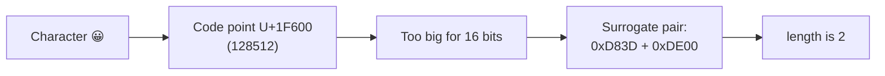
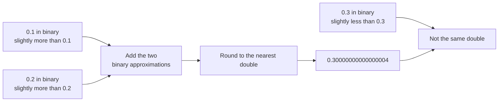
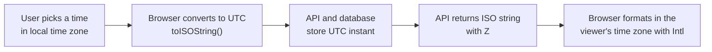

# Strings, Numbers and Dates

> In this document you will learn how JavaScript stores and handles text, numbers and dates, and the traps in each one: emoji length, `0.1 + 0.2`, `toFixed` rounding, 0-based months and time zones. These topics appear in interviews as output questions, as "write a function" tasks (palindrome, anagram, format money) and as real bug stories.

**Before this:** [Basics: variables, types and operators](./01-basics-variables-types-operators.md) · [Type coercion and equality](./02-type-coercion-and-equality.md) · **Interview questions:** [jump to questions](#interview-questions)

## Table of contents

1. [Strings are immutable primitives](#strings-are-immutable-primitives)
2. [Template literals](#template-literals)
3. [Tagged templates and String.raw](#tagged-templates-and-stringraw)
4. [Essential string methods](#essential-string-methods)
5. [Unicode, UTF-16 and emoji](#unicode-utf-16-and-emoji)
6. [Common string interview tasks](#common-string-interview-tasks)
7. [Regular expression essentials](#regular-expression-essentials)
8. [How numbers are stored](#how-numbers-are-stored)
9. [Precision problems and Number.EPSILON](#precision-problems-and-numberepsilon)
10. [Safe integers and BigInt](#safe-integers-and-bigint)
11. [NaN, Infinity and negative zero](#nan-infinity-and-negative-zero)
12. [Parsing numbers](#parsing-numbers)
13. [Rounding and formatting numbers](#rounding-and-formatting-numbers)
14. [The Math object](#the-math-object)
15. [Working with money](#working-with-money)
16. [The Date object](#the-date-object)
17. [Date pitfalls](#date-pitfalls)
18. [Time zones and how to store dates](#time-zones-and-how-to-store-dates)
19. [Formatting dates with Intl](#formatting-dates-with-intl)
20. [Date libraries and Temporal](#date-libraries-and-temporal)
21. [How to explain this in an interview](#how-to-explain-this-in-an-interview)
22. [Interview questions](#interview-questions)
23. [Summary](#summary)
24. [References](#references)

---

## Strings are immutable primitives

A **string** is a sequence of characters, like `"hello"`. In JavaScript, strings are **primitives**, and they are **immutable**. Immutable means a string can never be changed after it is created. Every string method returns a **new** string.

```js
const greeting = "hello";

greeting[0] = "H"; // silently ignored (throws a TypeError in strict mode)
console.log(greeting); // hello

const upper = greeting.toUpperCase();
console.log(upper); // HELLO
console.log(greeting); // hello  (unchanged)
```

A very common beginner mistake is to call a method and forget to use the result:

```js
let name = "  Asha  ";

// ❌ Wrong: trim returns a new string; the result is thrown away
name.trim();
console.log(`[${name}]`); // [  Asha  ]

// ✅ Correct: save the new string
name = name.trim();
console.log(`[${name}]`); // [Asha]
```

### How can a primitive have methods?

`"hello".toUpperCase()` works even though `"hello"` is not an object. When you access a property on a string, JavaScript temporarily wraps it in a `String` object, calls the method, and throws the wrapper away. This is called **auto-boxing**. You never need to create `new String("x")` yourself. In fact, avoid it:

```js
console.log(typeof "a"); // string
console.log(typeof new String("a")); // object
console.log(new String("a") === "a"); // false  (object vs primitive)
```

### Three ways to write a string

```js
const single = 'It is "quoted"';
const double = "It's fine";
const backtick = `Hello, ${single.length} chars`;

console.log(single, double, backtick); // It is "quoted" It's fine Hello, 14 chars
```

Single and double quotes are the same. Pick one style for your project (a formatter like Prettier will enforce it). Backticks create **template literals**, which have extra features.

### Strings are compared by value

Two strings with the same characters are equal, even if they were built in different ways. This is different from objects and arrays, which are compared by reference.

```js
const a = "hello";
const b = "hel" + "lo";

console.log(a === b); // true
```

### Building big strings

Because strings are immutable, `result += piece` creates a new string each time. Modern engines optimize this well (V8 uses internal "rope" strings), so `+=` in a loop is fine for normal sizes. For many pieces, collecting them in an array and calling `join` is also common and clear.

```js
const rows = [
  { name: "Pen", qty: 2 },
  { name: "Book", qty: 1 },
];

const csv = ["name,qty", ...rows.map((r) => `${r.name},${r.qty}`)].join("\n");
console.log(csv);
// name,qty
// Pen,2
// Book,1
```

---

## Template literals

A **template literal** is a string written with backticks. It has three features:

1. **Interpolation:** `${expression}` inserts the value of any expression.
2. **Multi-line strings:** line breaks inside backticks are kept.
3. **Tags:** a function can process the template (next section).

```js
const user = { name: "Asha", cartItems: 3 };

console.log(`Hi ${user.name}, you have ${user.cartItems} item${user.cartItems === 1 ? "" : "s"}.`);
// Hi Asha, you have 3 items.

console.log(`Total: ${(19.99 * 2).toFixed(2)}`); // Total: 39.98

const html = `
<ul>
  <li>${user.name}</li>
</ul>`;
console.log(html.trim().split("\n").length); // 3
```

The expression inside `${}` is converted to a string using the normal string conversion. Objects become `"[object Object]"` unless they have a useful `toString`. Arrays become comma-separated values.

```js
console.log(`${[1, 2, 3]}`); // 1,2,3
console.log(`${{ id: 1 }}`); // [object Object]
console.log(`${null} and ${undefined}`); // null and undefined
```

**Security note:** template literals do **not** escape HTML. Building HTML with `${userInput}` and putting it into `innerHTML` creates an XSS hole. Use `textContent`, or let your framework escape values (Angular and React do this for you in templates). See [Web security: XSS, CSRF, CORS, CSP](../01-cs-and-web-fundamentals/08-browser-storage-and-web-security-basics.md).

---

## Tagged templates and String.raw

### Tagged templates

A **tagged template** is a template literal with a function name in front of it. JavaScript calls that function with:

1. An array of the **string parts** (the text between the `${}` holes).
2. The **values** of each `${}` expression, as separate arguments.

The function can return anything.

```js
function inspect(strings, ...values) {
  return { strings, values };
}

console.log(inspect`Hello ${"Asha"}, you are ${30}!`);
// { strings: [ 'Hello ', ', you are ', '!' ], values: [ 'Asha', 30 ] }
```

There is always **one more string part than values**, because the template can start and end with text (which may be empty).

A useful tag: escape HTML in every inserted value.

```js
function safeHtml(strings, ...values) {
  const escape = (value) =>
    String(value)
      .replaceAll("&", "&amp;")
      .replaceAll("<", "&lt;")
      .replaceAll(">", "&gt;")
      .replaceAll('"', "&quot;")
      .replaceAll("'", "&#39;");

  return strings.reduce((out, part, i) => out + escape(values[i - 1]) + part);
}

const comment = '';
console.log(safeHtml`<p>${comment}</p>`);
// <p>&lt;img src=x onerror=&quot;alert(1)&quot;&gt;</p>
```

(`reduce` without an initial value starts with the first string part. Each step adds the escaped value that comes before the next part.)

Where you meet tagged templates in real projects:

- **Styled-components** and **Emotion** (React CSS-in-JS): `` styled.button`color: red;` ``.
- **GraphQL**: `` gql`query { user { id } }` `` parses the query.
- **Lit** (web components): `` html`<p>${name}</p>` `` creates safe, efficient DOM updates.
- **SQL libraries** (for example, `postgres` for Node.js): `` sql`select * from users where id = ${id}` `` turns values into query **parameters**, which prevents SQL injection.

### String.raw

`String.raw` is a built-in tag that returns the string **without processing escape sequences**. Backslashes stay as typed.

```js
console.log("C:\\new\\table"); // C:\new\table
console.log(String.raw`C:\new\table`); // C:\new\table
console.log(`a\nb`.length, String.raw`a\nb`.length); // 3 4
```

In a normal string, `\n` is one newline character. With `String.raw`, `\n` is two characters: a backslash and an `n`. This is handy for Windows paths and for building regular expressions from strings.

---

## Essential string methods

### Reading characters

```js
const word = "hello";

console.log(word[0]); // h
console.log(word.at(-1)); // o  (ES2022; negative index counts from the end)
console.log(word[-1]); // undefined  (looks for a property named "-1")
console.log(word.charAt(10)); // (empty string)
console.log(word[10]); // undefined
console.log(word.length); // 5
```

### Searching

| Method | Returns | Example |
|---|---|---|
| `includes(s)` | `true`/`false` | `"Hello".includes("ell")` → `true` |
| `startsWith(s)` / `endsWith(s)` | `true`/`false` | `"report.pdf".endsWith(".pdf")` → `true` |
| `indexOf(s)` | first index or `-1` | `"Hello".indexOf("l")` → `2` |
| `lastIndexOf(s)` | last index or `-1` | `"Hello".lastIndexOf("l")` → `3` |
| `search(regex)` | first index or `-1` | `"a1b2".search(/\d/)` → `1` |

All of these are **case-sensitive**. For a case-insensitive search, lowercase both sides first, or use a regular expression with the `i` flag.

```js
const title = "Learn JavaScript Fast";
const query = "javascript";

console.log(title.includes(query)); // false
console.log(title.toLowerCase().includes(query.toLowerCase())); // true
console.log(/javascript/i.test(title)); // true
```

### Extracting: slice vs substring (and the old substr)

| Method | Arguments | Negative numbers | If start > end |
|---|---|---|---|
| `slice(start, end)` | end is excluded | count from the end | returns `""` |
| `substring(start, end)` | end is excluded | treated as `0` | swaps the arguments |
| `substr(start, length)` | length, not end | start counts from end | legacy, avoid |

```js
const text = "hello world";

console.log(text.slice(0, 5)); // hello
console.log(text.slice(-5)); // world
console.log(text.substring(-5)); // hello world  (negative becomes 0)
console.log(text.slice(3, 1)); // (empty string)
console.log(text.substring(3, 1)); // el  (arguments swapped to 1, 3)
```

**Rule:** use `slice`. It behaves like the array `slice` method, and negative indexes are useful. `substr` is a legacy feature (Annex B of the specification) and should not be used in new code.

### Splitting and joining

`split(separator, limit)` breaks a string into an array. `join` (an array method) does the opposite.

```js
console.log("a,b,c".split(",")); // [ 'a', 'b', 'c' ]
console.log("a,b,c".split(",", 2)); // [ 'a', 'b' ]
console.log("abc".split("")); // [ 'a', 'b', 'c' ]
console.log("".split(",")); // [ '' ]  (one empty string, not an empty array)
console.log("one  two   three".split(/\s+/)); // [ 'one', 'two', 'three' ]

const slug = "Learn JavaScript Fast".toLowerCase().split(" ").join("-");
console.log(slug); // learn-javascript-fast
```

Watch the edge case `"".split(",")`: it returns `[""]`, an array with one empty string. Code like `csvLine.split(",").length` gives `1` for an empty line, not `0`.

### Replacing

- `replace(pattern, replacement)` replaces the **first** match when the pattern is a string.
- `replaceAll(pattern, replacement)` (ES2021) replaces **every** match.
- With a regular expression, `replace` replaces all matches only if the regex has the `g` flag.

```js
const path = "a.b.c";

console.log(path.replace(".", "/")); // a/b.c
console.log(path.replaceAll(".", "/")); // a/b/c
console.log(path.replace(/\./g, "/")); // a/b/c

try {
  path.replaceAll(/\./, "/"); // regex without g
} catch (error) {
  console.log(error.name); // TypeError
}
```

The replacement can be a **function**. It receives the match (and any groups) and returns the new text.

```js
const message = "Order 12 has 3 items";
console.log(message.replace(/\d+/g, (num) => `[${num}]`)); // Order [12] has [3] items

// Special patterns in a replacement string: $& = whole match, $1 = group 1
console.log("John Smith".replace(/(\w+) (\w+)/, "$2, $1")); // Smith, John
```

### Trimming, padding and repeating

```js
console.log(`[${"  hi  ".trim()}]`); // [hi]
console.log(`[${"  hi  ".trimStart()}]`); // [hi  ]
console.log(`[${"  hi  ".trimEnd()}]`); // [  hi]

console.log("5".padStart(3, "0")); // 005
console.log("4242".padStart(8, "*")); // ****4242
console.log("Total".padEnd(10, ".") + "$20"); // Total.....$20
console.log("-".repeat(10)); // ----------
```

Realistic uses: `padStart` for invoice numbers (`INV-00042`), time display (`09:05`) and masking card numbers; `trim` for every form input before validation.

```js
const formatTime = (h, m) => `${String(h).padStart(2, "0")}:${String(m).padStart(2, "0")}`;
console.log(formatTime(9, 5)); // 09:05

const maskCard = (card) => card.slice(-4).padStart(card.length, "*");
console.log(maskCard("4111111111111111")); // ************1111
```

### Changing case

```js
console.log("Hello".toUpperCase(), "Hello".toLowerCase()); // HELLO hello
console.log("ß".toUpperCase()); // SS  (the length can change!)

const capitalize = (s) => s.charAt(0).toUpperCase() + s.slice(1);
console.log(capitalize("angular")); // Angular
```

For language-specific rules (for example, Turkish has a dotted and a dotless "i"), use `toLocaleUpperCase("tr")` and `toLocaleLowerCase("tr")`.

### Comparing strings

`<` and `>` compare strings by UTF-16 code unit values. That means all uppercase letters come before all lowercase letters, and accented letters come after `z`.

```js
console.log("apple" < "banana"); // true
console.log("Zebra" < "apple"); // true  (uppercase Z has a smaller code than lowercase a)
console.log("10" < "9"); // true  (character "1" comes before "9")
```

For human-friendly order, use `localeCompare` (returns a negative number, `0` or a positive number):

```js
console.log("apple".localeCompare("Banana")); // -1
console.log("a".localeCompare("A", undefined, { sensitivity: "base" })); // 0  (ignore case)
```

Alphabet order depends on the language. In German, `ä` sorts near `a`. In Swedish, `ä` comes after `z`:

```js
console.log("ä".localeCompare("z", "de")); // -1
console.log("ä".localeCompare("z", "sv")); // 1
```

For sorting big lists, create one `Intl.Collator` and reuse it (see [Arrays: sorting strings correctly](./10-arrays-and-array-methods.md#sorting-strings-correctly)).

---

## Unicode, UTF-16 and emoji

### What it is

**Unicode** gives every character in every writing system a number, called a **code point**. For example, `A` is U+0041 and 😀 is U+1F600.

JavaScript strings store text as **UTF-16 code units**. A **code unit** is a 16-bit number (0 to 65,535).

- Most common characters (Latin, Cyrillic, Chinese, Hindi...) fit in **one** code unit.
- Characters with code points above 65,535 (most emoji, some rare scripts, math symbols) need **two** code units. This pair is called a **surrogate pair**.

The `length` property counts **code units**, not characters. That is why emoji have length 2.

```js
console.log("A".length); // 1
console.log("😀".length); // 2
console.log("😀".charCodeAt(0), "😀".charCodeAt(1)); // 55357 56832  (two halves)
console.log("😀".codePointAt(0)); // 128512  (the real code point, U+1F600)
```



### Three levels of "character"

| Level | What it counts | How to get it | `"👨‍👩‍👧"` |
|---|---|---|---|
| Code units | 16-bit pieces | `.length`, `str[i]`, `split("")` | 8 |
| Code points | Unicode characters | `[...str]`, `for...of`, `Array.from(str)` | 5 |
| Grapheme clusters | What a user sees as one character | `Intl.Segmenter` | 1 |

The family emoji is made of three person emoji joined by invisible "zero-width joiner" characters. A user sees one picture, but there are 5 code points and 8 code units.

```js
const family = "👨‍👩‍👧";

console.log(family.length); // 8
console.log([...family].length); // 5

const segmenter = new Intl.Segmenter("en", { granularity: "grapheme" });
console.log([...segmenter.segment(family)].length); // 1
```

`Intl.Segmenter` is supported in all modern browsers and in Node.js. It can also split text into words and sentences in a language-aware way.

### Why this matters in real code

- **Character limits:** a tweet-style "140 characters left" counter using `.length` counts emoji as 2. Use `Intl.Segmenter` to count what the user sees. (Your backend's limit may be in bytes or code points, so agree on one rule.)
- **Truncating:** `text.slice(0, 10)` can cut an emoji in half and leave a broken character (a "lone surrogate").
- **Reversing:** `split("").reverse()` breaks surrogate pairs.

```js
// ❌ Wrong: split("") separates the two halves of 😀 and reverses them
const broken = "ab😀".split("").reverse().join("");
console.log(broken === "😀ba"); // false
console.log(broken.isWellFormed()); // false  (it now contains broken halves)

// ✅ Better: spread splits by code point
console.log([..."ab😀"].reverse().join("")); // 😀ba
```

Even spread is not perfect for combined emoji (like the family emoji or flags), because they have several code points. For fully correct results, reverse grapheme clusters from `Intl.Segmenter`.

### Accents and normalize

The same visible text can be stored in different ways. `é` can be one code point (U+00E9) or `e` plus a "combining accent" (U+0065 U+0301).

```js
const precomposed = "caf\u00e9"; // é as one code point
const combined = "cafe\u0301"; // e + combining accent

console.log(precomposed, combined); // café café
console.log(precomposed.length, combined.length); // 4 5
console.log(precomposed === combined); // false
console.log(precomposed.normalize() === combined.normalize()); // true
```

`normalize()` converts both to the same form (NFC by default). Normalize user input before comparing, deduplicating or using it as a key (usernames, search terms, file names from macOS, which often uses the decomposed form).

### Useful Unicode helpers

```js
console.log(String.fromCodePoint(128512)); // 😀
console.log("\u{1F600}"); // 😀  (code point escape, ES2015)
console.log("ok".isWellFormed(), "\uD800".isWellFormed()); // true false  (ES2024)
```

`isWellFormed()` and `toWellFormed()` (ES2024) detect and fix lone surrogates, which break `encodeURIComponent` and some APIs.

---

## Common string interview tasks

### Reverse a string

```js
function reverse(str) {
  return [...str].reverse().join("");
}

console.log(reverse("hello")); // olleh
console.log(reverse("ab😀")); // 😀ba
```

Say in the interview: "I use spread instead of `split('')` so emoji are not broken. For full grapheme support I would use `Intl.Segmenter`." A manual loop version:

```js
function reverseLoop(str) {
  let result = "";
  for (const ch of str) result = ch + result; // for...of iterates code points
  return result;
}
console.log(reverseLoop("abc")); // cba
```

### Check a palindrome

A **palindrome** reads the same forwards and backwards ("racecar"). Real questions usually ignore case, spaces and punctuation.

```js
function isPalindrome(text) {
  const clean = text.toLowerCase().replace(/[^a-z0-9]/g, "");
  let left = 0;
  let right = clean.length - 1;
  while (left < right) {
    if (clean[left] !== clean[right]) return false;
    left++;
    right--;
  }
  return true;
}

console.log(isPalindrome("A man, a plan, a canal: Panama")); // true
console.log(isPalindrome("hello")); // false
console.log(isPalindrome("")); // true
```

The **two-pointer** version is O(n) time and does not create a reversed copy. The short version `clean === [...clean].reverse().join("")` is also O(n) but uses extra memory. Mention both.

### Check an anagram

Two words are **anagrams** if they use the same letters the same number of times ("listen" and "silent").

```js
// Approach 1: sort the letters — O(n log n)
const isAnagramSort = (a, b) =>
  [...a.toLowerCase()].sort().join("") === [...b.toLowerCase()].sort().join("");

// Approach 2: count letters — O(n)
function isAnagram(a, b) {
  if (a.length !== b.length) return false;
  const counts = new Map();
  for (const ch of a.toLowerCase()) counts.set(ch, (counts.get(ch) ?? 0) + 1);
  for (const ch of b.toLowerCase()) {
    const left = counts.get(ch);
    if (!left) return false;
    counts.set(ch, left - 1);
  }
  return true;
}

console.log(isAnagramSort("Listen", "Silent")); // true
console.log(isAnagram("listen", "silent")); // true
console.log(isAnagram("rat", "car")); // false
```

### Count characters and find the first non-repeating character

```js
function firstUnique(str) {
  const counts = new Map();
  for (const ch of str) counts.set(ch, (counts.get(ch) ?? 0) + 1);
  for (const ch of str) {
    if (counts.get(ch) === 1) return ch;
  }
  return null;
}

console.log(firstUnique("swiss")); // w
console.log(firstUnique("aabb")); // null
```

Two passes, O(n) time. A `Map` keeps insertion order, but the second loop over the string is what guarantees "first".

### Count vowels and words

```js
const countVowels = (s) => (s.match(/[aeiou]/gi) ?? []).length;
const countWords = (s) => s.trim().split(/\s+/).filter(Boolean).length;

console.log(countVowels("Hello World")); // 3
console.log(countWords("  the quick   brown fox ")); // 4
console.log(countWords("   ")); // 0
```

`match` returns `null` when there is no match, so `?? []` avoids a crash.

### Capitalize every word and convert cases

```js
const titleCase = (s) => s.toLowerCase().replace(/\b\w/g, (c) => c.toUpperCase());
console.log(titleCase("hello wORLD from js")); // Hello World From Js

const camelToKebab = (s) => s.replace(/[A-Z]/g, (c) => "-" + c.toLowerCase());
console.log(camelToKebab("backgroundColor")); // background-color

const kebabToCamel = (s) => s.replace(/-([a-z])/g, (_, c) => c.toUpperCase());
console.log(kebabToCamel("font-size")); // fontSize
```

### Truncate with an ellipsis

```js
function truncate(text, max) {
  const chars = [...text]; // do not cut emoji in half
  return chars.length <= max ? text : chars.slice(0, max - 1).join("") + "…";
}

console.log(truncate("Angular change detection", 10)); // Angular c…
console.log(truncate("short", 10)); // short
```

In UI code, consider CSS `text-overflow: ellipsis` first. It does not change the data and adapts to the width.

---

## Regular expression essentials

### What it is

A **regular expression** (regex) is a pattern for matching text. You use it to validate input, search, extract parts and replace text.

```js
const zip = /^\d{5}$/; // exactly 5 digits
console.log(zip.test("12345")); // true
console.log(zip.test("1234a")); // false
```

You can write a regex as a literal (`/abc/i`) or build one from a string with `new RegExp("abc", "i")`. Use the constructor when the pattern comes from a variable.

### The building blocks

| Syntax | Meaning | Example |
|---|---|---|
| `.` | any character except a newline | `/a.c/` matches `abc` |
| `\d`, `\w`, `\s` | digit, word character (`[A-Za-z0-9_]`), whitespace | `/\d+/` |
| `\D`, `\W`, `\S` | the opposite of each | `/\S+/` |
| `[abc]`, `[a-z]` | one character from the set or range | `/[aeiou]/` |
| `[^abc]` | one character **not** in the set | `/[^0-9]/` |
| `^`, `$` | start and end of the string (or line with `m`) | `/^hi$/` |
| `\b` | word boundary | `/\bcat\b/` |
| `*`, `+`, `?` | 0 or more, 1 or more, 0 or 1 | `/colou?r/` |
| `{n}`, `{n,}`, `{n,m}` | exact count, at least n, between n and m | `/\d{2,4}/` |
| `*?`, `+?` | **lazy**: match as little as possible | `/<.+?>/` |
| `(...)` | capturing group | `/(\d+)-(\d+)/` |
| `(?<name>...)` | named group (ES2018) | `/(?<year>\d{4})/` |
| `(?:...)` | group without capturing | `/(?:ab)+/` |
| `a\|b` | a or b | `/cat\|dog/` |
| `(?=...)`, `(?!...)` | lookahead: followed by / not followed by | `/\d+(?=px)/` |
| `(?<=...)`, `(?<!...)` | lookbehind (ES2018) | `/(?<=\$)\d+/` |

### Flags

| Flag | Name | What it does |
|---|---|---|
| `g` | global | find all matches; makes the regex remember `lastIndex` |
| `i` | ignore case | `A` matches `a` |
| `m` | multiline | `^` and `$` match at every line start/end |
| `s` | dotAll (ES2018) | `.` also matches newlines |
| `u` | unicode | treat the pattern and input as code points; enables `\u{...}` and `\p{...}` |
| `v` | unicodeSets (ES2024) | an improved `u` mode with set operations in character classes |
| `y` | sticky | match only exactly at `lastIndex` |
| `d` | indices (ES2022) | add start/end positions of groups to the result |

```js
console.log(/^hello/m.test("hi\nhello")); // true   (m: ^ matches after the newline)
console.log(/a.b/.test("a\nb"), /a.b/s.test("a\nb")); // false true
console.log(/^.$/.test("😀"), /^.$/u.test("😀")); // false true  (u: emoji is one character)
console.log(/\p{Lu}/u.test("É")); // true  (\p{Lu} = any uppercase letter in any language)
```

### The main methods

| Method | Returns | Use it for |
|---|---|---|
| `regex.test(str)` | `true`/`false` | validation |
| `str.match(regex)` without `g` | first match with groups, or `null` | extract one thing |
| `str.match(regex)` with `g` | array of all matched strings (no groups), or `null` | list all matches |
| `str.matchAll(regex)` (needs `g`) | iterator of full match objects | all matches **with** groups |
| `regex.exec(str)` | next match object or `null` | low-level loops |
| `str.replace` / `replaceAll` | new string | transform |
| `str.split(regex)` | array | split by a pattern |

```js
const date = "2024-01-15";

// Groups by position
const [, year, month, day] = date.match(/(\d{4})-(\d{2})-(\d{2})/);
console.log(year, month, day); // 2024 01 15

// Named groups are easier to read
const { groups } = date.match(/(?<y>\d{4})-(?<m>\d{2})-(?<d>\d{2})/);
console.log(groups.y, groups.d); // 2024 15

// Reorder with named groups in the replacement
console.log(date.replace(/(?<y>\d+)-(?<m>\d+)-(?<d>\d+)/, "$<d>/$<m>/$<y>")); // 15/01/2024

// All matches with g
console.log("a1b22c333".match(/\d+/g)); // [ '1', '22', '333' ]
console.log("abc".match(/\d+/g)); // null

// All matches WITH groups: matchAll
for (const m of "id=1, id=22".matchAll(/id=(\d+)/g)) {
  console.log(m[1], "at", m.index);
}
// 1 at 0
// 22 at 6
```

### The lastIndex pitfall with g and test

A regex with the `g` (or `y`) flag is **stateful**. It stores `lastIndex`, the position where the next search starts. `test` and `exec` update `lastIndex` after each match. If you reuse the same regex on another string, the search starts from the old position.

```js
const hasCat = /cat/g;

console.log(hasCat.test("cat")); // true   (lastIndex becomes 3)
console.log(hasCat.test("cat")); // false  (search starts at index 3: nothing there; lastIndex resets to 0)
console.log(hasCat.test("cat")); // true   (starts at 0 again)
```

This creates a real bug in `filter`:

```js
const words = ["cat", "cat", "cat"];

// ❌ Wrong: one shared /g regex; the result alternates
const pattern = /cat/g;
console.log(words.filter((w) => pattern.test(w))); // [ 'cat', 'cat' ]

// ✅ Correct: no g flag for test (you only need yes/no)
console.log(words.filter((w) => /cat/.test(w))); // [ 'cat', 'cat', 'cat' ]
```

**Rules:**

- Do not use `g` when you only need `test`.
- If you must reuse a `g` regex, reset `regex.lastIndex = 0` before each new string.
- `match`, `matchAll`, `replace` and `replaceAll` handle `lastIndex` for you (`matchAll` works on a copy of the regex).

### Greedy vs lazy

Quantifiers like `.*` are **greedy**: they take as much text as possible. Add `?` to make them **lazy**.

```js
const html = "<b>one</b><b>two</b>";

console.log(html.match(/<b>.*<\/b>/)[0]); // <b>one</b><b>two</b>  (greedy)
console.log(html.match(/<b>.*?<\/b>/)[0]); // <b>one</b>  (lazy)
```

(Do not parse real HTML with regex. Use `DOMParser` in the browser or an HTML parser library in Node.js.)

### Escaping user input in a regex

If you build a regex from user input, special characters like `.` and `*` change the meaning. Escape them.

```js
const escapeRegExp = (s) => s.replace(/[.*+?^${}()|[\]\\]/g, "\\$&");

const search = "1.5";
console.log(new RegExp(search).test("1x5")); // true   (. matches any character: wrong)
console.log(new RegExp(escapeRegExp(search)).test("1x5")); // false (correct)
```

> **Newer feature:** `RegExp.escape(str)` (ES2025) does this for you. It is available in Chrome 136+, Firefox 134+, Safari 18.2+ and Node.js 24+. It is not available in Node.js 22, so the helper above is still useful.

### Practical patterns and their limits

```js
// Simple email check: something@something.something (no spaces)
const looksLikeEmail = (s) => /^[^\s@]+@[^\s@]+\.[^\s@]+$/.test(s);
console.log(looksLikeEmail("asha@example.com"), looksLikeEmail("asha@example")); // true false

// Strong password: at least 8 chars, one digit, one uppercase letter (lookaheads)
const strong = /^(?=.*\d)(?=.*[A-Z]).{8,}$/;
console.log(strong.test("Secret123"), strong.test("secret123")); // true false
```

A perfect email regex does not exist in practice. Use a simple check in the UI (or `<input type="email">`) and confirm the address by sending an email.

**Security note: ReDoS.** Some patterns with nested quantifiers, like `/(a+)+$/`, can take exponential time on certain inputs. An attacker can send such input and freeze a Node.js server (one thread!). Avoid nested quantifiers on untrusted input, limit input length, and use linters (for example, the `eslint-plugin-regexp` rules) to detect risky patterns.

---

## How numbers are stored

### What it is

JavaScript has one main number type: `number`. Every `number` is a **64-bit floating-point value** in the **IEEE-754 double precision** format. Whole numbers and decimals are the same type.

```js
console.log(typeof 42, typeof 4.2); // number number
console.log(42 === 42.0); // true
```

(The other numeric type is `bigint` for very large whole numbers. See [Safe integers and BigInt](#safe-integers-and-bigint).)

### How it works inside

A double uses 64 bits, split into three parts, like scientific notation in binary:

| Part | Bits | Job |
|---|---|---|
| Sign | 1 | positive or negative |
| Exponent | 11 | how far to move the binary point (the scale) |
| Fraction (mantissa) | 52 | the significant digits |

This gives about **15 to 17 significant decimal digits** of precision, and a huge range (up to about `1.8 × 10^308`).

The important consequence: the number is stored in **binary** (base 2). Many simple decimal fractions, like `0.1`, cannot be written exactly in binary. They become very close approximations.

### Analogy

Try writing `1/3` as a decimal: `0.3333333...`. You must stop somewhere, so the value is slightly wrong. Binary has the same problem with `1/10`. In binary, `0.1` is `0.0001100110011...` repeating forever. The computer keeps 52 bits of it and rounds the rest.

The analogy breaks down in one way: in decimal, `1/3` is a "hard" number and `0.1` is easy. In binary it is the opposite: `0.5`, `0.25` and `0.125` are exact (they are powers of 2), while `0.1`, `0.2` and `0.3` are not.

```js
console.log(0.5 + 0.25 === 0.75); // true   (all exact in binary)
console.log(0.1 + 0.2 === 0.3); // false  (all approximations)
```

This is not a JavaScript bug. Python, Java, C# and C (with `double`) give the same results. See [How programs run](../01-cs-and-web-fundamentals/01-how-programs-run.md) for how data is represented in bits.

---

## Precision problems and Number.EPSILON

```js
console.log(0.1 + 0.2); // 0.30000000000000004
console.log(0.1 * 3); // 0.30000000000000004
console.log(1.1 + 2.2); // 3.3000000000000003
console.log(19.99 * 100); // 1998.9999999999998
```



Step by step:

1. `0.1` is stored as the closest double: about `0.1000000000000000055`.
2. `0.2` is stored as about `0.2000000000000000111`.
3. Their exact sum is about `0.3000000000000000166`.
4. That sum is rounded to the nearest double, which prints as `0.30000000000000004`.
5. The literal `0.3` is stored as a different double, about `0.2999999999999999889`.
6. The two doubles are different, so `===` is `false`.

You can see the stored value with `toFixed(20)`:

```js
console.log((0.1).toFixed(20)); // 0.10000000000000000555
```

### How to compare decimals

Do not compare decimal results with `===`. Check that they are **close enough**.

**`Number.EPSILON`** is the gap between `1` and the next larger double: about `2.2 × 10^-16`. It is a good tolerance for numbers near 1.

```js
console.log(Math.abs(0.1 + 0.2 - 0.3) < Number.EPSILON); // true
```

For bigger numbers, the gap between doubles is bigger, so a fixed `EPSILON` is too small. Scale the tolerance by the size of the numbers:

```js
function nearlyEqual(a, b) {
  return Math.abs(a - b) <= Number.EPSILON * Math.max(1, Math.abs(a), Math.abs(b));
}

console.log(nearlyEqual(0.1 + 0.2, 0.3)); // true
console.log(Math.abs(1000000.1 + 0.2 - 1000000.3) < Number.EPSILON); // false  (fixed tolerance fails)
console.log(nearlyEqual(1000000.1 + 0.2, 1000000.3)); // true
```

In tests, use your framework's helper: `expect(0.1 + 0.2).toBeCloseTo(0.3)` in Jest and Vitest.

### Practical fixes

| Problem | Fix |
|---|---|
| Money | Store integer cents (see [Working with money](#working-with-money)) |
| Display | Round only when formatting, with `toFixed` or `Intl.NumberFormat` |
| Comparisons | Use a tolerance, never `===` on computed decimals |
| Exact decimal math (finance, science) | Use a decimal library such as `decimal.js` or `big.js` |

---

## Safe integers and BigInt

### Safe integers

A double has 52 fraction bits plus one hidden bit, so it can store every whole number exactly up to **2^53 − 1**. This is **`Number.MAX_SAFE_INTEGER`** (9,007,199,254,740,991). Above it, some integers cannot be stored, and math gives wrong results silently.

```js
console.log(Number.MAX_SAFE_INTEGER); // 9007199254740991
console.log(2 ** 53 + 1); // 9007199254740992  (wrong: should end in 3)
console.log(Number.MAX_SAFE_INTEGER + 1 === Number.MAX_SAFE_INTEGER + 2); // true (!)
console.log(Number.isSafeInteger(2 ** 53 - 1), Number.isSafeInteger(2 ** 53)); // true false
```

### A real bug: large IDs in JSON

Many systems use 64-bit integer IDs (database `BIGINT`, "snowflake" IDs used by Twitter/X and Discord). If the server sends them as JSON numbers, `JSON.parse` turns them into doubles and changes the last digits.

```js
const response = '{"id": 9007199254740993}';
console.log(JSON.parse(response).id); // 9007199254740992  (a different id!)
```

The user then opens the wrong record or gets a 404. **Fix:** the API should send big IDs as **strings** (`"id": "9007199254740993"`). Treat IDs as opaque strings in the frontend anyway, since you never do math on them.

### BigInt

**`BigInt`** (ES2020) is a separate primitive type for whole numbers of any size. Write it with an `n` at the end, or convert with `BigInt()`.

```js
const big = 9007199254740993n;
console.log(big + 2n); // 9007199254740995n
console.log(typeof big); // bigint
console.log(2n ** 64n); // 18446744073709551616n
console.log(7n / 2n); // 3n  (division drops the fraction)
console.log(BigInt("12345678901234567890")); // 12345678901234567890n
```

Rules and limits:

```js
try {
  1n + 1; // cannot mix bigint and number
} catch (error) {
  console.log(error.message); // Cannot mix BigInt and other types, use explicit conversions
}

console.log(1n + BigInt(1)); // 2n
console.log(Number(10n) + 1); // 11
console.log(1n == 1, 1n === 1, 2n > 1); // true false true

try {
  JSON.stringify({ total: 10n });
} catch (error) {
  console.log(error.name); // TypeError  (JSON has no BigInt; convert to string first)
}
```

- You cannot mix `bigint` and `number` in arithmetic. Convert one side explicitly.
- `Math` methods do not accept `bigint`.
- `JSON.stringify` throws on `bigint`. Convert to a string (or add a `toJSON` method / replacer).
- Converting a huge `bigint` to `number` loses precision.
- `bigint` math is slower than `number` math. Use it only when you need it.

Real uses: 64-bit IDs that you must compute with, cryptography, high-resolution timers (`process.hrtime.bigint()` in Node.js returns nanoseconds), and reading 64-bit values from binary data (`DataView.getBigInt64`).

---

## NaN, Infinity and negative zero

### NaN

**`NaN`** means "Not a Number". It is the result of a math operation that has no meaningful number answer. Strangely, its type is `number`.

```js
console.log(0 / 0, Number("abc"), Math.sqrt(-1)); // NaN NaN NaN
console.log(typeof NaN); // number
console.log(NaN === NaN); // false  (the only value not equal to itself)
```

`NaN` **spreads**: any math with `NaN` gives `NaN`. One missing field can turn a whole total into `NaN`.

```js
const cart = [{ price: 5 }, { name: "gift card" }]; // second item has no price
const total = cart.reduce((sum, item) => sum + item.price, 0);
console.log(total); // NaN  (5 + undefined is NaN)
```

### isNaN vs Number.isNaN

| Function | Converts the argument first? | `"hello"` | `undefined` | `NaN` |
|---|---|---|---|---|
| global `isNaN(x)` | Yes (`Number(x)`) | `true` | `true` | `true` |
| `Number.isNaN(x)` (ES2015) | No | `false` | `false` | `true` |

```js
console.log(isNaN("hello"), Number.isNaN("hello")); // true false
console.log(isNaN(""), Number.isNaN("")); // false false  ("" converts to 0)
console.log(Object.is(NaN, NaN)); // true
```

The global `isNaN` really answers "would this become `NaN` if converted to a number?". `Number.isNaN` answers "is this value exactly `NaN`?". Use `Number.isNaN`.

### Infinity

```js
console.log(1 / 0, -1 / 0); // Infinity -Infinity
console.log(1e309); // Infinity  (too big for a double: overflow)
console.log(Number.MAX_VALUE); // 1.7976931348623157e+308
```

Dividing by zero does not throw in JavaScript. It gives `Infinity` (or `NaN` for `0 / 0`). Check for it before showing results like "average per day".

`Number.isFinite(x)` is `true` only for real, finite numbers. Like `isNaN`, the global `isFinite` converts first:

```js
console.log(isFinite("42"), Number.isFinite("42")); // true false
console.log(Number.isFinite(Infinity), Number.isFinite(NaN), Number.isFinite(42)); // false false true
```

`Number.isFinite` is the best one-line check for "is this a usable number?".

### Negative zero

IEEE-754 has both `+0` and `-0`. They are equal with `===`, but `Object.is` can tell them apart.

```js
console.log(0 === -0); // true
console.log(Object.is(0, -0)); // false
console.log(1 / -0); // -Infinity
console.log(Math.round(-0.4)); // -0
console.log(String(-0), `${-0}`); // 0 0  (string conversion hides the sign)
```

You rarely need to care. It matters when the sign carries meaning (for example, direction of movement in an animation or a game), and it explains why React state and `Object.is` treat `0` and `-0` as different values.

---

## Parsing numbers

Converting user input or text to numbers is a constant source of bugs. Know the differences.

| Input | `Number(x)` / `+x` | `parseInt(x, 10)` | `parseFloat(x)` |
|---|---|---|---|
| `"42"` | `42` | `42` | `42` |
| `" 42 "` | `42` | `42` | `42` |
| `"42px"` | `NaN` | `42` | `42` |
| `"3.14"` | `3.14` | `3` | `3.14` |
| `""` | `0` (!) | `NaN` | `NaN` |
| `"1e3"` | `1000` | `1` | `1000` |
| `"1,000"` | `NaN` | `1` | `1` |
| `"0x1A"` | `26` | `0` | `0` |
| `null` | `0` | `NaN` | `NaN` |
| `undefined` | `NaN` | `NaN` | `NaN` |

Key points:

- **`Number()` is strict.** The whole string must be a valid number (spaces around it are allowed). This is usually what you want for validation.
- **`parseInt` and `parseFloat` are lenient.** They read from the start and stop at the first invalid character. Good for `"42px"`, dangerous for validation (`"12abc"` becomes `12`).
- **Always pass the radix** to `parseInt`: `parseInt(x, 10)`. Without it, strings starting with `0x` are read as hexadecimal.
- **`Number("")` is `0`.** An empty form field silently becomes zero. Check for empty input first.
- **`parseInt` expects a string.** With a number like `0.0000005`, it first converts it to the string `"5e-7"` and returns `5`. This and other conversion puzzles are in [Type coercion and equality](./02-type-coercion-and-equality.md).

### Validating a number from a form

```js
function parseQuantity(input) {
  const text = String(input).trim();
  if (text === "") return null; // empty is not 0
  const n = Number(text);
  return Number.isInteger(n) && n > 0 ? n : null;
}

console.log(parseQuantity("3")); // 3
console.log(parseQuantity(" 12 ")); // 12
console.log(parseQuantity("")); // null
console.log(parseQuantity("2.5")); // null
console.log(parseQuantity("3abc")); // null
console.log(parseQuantity("-1")); // null
```

In Angular, `<input type="number">` with reactive forms gives you a number (or `null` when empty), but always validate on the server too.

### Number helpers

```js
console.log(Number.isInteger(5), Number.isInteger(5.5), Number.isInteger("5")); // true false false
console.log((255).toString(16), (5).toString(2)); // ff 101
console.log(parseInt("ff", 16), parseInt("101", 2)); // 255 5
console.log(1_000_000); // 1000000  (numeric separators, ES2021: only in code, not in strings)
console.log(Number("1_000")); // NaN
```

---

## Rounding and formatting numbers

### Math rounding functions

| Function | `2.5` | `2.4` | `-2.5` | `-2.6` |
|---|---|---|---|---|
| `Math.round` | `3` | `2` | `-2` | `-3` |
| `Math.floor` (down) | `2` | `2` | `-3` | `-3` |
| `Math.ceil` (up) | `3` | `3` | `-2` | `-2` |
| `Math.trunc` (drop decimals) | `2` | `2` | `-2` | `-2` |

```js
console.log(Math.round(2.5), Math.round(-2.5)); // 3 -2
console.log(Math.floor(-1.5), Math.trunc(-1.5)); // -2 -1
```

`Math.round` rounds `.5` **up toward positive infinity**. So `-2.5` becomes `-2`, not `-3`. This surprises people who expect "away from zero".

`floor` and `trunc` differ only for negative numbers. Use `trunc` when you mean "remove the decimal part".

### toFixed and its rounding pitfall

`toFixed(digits)` formats a number with a fixed number of decimals. It returns a **string**.

```js
const price = 1234.5678;
console.log(price.toFixed(2)); // 1234.57
console.log(typeof price.toFixed(2)); // string
console.log((5).toFixed(2)); // 5.00
```

The pitfall: `toFixed` rounds the **stored binary value**, not the decimal you typed.

```js
console.log((1.005).toFixed(2)); // 1.00  (you probably expected 1.01)
console.log((1.45).toFixed(1)); // 1.4
console.log((1.55).toFixed(1)); // 1.6
console.log(Math.round(1.005 * 100) / 100); // 1  (same problem)
```

Why? `1.005` is stored as about `1.00499999999999989`, which is slightly **below** the halfway point, so it rounds down. `1.55` happens to be stored slightly above `1.55`, so it rounds up.

How to handle it:

- For **money**, avoid decimals in calculations: use integer cents. Then rounding questions mostly disappear.
- For **display**, `toFixed` and `Intl.NumberFormat` are fine for most values. Just do not use the formatted string for more math.
- A common trick for rounding to 2 places is `Math.round((x + Number.EPSILON) * 100) / 100`. It fixes `1.005`, but it is a patch, not a guarantee for every value.
- For **exact decimal rounding rules** (finance, tax), use a decimal library.

Two more facts: `toFixed` switches to exponent notation for numbers of `1e21` or more, and `toPrecision(n)` formats to `n` **significant** digits:

```js
console.log((123.456).toPrecision(4)); // 123.5
console.log((0.000123).toPrecision(2)); // 0.00012
```

### Intl.NumberFormat: locale-aware formatting

`Intl.NumberFormat` formats numbers for a specific language and region: decimal separator, grouping, currency symbol and placement.

```js
const usd = new Intl.NumberFormat("en-US", { style: "currency", currency: "USD" });
console.log(usd.format(1234.5)); // $1,234.50

console.log(new Intl.NumberFormat("de-DE", { style: "currency", currency: "EUR" }).format(1234.5)); // 1.234,50 €
console.log(new Intl.NumberFormat("en-IN", { style: "currency", currency: "INR" }).format(1234567.5)); // ₹12,34,567.50
console.log(new Intl.NumberFormat("en", { notation: "compact" }).format(1234567)); // 1.2M
console.log(new Intl.NumberFormat("en", { style: "percent" }).format(0.256)); // 26%
console.log(new Intl.NumberFormat("en", { style: "unit", unit: "kilobyte" }).format(512)); // 512 kB
```

Notice:

- Germany uses `.` for grouping and `,` for decimals.
- India groups by lakhs and crores (`12,34,567`).
- The currency decides the decimals: `JPY` has no minor unit, so yen amounts show no decimals.

**Performance tip:** creating an `Intl.NumberFormat` is relatively expensive. Create it once and reuse `format`, for example in a module-level constant or an Angular service. `number.toLocaleString(locale, options)` is a shortcut that creates a formatter each time.

**In Angular:** the built-in `currency`, `number` (`DecimalPipe`) and `percent` pipes format numbers using Angular's own locale data. The output uses the app's `LOCALE_ID`.

---

## The Math object

`Math` is a built-in object with math constants and functions. It works only with `number` (not `bigint`).

```js
console.log(Math.max(3, 9, 1), Math.min(3, 9, 1)); // 9 1
console.log(Math.max(...[4, 8, 2])); // 8
console.log(Math.max(), Math.min()); // -Infinity Infinity  (empty input)
console.log(Math.abs(-7), Math.sign(-7)); // 7 -1
console.log(Math.pow(2, 10), 2 ** 10); // 1024 1024
console.log(Math.sqrt(16), Math.cbrt(27), Math.hypot(3, 4)); // 4 3 5
console.log(Math.PI.toFixed(4)); // 3.1416
```

`Math.max()` with no arguments is `-Infinity` because any real number is bigger than it. This makes it the correct starting point for a "find the maximum" loop.

### Random numbers

`Math.random()` returns a number from `0` (inclusive) up to `1` (exclusive).

```js
// Random integer between min and max, both inclusive
function randomInt(min, max) {
  return Math.floor(Math.random() * (max - min + 1)) + min;
}

const roll = randomInt(1, 6);
console.log(roll >= 1 && roll <= 6); // true
```

Why this formula works:

1. `Math.random()` is in `[0, 1)`.
2. Multiply by the number of possible values, `max - min + 1`. For dice: `[0, 6)`.
3. `Math.floor` gives an integer `0` to `5`.
4. Add `min`: `1` to `6`.

Using `Math.round` instead of `Math.floor` is a classic bug: the end values become half as likely as the others.

**Security:** `Math.random()` is **not** cryptographically secure. Its output can be predicted. For tokens, IDs, passwords or anything security-related, use the Web Crypto API, which exists in browsers and Node.js:

```js
console.log(crypto.randomUUID().length); // 36

const bytes = new Uint32Array(1);
crypto.getRandomValues(bytes);
console.log(typeof bytes[0]); // number
```

### A small helper you will write often

```js
const clamp = (value, min, max) => Math.min(Math.max(value, min), max);

console.log(clamp(150, 0, 100)); // 100
console.log(clamp(-5, 0, 100)); // 0
```

Used for sliders, volume controls, scroll positions and progress bars.

---

## Working with money

### The problem

Prices like `19.99` cannot be stored exactly as doubles. Adding many of them, applying discounts and taxes slowly creates small errors. A total of `60.970000000000006` on an invoice is a real bug.

### The rule: use integer minor units

Store and calculate money as **integers in the smallest unit** (cents for USD/EUR, paise for INR). Integers up to `MAX_SAFE_INTEGER` are exact. Convert to a decimal only for display.

```js
const cartLines = [
  { name: "T-shirt", priceCents: 1999, qty: 3 },
  { name: "Sticker", priceCents: 50, qty: 2 },
];

const totalCents = cartLines.reduce((sum, line) => sum + line.priceCents * line.qty, 0);
console.log(totalCents); // 6097

const usd = new Intl.NumberFormat("en-US", { style: "currency", currency: "USD" });
console.log(usd.format(totalCents / 100)); // $60.97
```

### Percentages need a rounding decision

`10%` of `1999` cents is `199.9` cents. You must decide how to round (and the business usually decides, not the developer). Round **once**, at a clear point:

```js
const discountCents = Math.round(1999 * 0.1);
console.log(discountCents); // 200
```

### Splitting without losing cents

Splitting `$100.00` three ways cannot give three equal cent amounts. Give the leftover cents to the first parts so the total stays correct.

```js
function allocate(totalCents, parts) {
  const base = Math.floor(totalCents / parts);
  const remainder = totalCents % parts;
  return Array.from({ length: parts }, (_, i) => base + (i < remainder ? 1 : 0));
}

console.log(allocate(10000, 3)); // [ 3334, 3333, 3333 ]  (adds up to 10000)
```

### Across the stack

- **Currencies differ:** USD has 2 decimals, JPY has 0, KWD has 3. Store the currency code next to the amount, and know each currency's minor unit.
- **APIs:** send money as an integer in minor units (`"amount": 1999, "currency": "USD"`) or as a decimal **string** (`"19.99"`). Avoid JSON floats for money.
- **Databases:** use `DECIMAL`/`NUMERIC` columns or integer minor units, never `FLOAT`.
- **Libraries:** `dinero.js` (money objects), `decimal.js` or `big.js` (exact decimal math) when rules get complex.

---

## The Date object

### What it is

A **`Date`** object stores **one number**: the number of milliseconds since the **Unix epoch**, which is midnight UTC on 1 January 1970. That number is called a **timestamp**. It represents an exact moment in time (an **instant**), the same moment everywhere on Earth.

The time zone is only used when you **read** the date as local fields (`getHours`) or **format** it. The `Date` itself has no time zone.

```js
const epoch = new Date(0);
console.log(epoch.toISOString()); // 1970-01-01T00:00:00.000Z

const moment = new Date("2024-06-15T10:30:00Z"); // Z means UTC
console.log(moment.getTime()); // 1718447400000
console.log(moment.toISOString()); // 2024-06-15T10:30:00.000Z
```

### Creating dates

| Code | Meaning |
|---|---|
| `new Date()` | now |
| `Date.now()` | now, as a number (milliseconds) |
| `new Date(1718447400000)` | from a timestamp |
| `new Date("2024-06-15T10:30:00Z")` | from an ISO 8601 string (UTC) |
| `new Date("2024-06-15T10:30:00+05:30")` | ISO string with an offset |
| `new Date(2024, 5, 15, 10, 30)` | from parts, in **local** time (month 5 = June!) |
| `new Date(Date.UTC(2024, 5, 15, 10, 30))` | from parts, in **UTC** |

```js
console.log(typeof Date.now()); // number
console.log(typeof Date()); // string  (calling without new returns a string!)
console.log(typeof new Date()); // object
```

### Reading parts

Each getter has a local version and a UTC version (`getHours` / `getUTCHours`).

```js
const d = new Date(2024, 0, 31); // 31 January 2024, local time

console.log(d.getFullYear()); // 2024
console.log(d.getMonth()); // 0  (January is 0!)
console.log(d.getDate()); // 31  (day of the month, starts at 1)
console.log(d.getDay()); // 3  (day of the week: 0 = Sunday, so 3 = Wednesday)
```

`getTimezoneOffset()` returns the difference between UTC and local time **in minutes**. It is **positive** when local time is **behind** UTC. In New York in winter (UTC−5), it returns `300`.

### Date math

Subtracting two dates gives the difference in milliseconds, because `-` converts them to numbers.

```js
const start = new Date("2024-01-01T00:00:00Z");
const end = new Date("2024-03-01T00:00:00Z");

const msPerDay = 24 * 60 * 60 * 1000;
console.log((end - start) / msPerDay); // 60
```

Comparison with `<` and `>` works (it compares timestamps). Equality with `===` does **not** work, because it compares object references:

```js
const a = new Date(2024, 0, 1);
const b = new Date(2024, 0, 1);

console.log(a < b, a > b); // false false
console.log(a === b); // false  (two different objects)
console.log(a.getTime() === b.getTime()); // true
```

### Useful tricks

```js
// Days in a month: day 0 of the next month is the last day of this month
const daysInMonth = (year, monthIndex) => new Date(year, monthIndex + 1, 0).getDate();
console.log(daysInMonth(2024, 1), daysInMonth(2023, 1)); // 29 28

// Check for an invalid date
const bad = new Date("not a date");
console.log(bad.getTime(), Number.isNaN(bad.getTime())); // NaN true
console.log(String(bad)); // Invalid Date
```

---

## Date pitfalls

The `Date` API was copied from Java's early `java.util.Date` in 1995, including its design problems. Java later replaced it. JavaScript is replacing it now with [Temporal](#date-libraries-and-temporal). Until Temporal is everywhere, you must know these traps.

The outputs below assume the computer's time zone is **New York (America/New_York)**, which is UTC−5 in winter and UTC−4 in summer. Your results may differ in another time zone. That difference is exactly the point of pitfalls 2 and 5.

### Pitfall 1: months start at 0, days start at 1

```js
const christmas = new Date(2024, 11, 25); // 11 = December
console.log(christmas.toDateString()); // Wed Dec 25 2024

// ❌ Wrong: month 12 does not exist, so it rolls over to January next year
console.log(new Date(2024, 12, 25).toDateString()); // Sat Jan 25 2025
```

When you display a month number from `getMonth()`, add 1.

### Pitfall 2: parsing rules are inconsistent

The specification defines only one string format reliably: **ISO 8601** (`YYYY-MM-DDTHH:mm:ss.sssZ` and its shorter forms). And even ISO has a trap:

- A **date-only** ISO string (`"2024-03-10"`) is parsed as **UTC midnight**.
- A **date-time** ISO string **without** an offset (`"2024-03-10T00:00"`) is parsed as **local** time.

```js
const dateOnly = new Date("2024-03-10");
console.log(dateOnly.toISOString()); // 2024-03-10T00:00:00.000Z
console.log(dateOnly.getDate()); // 9  (in New York it is still March 9 at that moment!)

const localMidnight = new Date("2024-03-10T00:00");
console.log(localMidnight.getDate()); // 10
```

Other formats such as `"03/10/2024"`, `"10-03-2024"` or `"March 10, 2024"` are **implementation-specific**. They may work in one browser and give `Invalid Date` (or a different date) in another. Do not parse them with `new Date(string)`. Parse the parts yourself, or use a library.

```js
// ✅ Safe: build a local date from known parts
const [year, month, day] = "2024-03-10".split("-").map(Number);
const safeLocal = new Date(year, month - 1, day);
console.log(safeLocal.getDate()); // 10
```

### Pitfall 3: Date objects are mutable

Setters (`setDate`, `setMonth`, `setHours`...) **change the object**. If two variables share one `Date`, both change.

```js
const startDate = new Date(2024, 0, 1);
const endDate = startDate; // same object, not a copy

endDate.setDate(15);
console.log(startDate.getDate()); // 15  (the start date changed too!)

// ✅ Copy before changing
const start2 = new Date(2024, 0, 1);
const end2 = new Date(start2); // a new Date with the same timestamp
end2.setDate(15);
console.log(start2.getDate(), end2.getDate()); // 1 15
```

This is a common bug in Angular forms and date pickers: a component changes a `Date` that came from an input or a store.

### Pitfall 4: invalid values roll over silently

```js
console.log(new Date(2024, 1, 30).toDateString()); // Fri Mar 01 2024  (Feb 30 becomes Mar 1)

const due = new Date(2024, 0, 31); // Jan 31
due.setMonth(1); // "February 31" does not exist
console.log(due.toDateString()); // Sat Mar 02 2024
```

"Add one month to January 31" gives March 2, not February 29. Libraries and Temporal clamp to the end of the month instead.

### Pitfall 5: a day is not always 24 hours

On daylight saving time (DST) days, a local day has 23 or 25 hours. In New York, clocks jumped from 2:00 to 3:00 on 10 March 2024.

```js
const before = new Date(2024, 2, 9, 12, 0); // March 9, 12:00 local

const plus24h = new Date(before.getTime() + 24 * 60 * 60 * 1000);
const plusOneDay = new Date(before);
plusOneDay.setDate(plusOneDay.getDate() + 1);

console.log(plus24h.getHours()); // 13  (24 real hours later the clock shows 13:00)
console.log(plusOneDay.getHours()); // 12  (same wall-clock time, next day)
```

- Adding **milliseconds** adds exact elapsed time.
- Using **`setDate`** adds a calendar day and keeps the wall-clock time.

Both are "correct" for different questions. A reminder "every day at 9:00" needs calendar days. A "24-hour countdown" needs milliseconds.

### Pitfall 6: toISOString can change the date

`toISOString()` always shows **UTC**. For a local date near midnight, the UTC date can be a different day. A popular but buggy way to get "today as YYYY-MM-DD" is `new Date().toISOString().slice(0, 10)`. In India (UTC+5:30), local midnight on 29 February is `2024-02-28T18:30:00.000Z` in UTC, so this returns the 28th.

```js
// ✅ Format a local date as YYYY-MM-DD from local parts
const toLocalISODate = (d) =>
  `${d.getFullYear()}-${String(d.getMonth() + 1).padStart(2, "0")}-${String(d.getDate()).padStart(2, "0")}`;

console.log(toLocalISODate(new Date(2024, 1, 29))); // 2024-02-29
```

---

## Time zones and how to store dates

### Three different kinds of "date"

| Kind | Example | How to store |
|---|---|---|
| **Instant** (exact moment) | "Order placed", log timestamps, `createdAt` | UTC ISO string (`2024-06-15T10:30:00Z`) or epoch milliseconds |
| **Wall-clock time in a place** | "Meeting at 9:00 in Berlin on 3 March" | local date-time **plus** IANA time zone name (`"Europe/Berlin"`) |
| **Date only** | birthday, holiday, invoice due date | the string `"YYYY-MM-DD"`, no time, no zone |

Mixing these up causes most date bugs. For example, a birthday stored as a `Date` at local midnight becomes the previous day when a user in another time zone views it.

Why store a time zone **name** (`Europe/Berlin`) and not an **offset** (`+01:00`)? The offset changes with DST, and governments sometimes change DST rules. A name lets the system compute the right offset for that date.

### The safe flow for instants



Rules:

1. **Store and transmit instants in UTC** (ISO 8601 with `Z`).
2. **Convert to local time only at the edges**: when the user types a date, and when you display one.
3. **Run servers in UTC.** Node.js uses the machine's time zone (or the `TZ` environment variable) for local `Date` methods. A server in UTC avoids surprises.
4. **Do not do calendar math in UTC** for things that happen in a local calendar (like "every day at 9:00 in Berlin"). Use a library or Temporal with the time zone.

### Dates in JSON

`JSON.stringify` turns a `Date` into an ISO string (through `Date.prototype.toJSON`). `JSON.parse` does **not** turn it back into a `Date`; you get a string.

```js
const payload = JSON.stringify({ createdAt: new Date("2024-06-15T10:30:00Z") });
console.log(payload); // {"createdAt":"2024-06-15T10:30:00.000Z"}

const parsed = JSON.parse(payload);
console.log(typeof parsed.createdAt); // string

// Convert back with a reviver (or map the field in your API service)
const revived = JSON.parse(payload, (key, value) => (key === "createdAt" ? new Date(value) : value));
console.log(revived.createdAt instanceof Date); // true
```

In Angular, `HttpClient` gives you strings for date fields, even if your TypeScript interface says `Date`. TypeScript types are not checked at runtime. Convert dates in the service, or keep them as strings and format them with the `date` pipe (which accepts ISO strings). See [Runtime validation and type-safe APIs](../03-typescript/11-runtime-validation-and-type-safe-apis.md).

---

## Formatting dates with Intl

`Intl.DateTimeFormat` formats a `Date` for any locale and any time zone. It is built in, so you do not need a library just for formatting.

```js
const meeting = new Date("2024-06-15T10:30:00Z");

const india = new Intl.DateTimeFormat("en-US", {
  dateStyle: "medium",
  timeStyle: "short",
  timeZone: "Asia/Kolkata",
});
console.log(india.format(meeting)); // Jun 15, 2024, 4:00 PM

console.log(new Intl.DateTimeFormat("en-GB", { dateStyle: "full", timeZone: "Europe/London" }).format(meeting));
// Saturday, 15 June 2024

console.log(new Intl.DateTimeFormat("de-DE", { timeZone: "UTC" }).format(meeting)); // 15.6.2024
```

Get the user's time zone:

```js
const userTimeZone = Intl.DateTimeFormat().resolvedOptions().timeZone;
console.log(typeof userTimeZone); // string  (for example "Asia/Kolkata")
```

### Relative time: "3 hours ago"

```js
const rtf = new Intl.RelativeTimeFormat("en", { numeric: "auto" });

console.log(rtf.format(-1, "day")); // yesterday
console.log(rtf.format(3, "hour")); // in 3 hours
console.log(rtf.format(-2, "week")); // 2 weeks ago
```

You compute the difference and choose the unit; `Intl.RelativeTimeFormat` only does the wording in the right language.

```js
function timeAgo(date, now = new Date()) {
  const seconds = Math.round((date - now) / 1000);
  const units = [
    ["year", 31536000],
    ["month", 2592000],
    ["day", 86400],
    ["hour", 3600],
    ["minute", 60],
  ];
  const rtf = new Intl.RelativeTimeFormat("en", { numeric: "auto" });
  for (const [unit, size] of units) {
    if (Math.abs(seconds) >= size) return rtf.format(Math.round(seconds / size), unit);
  }
  return rtf.format(seconds, "second");
}

const now = new Date("2024-06-15T12:00:00Z");
console.log(timeAgo(new Date("2024-06-15T09:00:00Z"), now)); // 3 hours ago
console.log(timeAgo(new Date("2024-06-14T12:00:00Z"), now)); // yesterday
```

(The month and year sizes here are approximations, which is fine for "time ago" labels.)

### In Angular

The `date` pipe formats dates in templates: `{{ order.createdAt | date: 'medium' }}`. It accepts `Date` objects, timestamps and ISO strings, and it can take a time zone argument: `{{ value | date: 'short' : 'UTC' }}`.

---

## Date libraries and Temporal

### Libraries

| Library | Style | Notes |
|---|---|---|
| **date-fns** | Many small functions on native `Date` (`addDays(date, 1)`) | Tree-shakable; immutable functions (they return new dates); time zone support through add-on packages |
| **Luxon** | Immutable `DateTime` objects | Built-in time zone support using `Intl`; from a Moment.js maintainer |
| **Day.js** | Small, Moment-like chainable API | Immutable; time zone support via plugins |
| **Moment.js** | Mutable objects, chainable API | **Legacy:** the Moment team calls it a legacy project in maintenance mode and recommends alternatives for new projects. Common in older Angular apps. |

```js
// Example with date-fns (needs: npm install date-fns)
// import { addDays, format } from "date-fns";
// format(addDays(new Date(2024, 0, 31), 1), "yyyy-MM-dd"); // "2024-02-01"
```

How to choose: for new code, use **Temporal** where your targets support it, or a polyfill. Otherwise, date-fns fits well with tree-shaking in Angular/React bundles, and Luxon is pleasant when you work with many time zones.

### Temporal

**Temporal** is the new built-in date and time API for JavaScript. It fixes the problems of `Date`.

**Status (checked October 2026):**

- The TC39 proposal reached **Stage 4 (finished)** in March 2026. It is listed for the ECMAScript 2027 edition.
- It ships in **Firefox 139+**, **Chrome and Edge 144+**, and **Node.js 26+** (enabled by default).
- **Safari** had it only in Technology Preview, not in a stable release.
- It is **not** available in Node.js 22 or 24 (the LTS lines this repository targets).
- For other environments, use a polyfill such as `@js-temporal/polyfill` or `temporal-polyfill`.

What Temporal fixes:

| `Date` problem | Temporal answer |
|---|---|
| One type for everything | Separate types: `Instant`, `ZonedDateTime`, `PlainDate`, `PlainTime`, `PlainDateTime`, `PlainYearMonth`, `PlainMonthDay`, `Duration` |
| Mutable | All Temporal objects are **immutable**; methods return new objects |
| Months start at 0 | Months start at **1** |
| Unreliable string parsing | Strict ISO 8601 / RFC 9557 parsing; invalid strings throw |
| Only local time and UTC | Any IANA time zone, with DST handled correctly |
| Overflow rolls over silently | Overflow is clamped by default, or rejected if you ask |

```js
// Needs a Temporal-capable runtime (for example Node.js 26+, Chrome 144+, Firefox 139+) or a polyfill

// Date only: perfect for birthdays and due dates
const due = Temporal.PlainDate.from("2024-01-31");
console.log(due.add({ months: 1 }).toString()); // 2024-02-29  (clamped to the month end)
console.log(due.month); // 1  (January is 1)

// An exact instant
const placed = Temporal.Instant.from("2024-06-15T10:30:00Z");
console.log(placed.toZonedDateTimeISO("Asia/Kolkata").toString());
// 2024-06-15T16:00:00+05:30[Asia/Kolkata]

// Calendar math in a real time zone handles DST
const meeting = Temporal.ZonedDateTime.from("2024-03-09T12:00:00-05:00[America/New_York]");
console.log(meeting.add({ days: 1 }).toString()); // 2024-03-10T12:00:00-04:00[America/New_York]
console.log(meeting.add({ hours: 24 }).toString()); // 2024-03-10T13:00:00-04:00[America/New_York]

// Durations between dates
const days = Temporal.PlainDate.from("2024-01-31").until("2024-03-01").days;
console.log(days); // 30
```

The DST example shows the same distinction as pitfall 5, but now it is explicit: `days: 1` means "same wall-clock time tomorrow", and `hours: 24` means "exactly 24 hours of real time".

---

## How to explain this in an interview

Use this for "Why is `0.1 + 0.2` not equal to `0.3`?" and "How do you handle money in JavaScript?"

1. **Define it:** "All JavaScript numbers are 64-bit IEEE-754 doubles. They store numbers in binary with about 15 to 17 significant digits."
2. **Why it exists:** "Binary floating point is fast and supported directly by the CPU. The cost is that many decimal fractions, like 0.1, have no exact binary form, the same way one third has no exact decimal form."
3. **How it works:** "0.1 and 0.2 are each stored as the nearest double. Their sum is rounded again, and the result is a different double from the one stored for 0.3. So `===` returns false. It prints as 0.30000000000000004."
4. **Small example:** "`19.99 * 100` gives `1998.9999999999998`, which is why money math breaks."
5. **Where it is useful:** "In real code I compare decimals with a tolerance like `Number.EPSILON` scaled to the size of the numbers. For money, I use integer cents and format only for display with `Intl.NumberFormat`. For large IDs above `Number.MAX_SAFE_INTEGER`, I use strings or `BigInt`."
6. **Trade-offs / gotchas:** "`toFixed` rounds the stored binary value, so `(1.005).toFixed(2)` is `'1.00'`. If exact decimal rules matter, like tax calculations, I use a decimal library or do the calculation on the server with a decimal type."

---

## Interview questions

### Q1. What does it mean that strings are immutable?

**What the interviewer is checking:** whether you understand primitives, method return values and a common bug.

**Short spoken answer (30–60 seconds):**
> It means a string value can never be changed after it is created. Methods like `toUpperCase`, `trim` or `replace` do not change the string; they return a new string. Even `str[0] = "H"` does nothing, and in strict mode it throws. So the common bug is calling `name.trim()` and not saving the result. Immutability makes strings safe to share: if I pass a string to a function, I know the function cannot change my copy. Engines also optimize strings a lot because of this, so building strings with `+=` is fine for normal sizes.

**Detailed explanation:** strings are primitives. When you call a method, JavaScript wraps the string in a temporary `String` object (auto-boxing), calls the method and discards the wrapper. A variable holding a string can be **reassigned** to a new string (`let s = "a"; s = "b";`) — that changes the variable, not the string value.

**Code:**

```js
"use strict";
const word = "hello";
try {
  word[0] = "J";
} catch (error) {
  console.log(error.name); // TypeError
}
console.log(word.replace("h", "J"), word); // Jello hello
```

**Follow-up questions:**
- **Is `const` what makes it immutable?** — No. `const` only stops reassigning the variable. Strings are immutable even in a `let` variable. A `const` array, by contrast, can still be mutated.
- **Why is `new String("a")` discouraged?** — It creates an object, so `typeof` is `"object"`, `===` against a primitive is `false`, and it is always truthy (even `new String("")`).
- **Is `+=` in a loop slow?** — Not in modern engines for normal sizes; they use rope structures. For very large outputs, collecting parts and calling `join`, or streaming, is clearer.

**Common mistakes:** saying "strings are objects"; forgetting to assign the result of `trim`/`replace`.

**Where this is used in real projects:** normalizing form input (`value.trim().toLowerCase()`), building slugs and keys.

### Q2. Why is `"😀".length` equal to 2? How do you count characters correctly?

**What the interviewer is checking:** Unicode understanding beyond ASCII.

**Short spoken answer (30–60 seconds):**
> JavaScript strings are stored as UTF-16 code units, and `length` counts code units. Characters with code points above 65,535, like most emoji, need two code units called a surrogate pair. So one emoji has length 2. If I spread the string, `[...str]`, I get code points, so the emoji counts as one. But some emoji, like the family emoji or flags, are several code points joined together. To count what the user actually sees, I use `Intl.Segmenter` with grapheme granularity. This matters for character counters, truncating text, and reversing strings.

**Code:**

```js
const text = "Hi 👋🏽";
console.log(text.length); // 7
console.log([...text].length); // 5
console.log([...new Intl.Segmenter().segment(text)].length); // 4
```

Here `👋🏽` is a waving hand plus a skin-tone modifier: 2 code points, 4 code units, 1 visible character.

**Follow-up questions:**
- **What is the difference between `charCodeAt` and `codePointAt`?** — `charCodeAt(i)` returns the 16-bit code unit at index `i` (half of an emoji). `codePointAt(i)` returns the full code point if a surrogate pair starts at `i`.
- **What does the `u` flag do in a regex?** — It makes the regex work with code points, so `.` matches a whole emoji and `\u{1F600}` and `\p{...}` work.
- **How does the backend count length?** — It depends: databases may count bytes (UTF-8), code points or characters. Agree on one rule for validation on both sides.

**Common mistakes:** saying "JavaScript uses UTF-8 internally" (source files are often UTF-8, but string values are UTF-16 code units); assuming `[...str]` handles every emoji.

**Where this is used in real projects:** chat apps, social posts with character limits, SMS length calculation, truncating titles in cards.

### Q3. What is the difference between `slice`, `substring` and `substr`?

**Short answer:** `slice(start, end)` and `substring(start, end)` both exclude the end. `slice` supports negative indexes (counting from the end) and returns `""` if start is after end. `substring` treats negative numbers as `0` and swaps the arguments if start is after end. `substr(start, length)` takes a length, is a legacy Annex B feature, and should not be used. Use `slice`.

```js
console.log("JavaScript".slice(-6)); // Script
console.log("JavaScript".substring(-6)); // JavaScript
console.log("JavaScript".substring(4, 0)); // Java
```

### Q4. What does this print?

```js
let city = "pune";
city.toUpperCase();
city[0] = "P";
console.log(city); // pune
console.log(city.toUpperCase()); // PUNE
```

**Answer:** `pune`, then `PUNE`.

**Why:**
1. `city.toUpperCase()` returns `"PUNE"`, but the result is not saved.
2. `city[0] = "P"` is ignored, because strings are immutable (in strict mode it would throw a `TypeError`).
3. `city` is still `"pune"`.
4. The last line logs the returned new string, `"PUNE"`.

### Q5. Write a function to reverse a string. What edge cases do you consider?

**What the interviewer is checking:** basic coding, plus awareness of Unicode.

**Short spoken answer (30–60 seconds):**
> The simple version is `[...str].reverse().join('')`. I use spread instead of `split('')` because spread splits by code points, so emoji are not broken into invalid halves. If they want no built-ins, I loop with `for...of` and prepend each character, or use two pointers over an array. Edge cases: empty string, one character, emoji, and combined characters like accents or emoji with skin tones. For those last ones, I would reverse grapheme clusters from `Intl.Segmenter`. Time is O(n).

**Code:**

```js
function reverseGraphemes(str) {
  const segments = [...new Intl.Segmenter().segment(str)].map((s) => s.segment);
  return segments.reverse().join("");
}

console.log(reverseGraphemes("ab👋🏽")); // 👋🏽ba
console.log([..."ab👋🏽"].reverse().join("") === "👋🏽ba"); // false  (modifier separated from the hand)
```

**Follow-up questions:**
- **Reverse the words in a sentence instead?** — `sentence.trim().split(/\s+/).reverse().join(" ")`.
- **Do it in place?** — Strings are immutable, so you cannot. You can convert to an array, swap with two pointers, and join.

**Common mistakes:** using `str.reverse()` (strings have no `reverse` method); forgetting emoji.

### Q6. Check if a string is a palindrome, ignoring case and punctuation.

**Short spoken answer:**
> First I normalize: lowercase, then remove everything that is not a letter or digit with a regex. Then I use two pointers, one at each end, moving toward the middle and comparing. If any pair differs, it is not a palindrome. It is O(n) time and O(n) for the cleaned string. I would mention that `[^a-z0-9]` only keeps English letters; for other languages I would use `/[^\p{L}\p{N}]/gu`.

```js
const isPal = (s) => {
  const clean = s.toLowerCase().replace(/[^\p{L}\p{N}]/gu, "");
  return clean === [...clean].reverse().join("");
};

console.log(isPal("Was it a car or a cat I saw?")); // true
console.log(isPal("Ésé")); // true
```

See the two-pointer version in [Common string interview tasks](#check-a-palindrome).

### Q7. Check if two strings are anagrams. Compare two approaches.

**What the interviewer is checking:** choosing between sorting and counting, and stating complexity.

**Short spoken answer (30–60 seconds):**
> Two strings are anagrams if they contain the same characters the same number of times. The simple approach is to sort the characters of both and compare, which is O(n log n). The better approach is counting: if the lengths differ, return false; otherwise count characters of the first string in a `Map`, then decrease counts for the second string, and fail if a count goes below zero. That is O(n) time and O(k) space, where k is the number of distinct characters. I would clarify whether case and spaces matter before coding.

**Code:** see [Check an anagram](#check-an-anagram).

**Follow-up questions:**
- **Group a list of words into anagram groups?** — Use the sorted word as a key in a `Map`: `map.get(key).push(word)`. O(n · k log k).
- **Why a `Map` instead of an array of 26 counts?** — An array of 26 is faster for lowercase English only. A `Map` works for any character, including Unicode.

**Common mistakes:** only checking that every character of `a` appears in `b` (fails for `"aab"` vs `"abb"`).

### Q8. What are tagged templates? Give real examples.

**What the interviewer is checking:** deeper language knowledge and practical libraries.

**Short spoken answer (30–60 seconds):**
> A tagged template is a function name followed by a template literal, like `` sql`select ... ${id}` ``. Instead of building a string, JavaScript calls the function with an array of the literal string parts and the interpolated values as separate arguments. The function decides what to return. This is powerful because the function sees the values separately from the text. SQL libraries use it to send values as query parameters, which prevents SQL injection. Styled-components uses it for CSS, GraphQL's `gql` parses queries, and Lit uses it for safe HTML templates. `String.raw` is a built-in tag that keeps backslashes as typed.

**Code:**

```js
function sql(strings, ...values) {
  const text = strings.reduce((query, part, i) => query + "$" + i + part);
  return { text, values };
}

const userId = "42; DROP TABLE users";
console.log(sql`SELECT * FROM users WHERE id = ${userId}`);
// { text: 'SELECT * FROM users WHERE id = $1', values: [ '42; DROP TABLE users' ] }
```

The dangerous value never becomes part of the SQL text. The database receives it as a parameter.

**Follow-up questions:**
- **How many string parts are there?** — Always one more than the number of values.
- **What is `strings.raw`?** — The tag's first argument also has a `raw` property with the unprocessed strings (backslashes kept). `String.raw` uses it.

**Common mistakes:** thinking a tagged template is just a fancier string; thinking the tag can only return a string.

### Q9. Find the bug: why does this validation pass and fail every other time?

```js
const digitsOnly = /^\d+$/g;

function isValidPin(pin) {
  return digitsOnly.test(pin);
}

console.log(isValidPin("1234")); // true
console.log(isValidPin("1234")); // false
```

**What the interviewer is checking:** regex state with `g` and `lastIndex`.

**Short spoken answer (30–60 seconds):**
> The regex has the `g` flag, and it is created once outside the function. With `g`, `test` remembers `lastIndex`, the position after the last match. The first call matches and sets `lastIndex` to 4. The second call starts searching at index 4, finds nothing, returns false and resets `lastIndex` to 0. So results alternate. The fix is to remove the `g` flag, because `test` only needs a yes or no answer. If a `g` regex must be shared, I reset `lastIndex` to 0 before each use.

**Fix:**

```js
const digitsOnly = /^\d+$/; // no g

console.log(digitsOnly.test("1234"), digitsOnly.test("1234")); // true true
```

**Follow-up questions:**
- **Which methods are affected by `lastIndex`?** — `test` and `exec` on regexes with `g` or `y`. `String.prototype.match`, `matchAll`, `replace` and `replaceAll` manage it themselves.
- **What does the `y` flag do?** — Sticky: the match must start exactly at `lastIndex`. Used in tokenizers.

**Where this is used in real projects:** form validators and log parsers that keep a shared regex constant.

### Q10. What is the difference between `replace` and `replaceAll`?

**Short answer:** with a string pattern, `replace` changes only the **first** match and `replaceAll` (ES2021) changes **all** matches. With a regex, `replace` changes all matches only if the regex has the `g` flag. `replaceAll` requires a `g` regex and throws a `TypeError` otherwise. Both return a new string and both accept a function as the replacement.

```js
console.log("1-2-3".replace("-", "+")); // 1+2-3
console.log("1-2-3".replaceAll("-", "+")); // 1+2+3
```

### Q11. Why is `0.1 + 0.2 !== 0.3`? How do you compare decimals?

**What the interviewer is checking:** understanding of IEEE-754 and practical handling.

**Short spoken answer (30–60 seconds):**
> All JavaScript numbers are 64-bit IEEE-754 doubles, stored in binary. Decimal fractions like 0.1 and 0.2 have no exact binary representation, so each is stored as the closest double. When you add them, the tiny errors add up and the result rounds to a double that prints as 0.30000000000000004, which is not the double used for 0.3. This happens in every language that uses doubles. To compare, I check that the difference is smaller than a tolerance, like `Number.EPSILON` scaled by the size of the numbers. In tests I use `toBeCloseTo`. For money I avoid the problem by using integer cents.

**Code:**

```js
console.log(0.1 + 0.2); // 0.30000000000000004
console.log(Math.abs(0.1 + 0.2 - 0.3) < Number.EPSILON); // true
```

**Follow-up questions:**
- **What exactly is `Number.EPSILON`?** — The difference between 1 and the smallest double greater than 1, about `2.22e-16`. It is the right tolerance near 1, but too small for large numbers, so scale it.
- **Why does `0.5 + 0.25 === 0.75` work?** — These are sums of powers of two, which binary stores exactly.
- **Is this a JavaScript bug?** — No. It is how binary floating point works in hardware. Python, Java and C# doubles behave the same.

**Common mistakes:** "fixing" it with `toFixed` and then comparing strings everywhere; using a fixed `EPSILON` for large numbers.

**Where this is used in real projects:** chart axes, physics in games, currency, unit tests on calculations.

### Q12. An order page sometimes opens the wrong order. The order IDs are 64-bit integers from the database. What is wrong?

**What the interviewer is checking:** safe integer limits in a realistic scenario.

**Short spoken answer (30–60 seconds):**
> JavaScript numbers can represent every integer exactly only up to `Number.MAX_SAFE_INTEGER`, which is 2 to the 53rd minus 1, about 9 quadrillion. 64-bit database IDs can be larger. When the API sends them as JSON numbers, `JSON.parse` converts them to doubles and the last digits change silently, so two different IDs can become the same number and the page loads the wrong order. The fix is to send IDs as strings from the API and treat them as opaque strings in the frontend. If I need to do math with them, I use `BigInt`, but I still transport them as strings because JSON has no BigInt.

**Code:**

```js
console.log(JSON.parse('{"id": 9007199254740993}').id); // 9007199254740992
console.log(JSON.parse('{"id": "9007199254740993"}').id); // 9007199254740993
console.log(BigInt("9007199254740993") + 1n); // 9007199254740994n
```

**Follow-up questions:**
- **How do you check if a number is safe?** — `Number.isSafeInteger(n)`.
- **Can `JSON.parse` read big numbers exactly?** — Not by default. Newer engines support a `context.source` argument in revivers (the "JSON.parse source text access" feature) that lets you read the original digits, but sending strings is simpler and works everywhere.
- **What are the limits of BigInt?** — No mixing with `number`, no `Math` methods, no fractions, and `JSON.stringify` throws.

**Where this is used in real projects:** Snowflake IDs (Twitter/X, Discord), database `BIGINT` keys, financial ledgers, nanosecond timestamps.

### Q13. What is the difference between `isNaN` and `Number.isNaN`?

**Short answer:** the global `isNaN` converts its argument to a number first, so `isNaN("hello")` is `true` even though `"hello"` is a string, not `NaN`. `Number.isNaN` does not convert; it returns `true` only for the actual `NaN` value. Use `Number.isNaN`, or `Number.isFinite` when you want "a real usable number".

```js
console.log(isNaN("hello"), Number.isNaN("hello")); // true false
console.log(isNaN(undefined), Number.isNaN(undefined)); // true false
console.log(Number.isNaN(0 / 0)); // true
```

**Follow-up:** *Why is `NaN !== NaN`?* — IEEE-754 defines `NaN` as unequal to everything, including itself, because many different invalid operations produce it and they should not be considered equal. `Object.is(NaN, NaN)` and `includes` (SameValueZero) treat it as equal.

### Q14. What does this print?

```js
console.log(typeof NaN); // number
console.log(Math.max() < Math.min()); // true
console.log(0.1 * 3 === 0.3); // false
console.log((2.5).toFixed(0), Math.round(-2.5)); // 3 -2
console.log(Number("") + Number(" ")); // 0
```

**Answer:** `number`, `true`, `false`, `3 -2`, `0`.

**Why:**
1. `NaN` is a special value of the `number` type.
2. `Math.max()` with no arguments is `-Infinity`; `Math.min()` is `Infinity`. `-Infinity < Infinity` is `true`.
3. `0.1 * 3` is `0.30000000000000004`.
4. `2.5` is exact in binary, so `toFixed(0)` rounds half up to `"3"`. `Math.round` rounds `.5` toward positive infinity, so `-2.5` becomes `-2`.
5. Empty and whitespace-only strings convert to `0`. `0 + 0` is `0`.

### Q15. Why does `(1.005).toFixed(2)` return `"1.00"`? How do you round reliably?

**What the interviewer is checking:** that rounding errors come from binary storage, and practical solutions.

**Short spoken answer (30–60 seconds):**
> `toFixed` rounds the value that is actually stored, and 1.005 cannot be stored exactly. The nearest double is about 1.00499999999999989, slightly below the halfway point, so it rounds down to 1.00. `Math.round(x * 100) / 100` has the same issue. For display, small differences like this are usually acceptable. For money, I avoid it by calculating in integer cents and rounding once at a defined step. If the business needs exact decimal rounding rules, such as banker's rounding for tax, I use a decimal library like decimal.js or let the backend do it with a decimal type.

**Code:**

```js
console.log((1.005).toFixed(20)); // 1.00499999999999989342
console.log((1.005).toFixed(2)); // 1.00
console.log(Math.round((1.005 + Number.EPSILON) * 100) / 100); // 1.01  (common patch, not a guarantee)
```

**Follow-up questions:**
- **What does `toFixed` return?** — A string. Convert back with `Number()` only if you really must.
- **What is banker's rounding?** — Rounding `.5` to the nearest even digit (2.5 → 2, 3.5 → 4) to avoid bias in large sums. JavaScript's `Math.round` does not do it; you need a library or custom code.

**Common mistakes:** doing more math with the string from `toFixed` (`"1.50" + 1` is `"1.501"`).

### Q16. How do you handle money in a JavaScript application?

**What the interviewer is checking:** end-to-end thinking (frontend, API, database).

**Short spoken answer (30–60 seconds):**
> I never calculate money with floating-point decimals. I store amounts as integers in the smallest currency unit, like cents, together with the currency code. All sums, quantities and discounts are integer math, and I round once at a clear step when a percentage creates fractions. When splitting an amount, I distribute the leftover cents so the total stays exact. For display, I use `Intl.NumberFormat` with the currency and the user's locale, or Angular's currency pipe. In the API, I send integer minor units or decimal strings, never floats, and the database uses a DECIMAL or integer column. For complex rules, I use a library like dinero.js or decimal.js.

**Code:** see [Working with money](#working-with-money).

**Follow-up questions:**
- **What about currencies with no cents, like JPY?** — Minor units differ per currency (JPY 0, USD 2, KWD 3). Store the currency and use its minor-unit count. `Intl.NumberFormat` knows the default decimals for each currency.
- **What if amounts exceed `MAX_SAFE_INTEGER` cents?** — That is about 90 trillion dollars, rarely an issue. If needed, use `BigInt` or a decimal library.
- **Where should the final price be calculated?** — On the server. The client calculation is only for display; never trust a price sent by the client.

**Where this is used in real projects:** e-commerce carts, invoices, payment integrations (Stripe's API, for example, uses integer minor units).

### Q17. How do you safely convert user input to a number? Compare `Number`, `parseInt` and unary `+`.

**What the interviewer is checking:** conversion rules and validation.

**Short spoken answer (30–60 seconds):**
> `Number(x)` and unary `+x` are the same: strict conversion of the whole string. `"42"` becomes 42, `"42px"` becomes NaN. But an empty string becomes 0, which is a trap with form fields. `parseInt(x, 10)` and `parseFloat` read from the start and stop at the first invalid character, so `"42px"` becomes 42 and `"12abc"` becomes 12. That is lenient, which is bad for validation. So for user input, I trim, reject empty strings, convert with `Number`, then check with `Number.isFinite` or `Number.isInteger` and the allowed range. And I always pass radix 10 to `parseInt`.

**Code:** see [Validating a number from a form](#validating-a-number-from-a-form).

**Follow-up questions:**
- **Why pass a radix to `parseInt`?** — Without it, `"0x1A"` is parsed as hex (26). Passing 10 makes intent clear and avoids surprises.
- **What does `Number(null)` return?** — `0`. `Number(undefined)` is `NaN`. Missing values need explicit handling.

**Common mistakes:** `if (!Number(value))` to detect invalid input — this also rejects a valid `0`.

### Q18. Write a function that returns a random integer between `min` and `max`, inclusive. Is `Math.random` safe for tokens?

**Short spoken answer:**
> `Math.floor(Math.random() * (max - min + 1)) + min`. `Math.random` gives a number from 0 up to but not including 1. Multiplying by the count of values and flooring gives an integer from 0 to count minus 1, and adding min shifts it into range. Using `Math.round` would make the two end values half as likely. `Math.random` is not cryptographically secure, so for tokens, session IDs or passwords I use `crypto.getRandomValues` or `crypto.randomUUID`, which are available in browsers and Node.js.

See the code in [Random numbers](#random-numbers).

**Follow-up:** *How would you shuffle an array fairly?* — The Fisher–Yates shuffle: loop from the end, swap each item with a random index from `0` to `i`. Sorting with `() => Math.random() - 0.5` is biased and should not be used.

```js
function shuffle(items) {
  const a = [...items];
  for (let i = a.length - 1; i > 0; i--) {
    const j = Math.floor(Math.random() * (i + 1));
    [a[i], a[j]] = [a[j], a[i]];
  }
  return a;
}

console.log(shuffle([1, 2, 3, 4]).length); // 4
```

### Q19. What does this print? (Assume the computer's time zone is New York, UTC−5 in winter.)

```js
const d = new Date(2024, 0, 31);
console.log(d.getMonth()); // 0
console.log(d.getDay()); // 3
d.setMonth(d.getMonth() + 1);
console.log(d.toDateString()); // Sat Mar 02 2024
console.log(new Date("2024-01-15").getDate()); // 14
```

**Answer:** `0`, `3`, `Sat Mar 02 2024`, `14`.

**Why:**
1. Months are 0-based: January is `0`.
2. `getDay()` is the weekday. 31 January 2024 was a Wednesday, which is `3` (Sunday is `0`).
3. Setting the month to 1 (February) keeps the day 31. February 2024 has 29 days, so "February 31" rolls over two days into March: March 2.
4. `"2024-01-15"` is a date-only ISO string, parsed as **UTC** midnight. In New York, that moment is 7 PM on January 14, so the local `getDate()` is `14`. In a time zone at or ahead of UTC (London, India), it prints `15`.

### Q20. A user in the USA picks 10 March in a date picker, but your app shows 9 March after saving. What is going on?

**What the interviewer is checking:** real-world date debugging across time zones.

**Short spoken answer (30–60 seconds):**
> This is the classic UTC versus local time bug. Somewhere the date is being converted between a date-only value and an instant. For example, the code parses `"2024-03-10"` with `new Date`, which treats a date-only string as UTC midnight. In the US, UTC midnight is still the previous evening, so displaying the local date shows March 9. The reverse also happens: a local midnight converted with `toISOString` becomes the previous day for users east of UTC. The fix is to treat date-only values as date-only: keep them as `"YYYY-MM-DD"` strings end to end, or build local dates from parts, and never send them through `toISOString`. With Temporal, I would use `PlainDate`.

**Code:**

```js
// ❌ Wrong: date-only string parsed as UTC, displayed in local time (New York)
console.log(new Date("2024-03-10").toDateString()); // Sat Mar 09 2024

// ✅ Correct: build a local date from parts
const [y, m, d] = "2024-03-10".split("-").map(Number);
console.log(new Date(y, m - 1, d).toDateString()); // Sun Mar 10 2024
```

**Follow-up questions:**
- **How do you reproduce bugs that depend on the time zone?** — Change the OS time zone, use browser DevTools sensor settings to override the time zone, or run Node tests with the `TZ` environment variable (for example `TZ=America/New_York`).
- **Which values should be instants instead?** — Anything that happened at a specific moment: created/updated timestamps, log events, payments.

**Where this is used in real projects:** booking systems, HR leave requests, birthdays, invoice due dates — very common in Angular apps with Material date pickers.

### Q21. How would you store and display dates for a global application?

**What the interviewer is checking:** architecture-level understanding of instants, wall-clock times and time zones.

**Short spoken answer (30–60 seconds):**
> First I decide what kind of value each date is. Instants, like `createdAt` or a payment time, I store in UTC, as an ISO 8601 string with Z or as epoch milliseconds, and I convert to the viewer's time zone only when displaying, using `Intl.DateTimeFormat` or the Angular date pipe. Future events tied to a place, like a meeting at 9 AM in Berlin, I store as a local date-time plus the IANA time zone name, because DST rules can change. Pure dates like birthdays, I store as `YYYY-MM-DD` with no time zone at all. Servers run in UTC. For calendar math in time zones, I use Temporal where available, or a library like Luxon or date-fns with its time zone add-on.

**Follow-up questions:**
- **Why not store the UTC offset (`+01:00`) instead of the zone name?** — The offset is different in summer and winter and can change by law. The zone name lets you compute the correct offset for any date.
- **How do you show "3 hours ago"?** — Compute the difference and format with `Intl.RelativeTimeFormat`.
- **What does `JSON.parse` do with dates?** — Nothing; they stay strings. Convert them explicitly in the API service or with a reviver.

**Common mistakes:** storing local times without a zone; storing birthdays as midnight timestamps; doing date math on formatted strings.

### Q22. How do you add one day to a date? Why is `date.getTime() + 86400000` not always correct?

**Short spoken answer:**
> Adding 86,400,000 milliseconds adds exactly 24 hours of real time. On DST change days, a local day is 23 or 25 hours long, so the wall-clock time shifts by an hour. If I want "the same time tomorrow", I copy the date and use `setDate(getDate() + 1)`, which works on the local calendar and also handles month ends. If I want "exactly 24 hours later", like a countdown, adding milliseconds is correct. Temporal makes this explicit with `add({ days: 1 })` versus `add({ hours: 24 })` on a `ZonedDateTime`.

```js
function addDays(date, days) {
  const copy = new Date(date); // do not mutate the input
  copy.setDate(copy.getDate() + days);
  return copy;
}

console.log(addDays(new Date(2024, 0, 31), 1).toDateString()); // Thu Feb 01 2024
```

### Q23. What does this print?

```js
const a = new Date("2024-01-01T00:00:00Z");
const b = new Date("2024-01-01T00:00:00Z");

console.log(a == b, a === b); // false false
console.log(a <= b && a >= b); // true
console.log(a.getTime() === b.getTime(), +a === +b); // true true
```

**Answer:** `false false`, `true`, `true true`.

**Why:** `==` and `===` between two objects compare **references**, and these are two different objects. `<=`, `>=` and unary `+` convert dates to numbers (timestamps) via `valueOf`, so they compare the actual moments. To check equality, compare `getTime()`.

### Q24. What is Temporal, and why is it being added?

**What the interviewer is checking:** awareness of modern JavaScript and the problems of `Date`.

**Short spoken answer (30–60 seconds):**
> Temporal is the new built-in date and time API that replaces `Date`. `Date` has many design problems: one type for everything, mutable objects, 0-based months, unreliable string parsing, and only local time or UTC. Temporal has separate immutable types: `Instant` for exact moments, `ZonedDateTime` for a moment in a specific time zone, `PlainDate` for dates like birthdays, `PlainTime`, and `Duration`. Months start at 1, parsing is strict, and DST is handled properly. It reached Stage 4 in March 2026 and ships in Firefox, Chrome, Edge and Node 26. Safari had not shipped it in a stable release when this was written, so for broad browser support I would use a polyfill or keep using a library for now.

**Follow-up questions:**
- **Which type would you use for a birthday?** — `Temporal.PlainDate`: no time and no time zone.
- **For a log timestamp?** — `Temporal.Instant`.
- **For a recurring 9 AM meeting in Berlin?** — `Temporal.ZonedDateTime` with `Europe/Berlin` (or store `PlainDateTime` plus the time zone ID).

**Common mistakes:** saying Temporal is "just another library"; it is part of the language.

### Q25. How do you format a price for different countries?

**Short answer:** use `Intl.NumberFormat` with the locale and the currency. It chooses the symbol, its position, the grouping separator, the decimal separator and the number of decimals for that currency. Create the formatter once and reuse it. In Angular, use the `currency` pipe with the right `LOCALE_ID`.

```js
const price = 1234.5;
for (const [locale, currency] of [["en-US", "USD"], ["de-DE", "EUR"], ["ja-JP", "JPY"]]) {
  console.log(new Intl.NumberFormat(locale, { style: "currency", currency }).format(price));
}
// $1,234.50
// 1.234,50 €
// ￥1,235
```

Note that the locale controls the format and the currency controls the symbol and decimals. They are independent: a German user can view a price in USD.

---

## Summary

- Strings are immutable primitives. Every method returns a new string; save the result.
- `length` counts UTF-16 code units. Emoji can be 2 or more. Use `[...str]` for code points and `Intl.Segmenter` for user-visible characters. Use `normalize()` before comparing user text.
- Prefer `slice` over `substring`/`substr`; prefer `replaceAll` or a `g` regex to replace every match.
- A `g` regex used with `test` or `exec` keeps `lastIndex`. Do not use `g` for yes/no checks.
- All numbers are IEEE-754 doubles. `0.1 + 0.2 !== 0.3`; compare decimals with a scaled tolerance.
- Integers are exact only up to `Number.MAX_SAFE_INTEGER` (2^53 − 1). Send big IDs as strings; use `BigInt` for big integer math.
- Use `Number.isNaN` and `Number.isFinite`, not the global versions. `Number("")` is `0`.
- `toFixed` returns a string and rounds the binary value (`(1.005).toFixed(2)` is `"1.00"`). Handle money as integer minor units and format with `Intl.NumberFormat`.
- `Math.random` is not secure; use `crypto.getRandomValues` or `crypto.randomUUID`.
- `Date` is a UTC timestamp. Months are 0-based, objects are mutable, overflow rolls over, date-only ISO strings parse as UTC.
- Store instants in UTC, place-based times with an IANA zone name, and date-only values as `YYYY-MM-DD`. Format with `Intl.DateTimeFormat`.
- Temporal (Stage 4, March 2026) replaces `Date` with immutable, time-zone-aware types; check runtime support or use a polyfill.

## References

- MDN — String: https://developer.mozilla.org/en-US/docs/Web/JavaScript/Reference/Global_Objects/String
- MDN — Template literals: https://developer.mozilla.org/en-US/docs/Web/JavaScript/Reference/Template_literals
- MDN — Intl.Segmenter: https://developer.mozilla.org/en-US/docs/Web/JavaScript/Reference/Global_Objects/Intl/Segmenter
- MDN — Regular expressions guide: https://developer.mozilla.org/en-US/docs/Web/JavaScript/Guide/Regular_expressions
- MDN — RegExp.prototype.lastIndex: https://developer.mozilla.org/en-US/docs/Web/JavaScript/Reference/Global_Objects/RegExp/lastIndex
- MDN — RegExp.escape: https://developer.mozilla.org/en-US/docs/Web/JavaScript/Reference/Global_Objects/RegExp/escape
- MDN — Number: https://developer.mozilla.org/en-US/docs/Web/JavaScript/Reference/Global_Objects/Number
- MDN — Number.prototype.toFixed: https://developer.mozilla.org/en-US/docs/Web/JavaScript/Reference/Global_Objects/Number/toFixed
- MDN — BigInt: https://developer.mozilla.org/en-US/docs/Web/JavaScript/Reference/Global_Objects/BigInt
- MDN — Intl.NumberFormat: https://developer.mozilla.org/en-US/docs/Web/JavaScript/Reference/Global_Objects/Intl/NumberFormat
- MDN — Date: https://developer.mozilla.org/en-US/docs/Web/JavaScript/Reference/Global_Objects/Date
- MDN — Date.parse (date time string format): https://developer.mozilla.org/en-US/docs/Web/JavaScript/Reference/Global_Objects/Date/parse
- MDN — Intl.DateTimeFormat: https://developer.mozilla.org/en-US/docs/Web/JavaScript/Reference/Global_Objects/Intl/DateTimeFormat
- MDN — Temporal: https://developer.mozilla.org/en-US/docs/Web/JavaScript/Reference/Global_Objects/Temporal
- TC39 — Finished proposals (Temporal, RegExp escaping): https://github.com/tc39/proposals/blob/main/finished-proposals.md
- Igalia — Temporal reaches Stage 4 (March 2026): https://www.igalia.com/2026/03/13/Temporal-Reaches-Stage-4.html
- Node.js 26.0.0 release notes (Temporal enabled by default): https://nodejs.org/en/blog/release/v26.0.0
- Moment.js project status: https://momentjs.com/docs/#/-project-status/
- ECMAScript specification — The Number type: https://tc39.es/ecma262/#sec-ecmascript-language-types-number-type
