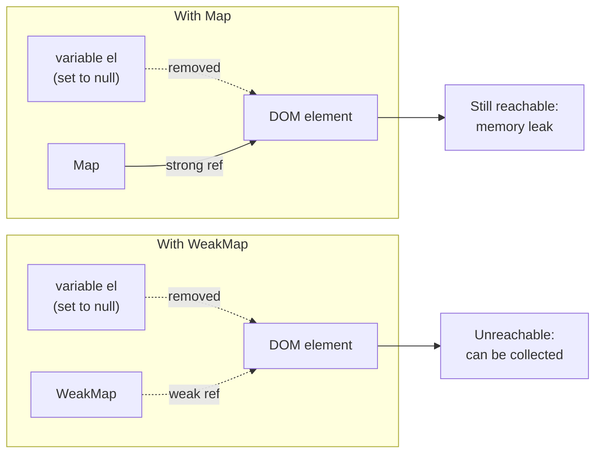
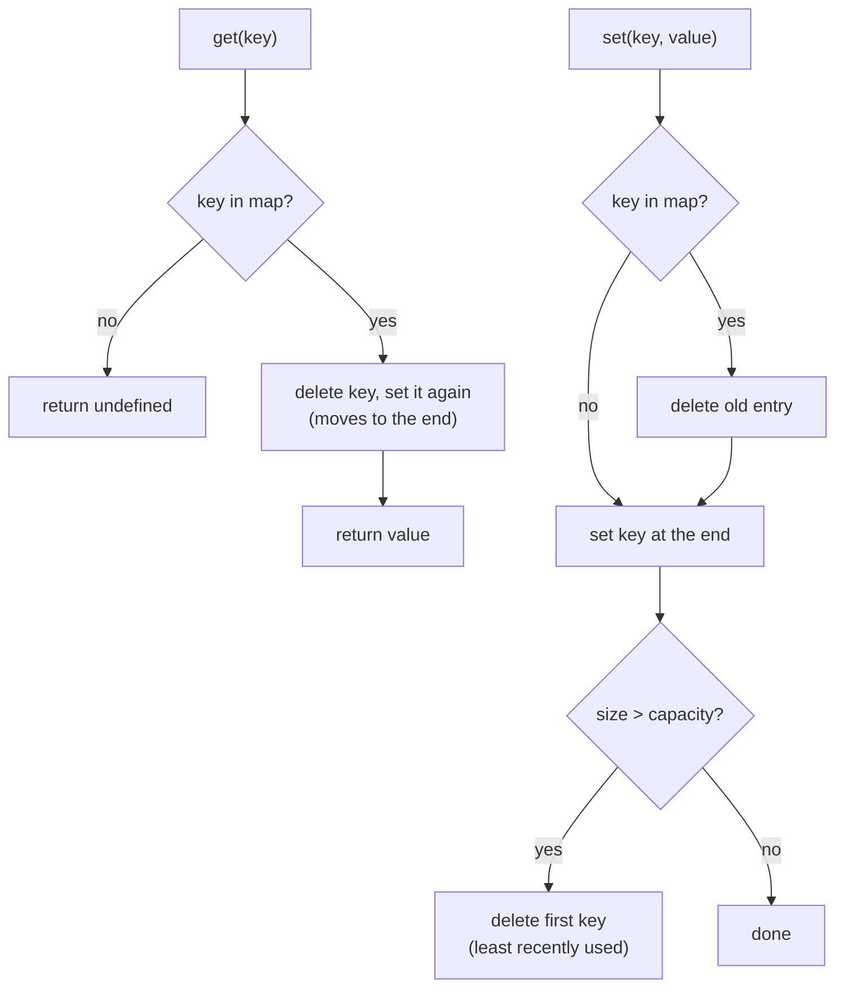
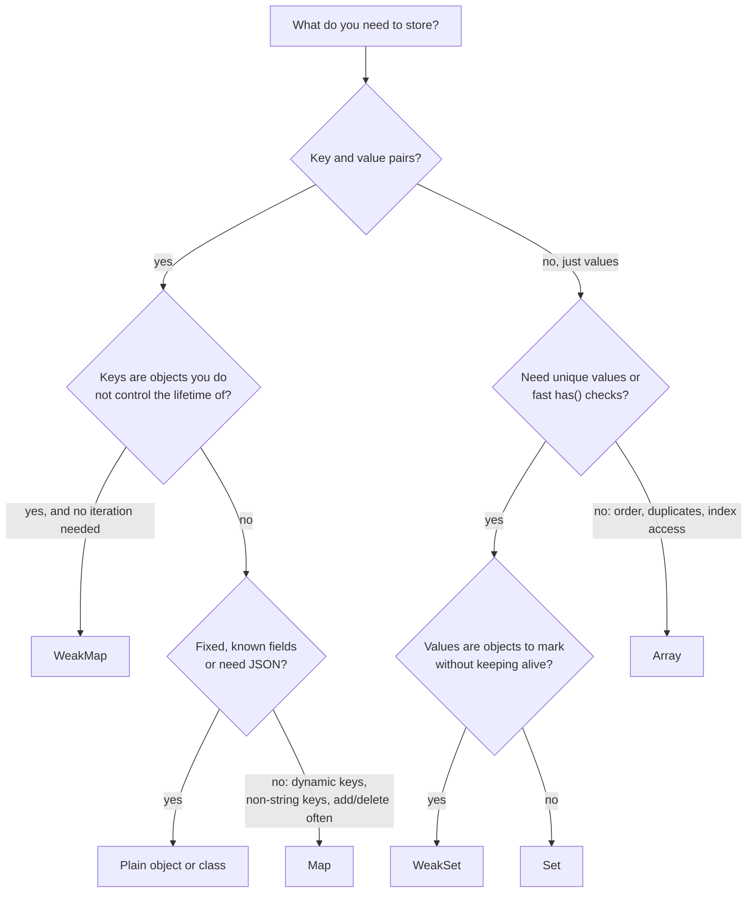

# Map, Set, WeakMap and WeakSet

> In this document you will learn the four keyed collections of JavaScript: when a `Map` is better than a plain object, how a `Set` removes duplicates and does set math, and how `WeakMap`/`WeakSet` attach data to objects without causing memory leaks. You will also build an LRU cache, a classic interview task.

**Before this:** [Objects and copying](./07-objects-and-copying.md) · [Arrays and array methods](./10-arrays-and-array-methods.md) · **Interview questions:** [jump to questions](#interview-questions)

## Table of contents

1. [Why these collections exist](#why-these-collections-exist)
2. [Map basics](#map-basics)
3. [Map vs Object](#map-vs-object)
4. [Set basics](#set-basics)
5. [Set methods ES2025](#set-methods-es2025)
6. [How keys are compared](#how-keys-are-compared)
7. [Converting between collections](#converting-between-collections)
8. [Iteration order and changes during iteration](#iteration-order-and-changes-during-iteration)
9. [WeakMap](#weakmap)
10. [WeakSet](#weakset)
11. [WeakRef and FinalizationRegistry](#weakref-and-finalizationregistry)
12. [Building an LRU cache with Map](#building-an-lru-cache-with-map)
13. [Real-world usage](#real-world-usage)
14. [Choosing the right collection](#choosing-the-right-collection)
15. [How to explain this in an interview](#how-to-explain-this-in-an-interview)
16. [Interview questions](#interview-questions)
17. [Summary](#summary)
18. [References](#references)

---

## Why these collections exist

Before ES2015, JavaScript developers used **plain objects** as dictionaries (key → value lookups) and **arrays** as sets. Both have problems:

- Object keys are always **strings** (or symbols). An object used as a key is turned into the string `"[object Object]"`.
- Objects inherit properties from `Object.prototype`, so keys like `"toString"` or `"__proto__"` can clash with built-in properties.
- There is no simple `size`, and objects are not optimized for adding and removing keys all the time.
- Checking "is this value in the array?" with `includes` is O(n).

ES2015 added four collections to fix this:

| Collection | Stores | Keys can be | Iterable | Holds keys strongly |
|---|---|---|---|---|
| `Map` | key → value pairs | any value | Yes | Yes |
| `Set` | unique values | any value | Yes | Yes |
| `WeakMap` | key → value pairs | objects (and non-registered symbols) | No | **No** (weak) |
| `WeakSet` | unique values | objects (and non-registered symbols) | No | **No** (weak) |

These are **language** features (ECMAScript). They work the same in browsers, Node.js and Electron.

---

## Map basics

### What it is

A **`Map`** is a collection of key–value pairs. Any value can be a key: a string, a number, an object, a function, even `NaN`. A `Map` remembers the order in which keys were first inserted.

### The API

| Method / property | What it does | Returns |
|---|---|---|
| `new Map(iterable)` | creates a map, optionally from `[key, value]` pairs | the map |
| `map.set(key, value)` | adds or updates an entry | the map (so you can chain) |
| `map.get(key)` | reads a value | the value, or `undefined` |
| `map.has(key)` | checks if a key exists | `true`/`false` |
| `map.delete(key)` | removes an entry | `true` if it existed |
| `map.clear()` | removes everything | `undefined` |
| `map.size` | number of entries (a property, not a method) | number |
| `map.keys()`, `map.values()`, `map.entries()` | iterators | iterator |
| `map.forEach((value, key, map) => ...)` | loops in insertion order | `undefined` |

```js
const roles = new Map();

roles.set("asha", "admin").set("ben", "editor"); // set returns the map, so it chains
console.log(roles.get("asha")); // admin
console.log(roles.has("chen")); // false
console.log(roles.get("chen")); // undefined
console.log(roles.size); // 2

roles.set("ben", "viewer"); // updating keeps the original position
console.log([...roles.keys()]); // [ 'asha', 'ben' ]

console.log(roles.delete("asha")); // true
console.log(roles.delete("asha")); // false  (already gone)
console.log(roles.size); // 1
```

### Keys of any type

```js
const cache = new Map();
const user = { id: 1 };
const loadUser = () => {};

cache.set(user, "profile data"); // object key
cache.set(loadUser, "function as a key"); // function key
cache.set(1, "number one");
cache.set("1", "string one"); // different from the number 1

console.log(cache.get(user)); // profile data
console.log(cache.get(1), cache.get("1")); // number one string one
console.log(cache.get({ id: 1 })); // undefined  (a different object)
```

The last line is important. Object keys are matched by **identity** (the same object in memory), not by content. A new object `{ id: 1 }` is a different key.

### Creating a Map from data

```js
// From an array of pairs
const prices = new Map([
  ["apple", 1.2],
  ["bread", 2.5],
]);

// From an object
const settings = new Map(Object.entries({ theme: "dark", fontSize: 14 }));

// From an array of records, keyed by id (very common)
const users = [
  { id: "u1", name: "Asha" },
  { id: "u2", name: "Ben" },
];
const usersById = new Map(users.map((u) => [u.id, u]));

console.log(prices.get("bread")); // 2.5
console.log(settings.get("theme")); // dark
console.log(usersById.get("u2").name); // Ben
```

### Iterating a Map

A `Map` is iterable. Each item is a `[key, value]` pair, so destructuring is natural.

```js
const stock = new Map([
  ["pen", 10],
  ["book", 0],
]);

for (const [item, qty] of stock) {
  console.log(`${item}: ${qty}`);
}
// pen: 10
// book: 0

stock.forEach((qty, item) => console.log(item, qty)); // note: value first, then key
// pen 10
// book 0

console.log([...stock.keys()]); // [ 'pen', 'book' ]
console.log([...stock.values()]); // [ 10, 0 ]
```

Notice that `forEach` passes `(value, key)`, the same order as arrays pass `(item, index)`.

### Counting with a Map

Counting is one of the most common uses.

```js
const votes = ["yes", "no", "yes", "yes", "abstain"];
const tally = new Map();

for (const vote of votes) {
  tally.set(vote, (tally.get(vote) ?? 0) + 1);
}

console.log(tally); // Map(3) { 'yes' => 3, 'no' => 1, 'abstain' => 1 }
```

> **Newer feature:** `map.getOrInsert(key, defaultValue)` and `map.getOrInsertComputed(key, callback)` return the existing value or insert a default in one step. They are part of ECMAScript 2026 (the "upsert" proposal), available in Chrome 145+, Firefox 144+, Safari 26.2+ and Node.js 26+. They are not in Node.js 22 or 24, so the `get ?? default` pattern above is still the portable way.

---

## Map vs Object

### Comparison table

| Feature | `Map` | Plain object `{}` |
|---|---|---|
| Key types | Any value (objects, functions, numbers, `NaN`) | Strings and symbols only (numbers become strings) |
| Inherited keys | None | Inherits from `Object.prototype` (`toString`, `constructor`...) unless created with `Object.create(null)` |
| Order | Insertion order, always | Integer-like keys first (ascending), then strings in insertion order, then symbols |
| Size | `map.size` | `Object.keys(obj).length` (O(n)) |
| Iteration | Directly iterable (`for...of`) | Needs `Object.keys/values/entries` or `for...in` |
| Frequent add/delete | Designed for it | Not optimized for it |
| JSON | Not supported directly (`JSON.stringify(map)` gives `"{}"`) | Native JSON support |
| Syntax | `map.get(k)`, `map.set(k, v)` | `obj.k`, `obj[k]` literal syntax, destructuring |
| Fixed shape records | Not intended | Ideal (a `user` with `name`, `age`) |

### Key conversion in objects

Object keys are converted to strings. This causes silent bugs.

```js
const lookup = {};
const keyA = { id: 1 };
const keyB = { id: 2 };

lookup[keyA] = "A";
lookup[keyB] = "B"; // overwrites "A"!

console.log(Object.keys(lookup)); // [ '[object Object]' ]
console.log(lookup[keyA]); // B
```

Both objects become the string `"[object Object]"`, so they are the same key. A `Map` keeps them apart.

Numbers are also converted: `obj[1]` and `obj["1"]` are the same property.

```js
const scores = {};
scores[1] = "number";
scores["1"] = "string";
console.log(scores); // { '1': 'string' }
```

### Order differences

```js
const obj = { b: 1, 2: "two", a: 2, 1: "one" };
console.log(Object.keys(obj)); // [ '1', '2', 'b', 'a' ]

const map = new Map([["b", 1], [2, "two"], ["a", 2], [1, "one"]]);
console.log([...map.keys()]); // [ 'b', 2, 'a', 1 ]
```

Objects put integer-like keys first in ascending order. Maps keep the exact insertion order. If you build a list of IDs like `"101"`, `"7"`, `"55"` and need to keep the order they arrived in, an object will reorder them.

### Prototype keys: a security and correctness risk

A plain object already "has" keys it inherited. When keys come from users (tags, usernames, query parameters), this causes bugs and even security problems.

```js
const wordCount = {};
console.log("constructor" in wordCount); // true  (inherited!)

const counts = {};
const userInput = "__proto__";
counts[userInput] = 5; // tries to set the prototype; a number is ignored
console.log(Object.keys(counts)); // []  (the count was lost)

const safeCounts = new Map();
safeCounts.set("__proto__", 5);
console.log(safeCounts.get("__proto__")); // 5
```

Worse, code that copies untrusted keys into objects (for example, a naive deep merge of JSON) can modify `Object.prototype` itself. This is called **prototype pollution**, and it has caused real vulnerabilities in popular npm packages. A `Map`, or an object created with `Object.create(null)`, has no prototype to pollute. See [Authentication and authorization](../07-nodejs-backend/09-authentication-and-authorization.md).

### Performance

The specification requires `Map` and `Set` operations to be "sublinear on average", which in practice means hash tables with O(1) average `get`, `set`, `has` and `delete`. Objects are also fast for lookups, but engines optimize them for a **fixed shape** (the same properties every time). When you keep adding and deleting many different keys, V8 switches the object to a slower "dictionary mode". MDN describes `Map` as performing better for frequent additions and removals.

Do not choose based on micro-benchmarks. Choose based on the job:

- **Record with known fields** (`user.name`, `order.total`): object (or a class).
- **Dictionary with dynamic keys**, especially non-string keys or user-provided keys, or frequent add/delete: `Map`.

### When a plain object is still the better choice

- You need **JSON** directly (API payloads, config files, `localStorage`).
- The keys are fixed and known (a record or a DTO).
- You want literal syntax, destructuring and spread.
- TypeScript types for records are simpler (`interface User { ... }`).

---

## Set basics

### What it is

A **`Set`** is a collection of **unique values**. Adding a value that is already there does nothing. Like `Map`, it keeps insertion order and accepts any type of value.

### The API

| Method / property | What it does |
|---|---|
| `new Set(iterable)` | creates a set, optionally from any iterable |
| `set.add(value)` | adds a value (returns the set, so it chains) |
| `set.has(value)` | `true`/`false`, O(1) on average |
| `set.delete(value)` | removes a value, returns `true` if it existed |
| `set.clear()` | removes everything |
| `set.size` | number of values |
| `set.values()`, `set.keys()` (same thing), `set.entries()` | iterators |
| `set.forEach((value, sameValue, set) => ...)` | loops in insertion order |

```js
const tags = new Set(["js", "css"]);

tags.add("js"); // already there: no change
tags.add("html");
console.log(tags.size); // 3
console.log(tags.has("css")); // true
console.log(tags.delete("css")); // true
console.log([...tags]); // [ 'js', 'html' ]
```

`set.entries()` returns `[value, value]` pairs and `forEach` passes the value twice. This odd design exists only so `Set` has the same shape as `Map`.

### Common uses

**1. Remove duplicates.**

```js
const emails = ["a@x.com", "b@x.com", "a@x.com"];
console.log([...new Set(emails)]); // [ 'a@x.com', 'b@x.com' ]

console.log(new Set("mississippi").size); // 4  (strings are iterable: m, i, s, p)
```

**2. Fast membership checks.** `set.has(x)` is O(1) on average; `array.includes(x)` is O(n).

```js
const allowedRoles = new Set(["admin", "editor"]);
const canEdit = (user) => allowedRoles.has(user.role);
console.log(canEdit({ role: "editor" }), canEdit({ role: "guest" })); // true false
```

**3. Track "seen" or "selected" items.**

```js
// Selected rows in a table (by id)
const selectedIds = new Set();

function toggleRow(id) {
  if (selectedIds.has(id)) selectedIds.delete(id);
  else selectedIds.add(id);
}

toggleRow(7);
toggleRow(9);
toggleRow(7);
console.log([...selectedIds]); // [ 9 ]
```

**4. Detect cycles and avoid repeated work** (graph traversal, recursive data).

```js
// Visit every node in a graph once, even if there are cycles
const graph = { a: ["b", "c"], b: ["a"], c: ["b"] };

function visitAll(start) {
  const visited = new Set();
  const stack = [start];
  while (stack.length) {
    const node = stack.pop();
    if (visited.has(node)) continue;
    visited.add(node);
    stack.push(...graph[node]);
  }
  return [...visited];
}

console.log(visitAll("a")); // [ 'a', 'c', 'b' ]
```

### Immutable updates with Set (Angular OnPush, NgRx, React)

A `Set` is mutable. Frameworks that compare references will not notice `selected.add(x)`. Create a new `Set` when updating state.

```js
const selected = new Set([1, 2]);

const withThree = new Set(selected).add(3); // new Set, original unchanged
const withoutOne = new Set([...selected].filter((id) => id !== 1));

console.log([...selected], [...withThree], [...withoutOne]); // [ 1, 2 ] [ 1, 2, 3 ] [ 2 ]
```

Note: NgRx and Redux recommend keeping store state **serializable** (plain objects and arrays). `Map` and `Set` are not JSON-serializable and do not work well with Redux DevTools. Use them inside components and services, and store arrays or id-keyed objects in the global store.

---

## Set methods ES2025

ES2025 added seven methods for set math. They are supported in Chrome 122+, Firefox 127+, Safari 17+ and Node.js 22+.

| Method | Returns | Meaning |
|---|---|---|
| `a.union(b)` | new Set | in `a` **or** `b` |
| `a.intersection(b)` | new Set | in **both** |
| `a.difference(b)` | new Set | in `a` but **not** in `b` |
| `a.symmetricDifference(b)` | new Set | in exactly **one** of them |
| `a.isSubsetOf(b)` | boolean | every item of `a` is in `b` |
| `a.isSupersetOf(b)` | boolean | every item of `b` is in `a` |
| `a.isDisjointFrom(b)` | boolean | no items in common |

```js
const frontend = new Set(["js", "css", "html", "ts"]);
const backend = new Set(["js", "ts", "sql"]);

console.log(frontend.union(backend)); // Set(5) { 'js', 'css', 'html', 'ts', 'sql' }
console.log(frontend.intersection(backend)); // Set(2) { 'js', 'ts' }
console.log(frontend.difference(backend)); // Set(2) { 'css', 'html' }
console.log(frontend.symmetricDifference(backend)); // Set(3) { 'css', 'html', 'sql' }

console.log(new Set(["js"]).isSubsetOf(frontend)); // true
console.log(frontend.isSupersetOf(new Set(["css", "ts"]))); // true
console.log(frontend.isDisjointFrom(new Set(["go"]))); // true
```

None of these change the original sets.

### The argument must be "set-like"

The argument does not have to be a `Set`, but it must be **set-like**: it needs a numeric `size` property and `has()` and `keys()` methods. A `Map` qualifies (its keys are used). An array does **not**.

```js
const a = new Set([1, 2]);

console.log(a.union(new Map([[3, "three"]]))); // Set(3) { 1, 2, 3 }

try {
  a.union([3, 4]);
} catch (error) {
  console.log(error.name); // TypeError
}

console.log(a.union(new Set([3, 4]))); // Set(4) { 1, 2, 3, 4 }  (wrap the array in a Set)
```

### Before ES2025 (and in interviews)

You can still be asked to implement these. Each is one line with spread and `filter`:

```js
const a = new Set([1, 2, 3, 4]);
const b = new Set([3, 4, 5]);

const union = new Set([...a, ...b]);
const intersection = new Set([...a].filter((x) => b.has(x)));
const difference = new Set([...a].filter((x) => !b.has(x)));
const isSubset = [...a].every((x) => b.has(x));

console.log(union, intersection, difference, isSubset);
// Set(5) { 1, 2, 3, 4, 5 } Set(2) { 3, 4 } Set(2) { 1, 2 } false
```

Real uses: comparing user permissions with required permissions (`required.isSubsetOf(granted)`), finding new and removed items between two syncs (`difference` both ways), and showing common interests between users (`intersection`).

---

## How keys are compared

`Map` keys and `Set` values are compared with the **SameValueZero** algorithm:

- It works like `===` for almost everything.
- **Difference 1:** `NaN` is equal to `NaN` (with `===` it is not).
- `+0` and `-0` are considered equal.
- Objects, arrays and functions are equal only if they are the **same reference**.

```js
console.log(new Set([NaN, NaN]).size); // 1
console.log(new Map([[0, "zero"]]).get(-0)); // zero
console.log(new Set([[1], [1]]).size); // 2  (two different arrays)
console.log(new Set(["1", 1]).size); // 2  (different types)
```

### Using content as a key

If you need "same content = same key", convert the content to a primitive key first:

```js
const visitedCells = new Set();
const cellKey = (row, col) => `${row},${col}`;

visitedCells.add(cellKey(2, 3));
console.log(visitedCells.has(cellKey(2, 3))); // true
console.log(visitedCells.has([2, 3])); // false  (array key would never match)
```

This is the standard trick for grid problems (game boards, path finding) in coding interviews.

For objects, `JSON.stringify` can make a key, but only if property order is always the same (`{a:1,b:2}` and `{b:2,a:1}` produce different strings). Prefer a real ID or an explicit composite key.

---

## Converting between collections

| From → To | Code |
|---|---|
| Array → Set | `new Set(array)` |
| Set → Array | `[...set]` or `Array.from(set)` |
| Object → Map | `new Map(Object.entries(obj))` |
| Map → Object | `Object.fromEntries(map)` (keys become strings) |
| Map → Array of pairs | `[...map]` or `Array.from(map)` |
| Array of records → Map by id | `new Map(items.map((x) => [x.id, x]))` |
| Array → grouped Map | `Map.groupBy(items, fn)` (ES2024) |

```js
const config = new Map([["theme", "dark"], ["lang", "en"]]);

console.log(Object.fromEntries(config)); // { theme: 'dark', lang: 'en' }
console.log([...config]); // [ [ 'theme', 'dark' ], [ 'lang', 'en' ] ]

const byParity = Map.groupBy([1, 2, 3, 4], (n) => (n % 2 ? "odd" : "even"));
console.log(byParity); // Map(2) { 'odd' => [ 1, 3 ], 'even' => [ 2, 4 ] }
```

### Map, Set and JSON

`JSON.stringify` does not know about `Map` and `Set`. They have no enumerable own properties, so they become `{}`.

```js
const prefs = new Map([["theme", "dark"]]);
const tags = new Set(["a", "b"]);

console.log(JSON.stringify({ prefs, tags })); // {"prefs":{},"tags":{}}  (data lost!)

// ✅ Convert explicitly
const json = JSON.stringify({ prefs: Object.fromEntries(prefs), tags: [...tags] });
console.log(json); // {"prefs":{"theme":"dark"},"tags":["a","b"]}

// ✅ And back
const data = JSON.parse(json);
const restoredPrefs = new Map(Object.entries(data.prefs));
const restoredTags = new Set(data.tags);
console.log(restoredPrefs.get("theme"), restoredTags.has("b")); // dark true
```

If the `Map` keys are not strings, store it as an array of pairs: `JSON.stringify([...map])`, and restore with `new Map(JSON.parse(text))`.

`structuredClone` **does** support `Map` and `Set`, so deep copying them works:

```js
const original = new Map([["list", [1, 2]]]);
const copy = structuredClone(original);
copy.get("list").push(3);
console.log(original.get("list")); // [ 1, 2 ]
```

---

## Iteration order and changes during iteration

`Map` and `Set` always iterate in **insertion order**. Updating an existing key does not move it. Deleting and re-adding a key moves it to the end. (The LRU cache below relies on this.)

```js
const queue = new Map([["a", 1], ["b", 2], ["c", 3]]);

queue.set("a", 100); // update: position unchanged
console.log([...queue.keys()]); // [ 'a', 'b', 'c' ]

queue.delete("a");
queue.set("a", 1); // re-insert: moves to the end
console.log([...queue.keys()]); // [ 'b', 'c', 'a' ]
```

You can safely change a `Map` or `Set` while iterating over it. The rules:

- Entries **added** during iteration **are** visited (if added after the current position).
- Entries **deleted** before they are reached are **not** visited.

```js
const pending = new Set([1]);
for (const n of pending) {
  if (n < 3) pending.add(n + 1); // add while looping
}
console.log([...pending]); // [ 1, 2, 3 ]
```

This makes a `Set` usable as a simple work queue, but be careful: adding forever creates an infinite loop.

---

## WeakMap

### What it is

A **`WeakMap`** is like a `Map`, with three differences:

1. Keys must be **objects** (or, since ES2023, symbols that were not created with `Symbol.for`).
2. Keys are held **weakly**: the `WeakMap` does not keep the key object alive.
3. It is **not iterable**, has **no `size`**, and **no `clear`**. You can only `get`, `set`, `has` and `delete`.

### Why it exists

Imagine you want to attach extra data to objects you do not own: DOM elements, objects from a library, request objects. If you use a `Map`, the `Map` holds a **strong reference** to each key. Even after the object is no longer used anywhere else, the `Map` keeps it alive. That is a **memory leak**.

A `WeakMap` solves this. When nothing else references the key object, the garbage collector can remove the key **and** its value.

### Simple explanation

- **Strong reference:** "I am holding this object; do not throw it away."
- **Weak reference:** "I want to know about this object while it exists, but I am not the reason it exists."

### Analogy

A `Map` is like a cloakroom that keeps your coat forever, even if you never come back. A `WeakMap` is like a sticky note attached to the coat itself: when the coat is thrown away, the note goes with it. The analogy breaks down slightly because you cannot ask a `WeakMap` "show me all notes" — it is not iterable.

### How it works inside

The garbage collector frees objects that are no longer **reachable** from the program's roots (global variables, the current call stack, closures). A `Map` entry counts as a path to its key. A `WeakMap` entry does not.



The value is held strongly **only while the key is alive**. This special rule is called an **ephemeron**. It even works when the value references its own key: that cycle does not keep the key alive.

Because the garbage collector decides **when** to remove entries, and that timing is not predictable, the language cannot let you iterate a `WeakMap` or read its `size`. The answer would change at random moments. That is why these methods do not exist.

### The API

```js
const metadata = new WeakMap();
const button = { id: "save" }; // imagine a DOM element

metadata.set(button, { clicks: 0 });
metadata.get(button).clicks++;

console.log(metadata.get(button)); // { clicks: 1 }
console.log(metadata.has(button)); // true
console.log(metadata.size); // undefined  (no size)

try {
  metadata.set("save", {}); // primitive key
} catch (error) {
  console.log(error.name); // TypeError
}
```

Why are primitive keys not allowed? A primitive like `"save"` can be recreated at any time (`"sa" + "ve"`), so it is never "unreachable". The entry could never be collected, which defeats the purpose.

### Use case 1: data attached to DOM elements

```js
// Browser code: store per-element state without leaking removed elements
const tooltipState = new WeakMap();

function attachTooltip(element, text) {
  tooltipState.set(element, { text, shown: false });
  element.addEventListener("mouseenter", () => {
    tooltipState.get(element).shown = true;
  });
}
// When the element is removed from the page and no longer referenced,
// its WeakMap entry can be garbage collected too.
```

### Use case 2: caching results per object (memoization)

```js
const summaryCache = new WeakMap();

function getOrderSummary(order) {
  if (summaryCache.has(order)) return summaryCache.get(order);
  const summary = {
    items: order.lines.length,
    total: order.lines.reduce((sum, line) => sum + line.price, 0),
  };
  summaryCache.set(order, summary);
  return summary;
}

const order = { lines: [{ price: 10 }, { price: 5 }] };
console.log(getOrderSummary(order)); // { items: 2, total: 15 }
console.log(getOrderSummary(order) === getOrderSummary(order)); // true  (cached)
```

This cache is safe with immutable data: when a new `order` object replaces the old one (as in NgRx or React state), the old cache entry disappears with the old object. This is how libraries like `reselect` and Angular-style memoized selectors can avoid growing forever. (If the `order` object is mutated, the cached summary becomes stale, so this pattern works best with immutable updates.)

### Use case 3: private data (before `#private` fields)

```js
const privateData = new WeakMap();

class BankAccount {
  constructor(owner, balance) {
    privateData.set(this, { balance });
    this.owner = owner;
  }
  deposit(amount) {
    privateData.get(this).balance += amount;
  }
  get balance() {
    return privateData.get(this).balance;
  }
}

const account = new BankAccount("Asha", 100);
account.deposit(50);
console.log(account.balance); // 150
console.log(Object.keys(account)); // [ 'owner' ]  (balance is not visible)
```

TypeScript used this pattern when compiling `#private` fields to older JavaScript targets. Today, native `#private` fields are the better choice. See [Classes](./09-classes.md).

### Use case 4: per-request data in Node.js

```js
// Associate data with a request object without adding properties to it
const requestTimings = new WeakMap();

function startTimer(req) {
  requestTimings.set(req, Date.now());
}
function elapsed(req) {
  return Date.now() - requestTimings.get(req);
}

const fakeReq = {};
startTimer(fakeReq);
console.log(elapsed(fakeReq) >= 0); // true
```

(For data that must follow an async flow, Node.js also has `AsyncLocalStorage`. See [Production Node.js](../07-nodejs-backend/14-production-nodejs.md).)

---

## WeakSet

A **`WeakSet`** is a set of objects held weakly. It has only `add`, `has` and `delete`. It answers one question: "have I seen / marked this object?"

```js
const processed = new WeakSet();

function processOnce(job) {
  if (processed.has(job)) return "skipped";
  processed.add(job);
  return "processed";
}

const job = { id: 1 };
console.log(processOnce(job)); // processed
console.log(processOnce(job)); // skipped

try {
  processed.add(42);
} catch (error) {
  console.log(error.name); // TypeError
}
```

Use cases:

- **Marking objects** without changing them: "this element is already initialized", "this object was validated".
- **Cycle detection** while walking an object graph (for example, in a custom deep-equal or a safe `JSON.stringify` replacer).
- **Branding:** checking that an object was created by your class (`instances.add(this)` in the constructor, `instances.has(obj)` later). Native `#x in obj` checks now do this better.

```js
// Safe stringify that replaces circular references
function safeStringify(value) {
  const seen = new WeakSet();
  return JSON.stringify(value, (key, val) => {
    if (typeof val === "object" && val !== null) {
      if (seen.has(val)) return "[Circular]";
      seen.add(val);
    }
    return val;
  });
}

const node = { name: "root" };
node.self = node;
console.log(safeStringify(node)); // {"name":"root","self":"[Circular]"}
```

(This simple version also marks repeated, non-circular references as `[Circular]`. That is acceptable for logging.)

---

## WeakRef and FinalizationRegistry

ES2021 added two lower-level tools. Most applications never need them. The specification and MDN both advise avoiding them when possible.

### WeakRef

A **`WeakRef`** holds a weak reference to one object. Call `deref()` to get the object, or `undefined` if it was already garbage collected.

```js
let bigReport = { rows: new Array(1000).fill("data") };
const ref = new WeakRef(bigReport);

console.log(ref.deref() === bigReport); // true  (still alive: we hold a strong reference)

bigReport = null; // drop our strong reference
// Later, ref.deref() MAY return undefined, after the garbage collector runs.
// You cannot know when, or even if, that happens.
```

A use case is a cache of expensive objects that should not prevent garbage collection:

```js
const imageCache = new Map(); // url -> WeakRef(image)

function getImage(url, load) {
  const cached = imageCache.get(url)?.deref();
  if (cached) return cached;
  const image = load(url);
  imageCache.set(url, new WeakRef(image));
  return image;
}

const img = getImage("/logo.png", (url) => ({ url, pixels: [] }));
console.log(getImage("/logo.png", () => ({})) === img); // true
```

Note that the `Map` itself still holds the URL strings and the `WeakRef` wrappers. To clean those up too, you need a `FinalizationRegistry`.

### FinalizationRegistry

A **`FinalizationRegistry`** lets you register a callback that **may** run after an object is garbage collected.

```js
const registry = new FinalizationRegistry((url) => {
  console.log(`image for ${url} was collected`);
  // e.g. imageCache.delete(url) if the WeakRef is empty
});

const image = { pixels: [] };
registry.register(image, "/logo.png");
```

### The caveats (say these in an interview)

- Garbage collection timing is **not deterministic**. It depends on the engine, memory pressure and other factors.
- A finalization callback **may never run** (for example, if the program exits first).
- Engines may keep objects alive longer than you expect (for example, a `WeakRef` target stays alive at least until the end of the current job).
- **Never** use them for essential logic like closing files, releasing locks or saving data. Use explicit cleanup (`close()`, `try...finally`, `AbortController`, `using` declarations where supported).

They are useful for caches and for cleaning up native resources as a **backup** to explicit cleanup. For the full picture of how the garbage collector works, see [Memory management and garbage collection](./19-memory-management-and-garbage-collection.md).

---

## Building an LRU cache with Map

### What it is

An **LRU (Least Recently Used) cache** keeps a fixed number of items. When it is full and you add a new item, it removes the item that was **used least recently**.

It is used for API response caches, image caches, database query caches and memoization with a size limit. It is also one of the most common data-structure tasks in interviews.

### Why Map is perfect for it

A `Map` gives you two things at once:

1. **O(1) average lookup** by key.
2. **Insertion order.** The first key in the map is the oldest.

To mark an item as "recently used", delete it and set it again. It moves to the end. The least recently used item is always the **first** key: `map.keys().next().value`.



### Full code

```js
class LRUCache {
  #capacity;
  #map = new Map();

  constructor(capacity) {
    if (!Number.isInteger(capacity) || capacity <= 0) {
      throw new RangeError("capacity must be a positive integer");
    }
    this.#capacity = capacity;
  }

  get(key) {
    if (!this.#map.has(key)) return undefined;
    const value = this.#map.get(key);
    this.#map.delete(key); // move to the end = most recently used
    this.#map.set(key, value);
    return value;
  }

  set(key, value) {
    if (this.#map.has(key)) this.#map.delete(key);
    this.#map.set(key, value);
    if (this.#map.size > this.#capacity) {
      const oldestKey = this.#map.keys().next().value; // first key = least recently used
      this.#map.delete(oldestKey);
    }
    return this;
  }

  has(key) {
    return this.#map.has(key); // checking does not count as "use"
  }

  get size() {
    return this.#map.size;
  }

  keys() {
    return [...this.#map.keys()]; // oldest first
  }
}

const cache = new LRUCache(2);
cache.set("a", 1);
cache.set("b", 2);
cache.get("a"); // "a" is now the most recently used
cache.set("c", 3); // full: evicts "b", the least recently used

console.log(cache.keys()); // [ 'a', 'c' ]
console.log(cache.get("b")); // undefined
console.log(cache.get("a")); // 1
```

### Step-by-step walkthrough

| Step | Operation | Map order (oldest → newest) | Note |
|---|---|---|---|
| 1 | `set("a", 1)` | a | |
| 2 | `set("b", 2)` | a, b | |
| 3 | `get("a")` | b, a | "a" moved to the end |
| 4 | `set("c", 3)` | b, a, c → a, c | size 3 > 2, delete first key "b" |
| 5 | `get("b")` | a, c | not found: `undefined` |
| 6 | `get("a")` | c, a | found: returns 1 |

### Complexity

- `get`: O(1) average (one `has`, one `get`, one `delete`, one `set`).
- `set`: O(1) average. Getting the first key with `keys().next()` is O(1).
- Space: O(capacity).

### Follow-ups interviewers ask

- **"Without relying on Map order?"** — The classic solution is a hash map plus a **doubly linked list**. The map points to list nodes; the list keeps usage order. Moving a node to the front and removing the tail are O(1). The `Map` version is the idiomatic JavaScript answer because `Map` already maintains insertion order.
- **"Add expiry (TTL)?"** — Store `{ value, expiresAt }` and treat expired entries as missing in `get` (delete them when found).
- **"Thread safety?"** — JavaScript runs your code on one thread, so there are no data races inside one process. With Node.js `worker_threads` or several server instances, each has its own cache. A shared cache needs Redis or similar. See [Caching in Node.js](../07-nodejs-backend/11-caching.md).

---

## Real-world usage

| Where | Collection | Example |
|---|---|---|
| Angular services | `Map` | In-memory cache of HTTP results by URL; registry of open dialogs by id |
| Angular components | `Set` | Selected rows in a table; expanded tree nodes |
| Frontend (any framework) | `WeakMap` | Per-element state in a directive or custom element; memoizing derived data per immutable state object |
| Frontend | `Set` | Deduplicating notifications; tracking which items were already rendered/viewed |
| Node.js | `Map` | Rate limiter: IP → request count; WebSocket server: userId → socket |
| Node.js | `LRU` with `Map` | Caching configuration or DB lookups with a memory bound |
| Node.js | `WeakMap` | Data attached to request/socket objects without mutating them |
| Electron | `Map` | windowId → `BrowserWindow`; tracking open documents by path |
| Libraries | `WeakMap`/`WeakSet` | Vue's reactivity system stores dependency tracking in a `WeakMap`; observers, proxies and caches keyed by objects |

A realistic Node.js example: a simple in-memory rate limiter.

```js
const WINDOW_MS = 60_000;
const LIMIT = 3;
const hits = new Map(); // ip -> { count, windowStart }

function isAllowed(ip, now = Date.now()) {
  const entry = hits.get(ip);
  if (!entry || now - entry.windowStart >= WINDOW_MS) {
    hits.set(ip, { count: 1, windowStart: now });
    return true;
  }
  entry.count++;
  return entry.count <= LIMIT;
}

const t = 1_000_000;
console.log([1, 2, 3, 4].map(() => isAllowed("10.0.0.1", t))); // [ true, true, true, false ]
console.log(isAllowed("10.0.0.1", t + WINDOW_MS)); // true  (new window)
```

(In production you also need to delete old entries so the `Map` does not grow forever, and you need a shared store like Redis when you run several server instances.)

---

## Choosing the right collection



---

## How to explain this in an interview

Use this for "When would you use a Map instead of an object?" and "What is a WeakMap?"

1. **Define it:** "A `Map` is a key-value collection where keys can be any type and insertion order is kept. A `Set` stores unique values. `WeakMap` and `WeakSet` are versions that hold their object keys weakly."
2. **Why it exists:** "Plain objects only allow string or symbol keys, they inherit prototype properties like `constructor`, they have no `size`, and they are optimized for fixed shapes, not for constant adding and deleting."
3. **How it works:** "Maps and Sets are hash tables with O(1) average operations, compared with SameValueZero, so `NaN` works as a key and objects are matched by reference. A `WeakMap` entry does not keep its key alive; when the key object is unreachable, the garbage collector can drop the entry and its value. That is why `WeakMap` cannot be iterated and has no `size`."
4. **Small example:** "For a word count with arbitrary user words, a `Map` avoids problems with keys like `__proto__`. To store metadata for DOM elements, a `WeakMap` lets removed elements be collected."
5. **Where it is useful:** "`Set` for deduplication and fast membership checks, `Map` for caches and lookups by id, an LRU cache built on Map's insertion order, and `WeakMap` for memoizing per-object results or private data."
6. **Trade-offs / gotchas:** "Maps and Sets do not serialize to JSON and don't fit well in Redux or NgRx stores, so I convert them at the boundary. Object keys are by identity, so `{id: 1}` is not found by another `{id: 1}`. And WeakRef or FinalizationRegistry should never drive essential logic because GC timing is not predictable."

---

## Interview questions

### Q1. When would you use a `Map` instead of a plain object?

**What the interviewer is checking:** that you know the real differences, not just "Map is newer".

**Short spoken answer (30–60 seconds):**
> I use a `Map` when I need a real dictionary: keys that are not strings, like objects or numbers I want to keep as numbers; keys that come from users, where prototype keys like `__proto__` or `constructor` could clash; frequent additions and deletions; or when I need the exact insertion order and an easy `size`. A `Map` is also directly iterable. I use a plain object for records with known fields, like a user or a DTO, and when I need JSON, because `Map` does not serialize. So: objects for structured records, Maps for dynamic collections.

**Detailed explanation:** see [Map vs Object](#map-vs-object). Object keys are converted to strings, so two different object keys collapse into `"[object Object]"`. Objects order integer-like keys first. Objects inherit from `Object.prototype` unless created with `Object.create(null)`.

**Code:**

```js
const visits = new Map();
const pageA = { url: "/a" };
const pageB = { url: "/b" };
visits.set(pageA, 1).set(pageB, 5);
console.log(visits.get(pageA), visits.size); // 1 2
```

**Follow-up questions:**
- **How do you make an object safe to use as a dictionary?** — `Object.create(null)` creates an object without a prototype. Keys are still strings, though.
- **Which is faster?** — Both are fast for lookups. `Map` is designed for frequent add/delete; objects are optimized for fixed shapes. Measure if it matters; choose by semantics first.
- **How do you send a Map to an API?** — Convert with `Object.fromEntries(map)` (string keys) or `[...map]` (any keys), and rebuild with `new Map(...)` on the other side.

**Common mistakes:** saying objects have "no order" (they do, with specific rules); saying Maps are "always faster"; forgetting that `map[key] = value` sets a normal property on the `Map` object instead of an entry.

**Where this is used in real projects:** caches keyed by URL or object, rate limiters, socket registries, grouping data.

### Q2. What does this print?

```js
const cache = {};
const a = { id: 1 };
const b = { id: 2 };

cache[a] = "first";
cache[b] = "second";

console.log(cache[a]); // second
console.log(Object.keys(cache).length); // 1
```

**Answer:** `second`, then `1`.

**Why:**
1. Object property keys must be strings or symbols. `a` is converted with `String(a)`, which gives `"[object Object]"`.
2. `b` is converted to the same string, so `cache[b] = "second"` overwrites the same property.
3. `cache[a]` reads `cache["[object Object]"]`, which is `"second"`.
4. There is only one key. A `Map` would keep two separate entries.

### Q3. What does this print?

```js
const m = new Map();
m.set({ id: 1 }, "user");
console.log(m.get({ id: 1 })); // undefined

const key = { id: 1 };
m.set(key, "user");
console.log(m.get(key)); // user
console.log(m.size); // 2
```

**Answer:** `undefined`, `user`, `2`.

**Why:** `Map` compares object keys by **reference**. Each `{ id: 1 }` literal creates a new object, so `get` with a new literal finds nothing. Using the same variable `key` works. The map holds two entries: the first, now unreachable, object key and `key`. (That first entry is also a tiny memory leak: you can never read it, but the `Map` keeps it alive.)

### Q4. How does a `Set` decide whether two values are the same?

**Short answer:** it uses **SameValueZero**: like `===`, except `NaN` equals `NaN`. `+0` and `-0` are the same. Objects and arrays are equal only if they are the same reference. `Map` keys use the same rule.

```js
console.log(new Set([NaN, NaN, 0, -0, "0"]).size); // 3
console.log(new Set([{}, {}]).size); // 2
```

The three values are `NaN`, `0` and `"0"`.

**Follow-up:** *How do you deduplicate objects by content?* — Choose a key (`id`, or a composite string) and use a `Set` of keys or a `Map` from key to object.

### Q5. What is a `WeakMap`, and how is it different from a `Map`?

**What the interviewer is checking:** garbage collection understanding and practical use cases.

**Short spoken answer (30–60 seconds):**
> A `WeakMap` is a key-value collection where keys must be objects and are held weakly. That means the `WeakMap` does not keep the key alive. If nothing else references the key object, the garbage collector can remove it, and the entry and its value go away too. Because entries can disappear at any time, a `WeakMap` is not iterable and has no `size` or `clear`; you can only get, set, check and delete by key. I use it to attach data to objects I don't own, like metadata for DOM elements, or to cache computed results per object, without causing memory leaks. A normal `Map` would keep those objects alive forever.

**Detailed explanation:** the value is held strongly only as long as the key is alive (an ephemeron). Primitive keys are not allowed because primitives can always be recreated and would never become unreachable. Since ES2023, non-registered symbols can also be keys.

**Code:**

```js
const clicks = new WeakMap();
let el = { tag: "button" };

clicks.set(el, 3);
console.log(clicks.get(el)); // 3

el = null; // the object can now be garbage collected, and its entry with it
```

**Follow-up questions:**
- **Why can't you iterate a WeakMap?** — The result would depend on when the garbage collector ran, which is unpredictable. The language hides that non-determinism by not offering iteration or `size`.
- **Can you use a string as a key?** — No, it throws a `TypeError`.
- **Does the WeakMap hold its values weakly?** — No. Values are held strongly while the key is alive. Only the key is weak.

**Common mistakes:** saying "WeakMap values are weak"; thinking `WeakMap` entries are removed immediately when you set a variable to `null` (collection happens later, at the engine's discretion); using `WeakMap` as a general cache with string keys.

**Where this is used in real projects:** framework internals (Vue's reactivity stores dependencies in a `WeakMap`), memoized selectors keyed by state objects, DOM metadata in directives, private class data in older code.

### Q6. Implement an LRU cache.

**What the interviewer is checking:** data structure design, complexity, and knowing `Map` insertion order.

**Short spoken answer (30–60 seconds):**
> I use a `Map` because it gives O(1) average lookups and remembers insertion order. The first key in the map is always the least recently used. In `get`, if the key exists, I delete it and set it again to move it to the end, then return the value. In `set`, I delete the key if it exists, set it, and if the size is now bigger than the capacity, I delete the first key, which I get with `map.keys().next().value`. Both operations are O(1) on average. In a language without an ordered map, I would use a hash map plus a doubly linked list.

**Code:** see [Full code](#full-code) in the LRU section.

**Follow-up questions:**
- **What is the complexity of `keys().next()`?** — O(1). It creates an iterator and reads only the first entry.
- **How would you build it with a linked list?** — A `Map` from key to node, and a doubly linked list with head (most recent) and tail (least recent). On access, unlink the node and insert it at the head; on overflow, remove the tail and delete its key from the map.
- **How do you test it?** — Test capacity 1, updating an existing key (it should become most recent and not grow the size), `get` of a missing key, and eviction order after mixed gets and sets.
- **What about memory for large values?** — Limit by total size instead of count: track a running byte estimate and evict until under the limit.

**Common mistakes:** updating an existing key without moving it to the end; evicting before inserting (off-by-one); scanning for the oldest key (O(n)).

**Where this is used in real projects:** HTTP response caches, image caches in Electron or mobile apps, memoization with bounded memory, database query caches. Node packages like `lru-cache` implement this.

### Q7. What are the new `Set` methods in ES2025?

**Short spoken answer:**
> ES2025 added `union`, `intersection`, `difference`, `symmetricDifference`, `isSubsetOf`, `isSupersetOf` and `isDisjointFrom`. The first four return a new Set; the last three return booleans. None of them modify the original. The argument must be set-like, meaning it has `size`, `has` and `keys`, so a Map works but an array does not. They are supported in all current browsers and Node 22 and later. Before that, we wrote them with spread and `filter`.

```js
const required = new Set(["read", "write"]);
const granted = new Set(["read", "write", "delete"]);
console.log(required.isSubsetOf(granted)); // true
console.log(granted.difference(required)); // Set(1) { 'delete' }
```

**Follow-up:** *What does `symmetricDifference` return?* — Values in exactly one of the two sets: `(a − b) ∪ (b − a)`.

### Q8. Your single-page app's memory grows every time a user opens and closes a modal. You find a `Map` that stores data per DOM element. What is happening, and how do you fix it?

**What the interviewer is checking:** diagnosing a memory leak and choosing `WeakMap`.

**Short spoken answer (30–60 seconds):**
> The `Map` holds strong references to the DOM elements as keys. When the modal closes, the elements are removed from the page, but the `Map` still references them, so they and everything they reference, including their child nodes and listeners' closures, can't be garbage collected. Each open and close adds more. The fix is either to delete the entries when the modal is destroyed, for example in `ngOnDestroy`, or to switch to a `WeakMap`, which doesn't keep its keys alive. I would confirm the fix with DevTools heap snapshots: take a snapshot, open and close the modal several times, take another, and look for "Detached" DOM nodes and their retainers.

**Code:**

```js
// ❌ Leaks: the Map keeps removed elements alive
const elementData = new Map();

// ✅ Entries can be collected together with the elements
const elementDataSafe = new WeakMap();
```

**Follow-up questions:**
- **When is explicit cleanup still needed with a WeakMap?** — When something else also references the element, such as a global event listener, a timer, or an RxJS subscription. The `WeakMap` only stops itself from being the cause.
- **How do you find what retains an object?** — In Chrome DevTools Memory panel, select the object in a heap snapshot and read the "Retainers" section. See [Debugging and code review](../11-coding-interviews/06-debugging-and-code-review.md).

**Where this is used in real projects:** directives that store per-element state, chart libraries that attach instances to containers, tooltips and popovers.

### Q9. What are `WeakRef` and `FinalizationRegistry`, and when should you use them?

**What the interviewer is checking:** knowledge of advanced memory APIs and their risks.

**Short spoken answer (30–60 seconds):**
> Both were added in ES2021. A `WeakRef` holds a weak reference to one object; `deref()` returns the object or `undefined` if it was collected. A `FinalizationRegistry` lets you register a callback that may run some time after an object is collected. They are useful for caches of large objects that should not block garbage collection, and as a backup for releasing native resources. But garbage collection timing is unpredictable, and the finalization callback might never run, so I would never use them for essential logic like closing files or saving data. For that I use explicit cleanup with `try...finally` or a `close` method.

**Follow-up questions:**
- **Why does `deref()` sometimes still return the object after you dropped all references?** — Collection happens later, when the engine decides. Engines also keep `WeakRef` targets alive at least until the current synchronous job ends.
- **How is `WeakRef` different from `WeakMap`?** — A `WeakMap` associates a value with an object key and you cannot observe collection. A `WeakRef` lets you observe whether an object is still alive.

**Common mistakes:** using finalizers to save user data; writing tests that expect collection at a certain time.

### Q10. What does this print?

```js
const queue = new Map([["a", 1], ["b", 2], ["c", 3]]);

queue.set("a", 10);
queue.delete("b");
queue.set("b", 20);

console.log([...queue.keys()]); // [ 'a', 'c', 'b' ]
console.log([...queue.values()]); // [ 10, 3, 20 ]
```

**Answer:** keys `[ 'a', 'c', 'b' ]`, values `[ 10, 3, 20 ]`.

**Why:**
1. Updating `"a"` changes its value but keeps its position (first).
2. Deleting `"b"` removes it.
3. Setting `"b"` again inserts it as a new entry at the end.

### Q11. How do you convert a `Map` to JSON and back?

**Short answer:** `JSON.stringify(map)` gives `"{}"` and loses the data. For string keys, use `Object.fromEntries(map)` before stringifying and `new Map(Object.entries(obj))` after parsing. For any key type, store an array of pairs: `JSON.stringify([...map])` and `new Map(JSON.parse(text))`. For a `Set`, use `[...set]` and `new Set(array)`.

```js
const m = new Map([[1, "one"], [2, "two"]]);
const text = JSON.stringify([...m]);
console.log(text); // [[1,"one"],[2,"two"]]
console.log(new Map(JSON.parse(text)).get(2)); // two
```

You can also use a replacer and reviver to do this automatically for every `Map` in a payload.

### Q12. Write a memoize function that works with an object argument without leaking memory.

**What the interviewer is checking:** combining closures with `WeakMap`.

**Short spoken answer:**
> I create a `WeakMap` inside a closure. When the function is called with an object, I return the cached result if the object is a key; otherwise I compute, store and return it. Because the cache is a `WeakMap`, results for objects that are no longer used elsewhere can be garbage collected. This works great with immutable state, where each update creates a new object. For primitive arguments, I would need a `Map` with a size limit instead, like an LRU.

```js
function memoizeByObject(fn) {
  const cache = new WeakMap();
  return function (obj) {
    if (cache.has(obj)) return cache.get(obj);
    const result = fn(obj);
    cache.set(obj, result);
    return result;
  };
}

let computeCount = 0;
const countActive = memoizeByObject((state) => {
  computeCount++;
  return state.users.filter((u) => u.active).length;
});

const state = { users: [{ active: true }, { active: false }] };
console.log(countActive(state), countActive(state), computeCount); // 1 1 1
```

**Follow-up:** *What if the function has several arguments?* — Use nested maps (one level per argument), or build a composite key for primitive arguments. The full memoize implementation is in [JavaScript polyfills and implementations](../11-coding-interviews/04-javascript-polyfills-and-implementations.md).

### Q13. Why is using a plain object as a dictionary for user-provided keys risky?

**What the interviewer is checking:** prototype-related bugs and prototype pollution awareness.

**Short spoken answer (30–60 seconds):**
> A plain object inherits from `Object.prototype`, so it already seems to contain keys like `toString`, `constructor` and `hasOwnProperty`. If a user's key is one of those, checks like `key in obj` give wrong answers. The special key `__proto__` is worse: assigning to it changes the object's prototype instead of creating an entry. And if code merges untrusted JSON into objects, an attacker can use `__proto__` to add properties to `Object.prototype` for the whole app, which is prototype pollution. For dynamic keys I use a `Map`, or at least `Object.create(null)` and `Object.hasOwn` checks.

**Code:**

```js
const tagCounts = {};
for (const tag of ["js", "constructor"]) {
  tagCounts[tag] = (tagCounts[tag] || 0) + 1;
}
console.log(typeof tagCounts.constructor); // string
console.log(tagCounts.constructor.endsWith("}1")); // true  ("function Object() { [native code] }1")
```

The `constructor` key started from the inherited `Object` function, so `(tagCounts[tag] || 0) + 1` produced a string instead of `1`.

**Follow-up questions:**
- **How does `Object.groupBy` avoid this?** — It returns a null-prototype object.
- **How do you defend against prototype pollution in Node APIs?** — Validate input schemas, avoid naive deep merges, freeze `Object.prototype` in some apps, use `Map` for dynamic keys, and keep dependencies updated.

### Q14. What is the time complexity of `Map` and `Set` operations? Is it guaranteed?

**Short answer:** `get`, `set`, `has`, `add` and `delete` are O(1) on **average**. The specification only requires access times that are "sublinear on the number of elements" on average; engines use hash tables. In the worst case (many hash collisions), a hash table can degrade. `size` is O(1). Iteration is O(n). Building a `Set` from an array is O(n).

**Follow-up:** *Why is converting an array to a Set before many lookups worth it?* — One O(n) build plus O(1) lookups beats O(n) `includes` for each lookup. See [Arrays: performance notes](./10-arrays-and-array-methods.md#performance-notes).

### Q15. Solve "two sum" with a `Map`: return the indexes of two numbers that add up to a target.

**What the interviewer is checking:** using a hash map to go from O(n²) to O(n).

**Short spoken answer:**
> The brute force checks every pair, which is O(n²). With a `Map`, I loop once. For each number, I compute the complement, `target - number`. If the complement is already in the map, I found the pair and return both indexes. Otherwise I store the current number with its index. It is O(n) time and O(n) space.

```js
function twoSum(nums, target) {
  const seen = new Map(); // value -> index
  for (let i = 0; i < nums.length; i++) {
    const complement = target - nums[i];
    if (seen.has(complement)) return [seen.get(complement), i];
    seen.set(nums[i], i);
  }
  return null;
}

console.log(twoSum([2, 7, 11, 15], 9)); // [ 0, 1 ]
console.log(twoSum([3, 3], 6)); // [ 0, 1 ]
console.log(twoSum([1, 2], 10)); // null
```

**Follow-up:** *Why check before inserting?* — So a number is not paired with itself (for `[3]` with target 6), while duplicates like `[3, 3]` still work.

### Q16. When would you use a `WeakSet`?

**Short answer:** to mark objects without keeping them alive or changing them: "already initialized", "already processed", "currently being visited" during a recursive walk (cycle detection), or to brand instances created by your code. It only supports `add`, `has` and `delete`, and only objects (or non-registered symbols).

```js
const initialized = new WeakSet();
function initWidget(el) {
  if (initialized.has(el)) return false;
  initialized.add(el);
  return true;
}
const widget = {};
console.log(initWidget(widget), initWidget(widget)); // true false
```

### Q17. What does this print?

```js
const s = new Set("hello");
console.log(s.size); // 4
console.log([...s].join("")); // helo

const nums = new Set([3, 1, 3, 2, 1]);
console.log([...nums]); // [ 3, 1, 2 ]
console.log(new Set([[1], [1]]).size); // 2
```

**Answer:** `4`, `helo`, `[ 3, 1, 2 ]`, `2`.

**Why:**
1. A string is iterable, so `new Set("hello")` adds `h`, `e`, `l`, `l`, `o`. The second `l` is ignored.
2. A `Set` keeps the order of first insertion, not sorted order.
3. Two array literals are two different objects, so both are kept.

### Q18. Should you put a `Map` or `Set` in your NgRx or Redux store?

**What the interviewer is checking:** practical architecture judgment.

**Short spoken answer (30–60 seconds):**
> Generally no. The Redux style guide and NgRx recommend serializable state: plain objects, arrays and primitives. `Map` and `Set` don't serialize to JSON, so features like Redux DevTools, state persistence and server-side hydration break or show empty objects. They are also easy to mutate by accident, which breaks reference-based change detection. In the store I keep entities as an object keyed by id, like NgRx Entity's `ids` and `entities`, and selected items as an array of ids. Inside a component or a selector, I can build a `Set` from that array for fast lookups.

**Follow-up questions:**
- **How do you get O(1) lookups then?** — Store `entities: { [id]: entity }`, which is an object keyed by id. Or memoize a selector that builds a `Set` or `Map` from the array.
- **Is a Map ever OK in Angular state?** — In local component state or a service using signals or a `BehaviorSubject`, yes, as long as you replace the `Map` (create a new one) on each update.

**Where this is used in real projects:** NgRx Entity adapters, Redux Toolkit `createEntityAdapter`.

---

## Summary

- `Map` is a key–value collection with **any key type**, insertion order, `size`, and direct iteration. Use it for dynamic dictionaries, caches and lookups by id.
- Plain objects convert keys to strings, inherit prototype keys and reorder integer-like keys. Use them for records with known fields and for JSON.
- `Set` stores **unique values**; `has` is O(1) on average. Use it for deduplication, membership checks and "seen" tracking.
- Keys and values are compared with **SameValueZero**: `NaN` equals `NaN`, objects match only by reference.
- ES2025 `Set` methods: `union`, `intersection`, `difference`, `symmetricDifference`, `isSubsetOf`, `isSupersetOf`, `isDisjointFrom`. The argument must be set-like.
- `Map` and `Set` do not serialize to JSON; convert with `Object.fromEntries`, `[...map]` or `[...set]`. `structuredClone` does copy them.
- `WeakMap`/`WeakSet` hold object keys **weakly**, so entries disappear when the key is garbage collected. They are not iterable and have no `size`.
- Use `WeakMap` for per-object metadata, memoization keyed by objects and private data; use `WeakSet` to mark objects.
- `WeakRef` and `FinalizationRegistry` exist for advanced caching and cleanup backups, but GC timing is unpredictable; never use them for essential logic.
- An **LRU cache** is a `Map` where `get` re-inserts the key and `set` evicts `map.keys().next().value` when over capacity: O(1) average per operation.

## References

- MDN — Map: https://developer.mozilla.org/en-US/docs/Web/JavaScript/Reference/Global_Objects/Map
- MDN — Set: https://developer.mozilla.org/en-US/docs/Web/JavaScript/Reference/Global_Objects/Set
- MDN — Set.prototype.union (set-like objects): https://developer.mozilla.org/en-US/docs/Web/JavaScript/Reference/Global_Objects/Set/union
- MDN — WeakMap: https://developer.mozilla.org/en-US/docs/Web/JavaScript/Reference/Global_Objects/WeakMap
- MDN — WeakSet: https://developer.mozilla.org/en-US/docs/Web/JavaScript/Reference/Global_Objects/WeakSet
- MDN — WeakRef: https://developer.mozilla.org/en-US/docs/Web/JavaScript/Reference/Global_Objects/WeakRef
- MDN — FinalizationRegistry: https://developer.mozilla.org/en-US/docs/Web/JavaScript/Reference/Global_Objects/FinalizationRegistry
- MDN — Keyed collections guide: https://developer.mozilla.org/en-US/docs/Web/JavaScript/Guide/Keyed_collections
- MDN — Equality comparisons and sameness (SameValueZero): https://developer.mozilla.org/en-US/docs/Web/JavaScript/Equality_comparisons_and_sameness
- ECMAScript specification — Map objects: https://tc39.es/ecma262/#sec-map-objects
- TC39 proposal — Set methods: https://github.com/tc39/proposal-set-methods
- TC39 proposal — Upsert (Map.prototype.getOrInsert): https://github.com/tc39/proposal-upsert
- Redux style guide — Do not put non-serializable values in state: https://redux.js.org/style-guide/#do-not-put-non-serializable-values-in-state-or-actions
