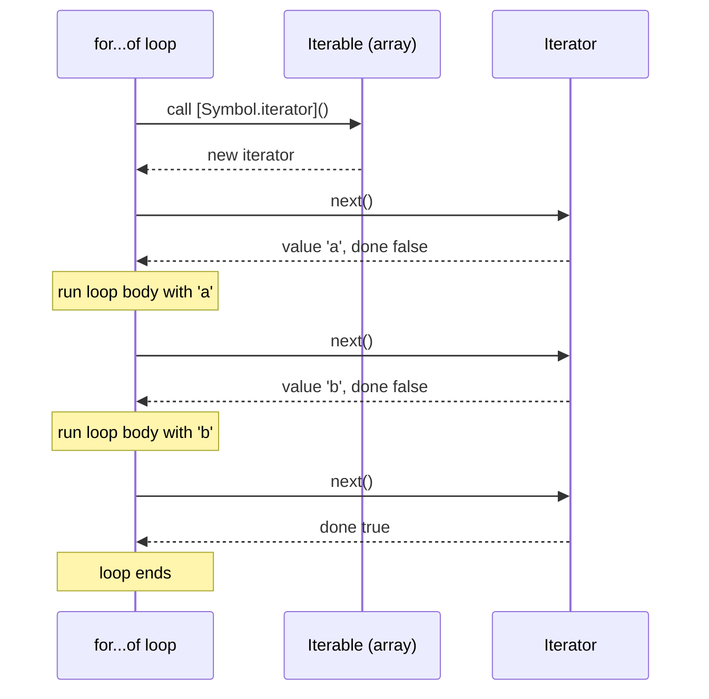
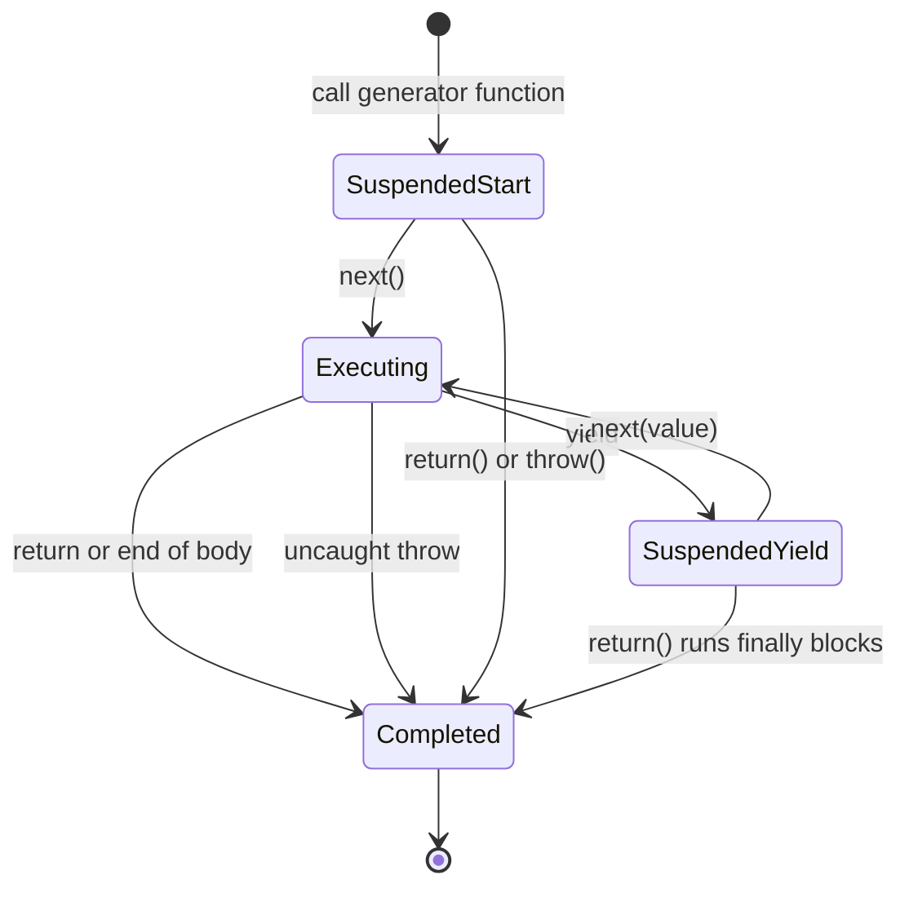
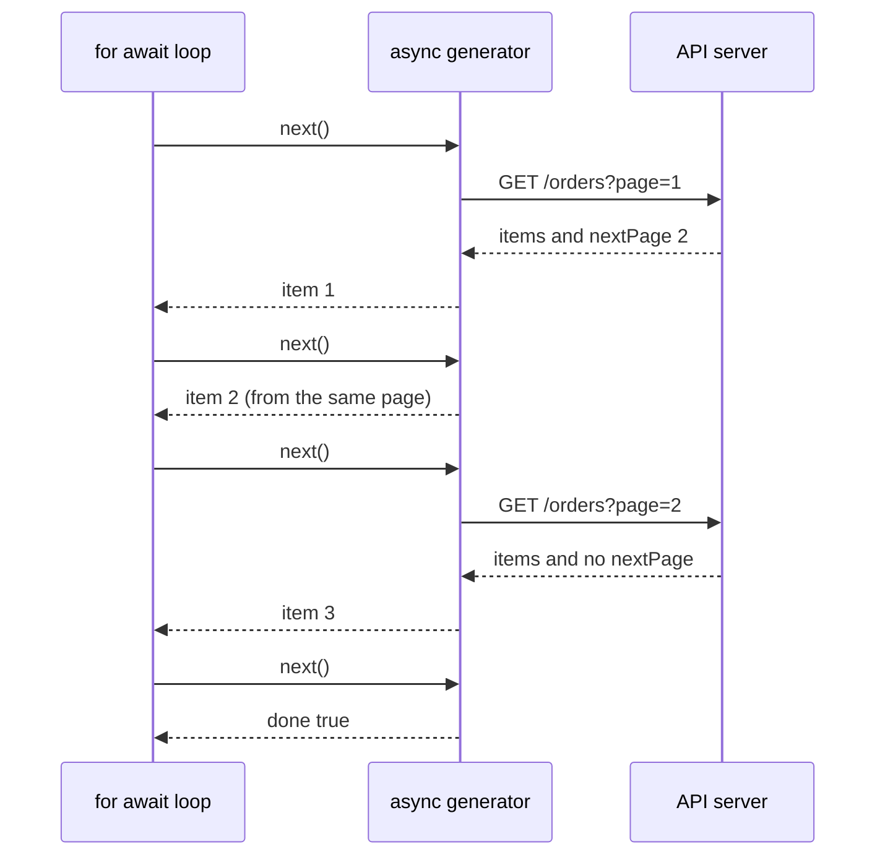

# Iterators and Generators

> In this document you will learn the iteration protocols that power `for...of`, spread and destructuring, how to make your own objects iterable, and how generator functions pause and resume. You will also learn async iterators for paginated APIs and streams, and the ES2025 iterator helpers. Interviewers use this topic to see whether you understand what really happens inside `for...of` and how lazy evaluation works.

**Before this:** [Functions and functional programming](./04-functions-and-functional-programming.md) · [Arrays and array methods](./10-arrays-and-array-methods.md) · **Interview questions:** [jump to questions](#interview-questions)

## Table of contents

1. [Why iteration protocols exist](#why-iteration-protocols-exist)
2. [The iterable and iterator protocols](#the-iterable-and-iterator-protocols)
3. [Built-in iterables](#built-in-iterables)
4. [What consumes iterables](#what-consumes-iterables)
5. [Writing a custom iterable](#writing-a-custom-iterable)
6. [Closing an iterator early with return](#closing-an-iterator-early-with-return)
7. [Generator basics](#generator-basics)
8. [Generator states](#generator-states)
9. [Two-way communication: next, return and throw](#two-way-communication-next-return-and-throw)
10. [Delegating with yield star](#delegating-with-yield-star)
11. [Lazy and infinite sequences](#lazy-and-infinite-sequences)
12. [Iterator helpers ES2025](#iterator-helpers-es2025)
13. [Async iterators and for await](#async-iterators-and-for-await)
14. [Async generators in real code](#async-generators-in-real-code)
15. [Real-world usage](#real-world-usage)
16. [Common mistakes](#common-mistakes)
17. [How to explain this in an interview](#how-to-explain-this-in-an-interview)
18. [Interview questions](#interview-questions)
19. [Summary](#summary)
20. [References](#references)

---

## Why iteration protocols exist

Before ES2015, every collection had its own way to loop: `for (let i = 0; ...)` for arrays, `for...in` for objects, special methods for DOM lists. There was no common way to say "give me the items one by one".

ES2015 added **iteration protocols**: a small, agreed set of rules. Any object that follows the rules can be used with `for...of`, spread (`...`), destructuring, `Array.from`, `new Set(...)`, `Promise.all(...)` and more.

The benefit: the **producer** of data (an array, a `Map`, a tree, an API) and the **consumer** of data (a loop, spread) do not need to know about each other. They only need to agree on the protocol.

These protocols are **language** features (ECMAScript). They work the same in browsers, Node.js and Electron.

---

## The iterable and iterator protocols

There are two separate ideas. People mix them up, so learn the difference carefully.

### Iterator

An **iterator** is an object with a `next()` method. Each call to `next()` returns a **result object** with two properties:

- `value`: the current item.
- `done`: `false` while there are more items, `true` when finished.

```js
const iterator = ["a", "b"][Symbol.iterator]();

console.log(iterator.next()); // { value: 'a', done: false }
console.log(iterator.next()); // { value: 'b', done: false }
console.log(iterator.next()); // { value: undefined, done: true }
```

An iterator is like a **bookmark** in a book: it remembers where you are, and `next()` turns one page.

### Iterable

An **iterable** is an object that can **give you an iterator**. It has a method under the special key `Symbol.iterator`. Calling that method returns a fresh iterator.

```js
const letters = ["a", "b"]; // arrays are iterable

const it1 = letters[Symbol.iterator]();
const it2 = letters[Symbol.iterator]();

console.log(it1.next().value, it1.next().value); // a b
console.log(it2.next().value); // a  (a fresh iterator starts at the beginning)
```

An iterable is like the **book**. You can open it many times, and each reader gets their own bookmark.

| | Iterable | Iterator |
|---|---|---|
| Has | `[Symbol.iterator]()` method | `next()` method |
| Job | Creates iterators | Produces values one at a time |
| Example | an array, a string, a `Map` | `array[Symbol.iterator]()`, `map.entries()` |
| Reusable? | Usually yes (each call gives a new iterator) | No, it is used up once it is done |

Many built-in iterators are **also iterable**: their `[Symbol.iterator]()` returns themselves. That is why you can write `for (const [k, v] of map.entries())`.

```js
const it = [1, 2, 3][Symbol.iterator]();
console.log(it[Symbol.iterator]() === it); // true
```

### How for...of uses the protocols



Step by step, `for (const x of letters) { ... }` does this:

1. Call `letters[Symbol.iterator]()` to get an iterator.
2. Call `iterator.next()`.
3. If `done` is `true`, stop.
4. Otherwise, put `value` in `x` and run the loop body.
5. Go back to step 2.
6. If the loop exits early (`break`, `return`, or an exception), call `iterator.return()` if the iterator has it (see [Closing an iterator early](#closing-an-iterator-early-with-return)).

You can write the same loop by hand:

```js
const letters = ["a", "b"];
const iterator = letters[Symbol.iterator]();
let result = iterator.next();
while (!result.done) {
  console.log(result.value);
  result = iterator.next();
}
// a
// b
```

---

## Built-in iterables

| Iterable | What it yields |
|---|---|
| `Array`, typed arrays | items (holes as `undefined`) |
| `String` | Unicode code points (so an emoji is one item) |
| `Map` | `[key, value]` pairs |
| `Set` | values |
| `arguments` | arguments |
| `NodeList` (browser) | DOM nodes |
| Results of `array.keys()`, `.values()`, `.entries()`, `map.keys()` etc. | indexes, values, pairs |
| `String.prototype.matchAll()` | regex match objects |
| Generator objects | whatever the generator yields |

**Plain objects are not iterable.**

```js
const user = { name: "Asha", role: "admin" };

try {
  for (const x of user) console.log(x);
} catch (error) {
  console.log(error.message); // user is not iterable
}

// Use Object.entries (an array) instead
for (const [key, value] of Object.entries(user)) {
  console.log(key, value);
}
// name Asha
// role admin
```

Objects are not iterable by default because it is not clear what to iterate: keys, values or both? `Object.keys`, `Object.values` and `Object.entries` let you choose.

---

## What consumes iterables

All of these work with **any** iterable, including your own:

```js
const tags = new Set(["js", "css", "html"]);

for (const tag of tags) console.log(tag); // for...of
console.log([...tags]); // spread into an array: [ 'js', 'css', 'html' ]
const [first, ...others] = tags; // array destructuring
console.log(first, others); // js [ 'css', 'html' ]
console.log(Array.from(tags, (t) => t.toUpperCase())); // [ 'JS', 'CSS', 'HTML' ]
console.log(new Map([["a", 1]]).size); // 1  (Map and Set constructors take iterables)
console.log(Math.max(...new Set([3, 9, 4]))); // 9  (spread into function arguments)
```

Also: `new Set(iterable)`, `new Map(iterable)`, `Promise.all(iterable)`, `Promise.race(iterable)`, `Object.fromEntries(iterable)`, `yield*` and `Array.fromAsync`.

Note: object spread (`{ ...obj }`) is different. It copies own enumerable properties and does **not** use the iteration protocol.

---

## Writing a custom iterable

### A range object

Let us make `range(1, 5)` work with `for...of`, like Python's `range`.

```js
const range = {
  from: 1,
  to: 4,
  [Symbol.iterator]() {
    let current = this.from;
    const last = this.to;
    return {
      next() {
        if (current <= last) {
          return { value: current++, done: false };
        }
        return { value: undefined, done: true };
      },
    };
  },
};

for (const n of range) console.log(n);
// 1
// 2
// 3
// 4

console.log([...range]); // [ 1, 2, 3, 4 ]
console.log(Math.max(...range)); // 4
```

Step by step for `[...range]`:

1. Spread calls `range[Symbol.iterator]()`. It creates a local `current = 1` and returns an iterator object.
2. Spread calls `next()`: returns `{ value: 1, done: false }`; `current` becomes 2.
3. This repeats for 2, 3 and 4.
4. The fifth `next()` returns `{ done: true }`, and spread stops.

Each call to `[Symbol.iterator]()` creates a **new** `current`, so the range can be iterated many times.

### A class that is iterable

In real code, you often add iteration to your own data structure. The cleanest way is a generator method (explained in the next sections), but here is the protocol written by hand first:

```js
class Playlist {
  #songs = [];
  add(song) {
    this.#songs.push(song);
    return this;
  }
  [Symbol.iterator]() {
    let index = 0;
    const songs = this.#songs;
    return {
      next: () =>
        index < songs.length
          ? { value: songs[index++], done: false }
          : { value: undefined, done: true },
      [Symbol.iterator]() {
        return this; // make the iterator iterable too (good practice)
      },
    };
  }
}

const playlist = new Playlist().add("Song A").add("Song B");
console.log([...playlist]); // [ 'Song A', 'Song B' ]
```

The consumer can loop over the playlist without knowing it uses a private array inside. This is the **Iterator design pattern** built into the language (see [Behavioral patterns](../04-oop-solid-design-patterns/08-behavioral-patterns.md)).

---

## Closing an iterator early with return

An iterator may have an optional `return()` method. `for...of`, destructuring and spread call it when they stop **before** the iterator is done, for example on `break`, `return`, a thrown error, or destructuring that takes only a few items.

This lets the iterator **clean up**: close a file, release a database cursor, stop a timer.

```js
function makeReader(lines) {
  let i = 0;
  return {
    [Symbol.iterator]() {
      return this;
    },
    next() {
      return i < lines.length ? { value: lines[i++], done: false } : { value: undefined, done: true };
    },
    return() {
      console.log("reader closed");
      return { value: undefined, done: true };
    },
  };
}

for (const line of makeReader(["a", "b", "c"])) {
  console.log(line);
  if (line === "b") break;
}
// a
// b
// reader closed

const [firstLine] = makeReader(["x", "y"]); // destructuring takes one item, then closes
// reader closed
console.log(firstLine); // x
```

Array iterators do **not** have a `return()` method, so they are not "closed" by `break`. You can continue using the same array iterator after a `break`:

```js
const items = [10, 20, 30].values();

for (const v of items) {
  console.log("first:", v);
  break;
}
for (const v of items) console.log("rest:", v);
// first: 10
// rest: 20
// rest: 30
```

Generators **do** have `return()`, so a generator is finished after `break`. You will see this below.

---

## Generator basics

### What it is

A **generator function** is a function that can **pause** in the middle and **resume** later. You write it with `function*` and pause with `yield`.

Calling a generator function does **not** run its body. It returns a **generator object**, which is an iterator (and also iterable). The body runs only when you call `next()`, and it runs until the next `yield`.

```js
function* countToThree() {
  console.log("starting");
  yield 1;
  yield 2;
  yield 3;
  console.log("finished");
}

const counter = countToThree(); // nothing is printed yet
console.log("created");

console.log(counter.next()); // starting, then { value: 1, done: false }
console.log(counter.next()); // { value: 2, done: false }
console.log(counter.next()); // { value: 3, done: false }
console.log(counter.next()); // finished, then { value: undefined, done: true }
```

Output in order:

```text
created
starting
{ value: 1, done: false }
{ value: 2, done: false }
{ value: 3, done: false }
finished
{ value: undefined, done: true }
```

### Why it exists

Writing an iterator by hand (like the `range` object above) needs a lot of code to track state: "where am I, what is next". A generator keeps that state for you, in its local variables and its position in the code. The `range` becomes three lines:

```js
function* range(from, to, step = 1) {
  for (let n = from; n <= to; n += step) yield n;
}

console.log([...range(1, 5)]); // [ 1, 2, 3, 4, 5 ]
console.log([...range(0, 10, 5)]); // [ 0, 5, 10 ]
```

And the `Playlist` class from before:

```js
class Playlist {
  #songs = ["Song A", "Song B"];
  *[Symbol.iterator]() {
    yield* this.#songs; // delegate to the array's iterator
  }
}

console.log([...new Playlist()]); // [ 'Song A', 'Song B' ]
```

### Analogy

A normal function is like a phone call: once started, it runs to the end. A generator is like a TV series on a streaming service: you watch one episode (`next()`), pause, and the service remembers exactly where you stopped. The next `next()` continues from that point, with everything (local variables) still in place.

### How it works inside

When a generator pauses at `yield`, the engine saves its **execution context**: local variables, the current position in the code, and any `try` blocks it is inside. This context is kept on the heap (not on the call stack), so it survives after `next()` returns. Calling `next()` puts the context back on the call stack and continues.

This is the same mechanism engines use for `async`/`await`: an `async` function pauses at `await` like a generator pauses at `yield`. Before native `async`/`await` (ES2017), libraries like `co` used generators to write async code in a synchronous style. See [Async/await](./18-async-await.md).

### Syntax forms

```js
function* declaration() { yield 1; }
const expression = function* () { yield 2; };
const obj = { *method() { yield 3; } };
class Tree { *[Symbol.iterator]() { yield 4; } }

console.log([...declaration(), ...expression(), ...obj.method(), ...new Tree()]); // [ 1, 2, 3, 4 ]
```

There are **no arrow generator functions**. `yield` is only valid directly inside a generator function, not inside a nested normal function or callback.

### return inside a generator

A `return value` in a generator finishes it. `next()` returns `{ value, done: true }`. But `for...of` and spread **ignore** the returned value, because they stop as soon as `done` is `true`.

```js
function* withReturn() {
  yield 1;
  return 2;
}

const g = withReturn();
console.log(g.next()); // { value: 1, done: false }
console.log(g.next()); // { value: 2, done: true }
console.log([...withReturn()]); // [ 1 ]  (2 is not included)
```

---

## Generator states

A generator object is always in one of four states:



- **Suspended start:** created, body not started.
- **Executing:** running right now.
- **Suspended at yield:** paused, waiting for `next()`.
- **Completed:** finished. Every further `next()` returns `{ value: undefined, done: true }`.

A generator object is **single-use**. Once completed, it cannot restart. Call the generator function again to get a new one.

```js
function* letters() {
  yield "a";
  yield "b";
}

const it = letters();
console.log([...it]); // [ 'a', 'b' ]
console.log([...it]); // []  (already completed)
console.log([...letters()]); // [ 'a', 'b' ]  (a new generator object)
```

---

## Two-way communication: next, return and throw

Generators can also **receive** values. This makes them more than iterators: they are **coroutines** (functions that can pause and exchange data with the caller).

### next(value): send a value in

The value passed to `next(value)` becomes the **result of the `yield` expression** where the generator is paused.

```js
function* conversation() {
  const name = yield "What is your name?";
  const city = yield `Hi ${name}! Where do you live?`;
  return `${name} lives in ${city}.`;
}

const chat = conversation();
console.log(chat.next().value); // What is your name?
console.log(chat.next("Asha").value); // Hi Asha! Where do you live?
console.log(chat.next("Pune").value); // Asha lives in Pune.
```

The tricky part: **the first `next()` value is ignored**. The first `next()` only starts the body and runs to the first `yield`. There is no paused `yield` yet to receive a value.

Step by step:

| Call | What runs | `yield` receives | Returned to caller |
|---|---|---|---|
| `next()` | start → first `yield` | — | `"What is your name?"` |
| `next("Asha")` | first `yield` returns `"Asha"` → second `yield` | `name = "Asha"` | `"Hi Asha! ..."` |
| `next("Pune")` | second `yield` returns `"Pune"` → `return` | `city = "Pune"` | `"Asha lives in Pune."`, `done: true` |

### return(value): stop the generator

`generator.return(value)` finishes the generator as if a `return` statement ran at the paused `yield`. Any `finally` blocks run first, so cleanup code is executed.

```js
function* withCleanup() {
  try {
    yield 1;
    yield 2;
  } finally {
    console.log("cleanup");
  }
}

const g = withCleanup();
console.log(g.next()); // { value: 1, done: false }
console.log(g.return(99)); // cleanup, then { value: 99, done: true }
console.log(g.next()); // { value: undefined, done: true }
```

If `return()` is called before the generator started, the body never runs, so the `finally` block does not run either.

This is why `break` in a `for...of` over a generator triggers `finally`:

```js
function* lines() {
  try {
    yield "line 1";
    yield "line 2";
    yield "line 3";
  } finally {
    console.log("file closed");
  }
}

for (const line of lines()) {
  console.log(line);
  if (line === "line 2") break;
}
// line 1
// line 2
// file closed
```

### throw(error): throw an error inside

`generator.throw(error)` resumes the generator by **throwing** the error at the paused `yield`. If the generator catches it, it continues. If not, the generator completes and the error comes out of `throw()`.

```js
function* resilientWorker() {
  while (true) {
    try {
      yield "ready";
    } catch (error) {
      console.log("worker caught:", error.message);
    }
  }
}

const worker = resilientWorker();
worker.next(); // start, pause at the first yield
console.log(worker.throw(new Error("bad input"))); // worker caught: bad input, then { value: 'ready', done: false }
```

This is how libraries like redux-saga deliver failed API calls into a generator: the saga writes a normal `try/catch` around `yield call(api)`.

---

## Delegating with yield star

`yield* iterable` yields every value from another iterable (an array, a string, another generator). It is like a `for...of` that yields each item.

```js
function* header() {
  yield "<header>";
}
function* page() {
  yield* header();
  yield* ["<main>", "</main>"];
  yield* "!!"; // strings are iterable
}

console.log([...page()]); // [ '<header>', '<main>', '</main>', '!', '!' ]
```

The value of a `yield*` expression is the **return value** of the inner generator:

```js
function* inner() {
  yield "a";
  return "inner done";
}
function* outer() {
  const result = yield* inner();
  console.log("result:", result);
}

console.log([...outer()]); // result: inner done, then [ 'a' ]
```

### Recursive tree traversal

`yield*` makes recursive traversal very short. This is a realistic use: walking a menu tree, a file tree or a nested comment thread.

```js
const menu = {
  label: "Root",
  children: [
    { label: "Products", children: [{ label: "Laptops", children: [] }] },
    { label: "About", children: [] },
  ],
};

function* walk(node, depth = 0) {
  yield { label: node.label, depth };
  for (const child of node.children) {
    yield* walk(child, depth + 1);
  }
}

for (const { label, depth } of walk(menu)) {
  console.log(" ".repeat(depth * 2) + label);
}
// Root
//   Products
//     Laptops
//   About
```

The consumer can also stop early (`find` the first match) without walking the whole tree, because the generator is lazy.

---

## Lazy and infinite sequences

### Lazy evaluation

**Lazy** means "compute a value only when someone asks for it". An array is **eager**: all items exist in memory at once. A generator is lazy: it produces one item per `next()` call.

```js
function* numbersLogged() {
  for (let i = 1; i <= 3; i++) {
    console.log("producing", i);
    yield i;
  }
}

for (const n of numbersLogged()) {
  console.log("using", n);
  if (n === 2) break;
}
// producing 1
// using 1
// producing 2
// using 2
```

Number 3 was never produced. With an array, all three would be created first.

### Infinite sequences

Because values are produced on demand, a generator can describe an **infinite** sequence. You just must stop consuming at some point.

```js
function* idGenerator(prefix) {
  let id = 1;
  while (true) {
    yield `${prefix}-${id++}`;
  }
}

const orderIds = idGenerator("ORD");
console.log(orderIds.next().value); // ORD-1
console.log(orderIds.next().value); // ORD-2

function* fibonacci() {
  let [a, b] = [0, 1];
  while (true) {
    yield a;
    [a, b] = [b, a + b];
  }
}

function take(iterable, count) {
  const result = [];
  if (count <= 0) return result;
  for (const value of iterable) {
    result.push(value);
    if (result.length >= count) break;
  }
  return result;
}

console.log(take(fibonacci(), 8)); // [ 0, 1, 1, 2, 3, 5, 8, 13 ]
```

**Danger:** `[...fibonacci()]` or `Array.from(fibonacci())` never ends. It tries to collect infinitely many items until the program runs out of memory.

### When lazy is better, and when it is not

| Use lazy (generators/iterators) | Use eager (arrays) |
|---|---|
| Data is huge or infinite | Data is small |
| You may stop early (search, "first 10") | You need random access (`arr[5]`) or `length` |
| Data arrives over time (pages, streams) | You iterate many times |
| You want a pipeline without intermediate arrays | You want the simplest, most familiar code |

---

## Iterator helpers ES2025

Arrays have `map`, `filter` and friends, but iterators did not. You had to convert to an array first, which loses laziness. **ES2025** added **iterator helpers**: methods on `Iterator.prototype` that work lazily on any iterator. They are available in Chrome 122+, Firefox 131+, Safari 18.4+ and Node.js 22+.

| Method | Returns | Lazy? |
|---|---|---|
| `map(fn)`, `filter(fn)`, `flatMap(fn)` | new iterator | Yes |
| `take(n)`, `drop(n)` | new iterator | Yes |
| `toArray()` | array | consumes |
| `reduce(fn, init)`, `forEach(fn)` | value / `undefined` | consumes |
| `some(fn)`, `every(fn)`, `find(fn)` | boolean / value | consumes, stops early |
| `Iterator.from(x)` (static) | wraps an iterable or iterator so it has the helpers | — |

```js
function* naturals() {
  let n = 1;
  while (true) yield n++;
}

// Works on an infinite sequence because every step is lazy
const firstEvenSquares = naturals()
  .filter((n) => n % 2 === 0)
  .map((n) => n * n)
  .take(3)
  .toArray();
console.log(firstEvenSquares); // [ 4, 16, 36 ]

console.log(naturals().drop(2).take(3).toArray()); // [ 3, 4, 5 ]
console.log(naturals().find((n) => n > 10)); // 11

// Map and Set iterators have the helpers too
const prices = new Map([["pen", 2], ["book", 12]]);
console.log(prices.entries().filter(([, p]) => p > 5).map(([name]) => name).toArray()); // [ 'book' ]

// Iterator.from adds the helpers to any iterable
console.log(Iterator.from([1, 2, 3, 4]).filter((n) => n % 2).toArray()); // [ 1, 3 ]
```

Important details:

- Helpers live on **iterators**, not iterables. Arrays do not get them (arrays already have their own eager `map`), so call `array.values()` or `Iterator.from(array)` first.
- Iterator helpers return iterators, which are **single-use**.
- Unlike `array.map`, the callback receives `(value, counter)`, not `(value, index, array)`.

> **Newer feature:** `Iterator.concat(...iterables)` (ES2026) joins several iterables into one iterator. It is available in Chrome 146+, Firefox 147+, Safari 26.4+ and Node.js 26+, not in Node.js 22 or 24.

---

## Async iterators and for await

### The problem

Some data arrives **over time**: pages from an API, chunks from a file, messages from a socket. A normal iterator must return `{ value, done }` immediately, so it cannot wait.

### Async iteration protocol

The async versions mirror the sync ones:

| | Sync | Async |
|---|---|---|
| Method key | `Symbol.iterator` | `Symbol.asyncIterator` |
| `next()` returns | `{ value, done }` | a **promise** of `{ value, done }` |
| Loop | `for...of` | `for await...of` |
| Generator | `function*` | `async function*` |

`for await...of` waits for each promise before running the loop body. It can only be used inside an `async` function or at the top level of an ES module.

```js
async function* countdown(from) {
  for (let i = from; i > 0; i--) {
    await new Promise((resolve) => setTimeout(resolve, 10)); // wait a little
    yield i;
  }
}

async function main() {
  for await (const n of countdown(3)) {
    console.log(n);
  }
  console.log("liftoff");
}

main();
// 3
// 2
// 1
// liftoff
```

`for await...of` also works with **sync** iterables. If items are promises, it awaits each one in order:

```js
async function demo() {
  for await (const value of [Promise.resolve("first"), "second"]) {
    console.log(value);
  }
}
demo();
// first
// second
```

Be careful: with an array of promises, all the work has already started. `for await` only controls the order in which you **read** the results. If one promise rejects before you reach it, it may be reported as unhandled. Prefer `Promise.all` for arrays of already-started promises.

`Array.fromAsync(asyncIterable)` (ES2026, available in Node.js 22+ and current browsers) collects an async iterable into an array:

```js
async function* twoValues() {
  yield 1;
  yield 2;
}

Array.fromAsync(twoValues()).then((values) => console.log(values)); // [ 1, 2 ]
```

### Async generator flow for paginated APIs



---

## Async generators in real code

### Paginated API

The consumer just loops over items. It does not need to know about pages, cursors or URLs.

```js
// A fake API so the example runs anywhere
const fakePages = { 1: { items: ["o1", "o2"], next: 2 }, 2: { items: ["o3"], next: null } };
const fetchPage = (page) => new Promise((resolve) => setTimeout(() => resolve(fakePages[page]), 5));

async function* fetchAllOrders() {
  let page = 1;
  while (page) {
    const data = await fetchPage(page); // in real code: await fetch(`/api/orders?page=${page}`)
    yield* data.items; // yield each item of this page
    page = data.next;
  }
}

async function exportOrders() {
  for await (const order of fetchAllOrders()) {
    console.log("export", order);
    if (order === "o2") break; // stops early: page 2 is never requested
  }
}

exportOrders();
// export o1
// export o2
```

Benefits:

- Pages are fetched **only when needed**. If the consumer stops early, no extra requests are made.
- Memory stays small: one page at a time.
- The paging logic lives in one place.

### Node.js streams are async iterable

In Node.js, readable streams (files, HTTP request bodies, `process.stdin`) implement `Symbol.asyncIterator`. You can read them with `for await`, and backpressure is handled for you.

```js
// Node.js: count lines in a large file without loading it into memory
import { createReadStream } from "node:fs";
import { createInterface } from "node:readline";

async function countErrors(path) {
  const lines = createInterface({ input: createReadStream(path), crlfDelay: Infinity });
  let errors = 0;
  for await (const line of lines) {
    if (line.includes("ERROR")) errors++;
  }
  return errors;
}
```

`readline.Interface` is async iterable and yields one line at a time. If you `break` out of the loop, the readline interface is closed (`rl.close()` is called for you). More in [Streams](../07-nodejs-backend/05-streams.md).

Other async iterables you will meet:

- `fs.promises.opendir()` (directory entries) and `events.on(emitter, "event")` in Node.js.
- `response.body` from `fetch` is a `ReadableStream`. It is async iterable in Node.js, Firefox (110+) and Chrome/Edge (124+). Safari support has lagged behind, so check your target browsers, or use `getReader()`, which works everywhere.

### Async generators vs RxJS Observables

Both deal with values over time. The key difference is **pull vs push**:

| | Async iterator | Observable (RxJS) |
|---|---|---|
| Who controls the pace | The consumer **pulls** (`next()`) | The producer **pushes** values |
| Backpressure | Built in: nothing is produced until asked | Needs operators (buffering, throttling) |
| Multiple values over time | Yes | Yes |
| Cancellation | `break` / `return()` | `unsubscribe()` |
| Operators | Iterator helpers (sync only), or hand-written | Very rich operator library |
| Typical use | Reading pages, files, streams sequentially | UI events, HTTP in Angular, websockets |

In Angular you will mostly use Observables (see [RxJS](../06-angular-16/09-rxjs.md)). Async generators shine in Node.js scripts, data exports and sequential processing.

---

## Real-world usage

| Where | How |
|---|---|
| Custom data structures | Make a linked list, tree, matrix or graph iterable with `*[Symbol.iterator]()` |
| Pagination | `async function*` that hides pages and cursors (REST, GraphQL, cloud SDKs: AWS SDK v3 and Azure SDKs expose async-iterable paginators) |
| Node.js files and streams | `for await (const chunk of stream)`, `readline` line by line |
| ID and test-data generators | Infinite generators for unique IDs or fake records in tests |
| redux-saga (React/Redux) | Side effects are written as generators: `const user = yield call(api.getUser, id)`; the middleware runs the generator and feeds results back with `next()` or errors with `throw()` |
| Parsers and tokenizers | A generator yields tokens one by one from a string |
| Batching | A generator that groups items into chunks lazily |
| Electron | Walking a large folder tree with `fs.promises.opendir` and `for await` without freezing the main process |

A lazy batching helper (works with any iterable, including infinite ones):

```js
function* chunked(iterable, size) {
  let batch = [];
  for (const item of iterable) {
    batch.push(item);
    if (batch.length === size) {
      yield batch;
      batch = [];
    }
  }
  if (batch.length > 0) yield batch;
}

console.log([...chunked(["a", "b", "c", "d", "e"], 2)]); // [ [ 'a', 'b' ], [ 'c', 'd' ], [ 'e' ] ]
```

---

## Common mistakes

1. **Expecting the generator body to run on call.** `const g = gen()` runs nothing. The body starts at the first `next()`.
2. **Reusing a used-up iterator.** Generators and iterators are single-use. Spreading the same generator twice gives `[]` the second time.

```js
function* nums() { yield 1; yield 2; }
const once = nums();
console.log([...once], [...once]); // [ 1, 2 ] []
```

3. **Spreading an infinite generator.** `[...naturals()]` never finishes. Use `take` or a loop with `break`.
4. **Expecting `for...of` to include the `return` value.** It does not.
5. **Passing a value to the first `next()`.** It is ignored.
6. **Using `yield` inside a callback.** `items.forEach((x) => { yield x; })` is a syntax error. Use `for...of` inside the generator.
7. **Using `for...in` instead of `for...of`.** `for...in` iterates property keys, not iterator values.
8. **Using `for await` on an array of started promises and expecting it to limit concurrency.** The promises are already running. To limit concurrency, start work lazily (for example, an async generator that starts each request when asked).
9. **Forgetting cleanup in hand-written iterators.** If your iterator holds a resource, implement `return()`, or use a generator with `try...finally`.

---

## How to explain this in an interview

1. **Define it:** "An iterable is an object with a `Symbol.iterator` method that returns an iterator. An iterator is an object with a `next()` method that returns `{ value, done }`. A generator is a function declared with `function*` that can pause at `yield` and resume later, and it returns an object that is both an iterator and iterable."
2. **Why it exists:** "It gives one common protocol for looping, so `for...of`, spread, destructuring and `Array.from` work with arrays, strings, Maps, Sets and my own objects. Generators remove the boilerplate of writing iterators by hand."
3. **How it works:** "`for...of` calls `[Symbol.iterator]()`, then `next()` repeatedly until `done` is true, and calls `return()` if it exits early. A generator saves its local variables and position when it yields; the next `next()` call continues from there. `next(value)` sends a value back in as the result of `yield`."
4. **Small example:** "`function* range(a, b) { for (let i = a; i <= b; i++) yield i; }` — then `[...range(1, 3)]` gives `[1, 2, 3]`."
5. **Where it is useful:** "Lazy and infinite sequences, making custom data structures iterable, tree traversal with `yield*`, and async generators for paginated APIs or Node streams with `for await`. redux-saga is built on generators."
6. **Trade-offs / gotchas:** "Iterators are single-use and have no length or random access. The generator body doesn't run until the first `next()`, the first `next()` argument is ignored, and spreading an infinite generator hangs. For a few items, a plain array is simpler."

---

## Interview questions

### Q1. What is the difference between an iterable and an iterator?

**What the interviewer is checking:** precise understanding of the two protocols.

**Short spoken answer (30–60 seconds):**
> An iterable is something you can loop over. It has a method under the key `Symbol.iterator`, and calling it returns an iterator. An iterator is the object that actually walks through the values: it has a `next()` method that returns objects like `{ value, done }`. Arrays, strings, Maps and Sets are iterables. Each time you ask an array for an iterator you get a new one starting at the beginning, while an iterator itself is used up once it reaches the end. Many built-in iterators, and all generator objects, are also iterable because their `Symbol.iterator` method returns themselves, which is why you can use them directly in `for...of`.

**Code:**

```js
const list = ["x", "y"];
const iterator = list[Symbol.iterator]();
console.log(typeof list[Symbol.iterator], typeof iterator.next); // function function
console.log(iterator.next()); // { value: 'x', done: false }
```

**Follow-up questions:**
- **Is a plain object iterable?** — No. Use `Object.keys`, `Object.values` or `Object.entries`, or add a `[Symbol.iterator]` method.
- **Is a string iterable by characters or code units?** — By code points, so `[..."😀"]` has length 1 although `"😀".length` is 2.
- **Is `arguments` iterable?** — Yes, in modern JavaScript.

**Common mistakes:** saying "an array is an iterator"; confusing `for...of` (iterables) with `for...in` (property keys).

**Where this is used in real projects:** any custom collection class; library APIs that accept "any iterable" (like `new Set(...)`, `Promise.all(...)`).

### Q2. What happens inside `for...of`?

**What the interviewer is checking:** knowledge of the protocol steps, including early exit.

**Short spoken answer (30–60 seconds):**
> First, `for...of` calls the object's `Symbol.iterator` method to get an iterator. Then it calls `next()` in a loop. While `done` is false, it assigns `value` to the loop variable and runs the body. When `done` is true, it stops, and the return value is ignored. If the loop exits early with `break`, `return` or an exception, it calls the iterator's `return()` method if one exists, which lets the iterator clean up, like closing a file. If the object has no `Symbol.iterator` method, it throws a TypeError saying the object is not iterable.

See the [sequence diagram](#how-forof-uses-the-protocols) and [closing early](#closing-an-iterator-early-with-return).

**Follow-up questions:**
- **Does destructuring also call `return()`?** — Yes. `const [a] = iterable` reads one value and then closes the iterator.
- **Why does a `break` from an array loop not "close" the array iterator?** — Array iterators do not define `return()`, so nothing is closed, and the same iterator object can continue later.

### Q3. Make this object iterable so that `[...team]` returns the member names.

```js
const team = { name: "Core", members: [{ name: "Asha" }, { name: "Ben" }] };
```

**Short spoken answer:**
> I add a `Symbol.iterator` method. The simplest way is a generator method that loops over `members` and yields each name. Using a generator means I do not have to write the `next` method and the state myself.

```js
const team = {
  name: "Core",
  members: [{ name: "Asha" }, { name: "Ben" }],
  *[Symbol.iterator]() {
    for (const member of this.members) yield member.name;
  },
};

console.log([...team]); // [ 'Asha', 'Ben' ]
for (const name of team) console.log(name);
// Asha
// Ben
```

**Follow-up:** *Write it without a generator.* — Return an object with a `next()` method that keeps an index in a closure, as in [Writing a custom iterable](#writing-a-custom-iterable).

### Q4. What does this print?

```js
function* gen() {
  console.log("A");
  const x = yield 1;
  console.log("B", x);
  const y = yield x * 2;
  console.log("C", y);
  return x + y;
}

const g = gen();
console.log("start");
console.log(g.next("ignored"));
console.log(g.next(5));
console.log(g.next(10));
console.log(g.next());
```

**Answer:**

```text
start
A
{ value: 1, done: false }
B 5
{ value: 10, done: false }
C 10
{ value: 15, done: true }
{ value: undefined, done: true }
```

**Why:**
1. `gen()` only creates the generator. Nothing runs, so `"start"` prints first.
2. The first `next("ignored")` starts the body: prints `A`, pauses at `yield 1`. The argument is ignored because no `yield` was waiting.
3. `next(5)`: the paused `yield 1` evaluates to `5`, so `x = 5`. Prints `B 5`, then pauses at `yield x * 2`, which yields `10`.
4. `next(10)`: `y = 10`. Prints `C 10`, then returns `x + y = 15` with `done: true`.
5. The generator is completed, so later calls return `{ value: undefined, done: true }`.

### Q5. What is a generator, and why would you use one?

**What the interviewer is checking:** the core concept plus realistic uses.

**Short spoken answer (30–60 seconds):**
> A generator is a function written with `function*` that can pause and resume. Calling it returns a generator object without running the body. Each `next()` runs the body until the next `yield`, returns the yielded value, and pauses, keeping all local variables. I use generators to create iterators easily, for example to make a tree or custom collection iterable, and for lazy sequences: values are computed only when asked, so I can even describe infinite sequences like IDs or Fibonacci numbers and take just what I need. Generators can also receive values through `next(value)`, which libraries like redux-saga use to run async flows. Async generators, `async function*`, combine this with `await` for things like paginated APIs.

**Follow-up questions:**
- **How do generators relate to async/await?** — Both pause a function and resume it later. Before ES2017, libraries like `co` ran generators that yielded promises to imitate `async`/`await`. Engines implement `await` with a similar suspend/resume mechanism.
- **Can you use arrow functions as generators?** — No; there is no arrow syntax for generators.
- **What is the memory benefit?** — Only the current value and the generator's state exist, not the whole sequence.

**Common mistakes:** saying generators run in parallel or on another thread (they run on the same thread; they just pause); saying the body runs on call.

**Where this is used in real projects:** tree walkers, lazy data pipelines, ID generators in tests, redux-saga, paginated SDKs.

### Q6. What does this print?

```js
function* items() {
  try {
    yield 1;
    yield 2;
    yield 3;
  } finally {
    console.log("cleanup");
  }
}

for (const item of items()) {
  console.log(item);
  if (item === 2) break;
}
console.log("after loop");
```

**Answer:**

```text
1
2
cleanup
after loop
```

**Why:** `break` makes `for...of` call the generator's `return()` method. `return()` resumes the generator as if a `return` statement were at the paused `yield 2`, so the `finally` block runs and prints `cleanup` before the loop finishes.

**Follow-up:** *What if you call `items().return()` before the first `next()`?* — The body never started, so it is not inside the `try`. The generator completes without printing `cleanup`.

### Q7. How do `next()`, `return()` and `throw()` differ?

**Short spoken answer:**
> All three resume a paused generator, but in different ways. `next(value)` continues normally, and the value becomes the result of the paused `yield`. `return(value)` finishes the generator as if a `return` statement ran at that `yield`; `finally` blocks still run, and it returns `{ value, done: true }`. `throw(error)` throws the error at the paused `yield`: if the generator catches it, it can continue and yield again; if not, the generator completes and the error is thrown out to the caller.

See the examples in [Two-way communication](#two-way-communication-next-return-and-throw).

### Q8. What is `yield*`?

**Short answer:** `yield*` delegates to another iterable: it yields each of its values one by one, as if you looped over it and yielded each item. Its result is the inner generator's `return` value. It is commonly used for recursion (tree traversal) and for composing generators.

```js
function* flatten(items) {
  for (const item of items) {
    if (Array.isArray(item)) yield* flatten(item);
    else yield item;
  }
}

console.log([...flatten([1, [2, [3, [4]]]])]); // [ 1, 2, 3, 4 ]
```

### Q9. Write a lazy `take(iterable, n)` and use it with an infinite generator.

**What the interviewer is checking:** laziness and early termination.

**Short spoken answer:**
> I write `take` as a generator. It loops over the source with `for...of`, yields each value, counts, and returns once it has yielded `n` values. Returning from inside `for...of` closes the source iterator, so an infinite source is fine. Because `take` is itself a generator, it is lazy too and can be chained. With ES2025 iterator helpers, I would just call `.take(n)` on the iterator.

```js
function* takeLazy(iterable, n) {
  if (n <= 0) return;
  let count = 0;
  for (const value of iterable) {
    yield value;
    if (++count >= n) return; // closes the source iterator
  }
}

function* squares() {
  for (let i = 1; ; i++) yield i * i;
}

console.log([...takeLazy(squares(), 4)]); // [ 1, 4, 9, 16 ]
console.log(squares().take(4).toArray()); // [ 1, 4, 9, 16 ]  (ES2025 helper)
```

**Follow-up:** *Why check `n <= 0` first?* — Otherwise the loop would pull one value before checking, which is wasteful and wrong for side-effecting sources.

### Q10. What are iterator helpers (ES2025), and how are they different from array methods?

**What the interviewer is checking:** awareness of modern features and the lazy vs eager distinction.

**Short spoken answer (30–60 seconds):**
> ES2025 added methods like `map`, `filter`, `take`, `drop`, `flatMap`, `reduce`, `toArray`, `some`, `every`, `find` and `forEach` to `Iterator.prototype`. They work on any iterator, such as generator objects or `map.entries()`. The big difference from array methods is laziness: `iterator.map(fn)` does not create an array; it returns a new iterator that applies `fn` only when a value is requested. So I can chain `filter`, `map` and `take` on an infinite generator and it finishes. Array methods are eager and create a full new array at each step. They are in Node 22 and all current browsers. `Iterator.from` wraps any iterable so it gets these methods.

**Follow-up questions:**
- **Can you call `[1, 2, 3].take(2)`?** — No. Arrays are iterables, not iterators. Use `[1, 2, 3].values().take(2)` or `Iterator.from(...)`.
- **What do the callbacks receive?** — `(value, counter)`, where `counter` counts from 0. There is no third "array" argument.

### Q11. What does this print?

```js
function* abc() {
  yield "a";
  yield "b";
  return "c";
}

const it = abc();
console.log([...it]); // [ 'a', 'b' ]
console.log([...it]); // []
const [x, y, z] = abc();
console.log(x, y, z); // a b undefined
```

**Answer:** `[ 'a', 'b' ]`, `[]`, `a b undefined`.

**Why:**
1. Spread collects values until `done: true`. The returned `"c"` comes with `done: true`, so it is not included.
2. The same generator object is now completed; spreading it again gives nothing.
3. A new generator object is destructured. `z` gets nothing because the third `next()` returns `done: true` (its value `"c"` is ignored).

### Q12. What are async iterators and `for await...of`? Give a real use case.

**What the interviewer is checking:** async iteration protocol and a practical example.

**Short spoken answer (30–60 seconds):**
> An async iterator is like a normal iterator, but `next()` returns a promise of `{ value, done }`. The object exposes it through `Symbol.asyncIterator`. `for await...of` awaits each result before running the loop body, so values are processed one after another as they arrive. The easiest way to create one is an async generator, `async function*`, where I can both `await` and `yield`. A typical use is a paginated API: the generator fetches page 1, yields its items, then fetches page 2 only when the consumer needs more. Node.js streams and `readline` are async iterable too, so I can read a huge file line by line with `for await`.

**Code:** see [Paginated API](#paginated-api).

**Follow-up questions:**
- **Where can you use `for await`?** — Inside `async` functions and at the top level of ES modules.
- **Does `for await` over an array of promises limit concurrency?** — No. All promises were already created and running. It only reads results in order.
- **How do you stop the async generator early?** — `break`; `for await` calls `return()` on the async iterator, which runs the generator's `finally` blocks.
- **How does it compare with an Observable?** — Async iterators are pull-based (consumer controls the pace); Observables are push-based. See [Async generators vs RxJS Observables](#async-generators-vs-rxjs-observables).

**Common mistakes:** using `for await` in a non-async function; thinking it runs iterations in parallel.

### Q13. Write an async generator that retrieves all items from a cursor-based API.

**Short spoken answer:**
> The generator keeps a cursor variable, starting as null. In a loop, it fetches a page with the cursor, yields each item with `yield*`, and updates the cursor from the response. It stops when the response has no next cursor. The consumer just writes `for await (const item of fetchAll())`. I would also accept an `AbortSignal` so a cancelled screen stops fetching.

```js
// Simulated API: returns { items, nextCursor }
const db = ["u1", "u2", "u3", "u4", "u5"];
async function getUsers(cursor = 0, limit = 2) {
  const items = db.slice(cursor, cursor + limit);
  const next = cursor + limit;
  return { items, nextCursor: next < db.length ? next : null };
}

async function* allUsers({ signal } = {}) {
  let cursor = 0;
  do {
    signal?.throwIfAborted();
    const { items, nextCursor } = await getUsers(cursor);
    yield* items;
    cursor = nextCursor;
  } while (cursor !== null);
}

(async () => {
  const names = [];
  for await (const user of allUsers()) names.push(user);
  console.log(names); // [ 'u1', 'u2', 'u3', 'u4', 'u5' ]
})();
```

**Follow-up:** *How would you process pages in parallel?* — An async generator is sequential by design. For parallel work, fetch several known pages with `Promise.all`, or use a concurrency-limited pool. See [Async/await](./18-async-await.md).

### Q14. Why are plain objects not iterable, and how do you loop over them?

**Short answer:** it is not obvious whether iterating an object should give keys, values or entries, and adding iteration to every object would change existing behavior. So you choose explicitly: `Object.keys(obj)`, `Object.values(obj)` or `Object.entries(obj)` return arrays, which are iterable. Use `for (const [key, value] of Object.entries(obj))`. If an object represents a collection, consider a `Map`, which is iterable.

### Q15. Implement the iterator protocol manually for a linked list.

**Short spoken answer:**
> I add a `Symbol.iterator` method to the list class. It keeps a pointer to the current node, starting at the head. Each `next()` returns the current node's value and moves the pointer to `node.next`; when the pointer is null, it returns `done: true`. A generator version is shorter: loop while the node is not null, yield its value, move on.

```js
class LinkedList {
  head = null;
  push(value) {
    const node = { value, next: null };
    if (!this.head) this.head = node;
    else {
      let current = this.head;
      while (current.next) current = current.next;
      current.next = node;
    }
    return this;
  }
  [Symbol.iterator]() {
    let node = this.head;
    return {
      next() {
        if (!node) return { value: undefined, done: true };
        const value = node.value;
        node = node.next;
        return { value, done: false };
      },
    };
  }
}

const list = new LinkedList().push("a").push("b").push("c");
console.log([...list]); // [ 'a', 'b', 'c' ]
```

### Q16. When would you NOT use generators?

**What the interviewer is checking:** senior-level judgment.

**Short spoken answer:**
> When the data is small and already in memory, a plain array with `map` and `filter` is simpler, faster to read, and gives `length` and index access. Generators add mental overhead: they are single-use, lazy evaluation can make debugging harder because code runs later than it appears, and many developers on a team are less familiar with them. Also, iterating a generator has some overhead compared with a simple array loop, which can matter in very hot code. In Angular apps, for event streams I use RxJS instead. I reach for generators when laziness, infinite sequences, early termination, custom iteration or sequential async paging really help.

### Q17. How does redux-saga use generators?

**Short spoken answer:**
> A saga is a generator function. Instead of calling APIs directly, it yields plain objects called effects, like `call(api.fetchUser, id)` or `put({ type: 'USER_LOADED' })`. The saga middleware runs the generator: when it receives a `call` effect, it executes the function, waits for the promise, and resumes the generator with `next(result)`; if the promise rejects, it uses `throw(error)`, so the saga can use normal `try/catch`. Because the saga only yields descriptions of effects, it is easy to test: you call `next()` and check the yielded objects without running real API calls.

```js
// Simplified idea of a saga runner
function run(saga) {
  const it = saga();
  function step(input, isError) {
    const { value, done } = isError ? it.throw(input) : it.next(input);
    if (done) return;
    Promise.resolve(value).then((res) => step(res, false), (err) => step(err, true));
  }
  step();
}

run(function* () {
  const user = yield Promise.resolve({ name: "Asha" });
  console.log("loaded", user.name); // loaded Asha
});
```

This tiny runner is also how `async`/`await` can be imitated with generators.

---

## Summary

- An **iterable** has `[Symbol.iterator]()` that returns an **iterator**; an iterator has `next()` returning `{ value, done }`.
- `for...of`, spread, array destructuring, `Array.from`, `new Map/Set`, `Promise.all` and `yield*` all use the iteration protocol. Plain objects are not iterable.
- `for...of` calls `return()` on early exit, which lets iterators and generators clean up (`finally` runs).
- A **generator** (`function*`) returns an iterator without running its body; each `next()` runs to the next `yield`. Generators are single-use.
- `next(value)` sends a value in (the first one is ignored), `return(value)` finishes (running `finally`), `throw(error)` throws at the paused `yield`.
- `yield*` delegates to another iterable and is ideal for recursive traversal.
- Generators are **lazy**, so they can model infinite sequences; never spread an infinite generator.
- **ES2025 iterator helpers** (`map`, `filter`, `take`, `drop`, `toArray`...) work lazily on iterators; use `Iterator.from` or `array.values()` to get them.
- **Async iterators** use `Symbol.asyncIterator` and `for await...of`; **async generators** are perfect for paginated APIs and Node.js streams.
- Async iterators are pull-based; RxJS Observables are push-based.

## References

- MDN — Iteration protocols: https://developer.mozilla.org/en-US/docs/Web/JavaScript/Reference/Iteration_protocols
- MDN — Iterators and generators guide: https://developer.mozilla.org/en-US/docs/Web/JavaScript/Guide/Iterators_and_generators
- MDN — function*: https://developer.mozilla.org/en-US/docs/Web/JavaScript/Reference/Statements/function*
- MDN — Generator: https://developer.mozilla.org/en-US/docs/Web/JavaScript/Reference/Global_Objects/Generator
- MDN — yield*: https://developer.mozilla.org/en-US/docs/Web/JavaScript/Reference/Operators/yield*
- MDN — Iterator (helpers): https://developer.mozilla.org/en-US/docs/Web/JavaScript/Reference/Global_Objects/Iterator
- MDN — for await...of: https://developer.mozilla.org/en-US/docs/Web/JavaScript/Reference/Statements/for-await...of
- MDN — async function*: https://developer.mozilla.org/en-US/docs/Web/JavaScript/Reference/Statements/async_function*
- MDN — Array.fromAsync: https://developer.mozilla.org/en-US/docs/Web/JavaScript/Reference/Global_Objects/Array/fromAsync
- ECMAScript specification — Iteration: https://tc39.es/ecma262/#sec-iteration
- TC39 proposal — Iterator helpers: https://github.com/tc39/proposal-iterator-helpers
- Node.js docs — Readable streams are async iterable: https://nodejs.org/api/stream.html#readablesymbolasynciterator
- Node.js docs — readline async iteration: https://nodejs.org/api/readline.html#example-read-file-stream-line-by-line
- redux-saga documentation: https://redux-saga.js.org/
