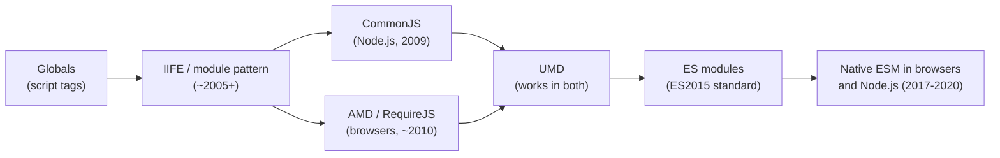
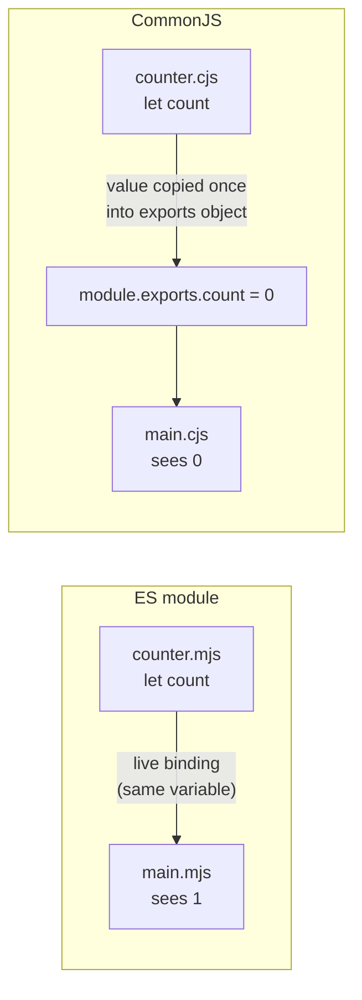
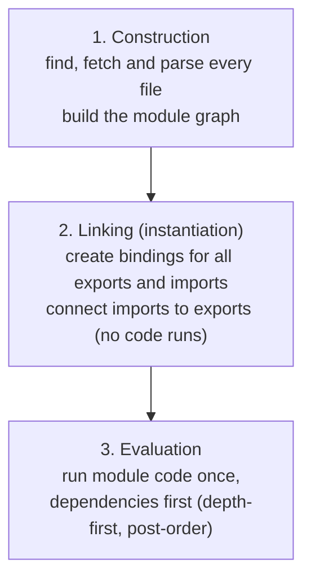
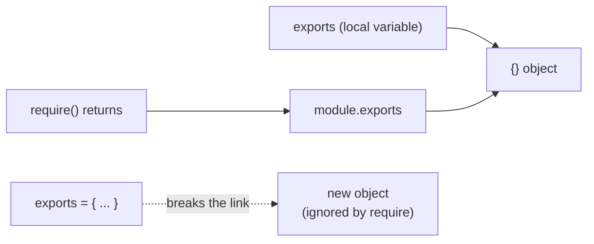
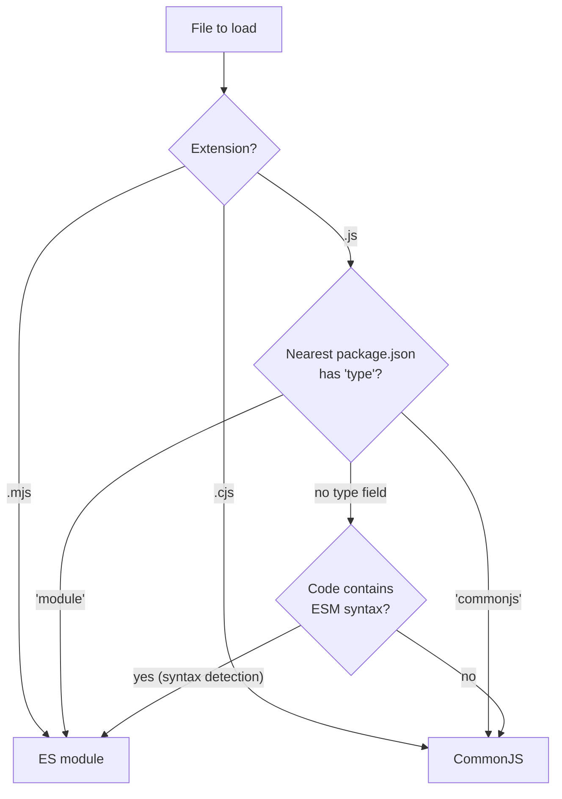
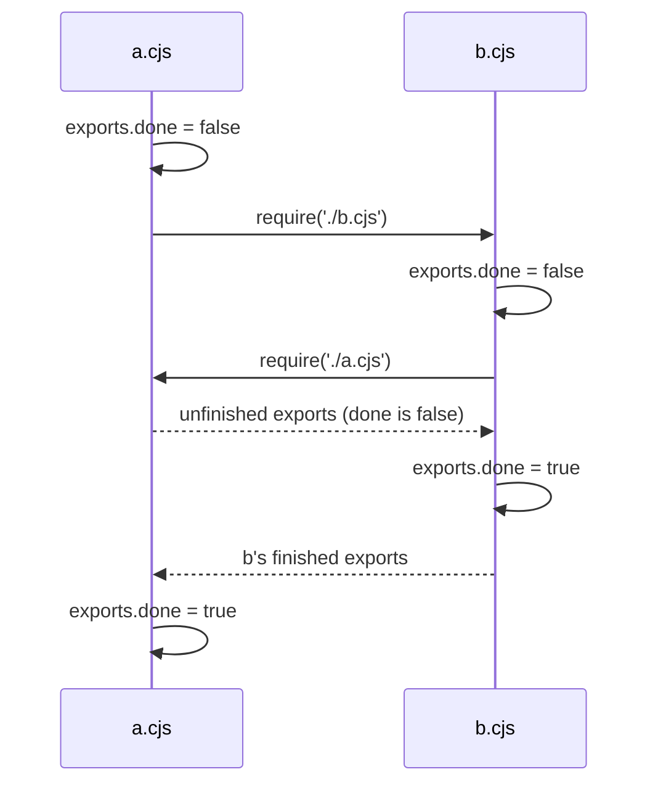

# Modules: ESM and CommonJS

> In this document you will learn why JavaScript has modules, how ES modules (`import`/`export`) and CommonJS (`require`/`module.exports`) work, how they differ (live bindings, loading, `this`, caching), how they interoperate in Node.js, and what happens with circular dependencies. Module questions appear in frontend interviews (tree shaking, lazy loading) and in Node.js interviews (ESM vs CJS, `require(esm)`).

**Before this:** [Scope, hoisting and the TDZ](./03-scope-hoisting-and-tdz.md) · [Closures](./05-closures.md) · **Interview questions:** [jump to questions](#interview-questions)

## Table of contents

1. [Why modules exist](#why-modules-exist)
2. [A short history](#a-short-history)
3. [ES modules basics](#es-modules-basics)
4. [Re-exports and barrel files](#re-exports-and-barrel-files)
5. [Live bindings](#live-bindings)
6. [How ES modules load](#how-es-modules-load)
7. [Module scope, strict mode and this](#module-scope-strict-mode-and-this)
8. [Dynamic import](#dynamic-import)
9. [Top-level await](#top-level-await)
10. [import.meta and import attributes](#importmeta-and-import-attributes)
11. [ES modules in the browser](#es-modules-in-the-browser)
12. [CommonJS](#commonjs)
13. [ESM vs CommonJS](#esm-vs-commonjs)
14. [ESM and CommonJS together in Node.js](#esm-and-commonjs-together-in-nodejs)
15. [Circular dependencies](#circular-dependencies)
16. [Bundlers and tree shaking](#bundlers-and-tree-shaking)
17. [Best practices](#best-practices)
18. [How to explain this in an interview](#how-to-explain-this-in-an-interview)
19. [Interview questions](#interview-questions)
20. [Summary](#summary)
21. [References](#references)

---

## Why modules exist

A **module** is a file with its own private scope that chooses what to share (**export**) and declares what it needs (**import**).

Without modules, every script on a page shares one **global scope**. That causes real problems:

- **Name collisions:** two scripts both define `function init()`, and the second silently replaces the first.
- **Hidden dependencies:** `app.js` uses `$` from jQuery, but nothing in the code says so. If the `<script>` tags are in the wrong order, the app breaks.
- **No privacy:** every helper variable is visible and changeable by any other script.
- **No reuse:** you cannot easily share code between projects or with npm.

Modules fix this:

| Problem | How modules solve it |
|---|---|
| Name collisions | Each module has its own scope; top-level variables are private |
| Hidden dependencies | `import` statements list exactly what a file needs |
| No privacy | Only `export`ed names are visible outside |
| Reuse | Packages expose a public API through their exports |
| Performance | Tools can analyze imports to remove unused code and split bundles |

---

## A short history



**1. Global scripts.** Every file adds variables to `window`.

**2. IIFE and the module pattern.** An **IIFE** (Immediately Invoked Function Expression) creates a private scope with a function, and returns a public API. This uses [closures](./05-closures.md).

```js
const cartModule = (function () {
  const items = []; // private
  function add(item) {
    items.push(item);
  }
  function count() {
    return items.length;
  }
  return { add, count }; // public API
})();

cartModule.add("book");
console.log(cartModule.count()); // 1
console.log(cartModule.items); // undefined  (private)
```

**3. CommonJS (CJS).** Created for server-side JavaScript and adopted by Node.js. Files use `require()` and `module.exports`. Loading is **synchronous**, which is fine on a server reading local files but not for browsers loading over a network.

**4. AMD (Asynchronous Module Definition).** Used by RequireJS in browsers: `define(["dep"], function (dep) { ... })`. Asynchronous, but verbose.

**5. UMD (Universal Module Definition).** A wrapper that detects the environment and works as AMD, CommonJS or a global. Libraries used it to support everyone. You still see it in some `dist/` folders.

**6. ES modules (ESM).** The official standard from ES2015, with `import` and `export` syntax built into the language. Browsers added native support around 2017–2018, and Node.js made it stable in v12–v14 (2019–2020).

Today: write **ESM** for new code. You will still read and maintain **CommonJS** in Node.js projects and older packages.

---

## ES modules basics

### Named exports

A module can have many **named exports**. The importer must use the same names (or rename them).

```js
// math.js
export const PI = 3.14159;

export function add(a, b) {
  return a + b;
}

function subtract(a, b) {
  return a - b;
}
const secret = 42; // not exported: private to this file

export { subtract };
```

```js
// app.js
import { PI, add, subtract } from "./math.js";
import { add as sum } from "./math.js"; // rename on import

console.log(add(2, 3), sum(1, 1), PI); // 5 2 3.14159
```

### Default export

A module can have **one default export**. The importer chooses any name.

```js
// logger.js
export default function log(message) {
  console.log(`[app] ${message}`);
}
```

```js
// app.js
import log from "./logger.js"; // any name works
import writeLog from "./logger.js"; // same function, different local name

log("started"); // [app] started
```

A default export is really a named export called `default`:

```js
import { default as log } from "./logger.js"; // the same as: import log from "./logger.js"
```

### Combining default and named

```js
// api.js
export default class ApiClient {}
export const BASE_URL = "https://api.example.com";
```

```js
// app.js
import ApiClient, { BASE_URL } from "./api.js";
```

### All the import forms

| Form | What it does |
|---|---|
| `import { a, b } from "./m.js"` | named imports |
| `import { a as x } from "./m.js"` | rename |
| `import d from "./m.js"` | default import |
| `import d, { a } from "./m.js"` | default + named |
| `import * as m from "./m.js"` | **namespace object** with all exports (`m.a`, `m.default`) |
| `import "./polyfills.js"` | run the module for its side effects only |
| `const m = await import("./m.js")` | dynamic import (returns a promise) |

### All the export forms

| Form | Example |
|---|---|
| Inline named | `export const x = 1;` `export function f() {}` `export class C {}` |
| List | `export { x, f };` |
| Rename | `export { f as format };` |
| Default | `export default expression;` `export default function () {}` |
| Re-export | `export { x } from "./other.js";` `export * from "./other.js";` |

### Named vs default: which to use

Many teams prefer **named exports**:

- The name is the same everywhere, so search and refactoring tools work well.
- Typos fail at build time (`import { formt }` is an error), while a default import accepts any name.
- Auto-import in editors works better.
- Tree shaking works naturally.

Default exports are common for "one main thing per file" (React components, configuration objects) and are required by some tools (for example, React's `lazy()` expects a module with a default export). Angular code uses named exports almost exclusively.

---

## Re-exports and barrel files

You can export something from another module without importing it first:

```js
// models/index.js
export { User } from "./user.js";
export { Order } from "./order.js";
export * from "./product.js"; // all named exports (NOT the default)
export * as validators from "./validators.js"; // a namespace export (ES2020)
export { default as Cart } from "./cart.js"; // re-export a default under a name
```

Now other files can write `import { User, Order } from "./models/index.js"`. A file like this is called a **barrel file**. Angular libraries use them as their public API (`public-api.ts`).

Barrel files have trade-offs:

- **Pro:** a clean public API; internal files can move without breaking imports.
- **Con:** importing one thing may load (and sometimes bundle) everything the barrel re-exports. In development servers and test runners (Jest), big barrels slow startup.
- **Con:** barrels make **circular dependencies** easier to create by accident.

Use barrels for a library's public boundary. Inside an application, import from the specific file.

---

## Live bindings

This is the most important difference between ESM and CommonJS.

An ES module import is a **live binding**: a read-only view of the exporter's variable. If the exporting module changes the variable, importers see the new value.

```js
// counter.mjs
export let count = 0;
export function increment() {
  count++;
}
```

```js
// main.mjs
import { count, increment } from "./counter.mjs";

console.log(count); // 0
increment();
console.log(count); // 1  (live: we see the updated value)

count = 10; // TypeError: Assignment to constant variable.
```

The importer **cannot assign** to the binding. Only the exporting module can change it. (Objects are still mutable: if `count` were an object, you could change its properties. Read-only applies to the binding, not to the object.)

### Compare with CommonJS

CommonJS exports an **object**. Destructuring or reading a property copies the **value at that moment**. Primitives are copied, so later changes are not visible.

```js
// counter.cjs
let count = 0;
function increment() {
  count++;
}
module.exports = { count, increment, getCount: () => count };
```

```js
// main.cjs
const counter = require("./counter.cjs");

console.log(counter.count); // 0
counter.increment();
console.log(counter.count, counter.getCount()); // 0 1
```

`counter.count` stays `0` because `module.exports.count` was set once to the value `0`. The local variable `count` inside the module changed to `1`, and only the function `getCount` (a closure) sees it.



Why live bindings matter:

- Circular dependencies work better in ESM, because a binding can be filled in later.
- A module can safely export mutable state (like a configuration value that is loaded later), though usually a function (`getConfig()`) is clearer.

---

## How ES modules load

### Static structure

`import` and `export` declarations must be at the **top level** of a module, and the module path must be a **string literal**. You cannot put them inside `if` blocks or functions, and you cannot compute the path.

```js
// ❌ All of these are syntax errors in ESM
// if (isAdmin) { import { admin } from "./admin.js"; }
// import { x } from getPath();

// ✅ For conditional or computed loading, use dynamic import()
// if (isAdmin) { const { admin } = await import("./admin.js"); }
```

Because the structure is static, tools can know **every** dependency without running the code. This enables:

- **Tree shaking:** remove exports nobody imports.
- **Early errors:** importing a name that does not exist fails before any code runs.
- **Parallel loading:** the browser can find and fetch the whole dependency graph up front.

### The three phases

The specification loads an ES module graph in three phases:



1. **Construction:** starting from the entry module, the loader fetches each file, parses it, reads its `import` statements and fetches those too. No module code runs.
2. **Linking:** for each module, memory is set aside for its exports, and every import is connected to the matching export. Bindings exist but are **uninitialized** (in the TDZ, like `let`).
3. **Evaluation:** modules run, **dependencies before dependents**. Each module runs **exactly once**, even if many modules import it. The result is cached by URL (browser) or resolved file path (Node.js).

### Imports are hoisted

Because linking happens before evaluation, all imports are available at the start of the module, even if the `import` line is written later. Imported modules run **before** any code in the importing module.

```js
// main.mjs
console.log("main body runs");
import "./setup.mjs"; // setup.mjs runs FIRST, before the line above
```

If `setup.mjs` logs `"setup runs"`, the output is `setup runs`, then `main body runs`. Write imports at the top so the code reads in the order it runs.

---

## Module scope, strict mode and this

Every ES module:

- Has its **own scope**. Top-level `var`, `let`, `const`, functions and classes do **not** become properties of `window` or `globalThis`.
- Runs in **strict mode** automatically. No `"use strict"` needed.
- Has `this` equal to **`undefined`** at the top level.
- Runs **once**, no matter how many times it is imported.

```js
// scope.mjs
var shared = 1;
console.log(typeof this); // undefined
console.log(globalThis.shared); // undefined  (not a global property)
```

In Node.js, CommonJS-only names like `require`, `module`, `exports`, `__filename` and `__dirname` do **not** exist inside ES modules. Use `import.meta` instead (see below).

Compare with a classic browser script, where `var shared = 1` at the top level creates `window.shared`, and `this` is `window`. See [Scope, hoisting and the TDZ](./03-scope-hoisting-and-tdz.md) and [this, call, apply and bind](./06-this-call-apply-bind.md).

---

## Dynamic import

### What it is

`import(specifier)` is a function-like expression that loads a module **at runtime** and returns a **promise** of its **namespace object**. Unlike static `import`, it can be used anywhere (inside functions, `if` blocks, event handlers), and the path can be computed. It works in both ES modules and CommonJS files.

```js
async function exportReport(rows) {
  // Load the heavy PDF library only when the user clicks "Export"
  const { generatePdf } = await import("./pdf-generator.js");
  return generatePdf(rows);
}

async function loadLocale(lang) {
  const messages = await import(`./locales/${lang}.js`); // computed path
  return messages.default;
}
```

### Why it exists

- **Code splitting and lazy loading:** bundlers turn each `import()` into a separate chunk that is downloaded only when needed. The first page load gets smaller and faster.
- **Conditional loading:** load a polyfill only if the browser needs it; load admin tools only for admins.
- **Loading ESM from CommonJS:** in Node.js, a CommonJS file can always `await import("esm-package")`.

### Real-world use: Angular lazy routes

Angular's router uses dynamic import for lazy-loaded features:

```ts
// Angular 16 route configuration
const routes: Routes = [
  {
    path: "admin",
    loadChildren: () => import("./admin/admin.module").then((m) => m.AdminModule),
  },
  {
    path: "reports",
    loadComponent: () => import("./reports/reports.component").then((m) => m.ReportsComponent), // standalone component
  },
];
```

The admin code is in a separate JavaScript file, downloaded only when the user navigates to `/admin`. See [Routing, guards and lazy loading](../06-angular-16/06-routing-guards-and-lazy-loading.md). React does the same with `React.lazy(() => import("./Page"))`.

### Things to know

- The promise rejects if the network request or the module evaluation fails. Handle it (show an error, offer a retry).
- With bundlers, a fully dynamic path (`import(userInput)`) cannot be analyzed. Use a template with a fixed folder (`./locales/${lang}.js`) so the bundler can create chunks for each file in that folder.
- The module is still evaluated only once and cached. A second `import()` of the same module returns the same namespace.

---

## Top-level await

Since ES2022, you can use `await` at the **top level of an ES module**, outside any `async` function.

```js
// config.mjs
const response = await fetch("/config.json");
export const config = await response.json();
```

```js
// app.mjs
import { config } from "./config.mjs"; // app.mjs waits until config.mjs finishes
console.log(config.apiUrl);
```

How it works: a module with top-level `await` becomes **asynchronous**. Modules that import it (directly or indirectly) wait for it to finish before they evaluate. Sibling modules that do not depend on it can still run.

Use it for:

- Loading configuration or a WebAssembly module before the app starts.
- Choosing an implementation: `const db = await import(useSqlite ? "./sqlite.js" : "./postgres.js");`.
- Short scripts and CLIs in Node.js (`.mjs` files).

Be careful:

- It **blocks** every module that depends on this one. A slow `fetch` at the top level delays the whole app.
- It only works in ES modules, not in CommonJS or classic scripts.
- In Node.js, a module graph that contains top-level `await` cannot be loaded with `require()` (error `ERR_REQUIRE_ASYNC_MODULE`).

---

## import.meta and import attributes

### import.meta

`import.meta` is an object with information about the **current module**. The host (browser or Node.js) decides its contents.

| Property | Where | Value |
|---|---|---|
| `import.meta.url` | browsers and Node.js | the module's full URL (`https://...` or `file:///...`) |
| `import.meta.resolve(specifier)` | browsers and Node.js | resolves a specifier to a URL string |
| `import.meta.dirname`, `import.meta.filename` | Node.js 20.11+ / 21.2+ | folder and file path (replacements for `__dirname`/`__filename`) |
| `import.meta.env` | Vite (not standard) | build-time environment variables |

```js
// Node.js ES module: read a file next to this module
import { readFile } from "node:fs/promises";

const text = await readFile(new URL("./data.json", import.meta.url), "utf8");
// or: join(import.meta.dirname, "data.json")
```

In the browser, `new URL("./logo.png", import.meta.url)` gives the asset's URL relative to the module file. Bundlers like Vite and webpack understand this pattern.

### Import attributes (JSON modules)

ES2025 standardized **import attributes** and **JSON modules**. You tell the host what type of module you expect:

```js
import settings from "./settings.json" with { type: "json" };
const data = await import("./data.json", { with: { type: "json" } });
```

The `type: "json"` attribute is required for JSON. It is a security measure: a server cannot trick your code into **executing** a file that you expected to be plain data, because a JSON module is parsed, never executed. JSON modules have only a default export. They work in current browsers and in Node.js 22+. (An older draft used `assert { type: "json" }`. That syntax was removed: Node.js 22+ and current Chrome versions reject it with a `SyntaxError`. Use `with`.)

---

## ES modules in the browser

```html
<script type="module" src="/js/app.js"></script>

<script type="module">
  import { startApp } from "/js/app.js";
  startApp();
</script>

<!-- Fallback for very old browsers that do not understand modules -->
<script nomodule src="/js/legacy-bundle.js"></script>
```

What `type="module"` changes:

| Behavior | Classic `<script>` | `<script type="module">` |
|---|---|---|
| Execution timing | Blocks HTML parsing (unless `defer`/`async`) | **Deferred by default**: runs after the HTML is parsed, in order |
| Scope | Global | Module scope |
| Strict mode | Only with `"use strict"` | Always |
| Top-level `this` | `window` | `undefined` |
| Runs how many times | Every time the tag appears | Once per URL |
| Cross-origin | Can load from any origin | Needs **CORS** headers for other origins |
| `file://` | Works | Usually blocked; use a local web server |

See [Browser architecture and rendering](../01-cs-and-web-fundamentals/07-browser-architecture-and-rendering.md) for how `defer` and `async` affect parsing.

### Specifiers and import maps

In the browser, a specifier must be a URL or a relative/absolute path: `"./utils.js"`, `"/js/utils.js"`, `"https://cdn.example.com/lib.js"`. A **bare specifier** like `"lodash-es"` does not work by default, because browsers have no `node_modules` lookup.

An **import map** tells the browser how to resolve bare specifiers. All modern browsers support it.

```html
<script type="importmap">
  {
    "imports": {
      "lodash-es": "https://cdn.jsdelivr.net/npm/lodash-es@4.17.21/lodash.js",
      "app/": "/js/app/"
    }
  }
</script>
<script type="module">
  import { debounce } from "lodash-es";
  import { start } from "app/main.js";
</script>
```

The import map must appear before any module that uses it.

### Performance: modulepreload

With native modules, the browser discovers nested imports only after downloading each file, which can create a "waterfall" of requests. `<link rel="modulepreload" href="/js/utils.js">` tells the browser to fetch and parse a module early. In production, most apps still use a **bundler** to combine modules into fewer, optimized files.

---

## CommonJS

### How require works

```js
// greet.cjs
function greet(name) {
  return `Hello, ${name}`;
}
module.exports = { greet };
```

```js
// app.cjs
const { greet } = require("./greet.cjs");
console.log(greet("Asha")); // Hello, Asha
```

`require(path)` does this:

1. **Resolve** the path to an absolute file name (relative files, `node_modules` lookup, `package.json` `"main"`/`"exports"`, adding `.js`/`.json`/`.node` extensions). Details are in [Modules, npm and packages](../07-nodejs-backend/03-modules-npm-and-packages.md).
2. **Check the cache** (`require.cache`). If the module was loaded before, return its `module.exports` immediately.
3. Otherwise, create a new `module` object, **add it to the cache**, then **load and run** the file inside the module wrapper.
4. **Return** `module.exports`.

Everything is **synchronous**: `require` reads the file from disk and runs it before the next line continues.

### The module wrapper

Node.js does not run a CommonJS file directly. It wraps the code in a function:

```js
(function (exports, require, module, __filename, __dirname) {
  // your module code is here
});
```

That is why these five names are available in every CommonJS file without importing them, and why top-level variables are private to the file (they are local variables of this function).

```js
// scope.cjs
console.log(this === module.exports); // true
console.log(typeof __filename, typeof __dirname); // string string
```

At the top level of a CommonJS module, `this` is `module.exports`.

### module.exports vs exports

`exports` is just a **shortcut variable** that initially points to the same object as `module.exports`. `require` always returns **`module.exports`**.

```js
// ✅ Adding properties: both point to the same object
exports.add = (a, b) => a + b;
module.exports.subtract = (a, b) => a - b;

// ✅ Replacing the whole export: must use module.exports
module.exports = class Calculator {};

// ❌ Wrong: this only changes the local variable "exports"
exports = { add: (a, b) => a + b };
// require() still returns the original (empty) module.exports
```



Rule of thumb: use `module.exports = { ... }` at the end of the file, or only add properties to `exports`. Never reassign `exports`.

### Caching and singletons

Modules are cached after the first `require`. Every later `require` of the same resolved file returns the **same object**. This makes a module a natural **singleton**.

```js
// db.cjs: one connection pool for the whole app
const pool = { connections: 0 }; // imagine: createPool(...)
module.exports = pool;

// a.cjs and b.cjs both do: const pool = require("./db.cjs");
// They get the same object.
```

Caveats:

- The cache key is the **resolved file path**. The same package installed twice in different `node_modules` folders gives two separate instances. This causes "two copies of the library" bugs (for example, `instanceof` failing between them).
- Tests sometimes clear the cache to get a fresh module (`delete require.cache[require.resolve("./x")]`, or Jest's module registry).

### Dynamic by design

`require` is a normal function call. It can be called inside `if` blocks, with computed paths, at any time. This flexibility is why CommonJS is hard to tree-shake: tools cannot always know what is imported.

```js
const isWindows = process.platform === "win32";
const pathTool = require(isWindows ? "node:path/win32" : "node:path/posix");
console.log(typeof pathTool.join); // function
```

`require` can also load JSON directly: `const pkg = require("./package.json")`.

---

## ESM vs CommonJS

| Feature | ES modules | CommonJS |
|---|---|---|
| Syntax | `import` / `export` | `require()` / `module.exports` |
| Standard | ECMAScript language standard | Node.js convention (not in the language spec) |
| Where | Browsers, Node.js, Deno, Bun, bundlers | Node.js and bundlers |
| Loading | Asynchronous-friendly, three phases | Synchronous |
| Structure | Static (top-level, string paths) | Dynamic (call anywhere, any expression) |
| Imported values | **Live bindings**, read-only | Copies of property values from the exports object |
| Top-level `await` | Yes | No |
| Strict mode | Always | Only with `"use strict"` |
| Top-level `this` | `undefined` | `module.exports` |
| File/dir names | `import.meta.url`, `import.meta.dirname` | `__filename`, `__dirname` |
| Tree shaking | Easy | Hard |
| Cache key | URL | resolved file path |
| File extensions in Node | `.mjs`, or `.js` with `"type": "module"` | `.cjs`, or `.js` by default |
| Relative imports in Node | Must include the extension: `"./utils.js"` | Extension optional: `"./utils"` |

---

## ESM and CommonJS together in Node.js

### How Node decides the module type



- `.mjs` is always ESM; `.cjs` is always CommonJS.
- `.js` follows the nearest `package.json` `"type"` field: `"module"` or `"commonjs"` (the default).
- If there is no `"type"` field, Node.js 22.7+ (and 20.19+) uses **syntax detection**: a `.js` file with `import`/`export` is run as ESM, with a warning suggesting you add `"type"`. Set the field explicitly to avoid the extra parsing and the warning.

### Importing CommonJS from ESM

This always works. The CommonJS `module.exports` becomes the **default** import. Node.js also tries to detect **named** exports with static analysis (the `cjs-module-lexer`), so named imports often work too.

```js
// counter.cjs exports: module.exports = { count, increment, getCount }

// main.mjs
import counter from "./counter.cjs"; // default = module.exports
import { increment } from "./counter.cjs"; // named: detected by static analysis
```

If named detection fails (for example, the exports are built dynamically), use the default import and destructure it.

### Importing ESM from CommonJS

**Option 1: dynamic `import()`.** Works in every supported Node.js version. It is asynchronous.

```js
// app.cjs
async function main() {
  const { default: greet, version } = await import("./lib.mjs");
  console.log(greet(), version);
}
main();
```

**Option 2: `require(esm)`.** Node.js now lets `require()` load an ES module **synchronously** if the module graph has **no top-level `await`**.

- Enabled without a flag since **Node.js 20.19, 22.12 and 23.0**.
- No experimental warning by default since 22.13 / 23.5.
- No longer experimental since **Node.js 25.4**.
- Check support with `process.features.require_module`.

```js
// lib.mjs
export default function greet() {
  return "hi";
}
export const version = "1.0";
```

```js
// app.cjs (Node.js 22.12+)
const lib = require("./lib.mjs");
console.log(lib.default(), lib.version); // hi 1.0
```

`require` returns the **module namespace object**, so the default export is at `.default`. If the ES module (or anything it imports) uses top-level `await`, `require` throws `ERR_REQUIRE_ASYNC_MODULE`; use `import()` for those.

Why this matters: for years, a package that switched to "ESM only" broke all CommonJS users (who had to use async `import()`). `require(esm)` removes most of that pain.

### Dual packages

Library authors sometimes publish both formats using the `"exports"` field:

```json
{
  "name": "my-lib",
  "type": "module",
  "exports": {
    ".": {
      "import": "./dist/index.js",
      "require": "./dist/index.cjs"
    }
  }
}
```

The risk is the **dual package hazard**: if one part of an app loads the ESM version and another part loads the CJS version, there are two copies of the library with separate state. With `require(esm)` available, many authors now publish ESM only.

### TypeScript note

TypeScript lets you write `import`/`export` and then compile to either format. With `"module": "nodenext"`, TypeScript follows Node's rules (including `"type"` and file extensions). Angular CLI projects compile to ESM for the browser. See [Modules, declaration files and tsconfig](../03-typescript/09-modules-declaration-files-and-tsconfig.md).

---

## Circular dependencies

A **circular dependency** happens when module A imports module B, and B (directly or through other modules) imports A. Both systems allow it, but you may see **incomplete** values.

### In CommonJS: a partially filled exports object

```js
// a.cjs
console.log("a starts");
exports.done = false;
const b = require("./b.cjs");
console.log("in a, b.done =", b.done);
exports.done = true;
console.log("a done");
```

```js
// b.cjs
console.log("b starts");
exports.done = false;
const a = require("./a.cjs");
console.log("in b, a.done =", a.done);
exports.done = true;
console.log("b done");
```

Running `node a.cjs` prints:

```text
a starts
b starts
in b, a.done = false
b done
in a, b.done = true
a done
```



Step by step:

1. `a.cjs` starts and sets `exports.done = false`.
2. It requires `b.cjs`, so `a` **pauses** in the middle.
3. `b.cjs` requires `a.cjs`. `a` is already in the cache (it was cached **before** it ran), so `require` returns its **unfinished** exports object, where `done` is `false`.
4. `b` finishes. Then `a` continues and sees `b.done === true`.

The danger: if `b` had destructured `const { someFunction } = require("./a.cjs")` and `a` only defines `someFunction` later, `b` gets `undefined` forever. And if `a` **replaces** `module.exports = {...}` after the cycle, `b` keeps the old, empty object.

### In ESM: live bindings and the TDZ

```js
// a.mjs
import { b } from "./b.mjs";
export const a = "A";
console.log("a.mjs runs, b =", b);
```

```js
// b.mjs
import { a } from "./a.mjs";
export const b = "B";
console.log("b.mjs runs");
console.log(a); // ReferenceError: Cannot access 'a' before initialization
```

Running `a.mjs` as the entry: linking connects all bindings first. Evaluation runs dependencies first, so `b.mjs` runs **before** `a.mjs`. At that moment, `a`'s `const` binding exists but is not initialized yet (TDZ), so reading it throws.

However, **functions** that read the binding **later** work fine, thanks to live bindings:

```js
// b.mjs (fixed)
import { a } from "./a.mjs";
export const b = "B";
export function describe() {
  return `a is ${a}`; // reads a when called, after a.mjs has run
}
```

Function declarations are also fully initialized during linking, so calling an imported **function declaration** from the other side of a cycle works even during evaluation.

### How to fix circular dependencies

1. **Extract the shared code** into a third module that both import. This is the usual fix.
2. **Move the use into a function**, so the value is read later, not at module load time.
3. **Invert the dependency**: pass what is needed as a parameter (dependency injection) instead of importing it.
4. **Find cycles with tools:** `madge --circular src/`, ESLint's `import/no-cycle` rule, or warnings from your bundler.

In Angular, circular imports between files often show up as `undefined` services or a runtime error such as "Cannot access 'X' before initialization". DI cycles (service A injects B, B injects A) are a different problem, reported by Angular as a circular dependency in DI (`NG0200`). Fix both by extracting shared logic.

---

## Bundlers and tree shaking

A **bundler** (webpack, Vite/Rollup, esbuild, the Angular CLI's esbuild-based builder) starts from your entry file, follows all `import`s, and produces optimized files for the browser. It can also handle TypeScript, CSS imports, assets and code splitting.

**Tree shaking** means removing code that is never used. It depends on ESM's static structure:

```js
// utils.js
export function formatPrice(n) { return `$${n.toFixed(2)}`; }
export function heavyChartHelper() { /* 50 KB of code */ }

// app.js
import { formatPrice } from "./utils.js";
// heavyChartHelper is never imported, so the bundler can drop it
```

Tree shaking can be blocked by:

- **CommonJS** modules (dynamic `require`, `module.exports` mutations).
- **Side effects** at module top level (code that runs on import, like patching globals). Bundlers must keep modules that might have side effects. Packages declare `"sideEffects": false` in `package.json` to tell bundlers it is safe to drop unused files.
- **Namespace usage that is too dynamic**, like `utils[name]()`.

That is why libraries publish ESM builds (for example, `lodash-es` instead of `lodash`) and why Angular libraries use the Angular Package Format, which is ESM-based. More in [Build tools and bundlers](../05-frontend-engineering/10-build-tools-and-bundlers.md).

---

## Best practices

1. **Use ESM for new code.** It is the standard, works in browsers and Node.js, and enables tree shaking. Reason: one module system everywhere.
2. **Set `"type"` explicitly** in Node.js `package.json`. Reason: avoids syntax detection overhead and surprises.
3. **Include file extensions in relative ESM imports in Node.js** (`"./utils.js"`). Reason: Node's ESM resolver does not guess extensions.
4. **Prefer named exports.** Reason: consistent names, better refactoring and auto-imports.
5. **Keep module top-level code free of side effects.** Do work in exported functions. Reason: predictable load order, easier testing, better tree shaking.
6. **Avoid circular dependencies**; check with tooling. Reason: they cause `undefined` values and TDZ errors that depend on load order.
7. **Use dynamic `import()` for large, rarely used features.** Reason: smaller initial bundles and faster first load.
8. **Never reassign `exports`** in CommonJS. Reason: `require` returns `module.exports`, not the `exports` variable.
9. **Use `node:` prefixes for built-ins** (`import fs from "node:fs"`). Reason: makes it clear it is a core module and cannot be confused with an npm package.

---

## How to explain this in an interview

1. **Define it:** "A module is a file with its own scope that explicitly exports what it shares and imports what it needs. JavaScript has two main systems: ES modules, the language standard with `import` and `export`, and CommonJS, Node's original system with `require` and `module.exports`."
2. **Why it exists:** "Before modules, all scripts shared the global scope, so we had name collisions, hidden dependencies and no privacy. Modules make dependencies explicit and let tools optimize code."
3. **How it works:** "ES modules are static: the loader parses all files and links imports to exports before running any code, then evaluates each module once, dependencies first. Imports are live, read-only bindings. CommonJS is dynamic: `require` synchronously resolves, runs the file in a wrapper function and returns `module.exports`, cached by path, so you get a copy of property values at that time."
4. **Small example:** "If a module exports `let count` and an `increment` function, an ESM importer sees `count` go from 0 to 1 after calling `increment`; a CommonJS importer reading `exports.count` still sees 0."
5. **Where it is useful:** "Static ESM enables tree shaking and dynamic `import()` enables code splitting, like Angular's `loadChildren`. In Node, I choose the format with `type` in package.json or `.mjs`/`.cjs`, and modern Node can `require` ES modules without top-level await."
6. **Trade-offs / gotchas:** "Circular dependencies give partially filled exports in CommonJS and TDZ errors in ESM. Interop has details: CJS from ESM comes in as the default export, and `require(esm)` returns a namespace with `.default`. Barrel files are nice APIs but can slow builds and cause cycles."

---

## Interview questions

### Q1. What are the main differences between ES modules and CommonJS?

**What the interviewer is checking:** a structured comparison with the important technical differences.

**Short spoken answer (30–60 seconds):**
> ES modules are the official JavaScript standard: `import` and `export`, used in browsers and Node. CommonJS is Node's older system: `require` and `module.exports`. The biggest differences: ESM is static, so imports must be at the top level with string paths, which lets tools tree-shake and detect errors early; CommonJS `require` is a normal function call you can use anywhere. ESM imports are live read-only bindings, while CommonJS gives you whatever values are on the exports object when you read them. ESM supports top-level await and is always strict mode, with `this` undefined at the top; in CommonJS, `this` is `module.exports`, and you get `__dirname` and `__filename`. Loading is synchronous in CommonJS, while ESM's design allows asynchronous loading.

**Detailed explanation:** see the [comparison table](#esm-vs-commonjs).

**Follow-up questions:**
- **Which should you use for a new Node.js project?** — ESM, with `"type": "module"`. Use CommonJS only if a dependency or tool requires it.
- **Can one file use both `import` and `require`?** — An ES module cannot use `require` directly, but it can create one with `createRequire(import.meta.url)` from `node:module`. A CommonJS file cannot use static `import`, but it can use `import()`.
- **Why can't browsers use CommonJS natively?** — `require` is synchronous; a browser would have to block while downloading each file over the network.

**Common mistakes:** saying "ESM is just new syntax for require"; forgetting live bindings; saying CommonJS is "deprecated" (it is fully supported).

**Where this is used in real projects:** choosing the module format for Node services and libraries, configuring bundlers, debugging "require is not defined" or "Cannot use import statement outside a module" errors.

### Q2. What is a live binding? Show an example.

**What the interviewer is checking:** the deepest ESM vs CJS difference.

**Short spoken answer (30–60 seconds):**
> In ES modules, an import is not a copy of a value. It is a live, read-only reference to the exporting module's variable. If the exporting module later changes that variable, every importer sees the new value. For example, if `counter.mjs` exports `let count = 0` and a function `increment`, then after calling `increment()`, the importer's `count` is 1. The importer cannot assign to `count`; that throws a TypeError. In CommonJS, `module.exports = { count }` copies the current value into an object, so the importer keeps seeing 0. Live bindings are also why circular imports can work in ESM when values are read later.

**Code:** see [Live bindings](#live-bindings).

**Follow-up questions:**
- **Can you modify an imported object?** — Yes, its properties. The binding is read-only, not the object.
- **How do you get live values in CommonJS?** — Export a function (`getCount()`) or a getter, or export an object and mutate its properties.

### Q3. What is the difference between `module.exports` and `exports`?

**What the interviewer is checking:** a classic CommonJS trap.

**Short spoken answer:**
> `exports` is a local variable that starts as a reference to the same object as `module.exports`. `require` always returns `module.exports`. So adding properties through either one works, because they point to the same object. But if you reassign `exports = { ... }`, you only change the local variable; `module.exports` still points to the original object, and the importer gets an empty object. To export a single function or class, or a new object, assign to `module.exports`.

```js
// wrong.cjs:  exports = { x: 1 };
// right.cjs:  exports.x = 1;
// console.log(require("./wrong.cjs"), require("./right.cjs")); // {} { x: 1 }
```

**Follow-up:** *What does `module.exports = fn; exports.extra = 1;` export?* — Only `fn`. After reassigning `module.exports`, `exports` still points to the old object, so `extra` is lost.

### Q4. What does this print? (`a.cjs` is the entry file.)

```js
// a.cjs
exports.loaded = false;
const b = require("./b.cjs");
console.log("a sees b.loaded =", b.loaded);
exports.loaded = true;

// b.cjs
const a = require("./a.cjs");
console.log("b sees a.loaded =", a.loaded);
exports.loaded = true;
```

**Answer:**

```text
b sees a.loaded = false
a sees b.loaded = true
```

**Why:**
1. `a.cjs` is cached as soon as Node starts loading it, then it sets `exports.loaded = false`.
2. `require("./b.cjs")` starts running `b.cjs` while `a.cjs` is paused.
3. `b.cjs` requires `a.cjs`. It is already in the cache (unfinished), so `b` gets `a`'s partial exports: `loaded` is `false`.
4. `b` finishes with `loaded = true`. Back in `a`, `b.loaded` is `true`.

### Q5. How do circular dependencies behave in ESM, and how do you fix them?

**What the interviewer is checking:** understanding of linking/evaluation and practical fixes.

**Short spoken answer (30–60 seconds):**
> In ESM, all imports and exports are linked before any code runs, so the cycle itself is allowed. Then modules evaluate dependencies first. In a cycle, one module must run before the other is finished. If it reads a `let`, `const` or class binding from the unfinished module at the top level, it gets a ReferenceError, "Cannot access before initialization", because that binding is still in the temporal dead zone. If it only reads the binding later, inside a function that is called after loading completes, it works, because bindings are live. Function declarations are initialized early, so they are usually safe. The real fix is to remove the cycle: extract shared code into a third module, or pass dependencies as parameters. I detect cycles with madge or ESLint's `import/no-cycle`.

**Code:** see [Circular dependencies](#circular-dependencies).

**Follow-up questions:**
- **Why does this happen more with barrel files?** — A file imports `../index.js` to get a sibling, while `index.js` re-exports that file itself, creating a hidden cycle.
- **How does CommonJS differ?** — CommonJS returns a partially filled `module.exports` object instead of throwing, so you get `undefined` values silently.

**Where this is used in real projects:** Angular apps with feature barrels, Node.js services where models import each other.

### Q6. What is dynamic `import()`, and when would you use it?

**What the interviewer is checking:** code splitting and lazy loading knowledge.

**Short spoken answer (30–60 seconds):**
> `import()` loads a module at runtime and returns a promise for its namespace object. Unlike a static import, I can call it anywhere, inside a function or an `if`, and the path can be computed. Bundlers put each dynamically imported module into a separate chunk that is only downloaded when `import()` runs. So I use it for lazy loading: Angular routes with `loadChildren` or `loadComponent`, React's `lazy`, or a heavy library like a PDF or chart library that loads only when the user clicks a button. It also lets CommonJS code load ES modules. I always handle the rejected promise, because a chunk can fail to download, for example after a new deployment removes old files.

**Follow-up questions:**
- **What does the promise resolve to?** — The module namespace object: named exports as properties and the default export as `.default`.
- **Is the module evaluated again on a second `import()`?** — No. Modules are cached; the same namespace is returned.
- **How do you handle "chunk load failed" errors after a deployment?** — Catch the error, show a message, and reload the page (or retry), since the old chunk file names no longer exist on the server.

### Q7. What is tree shaking, and why does it need ES modules?

**Short spoken answer:**
> Tree shaking is dead-code elimination at the module level: the bundler removes exports that no file imports. It needs ES modules because ESM imports and exports are static, so the bundler can see the whole dependency graph and every used name without running the code. CommonJS `require` is dynamic: paths can be computed and `module.exports` can be changed at runtime, so tools must keep everything. Side effects also block tree shaking, which is why packages mark themselves with `"sideEffects": false`. In practice: use ESM libraries like `lodash-es`, import only what you need, and avoid top-level side effects in your modules.

### Q8. What does this print?

```js
// config.mjs
console.log("config loaded");
export const env = "prod";

// main.mjs
console.log("main start");
import { env } from "./config.mjs";
console.log("env is", env);
```

**Answer:**

```text
config loaded
main start
env is prod
```

**Why:** static imports are processed before the importing module runs. During evaluation, `config.mjs` (a dependency) runs first, so `"config loaded"` prints before any line of `main.mjs`, even though the `import` is written after `console.log("main start")`.

### Q9. How does Node.js decide whether a `.js` file is ESM or CommonJS?

**Short spoken answer:**
> `.mjs` files are always ES modules and `.cjs` files are always CommonJS. For `.js`, Node looks at the nearest `package.json`: `"type": "module"` means ESM, `"type": "commonjs"` or no type means CommonJS. Recent Node versions also do syntax detection: if there's no type field and the file contains ESM syntax like `import` or `export`, Node runs it as ESM and prints a warning. I always set the type explicitly.

See the [decision diagram](#how-node-decides-the-module-type).

**Follow-up:** *What error do you get when you use `import` in a CommonJS file on an older Node version?* — `SyntaxError: Cannot use import statement outside a module`.

### Q10. Can you `require()` an ES module in Node.js?

**What the interviewer is checking:** up-to-date Node.js knowledge.

**Short spoken answer (30–60 seconds):**
> Yes, in modern Node. Since Node 20.19, 22.12 and 23, `require()` can load an ES module synchronously without a flag, and since 25.4 the feature is no longer experimental. The condition is that the ES module and everything it imports must not use top-level await; otherwise `require` throws `ERR_REQUIRE_ASYNC_MODULE`, and you need `import()`. `require` returns the module namespace object, so a default export is at `.default`, unless the module exports a special `"module.exports"` name. Before this, CommonJS code could only load ESM with async `import()`, which is why "ESM-only" packages were painful.

**Follow-up questions:**
- **How do you check support at runtime?** — `process.features.require_module`.
- **What about importing CommonJS from ESM?** — That always worked: `module.exports` becomes the default import, and named exports are detected when possible.

### Q11. Why are `__dirname` and `require` not defined in ES modules? What do you use instead?

**Short answer:** they are parameters of the CommonJS module wrapper function, and ES modules are not wrapped. Use `import.meta.dirname` and `import.meta.filename` (Node.js 20.11+/21.2+), or `fileURLToPath(new URL(".", import.meta.url))` for older versions. To load JSON, use `import data from "./x.json" with { type: "json" }` or read the file with `fs`. If you truly need `require` (for example, for a CommonJS-only optional dependency), create one with `createRequire(import.meta.url)` from `node:module`.

### Q12. What happens when two modules import the same module? Is it executed twice?

**Short answer:** no. In both systems, a module is evaluated once and cached: by URL in ESM and by resolved file path in CommonJS. All importers share the same instance, which makes modules natural singletons (a database pool, a config object). Exceptions: the same package installed twice in different `node_modules` folders, ESM and CJS builds of the same package loaded together (the dual package hazard), or query strings that make URLs different in the browser (`./a.js?v=1` vs `./a.js`).

### Q13. What is `type="module"` on a script tag, and how does it change behavior?

**Short spoken answer:**
> It tells the browser the script is an ES module. The script gets its own module scope instead of the global scope, runs in strict mode, has `this` as undefined at the top, can use `import` and `export`, and supports top-level await. Module scripts are deferred by default, so they run after HTML parsing, in order, like `defer`. They are executed once per URL, and loading them from another origin requires CORS. They also do not work from `file://` URLs, so you need a local server. Bare specifiers like `"lodash"` need an import map.

### Q14. What is an import map?

**Short answer:** a `<script type="importmap">` JSON block that tells the browser how to resolve module specifiers, especially bare ones like `"lodash-es"` that browsers cannot resolve alone. It maps names or prefixes to URLs. It must appear before modules that use it. It lets you use npm-style imports without a bundler (for example, from a CDN), and it is supported in all modern browsers.

### Q15. Your Node.js service fails with `ERR_REQUIRE_ESM` (or, in newer versions, `ERR_REQUIRE_ASYNC_MODULE`) after upgrading a dependency. What happened, and how do you fix it?

**What the interviewer is checking:** practical debugging of module interop.

**Short spoken answer (30–60 seconds):**
> The dependency's new version is published as ESM only, and our CommonJS code loads it with `require`. On older Node versions, `require` of an ES module throws `ERR_REQUIRE_ESM`. On newer Node versions, `require(esm)` works, unless the package uses top-level await, which gives `ERR_REQUIRE_ASYNC_MODULE`. Fixes, from simplest: upgrade Node to 22.12 or later so `require(esm)` works; or switch that call to `await import('package')`; or migrate our project to ESM with `"type": "module"`; or, as a temporary step, pin the older CommonJS version of the dependency. I would also check the package's changelog and `exports` field to see which entry points it offers.

**Follow-up:** *What changes when you migrate a project to ESM?* — Add `"type": "module"`, add file extensions to relative imports, replace `__dirname`, `require` and `module.exports`, update tools (Jest needs ESM configuration), and check that dependencies work with ESM.

### Q16. Are barrel files good or bad?

**What the interviewer is checking:** architecture trade-offs.

**Short spoken answer:**
> They are good as a public API boundary: a library or a feature folder exposes one `index` file, so consumers do not depend on internal file paths, and internals can move freely. Angular libraries do this with `public-api.ts`. Inside an application, large barrels have costs: importing one symbol can make dev servers and test runners load every re-exported file, they can hurt tree shaking if any module has side effects, and they make circular dependencies easy, for example when a file imports its own folder's index. So I use barrels at package or feature boundaries and import specific files inside a feature.

### Q17. What are import attributes and why does JSON need `with { type: "json" }`?

**Short answer:** import attributes (ES2025) pass extra information about how to load a module. For JSON modules, `with { type: "json" }` is required so the host knows to parse the file as data and never execute it. Without the check, a server returning JavaScript with an unexpected MIME type could make your "data" import run code. JSON modules expose the parsed value as the default export. They work in current browsers and Node.js 22+. The older `assert { type: "json" }` syntax was removed; Node.js 22+ and current Chrome versions throw a `SyntaxError` for it.

### Q18. Write the module pattern with an IIFE. Why was it used, and what replaced it?

**Short spoken answer:**
> Before ES modules, we wrapped code in an immediately invoked function expression. Variables inside the function were private thanks to the function scope, and the function returned an object with the public methods, which kept access to the private variables through closures. It avoided polluting the global scope. ES modules replaced it: each file has its own scope by default, and `export` defines the public API. The pattern still appears in old code, in UMD bundles, and as a quick way to create private state.

See the code in [A short history](#a-short-history).

---

## Summary

- Modules give each file its own scope and make dependencies explicit with imports and exports.
- History: globals → IIFE module pattern → CommonJS (Node) and AMD (browsers) → UMD → **ES modules** (the standard).
- ESM: `import`/`export`, named and default exports, re-exports, namespace imports. Static structure enables early errors and **tree shaking**.
- ESM loads in three phases: construction, linking, evaluation. Each module runs once, dependencies first; imports are hoisted.
- ESM imports are **live, read-only bindings**; CommonJS gives you property values from the `module.exports` object.
- ES modules are strict, have their own scope, and `this` is `undefined` at the top level. They support **top-level `await`** and `import.meta`.
- Dynamic **`import()`** returns a promise and powers lazy loading (Angular `loadChildren`/`loadComponent`, React `lazy`).
- In browsers, `type="module"` scripts are deferred, run once, need CORS, and need **import maps** for bare specifiers.
- CommonJS: synchronous `require`, a wrapper function (`exports, require, module, __filename, __dirname`), caching by path. Never reassign `exports`.
- Node picks the format by extension (`.mjs`/`.cjs`) or `package.json` `"type"`. ESM can import CJS; CJS can `import()` ESM and, since Node 20.19/22.12, `require()` ESM without top-level await.
- Circular dependencies give partial exports in CommonJS and TDZ errors in ESM; fix by extracting shared code.

## References

- MDN — JavaScript modules guide: https://developer.mozilla.org/en-US/docs/Web/JavaScript/Guide/Modules
- MDN — import: https://developer.mozilla.org/en-US/docs/Web/JavaScript/Reference/Statements/import
- MDN — export: https://developer.mozilla.org/en-US/docs/Web/JavaScript/Reference/Statements/export
- MDN — import(): https://developer.mozilla.org/en-US/docs/Web/JavaScript/Reference/Operators/import
- MDN — import.meta: https://developer.mozilla.org/en-US/docs/Web/JavaScript/Reference/Operators/import.meta
- MDN — Import attributes: https://developer.mozilla.org/en-US/docs/Web/JavaScript/Reference/Statements/import/with
- MDN — `<script type="importmap">`: https://developer.mozilla.org/en-US/docs/Web/HTML/Reference/Elements/script/type/importmap
- ECMAScript specification — Modules: https://tc39.es/ecma262/#sec-modules
- Node.js docs — Modules: CommonJS (wrapper, caching, cycles, require(esm)): https://nodejs.org/api/modules.html
- Node.js docs — Modules: ECMAScript modules: https://nodejs.org/api/esm.html
- Node.js docs — Modules: Packages (type, exports, syntax detection): https://nodejs.org/api/packages.html
- Mozilla Hacks — ES modules: a cartoon deep-dive (loading phases): https://hacks.mozilla.org/2018/03/es-modules-a-cartoon-deep-dive/
- Angular — Lazy-loading feature modules (v16): https://v16.angular.io/guide/lazy-loading-ngmodules
