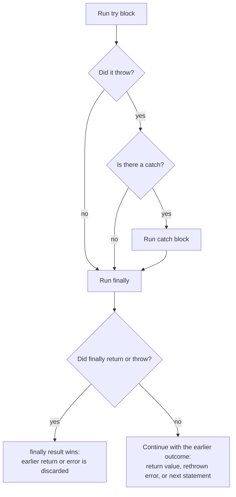
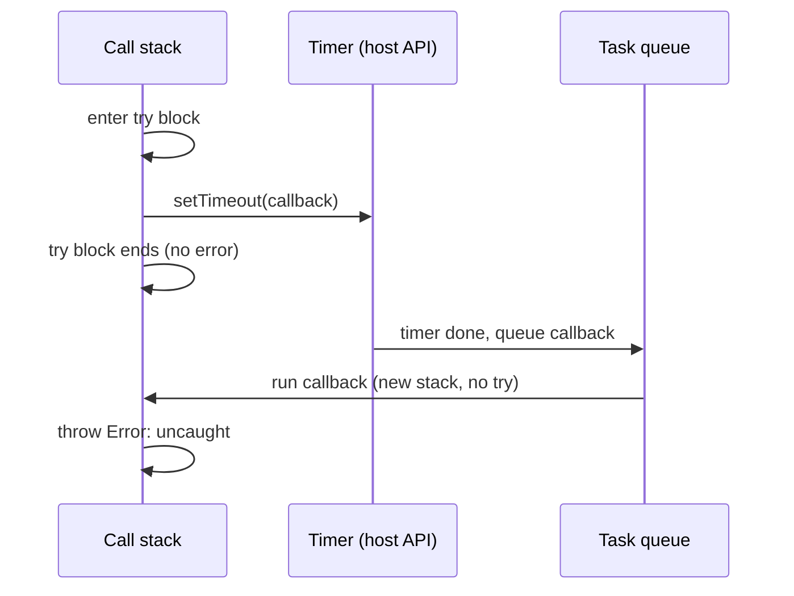
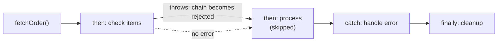
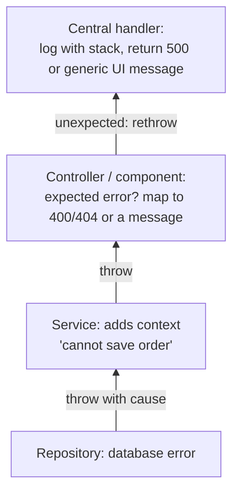

# Error Handling

> In this document you will learn how errors work in JavaScript: the built-in error types, `throw`, `try/catch/finally` and its tricky execution order, custom error classes, `cause`, errors in callbacks, promises and `async/await`, global handlers in browsers and Node.js, and strategies for handling errors in real applications. Interviewers use this topic for output puzzles (`return` inside `finally`) and to judge how you design reliable code.

**Before this:** [Functions and functional programming](./04-functions-and-functional-programming.md) · [Classes](./09-classes.md) · [Callbacks and promises](./17-callbacks-and-promises.md) · **Interview questions:** [jump to questions](#interview-questions)

## Table of contents

1. [What an error is](#what-an-error-is)
2. [The Error object](#the-error-object)
3. [Built-in error types](#built-in-error-types)
4. [Throwing errors](#throwing-errors)
5. [try, catch and finally](#try-catch-and-finally)
6. [finally execution order and return overrides](#finally-execution-order-and-return-overrides)
7. [Custom error classes](#custom-error-classes)
8. [Error cause and wrapping](#error-cause-and-wrapping)
9. [AggregateError](#aggregateerror)
10. [Errors in asynchronous code](#errors-in-asynchronous-code)
11. [Global error handlers](#global-error-handlers)
12. [Error handling strategies](#error-handling-strategies)
13. [Errors in Angular, Express and Electron](#errors-in-angular-express-and-electron)
14. [Reading stack traces](#reading-stack-traces)
15. [Common mistakes](#common-mistakes)
16. [How to explain this in an interview](#how-to-explain-this-in-an-interview)
17. [Interview questions](#interview-questions)
18. [Summary](#summary)
19. [References](#references)

---

## What an error is

An **error** (or **exception**) is a signal that something went wrong and the normal flow of the code cannot continue. When an error is **thrown**, JavaScript stops running the current code and jumps to the nearest **`catch`** block up the call stack. If there is no `catch` anywhere, the error is **uncaught**: the browser logs it in the console, and Node.js (by default) prints it and exits the process.

```js
function parseAge(input) {
  const age = Number(input);
  if (!Number.isInteger(age) || age < 0) {
    throw new RangeError(`Invalid age: ${input}`);
  }
  return age;
}

try {
  console.log(parseAge("30")); // 30
  console.log(parseAge("abc")); // jumps to catch
  console.log("never printed");
} catch (error) {
  console.log(error.message); // Invalid age: abc
}
```

### Two kinds of failures

It helps to separate two kinds of problems:

| Kind | Examples | What to do |
|---|---|---|
| **Expected (operational) errors** | network down, invalid user input, file not found, 404 from an API, timeout | Handle them: show a message, retry, use a fallback |
| **Bugs (programmer errors)** | `undefined is not a function`, reading a property of `null`, wrong argument types | Do not hide them. Let them fail loudly, log them, fix the code |

Most bad error handling comes from mixing these up: catching bugs and hiding them, or crashing on normal, expected failures.

---

## The Error object

`Error` is a built-in class. You create an error with `new Error(message)` (calling `Error(message)` without `new` also works).

```js
const error = new Error("Payment failed");

console.log(error.name); // Error
console.log(error.message); // Payment failed
console.log(String(error)); // Error: Payment failed
console.log(typeof error.stack); // string
```

| Property | Meaning | Standard? |
|---|---|---|
| `message` | human-readable description | Yes |
| `name` | the error type, like `"TypeError"` | Yes |
| `cause` | the original error that led to this one (ES2022) | Yes |
| `stack` | the call stack when the error was created | Not in the spec, but every major engine has it |

The **stack** shows which functions were running, with file names and line numbers. It is captured when the error object is **created**, not when it is thrown.

```js
function loadUser() {
  return new Error("not found");
}
const e = loadUser();
console.log(e.stack.split("\n")[0]); // Error: not found
// next lines look like: "    at loadUser (file.js:2:10)" (format depends on the engine)
```

V8 (Chrome, Node.js, Electron) also offers the non-standard `Error.captureStackTrace(obj)` and `Error.stackTraceLimit` (default 10 frames).

> **Newer feature:** `Error.isError(value)` (ES2026) checks if a value is a real error object, even across realms (iframes, Node `vm`). It is in Chrome 134+, Firefox 138+ and Node.js 24.3+, but not in Node.js 22. Until you can rely on it, `value instanceof Error` is the common check.

---

## Built-in error types

| Type | When JavaScript throws it | Example |
|---|---|---|
| `Error` | base type; used for general errors | `throw new Error("...")` |
| `TypeError` | a value has the wrong type for an operation | `null.x`, calling a non-function, assigning to a `const` |
| `ReferenceError` | using a variable that does not exist, or reading `let`/`const` in the TDZ | `undefinedVariable` |
| `SyntaxError` | code or data cannot be parsed | `JSON.parse("{bad")`, `eval("let let")` |
| `RangeError` | a number is outside the allowed range | `new Array(-1)`, `(1).toFixed(101)`, too much recursion |
| `URIError` | bad URI encoding | `decodeURIComponent("%")` |
| `EvalError` | historical; not thrown by modern engines | — |
| `AggregateError` | several errors wrapped together (ES2021) | `Promise.any` when all promises reject |

```js
try {
  null.name;
} catch (e) {
  console.log(e.name, e.message); // TypeError Cannot read properties of null (reading 'name')
}

try {
  missingVariable;
} catch (e) {
  console.log(e.name); // ReferenceError
}

try {
  JSON.parse("{bad json}");
} catch (e) {
  console.log(e.name); // SyntaxError
}

try {
  (function recurse() {
    recurse();
  })();
} catch (e) {
  console.log(e.name, e.message); // RangeError Maximum call stack size exceeded
}
```

Exact `message` texts differ between engines. Never write code that depends on the message text; check `name`, `instanceof`, or a custom `code` property.

A `SyntaxError` in your **own source code** cannot be caught by a `try/catch` in the same file, because the file fails to parse before anything runs. You can only catch syntax errors from runtime parsing (`JSON.parse`, `eval`, `new Function`, dynamic `import()`).

---

## Throwing errors

`throw` stops the current function and sends a value up the call stack.

```js
function withdraw(balance, amount) {
  if (amount > balance) {
    throw new Error("Insufficient funds");
  }
  return balance - amount;
}
```

### You can throw anything, but should throw Error objects

JavaScript lets you throw any value: a string, a number, an object, `undefined`.

```js
try {
  throw "something broke"; // a string
} catch (e) {
  console.log(typeof e, e.stack); // string undefined
}
```

This is legal but bad:

- A string has **no stack trace**, so you cannot see where it came from.
- Code that expects `error.message` gets `undefined`.
- `instanceof Error` checks fail.
- Logging and monitoring tools (Sentry, Datadog, Application Insights) group and display `Error` objects much better.

**Rule:** always throw `Error` objects (or subclasses). ESLint's `no-throw-literal` rule enforces this.

Because anything can be thrown, a `catch` block should not assume the value is an `Error`:

```js
function getMessage(error) {
  return error instanceof Error ? error.message : String(error);
}

try {
  throw { code: 42 };
} catch (e) {
  console.log(getMessage(e)); // [object Object]
}
```

In TypeScript with `strict`, the `catch` variable has the type `unknown`, which forces this kind of check.

---

## try, catch and finally

### The three blocks

```js
try {
  // code that might throw
} catch (error) {
  // runs only if the try block threw
} finally {
  // always runs: after try, or after catch
}
```

You need `try` plus at least one of `catch` or `finally`.

- **`catch`** handles the error. After it finishes, the program continues after the whole statement.
- **`finally`** runs no matter what: success, error, `return`, `break` or `continue`. It is for **cleanup**: hiding a loading spinner, closing a file, releasing a lock.

```js
function loadReport(showSpinner, hideSpinner) {
  showSpinner();
  try {
    throw new Error("server error"); // imagine a failing request
  } catch (error) {
    console.log("Could not load report:", error.message);
  } finally {
    hideSpinner(); // runs in both cases
  }
}

loadReport(
  () => console.log("spinner on"),
  () => console.log("spinner off")
);
// spinner on
// Could not load report: server error
// spinner off
```

### Optional catch binding (ES2019)

If you do not need the error object, leave out the parameter:

```js
function isValidJson(text) {
  try {
    JSON.parse(text);
    return true;
  } catch {
    return false;
  }
}

console.log(isValidJson('{"a":1}'), isValidJson("{oops")); // true false
```

### What try/catch can and cannot catch

`try/catch` catches errors thrown **synchronously** while the `try` block runs, including errors from functions it calls. It does **not** catch errors thrown later, in callbacks that run after the `try` block has finished (more in [Errors in asynchronous code](#errors-in-asynchronous-code)).

### Nested try and rethrowing

A `catch` should handle only errors it understands. Rethrow the rest so a higher level can deal with them.

```js
class ValidationError extends Error {}

function saveForm(data) {
  try {
    if (!data.email) throw new ValidationError("Email is required");
    JSON.parse(data.payload); // could throw SyntaxError
  } catch (error) {
    if (error instanceof ValidationError) {
      return { ok: false, message: error.message }; // expected: handle it
    }
    throw error; // unexpected: let someone else handle it
  }
  return { ok: true };
}

console.log(saveForm({})); // { ok: false, message: 'Email is required' }
try {
  saveForm({ email: "a@b.c", payload: "{bad" });
} catch (e) {
  console.log("outer:", e.name); // outer: SyntaxError
}
```

### Performance note

In modern engines, a `try` block costs almost nothing when no error is thrown. Throwing and catching is slower than a normal return, so do not use exceptions for normal control flow in hot loops (for example, "throw to break out of a loop").

---

## finally execution order and return overrides

`finally` has rules that create classic interview puzzles.



### Rule 1: finally runs even after return

```js
function getStatus() {
  try {
    return "from try";
  } finally {
    console.log("finally runs");
  }
}

console.log(getStatus());
// finally runs
// from try
```

Step by step:

1. `return "from try"` evaluates the value `"from try"` and **remembers** it.
2. Before the function actually returns, `finally` runs and logs.
3. The function returns the remembered value.

### Rule 2: a return in finally overrides everything

```js
function override() {
  try {
    return "from try";
  } finally {
    return "from finally";
  }
}

console.log(override()); // from finally
```

### Rule 3: a return in finally swallows errors

```js
function swallow() {
  try {
    throw new Error("important error");
  } finally {
    return "everything is fine"; // the error is silently lost!
  }
}

console.log(swallow()); // everything is fine
```

This is a dangerous bug. ESLint's `no-unsafe-finally` rule reports `return`, `throw`, `break` and `continue` inside `finally`.

### Rule 4: the return value is evaluated before finally runs

```js
function counterValue() {
  let count = 1;
  try {
    return count; // the value 1 is saved now
  } finally {
    count = 2; // too late to change the returned value
  }
}

function counterObject() {
  const state = { count: 1 };
  try {
    return state; // the reference is saved
  } finally {
    state.count = 2; // mutates the same object
  }
}

console.log(counterValue()); // 1
console.log(counterObject()); // { count: 2 }
```

For a primitive, the saved value cannot change. For an object, the saved **reference** points to the same object, so changes made in `finally` are visible.

### Rule 5: finally runs on break and continue

```js
for (let i = 0; i < 3; i++) {
  try {
    if (i === 1) break;
  } finally {
    console.log("finally", i);
  }
}
// finally 0
// finally 1
```

### Rule 6: an error in finally replaces the original error

```js
try {
  try {
    throw new Error("original");
  } finally {
    throw new Error("from finally");
  }
} catch (e) {
  console.log(e.message); // from finally  (the original error is lost)
}
```

Keep `finally` blocks small and safe. If cleanup can fail, wrap it in its own `try/catch`.

---

## Custom error classes

### Why

Built-in types say *what kind of JavaScript problem* happened. Your application needs its **own** categories: validation failed, not found, unauthorized, payment declined. Custom error classes let you:

- Check the type with `instanceof` and handle each kind differently.
- Add extra data: `field`, `statusCode`, `code`, `retryable`.
- Map errors to HTTP responses or user messages in one place.

### How to write one

```js
class AppError extends Error {
  constructor(message, { code = "APP_ERROR", statusCode = 500, cause } = {}) {
    super(message, { cause }); // sets message and cause
    this.name = new.target.name; // "NotFoundError", "ValidationError", ...
    this.code = code;
    this.statusCode = statusCode;
  }
}

class ValidationError extends AppError {
  constructor(message, field) {
    super(message, { code: "VALIDATION_FAILED", statusCode: 400 });
    this.field = field;
  }
}

class NotFoundError extends AppError {
  constructor(resource, id) {
    super(`${resource} ${id} not found`, { code: "NOT_FOUND", statusCode: 404 });
  }
}

const error = new ValidationError("Email is required", "email");

console.log(error instanceof ValidationError); // true
console.log(error instanceof AppError); // true
console.log(error instanceof Error); // true
console.log(error.name, error.code, error.statusCode, error.field); // ValidationError VALIDATION_FAILED 400 email
console.log(String(new NotFoundError("User", 7))); // NotFoundError: User 7 not found
```

Key points:

- **Call `super(message)` first.** In a derived class you cannot use `this` before `super()`.
- **Set `this.name`.** Otherwise the name stays `"Error"` and logs show `Error: ...`. Using `new.target.name` sets the correct name for every subclass automatically.
- **Add a stable `code`.** Messages change and get translated; codes like `"NOT_FOUND"` are safe to check in code and to send to clients.
- Native `class ... extends Error` works correctly in all modern engines. (When TypeScript compiled classes to ES5, `instanceof` broke for subclasses of `Error` and people used `Object.setPrototypeOf(this, new.target.prototype)`. With an ES2015+ target this is not needed.)

### Using custom errors

```js
class AppError extends Error {
  constructor(message, statusCode = 500) {
    super(message);
    this.name = new.target.name;
    this.statusCode = statusCode;
  }
}
class NotFoundError extends AppError {
  constructor(message) {
    super(message, 404);
  }
}

const users = new Map([[1, { id: 1, name: "Asha" }]]);

function getUser(id) {
  const user = users.get(id);
  if (!user) throw new NotFoundError(`User ${id} not found`);
  return user;
}

function handleRequest(id) {
  try {
    return { status: 200, body: getUser(id) };
  } catch (error) {
    if (error instanceof AppError) {
      return { status: error.statusCode, body: { error: error.message } };
    }
    return { status: 500, body: { error: "Internal server error" } }; // unknown: hide details
  }
}

console.log(handleRequest(1)); // { status: 200, body: { id: 1, name: 'Asha' } }
console.log(handleRequest(9)); // { status: 404, body: { error: 'User 9 not found' } }
```

### Errors and JSON

`JSON.stringify(new Error("x"))` gives `"{}"`, because `message` and `stack` are not enumerable own properties. When you send or log errors as JSON, pick the fields explicitly:

```js
const error = new Error("Disk full");

console.log(JSON.stringify(error)); // {}
console.log(JSON.stringify({ name: error.name, message: error.message })); // {"name":"Error","message":"Disk full"}
```

Do **not** send `stack` to API clients or users. It reveals internal file paths and code structure.

---

## Error cause and wrapping

When a low-level error happens, you often want to throw a **higher-level** error that makes sense to the caller ("Could not load profile") while keeping the original error ("ECONNRESET") for debugging. ES2022 added the **`cause`** option for this.

```js
async function fetchProfile(userId, http) {
  try {
    return await http.get(`/users/${userId}`);
  } catch (error) {
    throw new Error(`Could not load profile for user ${userId}`, { cause: error });
  }
}

const brokenHttp = { get: async () => { throw new Error("ECONNRESET"); } };

fetchProfile(7, brokenHttp).catch((error) => {
  console.log(error.message); // Could not load profile for user 7
  console.log(error.cause.message); // ECONNRESET
});
```

Why this is better than the alternatives:

- Just rethrowing the low-level error gives the caller no context ("ECONNRESET from where?").
- Replacing it with a new error **without** `cause` loses the original stack trace.
- `cause` keeps a **chain** of errors. Node.js prints the cause chain when it logs an uncaught error, and Chrome DevTools shows it too.

A helper to walk the chain when logging:

```js
function describeChain(error) {
  const parts = [];
  for (let e = error; e; e = e.cause) parts.push(e.message ?? String(e));
  return parts.join(" <- ");
}

const root = new Error("connection refused");
const mid = new Error("query failed", { cause: root });
const top = new Error("cannot save order", { cause: mid });

console.log(describeChain(top)); // cannot save order <- query failed <- connection refused
```

---

## AggregateError

**`AggregateError`** (ES2021) wraps **several** errors in one. Its `errors` property is an array.

- `Promise.any` rejects with an `AggregateError` when **all** promises reject.
- You can create one yourself, for example when validating many fields or running many tasks.

```js
Promise.any([
  Promise.reject(new Error("mirror 1 down")),
  Promise.reject(new Error("mirror 2 down")),
]).catch((error) => {
  console.log(error.name); // AggregateError
  console.log(error.errors.map((e) => e.message)); // [ 'mirror 1 down', 'mirror 2 down' ]
});

function validateUser(user) {
  const problems = [];
  if (!user.name) problems.push(new Error("name is required"));
  if (!user.email) problems.push(new Error("email is required"));
  if (problems.length) throw new AggregateError(problems, "Invalid user");
}

try {
  validateUser({});
} catch (error) {
  console.log(error.message, error.errors.length); // Invalid user 2
}
```

---

## Errors in asynchronous code

This is where most real bugs happen. The key fact: **`try/catch` only catches errors thrown while the `try` block is running on the call stack.** Asynchronous callbacks run later, from the event loop, after the `try` block has finished. See [The event loop](./16-event-loop.md).

### 1. Errors in setTimeout and other callbacks

```js
try {
  setTimeout(() => {
    throw new Error("thrown later"); // NOT caught by the outer try
  }, 0);
} catch (error) {
  console.log("never runs");
}
```

Step by step:

1. The `try` block runs `setTimeout`, which only **schedules** the callback and returns immediately.
2. The `try` block finishes with no error. The `catch` is never used.
3. Later, the event loop runs the callback. It throws, but the `try/catch` is no longer on the call stack.
4. The error is **uncaught**: the browser logs it (and fires `window.onerror`), Node.js crashes the process (unless an `uncaughtException` handler exists).



**Fix:** put the `try/catch` **inside** the callback.

```js
setTimeout(() => {
  try {
    throw new Error("thrown later");
  } catch (error) {
    console.log("caught inside:", error.message); // caught inside: thrown later
  }
}, 0);
```

The same applies to DOM event listeners, `EventEmitter` listeners and any other callback.

### 2. Error-first callbacks (Node.js style)

Classic Node.js APIs do not throw async errors. They pass the error as the **first argument** of the callback: `(error, result)`.

```js
const fs = require("node:fs");

fs.readFile("/definitely/missing.txt", "utf8", (error, text) => {
  if (error) {
    console.log("read failed:", error.code); // read failed: ENOENT
    return; // stop here, do not use text
  }
  console.log(text);
});
```

Rules for error-first callbacks:

- Always check `error` first, and `return` after handling it.
- Never throw inside the callback to "report" the error; nobody can catch it.
- Call the callback exactly once (not with both an error and a result).

Today, prefer promise-based APIs: `require("node:fs/promises")`, or `util.promisify` for old callback APIs. See [Callbacks and promises](./17-callbacks-and-promises.md).

### 3. Promises: rejection and .catch

A rejected promise is the async version of a thrown error. A `throw` inside a `.then` callback becomes a rejection of the promise returned by `.then`. Rejections travel down the chain to the next `.catch`.

```js
fetchOrder()
  .then((order) => {
    if (!order.items.length) throw new Error("Empty order"); // becomes a rejection
    return order;
  })
  .then((order) => console.log("processing", order.id)) // skipped
  .catch((error) => console.log("caught:", error.message)) // caught: Empty order
  .finally(() => console.log("done")); // done

function fetchOrder() {
  return Promise.resolve({ id: 1, items: [] });
}
```



Two common bugs:

```js
// ❌ Wrong: the promise is not returned, so the outer chain cannot see its errors
function saveAllWrong(api) {
  return api.validate().then(() => {
    api.save(); // missing return: a rejection here is "floating" and unhandled
  });
}

// ✅ Correct: return the inner promise
function saveAll(api) {
  return api.validate().then(() => api.save());
}
```

And wrapping a promise call in `try/catch` without `await` does nothing:

```js
// ❌ Wrong: the rejection happens later; try/catch only sees a pending promise
function wrong(api) {
  try {
    api.save(); // returns a promise that rejects later
  } catch (e) {
    console.log("never runs");
  }
}
```

### 4. async/await with try/catch

With `await`, a rejected promise **throws** at the `await` line, so a normal `try/catch` works.

```js
async function placeOrder(cart, api) {
  try {
    const order = await api.createOrder(cart); // a rejection throws here
    await api.charge(order.id);
    return order;
  } catch (error) {
    console.log("Order failed:", error.message);
    throw new Error("Could not place order", { cause: error }); // add context, rethrow
  } finally {
    console.log("unlock checkout button");
  }
}

const api = {
  createOrder: async () => ({ id: 42 }),
  charge: async () => {
    throw new Error("card declined");
  },
};

placeOrder(["book"], api).catch((e) => console.log("UI shows:", e.message, "|", e.cause.message));
// Order failed: card declined
// unlock checkout button
// UI shows: Could not place order | card declined
```

Other patterns:

```js
async function loadDashboard(api) {
  // Handle one call's failure locally with .catch on the awaited promise
  const settings = await api.getSettings().catch(() => ({ theme: "light" })); // fallback value

  // Collect many results, including failures, without one failure stopping the rest
  const results = await Promise.allSettled([api.getStats(), api.getNews()]);
  const failed = results.filter((r) => r.status === "rejected");

  return { settings, failedCount: failed.length };
}

const dashboardApi = {
  getSettings: async () => { throw new Error("404"); },
  getStats: async () => [1, 2],
  getNews: async () => { throw new Error("timeout"); },
};

loadDashboard(dashboardApi).then((r) => console.log(r)); // { settings: { theme: 'light' }, failedCount: 1 }
```

The `return` vs `return await` detail: inside a `try` block, `return promise` returns **before** the promise settles, so its rejection is **not** caught by that `catch`. Use `return await promise` inside `try` if you want to catch it there. See [Async/await](./18-async-await.md).

### 5. Unhandled promise rejections

A promise that rejects with **no handler** is an **unhandled rejection**.

- **Browsers:** log "Uncaught (in promise)" in the console and fire the `unhandledrejection` event.
- **Node.js:** since Node.js 15, the default mode (`--unhandled-rejections=throw`) treats an unhandled rejection like an uncaught exception: the process **crashes** (exit code 1), unless an `unhandledRejection` handler is registered.

Common sources: forgetting `await`, forgetting `return` in `.then`, `forEach(async ...)`, and "fire-and-forget" calls without `.catch`.

```js
// Fire-and-forget on purpose? Then attach a catch.
function trackEvent(analytics, name) {
  analytics.send(name).catch((error) => console.log("analytics failed (ignored):", error.message));
}

trackEvent({ send: async () => { throw new Error("offline"); } }, "page_view");
// analytics failed (ignored): offline
```

### 6. EventEmitter and streams in Node.js

An `EventEmitter` that emits an `'error'` event with **no `'error'` listener** throws the error, which usually crashes the process. Streams emit `'error'` too. Always attach an error listener, or use `stream.pipeline()` (or `await pipeline(...)` from `node:stream/promises`), which forwards errors and cleans up all streams. See [Core modules](../07-nodejs-backend/04-core-modules-fs-path-events-buffer.md) and [Streams](../07-nodejs-backend/05-streams.md).

```js
const { EventEmitter } = require("node:events");

const uploader = new EventEmitter();
uploader.on("error", (error) => console.log("upload error:", error.message)); // without this, the process would crash
uploader.emit("error", new Error("disk full")); // upload error: disk full
```

---

## Global error handlers

Global handlers are the **last line of defense**. They are for **logging and reporting** errors you did not handle, not for normal error handling.

### In the browser

```js
// Browser code
window.addEventListener("error", (event) => {
  // uncaught synchronous errors and errors in callbacks (also resource load errors with capture: true)
  reportToMonitoring({ message: event.message, source: event.filename, line: event.lineno, error: event.error });
});

window.addEventListener("unhandledrejection", (event) => {
  // promise rejected with no handler
  reportToMonitoring({ message: "Unhandled rejection", reason: event.reason });
  // event.preventDefault(); // would hide the default console message
});
```

`window.onerror = (message, source, line, column, error) => { ... }` is the older form. For scripts loaded from another origin, the browser hides details ("Script error.") unless the script is served with CORS headers and loaded with `crossorigin`.

### In Node.js

```js
process.on("unhandledRejection", (reason) => {
  console.error("Unhandled rejection:", reason);
  throw reason; // turn it into an uncaught exception (same as the default behavior)
});

process.on("uncaughtException", (error, origin) => {
  console.error("Uncaught exception:", error, origin);
  // log synchronously, then exit: the process may be in an unknown state
  process.exit(1);
});
```

The Node.js documentation is clear: `'uncaughtException'` is a crude mechanism for exception handling, intended only as a last resort. After an uncaught exception, the application may be in an inconsistent state (half-finished operations, leaked resources). The correct pattern:

1. Log the error (synchronously, or flush the logger).
2. Exit the process (`process.exit(1)`).
3. Let a process manager restart it (systemd, Docker/Kubernetes restart policy, PM2).

Do **not** use `uncaughtException` to "keep the server running" after unknown errors. For graceful shutdown details, see [Production Node.js](../07-nodejs-backend/14-production-nodejs.md).

### Monitoring

In production, connect global handlers to an error-tracking service (Sentry, Datadog, Azure Application Insights, Bugsnag). Upload **source maps** so minified stack traces show your original TypeScript file names and lines. See [Production Node.js](../07-nodejs-backend/14-production-nodejs.md).

---

## Error handling strategies

### 1. Fail fast

Check inputs early and throw a clear error as soon as something is wrong, instead of continuing with bad data and failing somewhere confusing later.

```js
function createInvoice(customerId, lines) {
  if (typeof customerId !== "string" || customerId === "") {
    throw new TypeError("customerId must be a non-empty string");
  }
  if (!Array.isArray(lines) || lines.length === 0) {
    throw new RangeError("An invoice needs at least one line");
  }
  return { customerId, lines };
}

try {
  createInvoice("c1", []);
} catch (e) {
  console.log(e.name, e.message); // RangeError An invoice needs at least one line
}
```

Fail fast also applies at startup: if a required environment variable or config value is missing, crash at startup with a clear message, not on the first request at 3 AM.

### 2. Never swallow errors

An empty `catch` hides failures. The program continues as if nothing happened, and you have no logs.

```js
// ❌ Wrong: the error disappears
function loadPrefsWrong(storage) {
  try {
    return JSON.parse(storage.getItem("prefs"));
  } catch (e) {}
}

// ✅ Correct: handle it deliberately, with a fallback and a log
function loadPrefs(storage, logger) {
  try {
    return JSON.parse(storage.getItem("prefs")) ?? {};
  } catch (error) {
    logger.warn("Corrupted prefs, using defaults", error);
    return {};
  }
}

const fakeStorage = { getItem: () => "{broken" };
console.log(loadPrefs(fakeStorage, { warn: (msg) => console.log("WARN:", msg) }));
// WARN: Corrupted prefs, using defaults
// {}
```

If you really decide to ignore an error, write a comment explaining why.

### 3. Catch at the right level

Handle an error where you can **do something useful** about it: retry, use a fallback, show a message, or translate it to an HTTP status. Low-level functions usually should not catch; they should throw (or add context with `cause`). Let errors bubble up to a central handler (Angular `ErrorHandler`, Express error middleware, a top-level `main().catch(...)`).



### 4. User-facing messages vs logged details

| Audience | Gets | Example |
|---|---|---|
| User | Short, friendly, actionable, no internals | "We could not save your changes. Please try again." |
| Logs / monitoring | Everything: message, stack, cause chain, request id, user id (no secrets) | `OrderSaveError: ... cause: ECONNRESET at db.js:42` |
| API client | Stable error code + safe message + correlation id | `{ "code": "NOT_FOUND", "message": "Order not found", "requestId": "abc123" }` |

Never show raw stack traces or database errors to users. They are confusing and they leak information that helps attackers.

### 5. Retry only what is safe to retry

Retries help with **temporary** failures (network glitches, 503, timeouts). They make things worse for **permanent** failures (400, 401, validation errors). Use **exponential backoff** (wait longer each time) with **jitter** (a random part) so many clients do not retry at the same moment, and limit the number of attempts.

```js
const sleep = (ms) => new Promise((resolve) => setTimeout(resolve, ms));

async function withRetry(task, { retries = 3, baseMs = 100, isRetryable = () => true } = {}) {
  for (let attempt = 0; ; attempt++) {
    try {
      return await task();
    } catch (error) {
      if (attempt >= retries || !isRetryable(error)) throw error;
      const delay = baseMs * 2 ** attempt + Math.random() * baseMs; // backoff + jitter
      await sleep(delay);
    }
  }
}

let calls = 0;
const flaky = async () => {
  calls++;
  if (calls < 3) throw new Error("503 Service Unavailable");
  return "ok";
};

withRetry(flaky, { baseMs: 5 }).then((result) => console.log(result, "after", calls, "calls")); // ok after 3 calls
```

Only retry **idempotent** operations (safe to repeat), or use idempotency keys for things like payments. More patterns (circuit breakers, timeouts) are in [Production Node.js](../07-nodejs-backend/14-production-nodejs.md).

### 6. Exceptions vs result objects

For **expected** outcomes that callers must always handle (like validation), some teams return a result object instead of throwing:

```js
function parseQuantity(text) {
  const n = Number(text);
  if (!Number.isInteger(n) || n <= 0) {
    return { ok: false, error: "Quantity must be a positive whole number" };
  }
  return { ok: true, value: n };
}

const result = parseQuantity("abc");
if (!result.ok) console.log(result.error); // Quantity must be a positive whole number
```

| | Throwing | Result object |
|---|---|---|
| Good for | unexpected or rare failures; failures that should stop the flow | expected outcomes the caller must handle (validation, "not found" lookups) |
| Caller can forget to handle? | Yes, but the error then propagates (loud) | Yes, and it may be ignored silently (TypeScript discriminated unions help) |
| Stack trace | Yes | Not by default |

Many codebases use both: result objects (or Angular form validators) for user input, exceptions for everything else.

### 7. Clean up resources

Use `finally` to release resources whatever happens: close files, release database connections, clear timers, remove loading states.

```js
async function withConnection(pool, work) {
  const connection = await pool.acquire();
  try {
    return await work(connection);
  } finally {
    connection.release(); // always released, even if work throws
  }
}
```

> **Newer feature:** explicit resource management (`using` and `await using` declarations, with `Symbol.dispose` and `Symbol.asyncDispose`) automatically disposes resources at the end of a block. It is a finished proposal expected in ECMAScript 2027. It already works in Node.js 24+, Chrome 134+ and Firefox 141+ (Safari only in preview at the time of writing), and TypeScript supports it since 5.2. Check your runtime before relying on it.

---

## Errors in Angular, Express and Electron

This section gives short pointers. Each framework has a full document.

### Angular

- **`ErrorHandler`:** Angular sends uncaught errors from components, templates and zone-tracked async code to the `ErrorHandler` service. Replace it with your own class to log to a monitoring service. See [Enterprise architecture](../06-angular-16/13-enterprise-architecture.md).

```ts
// Angular 16
import { ErrorHandler, Injectable } from "@angular/core";

@Injectable()
export class GlobalErrorHandler implements ErrorHandler {
  handleError(error: unknown): void {
    // send to Sentry / App Insights, then log
    console.error("Unhandled error:", error);
  }
}

// In AppModule providers: { provide: ErrorHandler, useClass: GlobalErrorHandler }
```

- **HTTP errors:** `HttpClient` returns `HttpErrorResponse`. Handle them with the RxJS `catchError` operator in services, or centrally in an `HttpInterceptor` (for example, redirect to login on 401, show a toast on 500). See [HttpClient and interceptors](../06-angular-16/08-httpclient-and-interceptors.md).
- **RxJS:** an error **terminates** an Observable. If an inner error is not caught with `catchError` inside a `switchMap`, the outer stream (for example, a search box) stops working forever. See [RxJS](../06-angular-16/09-rxjs.md).

### Express (Node.js)

- Express has **error-handling middleware** with four parameters: `(err, req, res, next)`. Register it after all routes. It is the central place to turn errors into HTTP responses.
- In Express 4, errors thrown in **async** route handlers are not caught automatically; you must call `next(err)` or use a wrapper. **Express 5** forwards rejected promises from async handlers to the error middleware automatically.

```js
// Express error middleware (central handler)
function errorHandler(err, req, res, next) {
  const status = err.statusCode ?? 500;
  if (status >= 500) console.error(err); // log details for unexpected errors
  res.status(status).json({
    code: err.code ?? "INTERNAL_ERROR",
    message: status >= 500 ? "Internal server error" : err.message,
  });
}
// app.use(errorHandler); // after all routes
```

Full details: [Validation and error handling in Node.js](../07-nodejs-backend/08-validation-and-error-handling.md).

### Electron

- The **main process** is a Node.js process: an uncaught exception there can crash the whole app. Use `process.on("uncaughtException")` only to log and then quit or restart safely.
- **Renderer** processes are like browser pages: use `window` error events.
- Errors thrown in an `ipcMain.handle` handler reject the `ipcRenderer.invoke` promise in the renderer (with a serialized message, not the full error object). Handle them with `try/catch` around `await invoke(...)`.
- For crash reporting and recovery, see [Logging, crash recovery and monitoring](../08-electron-desktop/08-logging-crash-recovery-and-monitoring.md).

---

## Reading stack traces

A stack trace reads **top to bottom**: the top line is where the error was created, and each line below is the caller.

```text
TypeError: Cannot read properties of undefined (reading 'total')
    at calculateTax (cart.js:12:24)
    at getCartSummary (cart.js:30:15)
    at CartComponent.ngOnInit (cart.component.ts:18:22)
```

How to use it:

1. Read the **error type and message** first: here, something was `undefined` when reading `total`.
2. Find the **first line in your own code** (skip library frames): `calculateTax` at line 12, column 24.
3. Walk down to understand **how** you got there.
4. Check the **cause** chain if there is one.

Tips:

- **Source maps** map minified production code back to your source files. Enable them in your build and upload them to your monitoring tool (but do not necessarily serve them publicly).
- **Async stack traces:** V8 shows `at async functionName` frames across `await` boundaries, so `async/await` code has more useful stacks than old callback code.
- DevTools can **pause on exceptions** (caught or uncaught), which is often faster than reading logs. See [Debugging and code review](../11-coding-interviews/06-debugging-and-code-review.md).

---

## Common mistakes

1. **Empty catch blocks** that hide errors.
2. **Throwing strings** instead of `Error` objects (no stack trace).
3. **`return` or `throw` in `finally`**, which overrides results and swallows errors.
4. **Expecting `try/catch` to catch errors from callbacks** (`setTimeout`, event listeners) or from promises that are not awaited.
5. **Forgetting `return` in `.then`** or forgetting `await`, creating floating promises and unhandled rejections.
6. **Using `forEach` with async callbacks**, so errors are unhandled (see [Arrays](./10-arrays-and-array-methods.md#the-async-foreach-pitfall)).
7. **Checking error messages** (`if (e.message === "Not found")`) instead of types or codes.
8. **Showing internal errors to users** or returning stack traces from APIs.
9. **Catching too broadly**: one big `try` around 50 lines that turns every bug into "Something went wrong".
10. **Retrying non-retryable errors**, like 400 Bad Request or a failed payment, or retrying without backoff.
11. **Keeping a Node.js process running after `uncaughtException`.**
12. **Losing the original error** when wrapping (use `cause`).

---

## How to explain this in an interview

1. **Define it:** "In JavaScript, an error is usually an `Error` object with a `name`, `message`, `stack` and optionally a `cause`. When code throws, execution jumps to the nearest `catch` up the call stack. If nothing catches it, it becomes an uncaught error."
2. **Why it exists:** "It separates the normal path from failure handling, and it lets an error travel up to a level that knows what to do, like showing a message or returning an HTTP status."
3. **How it works:** "`try/catch` catches synchronous errors on the current call stack; `finally` always runs and is for cleanup. For async code, a rejected promise is the async version of a throw: I handle it with `.catch` or with `await` inside `try/catch`. Callbacks that run later, like a `setTimeout` callback, need their own `try/catch`."
4. **Small example:** "In a checkout, the repository throws a database error, the service wraps it as `new Error('Could not save order', { cause })`, and the controller maps known errors like `ValidationError` to 400 and lets unknown ones go to a central handler that logs and returns 500."
5. **Where it is useful:** "Custom error classes with codes, Angular's `ErrorHandler` and HTTP interceptors, Express error middleware, global `unhandledrejection` and `uncaughtException` handlers for reporting, and retries with backoff for temporary network failures."
6. **Trade-offs / gotchas:** "Never swallow errors, never throw strings, never `return` in `finally`. Distinguish expected errors from bugs. In Node, an unhandled rejection crashes the process by default, and after an uncaught exception I log and restart rather than continue."

---

## Interview questions

### Q1. What does this print?

```js
function test() {
  try {
    return "try";
  } finally {
    console.log("finally");
  }
}
console.log(test());
```

**Answer:**

```text
finally
try
```

**Why:** `return "try"` evaluates and saves the value, then `finally` runs (printing `finally`) before the function actually returns. The saved value `"try"` is then returned and printed.

### Q2. What does this print?

```js
function test() {
  try {
    throw new Error("oops");
  } catch (e) {
    return "catch";
  } finally {
    return "finally";
  }
}
console.log(test()); // finally
```

**Answer:** `finally`.

**Why:** the `catch` block's `return "catch"` is saved, but `finally` runs afterwards and has its own `return`. A `return` in `finally` replaces any earlier return value or thrown error. This is why returning from `finally` is considered a bug (ESLint `no-unsafe-finally`).

**Follow-up:** *What if `finally` had no return?* — The function returns `"catch"`.

### Q3. What does this print?

```js
function a() {
  let x = 10;
  try {
    return x;
  } finally {
    x = 20;
  }
}

function b() {
  const box = { x: 10 };
  try {
    return box;
  } finally {
    box.x = 20;
  }
}

console.log(a()); // 10
console.log(b().x); // 20
```

**Answer:** `10`, then `20`.

**Why:** the return value is evaluated **before** `finally` runs. In `a`, the number `10` is saved; changing the variable `x` afterwards does not affect it. In `b`, the saved value is a reference to the object, and `finally` mutates that same object, so the caller sees `x: 20`.

### Q4. Why can't this `try/catch` catch the error? How do you fix it?

```js
try {
  setTimeout(() => {
    JSON.parse("{bad json");
  }, 100);
} catch (error) {
  console.log("Caught:", error.message);
}
```

**What the interviewer is checking:** understanding of the call stack and the event loop.

**Short spoken answer (30–60 seconds):**
> `try/catch` only catches errors thrown while its block is on the call stack. `setTimeout` just schedules the callback and returns immediately, so the `try` block finishes without any error. A hundred milliseconds later, the event loop runs the callback on a fresh call stack, and the `try/catch` is long gone. So the error is uncaught: the browser logs it and fires `window.onerror`, and Node crashes by default. The fix is to put the `try/catch` inside the callback, or to wrap the timer in a promise and use `await` inside a `try` block, because then the rejection is thrown at the `await` line.

**Fix:**

```js
const delay = (ms) => new Promise((resolve) => setTimeout(resolve, ms));

async function parseLater(text) {
  try {
    await delay(10);
    return JSON.parse(text);
  } catch (error) {
    console.log("Caught:", error.name); // Caught: SyntaxError
    return null;
  }
}

parseLater("{bad json");
```

**Follow-up questions:**
- **Does the same apply to event listeners?** — Yes. Errors in `addEventListener` callbacks are not caught by a `try` around the `addEventListener` call.
- **Where do these uncaught errors go?** — Browser: console and the window `error` event. Node.js: the `uncaughtException` event, then process exit if there is no handler.

**Common mistakes:** saying "because `setTimeout` is asynchronous" without explaining the call stack; thinking `async` alone fixes it (it does only when you `await` a promise that rejects).

**Where this is used in real projects:** timers, WebSocket message handlers, Node.js `EventEmitter` listeners, third-party callback APIs.

### Q5. How do you handle errors with promises and `async/await`?

**What the interviewer is checking:** full async error model, including unhandled rejections.

**Short spoken answer (30–60 seconds):**
> A rejected promise is the async equivalent of a thrown error. With promise chains, a throw inside any `.then` turns the chain into a rejected promise, which skips the following `.then` callbacks until a `.catch`. With `async/await`, awaiting a rejected promise throws at the `await` line, so I use a normal `try/catch`, and `finally` for cleanup like hiding a spinner. Common bugs are forgetting to `return` a promise inside `.then`, forgetting `await`, and using `forEach` with async callbacks; all of them create floating promises whose errors are unhandled. For several independent calls, `Promise.allSettled` lets me handle each failure. And any fire-and-forget promise still gets a `.catch`.

**Code:** see [Errors in asynchronous code](#errors-in-asynchronous-code).

**Follow-up questions:**
- **What happens to an unhandled rejection in Node.js?** — Since Node.js 15 the default is to treat it as an uncaught exception, so the process crashes with exit code 1, unless there is an `unhandledRejection` handler.
- **What is the difference between `return promise` and `return await promise` inside `try`?** — With `return promise`, the function returns before the promise settles, so its rejection skips the local `catch`. With `return await`, the rejection is thrown inside the `try` and is caught.
- **Does `.catch` at the end of a chain catch errors from all previous steps?** — Yes, any rejection or throw from earlier steps that was not already handled.

**Common mistakes:** wrapping a non-awaited promise in `try/catch`; adding `.catch` that only logs and then continuing as if the operation succeeded.

**Where this is used in real projects:** every API call in Angular services (with Observables you use `catchError`), Node.js route handlers, Electron IPC calls.

### Q6. How do you create a custom error class? Why would you?

**What the interviewer is checking:** practical design of error types.

**Short spoken answer (30–60 seconds):**
> I extend `Error`: in the constructor I call `super(message, { cause })` first, then set `this.name`, usually to `new.target.name` so subclasses get the right name automatically, and I add useful fields like a stable `code`, an HTTP `statusCode`, or the invalid `field`. Custom errors let callers use `instanceof` to handle different failures differently, for example mapping `NotFoundError` to 404 and `ValidationError` to 400 in one central place. They also make logs clearer. I usually have one base `AppError` and a few subclasses, not dozens.

**Code:** see [Custom error classes](#custom-error-classes).

**Follow-up questions:**
- **Why set `name`?** — Otherwise it is inherited as `"Error"`, so logs and `String(error)` show `Error:` instead of `ValidationError:`.
- **Why a `code` instead of checking the message?** — Messages change and may be translated. Codes are stable and safe for programs and API clients.
- **Does `instanceof` work for subclasses of Error?** — Yes with native classes (ES2015+). It broke only when compiling classes down to ES5.
- **What if errors cross realms or processes?** — `instanceof` fails across iframes and after serialization (for example, over Electron IPC or HTTP). Rely on `name` or `code` there.

### Q7. What is `error.cause`, and why is it useful?

**Short spoken answer:**
> `cause` was added in ES2022. When I catch a low-level error and throw a higher-level one, I pass the original as `new Error("Could not load profile", { cause: error })`. The new error gives context for the caller, and the cause keeps the original error and its stack for debugging. Without it, people either rethrow the raw error with no context or create a new one and lose the original. Node.js prints the cause chain for uncaught errors, and DevTools shows it too.

**Follow-up:** *Can `cause` be any value?* — Yes, any value, but an `Error` is most useful.

### Q8. What is the difference between `TypeError` and `ReferenceError`?

**Short answer:** a `ReferenceError` means a **name** could not be resolved: the variable does not exist, or it is a `let`/`const`/`class` binding read in its temporal dead zone. A `TypeError` means the name exists but its **value** has the wrong type for the operation: calling something that is not a function, reading a property of `undefined` or `null`, or assigning to a `const`.

```js
try { notDeclared; } catch (e) { console.log(e.name); } // ReferenceError
try { const x = 1; x = 2; } catch (e) { console.log(e.name); } // TypeError
try { undefined.length; } catch (e) { console.log(e.name); } // TypeError
```

### Q9. Why should you throw `Error` objects instead of strings?

**Short answer:** a thrown string has no `stack`, no `name` and no `message`, so you cannot see where it came from, `instanceof Error` checks fail, and monitoring tools cannot group it well. `Error` objects capture the stack trace when they are created, support `cause`, and can be subclassed. ESLint's `no-throw-literal` rule enforces this. Because other code might still throw non-errors, a `catch` should not assume `error.message` exists.

### Q10. What is the difference between `uncaughtException` and `unhandledRejection` in Node.js? How should you use them?

**What the interviewer is checking:** production Node.js reliability.

**Short spoken answer (30–60 seconds):**
> `uncaughtException` fires when a synchronous error, or an error thrown in a callback, reaches the top of the call stack with no `catch`. `unhandledRejection` fires when a promise rejects and no handler is attached. By default, Node exits on both: since Node 15, an unhandled rejection is turned into an uncaught exception. I use these handlers only as a last resort: log the error with as much context as possible, flush logs, and exit with a non-zero code so the process manager, like Kubernetes or PM2, restarts a clean process. I don't use them to keep the server running, because after an unknown error the state might be corrupted, for example a half-finished transaction or a leaked connection.

**Follow-up questions:**
- **Why not just keep running?** — The error interrupted code at an unknown point. Locks, connections or in-memory state may be inconsistent. A restart is safer.
- **How do you avoid dropping in-flight requests during the exit?** — Stop accepting new connections, give current requests a short timeout to finish, then exit. See [Production Node.js](../07-nodejs-backend/14-production-nodejs.md).
- **What's the browser equivalent?** — The window `error` event and the `unhandledrejection` event, used to report to a monitoring service.

### Q11. What does this print?

```js
async function run() {
  try {
    Promise.reject(new Error("A"));
    await Promise.reject(new Error("B"));
  } catch (e) {
    console.log("caught", e.message);
  }
}
run();
```

**Answer:** `caught B` is printed. The rejection `A` is **unhandled**: in Node.js 15+ (default settings) it crashes the process with "Error: A"; in a browser it logs "Uncaught (in promise) Error: A".

**Why:**
1. `Promise.reject(new Error("A"))` creates a rejected promise, but nobody awaits it or attaches `.catch`. The `try` block does not see it.
2. `await Promise.reject(new Error("B"))` throws at the `await`, so the `catch` handles `B`.
3. After the current microtasks finish, the runtime notices that promise `A` has no handler and reports an unhandled rejection.

(The order of the "caught B" log and the unhandled-rejection report can vary by environment; the important point is that `A` is never caught.)

### Q12. A colleague wrapped an entire 80-line function in one `try/catch` that shows "Something went wrong". What is wrong with this, and what would you suggest?

**What the interviewer is checking:** code review and error design judgment.

**Short spoken answer (30–60 seconds):**
> The big `try/catch` treats every failure the same. Expected problems like invalid input or a 404, and real bugs like a TypeError from a typo, all become "Something went wrong", so users get no useful message and developers get no signal unless it is logged. It also makes the code hard to follow. I would suggest: validate input early and handle expected errors specifically, close to where they can be handled, with clear messages; let unexpected errors propagate to a central handler, like Angular's ErrorHandler or Express error middleware, which logs them with the stack and shows a generic message; keep `try` blocks small around the operations that can actually fail; and add context with `cause` when rethrowing.

**Follow-up:** *When is a broad catch acceptable?* — At the very top level (a central handler, a job runner, a request boundary), where the job is to log and return a safe response, not to recover.

### Q13. Implement a `retry` function with exponential backoff. Which errors should not be retried?

**What the interviewer is checking:** async control flow and resilience thinking.

**Short spoken answer (30–60 seconds):**
> I write an async function that takes a task and options for max retries and base delay. In a loop, I `await` the task in a `try`. If it succeeds, I return the result. If it fails, I check whether I have attempts left and whether the error is retryable; if not, I rethrow. Otherwise I wait `base * 2^attempt` plus random jitter, and try again. Retryable errors are temporary ones: network errors, timeouts, 429 or 503. I would not retry 400 validation errors, 401 or 403, or 404, and I would only retry non-idempotent operations like payments if there is an idempotency key. I would also add a total timeout or an AbortSignal so retries don't go on forever.

**Code:** see [Retry only what is safe to retry](#5-retry-only-what-is-safe-to-retry).

**Follow-up questions:**
- **Why jitter?** — Without it, many clients that failed at the same time retry at the same time and overload the server again (a "thundering herd").
- **What about a 429 with a `Retry-After` header?** — Respect it: wait that long instead of the computed backoff.
- **What is a circuit breaker?** — After many failures, stop calling the service for a while and fail fast, then test again later. See [Production Node.js](../07-nodejs-backend/14-production-nodejs.md).

### Q14. What is `AggregateError`, and when do you get one?

**Short answer:** an error that holds several errors in its `errors` array (ES2021). `Promise.any` rejects with an `AggregateError` when every input promise rejects. You can also throw one yourself when collecting multiple failures, such as validating several fields or running several cleanup steps.

```js
Promise.any([Promise.reject(new Error("x"))]).catch((e) => {
  console.log(e instanceof AggregateError, e.errors[0].message); // true x
});
```

### Q15. What does this print?

```js
function check() {
  for (const n of [1, 2, 3]) {
    try {
      if (n === 2) continue;
      if (n === 3) return "returned at 3";
      console.log("body", n);
    } finally {
      console.log("finally", n);
    }
  }
  return "end";
}
console.log(check());
```

**Answer:**

```text
body 1
finally 1
finally 2
finally 3
returned at 3
```

**Why:** `finally` runs after every exit from the `try` block: normal completion (n = 1), `continue` (n = 2), and `return` (n = 3). The `return` value is saved, `finally` runs, then the function returns `"returned at 3"`, so `"end"` is never reached.

### Q16. What should an API return to the client when an error happens?

**What the interviewer is checking:** security and API design for errors.

**Short spoken answer:**
> A correct HTTP status code, and a consistent JSON body with a stable error code, a safe human-readable message, and a request or correlation ID that links to the server logs. For validation errors, I include which fields failed. I never include stack traces, SQL errors or internal file paths, because they leak implementation details to attackers. For unexpected errors, the client gets a generic 500 message, while the server logs the full error with the stack and cause chain. Some APIs use the standard Problem Details format, RFC 9457, for the body.

```js
const response = {
  status: 404,
  body: { code: "ORDER_NOT_FOUND", message: "Order 123 was not found", requestId: "req-7f3a" },
};
console.log(response.body.code); // ORDER_NOT_FOUND
```

See [REST API design](../07-nodejs-backend/07-rest-api-design.md).

### Q17. Why does `JSON.stringify(new Error("x"))` return `"{}"`? How do you log errors properly?

**Short answer:** `message` and `stack` are not enumerable own properties (they are set as non-enumerable, and `name` lives on the prototype), so `JSON.stringify` skips them. To log or send errors as JSON, build an object explicitly: `{ name, message, code, stack, cause }`. Structured loggers like `pino` have error serializers that do this. Remove the stack before sending anything to clients.

### Q18. How do you handle errors in an RxJS stream so a search box keeps working after one failed request?

**What the interviewer is checking:** the "error terminates the stream" rule, relevant to Angular.

**Short spoken answer:**
> In RxJS an error terminates the Observable. If my search uses `switchMap` to call the API and one request fails, the error goes up to the outer stream and kills it, so the search box stops reacting. The fix is to put `catchError` inside the `switchMap`, on the inner HTTP Observable, and return a fallback like an empty result or an error state. Then only that inner request fails, and the outer stream of keystrokes continues.

```ts
// Angular 16 + RxJS 7
results$ = this.searchTerm$.pipe(
  debounceTime(300),
  switchMap((term) =>
    this.api.search(term).pipe(
      catchError(() => of({ items: [], error: "Search failed, try again" }))
    )
  )
);
```

See [RxJS](../06-angular-16/09-rxjs.md).

---

## Summary

- An error is usually an `Error` object with `name`, `message`, `stack` (non-standard but universal) and `cause` (ES2022). Throw `Error` objects, never strings.
- Built-in types: `TypeError` (wrong type), `ReferenceError` (unknown name or TDZ), `SyntaxError` (parse failure), `RangeError` (out of range), `URIError`, `AggregateError`.
- `try/catch` catches **synchronous** errors on the current call stack. `finally` always runs and is for cleanup.
- The return value is computed before `finally` runs; a `return` or `throw` inside `finally` **overrides** the result and can **swallow** errors.
- Custom error classes: extend `Error`, call `super(message, { cause })`, set `this.name`, add a stable `code`. Map them to responses in one central place.
- Wrap low-level errors with `cause` to add context without losing the original.
- Errors in later callbacks (`setTimeout`, listeners) escape an outer `try`; handle them inside the callback.
- Rejected promises are async errors: use `.catch` or `await` in `try/catch`. Watch for missing `return`/`await` and `forEach(async)`.
- Node.js crashes on unhandled rejections and uncaught exceptions by default; global handlers are for logging, then exiting.
- Strategies: fail fast, never swallow, catch at the right level, friendly messages for users and full details in logs, retry only temporary failures with backoff and jitter.

## References

- MDN — Error: https://developer.mozilla.org/en-US/docs/Web/JavaScript/Reference/Global_Objects/Error
- MDN — Control flow and error handling: https://developer.mozilla.org/en-US/docs/Web/JavaScript/Guide/Control_flow_and_error_handling
- MDN — try...catch: https://developer.mozilla.org/en-US/docs/Web/JavaScript/Reference/Statements/try...catch
- MDN — Error: cause: https://developer.mozilla.org/en-US/docs/Web/JavaScript/Reference/Global_Objects/Error/cause
- MDN — AggregateError: https://developer.mozilla.org/en-US/docs/Web/JavaScript/Reference/Global_Objects/AggregateError
- MDN — Error.isError: https://developer.mozilla.org/en-US/docs/Web/JavaScript/Reference/Global_Objects/Error/isError
- MDN — Window: unhandledrejection event: https://developer.mozilla.org/en-US/docs/Web/API/Window/unhandledrejection_event
- MDN — Window: error event: https://developer.mozilla.org/en-US/docs/Web/API/Window/error_event
- ECMAScript specification — The try statement: https://tc39.es/ecma262/#sec-try-statement
- Node.js docs — Errors: https://nodejs.org/api/errors.html
- Node.js docs — process 'uncaughtException' and 'unhandledRejection': https://nodejs.org/api/process.html#event-uncaughtexception
- Node.js docs — --unhandled-rejections: https://nodejs.org/api/cli.html#--unhandled-rejectionsmode
- Express — Error handling: https://expressjs.com/en/guide/error-handling.html
- Angular — ErrorHandler (v16): https://v16.angular.io/api/core/ErrorHandler
- RFC 9457 — Problem Details for HTTP APIs: https://www.rfc-editor.org/rfc/rfc9457
- ESLint — no-unsafe-finally: https://eslint.org/docs/latest/rules/no-unsafe-finally
