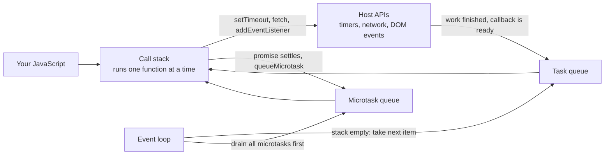
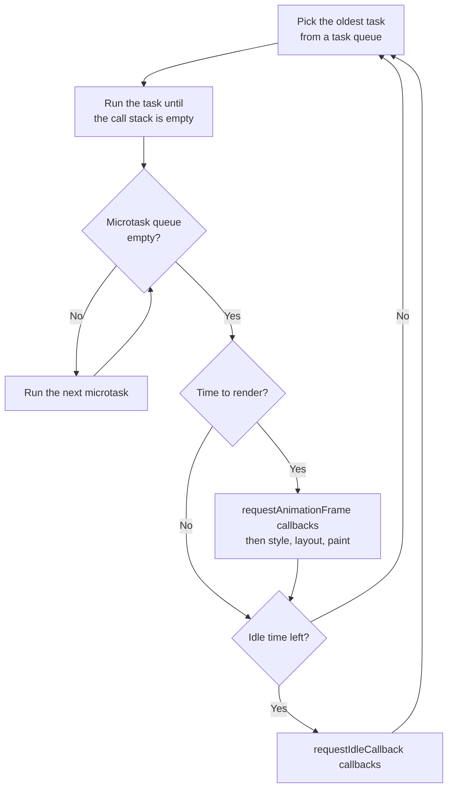
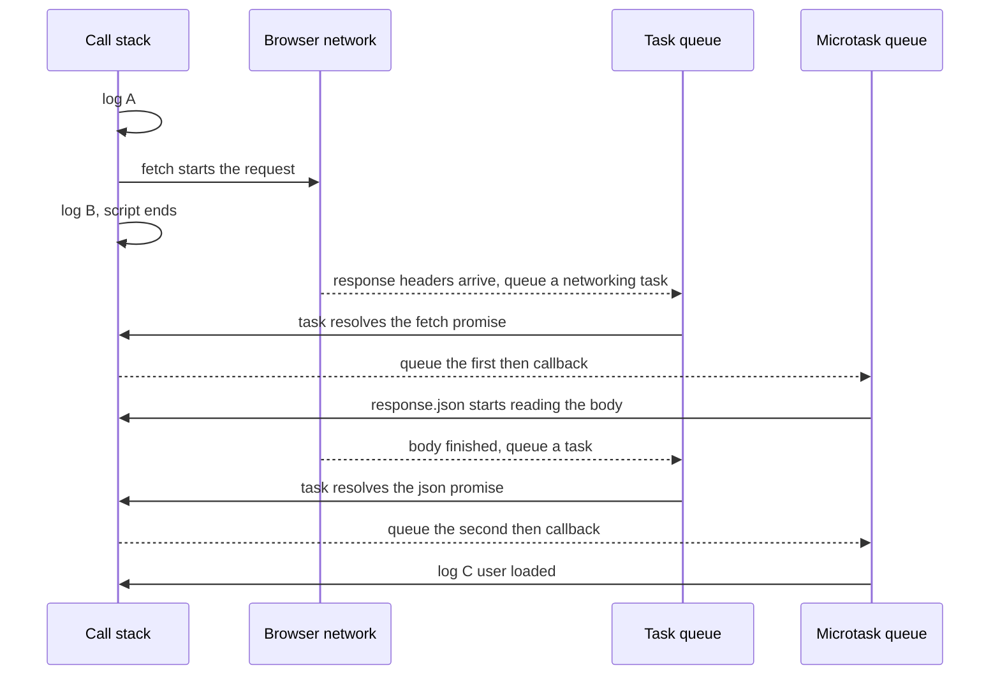
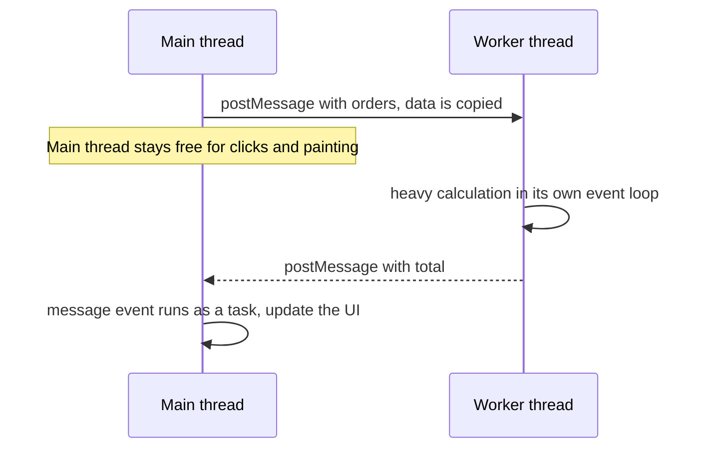

# The Event Loop

> In this document you will learn how JavaScript runs asynchronous code on a single thread: the call stack, the task queue, the microtask queue, timers, rendering, and the event loop that connects them. This is one of the most tested JavaScript topics. Interviewers use "what does this print?" puzzles to check if you really understand it, so this document has many puzzles, each checked by running it with Node.js.

**Before this:** [Scope, hoisting and TDZ](03-scope-hoisting-and-tdz.md) · [Functions and functional programming](04-functions-and-functional-programming.md) · **Interview questions:** [jump to the interview section](#interview-questions)

## Table of contents

1. [The big picture](#the-big-picture)
2. [The call stack](#the-call-stack)
3. [Who provides the event loop](#who-provides-the-event-loop)
4. [Tasks and microtasks](#tasks-and-microtasks)
5. [One turn of the event loop](#one-turn-of-the-event-loop)
6. [Timers in depth](#timers-in-depth)
7. [Promises and await in the event loop](#promises-and-await-in-the-event-loop)
8. [Rendering and the event loop](#rendering-and-the-event-loop)
9. [Long tasks and a responsive UI](#long-tasks-and-a-responsive-ui)
10. [Microtask starvation](#microtask-starvation)
11. [Web Workers](#web-workers)
12. [Node.js differences](#nodejs-differences)
13. [The event loop in real applications](#the-event-loop-in-real-applications)
14. [Common mistakes](#common-mistakes)
15. [Best practices](#best-practices)
16. [How to explain this in an interview](#how-to-explain-this-in-an-interview)
17. [Interview questions](#interview-questions)
18. [Summary](#summary)
19. [References](#references)

---

## The big picture

### What it is

JavaScript runs your code on **one thread**. A **thread** is one line of execution: it can do only one thing at a time.

But a web page must do many things "at the same time": wait for network responses, react to clicks, run timers, and draw the screen. The **event loop** is the mechanism that makes this possible. It is a loop that keeps checking: "Is the current code finished? Then which waiting callback should run next?"

### Why it exists

Imagine JavaScript waited for every slow operation. A network request can take 2 seconds. If the thread stopped and waited, the page would freeze for 2 seconds. No clicks, no scrolling, no animations.

So JavaScript works differently:

1. Your code **starts** a slow operation (a timer, a network request, reading a file).
2. The **host** (the browser or Node.js) does the waiting. Your code continues immediately.
3. When the slow operation is finished, the host puts a **callback** (a function to run later) into a **queue**.
4. When the call stack is empty, the event loop takes the callback from the queue and runs it.

### Simple explanation

There are four parts. Learn these names, because you will use them in every answer:

| Part | What it is | Who owns it |
| --- | --- | --- |
| **Call stack** | The list of functions running right now | The JavaScript engine (V8, SpiderMonkey, JavaScriptCore) |
| **Host APIs** | Timers, network, DOM events, file system. They do the waiting. | The host: browser or Node.js |
| **Queues** | Waiting lines of callbacks that are ready to run | The host |
| **Event loop** | The loop that moves the next callback from a queue onto the call stack | The host |

### Analogy

Think of a small restaurant with **one chef**.

- The chef is the JavaScript thread. The chef can cook only one dish at a time.
- The oven, the delivery driver and the waiters are the host APIs. They wait for things, so the chef does not have to.
- When the oven beeps, a note goes on the **order rail** (the task queue).
- There is also a small **urgent rail** (the microtask queue). Before the chef picks the next order, the chef always clears every note on the urgent rail.
- The chef never stops in the middle of a dish to start another one. A dish is always finished first.

Where the analogy breaks: the oven and the driver really work in parallel, but they never cook. In the same way, the host can wait for many things in parallel, but **only one piece of JavaScript runs at a time** on this thread.

### How it fits together



### The first example

```js
console.log("1: start");

setTimeout(() => {
  console.log("3: timeout");
}, 0);

console.log("2: end");

// Output:
// 1: start
// 2: end
// 3: timeout
```

Step by step:

1. `console.log("1: start")` runs on the call stack. It prints `1: start`.
2. `setTimeout(...)` asks the host to start a timer of 0 ms. The callback is **not** run now. The host keeps it.
3. `console.log("2: end")` runs and prints `2: end`.
4. The script is finished. The call stack is empty.
5. The timer has already expired, so the host has put the callback into the task queue.
6. The event loop sees an empty stack and a waiting task. It runs the callback. It prints `3: timeout`.

The key idea: **a callback from a queue can only run when the call stack is empty.** Even a 0 ms timer must wait for the current code to finish.

---

## The call stack

### What it is

The **call stack** is the list of functions that are running right now. When you call a function, it is pushed on top of the stack. When the function returns, it is popped off. The function on top is the one that is running.

### Example

```js
function getTotal(cart) {
  return cart.reduce((sum, item) => sum + item.price * item.qty, 0);
}

function formatPrice(amount) {
  return `$${amount.toFixed(2)}`;
}

function showCart(cart) {
  const total = getTotal(cart);
  console.log(formatPrice(total));
}

showCart([{ price: 10, qty: 2 }, { price: 5.5, qty: 1 }]); // $25.50
```

The stack changes like this (top of the stack is on the right):

| Step | What happens | Call stack |
| --- | --- | --- |
| 1 | The script starts | `(global)` |
| 2 | `showCart` is called | `(global)`, `showCart` |
| 3 | `getTotal` is called | `(global)`, `showCart`, `getTotal` |
| 4 | `reduce` calls the arrow function for each item | `(global)`, `showCart`, `getTotal`, `reduce`, `(arrow)` |
| 5 | `getTotal` returns `25.5` | `(global)`, `showCart` |
| 6 | `formatPrice` is called and returns `"$25.50"` | `(global)`, `showCart`, `formatPrice` → then popped |
| 7 | `console.log` prints, `showCart` returns | `(global)` |
| 8 | The script ends | empty |

The `(global)` entry is the **global execution context**: the code at the top level of your script. You learn more about execution contexts in [Scope, hoisting and TDZ](03-scope-hoisting-and-tdz.md).

When an error is thrown, the **stack trace** you see in the console is a snapshot of this call stack. You can print it yourself with `console.trace()`.

### Run to completion

This is the most important rule about the call stack:

> Once a piece of JavaScript starts, it runs until the call stack is empty. Nothing can interrupt it. Not a timer, not a click, not a network response.

This is called **run-to-completion**. It has a nice side effect: you never have two functions changing the same variable at the same moment. So JavaScript on one thread has no "data races" like multi-threaded languages.

It also has a bad side effect: **a long-running function blocks everything.**

```js
const start = Date.now();

setTimeout(() => {
  console.log("timer ran after", Date.now() - start, "ms");
}, 100);

// Busy loop: keeps the call stack busy for about 1 second
while (Date.now() - start < 1000) {
  // doing nothing useful, but the thread is busy
}

console.log("loop finished");

// Output:
// loop finished
// timer ran after 1000 ms   (or a little more)
```

The timer asked for 100 ms. It ran after about 1000 ms, because the loop never gave the event loop a chance to run it. In a browser, the same loop would freeze the whole page: clicks and scrolling would not work, and nothing would be drawn.

### Stack overflow

The stack has a size limit. If a function calls itself forever, the stack fills up:

```js
function countDown(n) {
  return countDown(n - 1); // ❌ Wrong: no base case
}

try {
  countDown(10);
} catch (error) {
  console.log(error instanceof RangeError, error.message);
  // true Maximum call stack size exceeded
}
```

Each recursive call adds a new frame. There is no base case, so the stack never shrinks. The engine throws a `RangeError`. More about recursion in [How programs run](../01-cs-and-web-fundamentals/01-how-programs-run.md).

---

## Who provides the event loop

This is a detail that many developers get wrong, and interviewers like to check it.

### The language vs the host

- The **ECMAScript specification** defines the JavaScript language: syntax, objects, functions, promises. It defines **jobs** (for example, the job that runs a promise callback), but it does **not** define the event loop, timers, network or the DOM.
- The **host** provides the event loop and all the APIs that talk to the outside world:
  - In browsers, the **HTML Standard** defines the event loop, tasks, microtasks and the rendering steps.
  - In **Node.js**, the event loop comes from a C library called **libuv**, plus Node's own code for `process.nextTick` and promise microtasks.

So `setTimeout` is **not part of JavaScript the language**. It is a host API. Browsers and Node.js both provide it, and they behave a little differently.

### Where each API comes from

| API | Defined by | Available in |
| --- | --- | --- |
| `Promise`, `async`/`await` | ECMAScript | Every JavaScript environment |
| `setTimeout`, `setInterval` | HTML Standard (browser), Node.js timers | Browser and Node.js (different implementations) |
| `queueMicrotask` | HTML Standard | Browser and Node.js (Node 11+) |
| `fetch` | Fetch Standard | Browser, and Node.js 18+ as a global |
| DOM events (`click`, `input`) | DOM and HTML Standards | Browser only |
| `requestAnimationFrame`, `requestIdleCallback` | HTML and related standards | Browser only |
| `fs.readFile`, `setImmediate`, `process.nextTick` | Node.js | Node.js only |

### One event loop per thread

- Each browser tab has a **main thread** with its own event loop. Your page's JavaScript, style calculation, layout and painting all share this one thread. (Pages from the same site can sometimes share a process, but the idea is the same.)
- Each **Web Worker** has its own thread and its own event loop.
- A **Node.js** process has one main JavaScript thread with one event loop. Each worker thread has its own.
- In **Electron**, the main process runs Node.js's event loop together with Chromium's. Each window (renderer process) has a browser-style event loop. See [Electron architecture and process model](../08-electron-desktop/01-electron-architecture-and-process-model.md).

---

## Tasks and microtasks

There is not just one queue. There are two kinds of queues, and the difference is the key to almost every event loop puzzle.

### What they are

A **task** (often called a **macrotask**) is a unit of work that the event loop runs one at a time. Running your main script is a task. Each timer callback is a task. Each click event is a task.

A **microtask** is a small job that must run **as soon as the current code finishes, before the next task**. Promise callbacks are microtasks.

The word "macrotask" is not used in the specifications. The HTML Standard just says "task". Many articles and interviewers say "macrotask", so you should know both words.

### What goes where

| Tasks (macrotasks) | Microtasks |
| --- | --- |
| Running a `<script>` (the main script) | Promise reactions: `.then`, `.catch`, `.finally` callbacks |
| `setTimeout` and `setInterval` callbacks | The code after `await` (the continuation of an async function) |
| UI events: `click`, `keydown`, `input`, `scroll` | `queueMicrotask(callback)` |
| Network events (for example XHR `load`); the networking step that resolves a `fetch` promise | `MutationObserver` callbacks |
| `MessageChannel` / `postMessage` messages | Node.js only: `process.nextTick` callbacks (a separate queue that runs even earlier, see [Node.js differences](#nodejs-differences)) |
| Node.js only: I/O callbacks (`fs`, sockets), `setImmediate` | |

### The rule that explains most puzzles

> After each task finishes, the event loop runs **all** microtasks in the microtask queue. If a microtask adds another microtask, that new one also runs before the next task. Only when the microtask queue is completely empty does the loop move on to the next task.

### Analogy

Think of a bank with one cashier.

- **Tasks** are customers waiting in the main line. The cashier serves one customer at a time.
- **Microtasks** are "one more small thing" requests from the current customer: "Can you also print a statement? And also change my address?" The cashier finishes **all** of these before calling the next customer.

If the current customer keeps adding "one more thing" forever, the next customer never gets served. That is called **microtask starvation**, and you will see it [later](#microtask-starvation).

### Example: the classic order

```js
console.log("A");

setTimeout(() => console.log("T"), 0);

Promise.resolve().then(() => console.log("P"));

queueMicrotask(() => console.log("M"));

console.log("B");

// Output:
// A
// B
// P
// M
// T
```

Step-by-step table:

| Step | What runs | Call stack | Microtask queue | Task queue | Printed |
| --- | --- | --- | --- | --- | --- |
| 1 | `console.log("A")` | main script | — | — | A |
| 2 | `setTimeout` registers a timer | main script | — | T (when the timer expires) | |
| 3 | `Promise.resolve().then(...)`: the promise is already fulfilled, so the callback is queued now | main script | P | T | |
| 4 | `queueMicrotask(...)` | main script | P, M | T | |
| 5 | `console.log("B")` | main script | P, M | T | B |
| 6 | Main script ends. Drain microtasks: run P | P | M | T | P |
| 7 | Run M | M | — | T | M |
| 8 | Microtask queue is empty. Take the next task: T | T | — | — | T |

Why does `P` come before `T` even though `setTimeout` was called first? Because the order of **calls** does not matter. What matters is **which queue** the callback is in. Microtasks always run before the next task.

### There are several task queues

The browser actually has several task queues, one per **task source**: timers, user interaction, networking, and others. In each turn, the browser chooses which queue to take a task from. It may give user input a higher priority so the page feels fast.

What is guaranteed:
- Tasks from the **same source** run in the order they were queued. Two timers with the same delay run in the order they were created.

What is **not** guaranteed:
- The order between tasks from **different sources**. Never write code that depends on "the click handler runs before the timer" or "the network callback runs before the timer".

There is only **one microtask queue** per event loop, and it is always first-in, first-out.

---

## One turn of the event loop

### The algorithm (browser model, simplified)

Each turn of the browser event loop does this:

1. **Pick one task** from one of the task queues (the oldest task in the chosen queue).
2. **Run it** until the call stack is empty.
3. **Microtask checkpoint:** run every microtask, including new microtasks added during this step, until the microtask queue is empty.
4. **Maybe render.** If it is time to update the screen (usually once per display frame, about every 16.7 ms on a 60 Hz screen) and something changed:
   - run `resize` and `scroll` event steps,
   - run `requestAnimationFrame` callbacks (with a microtask checkpoint after each one),
   - recalculate styles, do layout, paint and composite.
5. **If there is idle time** before the next frame, the browser may run `requestIdleCallback` callbacks.
6. Go back to step 1.



Three facts follow from this algorithm:

- **One task per turn, but all microtasks per turn.**
- **Rendering never happens in the middle of a task or in the middle of the microtask queue.** If your code changes the DOM ten times in one task, the user sees only the final result.
- A task that runs for a long time delays everything: other tasks, microtasks of the next turn, and rendering.

### Microtasks also run between callbacks

There is one more detail. A microtask checkpoint also happens **every time a callback finishes and the call stack becomes empty**. For example, when the browser calls two event listeners for one real user click, it runs the first listener, empties the stack, runs microtasks, and only then calls the second listener. See [Q13](#q13-browser-what-is-the-order-for-a-real-click-and-for-buttonclick) for the classic puzzle about this.

### A real request, step by step

```js
console.log("A: before fetch");

fetch("/api/user")
  .then((response) => response.json())
  .then((user) => console.log("C: user loaded", user.name));

console.log("B: after fetch");

// Output (browser):
// A: before fetch
// B: after fetch
// C: user loaded Asha    (some time later)
```



Notice how the work moves between the network (waiting), the task queue (the host reports "done"), and the microtask queue (your promise callbacks). The thread is free between these steps, so the page stays responsive.

---

## Timers in depth

### setTimeout basics

```js
const timerId = setTimeout(
  (name, role) => console.log(`Welcome, ${name} (${role})`),
  500,          // delay in milliseconds
  "Asha",       // extra arguments are passed to the callback
  "admin"
);

// Changed your mind? Cancel it before it runs:
// clearTimeout(timerId);

// After about 500 ms: Welcome, Asha (admin)
```

- `setTimeout(callback, delay, ...args)` asks the host to queue `callback` as a task after **at least** `delay` milliseconds.
- It returns an ID. In browsers this is a number. In Node.js it is a `Timeout` object (it still works with `clearTimeout`).
- `clearTimeout(id)` cancels the timer if it has not run yet. Calling it with an old or invalid ID does nothing.

### The delay is a minimum, not a promise

A timer callback can run only when:
1. the delay has passed, **and**
2. the call stack is empty, **and**
3. all microtasks are done, **and**
4. the earlier tasks have been processed.

You saw this in the busy loop example: a 100 ms timer ran after 1000 ms. The HTML Standard says it directly: timers are not guaranteed to run exactly on schedule.

That is why `setTimeout(fn, 0)` does not mean "run now". It means "run as a new task, as soon as possible, after the current code and all microtasks".

### Order of several timers

```js
setTimeout(() => console.log("100ms"), 100);
setTimeout(() => console.log("0ms"), 0);
setTimeout(() => console.log("10ms"), 10);

const start = Date.now();
while (Date.now() - start < 150) {} // block for 150 ms

console.log("blocking done");

// Output:
// blocking done
// 0ms
// 10ms
// 100ms
```

All three timers expire while the loop is blocking. When the stack is finally empty, they run in the order of their **expiry time** (start time + delay), not in the order they were created. Timers with the **same** delay run in the order they were created.

### Nested timer clamping

If timers keep scheduling timers inside each other, browsers slow them down. The HTML Standard says: when the timer **nesting level is greater than 5** and the delay is less than 4 ms, the delay is raised to **4 ms**.

```js
// Browser behavior
let last = performance.now();
let level = 0;

function tick() {
  const now = performance.now();
  console.log(`level ${level}: ${(now - last).toFixed(1)} ms`);
  last = now;
  if (++level < 10) setTimeout(tick, 0);
}

setTimeout(tick, 0);
// The first few levels show about 0–1 ms.
// After about five levels you see about 4 ms or more between calls.
```

Other timer facts you should know:

| Fact | Browser | Node.js |
| --- | --- | --- |
| Delay of `0` | Runs as soon as possible (with nesting clamping after 5 levels) | A delay below 1 ms is changed to 1 ms |
| Very large delay | Delays above 2,147,483,647 ms (about 24.8 days) overflow, and the callback runs almost immediately | Delays above 2,147,483,647 ms are changed to 1 ms (with a warning) |
| Background tabs | Timers are throttled: usually at most once per second, and sometimes much less for pages hidden a long time | Not applicable |
| Return value | A number | A `Timeout` object (has `ref()`/`unref()`) |

The practical lesson: never use timers to measure time. If you build a countdown clock, compute the remaining time from `Date.now()` (or `performance.now()`) on every tick instead of adding 1000 ms per callback.

```js
// ❌ Wrong: drifts because each tick can be late
let secondsLeft = 60;
setInterval(() => {
  secondsLeft -= 1;
}, 1000);

// ✅ Correct: compute from the real clock
const endTime = Date.now() + 60_000;
const intervalId = setInterval(() => {
  const secondsLeft = Math.max(0, Math.round((endTime - Date.now()) / 1000));
  console.log(secondsLeft);
  if (secondsLeft === 0) clearInterval(intervalId);
}, 1000);
```

### setInterval and its problems

`setInterval(callback, delay)` queues the callback again and again, about every `delay` ms, until you call `clearInterval(id)`.

Two problems in real apps:

1. **It does not wait for your async work.** If you poll a server every 2 seconds and a request takes 5 seconds, new requests start before old ones finish. Responses can arrive out of order.
2. **It does not care how long the callback takes.** If the callback is slow, the next run can start almost right after the previous one ends. (Browsers do not stack up many missed runs, but the gaps become uneven.)

The safer pattern for polling is a **recursive `setTimeout`**: schedule the next run only after the current one is finished.

```js
// fetchJobStatus, jobId and render come from your app (not shown)

// ❌ Wrong for async polling: requests can overlap
setInterval(async () => {
  const status = await fetchJobStatus(jobId);
  render(status);
}, 2000);

// ✅ Correct: the next poll starts 2 s after the previous one FINISHED
async function poll() {
  try {
    const status = await fetchJobStatus(jobId);
    render(status);
    if (status.state === "done") return; // stop polling
  } catch (error) {
    console.error("poll failed", error);
  }
  pollTimer = setTimeout(poll, 2000);
}

let pollTimer = setTimeout(poll, 0);
// To stop from outside: clearTimeout(pollTimer);
```

### Always clear timers you no longer need

A timer keeps its callback alive. If the callback uses a component or a big object, that object cannot be garbage collected until the timer is cleared. The callback may also run after the component is gone and touch a destroyed view.

```ts
// Angular 16 component
import { Component, OnDestroy, OnInit } from "@angular/core";

@Component({
  selector: "app-clock",
  template: `<span>{{ now | date: 'mediumTime' }}</span>`,
})
export class ClockComponent implements OnInit, OnDestroy {
  now = new Date();
  private intervalId?: ReturnType<typeof setInterval>;

  ngOnInit(): void {
    this.intervalId = setInterval(() => (this.now = new Date()), 1000);
  }

  ngOnDestroy(): void {
    clearInterval(this.intervalId); // ✅ stop the timer when the component is removed
  }
}
```

`ReturnType<typeof setInterval>` works with both browser and Node.js typings. More about leaks in [Memory management and garbage collection](19-memory-management-and-garbage-collection.md).

---

## Promises and await in the event loop

Promises are explained fully in [Callbacks and promises](17-callbacks-and-promises.md) and [Async/await](18-async-await.md). Here you only need a short reminder: a **promise** is an object that stands for a value that will be ready later. `promise.then(callback)` registers a callback to run when the promise is fulfilled. In this section you learn exactly **when** those callbacks run.

### The five rules

1. **The promise executor runs synchronously.** The function you pass to `new Promise(...)` runs immediately, on the current call stack.
2. **A `.then` callback is queued as a microtask when the promise settles.** If the promise is already settled when you call `.then`, the callback is queued immediately. It still runs later, never right away.
3. **Each step of a chain needs its own microtask.** In `.then(a).then(b)`, `b` is queued only after `a` has run and the promise returned by the first `.then` is fulfilled.
4. **`await` splits an async function in two.** The code before the first `await` runs synchronously. The code after it (the **continuation**) is queued as a microtask when the awaited value is ready. Awaiting a native promise or a plain value takes one microtask "tick".
5. **Returning a promise costs extra ticks.** If a `.then` callback (or an async function) returns another promise, the engine needs **two extra microtasks** to "unwrap" it.

A **tick** here means one round of the microtask queue: the microtasks that were already in the queue run, and the ones they add run in the next round.

### Rules 1 and 2: the executor is synchronous

```js
console.log("1");

const promise = new Promise((resolve) => {
  console.log("2: inside the executor");
  resolve("done");
  console.log("3: after resolve, still synchronous");
});

promise.then((value) => console.log("5:", value));

console.log("4");

// Output:
// 1
// 2: inside the executor
// 3: after resolve, still synchronous
// 4
// 5: done
```

`resolve("done")` does not stop the executor and does not run the `.then` callback. It only marks the promise as fulfilled. The callback runs as a microtask after the main script ends.

### Rule 3: chains take turns

```js
Promise.resolve()
  .then(() => console.log("a1"))
  .then(() => console.log("a2"));

Promise.resolve()
  .then(() => console.log("b1"))
  .then(() => console.log("b2"));

// Output:
// a1
// b1
// a2
// b2
```

Both first callbacks (`a1`, `b1`) are queued during the script. `a2` is queued only after `a1` has run, and by then `b1` is already waiting in front of it. So the two chains take turns.

### Rule 4: await and the continuation

```js
async function loadDashboard() {
  console.log("a1: start");
  await null; // continuation queued as a microtask
  console.log("a2: after first await");
  await null;
  console.log("a3: after second await");
}

loadDashboard();

Promise.resolve()
  .then(() => console.log("p1"))
  .then(() => console.log("p2"))
  .then(() => console.log("p3"));

console.log("sync");

// Output:
// a1: start
// sync
// a2: after first await
// p1
// a3: after second await
// p2
// p3
```

| Tick | Microtask queue at the start of the tick | Printed |
| --- | --- | --- |
| (sync) | — | `a1: start`, `sync` |
| 1 | continuation of `loadDashboard`, `p1` | `a2: after first await`, `p1` |
| 2 | next continuation, `p2` | `a3: after second await`, `p2` |
| 3 | `p3` | `p3` |

`loadDashboard()` runs synchronously until the first `await`. Then it returns a pending promise, and the main script continues. Each `await` lets the other chain run one step.

### Rule 5: returning a promise adds two ticks

```js
Promise.resolve()
  .then(() => {
    console.log("A1");
    return Promise.resolve("x"); // returning a promise, not a plain value
  })
  .then((value) => console.log("A2", value));

Promise.resolve()
  .then(() => console.log("B1"))
  .then(() => console.log("B2"))
  .then(() => console.log("B3"))
  .then(() => console.log("B4"));

// Output:
// A1
// B1
// B2
// B3
// A2 x
// B4
```

Why does `A2` wait so long? When a `.then` callback returns a promise, the promise created by `.then` must **adopt** the state of the returned promise. The specification does this with two extra jobs:

1. A job that calls `returnedPromise.then(resolve, reject)` (tick 2).
2. The reaction of that `then`, which finally resolves the outer promise (tick 3).
3. Only then is the `A2` callback queued (tick 4).

| Tick | Runs |
| --- | --- |
| 1 | `A1` (returns a promise), `B1` |
| 2 | adoption job 1, `B2` |
| 3 | adoption job 2, `B3` |
| 4 | `A2 x`, `B4` |

The same happens when an **async function returns a promise**:

```js
async function getValue() {
  return Promise.resolve("value"); // extra ticks to unwrap
}

getValue().then((v) => console.log(v));

Promise.resolve()
  .then(() => console.log("t1"))
  .then(() => console.log("t2"))
  .then(() => console.log("t3"));

// Output:
// t1
// t2
// value
// t3
```

> **Important:** these extra ticks are exact specification behavior, and they are useful for puzzles. But real code must **never depend** on how many ticks something takes. If one piece of code must run after another, connect them with `await` or `.then`.

---

## Rendering and the event loop

The browser's rendering pipeline (style, layout, paint, composite) is explained in [Browser architecture and rendering](../01-cs-and-web-fundamentals/07-browser-architecture-and-rendering.md). Here you learn **when** rendering happens compared to your JavaScript.

### Rendering happens between tasks

The browser usually updates the screen once per display frame. On a 60 Hz screen, that is about every **16.7 ms**. On a 120 Hz screen, about every 8.3 ms. If nothing changed, the browser can skip the rendering work.

Rendering can only happen **after** a task and **after** all microtasks. So:

- Changes made in the same task are combined. The user sees only the final state.
- If a task runs for 500 ms, the screen does not update for 500 ms.

```js
// Browser behavior
const box = document.querySelector("#box");

box.style.display = "none";
box.style.display = "block";
// The user never sees the box disappear.
// Both changes happen in one task, and only the final style is rendered.
```

### The spinner that never shows

This is a common real bug:

```js
// ❌ Wrong: the spinner never appears
button.addEventListener("click", () => {
  spinner.hidden = false;           // change the DOM
  const report = buildHugeReport(); // 2 seconds of synchronous work
  spinner.hidden = true;
  render(report);
});
```

The spinner is shown and hidden inside the same task. The browser never gets a chance to paint between the two changes, so the user sees a frozen page and no spinner.

```js
// ✅ Better: let the browser paint first, then do the heavy work
button.addEventListener("click", () => {
  spinner.hidden = false;
  // rAF runs just before the next paint. The setTimeout inside it
  // schedules our work as a new task AFTER that paint.
  requestAnimationFrame(() => {
    setTimeout(() => {
      const report = buildHugeReport();
      spinner.hidden = true;
      render(report);
    }, 0);
  });
});
```

Even better: move `buildHugeReport` to a [Web Worker](#web-workers) or split it into chunks (see [Long tasks and a responsive UI](#long-tasks-and-a-responsive-ui)). Then the spinner also keeps animating.

> Why not a single `setTimeout(work, 0)`? It usually works, but it is not guaranteed. The browser may run the timer task **before** the next rendering opportunity. `requestAnimationFrame` plus `setTimeout` makes sure one paint happens first.

### requestAnimationFrame

**`requestAnimationFrame(callback)`** (often called **rAF**) asks the browser to run `callback` right before the next paint. It is the correct tool for visual updates and animations.

```js
// Browser: move a box 300px in 1 second, smoothly
const box = document.querySelector("#box");
const duration = 1000;
let startTime = null;

function step(timestamp) {
  if (startTime === null) startTime = timestamp;
  const progress = Math.min((timestamp - startTime) / duration, 1); // 0..1
  box.style.transform = `translateX(${progress * 300}px)`;
  if (progress < 1) {
    requestAnimationFrame(step); // ask again for the next frame
  }
}

const frameId = requestAnimationFrame(step);
// cancelAnimationFrame(frameId) stops it before it runs
```

Key facts:

- The callback receives a **timestamp** (milliseconds, like `performance.now()`). Use it to compute progress, so the animation has the same speed on 60 Hz and 120 Hz screens.
- It runs about once per frame, matched to the screen refresh rate.
- It is **paused in background tabs** and hidden iframes. This saves battery.
- Each call schedules **one** callback. For an animation, call it again inside the callback.

| | `setTimeout` / `setInterval` for animation | `requestAnimationFrame` |
| --- | --- | --- |
| Timing | Not synced with the screen; frames can be skipped or drawn twice | Synced with the screen refresh |
| Background tab | Throttled but still runs | Paused |
| Best for | Delays, polling, non-visual work | Animations, visual updates, reading layout once per frame |

The order between a `setTimeout(fn, 0)` callback and a `requestAnimationFrame(fn)` callback is **not fixed**. It depends on when the next frame is due. Do not write code that depends on it.

### requestIdleCallback

**`requestIdleCallback(callback, { timeout })`** asks the browser to run `callback` when the main thread is idle: after rendering, when there is spare time before the next frame.

```js
// Browser: send analytics events only when the page is idle
const pendingEvents = [];

function flushAnalytics(deadline) {
  // Work while we have idle time (or if the timeout forced this call)
  while (pendingEvents.length > 0 && (deadline.timeRemaining() > 1 || deadline.didTimeout)) {
    sendToServer(pendingEvents.shift());
  }
  if (pendingEvents.length > 0) {
    requestIdleCallback(flushAnalytics, { timeout: 2000 });
  }
}

requestIdleCallback(flushAnalytics, { timeout: 2000 });
```

- `deadline.timeRemaining()` tells you how many milliseconds of idle time are left (at most 50 ms).
- `timeout` makes sure the callback runs within that time even if the page is never idle.
- Use it for low-priority work: analytics, prefetching, warming caches.
- Avoid DOM changes inside it. A DOM change in idle time can force extra layout work at a bad moment. If you need a DOM change, schedule a `requestAnimationFrame` from inside it.
- **Support:** Chromium browsers and Firefox support it. Safari does not support it by default (at the time of writing it exists only behind a flag in preview builds). Always feature-detect and fall back to `setTimeout`.

```js
const scheduleIdle =
  typeof requestIdleCallback === "function"
    ? (cb) => requestIdleCallback(cb, { timeout: 2000 })
    : (cb) => setTimeout(() => cb({ timeRemaining: () => 0, didTimeout: true }), 1);
```

---

## Long tasks and a responsive UI

### What a long task is

A **long task** is a task that keeps the main thread busy for **more than 50 ms**. While it runs, the browser cannot react to clicks or key presses and cannot paint. The user feels the page is slow or frozen.

This directly affects the Core Web Vital **INP** (Interaction to Next Paint), which measures how fast the page responds to user input. See [Web performance and Core Web Vitals](../05-frontend-engineering/05-web-performance-and-core-web-vitals.md).

Typical causes: processing a big array, parsing large JSON, rendering thousands of DOM nodes at once, heavy regular expressions, big synchronous libraries starting up.

### Why "async" alone does not help

A very common wrong belief: "I put the loop inside an `async` function, so it does not block." That is false. An `async` function runs on the same thread. Even `await` on a resolved promise only queues a **microtask**, and microtasks run before any task and before rendering.

```js
setTimeout(() => console.log("timer"), 0);

async function processAll(items) {
  for (const item of items) {
    await Promise.resolve(); // looks async, but only queues a microtask
  }
  console.log("processed", items.length);
}

processAll(Array.from({ length: 100_000 }, (_, i) => i));

// Output:
// processed 100000
// timer
```

The timer was ready almost immediately, but it had to wait until all 100,000 microtasks were done. In a browser, the page would also not paint or respond during that time. To really give the browser a break, you must **yield to a new task**.

### Option 1: split the work into chunks

Do a little work, then let the event loop handle other tasks, then continue.

```js
function yieldToMain() {
  // scheduler.yield() continues your work with priority (Chromium, Firefox).
  if (globalThis.scheduler?.yield) return scheduler.yield();
  // Fallback: continue in a new task.
  return new Promise((resolve) => setTimeout(resolve, 0));
}

async function processInChunks(items, processItem, budgetMs = 50) {
  let deadline = performance.now() + budgetMs;
  for (const item of items) {
    processItem(item);
    if (performance.now() >= deadline) {
      await yieldToMain(); // clicks, timers and painting can happen here
      deadline = performance.now() + budgetMs;
    }
  }
}

// Usage (orders and addRowToReport come from your app)
processInChunks(orders, (order) => addRowToReport(order)).then(() => {
  console.log("report ready");
});
```

Step by step:

1. Work on items until about 50 ms have passed.
2. `await yieldToMain()` ends the current task. The rest of the loop continues later, in a new task.
3. Between the two tasks, the browser can handle input and paint.
4. The loop continues with a new 50 ms budget.

**About `scheduler.yield()`:** it is part of the Prioritized Task Scheduling API. Per MDN compatibility data, it is supported in Chrome and Edge 129+ and Firefox 142+, but **not in Safari**. It is not available in Node.js. The advantage over `setTimeout`: your continuation goes to the **front** of the line, so tasks from other scripts cannot jump ahead of your remaining work, and it is not affected by timer clamping. Always feature-detect it as shown above.

The related **`scheduler.postTask(callback, { priority })`** schedules a task with a priority: `"user-blocking"`, `"user-visible"` (the default) or `"background"`. It has the same support situation.

### Option 2: move the work to another thread

If the work is pure computation (no DOM), run it in a [Web Worker](#web-workers). The main thread stays completely free.

### Option 3: do less work

Often the best fix is to avoid the work: render only the visible rows (virtual scrolling), cache results (memoization), or run the handler less often ([debounce and throttle](20-debounce-throttle-and-performance.md)).

### How to find long tasks

- The **Performance** panel in Chrome DevTools marks long tasks with a red corner. See [Debugging and code review](../11-coding-interviews/06-debugging-and-code-review.md).
- In production, you can observe them with `PerformanceObserver`:

```js
// Browser
const observer = new PerformanceObserver((list) => {
  for (const entry of list.getEntries()) {
    console.log("long task:", Math.round(entry.duration), "ms");
  }
});
observer.observe({ type: "longtask", buffered: true });
```

Chromium browsers (Chrome 123+) also have the **Long Animation Frames API** (`type: "long-animation-frame"`). It gives more detail, such as which scripts caused a slow frame. Firefox and Safari do not support it at the time of writing.

---

## Microtask starvation

### What it is

**Microtask starvation** happens when microtasks keep adding new microtasks. The event loop must empty the microtask queue before it can run the next task or render. If the queue never becomes empty, timers, clicks and painting **never** get a turn. The page freezes, even though no single function is "long".

### Example

```js
let count = 0;

setTimeout(() => console.log("timeout ran, microtasks run:", count), 0);

function spin() {
  count++;
  if (count < 100_000) queueMicrotask(spin); // each microtask adds another one
}

queueMicrotask(spin);

// Output:
// timeout ran, microtasks run: 100000
```

The timer was ready after about 1 ms, but it ran only after all 100,000 microtasks. Remove the `if` limit and the timer would **never** run.

Compare with tasks:

```js
let count = 0;

setTimeout(() => console.log("other timer ran, count was:", count), 5);

function spinWithTimers() {
  count++;
  if (count < 100) setTimeout(spinWithTimers, 0); // each run is a new task
}

setTimeout(spinWithTimers, 0);

// Output (Node.js; the exact number depends on the machine and OS):
// other timer ran, count was: 1    (always a small number, far below 100)
```

With `setTimeout`, each step is a separate task, so other tasks can run between the steps. The other timer runs long before the 100 steps are done. In a browser, rendering would also happen between steps.

### Where starvation comes from in real code

- A "polling" loop written with promises and no real delay: `function check() { return Promise.resolve().then(check); }`.
- A recursive async function that only awaits values that are already resolved.
- A `MutationObserver` callback that changes the same DOM it observes, so it triggers itself again.
- In Node.js, recursive `process.nextTick` calls. They starve I/O in the same way.

The fix is always the same: if a loop must continue for a long or unknown time, yield to a **task** (`setTimeout`, `scheduler.yield()`, `setImmediate` in Node.js), not to a microtask.

---

## Web Workers

### What they are

A **Web Worker** runs JavaScript on a **separate thread**, with its **own event loop**, its own global scope and its own memory. It is the browser's way to run JavaScript truly in parallel.

### Why they exist

The main thread is shared by your code, rendering and input handling. CPU-heavy work on the main thread always hurts the user experience, even if you chunk it. A worker moves that work off the main thread completely.

### How they communicate

A worker cannot touch the DOM, `window` or `document`. The main thread and the worker talk by sending **messages** with `postMessage`. Each message arrives as a **task** (a `message` event) in the other thread's event loop.

Messages are **copied** with the structured clone algorithm (the same algorithm `structuredClone` uses). Big binary data (like an `ArrayBuffer`) can be **transferred** instead of copied: ownership moves to the other thread, and the sender can no longer use it.

```js
// main.js (browser, module script)
const worker = new Worker(new URL("./report-worker.js", import.meta.url), { type: "module" });

worker.addEventListener("message", (event) => {
  console.log("Report ready:", event.data.total); // runs as a task on the main thread
});

worker.addEventListener("error", (event) => {
  console.error("Worker failed:", event.message);
});

worker.postMessage({ orders }); // `orders` is copied to the worker

// report-worker.js
self.addEventListener("message", (event) => {
  const { orders } = event.data;
  let total = 0;
  for (const order of orders) {
    total += order.items.reduce((sum, item) => sum + item.price * item.qty, 0);
  }
  self.postMessage({ total }); // send the result back
});
```



### Costs and limits

- Starting a worker takes time and memory. Reuse one worker for many jobs.
- Copying large data can be slow. Transfer `ArrayBuffer`s when possible.
- No DOM access. The worker computes; the main thread renders.
- **`SharedArrayBuffer`** (memory shared between threads) is only available on cross-origin isolated pages (pages sent with special `Cross-Origin-Opener-Policy` and `Cross-Origin-Embedder-Policy` headers).

### In real projects

- **Angular CLI** can generate a worker with `ng generate web-worker <name>`. Use it for heavy parsing, filtering or exporting big tables.
- **Node.js** has a similar feature, **worker threads**. See [Concurrency: worker threads and cluster](../07-nodejs-backend/12-concurrency-worker-threads-and-cluster.md).
- **Electron** apps can use Web Workers in a renderer, or move heavy work out of the main process. See [Electron performance and architecture](../08-electron-desktop/09-performance-architecture-and-alternatives.md).

---

## Node.js differences

Node.js uses the same big idea: one JavaScript thread, a call stack, queues and an event loop. But the loop comes from **libuv** and is organized in **phases**. This section gives only what you need to compare with the browser. The full explanation is in [The Node.js event loop](../07-nodejs-backend/02-node-event-loop.md).

### The phases in one list

Each turn of the Node.js event loop goes through these phases. Each phase has its own queue of callbacks.

1. **timers** — expired `setTimeout` and `setInterval` callbacks.
2. **pending callbacks** — some system I/O callbacks that were deferred.
3. **idle, prepare** — internal use only.
4. **poll** — get new I/O events and run their callbacks (file reads, network data). The loop may wait here when there is nothing else to do.
5. **check** — `setImmediate` callbacks.
6. **close callbacks** — for example, a socket's `close` event.

Node also has a **thread pool** in libuv (4 threads by default) for work that the operating system cannot do asynchronously, such as many `fs` operations, `dns.lookup`, some `crypto` functions and `zlib`. Your JavaScript still runs on one thread.

### Microtasks and process.nextTick

Node.js has **two** high-priority queues:

1. The **`process.nextTick` queue**.
2. The **promise microtask queue** (`.then` callbacks, `await` continuations, `queueMicrotask`).

After each callback, Node empties the nextTick queue first, then the promise microtask queue, and repeats until both are empty. Since Node.js 11, this happens after **every single** timer or immediate callback, which matches browser behavior.

```js
// Run as a CommonJS file: node order.js
setImmediate(() => console.log("immediate"));
Promise.resolve().then(() => console.log("promise"));
process.nextTick(() => console.log("nextTick"));
queueMicrotask(() => console.log("microtask"));
console.log("sync");

// Output:
// sync
// nextTick
// promise
// microtask
// immediate
```

> **ES modules are different.** If you run the same code as an ES module (`order.mjs`), Node.js prints `sync, promise, microtask, nextTick, immediate`. In an ES module, the top-level code itself runs as part of a promise job, so the promise microtasks it queues run in the same drain, before Node gets the chance to run the nextTick queue. Do not write code that depends on this order.

### setTimeout(fn, 0) vs setImmediate

In the **main module**, the order of `setTimeout(fn, 0)` and `setImmediate(fn)` is **not guaranteed**. It depends on how fast the process starts (whether 1 ms has already passed when the loop first checks the timers).

Inside an **I/O callback**, the order is always the same: `setImmediate` first, because the check phase comes right after the poll phase.

```js
const fs = require("node:fs");

fs.readFile(__filename, () => {
  setTimeout(() => console.log("timeout"), 0);
  setImmediate(() => console.log("immediate"));
  process.nextTick(() => console.log("nextTick"));
});

// Output (always):
// nextTick
// immediate
// timeout
```

### Browser vs Node.js summary

| Topic | Browser | Node.js |
| --- | --- | --- |
| Loop implementation | HTML Standard, inside the browser | libuv phases plus Node's own microtask handling |
| Extra high-priority queue | — | `process.nextTick` (runs before promise microtasks) |
| Rendering step | Yes (rAF, style, layout, paint) | No |
| Special scheduling APIs | `requestAnimationFrame`, `requestIdleCallback`, `scheduler.yield()` | `setImmediate`, `process.nextTick` |
| Minimum timer delay | 0 ms (4 ms after 5 nested levels) | 1 ms |
| Who suffers when the thread blocks | One user (one tab) | **All users** of the server |

---

## The event loop in real applications

### Angular 16 and zone.js

Angular 16 uses a library called **zone.js** by default. Zone.js **patches** (wraps) almost every async API: `setTimeout`, `setInterval`, promises, `addEventListener`, XHR and others. Because of this, Angular knows when an async callback has finished. When the zone has no more microtasks to run, Angular runs **change detection** to update the view.

This is why, in Angular 16, you can change a component property inside a `setTimeout` or a `.then` and the view updates without extra work.

It also explains a performance problem: **every** patched event triggers change detection. A `mousemove` or `scroll` listener can fire many times per second, and each time Angular checks the component tree. The fix is to run such code **outside** Angular's zone and come back in only when the view must change.

```ts
// Angular 16
import { Component, ElementRef, NgZone, OnDestroy, OnInit } from "@angular/core";

@Component({
  selector: "app-drag-tracker",
  template: `<div class="area">Last position: {{ position }}</div>`,
})
export class DragTrackerComponent implements OnInit, OnDestroy {
  position = "none";
  private removeListener?: () => void;

  constructor(private zone: NgZone, private host: ElementRef<HTMLElement>) {}

  ngOnInit(): void {
    this.zone.runOutsideAngular(() => {
      const onMove = (event: MouseEvent) => {
        // Runs outside Angular: no change detection for every mouse move
        if (event.buttons === 0) return;
        const value = `${event.offsetX}, ${event.offsetY}`;
        // Re-enter Angular only when the view must change
        this.zone.run(() => (this.position = value));
      };
      this.host.nativeElement.addEventListener("mousemove", onMove);
      this.removeListener = () => this.host.nativeElement.removeEventListener("mousemove", onMove);
    });
  }

  ngOnDestroy(): void {
    this.removeListener?.();
  }
}
```

The same idea applies to `requestAnimationFrame` loops, third-party chart libraries and WebSocket heartbeats: run them outside the zone, and re-enter only to update the view.

Details are in [Change detection and signals](../06-angular-16/10-change-detection-and-signals.md).

> **Newer Angular (18+):** Angular added **zoneless** change detection, which does not need zone.js. It was experimental in v18 and became stable in v20.2 (`provideZonelessChangeDetection()`). Change detection is then triggered by signals, template events, the `async` pipe and explicit marking, not by patched async APIs. In Angular 16, zone.js is the normal setup, and signals are only a developer preview.

### Node.js servers

On a server, the event loop serves **every** request. If one request handler blocks the thread for 3 seconds, **all** other users wait 3 seconds.

```js
// Node.js: one slow route blocks everyone
const http = require("node:http");

http
  .createServer((req, res) => {
    if (req.url === "/report") {
      // ❌ Wrong: 3 seconds of synchronous CPU work on the only JS thread
      const end = Date.now() + 3000;
      while (Date.now() < end) {}
      res.end("report done");
      return;
    }
    res.end("ok"); // even this fast route must wait while /report runs
  })
  .listen(3000);
```

Typical blockers in Node.js: `fs.readFileSync` in a request handler, `JSON.parse` on very large bodies, synchronous crypto or compression, slow regular expressions, big loops over data. Fixes: use the async APIs, stream large data, and move CPU work to worker threads or a background job queue. See [Production Node.js](../07-nodejs-backend/14-production-nodejs.md) and [Background jobs and queues](../07-nodejs-backend/13-background-jobs-and-queues.md).

### Electron

In Electron, the **main process** controls all windows. If the main process blocks (heavy synchronous file work, a synchronous IPC call like `ipcRenderer.sendSync`), every window of the app freezes. Keep the main process light, use async IPC (`invoke`/`handle`), and move heavy work to a separate process or worker. See [IPC and preload scripts](../08-electron-desktop/03-ipc-and-preload-scripts.md).

### Testing code that uses timers

Tests should not wait for real time. Test tools replace the timer functions with fake ones:

- Jest and Vitest: `jest.useFakeTimers()` / `vi.useFakeTimers()`, then move time forward with `advanceTimersByTime(ms)`. Remember that promise callbacks are microtasks, so after advancing timers you often need an `await` to let them run. See [Angular testing](../06-angular-16/14-testing.md).
- Angular: `fakeAsync` with `tick(ms)`, `flush()` and `flushMicrotasks()`. See [Angular testing](../06-angular-16/14-testing.md).

---

## Common mistakes

### 1. "setTimeout(fn, 0) runs immediately"

It never runs immediately. It runs as a **new task**, after the current code and after all microtasks. If the thread is busy, it can run much later.

### 2. "An async function runs in the background"

```js
// ❌ Wrong belief: "this does not block, because it is async"
async function hashAllPasswords(passwords) {
  return passwords.map((p) => slowHash(p)); // synchronous CPU work
}
```

`async` does not create a thread. All the code inside runs on the same thread. Only the **waiting** (network, timers, file I/O done by the host) happens outside JavaScript. For CPU work, use a worker or chunking.

### 3. Expecting the DOM to update in the middle of a task

Changing the DOM and then running heavy synchronous code: the user sees nothing until the task ends. See [the spinner that never shows](#the-spinner-that-never-shows).

### 4. Using setInterval for async polling

Requests can overlap and finish out of order. Use a recursive `setTimeout` that schedules the next poll after the current one finishes. See [setInterval and its problems](#setinterval-and-its-problems).

### 5. Using timers to measure time

Each tick can be late, so a counter that adds 1 per tick drifts. Calculate from `Date.now()` or `performance.now()` instead.

### 6. Infinite microtask loops

A promise chain or `queueMicrotask` that keeps scheduling itself freezes the page. Yield to a task instead. See [Microtask starvation](#microtask-starvation).

### 7. Relying on the order of unrelated async sources

```js
// ❌ Wrong: assumes the timer runs before the response arrives
let config = null;
setTimeout(() => (config = { theme: "dark" }), 0);
fetch("/api/user").then(() => applyTheme(config.theme)); // config may still be null
```

```js
// ✅ Correct: make the dependency explicit
const configPromise = loadConfig();
const userPromise = fetch("/api/user");
const [config] = await Promise.all([configPromise, userPromise]);
applyTheme(config.theme);
```

Different task sources have no guaranteed order. If B needs A, wait for A.

### 8. Forgetting to clear timers and listeners

Intervals and listeners keep callbacks (and everything they reference) alive. In Angular, clear them in `ngOnDestroy`. In Node.js, an active timer also keeps the process running (unless you call `timer.unref()`).

### 9. Heavy synchronous work on a shared thread

In Node.js servers and the Electron main process, one blocking call hurts every user or every window. Use async APIs and workers.

---

## Best practices

- **Keep each task short (under 50 ms).** Short tasks let the browser react to input and paint on time.
- **Yield to a task, not a microtask, when you split long work.** Only a task boundary gives the browser a chance to handle input and render. Use `scheduler.yield()` with a `setTimeout` fallback.
- **Move CPU-heavy work to a Web Worker (browser) or worker thread (Node.js).** Workers have their own thread and event loop, so the main thread stays free.
- **Use `requestAnimationFrame` for visual updates.** It is synced to the screen and paused in background tabs.
- **Use `requestIdleCallback` (with a fallback) for low-priority work.** It runs only when the browser has spare time.
- **Never depend on exact tick counts or on the order of different task sources.** Express the order with `await`, `.then` or `Promise.all`. This keeps code correct when engines or browsers change.
- **Use recursive `setTimeout` for polling.** The next request starts only after the previous one finished, so requests do not overlap.
- **Clear every timer, interval, animation frame and listener you create.** This prevents memory leaks and callbacks on destroyed components.
- **In Angular 16, run high-frequency events outside the zone.** This avoids running change detection on every `mousemove` or animation frame.
- **Measure before you optimize.** Use the DevTools Performance panel, long task observers and, in Node.js, event loop delay monitoring to find the real blocker.

---

## How to explain this in an interview

1. **Define it:** "The event loop is the host mechanism that lets single-threaded JavaScript handle async work. It takes callbacks from queues and runs them on the call stack when the stack is empty."
2. **Why it exists:** "JavaScript has one main thread, shared with rendering in the browser. If it waited for network or timers, the page would freeze. So the host does the waiting, and JavaScript only runs the callbacks."
3. **How it works:** "The loop runs one task, like a timer callback or a click handler. Then it drains the whole microtask queue, which holds promise callbacks and `await` continuations. Then the browser may render. Then it takes the next task."
4. **Small example:** "If I log A, set a timeout that logs T, add a promise `then` that logs P, and log B, the output is A, B, P, T. The sync code runs first, then microtasks, then the next task."
5. **Where it is useful:** "It explains why a 0 ms timer is not immediate, why a long loop freezes the UI, why I chunk work or use Web Workers, and in Angular, why zone.js can trigger change detection after async callbacks."
6. **Trade-offs and gotchas:** "Microtasks can starve rendering if they keep adding more. Timers are minimum delays, not exact. Node.js has phases, `process.nextTick` and `setImmediate`, so I say which runtime I mean before predicting output."

---

## Interview questions

### Q1. What is the event loop?

**What the interviewer is checking:** Whether you know the parts (call stack, host APIs, task queue, microtask queue) and the order in which the loop processes them, not just the phrase "it handles async code".

**Short spoken answer (30–60 seconds):**
> JavaScript runs on one thread with one call stack, so it can only run one piece of code at a time. The event loop is the mechanism, provided by the browser or Node.js, that decides what runs next. When I call something like `setTimeout` or `fetch`, the host does the waiting outside JavaScript. When the work is done, it puts my callback into a queue. Whenever the call stack is empty, the event loop runs all microtasks first — those are promise callbacks and code after `await` — and then takes the next task, like a timer or click callback. In the browser, it may also render between tasks. This is why a zero-millisecond timeout still runs after a resolved promise, and why one long function can freeze the whole page.

**Detailed explanation:**
- The **engine** (V8, SpiderMonkey, JavaScriptCore) provides the call stack and the heap. It runs code but has no timers, network or DOM.
- The **host** (browser or Node.js) provides those APIs, the queues and the loop itself.
- In browsers, one turn is: run one task → drain all microtasks → maybe render (rAF callbacks, style, layout, paint) → repeat.
- Run-to-completion: a running task is never interrupted. Callbacks wait until the stack is empty.

**Code or diagram:**

```js
console.log("A");
setTimeout(() => console.log("T"), 0);
Promise.resolve().then(() => console.log("P"));
console.log("B");
// A
// B
// P
// T
```

**Follow-up questions:**
- **Is the event loop part of JavaScript (ECMAScript)?** — No. ECMAScript defines jobs such as promise jobs, but the event loop is defined by the host: the HTML Standard for browsers and libuv plus Node's code for Node.js.
- **Is `setTimeout` part of JavaScript?** — No, it is a host API. Browsers and Node.js both provide it, with small differences (for example, Node's minimum delay is 1 ms and it returns a `Timeout` object).
- **How many event loops does a browser tab have?** — The main thread has one. Every Web Worker has its own event loop on its own thread.
- **What happens if the call stack is never empty?** — No callback can run. Timers, clicks, network callbacks and rendering all wait. The page freezes.

**Common mistakes:** Saying "JavaScript is multi-threaded because of async"; forgetting the microtask queue; saying the event loop "runs setTimeout in parallel"; not mentioning rendering.

**Where this is used in real projects:** Understanding UI freezes, ordering bugs in async code, why Angular updates views after async callbacks, and why one slow route in Node.js slows all users.

---

### Q2. JavaScript is single-threaded. How can it do asynchronous work?

**What the interviewer is checking:** That you separate "running JavaScript" (one thread) from "waiting for things" (done by the host, sometimes with other threads).

**Short spoken answer (30–60 seconds):**
> JavaScript code runs on one thread, but the environment around it is not single-threaded. When I start a network request or a timer, the browser or Node.js handles it outside the JavaScript thread — the network stack, the timer system, or in Node a thread pool for file operations. My code keeps running. When the operation finishes, the host puts a callback in a queue, and the event loop runs it when my current code is done. So the waiting happens in parallel, but my callbacks run one at a time. That is why I never have data races on variables, but also why CPU-heavy code still blocks: for real parallel JavaScript I need Web Workers or worker threads.

**Detailed explanation:**
- **Concurrency** means several operations are in progress over the same period. **Parallelism** means they run at the same instant. JavaScript on one thread is concurrent (many requests in flight), not parallel.
- In Node.js, network I/O uses the operating system's non-blocking mechanisms (epoll, kqueue, IOCP). File system work and some crypto use libuv's thread pool (4 threads by default). See [Operating systems, processes and threads](../01-cs-and-web-fundamentals/03-operating-systems-processes-threads-memory.md).

**Follow-up questions:**
- **Can two of my callbacks run at the same time?** — Not on the same thread. Each callback runs to completion before the next starts.
- **Then can a single-threaded app have race conditions?** — Yes, async race conditions. Two requests can finish in any order, and state can change between an `await` and the next line. See the search-box race in [Async/await](18-async-await.md).
- **How do I get real parallel JavaScript?** — Web Workers in browsers, worker threads in Node.js, or separate processes (cluster, child processes, Electron utility processes).

**Common mistakes:** Saying "async functions run on another thread"; confusing concurrency with parallelism.

**Where this is used in real projects:** A Node.js server handling thousands of connections on one thread; a browser app making several API calls at once while staying responsive.

---

### Q3. What is the difference between a task (macrotask) and a microtask?

**What the interviewer is checking:** That you know what goes into each queue and the exact processing rule.

**Short spoken answer (30–60 seconds):**
> A task is a bigger unit of work that the event loop runs one at a time: the main script, a timer callback, a click event, a message event. A microtask is a small job that must run right after the current code, before the next task. Promise callbacks, the code after `await`, `queueMicrotask` and MutationObserver callbacks are microtasks. The rule is: after each task, the loop drains the whole microtask queue, including microtasks added during draining, and only then moves to the next task or renders. So a resolved promise's callback always runs before a zero-millisecond timeout that was scheduled earlier.

**Detailed explanation:**

| | Task | Microtask |
| --- | --- | --- |
| Examples | script, `setTimeout`, `setInterval`, UI events, `postMessage`, I/O (Node), `setImmediate` (Node) | `.then/.catch/.finally`, `await` continuation, `queueMicrotask`, `MutationObserver`; Node: `process.nextTick` (its own queue, even earlier) |
| Per loop turn | One | All of them |
| Rendering between them | Possible | Never |
| Number of queues | Several (one per task source) | One |

**Follow-up questions:**
- **Why do microtasks exist at all?** — So that promise callbacks run as soon as possible, in a predictable order, without waiting behind timers and events, and before the browser renders. This makes the state consistent before the screen updates.
- **Is "macrotask" an official term?** — No. The HTML Standard says "task". "Macrotask" is a common informal name.
- **Where does `fetch` belong?** — The network work is done by the browser. When the response arrives, a networking **task** resolves the promise, and your `.then` callback then runs as a **microtask**.
- **When would you use `queueMicrotask`?** — When you need to run something after the current synchronous code but before any rendering or other task, for example to batch several synchronous state changes into one notification.

**Common mistakes:** Putting `setTimeout` and promises in the same queue; thinking only one microtask runs per turn; thinking rendering can happen between microtasks.

**Where this is used in real projects:** Libraries batch updates with microtasks (for example, scheduling one notification after several synchronous changes). Angular's zone.js tracks when the microtask queue becomes empty to run change detection.

---

### Q4. What does this print?

```js
console.log("1");
setTimeout(() => console.log("2"), 0);
new Promise((resolve) => {
  console.log("3");
  resolve();
}).then(() => console.log("4"));
console.log("5");
```

**Answer:**

```text
1
3
5
4
2
```

**Why:**
1. `1` is synchronous.
2. `setTimeout` registers a task for later.
3. The promise **executor runs synchronously**, so `3` prints now. `resolve()` queues nothing yet; `.then` is attached next and, since the promise is already fulfilled, its callback is queued as a microtask.
4. `5` is synchronous.
5. Script ends → microtasks: `4`.
6. Next task: `2`.

**Follow-up questions:**
- **What if `resolve()` is called inside a `setTimeout` in the executor?** — Then `4` would come after `2`, because the promise would only be fulfilled when that timer task runs (and that timer was created after the first one).

---

### Q5. What does this print?

```js
setTimeout(() => {
  console.log("timeout 1");
  Promise.resolve().then(() => console.log("promise inside timeout 1"));
}, 0);

setTimeout(() => {
  console.log("timeout 2");
}, 0);

Promise.resolve().then(() => {
  console.log("promise 1");
  setTimeout(() => console.log("timeout inside promise 1"), 0);
});

console.log("sync");
```

**Answer:**

```text
sync
promise 1
timeout 1
promise inside timeout 1
timeout 2
timeout inside promise 1
```

**Why:**

| Step | Runs | Task queue after the step | Microtask queue after the step |
| --- | --- | --- | --- |
| 1 | main script: two timers, one `.then`, logs `sync` | timeout 1, timeout 2 | promise 1 |
| 2 | microtask `promise 1`: adds a third timer | timeout 1, timeout 2, timeout inside promise 1 | — |
| 3 | task `timeout 1`: queues a microtask | timeout 2, timeout inside promise 1 | promise inside timeout 1 |
| 4 | microtask `promise inside timeout 1` (runs **before** timeout 2) | timeout 2, timeout inside promise 1 | — |
| 5 | task `timeout 2` | timeout inside promise 1 | — |
| 6 | task `timeout inside promise 1` | — | — |

The key point is step 4: microtasks run after **each** task, not after all timers. Browsers and Node.js 11+ both behave like this.

**Follow-up questions:**
- **Did old Node.js versions print this differently?** — Yes. Before Node.js 11, Node ran all expired timers in the timers phase first and then the microtasks, so `timeout 2` could print before `promise inside timeout 1`. Modern Node matches browsers.

---

### Q6. What does this print? (the classic async/await puzzle)

```js
async function async1() {
  console.log("async1 start");
  await async2();
  console.log("async1 end");
}

async function async2() {
  console.log("async2");
}

console.log("script start");

setTimeout(() => console.log("setTimeout"), 0);

async1();

new Promise((resolve) => {
  console.log("promise1");
  resolve();
}).then(() => console.log("promise2"));

console.log("script end");
```

**What the interviewer is checking:** That you know an async function runs synchronously until its first `await`, that `await` schedules the rest as a microtask, and that microtasks beat timers.

**Answer:**

```text
script start
async1 start
async2
promise1
script end
async1 end
promise2
setTimeout
```

**Step-by-step walkthrough:**
1. `script start` — synchronous.
2. `setTimeout` — the callback goes to the task queue.
3. `async1()` is called. It runs synchronously: prints `async1 start`.
4. `await async2()` — first `async2()` is **called**, synchronously: prints `async2`. It returns an already-fulfilled promise.
5. `await` pauses `async1`. Because the awaited promise is a native, fulfilled promise, the continuation (`console.log("async1 end")`) is queued as a microtask right away. `async1()` returns a pending promise to the main script.
6. `new Promise(...)` — the executor runs synchronously: prints `promise1`, then `resolve()`. `.then` queues `promise2` as a microtask (behind the `async1` continuation).
7. `script end` — synchronous.
8. Drain microtasks: `async1 end`, then `promise2`.
9. Next task: `setTimeout`.

**Follow-up questions:**
- **What changes if `async2` returns `Promise.resolve()` explicitly?** — An async function that returns a promise needs two extra ticks to adopt it, so `async1 end` moves **after** `promise2`. (Older engines, from before a 2019 specification change that made `await` take fewer ticks, printed `promise2` first even for the original code.)
- **Does `await` pause the whole program?** — No. It only pauses `async1`. The caller continues immediately, which is why `promise1` and `script end` print before `async1 end`.

**Common mistakes:** Printing `async2` after `script end` (forgetting that the awaited function is called synchronously); putting `setTimeout` before the microtasks.

**Where this is used in real projects:** Reasoning about the order of side effects in async services, for example which log or state update happens first.

---

### Q7. What does this print? (nested promise chains)

```js
Promise.resolve().then(() => {
  console.log(1);
  Promise.resolve()
    .then(() => console.log(2))
    .then(() => console.log(3));
}).then(() => console.log(4));
```

**Answer:**

```text
1
2
4
3
```

**Why:**
1. Tick 1: the outer callback prints `1`. Inside it, the inner chain queues `2`. The outer callback returns `undefined` (not a promise), so the outer `.then` promise is fulfilled and `4` is queued **after** `2`.
2. Tick 2: `2` runs and queues `3`. Then `4` runs.
3. Tick 3: `3` runs.

**Follow-up questions:**
- **How do you make `4` print after `3`?** — Return the inner chain: `return Promise.resolve().then(...).then(...)`. Then the outer chain waits for it. Forgetting this `return` is a very common real bug (the "floating promise").

---

### Q8. What does this print? (microtask added by a microtask)

```js
setTimeout(() => console.log("timeout"), 0);

Promise.resolve()
  .then(() => {
    console.log("micro 1");
    queueMicrotask(() => console.log("micro 2"));
  })
  .then(() => console.log("micro 3"));
```

**Answer:**

```text
micro 1
micro 2
micro 3
timeout
```

**Why:** `micro 1` runs and queues `micro 2`. When the callback returns, the chain's promise is fulfilled and `micro 3` is queued **behind** `micro 2`. Microtasks added while draining still run in the same drain, so all three microtasks run before the timer task.

---

### Q9. What does this print? (timers created inside microtasks)

```js
setTimeout(() => console.log("T1"), 0);

Promise.resolve()
  .then(() => {
    console.log("P1");
    setTimeout(() => {
      console.log("T2");
      Promise.resolve().then(() => console.log("P3"));
    }, 0);
  })
  .then(() => console.log("P2"));

setTimeout(() => console.log("T3"), 0);
```

**Answer:**

```text
P1
P2
T1
T3
T2
P3
```

**Why:**
1. During the script, `T1` and `T3` are scheduled, and `P1` is queued.
2. Microtasks: `P1` runs and schedules `T2` (created **after** `T3`). Then `P2` runs.
3. Tasks in order of creation (same delay): `T1`, `T3`, `T2`.
4. After task `T2`, its microtask `P3` runs.

---

### Q10. Does `setTimeout(fn, 0)` run the callback immediately? Why use it at all?

**What the interviewer is checking:** That you understand delays are minimums and that timers are tasks.

**Short spoken answer (30–60 seconds):**
> No. Zero is the minimum delay, not an instruction to run now. The callback goes into the task queue, so it runs only after the current synchronous code finishes and after all microtasks, like promise callbacks. If the main thread is busy, it can run much later. In browsers, nested timers are also clamped to at least 4 milliseconds after five levels, and background tabs are throttled. In Node.js, zero becomes one millisecond. People use it to defer work to a new task — for example, to let the browser handle input or paint between chunks of work — but today I prefer `scheduler.yield()` where it is supported, `requestAnimationFrame` for visual work, or a worker for heavy computation.

**Detailed explanation:** See [Timers in depth](#timers-in-depth). The HTML Standard explicitly says timers are not guaranteed to run on schedule. The browser may also delay them further, for example to save power.

**Follow-up questions:**
- **What runs first: `setTimeout(fn, 0)` or `Promise.resolve().then(fn)`?** — The promise callback, because microtasks drain before the next task.
- **Two timers with delays 10 and 0, created in that order. Which runs first?** — The 0 ms one, because timers run in order of expiry time. With equal delays, they run in creation order.
- **What happens with `setTimeout(fn, 3_000_000_000)`?** — The delay does not fit in a 32-bit signed integer. Browsers run it almost immediately. Node.js sets it to 1 ms and prints a `TimeoutOverflowWarning`.

**Common mistakes:** "It runs after exactly 0 ms"; "it runs before promises because it was called first".

**Where this is used in real projects:** Deferring non-urgent work, breaking up long tasks, letting a spinner paint before heavy work (with rAF), and in older code, "waiting for Angular change detection" (usually a sign of a design problem).

---

### Q11. What does this print, and roughly when?

```js
const start = Date.now();

setTimeout(() => console.log("A", Date.now() - start >= 500), 100);
setTimeout(() => console.log("B"), 0);

while (Date.now() - start < 500) {} // block for 500 ms

Promise.resolve().then(() => console.log("C"));
console.log("D");
```

**Answer:**

```text
D
C
B
A true
```

**Why:**
1. Both timers are registered. Then the loop blocks the thread for 500 ms. Both timers expire during that time, but they cannot run.
2. After the loop, `C` is queued as a microtask and `D` prints.
3. The script ends. The microtask `C` runs.
4. Timers run in order of expiry: `B` (expired at about 1 ms) then `A` (expired at 100 ms). `A` prints `true` because at least 500 ms have passed. The 100 ms delay was only a minimum.

---

### Q12. What is microtask starvation? Show an example and the fix.

**What the interviewer is checking:** That you understand the "drain all microtasks" rule and its danger.

**Short spoken answer (30–60 seconds):**
> The event loop must empty the microtask queue completely before it runs the next task or renders. If every microtask schedules another microtask, the queue never becomes empty. Then timers, clicks, network callbacks and painting never get a turn, and the page freezes even though no single function is slow. A typical example is a recursive promise loop without a real delay, or a MutationObserver that keeps changing the DOM it watches. The fix is to continue long or unbounded loops in a new task — with `setTimeout`, `scheduler.yield()`, or `setImmediate` in Node — so other work can run between steps.

**Code:**

```js
let count = 0;
setTimeout(() => console.log("timer finally ran after", count, "microtasks"), 0);

function step() {
  count++;
  if (count < 50_000) Promise.resolve().then(step); // ❌ starves the timer until done
}
step();

// Output:
// timer finally ran after 50000 microtasks
```

```js
// ✅ Fix: each step is a new task, so timers and rendering can run in between
function stepWithTask() {
  count++;
  if (count < 50_000) setTimeout(stepWithTask, 0);
}
```

**Follow-up questions:**
- **Can `process.nextTick` starve the Node.js event loop?** — Yes. The nextTick queue is drained before promise microtasks and before the loop continues, so recursive `nextTick` calls block I/O. Node's documentation recommends `setImmediate()` over `process.nextTick()` in most cases.
- **Is starvation the same as a long task?** — The effect is the same (a blocked thread), but the cause is different: many small microtasks instead of one long function. DevTools may show it as one long task, because all microtasks run inside the same turn.

**Common mistakes:** Thinking that `await` inside a loop automatically lets the browser breathe.

**Where this is used in real projects:** Diagnosing "frozen page, but no slow function in the profile" problems; writing schedulers and polling loops correctly.

---

### Q13. Browser: what is the order for a real click and for button.click()?

```js
// Browser behavior
const button = document.querySelector("#save");

button.addEventListener("click", () => {
  Promise.resolve().then(() => console.log("micro 1"));
  console.log("listener 1");
});

button.addEventListener("click", () => {
  Promise.resolve().then(() => console.log("micro 2"));
  console.log("listener 2");
});
```

**What the interviewer is checking:** That you know a microtask checkpoint happens whenever the call stack becomes empty, not only at the end of a task.

**Answer when the user really clicks the button:**

```text
listener 1
micro 1
listener 2
micro 2
```

**Answer when your code calls `button.click(); console.log("after click()");`:**

```text
listener 1
listener 2
after click()
micro 1
micro 2
```

**Why:**
- For a **real click**, the browser itself calls each listener. After `listener 1` returns, the JavaScript stack is empty, so the browser runs a microtask checkpoint: `micro 1` runs before `listener 2` is called.
- For **`button.click()`**, the listeners are called synchronously from inside your script. After `listener 1` returns, your script is still on the stack, so no checkpoint happens. Microtasks run only after your whole script finishes.

(The programmatic case was checked with jsdom. The real-click case is standard browser behavior described by the HTML Standard's "clean up after running script" step and can only be observed with a real user click.)

**Follow-up questions:**
- **Why can this matter in practice?** — Code that does important work in a promise callback inside a listener can behave differently for real clicks and for `click()`. For example, with `click()`, a microtask runs only after the event has finished dispatching, so calling `event.preventDefault()` there has no effect. Always call `preventDefault()` synchronously in the listener.
- **Does this also apply to tests?** — Yes. Tests that dispatch events programmatically (`click()`, `dispatchEvent`) see the second order. This can hide timing bugs that only appear with real user input.

---

### Q14. Scenario: when the user clicks "Export", the page freezes for 3 seconds and the loading spinner never appears. What is happening and how do you fix it?

**What the interviewer is checking:** Applying event loop knowledge to a real UI problem, and knowing several fixes with trade-offs.

**Short spoken answer (30–60 seconds):**
> The click handler probably shows the spinner and then does three seconds of synchronous work in the same task. Rendering can only happen between tasks, so the browser never paints the spinner, and it cannot react to any input during those three seconds. First I would confirm it in the Performance panel — I expect one long task. Then, depending on the work: if it is pure data processing, I move it to a Web Worker, so the main thread stays free and the spinner keeps animating. If it must touch the DOM, I split it into chunks and yield between them with `scheduler.yield()` or `setTimeout`. If I only need the spinner to appear first, I can show it and start the work after one paint, using `requestAnimationFrame` plus `setTimeout`. Often I also reduce the work itself, for example by not rendering all rows.

**Detailed explanation:**

| Fix | Good for | Trade-off |
| --- | --- | --- |
| Web Worker | Pure computation (CSV export, parsing, filtering) | No DOM access; data copying cost; setup |
| Chunking + yielding | Work that needs the DOM or main-thread APIs | More complex code; total time slightly longer |
| rAF + setTimeout before the work | Making the spinner appear | Page is still frozen during the work |
| Less work (virtualization, pagination, server-side export) | Large lists and reports | Requires design changes |

**Follow-up questions:**
- **Would wrapping the code in `async` / `await Promise.resolve()` help?** — No. That only creates microtasks, which run before rendering. The page is still blocked.
- **How would you show progress?** — With chunking, update a progress bar between chunks. With a worker, send progress messages (`postMessage({ progress: 40 })`).
- **How do you measure the improvement?** — DevTools Performance panel (no long tasks), INP in real-user monitoring, and long-task or long-animation-frame observers.

**Common mistakes:** Adding `setTimeout(work, 0)` alone and calling it fixed (the page is still frozen during the work); blaming the network without profiling.

**Where this is used in real projects:** Admin portals exporting large tables, dashboards recalculating charts, editors parsing big files.

---

### Q15. When would you use `requestAnimationFrame` instead of `setTimeout`?

**Short answer:** For anything visual — animations, moving elements, updating a canvas, reading layout once per frame. `requestAnimationFrame` runs right before the next paint and matches the screen refresh rate, so you do not skip or double-draw frames. It is paused in background tabs, which saves CPU and battery. Use the timestamp it passes to compute progress, so the speed is the same on 60 Hz and 120 Hz screens. `setTimeout` is for delays and non-visual scheduling; it is not synced with painting.

**Follow-up questions:**
- **Does rAF run on every task?** — No. It runs only in the rendering steps, about once per frame, and only when the page is visible.
- **What is the order between `setTimeout(fn, 0)` and `requestAnimationFrame(fn)`?** — Not fixed. It depends on when the next frame is due.
- **How do you run code right after a paint?** — Schedule a task from inside a rAF callback: `requestAnimationFrame(() => setTimeout(afterPaint, 0))`.

---

### Q16. If I put CPU-heavy code inside an `async` function, does it stop blocking the main thread?

**What the interviewer is checking:** A follow-up that exposes shallow understanding of async.

**Short spoken answer (30–60 seconds):**
> No. `async` does not create a thread. The body of an async function runs on the same thread as everything else. Until the first `await` it is fully synchronous, and after each `await` the continuation is again normal synchronous code on the main thread. `await` only helps when there is real waiting to do — like a network response — because the host does that waiting. For CPU work there is nothing to wait for, so the thread is simply busy. Even awaiting resolved promises in a loop doesn't help, because those are microtasks and they run before rendering. To keep the UI responsive, I need a worker, or I split the work and yield to a new task.

**Follow-up questions:**
- **Then what does `async` give you for CPU work?** — Only a convenient promise-based interface. It does not change where or how the code runs.
- **In Node.js, what is the equivalent fix?** — `worker_threads` for CPU work, or a separate service/queue for heavy jobs.

---

### Q17. How do Web Workers relate to the event loop? When do you use them?

**Short spoken answer (30–60 seconds):**
> A Web Worker is a separate thread with its own call stack, its own heap and its own event loop. The main thread and the worker communicate with `postMessage`; each message arrives as a task — a `message` event — in the other thread's event loop. Data is copied with structured clone, or transferred for things like `ArrayBuffer`. Workers have no DOM access, so the pattern is: the worker computes, the main thread renders. I use them for CPU-heavy work like parsing big files, image processing, search indexing or generating exports, when chunking on the main thread is not enough.

**Follow-up questions:**
- **Can a worker update the DOM?** — No. It must send a message, and the main thread updates the DOM.
- **What are the costs?** — Startup time and memory for each worker, and copying cost for large messages. Reuse workers and transfer buffers.
- **What is `SharedArrayBuffer` and when can you use it?** — Memory shared between threads (with `Atomics` for coordination). It is only available on cross-origin isolated pages.

---

### Q18. How is the Node.js event loop different from the browser's?

**What the interviewer is checking:** Awareness that "the event loop" is host-specific, plus the important Node details.

**Short spoken answer (30–60 seconds):**
> The idea is the same — one JavaScript thread, queues and a loop — but Node's loop is implemented by libuv and is split into phases: timers, pending callbacks, poll for I/O, check for `setImmediate`, and close callbacks. Node has no rendering step and no `requestAnimationFrame`. It adds `process.nextTick`, a queue that runs even before promise microtasks, and `setImmediate`, which runs in the check phase after I/O. Since Node 11, microtasks run after each individual timer or immediate callback, like in browsers. Also, in Node, blocking the thread is worse, because the same thread serves all users of the server.

**Follow-up questions:**
- **Is the order of `setTimeout(fn, 0)` and `setImmediate(fn)` deterministic?** — Not in the main module; it depends on process start-up timing. Inside an I/O callback, `setImmediate` always runs first.
- **`process.nextTick` vs `queueMicrotask` — which to use?** — Prefer `queueMicrotask` (standard, portable). Use `nextTick` only when you need Node's specific semantics, for example emitting an event after the caller has attached listeners. Both can starve I/O if used recursively.
- **What does libuv's thread pool do?** — It runs blocking operations (many `fs` calls, `dns.lookup`, some `crypto` and `zlib` work) on background threads, so the JavaScript thread does not block. Network sockets do not use it; they use the OS's non-blocking APIs.

Full details: [The Node.js event loop](../07-nodejs-backend/02-node-event-loop.md).

---

### Q19. Node.js: what does this print?

```js
// CommonJS file
const fs = require("node:fs");

console.log("start");

fs.readFile(__filename, () => {
  console.log("readFile callback");
  setTimeout(() => console.log("timeout"), 0);
  setImmediate(() => console.log("immediate"));
  Promise.resolve().then(() => console.log("promise"));
  process.nextTick(() => console.log("nextTick"));
});

Promise.resolve().then(() => console.log("top promise"));
process.nextTick(() => console.log("top nextTick"));

console.log("end");
```

**Answer:**

```text
start
end
top nextTick
top promise
readFile callback
nextTick
promise
immediate
timeout
```

**Why:**
1. `start` and `end` are synchronous.
2. After the main script, Node drains the nextTick queue (`top nextTick`), then promise microtasks (`top promise`). (In CommonJS. In an ES module the promise would come first.)
3. Later, the file read finishes. Its callback runs in the **poll** phase: `readFile callback`.
4. After that callback: nextTick queue (`nextTick`), then promises (`promise`).
5. The loop moves from poll to **check**: `immediate`.
6. The next loop turn reaches **timers**: `timeout`.

---

### Q20. Write a function that processes a large array without freezing the page, and reports progress.

**What the interviewer is checking:** Practical use of yielding to tasks.

```js
function yieldToMain() {
  if (globalThis.scheduler?.yield) return scheduler.yield();
  return new Promise((resolve) => setTimeout(resolve, 0));
}

async function mapInChunks(items, mapper, { budgetMs = 30, onProgress } = {}) {
  const results = new Array(items.length);
  let deadline = performance.now() + budgetMs;

  for (let i = 0; i < items.length; i++) {
    results[i] = mapper(items[i], i);

    if (performance.now() >= deadline) {
      onProgress?.(Math.round(((i + 1) / items.length) * 100));
      await yieldToMain(); // new task: input and painting can happen
      deadline = performance.now() + budgetMs;
    }
  }

  onProgress?.(100);
  return results;
}

// Usage (works in browsers and Node.js)
const rows = Array.from({ length: 300_000 }, (_, i) => ({ id: i, price: i % 100 }));
mapInChunks(rows, (row) => ({ ...row, priceWithTax: row.price * 1.2 }), {
  onProgress: (percent) => console.log(`progress ${percent}%`),
}).then((result) => console.log("done", result.length));
// progress ...% lines (count depends on machine speed)
// progress 100%
// done 300000
```

**Explanation:** The loop works within a time budget, then yields to a new task. Between chunks, the browser can process clicks and paint the progress bar. A time budget adapts to fast and slow devices better than a fixed chunk size.

**Follow-up questions:**
- **Why a time budget instead of "every 1,000 items"?** — Item cost can vary a lot. A time budget keeps every task short on any device.
- **How would you support cancellation?** — Accept an `AbortSignal` and check `signal.throwIfAborted()` after each yield. See [Async/await](18-async-await.md).
- **When is this not enough?** — When the total work is very heavy: users can still feel the slower overall time. Then use a Web Worker.

---

### Q21. Scenario: an Angular 16 page becomes slow when the user moves the mouse over a chart. Why, and how do you fix it?

**What the interviewer is checking:** Connecting the event loop, zone.js and change detection.

**Short spoken answer (30–60 seconds):**
> In Angular 16, zone.js patches `addEventListener`. Every `mousemove` event is a task inside Angular's zone, and when it finishes, Angular runs change detection for the component tree. Mouse moves can fire dozens of times per second, so the app runs change detection all the time. I would register the high-frequency listener inside `NgZone.runOutsideAngular`, do the cheap work there — like drawing the tooltip on a canvas — and call `zone.run` only when a bound value really needs to change. I would also use `OnPush` components to make each check cheaper, and maybe throttle the updates with `requestAnimationFrame`.

**Follow-up questions:**
- **How do you confirm the problem?** — Angular DevTools profiler shows many change detection cycles; the Performance panel shows repeated `ApplicationRef.tick` work during mouse moves.
- **What changes in newer Angular?** — With zoneless change detection (stable since v20.2), events in templates and signals schedule change detection; arbitrary patched async callbacks no longer trigger it.

See [Change detection and signals](../06-angular-16/10-change-detection-and-signals.md) and [Angular performance](../06-angular-16/12-performance.md).

---

### Q22. Scenario: in a Node.js API, response times go up for all endpoints whenever one specific endpoint is called. How do you investigate?

**What the interviewer is checking:** Recognizing event loop blocking on the server, and knowing the tools.

**Short spoken answer (30–60 seconds):**
> When one endpoint slows everything, I suspect it blocks the event loop with synchronous work, because all requests share one JavaScript thread. I would first measure event loop delay — Node has `perf_hooks.monitorEventLoopDelay()` — and see if it spikes when that endpoint runs. Then I would take a CPU profile with `--cpu-prof` or the inspector to find the hot function. Typical causes are synchronous file or crypto calls, huge `JSON.parse` or `JSON.stringify`, a catastrophic regular expression, or a big loop over data. The fix depends on the cause: switch to async APIs, stream the data, paginate, or move the CPU work to a worker thread or a background job.

**Code:**

```js
// Node.js: log event loop delay every 5 seconds
const { monitorEventLoopDelay } = require("node:perf_hooks");

const histogram = monitorEventLoopDelay({ resolution: 20 });
histogram.enable();

setInterval(() => {
  // values are in nanoseconds
  console.log(`event loop delay p99: ${(histogram.percentile(99) / 1e6).toFixed(1)} ms`);
  histogram.reset();
}, 5000).unref();
```

**Follow-up questions:**
- **Why not just add more CPU cores?** — One Node.js process uses one JavaScript thread. More cores help only if you run more processes (cluster, containers) or use worker threads.
- **How do you protect against this in the future?** — Monitor event loop delay in production, set alerts, add timeouts and load tests, and review code for sync APIs in request paths.

See [Production Node.js](../07-nodejs-backend/14-production-nodejs.md).

---

### Q23. How would you build an accurate countdown timer?

**Short answer:** Do not count ticks. Timer callbacks can be late (busy thread, throttled background tab), so `secondsLeft -= 1` drifts. Store the **end time** once, and on every tick compute `remaining = endTime - Date.now()`. Use `setTimeout`/`setInterval` (or `requestAnimationFrame` for a visual display) only to decide **when to redraw**, not to measure time. When the tab becomes visible again (`visibilitychange` event), redraw immediately.

```js
function startCountdown(seconds, onTick) {
  const endTime = Date.now() + seconds * 1000;
  let lastShown = null;
  let timerId;
  function tick() {
    const remaining = Math.max(0, Math.ceil((endTime - Date.now()) / 1000));
    if (remaining !== lastShown) {
      onTick(remaining); // redraw only when the number changes
      lastShown = remaining;
    }
    if (remaining > 0) timerId = setTimeout(tick, 250); // check often, compute from the clock
  }
  tick();
  return () => clearTimeout(timerId); // cancel function
}

const stop = startCountdown(3, (s) => console.log(s));
// 3
// 2
// 1
// 0
// (one number per second, correct even if some ticks are late)
```

**Follow-up questions:**
- **`Date.now()` or `performance.now()`?** — For durations inside one page, `performance.now()` is better: it is monotonic and does not jump when the system clock changes. For a deadline shared with a server, use server time and wall-clock dates.

---

### Q24. When would you use `queueMicrotask`, `Promise.resolve().then`, `setTimeout(fn, 0)` or `requestAnimationFrame`?

**Short answer:**

| API | Runs | Use it for |
| --- | --- | --- |
| `queueMicrotask(fn)` | Right after the current code, before rendering and before other tasks | Batching several synchronous changes into one notification; keeping state consistent before the next task |
| `Promise.resolve().then(fn)` | Same timing as `queueMicrotask`, but creates an extra promise; errors become rejections | Prefer `queueMicrotask` when you do not need a promise |
| `setTimeout(fn, 0)` | As a new task, after microtasks and possibly after a render | Yielding to the browser; deferring non-urgent work |
| `requestAnimationFrame(fn)` | Right before the next paint | Visual updates and animations |

**Follow-up questions:**
- **What is the difference in error handling?** — An error thrown in a `queueMicrotask` callback is reported like an uncaught exception (`error` event in browsers, `uncaughtException` in Node). An error in a `.then` callback becomes a rejected promise, and if nobody handles it, an `unhandledrejection`.

---

## Summary

- JavaScript runs your code on **one thread** with **one call stack**. A running task is never interrupted (run-to-completion).
- The **event loop**, the queues and APIs like timers, `fetch` and DOM events come from the **host** (browser or Node.js), not from the ECMAScript language.
- **Tasks**: script, timers, UI events, messages, I/O. **Microtasks**: promise callbacks, `await` continuations, `queueMicrotask`, `MutationObserver`.
- One loop turn: run **one task** → drain **all microtasks** → maybe **render** (rAF, style, layout, paint) → repeat.
- `setTimeout(fn, 0)` is a **minimum** delay for a new task. Timers can be late, are clamped when nested, and are throttled in background tabs.
- The promise executor and the code before the first `await` run **synchronously**. Returning a promise from `.then` or an async function costs extra ticks — never depend on tick counts in real code.
- Rendering happens only **between tasks**. Long tasks (over 50 ms) freeze the UI and hurt INP. Chunk work and yield to a task, or use a **Web Worker**.
- Microtasks that keep scheduling microtasks cause **starvation**: timers, input and rendering never run.
- **Node.js** has libuv phases, `process.nextTick` (before promises) and `setImmediate` (check phase). Blocking the thread on a server hurts all users.
- In **Angular 16**, zone.js patches async APIs to trigger change detection; run high-frequency work with `runOutsideAngular`.

## References

- HTML Standard — Event loops: https://html.spec.whatwg.org/multipage/webappapis.html#event-loops
- HTML Standard — Timers: https://html.spec.whatwg.org/multipage/timers-and-user-prompts.html#timers
- ECMAScript specification — Jobs and promise jobs: https://tc39.es/ecma262/multipage/executable-code-and-execution-contexts.html#sec-jobs
- MDN — JavaScript execution model: https://developer.mozilla.org/en-US/docs/Web/JavaScript/Reference/Execution_model
- MDN — Using microtasks with queueMicrotask(): https://developer.mozilla.org/en-US/docs/Web/API/HTML_DOM_API/Microtask_guide
- MDN — setTimeout(): https://developer.mozilla.org/en-US/docs/Web/API/Window/setTimeout
- MDN — requestAnimationFrame(): https://developer.mozilla.org/en-US/docs/Web/API/Window/requestAnimationFrame
- MDN — requestIdleCallback(): https://developer.mozilla.org/en-US/docs/Web/API/Window/requestIdleCallback
- MDN — Scheduler.yield(): https://developer.mozilla.org/en-US/docs/Web/API/Scheduler/yield
- MDN — Web Workers API: https://developer.mozilla.org/en-US/docs/Web/API/Web_Workers_API
- web.dev — Optimize long tasks: https://web.dev/articles/optimize-long-tasks
- Node.js — The Node.js Event Loop: https://nodejs.org/en/learn/asynchronous-work/event-loop-timers-and-nexttick
- Node.js — Don't Block the Event Loop: https://nodejs.org/en/learn/asynchronous-work/dont-block-the-event-loop
- Node.js — Timers API: https://nodejs.org/api/timers.html
- Angular 16 — NgZone guide: https://v16.angular.io/guide/zone
- Jake Archibald — Tasks, microtasks, queues and schedules: https://jakearchibald.com/2015/tasks-microtasks-queues-and-schedules/
