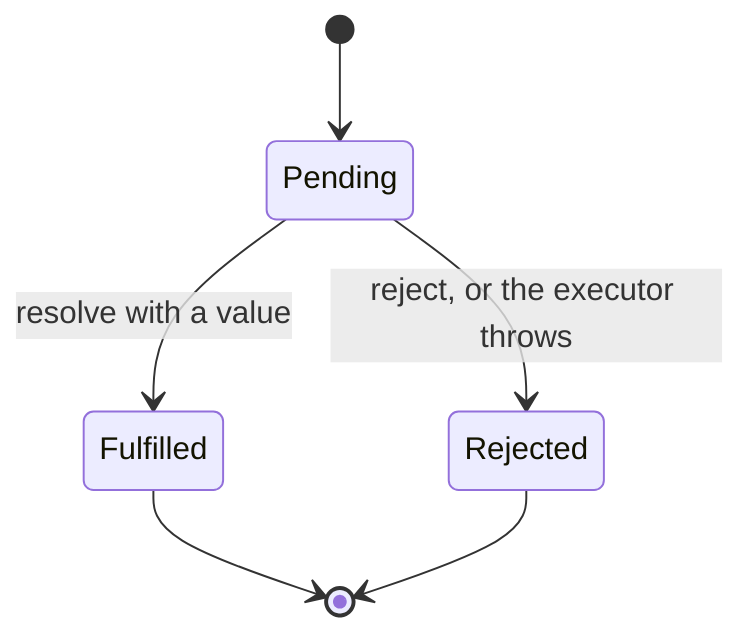
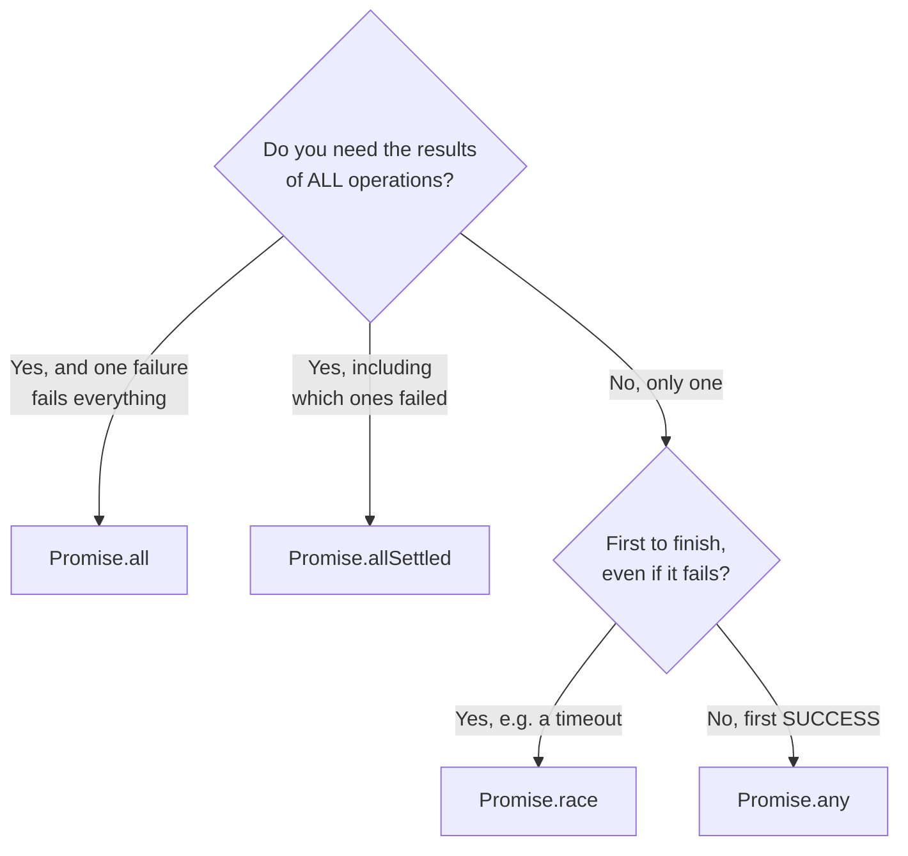
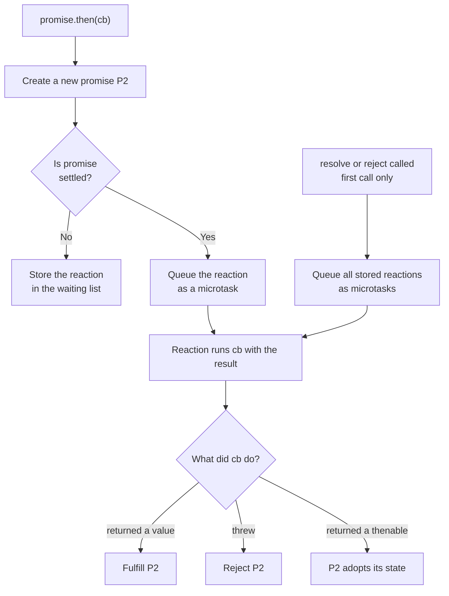

# Callbacks and Promises

> In this document you will learn how JavaScript handles results that arrive later: first with callbacks, then with promises. You will learn how promises work inside, how values and errors travel through a chain, the combinators (`all`, `allSettled`, `race`, `any`), and real patterns like retry, timeout and concurrency limits. Promises are the base of `async`/`await`, Angular's async code, Node.js APIs and Electron IPC, so interviewers test them deeply, often with output puzzles and "implement this" tasks.

**Before this:** [The event loop](16-event-loop.md) · [Functions and functional programming](04-functions-and-functional-programming.md) · **Interview questions:** [jump to the interview section](#interview-questions)

## Table of contents

1. [Synchronous vs asynchronous code](#synchronous-vs-asynchronous-code)
2. [Callbacks](#callbacks)
3. [Error-first callbacks](#error-first-callbacks)
4. [Callback hell and inversion of control](#callback-hell-and-inversion-of-control)
5. [What a promise is](#what-a-promise-is)
6. [Creating promises](#creating-promises)
7. [Using promises: then, catch and finally](#using-promises-then-catch-and-finally)
8. [Chaining and passing values](#chaining-and-passing-values)
9. [How errors travel through a chain](#how-errors-travel-through-a-chain)
10. [Resolving with a promise or a thenable](#resolving-with-a-promise-or-a-thenable)
11. [Promise static methods](#promise-static-methods)
12. [Promisify: turning callbacks into promises](#promisify-turning-callbacks-into-promises)
13. [Unhandled rejections](#unhandled-rejections)
14. [How a promise works inside](#how-a-promise-works-inside)
15. [Async patterns with promises](#async-patterns-with-promises)
16. [Promises in real projects](#promises-in-real-projects)
17. [Common mistakes](#common-mistakes)
18. [Best practices](#best-practices)
19. [How to explain this in an interview](#how-to-explain-this-in-an-interview)
20. [Interview questions](#interview-questions)
21. [Summary](#summary)
22. [References](#references)

---

## Synchronous vs asynchronous code

**Synchronous** code runs line by line. Each line finishes before the next one starts. If a line is slow, everything after it waits.

**Asynchronous** code starts an operation now and handles its result **later**. The rest of your code continues without waiting.

```js
const fs = require("node:fs");

// Synchronous: the thread waits until the file is read
const text = fs.readFileSync(__filename, "utf8");
console.log("sync read done, length > 0:", text.length > 0);

// Asynchronous: start reading, continue, handle the result later
fs.readFile(__filename, "utf8", (error, content) => {
  console.log("async read done");
});
console.log("this line runs before 'async read done'");

// Output:
// sync read done, length > 0: true
// this line runs before 'async read done'
// async read done
```

**Analogy:** in a coffee shop, synchronous is waiting at the counter until your coffee is ready. Nobody behind you can order. Asynchronous is getting a buzzer: you sit down, and the buzzer tells you when the coffee is ready. Meanwhile the shop serves other people.

Why JavaScript needs asynchronous code: it runs on one main thread (see [The event loop](16-event-loop.md)). If it waited for every network request or file read, the page or server would freeze. So slow operations are handed to the host (browser or Node.js), and JavaScript is told about the result later.

There are three main ways to "be told about the result later":

| Style | Since | Example |
| --- | --- | --- |
| Callbacks | The beginning | `fs.readFile(path, (err, data) => {...})` |
| Promises | ES2015 | `fetch(url).then(res => ...)` |
| `async`/`await` (built on promises) | ES2017 | `const res = await fetch(url)` — see [Async/await](18-async-await.md) |

---

## Callbacks

### What it is

A **callback** is a function that you pass to another function, so that the other function can call it later.

```js
function greetUser(name, callback) {
  const message = `Hello, ${name}`;
  callback(message);
}

greetUser("Asha", (message) => console.log(message)); // Hello, Asha
```

### Synchronous and asynchronous callbacks

A callback is just a function. Passing a callback does **not** make anything asynchronous by itself.

```js
// Synchronous callbacks: called right now, before the outer function returns
[1, 2, 3].forEach((n) => console.log("item", n));
console.log("after forEach");
// item 1
// item 2
// item 3
// after forEach

// Asynchronous callback: called later, by the host
setTimeout(() => console.log("timer callback"), 0);
console.log("after setTimeout");
// after setTimeout
// timer callback
```

| Synchronous callbacks | Asynchronous callbacks |
| --- | --- |
| `array.map`, `filter`, `forEach`, `sort` comparators | `setTimeout`, `addEventListener`, `fs.readFile`, `http.createServer` handlers |
| Run before the outer function returns | Run later, as a task, after the current code finishes |

### Real-world callback examples

```js
// Browser: event listener
button.addEventListener("click", (event) => {
  console.log("clicked at", event.clientX, event.clientY);
});

// Node.js: HTTP server request handler
const http = require("node:http");
http.createServer((req, res) => res.end("ok")).listen(3000);
```

Event listeners are a case where callbacks are still the **right tool**: an event can happen many times, and a promise can settle only once.

### Always sync or always async (avoid "Zalgo")

An API that calls its callback **sometimes synchronously and sometimes asynchronously** creates very confusing bugs. This problem has a funny nickname in the Node.js community: "releasing Zalgo".

```js
const cache = new Map();

// ❌ Wrong: synchronous when cached, asynchronous when not
function getUser(id, callback) {
  if (cache.has(id)) {
    callback(null, cache.get(id)); // runs NOW
    return;
  }
  setTimeout(() => {
    const user = { id, name: "Asha" };
    cache.set(id, user);
    callback(null, user); // runs LATER
  }, 10);
}

function load(label) {
  let status = "loading";
  getUser(1, () => console.log(label, "callback sees status:", status));
  status = "waiting";
}

load("first call:");
setTimeout(() => load("second call:"), 50);

// Output:
// first call: callback sees status: waiting
// second call: callback sees status: loading
```

The same code behaves differently depending on the cache. The fix: make the callback **always** asynchronous, for example with `queueMicrotask(() => callback(null, cache.get(id)))`. Promises solve this automatically: `.then` callbacks are **always** asynchronous.

---

## Error-first callbacks

### What it is

Node.js uses a convention called **error-first callbacks** (also "Node-style callbacks"):

- The callback is the **last** argument.
- The callback's **first** parameter is an error (or `null` if there is no error).
- The next parameters are the results.

```js
const fs = require("node:fs");

fs.readFile("config.json", "utf8", (error, text) => {
  if (error) {
    console.error("Could not read config:", error.code); // e.g. ENOENT
    return; // ✅ stop here, do not use `text`
  }
  const config = JSON.parse(text);
  console.log("port:", config.port);
});
```

### Why this convention exists

An asynchronous callback runs later, in a new task. By then, the function that started the work has already returned. So you **cannot** use `try`/`catch` around the call to catch errors that happen later:

```js
const fs = require("node:fs");

// ❌ Wrong: this try/catch cannot catch the read error
try {
  fs.readFile("missing.json", "utf8", (error, text) => {
    // `error` is passed here. Nothing is thrown at the try block.
  });
} catch (error) {
  console.log("never runs for read errors");
}
```

The error is passed as a value instead. Making it the **first** parameter forces you to see it.

### Rules for error-first callbacks

1. **Check the error first**, and `return` after handling it.
2. **Call the callback exactly once.** Not zero times, not twice.
3. **Never throw inside an async callback.** There is no `try` around it anymore. In Node.js, the exception becomes an `uncaughtException` and usually crashes the process.
4. **Pass errors as `Error` objects**, not strings, so you keep the stack trace.

Writing your own function in this style:

```js
const fs = require("node:fs");

function readJson(path, callback) {
  fs.readFile(path, "utf8", (error, text) => {
    if (error) return callback(error);
    let data;
    try {
      data = JSON.parse(text); // JSON.parse throws synchronously: catch it here
    } catch (parseError) {
      return callback(parseError);
    }
    callback(null, data); // call the callback outside the try block
  });
}

readJson("missing.json", (error, data) => {
  if (error) return console.log("failed:", error.code); // failed: ENOENT
  console.log(data);
});
```

Note that `callback(null, data)` is called **outside** the `try` block. If it were inside, an error thrown by the caller's callback would be caught by our `catch`, and the callback would be called a second time with that error.

---

## Callback hell and inversion of control

### Callback hell

When several async steps depend on each other, callbacks nest inside callbacks:

```js
// Each function takes an error-first callback
getUser(userId, (error, user) => {
  if (error) return showError(error);
  getOrders(user.id, (error, orders) => {
    if (error) return showError(error);
    getOrderDetails(orders[0].id, (error, details) => {
      if (error) return showError(error);
      sendReceipt(user.email, details, (error) => {
        if (error) return showError(error);
        console.log("receipt sent");
      });
    });
  });
});
```

This shape is called **callback hell** or the "pyramid of doom". The problems:

- **Hard to read.** The code moves to the right and the logic is buried.
- **Repeated error handling.** Every level must check the error. Forget one and the error disappears.
- **Hard to combine.** Running steps in parallel, adding a timeout or retrying needs a lot of manual code.

You can reduce the nesting with named functions, but the deeper problems stay.

### Inversion of control

The bigger problem is **trust**. When you pass a callback to someone else's code, you give them control over **your** code. You trust them to:

- call it **once** (not twice, not never),
- call it **not too early** (not synchronously when you expect async),
- pass the **right arguments**,
- **not swallow errors**.

This is called **inversion of control**: the other code decides when and how your code runs.

```js
// Imagine a third-party payment SDK with a bug: it calls the callback twice
paymentSdk.charge(cart.total, (error, receipt) => {
  if (error) return showError(error);
  orderService.markPaid(cart.id); // ❌ might run twice: two "paid" events, two emails
});
```

### How promises fix this

With a promise, the other code gives **you** an object, and **you** decide what to do with it. The promise itself guarantees:

| Callback problem | Promise guarantee |
| --- | --- |
| Called twice | A promise settles **only once**. Later `resolve`/`reject` calls are ignored. |
| Called synchronously sometimes | `.then` callbacks are **always** asynchronous (microtasks). |
| Errors swallowed or thrown into nowhere | A thrown error becomes a **rejection** that travels down the chain to a `.catch`. |
| Hard to combine | `Promise.all`, `race`, `any`, `allSettled`, chaining, `async`/`await`. |

The same flow with promises:

```js
getUser(userId)
  .then((user) => getOrders(user.id).then((orders) => ({ user, orders })))
  .then(({ user, orders }) => getOrderDetails(orders[0].id).then((details) => ({ user, details })))
  .then(({ user, details }) => sendReceipt(user.email, details))
  .then(() => console.log("receipt sent"))
  .catch(showError); // one place for every error
```

And with `async`/`await`, which is built on promises (see [Async/await](18-async-await.md)):

```js
try {
  const user = await getUser(userId);
  const orders = await getOrders(user.id);
  const details = await getOrderDetails(orders[0].id);
  await sendReceipt(user.email, details);
  console.log("receipt sent");
} catch (error) {
  showError(error);
}
```

---

## What a promise is

### Definition

A **promise** is an object that represents the **future result** of an asynchronous operation. It is a placeholder: "I do not have the value yet, but I will tell you when I have it, or tell you why it failed."

### States

A promise is always in one of three states:

| State | Meaning |
| --- | --- |
| **pending** | The operation is not finished yet. |
| **fulfilled** | It finished successfully. The promise has a **value**. |
| **rejected** | It failed. The promise has a **reason** (usually an `Error`). |

A promise that is fulfilled or rejected is called **settled**. Once settled, it **never changes again**.



One more word that confuses people: **resolved** is not the same as **fulfilled**. A promise is "resolved" when its fate is decided. If you resolve promise A with another promise B, A is resolved (locked to B) but still **pending** until B settles. If B rejects, A rejects too, even though you "resolved" it.

### Analogy

A promise is like the **order receipt with a number** you get at a fast-food counter.

- When you get it, the food is not ready (pending).
- Later, your number is called and you get the food (fulfilled), or they tell you they ran out (rejected).
- You can decide what to do with the result at any time, even after it is ready: the result waits for you.

Where the analogy breaks: many people can "watch" the same promise and all get the same result. And a promise is not the work itself — the cooking happens anyway, whether anybody watches the receipt or not.

### Why promises are better than events for one-time results

You can attach a `.then` handler **after** the promise is already settled, and the handler still runs with the value. With events, if you add a listener after the event happened, you miss it.

```js
const ready = Promise.resolve("config loaded");

setTimeout(() => {
  // Attached 100 ms later, still receives the value
  ready.then((value) => console.log("late handler:", value));
}, 100);

// After 100 ms: late handler: config loaded
```

---

## Creating promises

### The Promise constructor

```js
const promise = new Promise((resolve, reject) => {
  // This function is called the "executor".
  // Call resolve(value) on success or reject(error) on failure.
});
```

Important facts about the executor:

1. It runs **synchronously**, immediately, inside `new Promise(...)`.
2. Only the **first** call to `resolve` or `reject` counts. Later calls are ignored.
3. If the executor **throws**, the promise is rejected with that error.
4. `resolve` and `reject` do not stop the executor. Code after them still runs (use `return resolve(x)` if you want to stop).

```js
const p = new Promise((resolve, reject) => {
  console.log("executor starts");
  resolve("first");
  resolve("second");            // ignored
  reject(new Error("ignored")); // ignored
  console.log("executor ends");
});

p.then((value) => console.log("value:", value));
console.log("after new Promise");

// Output:
// executor starts
// executor ends
// after new Promise
// value: first
```

### Wrapping a callback API

The main use of `new Promise` is to wrap an API that uses callbacks or events.

```js
// A promise-based delay
function delay(ms) {
  return new Promise((resolve) => setTimeout(resolve, ms));
}

delay(500).then(() => console.log("half a second later"));
```

```js
// Browser: load an image
function loadImage(url) {
  return new Promise((resolve, reject) => {
    const img = new Image();
    img.onload = () => resolve(img);
    img.onerror = () => reject(new Error(`Failed to load image: ${url}`));
    img.src = url;
  });
}

loadImage("/images/logo.png")
  .then((img) => document.body.append(img))
  .catch((error) => console.error(error.message));
```

### Shortcuts: Promise.resolve and Promise.reject

```js
const fulfilled = Promise.resolve(42);                    // already fulfilled with 42
const rejected = Promise.reject(new Error("not allowed")); // already rejected

fulfilled.then((v) => console.log(v));               // 42
rejected.catch((e) => console.log(e.message));       // not allowed
```

`Promise.resolve` is useful when a function must always return a promise, for example when a value is cached:

```js
const cache = new Map();

function getProduct(id) {
  if (cache.has(id)) return Promise.resolve(cache.get(id)); // same type either way
  return fetchProductFromApi(id).then((product) => {
    cache.set(id, product);
    return product;
  });
}
```

### Always reject with Error objects

```js
// ❌ Wrong: no stack trace, no name, harder to check
reject("Something failed");

// ✅ Correct
reject(new Error("Something failed"));
reject(new Error("Payment failed", { cause: originalError })); // ES2022: keep the original error
```

---

## Using promises: then, catch and finally

### then

`promise.then(onFulfilled, onRejected)` registers two optional callbacks:

- `onFulfilled(value)` runs if the promise is fulfilled.
- `onRejected(reason)` runs if the promise is rejected.

The callbacks **always run asynchronously**, as microtasks, even if the promise is already settled.

```js
Promise.resolve("data").then((value) => console.log("got", value));
console.log("this prints first");

// Output:
// this prints first
// got data
```

### catch

`promise.catch(onRejected)` is the same as `promise.then(undefined, onRejected)`. It handles a rejection.

```js
Promise.reject(new Error("network down"))
  .catch((error) => console.log("handled:", error.message)); // handled: network down
```

### finally

`promise.finally(onFinally)` runs a callback when the promise settles, **either way**. It is for cleanup: hide a spinner, close a connection, release a lock.

Its special rules:

1. `onFinally` gets **no arguments**. It does not know if the promise was fulfilled or rejected.
2. It **passes the original result through**. The value or error continues down the chain unchanged.
3. Whatever `onFinally` **returns is ignored** (but if it returns a promise, the chain waits for it).
4. If `onFinally` **throws** (or returns a rejected promise), that new error **replaces** the original result.

```js
Promise.resolve("data")
  .finally(() => "ignored")         // return value is ignored
  .then((v) => console.log(v));     // data
```

```js
Promise.reject(new Error("original"))
  .finally(() => {
    throw new Error("from finally"); // replaces the original error
  })
  .catch((e) => console.log(e.message)); // from finally
```

Real example:

```js
function loadOrders() {
  showSpinner();
  return fetchOrders()
    .then((orders) => renderOrders(orders))
    .catch((error) => showError(error))
    .finally(() => hideSpinner()); // runs on success and on failure
}
```

### One promise, many handlers vs a chain

You can attach **several** handlers to the **same** promise. Each gets the same value. That is **branching**, not chaining.

```js
const userPromise = Promise.resolve({ name: "Asha", role: "admin" });

userPromise.then((user) => console.log("header shows", user.name));
userPromise.then((user) => console.log("menu shows", user.role));

// header shows Asha
// menu shows admin
```

---

## Chaining and passing values

### then returns a new promise

This is the most important fact about promises: **every call to `.then`, `.catch` or `.finally` returns a new promise.** That is why you can chain them.

What happens to that new promise depends on what your callback does:

| Your callback... | The new promise is... |
| --- | --- |
| returns a normal value `x` | fulfilled with `x` |
| returns nothing | fulfilled with `undefined` |
| returns a promise (or thenable) | locked to it: it settles the same way, later |
| throws an error | rejected with that error |
| (no callback for this state, e.g. `.then` without `onRejected` on a rejection) | settled the same way as the previous promise (pass-through) |

### Example: value passing

```js
Promise.resolve(2)
  .then((n) => n * 10)                      // returns 20
  .then((n) => {
    console.log("step 2 got", n);           // step 2 got 20
    return new Promise((resolve) => setTimeout(() => resolve(n + 1), 100));
  })
  .then((n) => console.log("step 3 got", n)); // step 3 got 21 (after 100 ms)
```

Step by step:

1. `Promise.resolve(2)` is fulfilled with `2`.
2. The first callback returns `20`. The second promise is fulfilled with `20`.
3. The second callback logs `20` and returns a **promise**. The third promise waits for it.
4. After 100 ms, the inner promise is fulfilled with `21`. The third promise is fulfilled with `21`, and the last callback logs it.

### Realistic chain

```js
function getCartTotal(userId) {
  return fetchUser(userId)
    .then((user) => fetchCart(user.cartId))         // returns a promise: the chain waits
    .then((cart) => cart.items)                      // returns a value
    .then((items) => items.reduce((sum, item) => sum + item.price * item.qty, 0));
}

getCartTotal(42).then((total) => console.log("total:", total));
```

### The missing return bug

If you start async work inside `.then` but **forget to return it**, the chain does not wait for it, and its errors are lost.

```js
// ❌ Wrong: the next step does not wait for saveOrder, and its errors are lost
validateOrder(order)
  .then((valid) => {
    saveOrder(valid); // promise is created but not returned
  })
  .then(() => showSuccess()) // runs immediately, even if saving fails later
  .catch(showError);         // never sees saveOrder errors

// ✅ Correct: return the promise
validateOrder(order)
  .then((valid) => saveOrder(valid)) // arrow with no braces returns automatically
  .then(() => showSuccess())
  .catch(showError);
```

A promise that nobody returns or awaits is called a **floating promise**. Linters can catch it (for example, the `@typescript-eslint/no-floating-promises` rule).

```js
// The value case is just as easy to get wrong
Promise.resolve(1)
  .then((x) => { x + 1; })      // braces, no return → returns undefined
  .then((x) => console.log(x)); // undefined
```

### Avoid nesting promises

Promises fix callback hell only if you **chain** them instead of nesting them.

```js
// ❌ Wrong: "promise hell" — nested, and the inner errors are not caught by the outer catch
fetchUser(id).then((user) => {
  fetchOrders(user.id).then((orders) => {
    render(user, orders);
  });
}).catch(showError);

// ✅ Correct: flat chain; keep needed values with a small object
fetchUser(id)
  .then((user) => fetchOrders(user.id).then((orders) => ({ user, orders })))
  .then(({ user, orders }) => render(user, orders))
  .catch(showError);
```

When you need many earlier values, `async`/`await` is usually cleaner.

---

## How errors travel through a chain

### The rule

When a promise in the chain is rejected (or a callback throws), the chain **skips** all fulfillment handlers until it finds a **rejection handler** (`.catch` or the second argument of `.then`).

```js
Promise.resolve()
  .then(() => {
    throw new Error("validation failed");
  })
  .then(() => console.log("A: skipped"))
  .then(() => console.log("B: skipped"))
  .catch((error) => console.log("C: caught", error.message))
  .then(() => console.log("D: chain continues"));

// Output:
// C: caught validation failed
// D: chain continues
```

### catch can recover or rethrow

A `.catch` handler works like a `catch` block:

- If it **returns** a value, the chain is **recovered**: the next promise is fulfilled with that value.
- If it **throws** (or rethrows), the chain stays **rejected**.

```js
Promise.reject(new Error("fail"))
  .then(() => console.log("A"))
  .catch((e) => {
    console.log("B", e.message);
    return "recovered"; // recovery
  })
  .then((v) => console.log("C", v))
  .finally(() => console.log("D"));

// Output:
// B fail
// C recovered
// D
```

```js
// Log and rethrow: handle locally, but let the caller know it failed
function loadProfile(id) {
  return fetchProfile(id).catch((error) => {
    logger.warn("profile load failed", { id, error });
    throw error; // ✅ the caller's catch still runs
  });
}
```

A very common bug is a `.catch` that **logs and returns nothing**. That turns the failure into a success with the value `undefined`, and the next step crashes in a confusing way.

### Where you put catch matters

```js
// catch in the middle: protects only the steps before it
fetchSettings()
  .catch(() => DEFAULT_SETTINGS) // if settings fail, use defaults and continue
  .then((settings) => applySettings(settings))
  .catch(showError);             // catches errors from applySettings
```

### then(success, failure) vs then(success).catch(failure)

These two are **not** the same:

```js
// Version 1: the failure handler does NOT catch errors thrown by the success handler
promise.then(onSuccess, onFailure);

// Version 2: the catch handler also catches errors thrown by onSuccess
promise.then(onSuccess).catch(onFailure);
```

```js
Promise.resolve()
  .then(
    () => {
      throw new Error("in success");
    },
    (e) => console.log("handler 1", e.message) // only for rejections of the ORIGINAL promise
  )
  .catch((e) => console.log("handler 2", e.message));

// Output:
// handler 2 in success
```

Use version 1 only when you **want** to handle only the original promise's error, for example to separate "the request failed" from "my processing failed".

---

## Resolving with a promise or a thenable

### Thenables

A **thenable** is any object with a `then` method. Promises are thenables, but so are objects from old promise libraries (for example, jQuery Deferreds).

When you resolve a promise with a thenable, JavaScript **calls its `then` method** to find out the final result. This is called **adoption**: the outer promise adopts the state of the thenable.

```js
const thenable = {
  then(resolve) {
    console.log("then called");
    resolve(42);
  },
};

Promise.resolve(thenable).then((v) => console.log(v));
console.log("sync");

// Output:
// sync
// then called
// 42
```

The thenable's `then` is called **asynchronously** (in a microtask), so `sync` prints first.

### Promise.resolve does not wrap a native promise twice

```js
const p = Promise.resolve(1);

console.log(Promise.resolve(p) === p);          // true  (same object returned)
console.log(new Promise((r) => r(p)) === p);    // false (new promise that follows p)
```

`Promise.resolve(x)` returns `x` itself if `x` is a native promise (from the same constructor). `new Promise(r => r(p))` always creates a new promise that **follows** `p`, which also costs extra microtask ticks (see [Promises and await in the event loop](16-event-loop.md#promises-and-await-in-the-event-loop)).

### A pitfall: objects that accidentally have a then method

```js
const task = {
  title: "Write report",
  then: "Send it to the manager", // just a string, not a function: fine
};
Promise.resolve(task).then((t) => console.log(t.title)); // Write report

const query = {
  sql: "SELECT 1",
  then(cb) { /* a builder method that never calls cb */ },
};
// Promise.resolve(query) would stay pending forever, because `then` is a function
// that never calls resolve. Query builders (like Knex) are thenable on purpose.
```

Only an object whose `then` is a **function** is treated as a thenable. Be careful when you return objects with a `then` method from async functions or `.then` callbacks.

---

## Promise static methods

### The four combinators

A **combinator** takes many promises and returns **one** promise that represents all of them in some way. They all accept any iterable (usually an array). Non-promise values in the array are treated as already-fulfilled promises.

| Method | Fulfills when | Rejects when | Result | Empty input | Added in |
| --- | --- | --- | --- | --- | --- |
| `Promise.all` | **all** inputs fulfill | the **first** input rejects | array of values, in **input order** | fulfills with `[]` | ES2015 |
| `Promise.allSettled` | **all** inputs settle (either way) | never | array of `{ status, value }` or `{ status, reason }` | fulfills with `[]` | ES2020 |
| `Promise.race` | the **first** input to settle is fulfilled | the **first** input to settle is rejected | the first settled value or reason | stays **pending forever** | ES2015 |
| `Promise.any` | the **first** input fulfills | **all** inputs reject | the first fulfilled value, or an `AggregateError` with `.errors` | rejects with `AggregateError` | ES2021 |

**Important:** none of them **cancels** anything. When `Promise.all` rejects early, the other operations keep running. Their results are just ignored. Cancellation needs `AbortController` (see [Async/await](18-async-await.md)).

### Promise.all: "I need everything"

Use it when you need **all** results and one failure means the whole operation failed.

```js
// Load everything a dashboard needs, in parallel
function loadDashboard(userId) {
  return Promise.all([
    fetchUser(userId),
    fetchNotifications(userId),
    fetchStats(userId),
  ]).then(([user, notifications, stats]) => ({ user, notifications, stats }));
}
```

The results are in the **order of the input**, not in the order they finished:

```js
const delay = (ms, value) =>
  new Promise((resolve) =>
    setTimeout(() => {
      console.log("finished", value);
      resolve(value);
    }, ms)
  );

Promise.all([delay(30, "slow"), delay(10, "fast"), delay(20, "medium")]).then((results) =>
  console.log(results)
);

// Output:
// finished fast
// finished medium
// finished slow
// [ 'slow', 'fast', 'medium' ]
```

### Promise.allSettled: "I want every outcome"

Use it when the operations are independent and you want to know which ones failed, without stopping at the first failure.

```js
const delay = (ms, value, fail = false) =>
  new Promise((resolve, reject) =>
    setTimeout(() => (fail ? reject(new Error(value)) : resolve(value)), ms)
  );

Promise.allSettled([
  delay(10, "email to asha"),
  delay(20, "bad address", true),
  delay(5, "email to ravi"),
]).then((results) => {
  const sent = results.filter((r) => r.status === "fulfilled").map((r) => r.value);
  const failed = results.filter((r) => r.status === "rejected").map((r) => r.reason.message);
  console.log("sent:", sent);
  console.log("failed:", failed);
});

// Output:
// sent: [ 'email to asha', 'email to ravi' ]
// failed: [ 'bad address' ]
```

Each result looks like `{ status: "fulfilled", value: ... }` or `{ status: "rejected", reason: ... }`.

### Promise.race: "the first one to finish wins"

Use it mainly for **timeouts**: race the real operation against a timer that rejects.

```js
function withTimeout(promise, ms) {
  let timerId;
  const timeout = new Promise((_, reject) => {
    timerId = setTimeout(() => reject(new Error(`Timed out after ${ms} ms`)), ms);
  });
  return Promise.race([promise, timeout]).finally(() => clearTimeout(timerId));
}

withTimeout(fetchReport(), 5000)
  .then(showReport)
  .catch((error) => showError(error.message)); // "Timed out after 5000 ms" if too slow
```

Note: `race` settles with the first promise that **settles**, even if that is a **rejection**:

```js
const delay = (ms, value, fail = false) =>
  new Promise((resolve, reject) =>
    setTimeout(() => (fail ? reject(new Error(value)) : resolve(value)), ms)
  );

Promise.race([delay(20, "slow success"), delay(10, "fast failure", true)]).then(
  (v) => console.log("value:", v),
  (e) => console.log("error:", e.message)
);

// Output:
// error: fast failure
```

### Promise.any: "I need just one success"

Use it when you have several sources for the same thing and want the first one that works: several mirrors, several CDNs, cache or network.

```js
const delay = (ms, value, fail = false) =>
  new Promise((resolve, reject) =>
    setTimeout(() => (fail ? reject(new Error(value)) : resolve(value)), ms)
  );

Promise.any([
  delay(30, "mirror A failed", true),
  delay(20, "mirror B"),
  delay(10, "mirror C failed", true),
]).then((v) => console.log("using", v)); // using mirror B

Promise.any([Promise.reject(new Error("a")), Promise.reject(new Error("b"))]).catch((e) => {
  console.log(e.name, "|", e.message, "|", e.errors.map((x) => x.message));
});
// AggregateError | All promises were rejected | [ 'a', 'b' ]
// (If you run both snippets together, this line prints first: these promises
// are already rejected, so no timer has to fire.)
```

### Choosing a combinator



### Promise.withResolvers (ES2024)

Sometimes you need to call `resolve` or `reject` from **outside** the executor, for example when the result comes from an event handler that is set up elsewhere. Before ES2024 you wrote this:

```js
let resolveReady;
const ready = new Promise((resolve) => {
  resolveReady = resolve; // leak resolve out of the executor
});
```

`Promise.withResolvers()` does it in one line:

```js
const { promise, resolve, reject } = Promise.withResolvers();

setTimeout(() => resolve("resolved from outside"), 5);
promise.then((value) => console.log(value)); // resolved from outside
```

A realistic use: wait for a specific reply message on a WebSocket.

```js
// Browser or Node.js 22+ (WebSocket client)
const pending = new Map(); // requestId -> { resolve, reject }

function request(socket, payload) {
  const id = crypto.randomUUID();
  const { promise, resolve, reject } = Promise.withResolvers();
  pending.set(id, { resolve, reject });
  socket.send(JSON.stringify({ id, ...payload }));
  return promise;
}

function onMessage(event) {
  const message = JSON.parse(event.data);
  const entry = pending.get(message.id);
  if (!entry) return;
  pending.delete(message.id);
  if (message.error) entry.reject(new Error(message.error));
  else entry.resolve(message.result);
}
```

Support: ES2024. Available in Node.js 22+, Chrome 119+, Firefox 121+, Safari 17.4+.

### Promise.try (ES2025)

`Promise.try(fn, ...args)` calls `fn` immediately and always returns a promise:

- if `fn` returns a value → fulfilled promise,
- if `fn` returns a promise → that promise's result,
- if `fn` **throws synchronously** → rejected promise (instead of a thrown exception).

```js
// Node.js 24+ / modern browsers
function parseConfig(text) {
  return JSON.parse(text); // may throw synchronously
}

Promise.try(parseConfig, "{ invalid json")
  .then((config) => console.log(config))
  .catch((error) => console.log("caught:", error.name)); // caught: SyntaxError
```

Without `Promise.try`, a synchronous throw would escape before any `.catch` is attached. The older workaround is `Promise.resolve().then(() => parseConfig(text))`, but that runs the function one microtask later instead of right away.

Support: ES2025. Node.js 23+ (so **Node.js 24 LTS has it, Node.js 22 does not**), Chrome 128+, Firefox 134+, Safari 18.2+.

---

## Promisify: turning callbacks into promises

Old APIs use error-first callbacks. To use them with `.then` or `await`, you **promisify** them: wrap them in a function that returns a promise.

### Manually, for one function

```js
const fs = require("node:fs");

function readFileAsync(path, encoding) {
  return new Promise((resolve, reject) => {
    fs.readFile(path, encoding, (error, data) => {
      if (error) reject(error);
      else resolve(data);
    });
  });
}

readFileAsync("missing.txt", "utf8").catch((e) => console.log(e.code)); // ENOENT
```

### A generic promisify

```js
function promisify(fn) {
  return function (...args) {
    return new Promise((resolve, reject) => {
      // keep `this`, add our callback as the last argument
      fn.call(this, ...args, (error, result) => {
        if (error) reject(error);
        else resolve(result);
      });
    });
  };
}

const fs = require("node:fs");
const readFile = promisify(fs.readFile);

readFile(__filename, "utf8").then((text) => console.log("chars > 0:", text.length > 0)); // chars > 0: true
```

`fn.call(this, ...)` matters for methods. If you promisify a method like `db.query`, call the promisified version on the object (`db.queryAsync = promisify(db.query)` then `db.queryAsync(sql)`), or bind it: `promisify(db.query.bind(db))`. See [`this`, call, apply, bind](06-this-call-apply-bind.md).

### In Node.js, use the built-in tools

```js
const util = require("node:util");
const fs = require("node:fs");

const readFile = util.promisify(fs.readFile); // built-in promisify
readFile(__filename, "utf8").then((t) => console.log(t.length > 0)); // true

// Even better: most core modules have a promise API already
const fsp = require("node:fs/promises");
fsp.readFile(__filename, "utf8").then((t) => console.log(t.length > 0)); // true
```

Other built-in promise APIs in Node.js: `node:timers/promises` (`setTimeout` that returns a promise), `node:stream/promises` (`pipeline`), `events.once(emitter, "event")`, `node:dns/promises`. See [Core modules](../07-nodejs-backend/04-core-modules-fs-path-events-buffer.md).

---

## Unhandled rejections

### What it is

An **unhandled rejection** happens when a promise is rejected and **no rejection handler** is attached to it in time. It is the promise version of an uncaught exception. The error happened, and nobody is listening.

```js
function saveDraft(draft) {
  return api.post("/drafts", draft); // may reject
}

saveDraft(draft); // ❌ floating promise: if it rejects, nobody handles it
```

### When does a rejection count as unhandled?

The host checks after the current microtasks are processed. If a rejected promise still has no handler at that moment, it is reported. If you attach a handler later (for example, inside a `setTimeout`), it is **too late**: it is already reported. Browsers then fire a `rejectionhandled` event; Node.js may already have stopped the process.

### What happens in browsers

The browser logs "Uncaught (in promise)" in the console and fires an `unhandledrejection` event on `window`. You can listen to it for error reporting:

```js
// Browser: report unhandled rejections to your monitoring service
window.addEventListener("unhandledrejection", (event) => {
  reportError({ type: "unhandledrejection", reason: String(event.reason) });
  // event.preventDefault(); // would hide the default console message
});
```

The page keeps running.

### What happens in Node.js

Since **Node.js 15**, the default mode is `throw`: an unhandled rejection is raised as an uncaught exception. If there is no `uncaughtException` handler, the **process exits with code 1**.

```js
// Node.js
Promise.reject(new Error("nobody handles me"));
setTimeout(() => console.log("this never prints"), 100);

// The process prints the error with its stack trace and exits with code 1.
// "this never prints" is never printed.
```

You can observe them with `process.on("unhandledRejection", (reason, promise) => { ... })`, usually to log and then shut down cleanly. You can change the behavior with the `--unhandled-rejections` flag (`throw`, `strict`, `warn`, `warn-with-error-code`, `none`), but the safe default is to crash and restart, because the app may be in an unknown state.

Global error handlers and shutdown strategies are covered in [Error handling](15-error-handling.md).

### How to avoid them

- Every promise chain ends with a `.catch`, or is returned/awaited by someone who handles it.
- In `async` functions, `await` every promise you create (or pass it to `Promise.all`/`allSettled`).
- If you **really** want fire-and-forget, make it explicit and handle errors: `saveDraft(draft).catch(logError);`.
- Turn on a linter rule against floating promises.

---

## How a promise works inside

You do not need this to use promises, but interviewers often ask "how would you implement a promise?". Knowing the inside also makes the output puzzles easy.

### The internal state

The specification describes each promise as an object with hidden internal slots:

| Internal slot | Holds |
| --- | --- |
| `[[PromiseState]]` | `"pending"`, `"fulfilled"` or `"rejected"` |
| `[[PromiseResult]]` | the value or the reason |
| `[[PromiseFulfillReactions]]` | list of callbacks waiting for fulfillment |
| `[[PromiseRejectReactions]]` | list of callbacks waiting for rejection |
| `[[PromiseIsHandled]]` | whether any handler was ever attached (used for unhandled rejection tracking) |

### The two key operations

1. **`then(onFulfilled, onRejected)`**:
   - creates a **new** promise (the one it returns),
   - if the current promise is pending, stores a **reaction** (callback + the new promise's resolve/reject) in the lists,
   - if it is already settled, queues the reaction as a **microtask** immediately.
2. **Settling (resolve/reject)**:
   - changes the state once (later calls are ignored),
   - queues every stored reaction as a microtask,
   - clears the lists.

When a reaction runs, it calls your callback and uses the result to **resolve the new promise**: a value fulfills it, a thrown error rejects it, a returned thenable is adopted.



### A minimal implementation

This simplified version covers the important behavior: synchronous executor, settle once, async callbacks, chaining, error propagation and thenable adoption. (A complete, test-passing version with `finally` and the static methods is in [Polyfills and implementations](../11-coding-interviews/04-javascript-polyfills-and-implementations.md).)

```js
class MyPromise {
  #state = "pending";
  #value = undefined;
  #reactions = [];

  constructor(executor) {
    let called = false; // resolve/reject work only once
    const resolve = (value) => { if (!called) { called = true; this.#resolveWith(value); } };
    const reject = (reason) => { if (!called) { called = true; this.#settle("rejected", reason); } };
    try {
      executor(resolve, reject); // the executor runs synchronously
    } catch (error) {
      reject(error);
    }
  }

  #resolveWith(value) {
    if (value === this) {
      return this.#settle("rejected", new TypeError("Cannot resolve a promise with itself"));
    }
    if (value !== null && (typeof value === "object" || typeof value === "function")) {
      let then;
      try { then = value.then; } catch (error) { return this.#settle("rejected", error); }
      if (typeof then === "function") {
        // Adopt the state of the thenable (in a microtask, like the spec)
        let called = false;
        queueMicrotask(() => {
          try {
            then.call(
              value,
              (v) => { if (!called) { called = true; this.#resolveWith(v); } },
              (r) => { if (!called) { called = true; this.#settle("rejected", r); } }
            );
          } catch (error) {
            if (!called) { called = true; this.#settle("rejected", error); }
          }
        });
        return;
      }
    }
    this.#settle("fulfilled", value);
  }

  #settle(state, value) {
    if (this.#state !== "pending") return;
    this.#state = state;
    this.#value = value;
    this.#reactions.forEach((reaction) => queueMicrotask(reaction));
    this.#reactions = [];
  }

  then(onFulfilled, onRejected) {
    return new MyPromise((resolve, reject) => {
      const reaction = () => {
        const handler = this.#state === "fulfilled" ? onFulfilled : onRejected;
        if (typeof handler !== "function") {
          // No handler for this state: pass the value or error through
          return this.#state === "fulfilled" ? resolve(this.#value) : reject(this.#value);
        }
        try {
          resolve(handler(this.#value)); // the return value feeds the next promise
        } catch (error) {
          reject(error); // a throw rejects the next promise
        }
      };
      if (this.#state === "pending") this.#reactions.push(reaction);
      else queueMicrotask(reaction); // already settled: still run later, never now
    });
  }

  catch(onRejected) {
    return this.then(undefined, onRejected);
  }

  static resolve(value) {
    return value instanceof MyPromise ? value : new MyPromise((resolve) => resolve(value));
  }
}

// Try it
console.log("start");
new MyPromise((resolve) => setTimeout(() => resolve(2), 10))
  .then((n) => n * 10)
  .then((n) => new MyPromise((resolve) => setTimeout(() => resolve(n + 1), 10)))
  .then((n) => { throw new Error("failed at " + n); })
  .then(() => console.log("skipped"))
  .catch((error) => console.log("caught:", error.message))
  .then(() => console.log("chain continues"));
MyPromise.resolve("sync value").then((v) => console.log(v));
console.log("end");

// Output:
// start
// end
// sync value
// caught: failed at 21
// chain continues
```

The ideas to remember for an interview:
- **State + value + list of reactions.**
- `then` **always returns a new promise** and **always runs callbacks asynchronously** (microtask).
- The callback's **return value resolves** the next promise; a **throw rejects** it.
- **Missing handler = pass-through.** That is how errors skip `.then` steps until a `.catch`.

---

## Async patterns with promises

### Sequential vs parallel

If operations do **not depend** on each other, start them all and wait together. If they **do depend** on each other, run them one after another.

```js
const sleep = (ms, value) => new Promise((r) => setTimeout(() => r(value), ms));
const round = (ms) => Math.round(ms / 100) * 100;

// Sequential: about 300 ms
const t1 = Date.now();
sleep(100, "a")
  .then(() => sleep(100, "b"))
  .then(() => sleep(100, "c"))
  .then(() => {
    console.log("sequential took about", round(Date.now() - t1), "ms");

    // Parallel: about 100 ms
    const t2 = Date.now();
    return Promise.all([sleep(100, "a"), sleep(100, "b"), sleep(100, "c")]).then(() =>
      console.log("parallel took about", round(Date.now() - t2), "ms")
    );
  });

// Output:
// sequential took about 300 ms
// parallel took about 100 ms
```

**Important:** a promise represents work that has **already started**. `Promise.all` does not "start" anything. The work starts when you call `sleep(...)` / `fetch(...)`. So "parallel" really means "started at the same time, waited for together".

### Running a list of steps in order

For a dynamic list, chain with `reduce` (or use `for...of` with `await`, see [Async/await](18-async-await.md)):

```js
const sleep = (ms) => new Promise((r) => setTimeout(r, ms));
const steps = ["validate", "save", "notify"];

steps
  .reduce(
    (chain, step) => chain.then(() => sleep(100).then(() => console.log("done:", step))),
    Promise.resolve() // start with a fulfilled promise
  )
  .then(() => console.log("all steps done"));

// Output:
// done: validate
// done: save
// done: notify
// all steps done
```

Notice the steps are **functions** that create the promise when it is their turn. If you created all promises first (`steps.map(runStep)`), they would all start at once and the "order" would be fake.

### Retry with exponential backoff

Network calls fail sometimes. A **retry** tries again. **Exponential backoff** waits longer after each failure (200 ms, 400 ms, 800 ms...), so you do not overload a struggling server. **Jitter** adds randomness so that many clients do not retry at the same moment.

```js
const sleep = (ms) => new Promise((resolve) => setTimeout(resolve, ms));

function retry(operation, { retries = 3, baseDelayMs = 200, maxDelayMs = 5000, shouldRetry = () => true } = {}) {
  let attempt = 0;

  function run() {
    attempt += 1;
    return operation(attempt).catch((error) => {
      if (attempt > retries || !shouldRetry(error)) throw error; // give up
      const exp = Math.min(maxDelayMs, baseDelayMs * 2 ** (attempt - 1));
      const wait = Math.random() * exp; // "full jitter"
      console.log(`attempt ${attempt} failed (${error.message}), retrying in ${Math.round(wait)} ms`);
      return sleep(wait).then(run); // try again after the wait
    });
  }

  return run();
}

// Demo: fails twice, then succeeds
let calls = 0;
function flakyRequest() {
  calls += 1;
  return calls < 3 ? Promise.reject(new Error("503 Service Unavailable")) : Promise.resolve({ ok: true });
}

retry(flakyRequest, { retries: 4, baseDelayMs: 20 }).then((result) =>
  console.log("result:", result, "after", calls, "calls")
);

// Output (the wait times are random):
// attempt 1 failed (503 Service Unavailable), retrying in 12 ms
// attempt 2 failed (503 Service Unavailable), retrying in 31 ms
// result: { ok: true } after 3 calls
```

Rules for retries in real systems:

- Retry only errors that can succeed later: network errors, timeouts, `429`, `502`, `503`, `504`. Do not retry `400`, `401`, `403`, `404` or validation errors. Use `shouldRetry` for that.
- Retry only **idempotent** operations (safe to repeat), like `GET` or a `PUT` with the same data. Retrying a `POST /payments` can charge twice unless the API supports idempotency keys.
- Always have a maximum number of attempts and a maximum delay.

### Timeout with race

You saw `withTimeout` above. Two details make it production-ready:

1. **Clear the timer** in `finally`. Otherwise the timer keeps running (and in Node.js keeps the process alive) after the real promise wins.
2. A timeout **does not stop the real operation**. The request continues in the background; you only stop waiting. To really stop it, pass an `AbortSignal` (for `fetch`: `AbortSignal.timeout(ms)`). See [Async/await](18-async-await.md).

### Concurrency limit (mapLimit)

`Promise.all(items.map(fetchItem))` starts **all** requests at once. With 5,000 items, that can overload the server, hit rate limits, or run out of sockets or memory. A **concurrency limit** runs at most `limit` operations at the same time.

```js
function mapLimit(items, limit, mapper) {
  return new Promise((resolve, reject) => {
    const results = new Array(items.length);
    let nextIndex = 0; // next item to start
    let active = 0;    // operations running now
    let done = 0;      // operations finished
    let failed = false;

    if (items.length === 0) return resolve(results);

    function startNext() {
      while (active < limit && nextIndex < items.length && !failed) {
        const index = nextIndex++;
        active += 1;
        Promise.resolve()
          .then(() => mapper(items[index], index)) // also catches sync throws
          .then(
            (value) => {
              results[index] = value; // keep input order
              active -= 1;
              done += 1;
              if (done === items.length) resolve(results);
              else startNext(); // a slot is free: start the next item
            },
            (error) => {
              failed = true; // stop starting new work
              reject(error);
            }
          );
      }
    }

    startNext();
  });
}

// Demo
const sleep = (ms) => new Promise((r) => setTimeout(r, ms));
let running = 0;
let maxRunning = 0;

mapLimit([1, 2, 3, 4, 5, 6, 7], 3, async (id) => {
  running++;
  maxRunning = Math.max(maxRunning, running);
  await sleep(10 * ((id % 3) + 1)); // different durations
  running--;
  return `user-${id}`;
}).then((users) => console.log(users.join(","), "| max running:", maxRunning));

// Output:
// user-1,user-2,user-3,user-4,user-5,user-6,user-7 | max running: 3
```

Step by step:

1. `startNext` starts items 0, 1 and 2 (three slots).
2. When any of them finishes, it stores its result **at its own index**, frees a slot, and calls `startNext`, which starts the next item.
3. When all items are done, the promise resolves with results in **input order**, even though they finished in a different order.
4. On the first error, it rejects and stops starting new work. Already-running operations continue (no cancellation).

Libraries like `p-limit` do the same. The async/await version is in [Async/await](18-async-await.md#controlled-concurrency).

### Sharing one in-flight request (deduplication)

If three components ask for the same product at the same time, you can share **one** request by caching the **promise**, not the value:

```js
const inFlight = new Map();

function getProduct(id) {
  if (inFlight.has(id)) return inFlight.get(id); // reuse the running request
  const promise = fetchProduct(id).finally(() => inFlight.delete(id)); // forget it when done
  inFlight.set(id, promise);
  return promise;
}

Promise.all([getProduct(7), getProduct(7), getProduct(7)]).then(([a, b]) => {
  console.log(a === b); // true — one network call, same result object
});
```

Removing the entry in `finally` means a **failed** request is not cached forever: the next caller tries again.

---

## Promises in real projects

### fetch does not reject on HTTP errors

`fetch` rejects only when the request **could not be made** (network failure, DNS error, CORS block, abort). A `404` or `500` response is a **successful** fetch with `response.ok === false`.

```js
// ❌ Wrong: a 404 or 500 goes into the success path
fetch("/api/orders/42")
  .then((response) => response.json())
  .then(renderOrder)
  .catch(showError);

// ✅ Correct: turn HTTP errors into rejections
function getJson(url, options) {
  return fetch(url, options).then((response) => {
    if (!response.ok) {
      throw new Error(`HTTP ${response.status} for ${url}`);
    }
    return response.json();
  });
}

getJson("/api/orders/42").then(renderOrder).catch(showError);
```

More in [API integration and data fetching](../05-frontend-engineering/07-api-integration-and-data-fetching.md).

### Angular 16: Observables and promises

Angular's `HttpClient` returns **Observables** (RxJS), not promises. Observables can emit many values and can be cancelled by unsubscribing; promises give one value and cannot be cancelled. Most Angular code should stay with Observables (see [RxJS](../06-angular-16/09-rxjs.md)). When you really need a promise — for example, an app initializer — convert with `firstValueFrom` or `lastValueFrom` (RxJS 7). The old `.toPromise()` is deprecated.

```ts
// Angular 16: load runtime config before the app starts
import { APP_INITIALIZER, Injectable, NgModule } from "@angular/core";
import { HttpClient, HttpClientModule } from "@angular/common/http";
import { firstValueFrom } from "rxjs";

interface AppConfig {
  apiUrl: string;
}

@Injectable({ providedIn: "root" })
export class ConfigService {
  config?: AppConfig;

  constructor(private http: HttpClient) {}

  load(): Promise<void> {
    return firstValueFrom(this.http.get<AppConfig>("/assets/config.json")).then((config) => {
      this.config = config;
    });
  }
}

export function initConfig(configService: ConfigService): () => Promise<void> {
  return () => configService.load(); // Angular waits for this promise before bootstrapping
}

@NgModule({
  imports: [HttpClientModule],
  providers: [{ provide: APP_INITIALIZER, useFactory: initConfig, deps: [ConfigService], multi: true }],
})
export class CoreModule {}
```

> **Newer Angular (19+):** `provideAppInitializer(() => inject(ConfigService).load())` replaces the `APP_INITIALIZER` token, which is deprecated from v19.

### Node.js

Modern Node.js APIs are promise-based: `node:fs/promises`, `node:timers/promises`, `node:stream/promises`, `events.once`, and almost all database drivers. Use `util.promisify` only for old callback APIs.

### Electron

In Electron, the renderer calls the main process with `ipcRenderer.invoke(channel, ...args)`, which returns a **promise**. If the main-process handler throws or returns a rejected promise, the renderer's promise rejects. Only the error's `message` is passed across (the error is serialized), so do not rely on custom error classes or extra properties crossing the IPC boundary. See [IPC and preload scripts](../08-electron-desktop/03-ipc-and-preload-scripts.md).

---

## Common mistakes

1. **Forgetting to `return` inside `.then`.** The chain does not wait, and errors are lost. See [the missing return bug](#the-missing-return-bug).
2. **Nesting promises instead of chaining.** It recreates callback hell and breaks error handling.
3. **No `.catch` at the end.** Leads to unhandled rejections; in Node.js, a crash.
4. **A `.catch` that only logs.** It converts the failure into success with `undefined`. Rethrow if the caller must know.
5. **The explicit construction anti-pattern** — wrapping something that is already a promise in `new Promise`:

   ```js
   // ❌ Wrong: extra code, and if getUser throws synchronously or you forget reject, errors are lost
   function loadUser(id) {
     return new Promise((resolve, reject) => {
       getUser(id).then((user) => resolve(user)).catch(reject);
     });
   }

   // ✅ Correct: just return the promise (and transform it if needed)
   function loadUser(id) {
     return getUser(id);
   }
   ```

6. **Rejecting with strings** instead of `Error` objects. You lose the stack trace.
7. **Thinking `Promise.all` cancels the others** when one fails. It does not.
8. **Expecting `fetch` to reject on 404/500.** Check `response.ok`.
9. **Creating promises too early** when you wanted them to run later or in order. A promise starts its work when it is created. Pass **functions** that create promises if you need control (retry, sequence, concurrency limit).
10. **Using `forEach` with async work.** `forEach` ignores returned promises. Use `for...of` with `await`, or `Promise.all(items.map(...))`.
11. **Throwing inside a `setTimeout` callback inside an executor.** That error is not caught by the promise. Call `reject` instead (see [Q23](#q23-is-an-error-thrown-inside-a-settimeout-callback-in-the-executor-caught-by-catch)).

---

## Best practices

- **Return promises from every function that does async work.** Callers can then wait, chain and handle errors.
- **End every chain with `.catch`, or hand the promise to someone who handles it.** This prevents unhandled rejections.
- **Keep chains flat.** Return the next promise instead of nesting. Flat chains are easier to read and errors flow to one place.
- **Reject with `Error` objects (use `cause` to wrap).** You keep stack traces and can check `name` or `instanceof`.
- **Use `finally` for cleanup only.** Do not return values from it; it does not change the result (except by throwing).
- **Pick the right combinator.** `all` for all-or-nothing, `allSettled` for independent work, `race` for timeouts, `any` for first success.
- **Limit concurrency for large lists.** Protects servers, rate limits and memory.
- **Retry only idempotent operations, with backoff, jitter and a limit.** Prevents duplicate side effects and retry storms.
- **Use built-in promise APIs (`fs/promises`, `util.promisify`).** Less code, fewer bugs than hand-written wrappers.
- **Prefer `async`/`await` for complex flows.** It is easier to read; it is still promises underneath, so everything in this document still applies.
- **Turn on lint rules for floating promises** (`@typescript-eslint/no-floating-promises`, `no-misused-promises`). They catch missing `await`/`return` automatically.

---

## How to explain this in an interview

1. **Define it:** "A promise is an object that represents the future result of an async operation. It is pending at first, and then settles once: fulfilled with a value or rejected with a reason."
2. **Why it exists:** "Callbacks led to deep nesting, repeated error handling and inversion of control — I had to trust other code to call my callback exactly once and at the right time. A promise gives me an object I control, it settles only once, and its callbacks always run asynchronously."
3. **How it works:** "`then` registers callbacks and returns a new promise. Whatever my callback returns resolves the next promise; if it throws, the next promise rejects. Rejections skip success handlers until a `catch`. The callbacks run as microtasks."
4. **Small example:** "`fetchUser().then(user => fetchOrders(user.id)).then(render).catch(showError)` — the second step waits for the orders promise because I return it, and any error from any step lands in the one `catch`."
5. **Where it is useful:** "Every async API: `fetch`, Node's `fs/promises`, database drivers, Electron's `ipcRenderer.invoke`. And `async`/`await` is built on top of promises. For many operations I use `Promise.all`, `allSettled`, `race` for timeouts, or `any`."
6. **Trade-offs and gotchas:** "A promise is eager and can't be cancelled by itself — I need an `AbortController`. It represents one value, so for streams of values I use Observables or async iterators. And I must always handle rejections; in Node an unhandled rejection crashes the process by default."

---

## Interview questions

### Q1. What is a promise?

**What the interviewer is checking:** A clear definition, the states, and the key guarantees — not just "it is for async code".

**Short spoken answer (30–60 seconds):**
> A promise is an object that represents the future result of an asynchronous operation. It starts as pending, and then it settles exactly once: either fulfilled with a value or rejected with a reason, usually an Error. I attach callbacks with `then`, `catch` and `finally`. Each of these returns a new promise, so I can chain steps, and an error from any step skips ahead to the next `catch`. The callbacks always run asynchronously, as microtasks, even if the promise is already settled. Promises replaced deeply nested callbacks, and `async`/`await` is built on top of them. One limitation: a promise can't be cancelled by itself and it only carries one value.

**Detailed explanation:**
- States: pending → fulfilled or rejected. Settled = fulfilled or rejected. Settled promises never change.
- "Resolved" means the fate is decided; a promise resolved with another promise is still pending until that one settles.
- Guarantees: settles once; callbacks are async; errors propagate; handlers can be attached at any time and still get the result.

**Follow-up questions:**
- **Is a promise the async operation itself?** — No. It is a placeholder for the result. The operation (a request, a timer) was already started by whoever created the promise.
- **Can a promise be fulfilled with another promise as its value?** — No. If you resolve with a promise or thenable, the outer promise adopts its state. You can never get a promise as the final value of `.then`.
- **What is the difference between a promise and an Observable?** — A promise is eager, gives one value, and cannot be cancelled. An Observable is lazy (starts on subscribe), can emit many values, and can be cancelled by unsubscribing. See [RxJS](../06-angular-16/09-rxjs.md).
- **Are promise callbacks tasks or microtasks?** — Microtasks. They run after the current code and before the next task (timer, event). See [The event loop](16-event-loop.md).

**Common mistakes:** Saying a promise "runs code in the background"; confusing resolved and fulfilled; saying `then` modifies the original promise.

**Where this is used in real projects:** `fetch`, Node's `fs/promises`, database drivers, Electron `invoke`, Angular app initializers, every `async` function.

---

### Q2. Why were promises introduced? What is wrong with callbacks?

**What the interviewer is checking:** Whether you understand inversion of control, not only "callback hell looks ugly".

**Short spoken answer (30–60 seconds):**
> Callbacks have two kinds of problems. The visible one is callback hell: dependent steps nest deeper and deeper, and I must handle errors at every level. The deeper one is inversion of control: when I pass my callback to another library, I trust it to call it exactly once, not too early, with the right arguments, and not to swallow errors. If a payment SDK calls my callback twice, I might mark an order as paid twice. Promises flip this: the library gives me back an object, and the promise itself guarantees it settles only once, that callbacks are always async, and that errors travel down the chain to a `catch`. They also compose: I can chain, run things in parallel with `Promise.all`, add timeouts with `race`, and use `async`/`await`.

**Follow-up questions:**
- **Are callbacks bad in general?** — No. For events that happen many times (clicks, stream data, WebSocket messages), callbacks or event listeners are the right tool, because a promise settles only once. Array methods also use synchronous callbacks.
- **What is "Zalgo"?** — An API that calls its callback sometimes synchronously and sometimes asynchronously. It causes order-dependent bugs. Promises avoid it because `then` callbacks are always asynchronous. See [Always sync or always async](#always-sync-or-always-async-avoid-zalgo).
- **Can you fix callback hell without promises?** — Partly: name the functions and flatten them, or use helper libraries like `async.waterfall`. But inversion of control and error propagation stay manual.

**Common mistakes:** Only talking about indentation; claiming promises make code faster.

**Where this is used in real projects:** Migrating old Node.js callback code to `fs/promises` and `util.promisify`; wrapping old SDKs in promise-based services.

---

### Q3. What are the states of a promise? Can a promise be resolved twice?

**Short answer:** Pending, fulfilled and rejected. Fulfilled and rejected together are called settled. A promise settles **only once**. After the first `resolve` or `reject`, later calls do nothing, and a `throw` after settling is also ignored.

```js
const p = new Promise((resolve, reject) => {
  resolve("first");
  reject(new Error("too late"));
  resolve("second");
  throw new Error("also ignored"); // the promise is already settled
});

p.then((v) => console.log(v), (e) => console.log("rejected:", e.message)); // first
```

**Follow-up questions:**
- **Can you read a promise's state synchronously?** — Not with a standard API. You only learn the result through `then`/`await`. (DevTools and Node's `util.inspect` can show it for debugging: `Promise { <pending> }`.)

---

### Q4. What does this print?

```js
const p = new Promise((resolve, reject) => {
  console.log("A");
  reject(new Error("x"));
  resolve("ignored");
  console.log("B");
});

p.then(() => console.log("C")).catch((e) => console.log("D", e.message));

console.log("E");
```

**Answer:**

```text
A
B
E
D x
```

**Why:**
1. The executor runs synchronously: `A`, then `reject` settles the promise as rejected, `resolve` is ignored, and `B` still prints (calling `reject` does not stop the function).
2. `.then(() => "C")` has no rejection handler, so the rejection passes through to the promise returned by `.then`.
3. `E` prints synchronously.
4. Microtasks: the `.then` passes the rejection on; then `.catch` prints `D x`. `C` never prints.

---

### Q5. What does this print?

```js
Promise.resolve(1)
  .then((x) => x + 1)
  .then((x) => {
    x * 10;
  })
  .then((x) => {
    console.log("A:", x);
    return Promise.resolve(5);
  })
  .then((x) => console.log("B:", x));
```

**Answer:**

```text
A: undefined
B: 5
```

**Why:** The second callback has braces and no `return`, so it returns `undefined`. The next step receives `undefined`. The third callback returns a promise; the chain waits for it, and the last step receives `5` (not a promise).

**Follow-up questions:**
- **How would you catch this bug automatically?** — TypeScript helps: the next step's parameter type becomes `void`, so using it as a number is a type error. Tests also catch it. For the async version of the bug (a promise created but not returned), the lint rule `@typescript-eslint/no-floating-promises` warns you.

---

### Q6. What does this print? (catch, rethrow and recovery)

```js
Promise.resolve("start")
  .then(() => {
    throw new Error("step 1 failed");
  })
  .catch((e) => {
    console.log("catch 1:", e.message);
    throw new Error("rethrown");
  })
  .then(() => console.log("then after catch 1"))
  .catch((e) => console.log("catch 2:", e.message))
  .then((v) => console.log("final:", v));
```

**Answer:**

```text
catch 1: step 1 failed
catch 2: rethrown
final: undefined
```

**Why:**
1. The first `.then` throws → the chain is rejected.
2. `catch 1` handles it but **throws again** → the chain stays rejected with the new error.
3. `then after catch 1` is skipped (it has no rejection handler).
4. `catch 2` handles the error and returns nothing → the chain is **fulfilled** with `undefined`.
5. The last `.then` prints `final: undefined`.

---

### Q7. How does `finally` behave? What does this print?

```js
console.log("1");

Promise.resolve("2")
  .finally(() => console.log("3"))
  .then((v) => console.log(v));

setTimeout(() => console.log("4"), 0);

Promise.reject(new Error("5"))
  .catch((e) => e.message)
  .then((v) => console.log(v));

console.log("6");
```

**What the interviewer is checking:** `finally` semantics (no arguments, passes the value through) plus microtask ordering.

**Answer:**

```text
1
6
3
5
2
4
```

**Why:**
1. `1` and `6` are synchronous.
2. First microtasks: the `finally` callback prints `3`; the `catch` callback returns `"5"`.
3. The `.then` after the `catch` prints `5` in the next tick.
4. `finally` needs **extra microtasks** to pass the original value through (internally it waits for the result of your callback and then re-delivers the value), so `2` prints after `5`.
5. `4` is a timer task, so it prints after all microtasks.

**Rules to say out loud:** the `finally` callback gets no arguments; it passes the original value or error through; its return value is ignored; if it throws or returns a rejected promise, that error replaces the result.

**Follow-up questions:**
- **When would you use `finally`?** — Cleanup that must happen in both cases: hide a loading indicator, release a lock, close a file or database connection.
- **What if `finally` returns a promise?** — The chain waits for it, but its value is still ignored (unless it rejects).

---

### Q8. What does this print? (a rejection travels slower than you think)

```js
Promise.reject("x")
  .then(() => console.log("a"))
  .catch(() => console.log("b"));

Promise.resolve()
  .then(() => console.log("c"))
  .then(() => console.log("d"));
```

**Answer:**

```text
c
b
d
```

**Why:**
1. Tick 1: two jobs are queued: the rejection reaction of `.then(a)`, and `c`. The `.then(a)` has no rejection handler, so its job just passes the rejection to the next promise. That queues the `catch` job. Then `c` prints and queues `d`.
2. Tick 2: `b` (the catch) prints, then `d`.

Each `.then` without a matching handler still costs one microtask to pass the result along. That is why the `catch` is "one step late".

---

### Q9. What is the difference between `then(onSuccess, onFailure)` and `then(onSuccess).catch(onFailure)`?

**Short answer:** In `then(onSuccess, onFailure)`, `onFailure` only handles a rejection of the **original** promise. If `onSuccess` itself throws, `onFailure` does **not** see it. In `then(onSuccess).catch(onFailure)`, the `catch` handles both: a rejection of the original promise and an error thrown in `onSuccess`.

```js
Promise.resolve()
  .then(
    () => {
      throw new Error("in success");
    },
    (e) => console.log("handler 1", e.message)
  )
  .catch((e) => console.log("handler 2", e.message));

// Output:
// handler 2 in success
```

**Follow-up questions:**
- **When is the two-argument form useful?** — When you want to treat "the request failed" differently from "my processing of the result failed", for example to show a "network error" message only for the first case.

---

### Q10. Compare `Promise.all`, `Promise.allSettled`, `Promise.race` and `Promise.any`.

**What the interviewer is checking:** Exact semantics (including failure behavior and empty input) and when to use each.

**Short spoken answer (30–60 seconds):**
> All four take many promises and return one. `Promise.all` fulfills with an array of all values, in input order, but rejects as soon as any one rejects — I use it when I need everything, like loading all the data for a page. `allSettled` waits for every promise and never rejects; it gives me an array of status objects, so I use it for independent work like sending many notifications where I want a report of failures. `race` settles with whichever promise settles first, success or failure — the classic use is a timeout. `any` fulfills with the first success and only rejects, with an `AggregateError`, if all of them fail — good for trying several mirrors. None of them cancel the other operations.

**Detailed explanation:** See the [comparison table](#the-four-combinators).

**Follow-up questions:**
- **What does each return for an empty array?** — `all` and `allSettled` fulfill with `[]`; `any` rejects with an `AggregateError`; `race` stays pending forever.
- **If `Promise.all` rejects, are the other results lost?** — Yes, `all` gives you only the first error. If you need partial results, use `allSettled`, or catch inside each promise: `Promise.all(items.map(p => p.catch(e => ({ error: e }))))`.
- **Does `Promise.all` run things in parallel?** — It does not run anything. The operations were started when the promises were created. `Promise.all` only waits for them together. And JavaScript code still runs on one thread; only the waiting overlaps.
- **Which ES version added each?** — `all` and `race`: ES2015; `allSettled`: ES2020; `any` and `AggregateError`: ES2021.

**Common mistakes:** Saying `race` returns the first success (that is `any`); saying `all` returns results in completion order; thinking `all` stops the other operations.

**Where this is used in real projects:** Dashboards (`all`), bulk emails or uploads (`allSettled`), timeouts (`race`), fallback endpoints or CDNs (`any`).

---

### Q11. What does this print?

```js
const results = [];

const p1 = new Promise((resolve) =>
  setTimeout(() => {
    results.push("p1 done");
    resolve("p1");
  }, 30)
);
const p2 = new Promise((_, reject) => setTimeout(() => reject(new Error("p2 failed")), 10));

Promise.all([p1, p2])
  .then((v) => console.log("all:", v))
  .catch((e) => console.log("all failed:", e.message, "| results so far:", results.length));

setTimeout(() => console.log("later:", results), 50);
```

**Answer:**

```text
all failed: p2 failed | results so far: 0
later: [ 'p1 done' ]
```

**Why:** `p2` rejects at 10 ms, so `Promise.all` rejects immediately. `p1` is **not cancelled**: it still finishes at 30 ms and pushes its result. This shows that `Promise.all` fails fast but does not stop the other work.

---

### Q12. What happens when you pass an empty array to each combinator?

**Short answer (verified with Node.js):**

```js
Promise.all([]).then((v) => console.log("all:", v));                 // all: []
Promise.allSettled([]).then((v) => console.log("allSettled:", v));   // allSettled: []
Promise.any([]).catch((e) => console.log("any:", e.constructor.name)); // any: AggregateError
const raced = Promise.race([]); // stays pending forever — never settles
```

The logic: "all of zero things fulfilled" is true; "at least one of zero things fulfilled" is false; and with zero competitors, there is never a first one to finish a race. In real code, guard against an empty list before `race`, or your code may wait forever.

---

### Q13. Does `Promise.all` cancel the other promises when one rejects? How would you cancel them?

**What the interviewer is checking:** That you know promises are not cancellable and know the real tool (`AbortController`).

**Short spoken answer (30–60 seconds):**
> No. A promise is just a result container; it has no way to stop the work behind it. When `Promise.all` rejects, the other requests keep running and their results are ignored. To really cancel, the operations must support cancellation. In browsers and Node, the standard way is an `AbortController`: I create one controller, pass its `signal` to every `fetch`, and when one request fails, I call `controller.abort()`. The other fetches then reject with an `AbortError`, and the network requests are stopped.

**Code:**

```js
// Browser or Node.js 18+
async function loadAll(urls) {
  const controller = new AbortController();
  try {
    return await Promise.all(
      urls.map((url) =>
        fetch(url, { signal: controller.signal }).then((res) => {
          if (!res.ok) throw new Error(`HTTP ${res.status} for ${url}`);
          return res.json();
        })
      )
    );
  } catch (error) {
    controller.abort(); // stop the requests that are still running
    throw error;
  }
}
```

**Follow-up questions:**
- **Does aborting undo work on the server?** — No. If the server already processed the request, aborting only stops the client from waiting. For writes, you need idempotency or compensation on the server side.
- **How do you cancel your own async function?** — Accept a `signal` parameter, check `signal.aborted` or call `signal.throwIfAborted()` at safe points, and listen for the `abort` event to clean up timers. Details in [Async/await](18-async-await.md).

---

### Q14. Implement `promisify`.

**What the interviewer is checking:** Understanding of error-first callbacks, rest/spread arguments and `this`.

```js
function promisify(fn) {
  return function (...args) {
    return new Promise((resolve, reject) => {
      fn.call(this, ...args, (error, result) => {
        if (error) return reject(error);
        resolve(result);
      });
    });
  };
}

// Test with a fake callback API
function divide(a, b, callback) {
  setTimeout(() => {
    if (b === 0) callback(new Error("Cannot divide by zero"));
    else callback(null, a / b);
  }, 10);
}

const divideAsync = promisify(divide);
divideAsync(10, 2).then((r) => console.log("result:", r));                 // result: 5
divideAsync(1, 0).catch((e) => console.log("error:", e.message));          // error: Cannot divide by zero
```

**Explanation:**
- Return a new function that collects the arguments with `...args`.
- Call the original with our own callback added at the end.
- Map the error-first callback to `reject`/`resolve`.
- Use `fn.call(this, ...)` so it also works for methods (`obj.method = promisify(obj.method)`).

**Follow-up questions:**
- **What if the callback receives several results, like `(err, rows, fields)`?** — This version keeps only the first. You could resolve with an array of all results. Node's `util.promisify` supports custom behavior through `util.promisify.custom`.
- **What does Node offer?** — `util.promisify`, and promise versions of core modules like `fs/promises`.

---

### Q15. Implement `Promise.all`.

**What the interviewer is checking:** Order preservation, counting, fail-fast, non-promise values and the empty case.

```js
function promiseAll(iterable) {
  return new Promise((resolve, reject) => {
    const items = Array.from(iterable);
    const results = new Array(items.length);
    let remaining = items.length;

    if (remaining === 0) return resolve(results); // empty input → []

    items.forEach((item, index) => {
      Promise.resolve(item).then((value) => {     // also accepts plain values
        results[index] = value;                   // keep input order
        remaining -= 1;
        if (remaining === 0) resolve(results);
      }, reject);                                 // first rejection wins
    });
  });
}

const delay = (ms, value) => new Promise((r) => setTimeout(() => r(value), ms));

promiseAll([delay(30, "a"), 2, delay(10, "c")]).then((v) => console.log(v)); // [ 'a', 2, 'c' ]
promiseAll([delay(10, 1), Promise.reject(new Error("boom"))]).catch((e) => console.log(e.message)); // boom
promiseAll([]).then((v) => console.log(v)); // []
```

**Key points to say:**
- Store each result **by index**, not with `push` (completion order is different from input order).
- Count completed items; do not check `results.length` (a sparse array has full length from the start).
- `Promise.resolve(item)` handles plain values and thenables.
- Calling `reject` many times is harmless, because a promise settles only once.

More variants (`allSettled`, `any`, `race`) are in [Polyfills and implementations](../11-coding-interviews/04-javascript-polyfills-and-implementations.md).

---

### Q16. Write a `withTimeout(promise, ms)` helper. What are its limits?

**Short answer:**

```js
function withTimeout(promise, ms, message = `Timed out after ${ms} ms`) {
  let timerId;
  const timeout = new Promise((_, reject) => {
    timerId = setTimeout(() => reject(new Error(message)), ms);
  });
  return Promise.race([promise, timeout]).finally(() => clearTimeout(timerId));
}

const delay = (ms, value) => new Promise((r) => setTimeout(() => r(value), ms));

withTimeout(delay(50, "slow"), 20).catch((e) => console.log(e.message)); // Timed out after 20 ms
withTimeout(delay(5, "fast"), 20).then((v) => console.log(v));           // fast
```

**Limits to mention:**
- It **stops waiting** but **does not stop the work**. The slow operation continues. For `fetch`, use `fetch(url, { signal: AbortSignal.timeout(ms) })` to really abort.
- Clear the timer in `finally`, or a pending timer keeps a Node.js process alive and wastes resources.
- Use an error with a recognizable name or code (for example a `TimeoutError` class) so callers can tell a timeout from other failures.

---

### Q17. Implement retry with exponential backoff.

**What the interviewer is checking:** Recursion with promises, backoff math, and production judgment (what to retry).

**Short spoken answer (30–60 seconds):**
> I take a function that returns a promise, not a promise, because I need to start a fresh attempt each time. I call it; on failure I check if I have attempts left and if the error is retryable. If so, I wait `baseDelay * 2 ** (attempt - 1)`, capped at a maximum, with random jitter so many clients don't retry at the same moment, and then call it again. Otherwise I rethrow the last error. In production I only retry idempotent operations and transient errors — network failures, timeouts, 429 or 503 — never a 400 or a non-idempotent POST without an idempotency key.

**Code:** see [Retry with exponential backoff](#retry-with-exponential-backoff) above.

**Follow-up questions:**
- **Why pass a function and not a promise?** — A promise represents work that has already started and can only settle once. Retrying needs a new attempt, so you need a function that creates a new promise.
- **Why jitter?** — Without it, all clients that failed at the same time retry at the same time and overload the server again ("thundering herd").
- **What about `Retry-After` headers?** — For `429` and `503`, respect the server's `Retry-After` value when present.

---

### Q18. Implement a concurrency-limited map (`mapLimit`).

**What the interviewer is checking:** Managing a pool of running promises, keeping order, and handling failure.

**Short spoken answer (30–60 seconds):**
> I keep a pointer to the next item and a counter of active operations. At the start I launch up to `limit` operations. Each time one finishes, I store its result at its own index — so the output keeps input order — and start the next item. When the finished count equals the number of items, I resolve. On the first error I reject and stop launching new work. It's like a pool of `limit` workers pulling from a shared queue. Libraries like `p-limit` do the same thing.

**Code:** see [Concurrency limit (mapLimit)](#concurrency-limit-maplimit) above. An async/await version with workers is in [Async/await](18-async-await.md#controlled-concurrency).

**Follow-up questions:**
- **Concurrency limit vs rate limit?** — A concurrency limit caps how many run **at the same time**. A rate limit caps how many **start per time period** (for example 10 per second). An API quota may need both.
- **What happens to running operations after a failure?** — They continue (promises are not cancellable). Pass an `AbortSignal` to the mapper if you need to stop them.
- **How do you choose the limit?** — Based on the server's capacity, rate limits, browser connection limits (HTTP/1.1 allows about 6 connections per host), and measurements.

---

### Q19. How do you run a list of async tasks one after another with promises?

**Short answer:** Chain them with `reduce`, starting from `Promise.resolve()`, and make sure each task is a **function** that starts its work only when its turn comes:

```js
const sleep = (ms) => new Promise((r) => setTimeout(r, ms));
const tasks = [
  () => sleep(30).then(() => console.log("migrate users")),
  () => sleep(10).then(() => console.log("migrate orders")),
  () => sleep(20).then(() => console.log("migrate invoices")),
];

tasks
  .reduce((chain, task) => chain.then(task), Promise.resolve())
  .then(() => console.log("all migrations done"));

// Output (in order, even though durations differ):
// migrate users
// migrate orders
// migrate invoices
// all migrations done
```

With `async`/`await`, a `for...of` loop with `await` is clearer. A common bug is `tasks.map(t => t())` first: that starts everything at once.

---

### Q20. What is an unhandled rejection? What happens in the browser and in Node.js?

**What the interviewer is checking:** Awareness of a real production failure mode and the platform differences.

**Short spoken answer (30–60 seconds):**
> It's a promise that rejects while nobody has attached a rejection handler — the async version of an uncaught exception. The host checks after the microtasks run; if the rejected promise still has no handler, it reports it. In the browser, you see "Uncaught (in promise)" in the console and a `unhandledrejection` event fires on `window`, but the page keeps running. In Node.js, since version 15, the default is to treat it like an uncaught exception, so the process crashes with exit code 1 unless you handle it. I prevent them by returning or awaiting every promise and ending chains with `catch`, and I add global handlers only for logging and clean shutdown.

**Follow-up questions:**
- **Why does Node crash instead of just warning?** — After an unexpected error, the app may be in an inconsistent state (half-finished work, leaked resources). Crashing and letting a process manager restart it is safer than continuing silently.
- **Can a rejection be "handled late"?** — Yes. If you attach a handler after the check, browsers fire `rejectionhandled`. In Node with the default mode, it may already have crashed. A common cause is starting two promises and awaiting them one after another; see [Async/await](18-async-await.md).
- **How do you report them in production?** — `window.addEventListener("unhandledrejection", ...)` in browsers, `process.on("unhandledRejection", ...)` in Node, sending the error to your monitoring tool. See [Error handling](15-error-handling.md).

---

### Q21. What does this print? (resolving with a promise)

```js
const promise = new Promise((resolve) => resolve(Promise.resolve("inner")));
promise.then((v) => console.log("outer got:", v));

Promise.resolve()
  .then(() => console.log("tick 1"))
  .then(() => console.log("tick 2"))
  .then(() => console.log("tick 3"));
```

**Answer:**

```text
tick 1
tick 2
outer got: inner
tick 3
```

**Why:** Resolving a promise with another promise does not fulfill it immediately. The engine adopts the inner promise's state, which takes two extra microtasks (one job to call `inner.then`, one for that reaction). Only then is `outer got` queued. Meanwhile, the other chain advances.

**Follow-up questions:**
- **Is `Promise.resolve(p) === p` for a native promise?** — Yes. `Promise.resolve` returns the same promise object, without extra ticks. `new Promise(r => r(p))` always creates a new promise that follows `p`.

---

### Q22. Code review: what is wrong with this function?

```js
function getUserWithPosts(id) {
  return new Promise((resolve, reject) => {
    fetchUser(id).then((user) => {
      fetchPosts(user.id).then((posts) => {
        user.posts = posts;
        resolve(user);
      });
    });
  });
}
```

**What the interviewer is checking:** Recognizing the explicit construction anti-pattern, nesting and lost errors.

**Answer:**
1. **Errors are lost.** If `fetchUser` or `fetchPosts` rejects, nobody calls `reject`. The returned promise stays **pending forever**, and the inner rejection becomes an unhandled rejection.
2. **Explicit construction anti-pattern:** wrapping existing promises in `new Promise` is unnecessary.
3. **Nesting** recreates callback hell.
4. **Mutation:** it changes the `user` object, which may be shared (for example, cached).

**Fixed version:**

```js
function getUserWithPosts(id) {
  return fetchUser(id).then((user) =>
    fetchPosts(user.id).then((posts) => ({ ...user, posts }))
  );
}

// or with async/await
async function getUserWithPostsAsync(id) {
  const user = await fetchUser(id);
  const posts = await fetchPosts(user.id);
  return { ...user, posts };
}
```

Now every rejection reaches the caller, and there is no mutation.

---

### Q23. Is an error thrown inside a setTimeout callback in the executor caught by catch?

```js
process.on("uncaughtException", (e) => console.log("uncaughtException:", e.message)); // Node.js, for the demo

new Promise((resolve, reject) => {
  setTimeout(() => {
    throw new Error("thrown inside setTimeout");
  }, 0);
}).catch((e) => console.log("catch:", e.message));

new Promise(() => {
  throw new Error("thrown in executor");
}).catch((e) => console.log("catch:", e.message));

// Output:
// catch: thrown in executor
// uncaughtException: thrown inside setTimeout
```

**Answer:** No. The promise constructor wraps only the **synchronous** run of the executor in a try/catch. A throw directly in the executor rejects the promise. But the `setTimeout` callback runs later, in a separate task, outside that try/catch. Its error is an uncaught exception (in Node.js, it crashes the process without a handler). And the first promise stays **pending forever**.

**Fix:** call `reject` instead of throwing inside async callbacks:

```js
new Promise((resolve, reject) => {
  setTimeout(() => {
    try {
      resolve(riskyParse(data));
    } catch (error) {
      reject(error); // ✅ the promise rejects properly
    }
  }, 0);
});
```

---

### Q24. Why should a callback-based API be "always async"? (Zalgo)

**What the interviewer is checking:** A senior-level design detail about predictable APIs.

**Short spoken answer (30–60 seconds):**
> If an API calls its callback synchronously in some cases — say, when data is cached — and asynchronously in others, then code after the call sometimes runs before the callback and sometimes after it. That produces bugs that appear only with a warm cache, which are very hard to reproduce. The rule is: an API should be always synchronous or always asynchronous. For a callback API with a cache, I defer the cached case with `queueMicrotask` or `process.nextTick`. Promises solve this by design, because `then` callbacks always run asynchronously, even for an already-resolved promise.

**Code:** see [Always sync or always async](#always-sync-or-always-async-avoid-zalgo).

**Follow-up questions:**
- **Does this apply to `async` functions?** — An `async` function always returns a promise, and callers using `await` or `then` always continue asynchronously. So promise-based APIs are automatically consistent.

---

### Q25. Scenario: your `catch` does not run when the API returns 404. Why?

**Short answer:** `fetch` only rejects for network-level failures (no connection, DNS error, CORS block, abort). An HTTP error status like 404 or 500 is still a completed request, so the promise **fulfills** with a `Response` whose `ok` is `false`. Check `response.ok` (or `response.status`) and throw yourself, ideally in one shared helper (see [fetch does not reject on HTTP errors](#fetch-does-not-reject-on-http-errors)). Libraries like Axios and Angular's `HttpClient` behave differently: they treat non-2xx responses as errors.

**Follow-up questions:**
- **What should the error contain?** — The status, the URL and, if available, the parsed error body, so the UI can show a useful message and logs are helpful. A custom `HttpError` class with a `status` property makes it easy to branch on.

---

### Q26. What problem does `Promise.withResolvers` solve?

**Short answer:** It returns `{ promise, resolve, reject }` so you can settle a promise from **outside** its executor, without the old pattern of copying `resolve` into an outer variable. It is useful when the result arrives through a different code path: a reply message on a WebSocket, a button in a confirmation dialog, a "ready" event, or a test helper. It is ES2024, available in Node.js 22+ and current browsers.

```js
// Browser: a confirmation dialog that returns a promise
function confirmDialog(dialog) {
  const { promise, resolve } = Promise.withResolvers();
  dialog.querySelector(".ok").addEventListener("click", () => resolve(true), { once: true });
  dialog.querySelector(".cancel").addEventListener("click", () => resolve(false), { once: true });
  dialog.showModal();
  return promise;
}

// const confirmed = await confirmDialog(document.querySelector("#delete-dialog"));
```

**Follow-up questions:**
- **Any risk?** — The promise can stay pending forever if no path ever calls `resolve`/`reject`. Add a timeout or an abort path, and remove listeners you no longer need.

---

## Summary

- **Callbacks** are functions called later. Node uses **error-first callbacks** `(err, result)`. Callbacks lead to nesting and **inversion of control**.
- A **promise** is an object for a future result. It is **pending**, then settles **once**: **fulfilled** (value) or **rejected** (reason).
- The **executor runs synchronously**. `then`/`catch`/`finally` callbacks always run **asynchronously** as microtasks.
- `then`, `catch` and `finally` **return new promises**: a returned value fulfills the next one, a returned promise is adopted, a throw rejects it.
- **Always `return`** promises inside `.then` and from functions. Floating promises lose errors and timing.
- Rejections **skip** success handlers until a `catch`. A `catch` can **recover** (return) or **rethrow**. `finally` passes the result through.
- **Combinators:** `all` (all or fail fast), `allSettled` (every outcome), `race` (first to settle), `any` (first success, `AggregateError` if none). None of them cancel.
- `Promise.withResolvers` (ES2024) and `Promise.try` (ES2025; Node.js 24 LTS yes, 22 no) are recent additions.
- **Unhandled rejections** crash Node.js by default (since v15); browsers fire `unhandledrejection`.
- Real patterns: sequential vs parallel, retry with backoff and jitter, timeout with `race` (does not stop the work), concurrency limits, promise caching for deduplication.

## References

- MDN — Promise: https://developer.mozilla.org/en-US/docs/Web/JavaScript/Reference/Global_Objects/Promise
- MDN — Using promises: https://developer.mozilla.org/en-US/docs/Web/JavaScript/Guide/Using_promises
- MDN — Promise.all / allSettled / race / any: https://developer.mozilla.org/en-US/docs/Web/JavaScript/Reference/Global_Objects/Promise/all
- MDN — Promise.withResolvers(): https://developer.mozilla.org/en-US/docs/Web/JavaScript/Reference/Global_Objects/Promise/withResolvers
- MDN — Promise.try(): https://developer.mozilla.org/en-US/docs/Web/JavaScript/Reference/Global_Objects/Promise/try
- MDN — Window: unhandledrejection event: https://developer.mozilla.org/en-US/docs/Web/API/Window/unhandledrejection_event
- MDN — Using the Fetch API (checking response.ok): https://developer.mozilla.org/en-US/docs/Web/API/Fetch_API/Using_Fetch
- ECMAScript specification — Promise objects: https://tc39.es/ecma262/multipage/control-abstraction-objects.html#sec-promise-objects
- Promises/A+ specification: https://promisesaplus.com/
- Node.js — util.promisify: https://nodejs.org/api/util.html#utilpromisifyoriginal
- Node.js — Unhandled rejections (`--unhandled-rejections`): https://nodejs.org/api/cli.html#--unhandled-rejectionsmode
- Node.js — process 'unhandledRejection' event: https://nodejs.org/api/process.html#event-unhandledrejection
- Angular 16 — APP_INITIALIZER: https://v16.angular.io/api/core/APP_INITIALIZER
- RxJS — Conversion to promises (firstValueFrom, lastValueFrom): https://rxjs.dev/deprecations/to-promise
- Electron — ipcMain.handle: https://www.electronjs.org/docs/latest/api/ipc-main#ipcmainhandlechannel-listener
