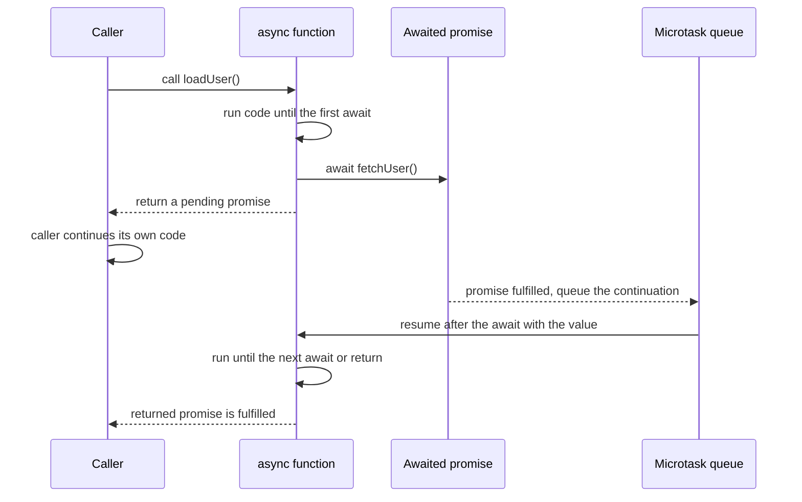
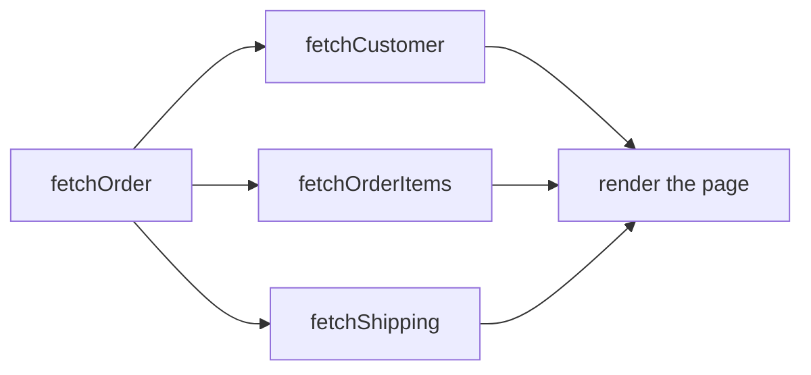
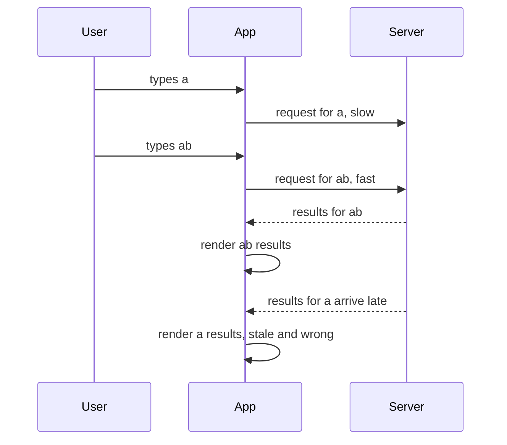

# Async/await

> In this document you will learn how `async` functions and `await` really work: what they return, when the code after `await` runs, how they are built on promises, and how to handle errors, run work in parallel, limit concurrency, cancel operations and avoid race conditions. Async/await is the way most modern JavaScript, TypeScript, Node.js and Electron code is written, so interviewers test both the mechanics (output puzzles) and real-world judgment (parallel vs sequential, cancellation, stale responses).

**Before this:** [The event loop](16-event-loop.md) · [Callbacks and promises](17-callbacks-and-promises.md) · **Interview questions:** [jump to the interview section](#interview-questions)

## Table of contents

1. [What async and await are](#what-async-and-await-are)
2. [An async function always returns a promise](#an-async-function-always-returns-a-promise)
3. [What await really does](#what-await-really-does)
4. [Built on promises and generators](#built-on-promises-and-generators)
5. [Error handling](#error-handling)
6. [Sequential vs parallel](#sequential-vs-parallel)
7. [Loops and async code](#loops-and-async-code)
8. [Controlled concurrency](#controlled-concurrency)
9. [Top-level await](#top-level-await)
10. [Cancellation with AbortController](#cancellation-with-abortcontroller)
11. [Race conditions and stale responses](#race-conditions-and-stale-responses)
12. [return await vs return](#return-await-vs-return)
13. [Async constructors and the factory pattern](#async-constructors-and-the-factory-pattern)
14. [Async/await in real projects](#asyncawait-in-real-projects)
15. [Common mistakes](#common-mistakes)
16. [Best practices](#best-practices)
17. [How to explain this in an interview](#how-to-explain-this-in-an-interview)
18. [Interview questions](#interview-questions)
19. [Summary](#summary)
20. [References](#references)

---

## What async and await are

### Definition

- **`async`** is a keyword you put before a function. It makes the function **always return a promise**.
- **`await`** is an operator you use inside an `async` function (or at the top level of a module). It **pauses that function** until a promise settles, and then gives you the promise's value — or throws its error.

They were added in **ES2017**. They do not add new abilities to the language. Everything you can do with them, you can do with promises and `.then`. But the code becomes much easier to read: asynchronous code looks like normal, top-to-bottom code.

### Why they exist

Compare the same logic with promises and with async/await:

```js
// With promise chains
function showOrderTotal(userId) {
  return fetchUser(userId)
    .then((user) => fetchCart(user.cartId))
    .then((cart) => {
      const total = cart.items.reduce((sum, item) => sum + item.price * item.qty, 0);
      console.log("total:", total);
      return total;
    })
    .catch((error) => {
      console.error("could not load total", error);
      throw error;
    });
}

// With async/await
async function showOrderTotalAsync(userId) {
  try {
    const user = await fetchUser(userId);
    const cart = await fetchCart(user.cartId);
    const total = cart.items.reduce((sum, item) => sum + item.price * item.qty, 0);
    console.log("total:", total);
    return total;
  } catch (error) {
    console.error("could not load total", error);
    throw error;
  }
}
```

With async/await:
- Variables from earlier steps (`user`) are simply in scope. No need to pass them through the chain.
- Normal `try`/`catch`/`finally` works for async errors.
- Normal `if`, `for` and `while` work with async steps.

### Analogy

Think of reading a recipe that says "bake for 30 minutes, then add the cheese". With `await`, you write the recipe exactly like that. But the cook (the JavaScript thread) does **not** stand in front of the oven for 30 minutes. While the cake bakes, the cook works on other dishes. When the oven is done, the cook comes back to **this** recipe and continues at "add the cheese".

That is the key idea: **`await` pauses your function, not the thread.**

### Where you can use them

```js
// Function declaration
async function loadUser(id) { /* ... */ }

// Function expression and arrow function
const loadOrders = async function (userId) { /* ... */ };
const loadCart = async (cartId) => { /* ... */ };

// Methods in objects and classes
const api = {
  async getProducts() { /* ... */ },
};

class UserService {
  async findById(id) { /* ... */ }
}

// Top level of an ES module (not in classic scripts or CommonJS)
// const config = await loadConfig();
```

`await` is only allowed inside `async` functions and at the top level of ES modules. Using it in a normal function is a `SyntaxError`.

---

## An async function always returns a promise

Whatever happens inside an `async` function, the caller gets a **promise**:

| Inside the async function | The returned promise |
| --- | --- |
| `return value` | fulfilled with `value` |
| no `return` | fulfilled with `undefined` |
| `return somePromise` | follows `somePromise` (settles the same way) |
| `throw error` (anywhere, even before the first `await`) | rejected with `error` |

```js
async function getNumber() {
  return 1;
}

console.log(getNumber());                   // Promise { 1 }
console.log(getNumber() instanceof Promise); // true
getNumber().then((n) => console.log(n));    // 1
```

(`Promise { 1 }` is how Node.js prints a fulfilled promise. Browsers show something similar.)

### Errors become rejections, even synchronous ones

```js
async function validateAge(age) {
  if (age < 0) {
    throw new Error("Age cannot be negative"); // thrown before any await
  }
  return age;
}

let promise;
try {
  promise = validateAge(-5); // does NOT throw here
  console.log("no error was thrown synchronously");
} catch (error) {
  console.log("never runs");
}

promise.catch((error) => console.log("rejected:", error.message));

// Output:
// no error was thrown synchronously
// rejected: Age cannot be negative
```

This is important: a caller can **never** catch an async function's error with a plain `try`/`catch` around the call. The caller must use `await` (inside its own `try`) or `.catch()`.

### The code before the first await runs synchronously

```js
async function loadDashboard() {
  console.log("2: loadDashboard starts (synchronously)");
  await null;
  console.log("4: after await (later, as a microtask)");
}

console.log("1: before call");
loadDashboard();
console.log("3: after call");

// Output:
// 1: before call
// 2: loadDashboard starts (synchronously)
// 3: after call
// 4: after await (later, as a microtask)
```

Calling an async function does not "schedule" it. It **runs immediately**, until the first `await`. Only the part after `await` runs later.

---

## What await really does

### Step by step

When the engine reaches `const value = await something;`:

1. It turns `something` into a promise (like `Promise.resolve(something)`). A plain value becomes an already-fulfilled promise. A thenable is adopted.
2. It **pauses** the async function and saves its state (local variables, where it stopped).
3. It **returns control** to the caller. The caller continues with its next line. If this was the first `await`, the caller receives the function's pending promise.
4. When the awaited promise settles, the rest of the function (the **continuation**) is queued as a **microtask**.
5. When the microtask runs, the function continues: `value` gets the fulfilled value, or, if the promise was rejected, the `await` expression **throws** the rejection reason at that line.



### Example with a timeline

```js
const sleep = (ms) => new Promise((resolve) => setTimeout(resolve, ms));

async function makeCoffee() {
  console.log("1. start the coffee machine");
  await sleep(100); // the function pauses here, the thread is free
  console.log("3. coffee is ready");
  return "coffee";
}

makeCoffee().then((drink) => console.log("4. drinking", drink));
console.log("2. meanwhile, read emails");

// Output:
// 1. start the coffee machine
// 2. meanwhile, read emails
// 3. coffee is ready
// 4. drinking coffee
```

### await with non-promises and thenables

```js
async function demo() {
  const n = await 42;            // plain value: works, takes one microtask
  console.log(n);                // 42

  const thenable = {
    then(resolve) {
      resolve("from a thenable"); // objects with a then method are adopted
    },
  };
  console.log(await thenable);   // from a thenable
}

demo();
```

Awaiting a plain value is allowed but has no benefit. It only delays the rest of the function by one microtask. Linters often warn about it (`await-thenable` rule in typescript-eslint).

### await does not block the thread

`await` only pauses the current async function. Other code — other functions, timers, event handlers, rendering — keeps running while the function waits. But `await` does **not** make CPU-heavy code non-blocking. If the code between two `await`s takes 2 seconds, the thread is blocked for 2 seconds. See [Long tasks and a responsive UI](16-event-loop.md#long-tasks-and-a-responsive-ui).

### How many microtasks does an await take?

For output puzzles, these rules are enough (they are verified with Node.js and covered in detail in [Promises and await in the event loop](16-event-loop.md#promises-and-await-in-the-event-loop)):

- `await nativePromise` or `await plainValue`: the continuation runs **one** microtask tick after the value is ready.
- An async function that **returns a promise** settles **two ticks later** than one that returns a plain value.
- `await` on a thenable that is not a native promise takes extra ticks, because its `then` method is called in a separate job.

In real code, never depend on tick counts.

---

## Built on promises and generators

### Async/await is promises underneath

Every `async` function returns a promise. Every `await` is like calling `.then` on a promise and putting the rest of the function inside the callback. So this:

```js
async function getUserName(id) {
  const user = await fetchUser(id);
  return user.name.toUpperCase();
}
```

behaves like this:

```js
function getUserName(id) {
  return Promise.resolve(fetchUser(id)).then((user) => user.name.toUpperCase());
}
```

Everything you learned in [Callbacks and promises](17-callbacks-and-promises.md) still applies: rejections, `Promise.all`, unhandled rejections, the event loop order.

### The generator idea

Before `async`/`await` existed, libraries like `co` used **generator functions** to write the same style of code. A **generator** is a function that can pause at `yield` and be resumed later from outside (see [Iterators and generators](13-iterators-and-generators.md)).

The trick: the generator yields a promise; a small "runner" waits for it and resumes the generator with the result. This is exactly what `async`/`await` does, built into the engine.

```js
function run(generatorFn) {
  return new Promise((resolve, reject) => {
    const iterator = generatorFn();

    function step(method, input) {
      let result;
      try {
        result = iterator[method](input); // resume the generator (next or throw)
      } catch (error) {
        return reject(error);             // the generator threw: reject
      }
      if (result.done) return resolve(result.value); // the generator returned
      Promise.resolve(result.value).then(
        (value) => step("next", value),    // like await giving back a value
        (error) => step("throw", error)    // like await throwing an error
      );
    }

    step("next", undefined);
  });
}

// Fake APIs
const fetchUser = (id) => new Promise((r) => setTimeout(() => r({ id, name: "Asha" }), 10));
const fetchOrders = () => new Promise((_, reject) => setTimeout(() => reject(new Error("orders failed")), 10));

run(function* () {
  const user = yield fetchUser(1);      // like: await fetchUser(1)
  console.log("user:", user.name);
  try {
    yield fetchOrders(user.id);         // like: await fetchOrders(...)
  } catch (error) {
    console.log("caught inside generator:", error.message);
  }
  return "finished";
}).then((value) => console.log(value));

// Output:
// user: Asha
// caught inside generator: orders failed
// finished
```

The mapping:

| Generator + runner | async/await |
| --- | --- |
| `function*` + `run(...)` | `async function` |
| `yield promise` | `await promise` |
| runner calls `iterator.next(value)` | engine resumes with the value |
| runner calls `iterator.throw(error)` | `await` throws the error |
| runner returns a promise | the async function returns a promise |

TypeScript and Babel used this exact transformation to compile `async`/`await` for old targets (ES2015/ES2016), and the Angular CLI still uses a similar transformation when zone.js is used (see [Async/await in real projects](#asyncawait-in-real-projects)).

---

## Error handling

### try/catch around await

When an awaited promise rejects, `await` **throws** the reason at that line. So normal `try`/`catch`/`finally` works:

```js
async function loadProfile(userId) {
  showSpinner();
  try {
    const user = await fetchUser(userId);
    const posts = await fetchPosts(user.id);
    return { user, posts };
  } catch (error) {
    showError(`Could not load profile: ${error.message}`);
    throw error; // ✅ rethrow so the caller knows it failed (or return a fallback on purpose)
  } finally {
    hideSpinner(); // runs on success and on failure
  }
}
```

### Handling errors per call

One big `try` block catches errors from every step, and you may not know which step failed. When steps need different handling, handle them separately:

```js
async function loadPage(userId) {
  const user = await fetchUser(userId); // required: if this fails, the page fails

  // optional: if recommendations fail, show the page without them
  const recommendations = await fetchRecommendations(userId).catch((error) => {
    logger.warn("recommendations failed", error);
    return []; // fallback value
  });

  return { user, recommendations };
}
```

Mixing `await` with `.catch()` is a clean way to give one call a fallback without a nested `try` block.

### A "result tuple" helper

Some teams like a Go-style helper that never throws:

```js
async function to(promise) {
  try {
    return [null, await promise];
  } catch (error) {
    return [error, undefined];
  }
}

async function main() {
  const [error, user] = await to(Promise.reject(new Error("not found")));
  if (error) {
    console.log("handled:", error.message); // handled: not found
    return;
  }
  console.log(user);
}

main();
```

It makes error handling very explicit. The downside: it is easy to forget the `if (error)` check, and errors no longer flow up automatically. Use it where explicit handling is really wanted, not everywhere.

### What try/catch cannot catch

`try`/`catch` only catches errors from promises you **await inside the try block**.

```js
async function saveAll(items) {
  try {
    items.forEach(async (item) => {
      await saveItem(item); // ❌ rejection happens inside a separate async callback
    });
  } catch (error) {
    console.log("never catches saveItem errors");
  }
}
```

The errors happen inside other async functions (the `forEach` callbacks) whose promises nobody awaits. They become unhandled rejections. See [Loops and async code](#loops-and-async-code) for the fix.

Also, errors thrown inside callbacks like `setTimeout` are not caught by an outer `try`, for the same reason: they run later, in a separate task. See [Error handling](15-error-handling.md).

### Unhandled rejections from "handled later" promises

This bug surprises many developers:

```js
const sleep = (ms) => new Promise((r) => setTimeout(r, ms));

async function fetchUser() {
  await sleep(10);
  throw new Error("user service down"); // rejects after 10 ms
}

async function fetchSettings() {
  await sleep(50);
  return { theme: "dark" };             // fulfills after 50 ms
}

async function loadPage() {
  const userPromise = fetchUser();         // both start now (good: parallel)
  const settingsPromise = fetchSettings();
  const settings = await settingsPromise;  // waiting here for 50 ms...
  const user = await userPromise;          // ...but userPromise rejected at 10 ms
  return { user, settings };
}

loadPage().catch((e) => console.log("caught:", e.message));

// Node.js output: the process crashes with "Error: user service down" (exit code 1).
// "caught: ..." is never printed.
```

At 10 ms, `userPromise` rejects, and **nobody is awaiting it yet**. Node.js sees an unhandled rejection and, by default, crashes. The later `await userPromise` comes too late. In browsers you get an "Uncaught (in promise)" error in the console.

The fix is to wait for both together, so both have a handler from the start:

```js
async function loadPage() {
  const [user, settings] = await Promise.all([fetchUser(), fetchSettings()]); // ✅
  return { user, settings };
}
```

Rule: **if you start several promises in parallel, await them together** with `Promise.all` or `Promise.allSettled`.

---

## Sequential vs parallel

### The accidental waterfall

`await` waits. If you `await` independent operations one by one, they run **one after another**, even though they could run at the same time. This is called a **waterfall**, and it is one of the most common performance bugs in async code.

```js
const sleep = (ms, value) => new Promise((r) => setTimeout(() => r(value), ms));
const round = (ms) => Math.round(ms / 100) * 100;

async function sequential() {
  const t = Date.now();
  const a = await sleep(100, "user");    // wait 100 ms
  const b = await sleep(100, "orders");  // then wait 100 ms more
  const c = await sleep(100, "stats");   // then 100 ms more
  console.log("sequential", [a, b, c], "about", round(Date.now() - t), "ms");
}

async function parallel() {
  const t = Date.now();
  const [a, b, c] = await Promise.all([
    sleep(100, "user"),                  // all three start now
    sleep(100, "orders"),
    sleep(100, "stats"),
  ]);
  console.log("parallel", [a, b, c], "about", round(Date.now() - t), "ms");
}

sequential().then(parallel);

// Output:
// sequential [ 'user', 'orders', 'stats' ] about 300 ms
// parallel [ 'user', 'orders', 'stats' ] about 100 ms
```

### Decide by dependencies

Ask: **does this step need the result of the previous step?**

- **Yes** → sequential (`await` one after another). Example: you need `user.cartId` before you can load the cart.
- **No** → parallel (start all, then `await Promise.all`). Example: user profile, notifications and stats for a dashboard.

Real code is often a mix:

```js
async function loadOrderPage(orderId) {
  const order = await fetchOrder(orderId); // step 1: needed by the others

  // step 2: these only need `order`, not each other → parallel
  const [customer, items, shipping] = await Promise.all([
    fetchCustomer(order.customerId),
    fetchOrderItems(order.id),
    fetchShipping(order.shippingId),
  ]);

  return { order, customer, items, shipping };
}
```



### Start early, await later

Another way to run things in parallel is to **start** the promises first and **await** them later. But remember the "handled later" problem from [Error handling](#error-handling): if one promise rejects while you are awaiting another one, you get an unhandled rejection. `Promise.all` is safer.

### Promise.all vs Promise.allSettled with await

```js
// All-or-nothing: if one fails, the whole function fails fast
const [user, orders] = await Promise.all([fetchUser(id), fetchOrders(id)]);

// Independent results: get every outcome, decide per item
const results = await Promise.allSettled(userIds.map((id) => sendWelcomeEmail(id)));
const failed = results.filter((r) => r.status === "rejected");
if (failed.length > 0) logger.warn(`${failed.length} emails failed`);
```

---

## Loops and async code

### for...of with await: sequential

```js
const sleep = (ms) => new Promise((r) => setTimeout(r, ms));

async function migrate(tables) {
  for (const table of tables) {
    await sleep(10);                 // pretend to migrate one table
    console.log("migrated", table);  // strictly in order
  }
  console.log("all done");
}

migrate(["users", "orders", "invoices"]);

// Output:
// migrated users
// migrated orders
// migrated invoices
// all done
```

Use this when order matters, when each step depends on the previous one, or when you must not overload a server.

### The forEach pitfall

`forEach` **ignores** the promises returned by its callback. It does not wait.

```js
const sleep = (ms) => new Promise((r) => setTimeout(r, ms));

async function save(id) {
  await sleep(10 * (4 - id)); // id 3 is the fastest
  console.log("saved", id);
}

async function run() {
  [1, 2, 3].forEach(async (id) => {
    await save(id); // ❌ forEach does not wait for this
  });
  console.log("done"); // runs before anything is saved
}

run();

// Output:
// done
// saved 3
// saved 2
// saved 1
```

Three problems at once: `done` prints too early, the order is random, and if a `save` fails, the error is an unhandled rejection that `run` cannot catch.

The same is true for `map`, `filter`, `some` and `reduce` with async callbacks: they do not wait. (`map` at least gives you an array of promises that you can pass to `Promise.all`.)

### map + Promise.all: parallel

```js
async function saveAll(ids) {
  await Promise.all(ids.map((id) => save(id))); // ✅ start all, wait for all
  console.log("done"); // after everything is saved
}
```

`filter` with an async predicate needs two steps:

```js
async function getActiveUsers(users) {
  const flags = await Promise.all(users.map((user) => isActive(user))); // [true, false, ...]
  return users.filter((_, index) => flags[index]);
}
```

### Which loop to use

| Goal | Use |
| --- | --- |
| One at a time, in order | `for...of` with `await` |
| All at the same time, wait for all | `await Promise.all(items.map(fn))` |
| All at once, keep going on failures | `await Promise.allSettled(items.map(fn))` |
| At most N at a time | a concurrency limiter (next section) |
| Values that arrive over time (pages, streams) | `for await...of` |
| Never | `forEach` with an async callback |

### for await...of and async generators

`for await...of` loops over an **async iterable**: something that produces values one by one, where each value may take time. An **async generator** (`async function*`) is the easiest way to create one. (Iterators and generators are explained in [Iterators and generators](13-iterators-and-generators.md).)

A realistic example: an API returns users in pages. You want to process all users without loading all pages first.

```js
// Fake paginated API
const pages = {
  1: { items: ["u1", "u2"], next: 2 },
  2: { items: ["u3"], next: 3 },
  3: { items: ["u4", "u5"], next: null },
};
async function fetchPage(page) {
  await new Promise((r) => setTimeout(r, 5));
  return pages[page];
}

// Async generator: yields users one by one, fetching pages as needed
async function* fetchAllUsers() {
  let page = 1;
  while (page !== null) {
    const data = await fetchPage(page);
    yield* data.items; // yield each user of this page
    page = data.next;
  }
}

for await (const user of fetchAllUsers()) {
  console.log("user", user);
}

// Output:
// user u1
// user u2
// user u3
// user u4
// user u5
```

(This snippet uses top-level `await`, so it must run as an ES module, for example a `.mjs` file.)

Benefits: the consumer code is a simple loop, pages are fetched only when needed, and you can `break` early to stop fetching.

Other async iterables you will meet:
- **Node.js readable streams** (`for await (const chunk of fs.createReadStream(file))`). See [Streams](../07-nodejs-backend/05-streams.md).
- `readline` interfaces for reading a file line by line.
- `events.on(emitter, "event")` in Node.js.

`Array.fromAsync(asyncIterable)` collects all values into an array (ES2026; supported in Node.js 22+ and current browsers).

---

## Controlled concurrency

`await Promise.all(items.map(fn))` starts **everything at once**. With 10 items that is fine. With 10,000 items you may overload the API, hit rate limits (HTTP 429), run out of sockets or memory, or freeze a browser tab. A **concurrency limit** runs at most N operations at the same time.

### A worker-pool implementation

The idea: start N "workers". Each worker takes the next item from a shared index, processes it, and repeats until no items are left.

```js
async function mapWithConcurrency(items, limit, mapper) {
  const results = new Array(items.length);
  let nextIndex = 0;

  async function worker() {
    while (nextIndex < items.length) {
      const index = nextIndex++; // claim an item; no await between check and claim, so no race
      results[index] = await mapper(items[index], index);
    }
  }

  const workers = Array.from({ length: Math.min(limit, items.length) }, () => worker());
  await Promise.all(workers); // rejects on the first error
  return results;
}

// Demo
const sleep = (ms) => new Promise((r) => setTimeout(r, ms));
let active = 0;
let maxActive = 0;

mapWithConcurrency([1, 2, 3, 4, 5, 6, 7, 8], 3, async (id) => {
  active++;
  maxActive = Math.max(maxActive, active);
  await sleep(5 + (id % 4) * 5); // different durations
  active--;
  return id * 10;
}).then((results) => console.log(results.join(","), "| max active:", maxActive));

// Output:
// 10,20,30,40,50,60,70,80 | max active: 3
```

Why it is safe: JavaScript runs one piece of code at a time. Between `while (nextIndex < items.length)` and `nextIndex++` there is no `await`, so no other worker can run in between. Each index is claimed by exactly one worker.

Behavior on failure: `Promise.all(workers)` rejects as soon as one worker throws. The other workers keep processing their current item and may even start more items. If you need "stop everything on first error", add a shared `failed` flag that workers check, and pass an `AbortSignal` to the mapper. The promise-based version in [Callbacks and promises](17-callbacks-and-promises.md#concurrency-limit-maplimit) stops starting new work after a failure.

### Batching (simpler, but slower)

```js
async function inBatches(items, batchSize, mapper) {
  const results = [];
  for (let i = 0; i < items.length; i += batchSize) {
    const batch = items.slice(i, i + batchSize);
    results.push(...(await Promise.all(batch.map(mapper)))); // wait for the whole batch
  }
  return results;
}
```

Batching is easy to understand, but each batch waits for its **slowest** item before the next batch starts. The worker pool keeps all N slots busy, so it is usually faster.

In real projects, small libraries like `p-limit` or `p-map` provide this, and RxJS has `mergeMap(fn, concurrency)` for Observables.

---

## Top-level await

### What it is

**Top-level await** (ES2022) lets you use `await` directly at the top level of an **ES module**, outside any function.

```js
// config.mjs (an ES module)
const response = await fetch("/assets/config.json"); // browser module or Node.js 18+
export const config = await response.json();
```

```js
// main.mjs
import { config } from "./config.mjs"; // waits until config.mjs has finished
console.log(config.apiUrl);
```

It works only in ES modules: `<script type="module">` in browsers, `.mjs` files or `"type": "module"` in Node.js. It does **not** work in classic scripts or CommonJS files.

### How it affects module loading

A module that uses top-level await becomes **asynchronous**. Any module that imports it (directly or indirectly) **waits** until it finishes. Modules that do not depend on it can still run.

- Good for: loading configuration, connecting to a database at start-up in a Node.js script, dynamic imports with a fallback (`const lib = await import("./fast.js").catch(() => import("./slow.js"))`), small CLI scripts.
- Risk: a slow top-level await **delays every importer**. In a browser, a slow request at the top of a shared module can delay the whole app start. Keep it for start-up work that really must finish first.
- In Node.js, a module with top-level await cannot be loaded with `require()`, even in versions that support `require(esm)`. The call fails with the error `ERR_REQUIRE_ASYNC_MODULE`.

More about modules in [Modules: ESM and CommonJS](14-modules-esm-and-commonjs.md).

> **Angular note:** when zone.js is used (the default in Angular 16), the Angular CLI downlevels native `async`/`await` so zone.js can track it. Top-level await cannot be downleveled, so it is generally not usable in Angular 16 application code. Put the work inside an async function, or use an app initializer.

---

## Cancellation with AbortController

### Why you need it

A promise cannot be cancelled. But often you **should** stop async work:

- The user leaves the page or closes a dialog.
- The user types a new search query, so the old request is useless.
- A request takes too long.
- A component is destroyed.

The standard tool, in browsers and Node.js, is **`AbortController`**:

- `const controller = new AbortController()` creates a controller.
- `controller.signal` is an **`AbortSignal`**: pass it to the operation.
- `controller.abort(reason?)` cancels. The signal's `aborted` becomes `true`, its `reason` is set, and its `abort` event fires.
- Operations that support signals (like `fetch`) stop and reject. By default the error is a `DOMException` named `"AbortError"`. If you pass your own reason to `abort(reason)`, they reject with that reason instead.

### Cancelling fetch

```js
// Browser or Node.js 18+
const controller = new AbortController();

const request = fetch("/api/report", { signal: controller.signal })
  .then((response) => response.json())
  .catch((error) => {
    if (error.name === "AbortError") {
      console.log("request cancelled"); // expected: not a real failure
      return null;
    }
    throw error; // real errors still go up
  });

// Later, for example when the user clicks "Cancel":
controller.abort();
```

### Timeouts with AbortSignal.timeout

`AbortSignal.timeout(ms)` creates a signal that aborts automatically after `ms` milliseconds. The error is a `DOMException` named `"TimeoutError"`, so you can tell a timeout from a manual cancel.

```js
// Browser or Node.js 17.3+
async function getReport() {
  try {
    const response = await fetch("/api/report", { signal: AbortSignal.timeout(5000) });
    return await response.json();
  } catch (error) {
    if (error.name === "TimeoutError") throw new Error("The report took too long. Please try again.");
    throw error;
  }
}
```

Unlike `Promise.race` with a timer, this **really stops** the request.

To combine a user cancel and a timeout, use `AbortSignal.any([...])` (Node.js 20.3+, Chrome 116+, Firefox 124+, Safari 17.4+):

```js
const userCancel = new AbortController();
const signal = AbortSignal.any([userCancel.signal, AbortSignal.timeout(10_000)]);
await fetch("/api/export", { signal }); // aborts on whichever happens first
```

### Making your own functions cancellable

Your own async functions should accept a `signal` too. Two things to do:

1. Check the signal at safe points: `signal?.throwIfAborted()` throws `signal.reason` if it is already aborted.
2. Listen for the `abort` event to stop timers or other resources, and **remove the listener** when you finish normally.

```js
function sleep(ms, { signal } = {}) {
  return new Promise((resolve, reject) => {
    signal?.throwIfAborted(); // already cancelled? reject right away

    const timerId = setTimeout(() => {
      signal?.removeEventListener("abort", onAbort); // clean up
      resolve();
    }, ms);

    function onAbort() {
      clearTimeout(timerId); // stop the real work
      reject(signal.reason); // AbortError by default
    }

    signal?.addEventListener("abort", onAbort, { once: true });
  });
}

async function syncAllOrders(orderIds, { signal } = {}) {
  for (const id of orderIds) {
    signal?.throwIfAborted();          // stop between items
    await syncOrder(id, { signal });   // pass the signal down
    await sleep(100, { signal });      // polite pause, also cancellable
  }
}

// Demo of sleep
const controller = new AbortController();
setTimeout(() => controller.abort(), 10);
sleep(1000, { signal: controller.signal }).catch((error) => console.log("sleep aborted:", error.name));
// sleep aborted: AbortError
```

Important limits:
- Cancellation is **cooperative**. Code that does not check the signal keeps running.
- Aborting a request does **not undo** work the server already did. For writes, design the API to be idempotent.

### In Angular

In Angular you usually use `HttpClient` Observables. Unsubscribing cancels the HTTP request, and operators like `switchMap` and `takeUntil` handle cancellation for you. See [RxJS](../06-angular-16/09-rxjs.md). With `fetch`-based code, create an `AbortController` per component and call `abort()` in `ngOnDestroy`.

---

## Race conditions and stale responses

### The problem

JavaScript is single-threaded, but async code can still have **race conditions**: the result depends on which async operation finishes first.

Classic example: a search box. The user types "a", then "ab". Two requests start. If the request for "a" is slower, it finishes **last** and overwrites the correct results for "ab".

```js
// Fake search API: the query "a" is slow, "ab" is fast
function searchApi(query, { signal } = {}) {
  const ms = query === "a" ? 100 : 20;
  return new Promise((resolve, reject) => {
    const timerId = setTimeout(() => resolve([`${query}-result`]), ms);
    signal?.addEventListener("abort", () => {
      clearTimeout(timerId);
      reject(signal.reason);
    }, { once: true });
  });
}

let shown = null;
const render = (results) => {
  shown = results;
  console.log("render", results);
};

// ❌ Wrong: whichever response arrives last wins
async function naiveSearch(query) {
  const results = await searchApi(query);
  render(results);
}

naiveSearch("a");
naiveSearch("ab");
setTimeout(() => console.log("final:", shown), 200);

// Output:
// render [ 'ab-result' ]
// render [ 'a-result' ]
// final: [ 'a-result' ]      ← wrong: the user typed "ab"
```



### Fix 1: cancel the previous request

```js
let controller = null;

async function search(query) {
  controller?.abort();               // cancel the previous request
  controller = new AbortController();
  const { signal } = controller;
  try {
    const results = await searchApi(query, { signal });
    render(results);
  } catch (error) {
    if (error.name === "AbortError") return; // an old request was cancelled: ignore
    showError(error);
  }
}

search("a");
search("ab");

// Output:
// render [ 'ab-result' ]
```

### Fix 2: ignore stale responses with a request id

Sometimes you cannot cancel (the API has no signal support, or the response arrives at an awkward moment). Then keep a counter and only accept the **latest** response:

```js
let latestRequestId = 0;

async function search(query) {
  const requestId = ++latestRequestId;
  const results = await searchApi(query);
  if (requestId !== latestRequestId) return; // a newer search started: ignore this result
  render(results);
}
```

Best: use **both**. Cancel to save network and server work, and check the id so that nothing stale is ever rendered. Also add a **debounce** so you do not send a request for every keystroke (see [Debounce, throttle and performance](20-debounce-throttle-and-performance.md)).

In Angular, the idiomatic solution is RxJS: `debounceTime` + `distinctUntilChanged` + `switchMap`, where `switchMap` unsubscribes (and cancels) the previous request automatically. See [RxJS](../06-angular-16/09-rxjs.md) and [Case study: autocomplete search](../09-system-design/11-case-study-autocomplete-search.md).

### Other async races

- **State changes during `await`.** After an `await`, the world may have changed: the user logged out, the component was destroyed, another request updated the same data. Check again after awaiting if it matters.
- **Double submit.** A user clicks "Pay" twice; two requests start. Disable the button while the request is running, and use an idempotency key on the server.
- **Lazy initialization.** Two callers call `getDb()` at the same time and both start a connection. Cache the **promise**, not the result:

```js
let dbPromise = null;

function getDb() {
  if (!dbPromise) {
    dbPromise = connectToDatabase().catch((error) => {
      dbPromise = null; // allow a retry next time
      throw error;
    });
  }
  return dbPromise; // every caller shares one connection attempt
}
```

---

## return await vs return

### The difference

Outside of `try`/`catch`, `return promise` and `return await promise` give the caller the same result. Inside `try`/`catch`, they are **very different**:

```js
async function getUser() {
  throw new Error("not found");
}

async function withoutAwait() {
  try {
    return getUser(); // returns the promise: the rejection happens AFTER we leave the try
  } catch (error) {
    return "fallback"; // never runs
  }
}

async function withAwait() {
  try {
    return await getUser(); // waits here: the rejection is thrown INSIDE the try
  } catch (error) {
    return "fallback"; // runs
  }
}

withoutAwait().then((v) => console.log("A", v), (e) => console.log("A error", e.message));
withAwait().then((v) => console.log("B", v), (e) => console.log("B error", e.message));

// Output:
// B fallback
// A error not found
```

Why:
- In `withoutAwait`, `return getUser()` hands the promise to the caller and leaves the `try` block immediately. When the promise rejects, the function is already finished, so the `catch` never sees it.
- In `withAwait`, the function **waits** at `await`. The rejection is thrown at that line, inside the `try`, so the `catch` handles it.
- (`B` prints before `A` because returning a promise from an async function costs extra microtask ticks.)

The same applies to `finally`: with `return await`, the `finally` block runs **after** the operation finishes. With plain `return`, it runs **before** the operation finishes, which matters for cleanup like releasing a database connection.

### Rule

- Inside `try`/`catch`/`finally`: **use `return await`**.
- Elsewhere: both work. `return await` also gives better async stack traces in V8, so many teams use it everywhere. The typescript-eslint rule `return-await` (with the `in-try-catch` option) enforces the important case.

---

## Async constructors and the factory pattern

A class `constructor` **cannot be `async`**. A constructor must return the new object, not a promise. `async constructor()` is a `SyntaxError`.

So what if an object needs async setup, like opening a connection or loading a file?

```js
// ❌ Wrong: the object is used before it is ready, and errors are lost
class ReportService {
  constructor() {
    this.ready = false;
    this.loadTemplates(); // floating promise
  }
  async loadTemplates() {
    this.templates = await readTemplates();
    this.ready = true;
  }
}
```

### Fix: a static async factory

```js
class ReportService {
  #templates;

  // Keep the constructor simple and synchronous: it only stores ready data
  constructor(templates) {
    this.#templates = templates;
  }

  // The async work happens in a static factory method
  static async create() {
    const templates = await readTemplates(); // async setup
    return new ReportService(templates);     // the object is fully ready
  }

  render(name) {
    return this.#templates[name] ?? "unknown template";
  }
}

async function readTemplates() {
  await new Promise((r) => setTimeout(r, 10)); // pretend to read files
  return { invoice: "<h1>Invoice</h1>" };
}

ReportService.create().then((service) => console.log(service.render("invoice"))); // <h1>Invoice</h1>
```

Benefits: a `ReportService` object can never exist in a half-initialized state, and setup errors reach the caller.

Alternatives:
- An explicit `await service.init()` method (simple, but callers may forget it).
- In Angular, use an app initializer to load data before the app starts, or load data in the service on demand and expose it as an Observable. In Node.js, create dependencies at start-up (`await createApp()`) before you start the HTTP server.

---

## Async/await in real projects

### Angular 16

- `HttpClient` returns **Observables**. Many Angular teams keep using Observables (with the `async` pipe) because they support cancellation, retries and composition with operators. See [HttpClient and interceptors](../06-angular-16/08-httpclient-and-interceptors.md) and [RxJS](../06-angular-16/09-rxjs.md).
- You can use `async`/`await` with `firstValueFrom` / `lastValueFrom` (RxJS 7) when you need a single value, for example in an app initializer, a guard, or a one-off "save" action:

```ts
// Angular 16 component method
import { Component } from "@angular/core";
import { HttpClient } from "@angular/common/http";
import { firstValueFrom } from "rxjs";

interface Order {
  id: number;
  status: string;
}

@Component({
  selector: "app-order-actions",
  template: `<button (click)="cancel(42)" [disabled]="busy">Cancel order</button> {{ message }}`,
})
export class OrderActionsComponent {
  busy = false;
  message = "";

  constructor(private http: HttpClient) {}

  async cancel(orderId: number): Promise<void> {
    this.busy = true;
    try {
      const order = await firstValueFrom(this.http.post<Order>(`/api/orders/${orderId}/cancel`, {}));
      this.message = `Order ${order.id} is now ${order.status}`;
    } catch {
      this.message = "Could not cancel the order. Please try again.";
    } finally {
      this.busy = false; // the view updates: zone.js tracks the async work
    }
  }
}
```

| Promises / async-await | Observables |
| --- | --- |
| One value | Zero, one or many values over time |
| Eager: starts immediately | Lazy: starts on subscribe |
| Cannot be cancelled by itself | Unsubscribe cancels (`HttpClient` aborts the request) |
| Great for one-off actions and simple flows | Great for streams, user input, retries, `switchMap`, combining sources |

- **zone.js and async/await:** zone.js cannot patch native `async`/`await`. That is why the Angular CLI transforms (downlevels) `async`/`await` to generators plus promises when zone.js is used. This happens automatically; you just write `async`/`await`. (Newer Angular builds with zoneless change detection can keep native `async`/`await`.)

### Node.js and Express

Async/await is the normal style for Node.js services: `fs/promises`, database drivers, HTTP clients.

In **Express 4**, a rejected promise from an `async` route handler is **not** passed to the error middleware. The request hangs, and an unhandled rejection is reported. You need a wrapper (or the `express-async-errors` package):

```js
// Express 4: forward async errors to the error middleware
const asyncHandler = (fn) => (req, res, next) => Promise.resolve(fn(req, res, next)).catch(next);

app.get("/users/:id", asyncHandler(async (req, res) => {
  const user = await userService.findById(req.params.id);
  if (!user) return res.status(404).json({ error: "User not found" });
  res.json(user);
}));
```

In **Express 5**, route handlers and middleware that return a rejected promise (or throw inside an `async` function) automatically call `next(error)`. No wrapper is needed:

```js
// Express 5
app.get("/users/:id", async (req, res) => {
  const user = await userService.findById(req.params.id); // a rejection goes to the error middleware
  res.json(user);
});
```

See [Validation and error handling](../07-nodejs-backend/08-validation-and-error-handling.md).

### Electron

The secure way for a renderer to ask the main process for something is `ipcRenderer.invoke` (exposed through a preload script), which returns a promise:

```js
// preload.js
const { contextBridge, ipcRenderer } = require("electron");

contextBridge.exposeInMainWorld("filesApi", {
  readSettings: () => ipcRenderer.invoke("settings:read"),
});

// main.js
const { ipcMain } = require("electron");
const fs = require("node:fs/promises");

ipcMain.handle("settings:read", async () => {
  const text = await fs.readFile(settingsPath, "utf8");
  return JSON.parse(text); // the value is sent back to the renderer
});

// renderer.js
async function loadSettings() {
  try {
    const settings = await window.filesApi.readSettings();
    applySettings(settings);
  } catch (error) {
    // Only the error message crosses the IPC boundary (the error is serialized)
    showError(`Could not load settings: ${error.message}`);
  }
}
```

If the main-process handler throws, the renderer's promise rejects, but only the error's `message` is passed across, not its class or extra properties. If you need structured errors, return a result object like `{ ok: false, code: "NOT_FOUND" }`. See [IPC and preload scripts](../08-electron-desktop/03-ipc-and-preload-scripts.md).

---

## Common mistakes

1. **Forgetting `await`.** You get a promise instead of a value (`user.name` is `undefined`), and errors become unhandled rejections.

   ```js
   const user = getUser(id);   // ❌ user is a Promise
   const user2 = await getUser(id); // ✅
   ```

2. **Accidental waterfalls.** Awaiting independent operations one by one. Use `Promise.all`.
3. **`forEach` with an async callback.** It does not wait and cannot catch errors. Use `for...of` or `Promise.all(items.map(...))`.
4. **Starting promises early and awaiting them one by one.** A rejection while you wait for another promise becomes an unhandled rejection. Await them together.
5. **`return` instead of `return await` inside `try`.** The `catch` and `finally` do not cover the returned promise.
6. **Expecting `try`/`catch` around a call to catch async errors without `await`.** Only awaited rejections are caught.
7. **Thinking `async` makes CPU work non-blocking.** It does not. Use workers or chunking.
8. **No cancellation.** Old requests overwrite new results; work continues after the user leaves. Use `AbortController` and stale-response checks.
9. **Swallowing errors** with an empty `catch {}`. At least log, and usually rethrow or show a message.
10. **Unnecessary `async`.** Marking a function `async` when it does no async work forces every caller to `await` it for nothing. Keep functions synchronous when they can be.
11. **Async callbacks where a sync one is expected**, for example `array.sort(async (a, b) => ...)` or `addEventListener("submit", async (e) => { await x; e.preventDefault(); })`. `preventDefault()` after an `await` runs too late. Call it before the first `await`.

---

## Best practices

- **Await everything you start, or explicitly handle it.** Prevents unhandled rejections and lost errors. For fire-and-forget, write `doThing().catch(logError)`.
- **Run independent work in parallel with `Promise.all`.** Avoids waterfalls and is safer than awaiting pre-started promises one by one.
- **Limit concurrency for big lists.** Protects servers, rate limits and memory.
- **Use `try`/`catch` where you can do something useful** (fallback, user message, cleanup). Otherwise let errors go up to a central handler.
- **Use `return await` inside `try`/`catch`/`finally`.** So the handlers cover the awaited operation.
- **Accept an `AbortSignal` in long-running async functions and pass it down.** Makes cancellation and timeouts possible everywhere.
- **Guard against stale responses** in UI code (cancel + request id, or `switchMap` in Angular).
- **Use `for await...of` for paginated or streamed data.** Consumers stay simple and memory use stays low.
- **Use static async factories instead of async work in constructors.** Objects are never half-initialized.
- **Enable lint rules:** `@typescript-eslint/no-floating-promises`, `no-misused-promises`, `require-await`, `return-await`, and ESLint's `no-await-in-loop` (as a reminder to check for waterfalls).

---

## How to explain this in an interview

1. **Define it:** "`async` makes a function always return a promise. `await` pauses that async function until a promise settles, then gives me the value, or throws the error at that line."
2. **Why it exists:** "It lets me write promise-based code in a normal top-to-bottom style, with normal variables, loops and `try`/`catch`, instead of long `.then` chains."
3. **How it works:** "The code before the first `await` runs synchronously. At `await`, the function is suspended and the caller continues. When the promise settles, the rest of the function is queued as a microtask. It is built on promises — conceptually like a generator that yields promises and a runner that resumes it."
4. **Small example:** "`const user = await fetchUser(id); const orders = await fetchOrders(user.id);` — the second call needs the user, so sequential is right. But for a dashboard, I start user, stats and notifications together with `await Promise.all([...])`."
5. **Where it is useful:** "Node.js services and Express handlers, Electron `ipcRenderer.invoke` calls, one-off actions in Angular with `firstValueFrom`, scripts with top-level await, and paginated data with `for await`."
6. **Trade-offs and gotchas:** "`await` pauses the function, not the thread, so CPU work still blocks. Accidental waterfalls, `forEach` with async callbacks, missing `return await` in `try`, and no built-in cancellation — I use `AbortController` and guard against stale responses."

---

## Interview questions

### Q1. What do `async` and `await` do?

**What the interviewer is checking:** The exact mechanics: return value, what pauses, when the continuation runs, and how errors work.

**Short spoken answer (30–60 seconds):**
> `async` before a function makes it always return a promise. If the function returns a value, the promise is fulfilled with it; if it throws, the promise is rejected. `await` can be used inside async functions and at the top level of modules. It takes a promise, pauses the async function until that promise settles, and then gives me the value — or throws the rejection at that line, so I can use normal try/catch. Only the function pauses, not the thread: the caller continues, and the rest of the function is resumed later as a microtask. It's syntax over promises, so `Promise.all`, rejections and the event loop rules all still apply.

**Detailed explanation:** See [What await really does](#what-await-really-does). Key points: code before the first `await` is synchronous; the caller gets a pending promise at the first `await`; the continuation is a microtask.

**Follow-up questions:**
- **Can you use `await` in a normal function?** — No, it is a `SyntaxError`. Only in `async` functions and at the top level of ES modules.
- **What does `await 5` do?** — It wraps 5 in a fulfilled promise and resumes the function one microtask later with `5`. It works but is pointless.
- **What happens if you call an async function without `await`?** — It still runs (synchronously until its first `await`). You just do not wait for it, and if it rejects, nobody handles it.
- **Which ES version added it?** — ES2017. Top-level await came in ES2022.

**Common mistakes:** "await blocks the thread"; "async functions run in the background"; "an async function returns its value directly".

**Where this is used in real projects:** Almost every Node.js service, Express handler, Electron IPC call and many frontend data-loading functions.

---

### Q2. What does this print?

```js
async function getData() {
  console.log("B");
  const result = await "data";
  console.log("D", result);
  return result;
}

console.log("A");
getData().then((r) => console.log("E", r));
console.log("C");
```

**Answer:**

```text
A
B
C
D data
E data
```

**Why:**
1. `A` — synchronous.
2. `getData()` runs synchronously until the `await`: `B`.
3. `await "data"` pauses `getData`; the caller gets a pending promise and attaches `.then`.
4. `C` — synchronous.
5. Microtask: `getData` resumes, prints `D data`, returns `"data"` → its promise is fulfilled.
6. Next microtask: the `.then` callback prints `E data`.

---

### Q3. What does `console.log(asyncFn())` print, and why can't `try`/`catch` catch this error?

```js
async function loadUser(id) {
  console.log("load start");
  if (!id) throw new Error("id is required");
  return { id };
}

const p = loadUser();
console.log("after call");
p.catch((e) => console.log("caught:", e.message));
```

**Answer:**

```text
load start
after call
caught: id is required
```

**Why:** The `throw` happens synchronously (before any `await`), but inside an `async` function it does **not** escape to the caller. It rejects the returned promise. So `after call` prints, and the rejection is handled later by `.catch`. A `try`/`catch` around `loadUser()` without `await` would catch nothing.

`console.log(loadUser(1))` would print `Promise { { id: 1 } }` in Node.js: you always get a promise, never the value.

**Follow-up questions:**
- **How do you catch it with try/catch?** — `try { await loadUser(); } catch (e) { ... }` inside another async function.

---

### Q4. What does this print? (await mixed with timers and promises)

```js
console.log("1");

setTimeout(() => console.log("2"), 0);

async function main() {
  console.log("3");
  await Promise.resolve();
  console.log("4");
  await new Promise((r) => setTimeout(r, 0));
  console.log("5");
}

main().then(() => console.log("6"));

Promise.resolve().then(() => console.log("7"));

console.log("8");
```

**What the interviewer is checking:** Microtask vs task ordering with `await`, and that an `await` on a timer-based promise moves the continuation behind other tasks.

**Answer:**

```text
1
3
8
4
7
2
5
6
```

**Step-by-step walkthrough:**

| Step | What happens | Printed |
| --- | --- | --- |
| 1 | Sync: `1`; timer A (`2`) is scheduled | 1 |
| 2 | `main()` runs synchronously to the first `await` | 3 |
| 3 | `.then(7)` is queued after `main`'s continuation; sync `8` | 8 |
| 4 | Microtask: `main` resumes, prints `4`, creates timer B, pauses | 4 |
| 5 | Microtask: `7` | 7 |
| 6 | Task: timer A (created first) | 2 |
| 7 | Task: timer B resolves the promise → microtask: `main` resumes, prints `5`, returns | 5 |
| 8 | Microtask: `main()`'s promise is fulfilled → `6` | 6 |

**Follow-up questions:**
- **Why does `4` come before `7`?** — `main`'s continuation was queued first (when `await Promise.resolve()` ran, before the `Promise.resolve().then(7)` line).

---

### Q5. Why does returning a promise from an async function change the order?

```js
async function first() {
  console.log(1);
  await second();
  console.log(2);
}

async function second() {
  console.log(3);
  return Promise.resolve(); // returns a promise instead of a plain value
}

console.log(4);
first();
Promise.resolve()
  .then(() => console.log(5))
  .then(() => console.log(7))
  .then(() => console.log(8));
console.log(6);
```

**Answer:**

```text
4
1
3
6
5
7
2
8
```

**Why:** If `second` returned nothing, `2` would print right after `6` (before `5`). But `second` **returns a promise**, so its own promise needs two extra microtask ticks to adopt it. Only then can `await second()` resume `first`. Meanwhile the other chain prints `5` and `7`. This is spec behavior; in real code you must never depend on tick counts — use explicit `await` to order things.

---

### Q6. Is async/await just syntactic sugar? How does it work under the hood?

**What the interviewer is checking:** Understanding of the relationship with promises and generators.

**Short spoken answer (30–60 seconds):**
> Mostly yes: async/await is built on promises. An async function always returns a promise, and each `await` behaves like attaching `.then` to a promise and putting the rest of the function in the callback. The difference from hand-written chains is that the engine keeps the function's local variables and position, like a generator. Before async/await, libraries like `co` did exactly this with generators: the generator yields a promise, a runner waits for it and resumes the generator with `next(value)` or `throw(error)`. TypeScript and Babel compiled async/await to that pattern for old targets. Native async/await is better integrated: it's faster and gives proper async stack traces in DevTools.

**Code:** See the generator runner in [Built on promises and generators](#built-on-promises-and-generators).

**Follow-up questions:**
- **Name something async/await gives you that `.then` chains do not.** — Normal `try`/`catch`/`finally`, loops and conditionals with async steps, local variables visible across steps, and better stack traces.
- **Can you mix them?** — Yes. `await` works with any promise, and an async function's result can be used with `.then`. `await fetchX().catch(() => fallback)` is a common mix.

---

### Q7. How do you handle errors with async/await?

**What the interviewer is checking:** Practical error handling strategy, not just "use try/catch".

**Short spoken answer (30–60 seconds):**
> When an awaited promise rejects, `await` throws at that line, so I use try/catch/finally like synchronous code. But I only catch where I can do something useful: show a message, use a fallback, or clean up in `finally`. Otherwise I let the error propagate to a central handler — like Angular's ErrorHandler or Express error middleware. For a single optional call I often write `await fetchX().catch(() => fallback)`. I make sure every promise is awaited, because try/catch only catches what I await inside it, and I use `return await` inside try blocks. And I never leave an empty catch block.

**Detailed explanation:** See [Error handling](#error-handling).

**Follow-up questions:**
- **How do you handle errors when running things in parallel?** — `await Promise.all` rejects with the first error (wrap it in try/catch). If you need every result, use `Promise.allSettled` and inspect each status.
- **What happens to an error thrown inside a `forEach(async ...)` callback?** — It becomes an unhandled rejection; the outer `try` never sees it.
- **Where are global handlers?** — Browser: `unhandledrejection` event. Node.js: `process.on("unhandledRejection")`. See [Error handling](15-error-handling.md).

**Common mistakes:** Wrapping every line in try/catch; catching and returning `undefined`; forgetting that `try` only covers awaited promises.

**Where this is used in real projects:** Service layers that convert low-level errors into domain errors; UI actions that show a toast on failure and always reset a loading flag in `finally`.

---

### Q8. What does this print? Explain `return` vs `return await`.

```js
async function getUser() {
  throw new Error("not found");
}

async function withoutAwait() {
  try {
    return getUser();
  } catch (error) {
    return "fallback";
  }
}

async function withAwait() {
  try {
    return await getUser();
  } catch (error) {
    return "fallback";
  }
}

withoutAwait().then((v) => console.log("A", v), (e) => console.log("A error", e.message));
withAwait().then((v) => console.log("B", v), (e) => console.log("B error", e.message));
```

**What the interviewer is checking:** Whether you know that a returned promise is not covered by the surrounding `try`.

**Answer:**

```text
B fallback
A error not found
```

**Short spoken answer (30–60 seconds):**
> In `withoutAwait`, `return getUser()` hands the promise straight to the caller and leaves the try block immediately. When it rejects later, the function has already finished, so the catch never runs and the caller gets the rejection. In `withAwait`, the function waits at the `await`, the rejection is thrown inside the try, and the catch returns the fallback. So inside try/catch or try/finally, I always write `return await`. `B` prints first only because returning a promise from an async function costs extra microtask ticks.

**Follow-up questions:**
- **Is `return await` ever harmful?** — Outside `try`, it is just redundant (one extra tick, negligible). Many teams use it everywhere because it gives better async stack traces.
- **What about `finally`?** — With plain `return promise`, `finally` runs before the promise settles. If `finally` releases a resource (like a DB connection) that the operation still uses, that is a bug. Use `return await`.

---

### Q9. Your page makes three API calls and takes 3 seconds. Each call takes about 1 second. What is wrong?

**What the interviewer is checking:** Recognizing accidental waterfalls.

**Short spoken answer (30–60 seconds):**
> Probably the code awaits three independent calls one after another — a waterfall — so the times add up. If the calls don't depend on each other, I start them all at once and wait with `await Promise.all([...])`, so the total is about the slowest call, around 1 second. If one call depends on another, I keep that part sequential and parallelize the rest. I also check the Network panel: a waterfall shows requests starting only after the previous one finishes.

**Code:**

```js
// ❌ about 3 s
const user = await fetchUser(id);
const stats = await fetchStats(id);
const notifications = await fetchNotifications(id);

// ✅ about 1 s
const [user2, stats2, notifications2] = await Promise.all([
  fetchUser(id),
  fetchStats(id),
  fetchNotifications(id),
]);
```

**Follow-up questions:**
- **Why not `const a = fetchA(); const b = fetchB(); await a; await b;`?** — It is parallel, but if `b` rejects while you are still awaiting `a`, that rejection is unhandled (Node.js crashes by default). `Promise.all` attaches handlers to both immediately.
- **When is sequential correct?** — When a step needs the previous result, when order matters (migrations), or when you must not overload a server.
- **What if one optional call fails?** — Use `Promise.allSettled`, or add `.catch(() => fallback)` to that one call inside `Promise.all`.

---

### Q10. What does this print? (forEach with async)

```js
const sleep = (ms) => new Promise((r) => setTimeout(r, ms));

async function save(id) {
  await sleep(10 * (4 - id));
  console.log("saved", id);
}

async function run() {
  [1, 2, 3].forEach(async (id) => {
    await save(id);
  });
  console.log("done");
}

run();
```

**Answer:**

```text
done
saved 3
saved 2
saved 1
```

**Why:** `forEach` calls the async callback three times and ignores the returned promises. All three saves start at once, `done` prints immediately, and the saves finish in order of their durations (id 3 is fastest). Errors from `save` would be unhandled rejections.

**Fix:** `for (const id of ids) await save(id);` (sequential) or `await Promise.all(ids.map(save));` (parallel).

---

### Q11. Why does this crash Node.js even though both promises are awaited?

```js
async function loadPage() {
  const userPromise = fetchUser();         // rejects after 10 ms
  const settingsPromise = fetchSettings(); // fulfills after 50 ms
  const settings = await settingsPromise;
  const user = await userPromise;
  return { user, settings };
}

loadPage().catch((e) => console.log("caught:", e.message));
```

**What the interviewer is checking:** A subtle but real production bug with unhandled rejections.

**Short spoken answer (30–60 seconds):**
> Both promises start in parallel, which is good, but they're awaited one by one. While the function waits for `settingsPromise`, `userPromise` rejects at 10 milliseconds, and at that moment nothing is attached to it. Node checks for unhandled rejections after the microtasks run, finds one, and by default since Node 15 it crashes the process. The later `await userPromise` comes too late. The fix is to await them together with `Promise.all` or `allSettled`, which attaches handlers to every promise immediately.

**Follow-up questions:**
- **Is this a problem in browsers?** — The page does not crash, but you get an "Uncaught (in promise)" error and an `unhandledrejection` event, which pollutes error monitoring. Then a `rejectionhandled` event fires when the late handler is attached.
- **Can you fix it without `Promise.all`?** — You could attach `.catch` early, but `Promise.all` is the clear, standard fix.

---

### Q12. How would you process 10,000 items with an async API, but at most 5 requests at a time?

**What the interviewer is checking:** Controlled concurrency and the reasons for it.

**Short spoken answer (30–60 seconds):**
> `Promise.all` over 10,000 calls would start everything at once and could overload the API, hit rate limits or run out of memory. A simple loop with `await` would be safe but slow. So I use a worker pool: I start 5 async workers that share an index. Each worker takes the next item, awaits the call, stores the result at that item's index, and repeats until no items are left. Then I `await Promise.all(workers)`. Results keep input order, and at most 5 requests are active. In production I'd also add retries with backoff for transient errors, an `AbortSignal` to stop early, and maybe use a library like `p-limit`.

**Code:** See [Controlled concurrency](#controlled-concurrency).

**Follow-up questions:**
- **Why is the shared index safe without locks?** — JavaScript runs one piece of code at a time, and there is no `await` between reading and incrementing the index.
- **Batching vs worker pool?** — Batches wait for the slowest item of each batch; a pool keeps all slots busy.
- **How does this relate to rate limits like "10 requests per second"?** — Concurrency limits active requests; a rate limit limits starts per time window. You may need a token bucket in addition.

---

### Q13. How do you cancel an async operation in JavaScript?

**What the interviewer is checking:** Knowledge of `AbortController`, and that cancellation is cooperative.

**Short spoken answer (30–60 seconds):**
> Promises themselves can't be cancelled, so the standard tool is `AbortController`. I create a controller, pass `controller.signal` to the operation — `fetch` accepts it directly — and call `controller.abort()` to cancel. The operation rejects with an `AbortError`, which I usually treat as "not a real failure". For timeouts there's `AbortSignal.timeout(ms)`, which rejects with a `TimeoutError`, and `AbortSignal.any` combines signals. For my own async functions, I accept a `signal` option, call `signal.throwIfAborted()` at safe points, listen for the `abort` event to clear timers, and pass the signal down to inner calls. Cancellation is cooperative: code that ignores the signal keeps running, and aborting a request doesn't undo server-side work.

**Code:** See [Cancellation with AbortController](#cancellation-with-abortcontroller).

**Follow-up questions:**
- **What error do you get if you call `abort(new Error("user left"))`?** — `fetch` rejects with that reason, not an `AbortError`. So check `signal.aborted` if you use custom reasons.
- **How do you cancel in Angular?** — Unsubscribe from the `HttpClient` Observable (directly, with `takeUntil`, `switchMap`, or the `async` pipe on destroy); Angular aborts the underlying request.
- **What do you do in a component when it is destroyed?** — Abort its controller in `ngOnDestroy` (or the framework's cleanup), so late responses do not update a destroyed view.

---

### Q14. Scenario: in a search box, results sometimes do not match the typed text. What is happening and how do you fix it?

**What the interviewer is checking:** Async race conditions in UI code and the layered fix.

**Short spoken answer (30–60 seconds):**
> It's a race condition between requests. The user types "a" and then "ab"; both requests are in flight, and if the "a" request is slower, its response arrives last and overwrites the correct "ab" results. I fix it in layers. First, debounce the input so I don't send a request for every keystroke. Second, cancel the previous request with an `AbortController` when a new search starts, and ignore `AbortError`. Third, guard the render with a request id: I only render if the response belongs to the latest request, which protects me even when cancellation isn't possible. In Angular I'd use `debounceTime`, `distinctUntilChanged` and `switchMap`, which cancels the previous request automatically.

**Code:** See [Race conditions and stale responses](#race-conditions-and-stale-responses).

**Follow-up questions:**
- **Why isn't debounce alone enough?** — It reduces the number of requests, but two requests can still overlap if the user pauses, types again, and the network is slow.
- **Would you use `switchMap` for saving data?** — Usually not. Cancelling a save on the client does not stop it on the server, so the server may still apply it. For writes, use `concatMap` (in order) or `exhaustMap` (ignore new clicks while saving), plus idempotency.

---

### Q15. Can a constructor be async? How do you create an object that needs async setup?

**Short spoken answer (30–60 seconds):**
> No. A constructor must return the new object synchronously, and `async constructor` is a syntax error. If I start async work in the constructor anyway, the object exists in a half-ready state and the setup errors are lost. The common pattern is a static async factory: `static async create()` does the async work first and then calls a simple synchronous constructor with the ready data, so the object is never half-initialized and errors reach the caller. Alternatives are an explicit `init()` method, or in frameworks, initializing during app start-up.

**Code:** See [Async constructors and the factory pattern](#async-constructors-and-the-factory-pattern).

**Follow-up questions:**
- **How do you stop people from calling `new` directly?** — In JavaScript you can use a private token: the constructor checks a module-private symbol that only `create()` passes. In TypeScript you can make the constructor `private`.

---

### Q16. What is top-level await? Where can you use it, and what are the risks?

**Short answer:** Top-level await (ES2022) lets you use `await` at the top level of an **ES module** (browser module scripts, `.mjs` files or `"type": "module"` packages in Node.js) — not in classic scripts or CommonJS. The module becomes asynchronous: every module that imports it waits until it finishes. It is great for start-up work (load config, connect to a database in a script, conditional dynamic imports). The risk is that a slow top-level await delays all importers and can slow the app start; a rejection makes the import fail. In Node.js, a module with top-level await cannot be loaded with `require()`. In Angular 16 with zone.js it is generally not usable, because the CLI downlevels async/await and top-level await cannot be downleveled.

---

### Q17. When would you use async/await and when Observables in Angular?

**What the interviewer is checking:** Practical judgment in an Angular codebase.

**Short spoken answer (30–60 seconds):**
> In Angular, `HttpClient` returns Observables, and I usually keep them: with the `async` pipe, subscriptions are cleaned up automatically, I get cancellation for free, and operators like `switchMap`, `debounceTime` and `retry` handle complex flows such as search or polling. Async/await is good for one-off, imperative actions where I need a single value — like a save button handler, an app initializer, or a guard — and I convert with `firstValueFrom`. The trade-off: a promise is eager, gives one value and can't be cancelled, while an Observable is lazy, can emit many values and can be unsubscribed. I avoid mixing styles randomly in one feature.

**Follow-up questions:**
- **`firstValueFrom` vs `lastValueFrom`?** — `firstValueFrom` resolves with the first emitted value and unsubscribes. `lastValueFrom` waits for completion and resolves with the last value. For `HttpClient` (one value, then complete) both work; for never-completing streams, `lastValueFrom` would never resolve.
- **Why is `.toPromise()` not used?** — It is deprecated in RxJS 7 (and planned for removal in RxJS 8) because its behavior with empty streams was confusing.

See [RxJS](../06-angular-16/09-rxjs.md).

---

### Q18. In Express, what happens when an async route handler throws?

**Short spoken answer (30–60 seconds):**
> It depends on the Express version. In Express 4, the router doesn't look at the promise returned by an async handler, so a rejection never reaches the error middleware: the request hangs until it times out, and the process gets an unhandled rejection, which in modern Node crashes it by default. The usual fix was a small wrapper that adds `.catch(next)`, or the `express-async-errors` package. Express 5 handles this natively: if a handler or middleware returns a rejected promise, Express calls `next(error)` automatically, so normal error middleware handles it.

**Code:** See [Node.js and Express](#nodejs-and-express).

**Follow-up questions:**
- **What about promise chains (not async functions) in Express 5?** — The handler must **return** the promise. If it creates a promise and does not return it, Express does not know about it.

---

### Q19. Does `await` block the main thread?

**Short answer:** No. `await` suspends only the current async function and returns control to the event loop; other code, events and rendering continue. But the synchronous code **between** awaits runs on the main thread as usual, so a CPU-heavy loop inside an async function still blocks everything. `await` helps only when there is real waiting (network, timers, I/O done by the host). For CPU work, use a Web Worker / worker thread, or split the work and yield to a task. See [The event loop](16-event-loop.md#q16-if-i-put-cpu-heavy-code-inside-an-async-function-does-it-stop-blocking-the-main-thread).

---

### Q20. Write an async generator that yields all items from a paginated API, and consume it.

**What the interviewer is checking:** Async iteration and lazy data loading.

**Code:** See [for await...of and async generators](#for-awaitof-and-async-generators).

**Key points to say:**
- `async function*` can both `await` (fetch a page) and `yield` (hand out items one by one).
- The consumer writes `for await (const item of fetchAll())`. Pages are fetched only when needed.
- `break` in the loop calls the generator's `return()`, so it stops fetching — good for "find the first match".
- Pass an `AbortSignal` into the generator to support cancellation.

**Follow-up questions:**
- **How would you add a limit, like "only the first 50 items"?** — Count in the consumer and `break`, or (where supported) use async iterator helpers from libraries. Breaking early is cheap because the generator is lazy.

---

### Q21. Electron: how do you call the main process from the renderer with async/await, and how do errors behave?

**Short answer:** Expose a small function through the preload script with `contextBridge`, implemented with `ipcRenderer.invoke(channel, ...args)`, and register the handler in the main process with `ipcMain.handle(channel, async (event, ...args) => ...)`. In the renderer, `await window.api.someCall()` gives the handler's return value. If the handler throws or rejects, the renderer's promise rejects, but the error is serialized and **only its `message`** arrives — not its class, stack or custom properties. For structured errors, return result objects such as `{ ok: false, code: "NOT_FOUND" }`. Validate the arguments in the main process, because the renderer is less trusted. See [IPC and preload scripts](../08-electron-desktop/03-ipc-and-preload-scripts.md).

---

### Q22. Code review: find the problems in this function.

```js
async function importCustomers(rows) {
  let imported = 0;
  rows.forEach(async (row) => {
    const customer = await api.createCustomer(row);
    imported++;
  });
  try {
    return api.sendReport({ imported });
  } catch (error) {
    console.log(error);
  }
}
```

**What the interviewer is checking:** Spotting several async bugs at once and proposing a clean fix.

**Answer:**
1. **`forEach` with async callback:** the function does not wait for the imports. `imported` is still `0` when the report is sent.
2. **Unhandled rejections:** a failing `createCustomer` cannot be caught by anyone.
3. **No concurrency control:** all rows are sent at once; with thousands of rows, this can overload the API.
4. **`return` without `await` in `try`:** a rejected `sendReport` is not caught by this `catch`.
5. **Swallowed errors:** the `catch` only logs and returns `undefined`, so the caller thinks it worked.
6. Unused variable `customer`.

**Fixed version:**

```js
async function importCustomers(rows, { concurrency = 5 } = {}) {
  const results = await mapWithConcurrency(rows, concurrency, async (row) => {
    try {
      await api.createCustomer(row);
      return { ok: true };
    } catch (error) {
      return { ok: false, row, error: error.message }; // record per-row failures
    }
  });

  const imported = results.filter((r) => r.ok).length;
  const failed = results.filter((r) => !r.ok);

  try {
    return await api.sendReport({ imported, failed: failed.length });
  } catch (error) {
    throw new Error("Import finished but the report could not be sent", { cause: error });
  }
}
```

(`mapWithConcurrency` is from [Controlled concurrency](#controlled-concurrency).)

---

### Q23. Implement `withTimeout(asyncFn, ms)` that really cancels the work.

**What the interviewer is checking:** Combining `AbortSignal` with your own functions, instead of only `Promise.race`.

```js
async function withTimeout(asyncFn, ms) {
  const signal = AbortSignal.timeout(ms); // aborts with a TimeoutError after ms
  return asyncFn(signal);                 // the function must use the signal
}

// A cancellable operation
function slowTask(signal) {
  return new Promise((resolve, reject) => {
    const timerId = setTimeout(() => resolve("task result"), 200);
    signal.addEventListener("abort", () => {
      clearTimeout(timerId); // really stop the work
      reject(signal.reason);
    }, { once: true });
  });
}

withTimeout(slowTask, 50).catch((error) => console.log(error.name)); // TimeoutError
withTimeout(slowTask, 500).then((value) => console.log(value));      // task result
```

**Explanation:** `Promise.race` with a timer only stops **waiting**. Passing a signal lets the operation stop itself and free resources. For `fetch`, just pass `{ signal: AbortSignal.timeout(ms) }`.

**Follow-up questions:**
- **How do you also support a user cancel?** — Accept an outer signal and combine: `AbortSignal.any([outerSignal, AbortSignal.timeout(ms)])`.

---

### Q24. Scenario: a form submit handler uses `await` and `event.preventDefault()`, but the page reloads. Why?

```js
// Browser
form.addEventListener("submit", async (event) => {
  const valid = await validateOnServer(new FormData(form));
  if (!valid) event.preventDefault(); // ❌ too late
});
```

**Short answer:** The browser decides about the default action (submitting and navigating) as soon as the listener **returns**. An async listener returns a promise at its first `await`, and the browser does not wait for that promise. By the time `preventDefault()` runs, the event has already finished dispatching and the form was submitted. Call `event.preventDefault()` **synchronously, before the first `await`**, then submit manually if validation passes (for example with `fetch`, or `form.submit()` after validating).

```js
form.addEventListener("submit", async (event) => {
  event.preventDefault(); // ✅ synchronous, before any await
  const data = new FormData(form);
  if (await validateOnServer(data)) {
    await fetch(form.action, { method: "POST", body: data });
  }
});
```

---

## Summary

- `async` functions **always return a promise**: a return value fulfills it, a `throw` (even before any `await`) rejects it.
- `await` **pauses the function, not the thread**. The code before the first `await` runs synchronously; the continuation runs later as a **microtask**.
- Async/await is **built on promises** (conceptually, a generator yielding promises plus a runner). All promise rules still apply.
- Use `try`/`catch`/`finally` for awaited errors; use `.catch()` per call for fallbacks; never swallow errors.
- Use **`return await`** inside `try`/`catch`/`finally`.
- Avoid **waterfalls**: run independent work with `await Promise.all(...)`. Await parallel promises **together** to avoid unhandled rejections.
- **Never use `forEach` with async callbacks.** Use `for...of` (sequential), `Promise.all(map)` (parallel) or a concurrency limiter.
- Use **`for await...of`** with async generators for pagination and streams.
- **Top-level await** works only in ES modules and delays every importer.
- Cancel with **`AbortController`**, `AbortSignal.timeout`, `AbortSignal.any`; guard UI code against **stale responses**.
- Constructors cannot be async: use a **static async factory**. Express 5 forwards async errors automatically; Express 4 needs a wrapper.

## References

- MDN — async function: https://developer.mozilla.org/en-US/docs/Web/JavaScript/Reference/Statements/async_function
- MDN — await: https://developer.mozilla.org/en-US/docs/Web/JavaScript/Reference/Operators/await
- MDN — for await...of: https://developer.mozilla.org/en-US/docs/Web/JavaScript/Reference/Statements/for-await...of
- MDN — async function*: https://developer.mozilla.org/en-US/docs/Web/JavaScript/Reference/Statements/async_function*
- MDN — AbortController: https://developer.mozilla.org/en-US/docs/Web/API/AbortController
- MDN — AbortSignal (timeout, any, throwIfAborted): https://developer.mozilla.org/en-US/docs/Web/API/AbortSignal
- MDN — Array.fromAsync(): https://developer.mozilla.org/en-US/docs/Web/JavaScript/Reference/Global_Objects/Array/fromAsync
- ECMAScript specification — Async function definitions: https://tc39.es/ecma262/multipage/ecmascript-language-functions-and-classes.html#sec-async-function-definitions
- V8 blog — Faster async functions and promises: https://v8.dev/blog/fast-async
- Node.js — ECMAScript modules (top-level await): https://nodejs.org/api/esm.html
- Express — Error handling (v5 promise support): https://expressjs.com/en/guide/error-handling.html
- Electron — ipcMain.handle: https://www.electronjs.org/docs/latest/api/ipc-main#ipcmainhandlechannel-listener
- RxJS — firstValueFrom / lastValueFrom: https://rxjs.dev/deprecations/to-promise
- typescript-eslint — no-floating-promises: https://typescript-eslint.io/rules/no-floating-promises/
