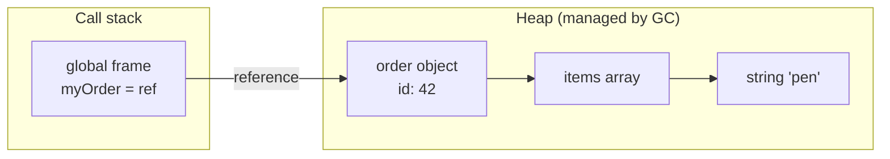
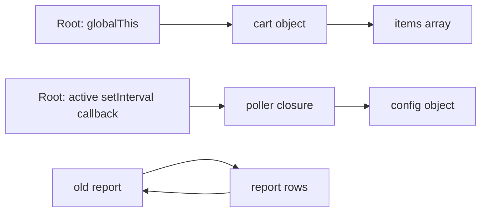
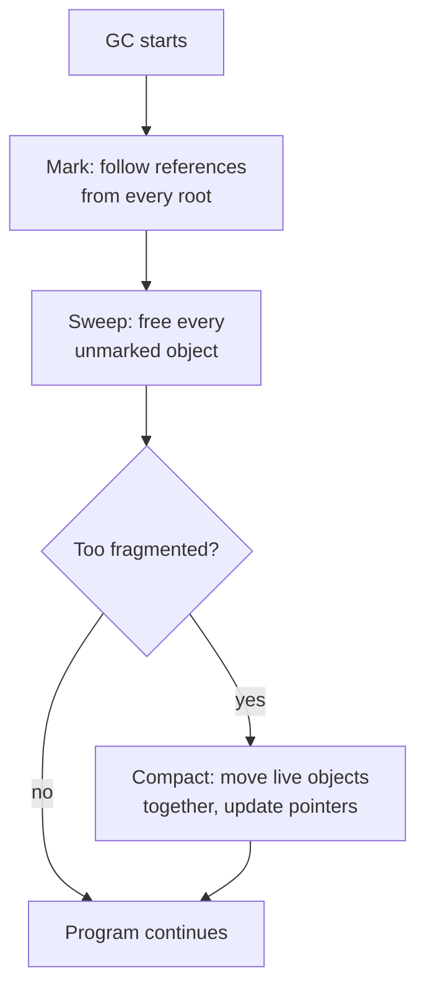
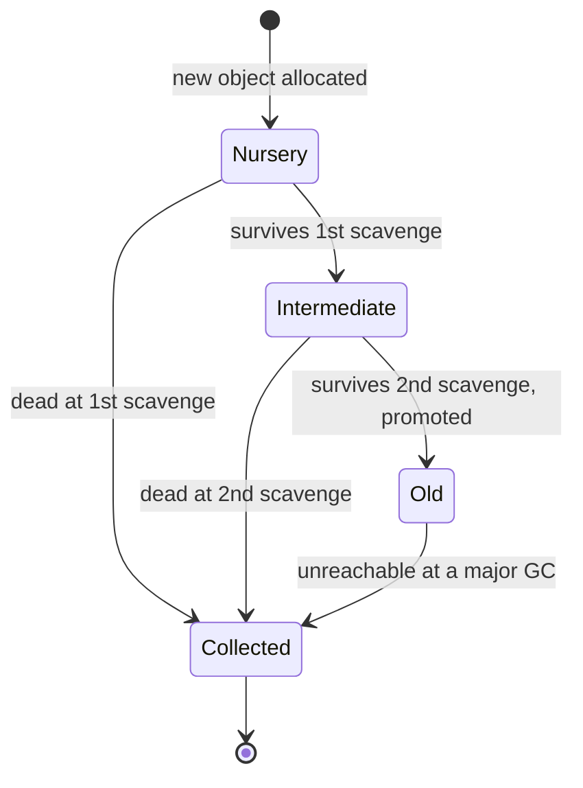
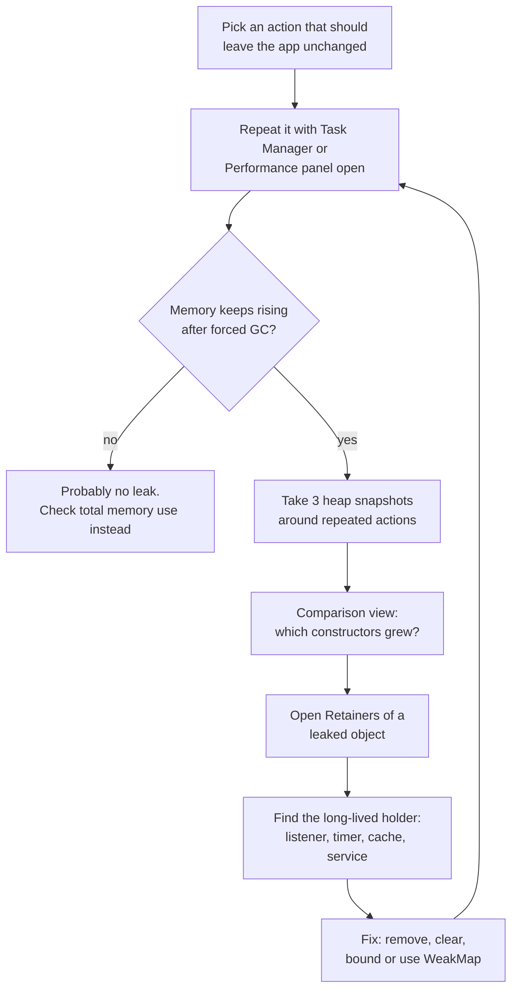

# Memory Management and Garbage Collection

> In this document you will learn how JavaScript gets memory, how the garbage collector decides what to free, how V8 does it in practice, and why memory leaks still happen in a language with automatic memory management. You will also learn to find leaks with Chrome DevTools and Node.js tools, and to prevent them in Angular, Electron and Node.js apps. Interviewers use this topic to see whether you understand what happens *after* your code runs, not only the code itself.

**Before this:** [Closures](05-closures.md) · [Objects and copying](07-objects-and-copying.md) · [Processes, threads and memory (OS basics)](../01-cs-and-web-fundamentals/03-operating-systems-processes-threads-memory.md) · **Interview questions:** [jump to the interview section](#interview-questions)

## Table of contents

1. [Why memory matters in JavaScript](#why-memory-matters-in-javascript)
2. [The memory lifecycle](#the-memory-lifecycle)
3. [Stack and heap as a mental model](#stack-and-heap-as-a-mental-model)
4. [Reachability and garbage collection roots](#reachability-and-garbage-collection-roots)
5. [Garbage collection algorithms](#garbage-collection-algorithms)
6. [How V8 collects garbage](#how-v8-collects-garbage)
7. [What a memory leak is](#what-a-memory-leak-is)
8. [Common memory leaks with code](#common-memory-leaks-with-code)
9. [Weak references for caches and metadata](#weak-references-for-caches-and-metadata)
10. [Finding leaks in the browser with Chrome DevTools](#finding-leaks-in-the-browser-with-chrome-devtools)
11. [Finding leaks in Node.js](#finding-leaks-in-nodejs)
12. [Memory in Angular apps](#memory-in-angular-apps)
13. [Memory in Electron apps](#memory-in-electron-apps)
14. [Memory in Node.js servers](#memory-in-nodejs-servers)
15. [Best practices](#best-practices)
16. [How to explain this in an interview](#how-to-explain-this-in-an-interview)
17. [Interview questions](#interview-questions)
18. [Summary](#summary)
19. [References](#references)

---

## Why memory matters in JavaScript

In languages like C, you ask for memory with `malloc()` and you give it back with `free()`. If you forget `free()`, the memory is lost until the program ends. If you call `free()` too early, the program crashes or behaves strangely.

JavaScript has **automatic memory management**. You never free memory yourself. A part of the engine called the **garbage collector** (GC) finds memory that your program can no longer use and frees it for you.

This is a big help, but it does not mean you can ignore memory:

- The garbage collector frees only memory that is **unreachable**. If your code still holds a reference to an object, the object stays in memory, even if you will never use it again. This is a **memory leak**.
- Garbage collection costs time. If your code creates a huge number of temporary objects, the collector runs more often, and the user may see small freezes (often called **jank**).
- Every environment has limits. A browser tab can crash with an "out of memory" error. A Node.js process stops with `JavaScript heap out of memory`. An Electron app that leaks for a full workday can use several gigabytes.

Typical symptoms of a memory problem:

| Where | Symptom |
|---|---|
| Browser single-page app | The page gets slower the longer it is open. The tab crashes after many hours. |
| Angular app | Opening and closing the same dialog or route many times makes memory grow and never come back. |
| Node.js server | Memory grows slowly until the process crashes or the container is killed. Then it restarts and the cycle repeats. |
| Electron app | The app uses more RAM every time the user opens and closes a window. |

> **Important distinction:** The ECMAScript specification does not say *how* memory is managed. It does not mention a stack, a heap or a specific garbage collection algorithm. Everything in this document about how memory is laid out and collected is engine behavior (mostly V8, the engine in Chrome, Edge, Node.js and Electron). The *rules you can rely on* are: unreachable objects can be collected, reachable objects are kept, and you cannot control exactly when collection happens.

---

## The memory lifecycle

Every piece of memory goes through three steps, in every programming language:

1. **Allocate** — get memory.
2. **Use** — read and write it.
3. **Release** — give it back so it can be reused.

In JavaScript, step 1 happens automatically when you create values. Step 3 happens automatically when the garbage collector decides the value is no longer reachable. You control only step 2, and, indirectly, step 3 (by keeping or dropping references).

### Allocation happens all the time

You allocate memory every time you create something that is not a tiny value stored directly:

```js
const user = { id: 1, name: "Asha" };          // an object
const cart = [12.5, 7.99, 3];                  // an array
const greeting = "Hello, " + user.name;        // a new string
const format = (price) => price.toFixed(2);    // a function object
const sessions = new Map();                    // a Map
const button = document.createElement("button"); // a DOM node (browser)
const bytes = new Uint8Array(1024);            // 1 KB of binary memory
```

Some allocations are hidden. These lines also create new objects:

```js
const total = cart.map((p) => p * 2);          // map creates a new array
const label = `Total: ${total.length}`;        // template literal creates a new string
const merged = { ...user, role: "admin" };     // spread creates a new object
const words = "a,b,c".split(",");              // split creates a new array of strings
```

### Using memory

Using memory means reading and writing values: `user.name`, `cart.push(5)`, `sessions.set(id, data)`.

### Releasing memory

You do not release memory directly. You make a value **unreachable**, and the garbage collector frees it later.

```js
let report = buildBigReport(); // allocates a lot of memory
showReport(report);
report = null;                 // you drop your reference
// The report object can now be collected, IF nothing else refers to it.
```

Setting a variable to `null` does not free anything by itself. It only removes **one** reference. If another variable, array, closure or event listener still refers to the object, the object stays.

> **Common confusion:** The `delete` operator does not free memory. `delete obj.prop` removes a property from an object. If that property was the last reference to some other object, that other object becomes unreachable and *can* be collected later. But `delete` is not a "free memory" command, and it does not work on variables.

---

## Stack and heap as a mental model

Most engines use two areas of memory. This is a helpful mental model, not a rule from the specification.

- The **stack** (or **call stack**) is a small, fast, ordered area. Every time a function is called, the engine pushes a **stack frame** for it. The frame holds the function's local variables and parameters (when the engine can keep them there) and where to return to. When the function returns, its frame is popped and that memory is reused immediately. No garbage collector is needed for the stack.
- The **heap** is a large, unordered area for values that can live longer than one function call: objects, arrays, functions, closures' captured variables, most strings, Maps, Sets and so on. The heap is the area the garbage collector manages.

A variable that holds an object does not hold the object itself. It holds a **reference** (think: the address of the object in the heap).

```js
function createOrder() {
  const quantity = 3;                        // small number, can live in the frame
  const order = { id: 42, items: ["pen"] };  // object lives in the heap
  return order;                              // returns the reference
}

const myOrder = createOrder();
// createOrder's frame is gone. 'quantity' is gone.
// The object { id: 42, ... } is still in the heap because myOrder refers to it.
```



### Two references, one object

Because variables hold references, two variables can point to the same heap object:

```js
let user = { name: "Asha" };
let admin = user;     // copies the reference, not the object

user = null;          // the object is still reachable through admin
console.log(admin.name); // "Asha"

admin = null;         // now no variable refers to it → it can be collected
```

### What V8 really does (engine detail)

- Small integers (called **Smis** in V8) are stored directly inside the variable slot or object field. They do not need a separate heap object.
- Other numbers, strings, objects and arrays are heap objects. The variable holds a pointer to them.
- If an inner function (a closure) uses a local variable of an outer function, that variable cannot live in the stack frame, because the frame will be popped. V8 moves such variables into a heap object called a **context**. This is how closures keep their variables alive. You will see why this matters for leaks [later](#4-closures-that-keep-big-data-alive).

You do not need these details to write correct code. They help you read heap snapshots and explain closure-related leaks.

---

## Reachability and garbage collection roots

### What it is

The core idea of modern garbage collection is **reachability**.

An object is **reachable** if your program can still get to it by following references, starting from a set of always-alive starting points called **roots**. Reachable objects are kept. Unreachable objects are garbage and can be freed.

### The roots

Roots are things the engine knows are alive right now. In a browser or Node.js, the roots include:

- The **global object** (`window` / `globalThis`) and everything stored on it.
- **Local variables and parameters** of the functions currently on the call stack.
- **Module-level variables** of loaded modules (a module stays loaded for the life of the page or process).
- Things the **host** holds on your behalf:
  - callbacks of active timers (`setTimeout`, `setInterval`),
  - event listeners on objects that are alive (for example, on `window`, on `document`, or on an element that is still in the page),
  - callbacks waiting for pending network requests, file reads or IPC replies,
  - the DOM tree of the current document.

### How it works

The garbage collector starts at the roots and follows every reference. Everything it can reach is alive. Everything else is garbage.



In this diagram, `old report` and `report rows` refer to each other, but no root leads to them. They are an **unreachable island**, so both are garbage, even though they point to each other.

### Analogy

Think of a city map. The roots are the train stations. An object is "reachable" if you can walk to it from any station using roads (references). A house with no road from any station is cut off, and the city can demolish it. Two houses connected only to each other are still cut off.

Where the analogy breaks: in a city, a cut-off house is demolished immediately. The garbage collector frees garbage **later, at a time it chooses**. You cannot predict the exact moment.

### Example: a cycle is not a problem

```js
function createFamily() {
  const husband = { name: "Ravi" };
  const wife = { name: "Meera" };
  husband.wife = wife;      // husband → wife
  wife.husband = husband;   // wife → husband (a cycle)
  return { father: husband, mother: wife };
}

let family = createFamily();
family = null;
// Nothing reachable points to husband or wife anymore.
// The cycle is unreachable, so both objects can be collected.
```

You can check this in Node.js with a `WeakRef` (a reference that does not keep the object alive) and the `--expose-gc` flag, which adds a `gc()` function for experiments:

```js
// Run with: node --expose-gc cycle-demo.mjs
const tick = () => new Promise((resolve) => setTimeout(resolve, 0));

let family = createFamily();          // createFamily from the example above
const fatherRef = new WeakRef(family.father);
family = null;

await tick();      // WeakRef targets stay alive until the current job ends
globalThis.gc();   // force a collection (for experiments only)
console.log(fatherRef.deref()); // undefined → the cycle was collected
```

The `await tick()` line matters. The language keeps an object alive until the end of the current synchronous job if you created a `WeakRef` to it or called `deref()` on it during that job. So you must let the current job finish before the object can disappear.

> Never use `--expose-gc` and `gc()` in production code. They exist for tests and experiments. Forcing collections usually makes performance worse.

---

## Garbage collection algorithms

There are two classic families of algorithms. Knowing both, and why modern engines chose one of them, is a common interview topic.

### Reference counting

**What it is:** Every object keeps a counter of how many references point to it. When a new reference is created, the counter goes up. When a reference is removed, it goes down. When the counter reaches zero, the object is freed immediately.

```js
let a = { name: "order" }; // count(order) = 1
let b = a;                  // count(order) = 2
a = null;                   // count(order) = 1
b = null;                   // count(order) = 0 → freed at once
```

**Advantages:**

- Memory is freed as soon as it becomes garbage.
- No big pauses, because the work is spread over every assignment.

**The big problem: cycles.** Two objects that point to each other always have a count of at least 1, even when nothing else can reach them:

```js
function link() {
  const a = {};
  const b = {};
  a.other = b; // count(b) = 2 (variable b + a.other)
  b.other = a; // count(a) = 2 (variable a + b.other)
}
link();
// After return: count(a) = 1, count(b) = 1 (they point to each other)
// A pure reference counter never frees them → leak.
```

**History you can mention in interviews:** Old Internet Explorer versions (IE 6 and 7) managed DOM objects with reference counting, while JavaScript objects used a different collector. A cycle between a DOM element and a JavaScript function (for example, `element.onclick` pointing to a closure that refers back to `element`) was never freed. This is where many old "JavaScript memory leak" articles come from. Modern browsers do not have this problem.

### Mark-and-sweep

**What it is:** A **tracing** collector. It works in phases:

1. **Mark:** Start from the roots. Visit every object you can reach and mark it as alive.
2. **Sweep:** Walk through the heap. Every object that is not marked is garbage. Free its memory.
3. **Compact** (optional): Move the surviving objects close together, so free memory becomes one big block instead of many small holes. Small holes are called **fragmentation**.



Because mark-and-sweep works from roots, **cycles are not a problem**. An unreachable cycle is never marked, so it is swept.

MDN notes that, since 2012, all modern browsers ship mark-and-sweep style collectors. Real engines add many improvements on top (generations, incremental and concurrent work), but the reachability idea stays the same.

### Comparison

| | Reference counting | Mark-and-sweep (tracing) |
|---|---|---|
| Decides garbage by | Counter reaches zero | Not reachable from roots |
| Handles cycles | No (leaks) | Yes |
| When memory is freed | Immediately | Later, during a GC cycle |
| Pauses | Small, spread out | Can pause the program (modern engines reduce this a lot) |
| Used by JS engines today | Not as the main collector | Yes (with many optimizations) |

> **Note:** Reference counting is still used in other places. Python (CPython) uses reference counting plus a separate cycle detector. Swift and Objective-C use automatic reference counting. Some C++ smart pointers (`shared_ptr`) count references. It is just not how JavaScript engines collect JavaScript objects.

---

## How V8 collects garbage

This section describes V8 at a high level. Details change between versions, so learn the ideas, not exact numbers.

### The generational hypothesis

Studies of real programs show that **most objects die young**. Think about everything you create in one click handler: temporary arrays from `map`, strings from template literals, small option objects. Most of them are garbage a few milliseconds later. A smaller number of objects (services, caches, the app state) live for a long time.

V8 uses this idea. It splits the heap into **generations**:

- **Young generation** — a small area where new objects are created.
- **Old generation** — a large area for objects that survived for a while.

Each generation gets a different collector, tuned for its kind of objects.

### Minor GC: the Scavenger (young generation)

The young generation is split into two halves (called **semi-spaces**: "from-space" and "to-space").

1. New objects are allocated in from-space. Allocation is very fast: V8 just moves a pointer forward.
2. When from-space is full, a **minor GC** (called a **scavenge**) runs.
3. The scavenger finds the live objects (starting from roots and from old objects that point into the young generation) and **copies** them to to-space. Dead objects are not touched at all.
4. The two halves swap roles. The old from-space is now empty and ready for new objects.
5. An object that survives **two** scavenges is **promoted** (moved) to the old generation.

Why this is fast: the cost depends on the number of **live** objects, not dead ones. Since most young objects are dead, a scavenge usually copies only a little.

How does the scavenger know which old objects point to young ones without scanning the whole old generation? V8 uses a **write barrier**: a tiny piece of code that runs when your program stores a reference into an object. If an old object starts pointing to a young object, the write barrier records it in a list. The scavenger treats that list as extra roots.

### Major GC: Mark-Compact (old generation)

The old generation is large, so copying everything would be too expensive. V8 uses **mark-sweep-compact** there:

1. **Mark** all reachable objects, starting from roots.
2. **Sweep** dead objects: their memory goes to free lists for reuse.
3. **Compact** only the most fragmented pages: live objects are moved out so the page can be freed completely.

### Orinoco: making pauses short

A collector that stops your program for the whole collection is called **stop-the-world**. With a big heap, that could mean long freezes. V8's garbage collector project (named **Orinoco**) uses three techniques to keep pauses short:

| Technique | Meaning | Example in V8 |
|---|---|---|
| **Parallel** | Several helper threads do GC work at the same time, while the main thread is paused | Scavenges are parallel. Compaction is parallel. |
| **Incremental** | GC work is split into small steps mixed with your JavaScript | Marking can be done in small slices between tasks. |
| **Concurrent** | Helper threads do GC work in the background while your JavaScript keeps running | Most marking and sweeping of the old generation run concurrently. |

A short pause on the main thread is still needed at the end of marking. Chrome can also schedule GC work during **idle time** (for example, when a frame finished early), so the user notices it less.

### The life of an object



### Seeing the collector work in Node.js

Node.js accepts V8 flags. `--trace-gc` prints one line for every collection:

```bash
node --trace-gc app.js
```

You will see lines like these (shortened):

```text
[20952:...]  49 ms: Scavenge 4.4 (5.1) -> 3.9 (6.1) MB, 2.30 / 0.00 ms  allocation failure;
[20952:...]  65 ms: Scavenge 8.1 (10.9) -> 7.5 (10.8) MB, 6.11 / 0.00 ms  allocation failure;
```

- `Scavenge` is a minor GC. `Mark-Compact` lines are major GCs.
- `4.4 -> 3.9 MB` is heap usage before and after.
- `2.30 ms` is how long the pause took.
- "allocation failure" sounds scary, but it only means "the young generation was full, so a GC was needed". It is normal.

### DOM objects in Chrome

In Chrome, DOM nodes are C++ objects managed by Blink's own garbage collector (called **Oilpan**). V8 and Oilpan cooperate and trace references across the JavaScript–DOM boundary. So a cycle between a DOM node and a JavaScript closure is collected when the whole cycle is unreachable. The old IE problem described above does not exist here.

### Heap limits

V8 has a maximum heap size. When the old generation is full and a major GC cannot free enough memory, the process crashes:

```text
FATAL ERROR: Reached heap limit Allocation failed - JavaScript heap out of memory
```

In Node.js, the default limit depends on the Node.js version and on how much memory the machine has. You can check it and change it:

```js
import v8 from "node:v8";
const limitMB = v8.getHeapStatistics().heap_size_limit / 1024 / 1024;
console.log(limitMB.toFixed(0)); // depends on your machine and flags
```

```bash
node --max-old-space-size=4096 server.js   # allow about 4 GB for the old generation
```

Raising the limit is fine when your app really needs more memory (for example, a build tool processing a huge project). It is **not** a fix for a leak. A leaking process with a bigger limit just crashes later.

### What this means for your code

- Creating many short-lived objects is cheap, thanks to the scavenger. Do not avoid normal code like `map` and spread out of fear.
- In **hot paths** (code that runs thousands of times per second, like an animation frame or a game loop), reducing temporary allocations can reduce GC pauses. Measure first.
- Long-lived objects that you keep by mistake are expensive: they get promoted, they are scanned in every major GC, and they never go away. This is the real problem behind leaks.

---

## What a memory leak is

A **memory leak** in JavaScript is memory that your program **no longer needs** but **still keeps reachable**. The garbage collector cannot know your intentions. It only sees references. If a reference exists, the object stays.

So every JavaScript leak has the same shape:

```text
root  →  something long-lived  →  ...  →  object you forgot about
```

Your job when fixing a leak is to find that chain and cut it at the right place.

### Leak or just high memory?

Not every memory increase is a leak:

| Situation | Leak? |
|---|---|
| Memory goes up while you load a big table, then stays stable | No. The app needs that data. |
| Memory goes up and down in a "sawtooth" shape | No. This is normal: allocation, then GC. |
| Memory goes up after each repeat of the same action (open/close a dialog) and never comes back down, even after GC | Probably a leak. |
| The lowest points of the sawtooth keep rising over hours | Probably a leak. |

The key test: **repeat an action that should leave the app in the same state** (open a page and leave it, open a dialog and close it). If memory after a forced GC keeps growing with each repeat, something is being kept by mistake.

---

## Common memory leaks with code

### 1. Accidental global variables

In sloppy (non-strict) mode, assigning to an undeclared variable creates a property on the global object. Global properties are reachable from a root, so the value lives forever.

```js
// ❌ Wrong (sloppy mode script)
function addToCart(price) {
  total = price; // forgot let/const → creates globalThis.total
}
addToCart(99);
console.log(globalThis.total); // 99 — it leaked into the global object
```

A single number is harmless. The real danger is when the accidental global holds something big, like a list of results or a DOM subtree.

```js
// ✅ Correct
"use strict";
function addToCart(price) {
  const total = price; // local, can be freed when no longer reachable
  return total;
}
// In strict mode, the wrong version throws: ReferenceError: total is not defined
```

**Prevention:** ES modules, class bodies and TypeScript output for modules are strict by default, so Angular code is strict. Keep linting rules like `no-undef` enabled.

### 2. Forgotten timers and intervals

An active `setInterval` is held by the host. Its callback, and everything the callback refers to, stays alive until you call `clearInterval`.

```js
// ❌ Wrong: the interval keeps running after the widget is removed
function startStockWidget(element, symbol) {
  const history = []; // grows forever
  setInterval(async () => {
    const price = await fetchPrice(symbol);
    history.push(price);
    element.textContent = `${symbol}: ${price}`;
  }, 1000);
}
```

Even after `element` is removed from the page, the interval callback still refers to `element` (now a detached node) and to `history` (which keeps growing).

```js
// ✅ Correct: return a cleanup function and call it
function startStockWidget(element, symbol) {
  const history = [];
  const intervalId = setInterval(async () => {
    const price = await fetchPrice(symbol);
    history.push(price);
    if (history.length > 100) history.shift(); // keep it bounded
    element.textContent = `${symbol}: ${price}`;
  }, 1000);

  return function stop() {
    clearInterval(intervalId);
  };
}

const stopWidget = startStockWidget(document.querySelector("#ticker"), "ACME");
// later, when the widget is removed:
stopWidget();
```

A `setTimeout` that has already fired is not a leak: the host drops the callback after running it. A long timeout (for example, 10 minutes) does keep its callback alive until it fires or is cleared.

### 3. Event listeners that are never removed

A listener on a long-lived target (`window`, `document`, a shared service, a WebSocket) keeps the listener function alive. The function keeps its closure alive. The closure often refers to a component.

```js
// ❌ Wrong
class ChartPanel {
  constructor(element) {
    this.element = element;
    this.data = new Array(100_000).fill(0);
    window.addEventListener("resize", this.onResize.bind(this));
  }
  onResize() {
    this.redraw();
  }
  redraw() { /* uses this.data and this.element */ }
  destroy() {
    // bind() creates a NEW function, so this removes nothing
    window.removeEventListener("resize", this.onResize.bind(this));
  }
}
```

`bind()` returns a new function every time. `removeEventListener` needs the **exact same function reference** that you passed to `addEventListener`. So `destroy()` removes nothing, and every `ChartPanel` you ever created stays in memory through the chain `window → listener → bound function → panel → data`.

```js
// ✅ Correct, option A: keep the same function reference
class ChartPanel {
  constructor(element) {
    this.element = element;
    this.data = new Array(100_000).fill(0);
    this.handleResize = () => this.redraw(); // one reference, stored
    window.addEventListener("resize", this.handleResize);
  }
  redraw() { /* ... */ }
  destroy() {
    window.removeEventListener("resize", this.handleResize);
  }
}
```

```js
// ✅ Correct, option B: AbortController removes many listeners at once
class ChartPanel {
  #abort = new AbortController();

  constructor(element) {
    const { signal } = this.#abort;
    window.addEventListener("resize", () => this.redraw(), { signal });
    document.addEventListener("keydown", (e) => this.onKey(e), { signal });
    element.addEventListener("click", (e) => this.onClick(e), { signal });
  }
  redraw() {}
  onKey() {}
  onClick() {}
  destroy() {
    this.#abort.abort(); // removes all three listeners
  }
}
```

The `signal` option of `addEventListener` is a DOM feature supported by all modern browsers. For a listener that should run only one time, use `{ once: true }`.

> Listeners on an element that is removed and no longer referenced are not a leak. When the element itself becomes unreachable, its listeners go with it. The leak happens when the **target lives longer than the owner of the listener**.

### 4. Closures that keep big data alive

A closure keeps alive every outer variable it uses. If a long-lived callback uses a big variable, the big variable lives as long as the callback.

```js
// ❌ Wrong: the click handler keeps the whole report alive
function setupExportButton(button) {
  const report = buildReport(); // imagine 50 MB of rows
  button.addEventListener("click", () => {
    console.log(`Report has ${report.rows.length} rows`);
  });
}
```

```js
// ✅ Correct: keep only what the callback needs
function setupExportButton(button) {
  const report = buildReport();
  const rowCount = report.rows.length; // small value
  button.addEventListener("click", () => {
    console.log(`Report has ${rowCount} rows`);
  });
  // 'report' is not used by any closure, so it can be collected after return
}
```

**A V8 detail that surprises people:** closures created in the same scope **share one context object**. If any closure in that scope uses a variable, the variable is stored in the shared context. Then *every* closure from that scope keeps it alive, even closures that never use it.

```js
function createSession() {
  const report = new Array(100_000).fill("row");
  const user = { name: "Asha" };

  const logSize = () => console.log("rows:", report.length); // uses report
  logSize();

  return {
    getUserName() { return user.name; }, // does not use report...
  };
}

const session = createSession();
// ...but in V8, getUserName shares a context with logSize,
// so 'report' stays alive as long as 'session' is alive.
```

We checked this with `WeakRef` and `node --expose-gc` (Node.js 22):

- Without `logSize`, `report` was collected after `createSession` returned. Only `user` stayed alive.
- With `logSize` in the same function, `report` stayed alive until `session` was set to `null`.
- The same happened when `logSize` was inside an `if` branch that never ran, because V8 decides what goes into the context by reading the source code, not by watching what runs.

The famous version of this bug builds a **chain**: each new object's method shares a context with a closure that refers to the *previous* object, so no object is ever freed. In our test, 20 calls of such a function grew the heap by about 150 MB, compared with about 8 MB after the fix. The fix: do not let a long-lived closure share a scope with a closure that captures big or chained data, or set that variable to `null` when you are done with it.

For the general rules of closures, see [Closures](05-closures.md).

### 5. Detached DOM nodes

A **detached DOM node** is an element that has been removed from the document but is still referenced from JavaScript. The browser cannot free it. If it is the root of a subtree, the whole subtree stays (every child element and text node).

```js
// ❌ Wrong: removed rows stay in memory through the cache
const rowCache = [];

function renderRows(table, users) {
  table.innerHTML = ""; // removes old rows from the page
  for (const user of users) {
    const row = document.createElement("tr");
    row.textContent = user.name;
    table.appendChild(row);
    rowCache.push(row); // keeps every row ever created
  }
}
```

After ten re-renders, nine sets of rows are detached but still in `rowCache`.

```js
// ✅ Correct: keep references only to what is on the page now
let currentRows = [];

function renderRows(table, users) {
  table.innerHTML = "";
  currentRows = users.map((user) => {
    const row = document.createElement("tr");
    row.textContent = user.name;
    table.appendChild(row);
    return row;
  });
}
```

If you need to attach extra data to elements, use a `WeakMap` with the element as the key. When the element is gone, the entry can go too (see [weak references](#weak-references-for-caches-and-metadata)).

Frameworks like Angular and React create and remove DOM nodes for you. So detached nodes usually come from **your own code that holds element references**: `@ViewChild` references copied into a long-lived service, third-party widgets (charts, maps, editors) that were never destroyed, or manual DOM caches.

### 6. Unbounded caches and Maps

A cache that only grows is a leak with a nice name. It is very common in memoization and in Node.js servers.

```js
// ❌ Wrong: one entry per unique query, forever
const searchCache = new Map();

async function searchProducts(query) {
  if (searchCache.has(query)) return searchCache.get(query);
  const results = await fetchResults(query);
  searchCache.set(query, results);
  return results;
}
```

```js
// ✅ Correct: a small LRU (least recently used) cache with a size limit
class LruCache {
  #map = new Map();
  constructor(maxSize) {
    this.maxSize = maxSize;
  }
  get(key) {
    if (!this.#map.has(key)) return undefined;
    const value = this.#map.get(key);
    this.#map.delete(key); // move the key to the "newest" end
    this.#map.set(key, value);
    return value;
  }
  set(key, value) {
    this.#map.delete(key);
    this.#map.set(key, value);
    if (this.#map.size > this.maxSize) {
      const oldestKey = this.#map.keys().next().value; // Map keeps insertion order
      this.#map.delete(oldestKey);
    }
  }
  get size() {
    return this.#map.size;
  }
}

const cache = new LruCache(2);
cache.set("a", 1);
cache.set("b", 2);
cache.get("a");     // "a" is now the most recently used
cache.set("c", 3);  // evicts "b", the least recently used
console.log(cache.get("b"), cache.get("a"), cache.size); // undefined 1 2
```

Every cache needs an answer to one question: **"When does an entry leave?"** Possible answers: a maximum size (LRU), a time to live (TTL), when its key object dies (`WeakMap`), or when the user logs out. More detail: [Map, Set, WeakMap and WeakSet](12-map-set-weakmap-weakset.md) and [Caching in Node.js](../07-nodejs-backend/11-caching.md).

### 7. Pending requests that never finish

Code that matches requests with responses often stores callbacks in a Map: WebSocket RPC, worker messages, custom IPC. If a response never comes, the entry stays forever.

```js
// ❌ Wrong: if the server never answers, the entry is never deleted
const pending = new Map();
let nextId = 1;

function request(socket, method, params) {
  const id = nextId++;
  return new Promise((resolve, reject) => {
    pending.set(id, { resolve, reject });
    socket.send(JSON.stringify({ id, method, params }));
  });
}
```

```js
// ✅ Correct: always clean up, including on timeout
function request(socket, method, params, timeoutMs = 10_000) {
  const id = nextId++;
  return new Promise((resolve, reject) => {
    const timer = setTimeout(() => {
      pending.delete(id);
      reject(new Error(`${method} timed out`));
    }, timeoutMs);

    pending.set(id, {
      resolve: (value) => { clearTimeout(timer); pending.delete(id); resolve(value); },
      reject: (error) => { clearTimeout(timer); pending.delete(id); reject(error); },
    });
    socket.send(JSON.stringify({ id, method, params }));
  });
}
```

A promise that never settles is not a leak by itself. If nothing refers to the promise, it can be collected together with its callbacks. The leak comes from the **Map** that keeps the `resolve` and `reject` functions reachable.

### 8. RxJS subscriptions that are never closed

In Angular, an Observable that never completes (an `interval`, a store selection, a `Subject` in a root service, `fromEvent(window, "resize")`) keeps every subscriber alive until you unsubscribe. The subscriber callback usually refers to the component. So the component stays in memory after Angular destroys it, and the callback keeps running.

```ts
// ❌ Wrong: the subscription outlives the component
@Component({ selector: "app-notifications", template: "{{ count }}" })
export class NotificationsComponent implements OnInit {
  count = 0;
  constructor(private notifications: NotificationService) {}

  ngOnInit() {
    this.notifications.unread$.subscribe((n) => (this.count = n));
  }
}
```

Here `NotificationService` is a root singleton, so `unread$` lives forever. Each time the user visits this page, one more destroyed component stays in memory. The fixes (`async` pipe, `takeUntilDestroyed`, `takeUntil`) are in [Memory in Angular apps](#memory-in-angular-apps).

### 9. Node.js listener leaks and global caches

A Node.js server runs for days. Anything that grows a little on every request becomes a big leak.

A common mistake is adding a listener to a long-lived emitter **per request**:

```js
import { EventEmitter } from "node:events";

const priceFeed = new EventEmitter(); // lives as long as the process

// ❌ Wrong: a new listener on every request, never removed
function handleRequest(id) {
  priceFeed.on("price", (price) => console.log(id, price));
}

for (let i = 1; i <= 11; i++) handleRequest(i);
console.log(priceFeed.listenerCount("price")); // 11
```

Node.js prints a warning when an emitter gets more than 10 listeners for one event (10 is the default limit):

```text
(node:29016) MaxListenersExceededWarning: Possible EventEmitter memory leak detected. 11 price listeners added to [EventEmitter]. MaxListeners is 10. Use emitter.setMaxListeners() to increase limit
```

The warning is a hint, not an error. The fix is to remove the listener when the request ends:

```js
// ✅ Correct: remove the listener when the client disconnects
function handleRequest(req, res) {
  const onPrice = (price) => res.write(`data: ${price}\n\n`);
  priceFeed.on("price", onPrice);
  req.on("close", () => priceFeed.off("price", onPrice));
}
```

Call `emitter.setMaxListeners(n)` only when you truly expect many listeners on purpose (for example, one emitter that serves many long-lived subscribers). Raising the limit to silence the warning hides the leak.

Other Node.js leak sources: module-level Maps and arrays used as caches or "recent requests" lists, per-user data stored in memory without cleanup, and closures kept by long-lived timers. See [Memory in Node.js servers](#memory-in-nodejs-servers).

### 10. Logging objects to the console

In browsers, when you `console.log` an object, the DevTools console keeps a reference so you can expand it later. While DevTools is open and the console is not cleared, logged objects cannot be collected. This can confuse leak investigations. Clear the console before taking heap snapshots, and remove debug logging of big objects from production code.

---

## Weak references for caches and metadata

Sometimes you want to connect data to an object **without keeping that object alive**. JavaScript has four tools for this. Full details are in [Map, Set, WeakMap and WeakSet](12-map-set-weakmap-weakset.md). Here is what matters for memory.

| Tool | Added | What is held weakly | Typical use |
|---|---|---|---|
| `WeakMap` | ES2015 | The keys (objects, and non-registered symbols since ES2023) | Extra data for objects you do not own: DOM metadata, per-object caches, private data |
| `WeakSet` | ES2015 | The values (objects) | "Have I seen this object?" checks |
| `WeakRef` | ES2021 | The target object | Optional caches where losing the value is acceptable |
| `FinalizationRegistry` | ES2021 | Registered objects | Optional cleanup after an object was collected |

### WeakMap: the safe default

A `WeakMap` holds its keys weakly. If the key object becomes unreachable everywhere else, the entry disappears. The value is kept alive only as long as the key is alive.

```js
// Extra data for DOM elements, without risk of detached-node leaks
const tooltipData = new WeakMap();

function attachTooltip(element, text) {
  tooltipData.set(element, { text, shownCount: 0 });
}

function showTooltip(element) {
  const data = tooltipData.get(element);
  if (!data) return;
  data.shownCount++;
  console.log(data.text);
}
// When an element is removed and no longer referenced,
// its WeakMap entry can be collected automatically.
```

A per-object memoization cache:

```js
const totalCache = new WeakMap();

function cartTotal(cart) {
  if (totalCache.has(cart)) return totalCache.get(cart);
  const total = cart.items.reduce((sum, item) => sum + item.price * item.qty, 0);
  totalCache.set(cart, total);
  return total;
}

const cart = { items: [{ price: 10, qty: 2 }, { price: 5, qty: 1 }] };
console.log(cartTotal(cart)); // 25 (calculated)
console.log(cartTotal(cart)); // 25 (from cache)
```

This works well with immutable state: a changed cart is a new object, so it gets a new cache entry, and old carts can be collected together with their entries.

Limits of `WeakMap`: you cannot iterate it, you cannot read its size, and keys must be objects (or non-registered symbols). These limits exist on purpose. If you could list the keys, your program's behavior would depend on when the GC runs.

### WeakRef and FinalizationRegistry: use with care

A `WeakRef` refers to an object without keeping it alive. `deref()` returns the object, or `undefined` if it was collected.

```js
// An optional cache of decoded images: losing an entry only costs a re-decode
const imageCache = new Map(); // url → WeakRef
const cleanup = new FinalizationRegistry((url) => {
  // Runs some time after the image object was collected (maybe never)
  const ref = imageCache.get(url);
  if (ref && ref.deref() === undefined) imageCache.delete(url);
});

function getDecodedImage(url) {
  const cached = imageCache.get(url)?.deref();
  if (cached) return cached;

  const image = decodeImage(url); // expensive, big object
  imageCache.set(url, new WeakRef(image));
  cleanup.register(image, url);
  return image;
}
```

Rules for these two tools:

- The GC decides when, and whether, a target is collected. Two runs of the same program can behave differently.
- A `FinalizationRegistry` callback may run late or **never** (for example, if the page closes). Never use it for important cleanup like saving data, closing files or releasing locks. Use explicit `close()` or `destroy()` methods for that.
- The proposal authors themselves advise avoiding these tools unless you have a clear need. Most apps never need them. A `WeakMap` or an explicit size limit is almost always the better choice.

---

## Finding leaks in the browser with Chrome DevTools

Guessing does not work well for leaks. You need to **measure**, find **what** is growing, and find **who is holding it** (the retainer chain).

### Step 1: confirm there is a leak

Two quick tools tell you whether memory really grows:

- **Chrome Task Manager** (Shift+Esc on Windows/Linux, or the browser menu → More tools → Task manager). Turn on the "JavaScript memory" column. Watch the live value while you repeat an action.
- **Performance panel** with the **Memory** checkbox on. Record while you repeat the action several times. Click the "Collect garbage" button (trash can icon) at the start and the end of the recording. If the JS heap, the number of DOM nodes or the number of listeners ends higher than at the start, and the lowest points keep rising, you probably have a leak.

### Step 2: find what is growing with heap snapshots

The **Memory** panel has four profiling types:

| Profiling type | What it shows | Use it when |
|---|---|---|
| **Heap snapshot** | Every object in the JS heap at one moment, with sizes and retainers | Finding what stays alive after an action |
| **Allocations on timeline** | Allocations over time. Blue bars are objects still alive, gray bars were collected | Finding which action allocates memory that is never freed |
| **Allocation sampling** | Low-overhead sampling of allocations by function | Finding which functions allocate the most, on long recordings |
| **Detached elements** | DOM elements that are detached but still retained | Hunting detached DOM node leaks directly |

The classic **three-snapshot technique**:

1. Load the page and bring it to a "neutral" state (for example, the dashboard with no dialog open).
2. Take **snapshot 1** (the baseline). Taking a snapshot runs a garbage collection first, so you only see reachable objects.
3. Do the suspect action, then undo it (open the dialog, close it). Repeat it several times, for example 5 times. Repeating makes the leak bigger and easier to see.
4. Take **snapshot 2**.
5. Repeat the action 5 more times, then take **snapshot 3**.
6. Select snapshot 3 and switch the view to **Comparison** against snapshot 2 (or select snapshot 2 and compare with snapshot 1). Sort by **# Delta** or **Size Delta**.
7. Look for constructor names that grew by a multiple of your repeat count. For example, if you repeated 5 times and `DialogComponent` shows +5, every dialog you closed is still alive.

### Step 3: find who is holding it

Click an object that should have been freed. The **Retainers** section at the bottom shows the chain of references from that object back to a root. Read it from the object upward:

```text
DialogComponent
  ← context in function handleKeydown()      (a closure)
  ← listener in EventListener                 (a listener)
  ← document                                  (a root)
```

This chain tells you exactly what to fix: a `keydown` listener on `document`, created by the dialog, was never removed.

Useful columns and filters:

- **Shallow size** — memory used by the object itself.
- **Retained size** — memory that would be freed if this object were freed (the object plus everything only it keeps alive). Sort by retained size to find the "big holder".
- **Distance** — number of references between the object and the nearest root.
- Type `Detached` in the **Class filter** to see detached DOM elements, or choose the "Objects retained by detached nodes" filter in the Summary view.

### The workflow in one picture



### Tips that save time

- Use an **Incognito window** or a clean profile. Browser extensions also allocate memory and appear in snapshots.
- **Clear the console** before snapshots (logged objects are retained).
- Use a **production-like build** but with source maps. Development builds of frameworks keep extra debug data.
- Name things. A class called `CheckoutDialogComponent` is easy to find in a snapshot. An anonymous object literal shows up only as `Object`.
- For automated leak tests in CI, Meta's open-source tool **MemLab** drives a browser through a scenario and reports leaked objects. It is optional, but useful for big apps.

---

## Finding leaks in Node.js

### Watch the numbers first

`process.memoryUsage()` returns memory in bytes:

```js
const toMB = (bytes) => (bytes / 1024 / 1024).toFixed(1) + " MB";

const usage = process.memoryUsage();
console.log(Object.keys(usage)); // [ 'rss', 'heapTotal', 'heapUsed', 'external', 'arrayBuffers' ]
console.log("heapUsed:", toMB(usage.heapUsed)); // for example "heapUsed: 4.3 MB"
```

| Field | Meaning |
|---|---|
| `rss` | Resident set size: all memory the process uses in RAM (heap, code, stacks, native memory) |
| `heapTotal` | Memory V8 has reserved for the JS heap |
| `heapUsed` | Memory actually used by JS objects in the heap |
| `external` | Memory of C++ objects linked to JS objects (for example, the data of `Buffer`s) |
| `arrayBuffers` | Memory for `ArrayBuffer`s and `SharedArrayBuffer`s, including Node.js `Buffer`s (part of `external`) |

A simple way to watch trends in a running service:

```js
const toMB = (bytes) => Math.round(bytes / 1024 / 1024);

setInterval(() => {
  const { rss, heapUsed } = process.memoryUsage();
  console.log(JSON.stringify({ msg: "memory", rssMB: toMB(rss), heapUsedMB: toMB(heapUsed) }));
}, 30_000).unref(); // unref(): this timer alone will not keep the process alive
```

If `heapUsed` keeps rising under steady traffic, suspect a JS leak. If `rss` rises but `heapUsed` stays flat, look at native memory: Buffers, native add-ons, or memory fragmentation.

### Take heap snapshots

Option 1: **DevTools connected to Node.js**

```bash
node --inspect server.js
```

Open `chrome://inspect` in Chrome, click "Open dedicated DevTools for Node", and use the **Memory** tab exactly like in the browser (heap snapshots, comparison, retainers, allocation timeline).

Option 2: **write a snapshot file from code**

```js
import v8 from "node:v8";

// For example, behind an admin-only endpoint or a signal handler
const file = v8.writeHeapSnapshot(); // returns the file name, e.g. Heap.20261018.....heapsnapshot
console.log("Snapshot written to", file);
```

Load the `.heapsnapshot` file in the Chrome DevTools Memory panel ("Load" button).

Option 3: **command-line flags**

```bash
# Write a snapshot when the process receives a signal (Linux/macOS)
node --heapsnapshot-signal=SIGUSR2 server.js
kill -USR2 <pid>

# Write up to 2 snapshots automatically when the heap is close to its limit
node --heapsnapshot-near-heap-limit=2 server.js
```

Be careful in production: writing a snapshot **blocks the event loop** while it runs, and the Node.js docs warn it can need about twice the current heap size in memory. Do it on one instance, ideally taken out of the load balancer.

### Other useful flags

| Flag | What it does |
|---|---|
| `--inspect` / `--inspect-brk` | Opens the debugger port. `-brk` pauses on the first line. |
| `--max-old-space-size=<MB>` | Sets the old-generation heap limit |
| `--trace-gc` | Prints one line per garbage collection |
| `--expose-gc` | Adds `globalThis.gc()` for tests and experiments only |
| `--heapsnapshot-near-heap-limit=<n>` | Writes snapshots automatically before an out-of-memory crash |

### A leak test you can run

You can write a small test that repeats an operation and checks that the heap returns to normal. This catches leaks before production:

```js
// node --expose-gc leak-check.mjs
async function heapAfterGc() {
  await new Promise((resolve) => setTimeout(resolve, 0));
  globalThis.gc();
  return process.memoryUsage().heapUsed;
}

const before = await heapAfterGc();
for (let i = 0; i < 1_000; i++) {
  await handleFakeRequest(); // the code under test
}
const after = await heapAfterGc();
console.log("growth MB:", ((after - before) / 1024 / 1024).toFixed(1));
```

Heap numbers are noisy, so use a generous threshold and many repetitions. The goal is to catch "grows 50 MB per 1,000 requests", not 100 KB.

---

## Memory in Angular apps

An Angular app is a single-page app that can stay open all day. Components are created and destroyed constantly when users navigate. Anything a destroyed component leaves behind is a leak.

### What Angular cleans up for you

- Template event bindings like `(click)="save()"` and `@HostListener` listeners are removed when the component is destroyed.
- The `async` pipe unsubscribes automatically when the view is destroyed.
- `HttpClient` Observables complete after the response arrives, so their subscriptions end on their own. (Unsubscribing early is still useful, because it **cancels** the request.)
- The Angular docs explain that `ActivatedRoute` and its Observables (`paramMap`, `queryParamMap`) are destroyed together with the routed component, so you do not have to unsubscribe from them.
- Components and services provided at component level are destroyed with that component.

### What you must clean up yourself

- Subscriptions to Observables that do not complete: `interval`, `fromEvent`, store selections, `Subject`s and `BehaviorSubject`s in root services, WebSocket streams.
- `setInterval`, long `setTimeout`s, `requestAnimationFrame` loops.
- Listeners you add manually with `addEventListener` (on `window`, `document`) or with `Renderer2.listen` (it returns an "unlisten" function).
- Third-party widgets: charts, maps, rich text editors. Most have a `destroy()` or `dispose()` method.
- References to component instances or DOM elements stored in root services.

### Strategy 1: the async pipe (preferred)

```ts
import { Component } from "@angular/core";
import { AsyncPipe, NgIf } from "@angular/common";

@Component({
  selector: "app-notifications",
  standalone: true,
  imports: [AsyncPipe, NgIf],
  template: `<span *ngIf="unread$ | async as count">{{ count }} unread</span>`,
})
export class NotificationsComponent {
  unread$ = this.notifications.unread$;
  constructor(private notifications: NotificationService) {}
}
```

No `subscribe()` in your code means nothing to forget.

### Strategy 2: takeUntilDestroyed (Angular 16, developer preview)

Angular 16 added `DestroyRef` and the `takeUntilDestroyed()` operator in `@angular/core/rxjs-interop`. The operator completes the stream when the component (or directive, or service) is destroyed.

```ts
import { Component, DestroyRef, OnInit, inject } from "@angular/core";
import { takeUntilDestroyed } from "@angular/core/rxjs-interop";
import { fromEvent, interval } from "rxjs";

@Component({ selector: "app-live-prices", standalone: true, template: "{{ price }}" })
export class LivePricesComponent implements OnInit {
  price = 0;
  private destroyRef = inject(DestroyRef);

  constructor(private prices: PriceService) {
    // In the constructor we are in an "injection context", so no argument is needed
    this.prices.price$
      .pipe(takeUntilDestroyed())
      .subscribe((p) => (this.price = p));
  }

  ngOnInit() {
    // Outside the injection context (ngOnInit), pass the DestroyRef explicitly
    fromEvent(window, "resize")
      .pipe(takeUntilDestroyed(this.destroyRef))
      .subscribe(() => this.relayout());

    interval(5_000)
      .pipe(takeUntilDestroyed(this.destroyRef))
      .subscribe(() => this.refresh());
  }

  private relayout() {}
  private refresh() {}
}
```

`DestroyRef` is also useful for non-RxJS cleanup:

```ts
constructor() {
  const id = setInterval(() => this.tick(), 1000);
  inject(DestroyRef).onDestroy(() => clearInterval(id));
}
```

> **Newer Angular:** `DestroyRef` and `takeUntilDestroyed` left developer preview in later versions and are now the standard way. In Angular 16, they work but are marked developer preview.

### Strategy 3: takeUntil with a destroy Subject (classic, works in every version)

```ts
import { Component, OnDestroy, OnInit } from "@angular/core";
import { Subject, takeUntil } from "rxjs";

@Component({ selector: "app-orders", template: "..." })
export class OrdersComponent implements OnInit, OnDestroy {
  private destroy$ = new Subject<void>();

  constructor(private store: OrderStore) {}

  ngOnInit() {
    this.store.orders$
      .pipe(takeUntil(this.destroy$)) // keep takeUntil as the LAST operator
      .subscribe((orders) => this.render(orders));
  }

  ngOnDestroy() {
    this.destroy$.next();
    this.destroy$.complete();
  }

  private render(orders: unknown[]) {}
}
```

Put `takeUntil` **last** in the pipe. If an operator like `switchMap` comes after it, the inner subscription can keep running after destroy.

### Strategy 4: keep the Subscription and unsubscribe

```ts
private subscription = new Subscription();

ngOnInit() {
  this.subscription.add(this.a$.subscribe(/* ... */));
  this.subscription.add(this.b$.subscribe(/* ... */));
}

ngOnDestroy() {
  this.subscription.unsubscribe(); // closes both
}
```

### Which one to choose

| Strategy | Use when |
|---|---|
| `async` pipe | The value is shown in the template. First choice. |
| `takeUntilDestroyed()` | You need `subscribe()` in a component, directive or service (Angular 16+). |
| `takeUntil(destroy$)` | Older Angular versions, or teams that prefer the explicit pattern. |
| `Subscription.unsubscribe()` | A few manual subscriptions, or subscriptions you need to stop before destroy. |
| `take(1)` / `first()` | You need exactly one value (but if the value never comes, the subscription stays open). |

### Other Angular memory notes

- **Root services live forever.** A `providedIn: "root"` service that stores search results, big lists or component references holds them for the whole session. Clear state on logout, or provide the service at the feature or component level if its data belongs to one screen.
- **Signals (Angular 16 developer preview):** an `effect()` created in a component is destroyed with that component. `toSignal()` unsubscribes from its Observable when its context is destroyed.
- Deep dives: [Angular RxJS](../06-angular-16/09-rxjs.md), [Lifecycle hooks](../06-angular-16/04-lifecycle-hooks.md), [Angular performance](../06-angular-16/12-performance.md).

---

## Memory in Electron apps

An Electron app has several processes. Each one has its own memory and its own V8 heap (see [Electron architecture](../08-electron-desktop/01-electron-architecture-and-process-model.md)).

- The **main process** runs Node.js and lives as long as the app. A leak here grows for the whole session.
- Each **renderer process** (one per window, roughly) runs your web UI. A leak here grows while that window is open. Closing the window frees the process memory.

### Common Electron leaks

**1. Preload APIs that add IPC listeners but never remove them.** A typical bug: a component subscribes to updates from the main process every time it is shown, but never unsubscribes.

```js
// preload.js — ❌ Wrong: no way to remove the listener
const { contextBridge, ipcRenderer } = require("electron");

contextBridge.exposeInMainWorld("updates", {
  onProgress(callback) {
    ipcRenderer.on("update:progress", (_event, percent) => callback(percent));
  },
});
```

```js
// preload.js — ✅ Correct: return an unsubscribe function
const { contextBridge, ipcRenderer } = require("electron");

contextBridge.exposeInMainWorld("updates", {
  onProgress(callback) {
    const listener = (_event, percent) => callback(percent);
    ipcRenderer.on("update:progress", listener);
    return () => ipcRenderer.removeListener("update:progress", listener);
  },
});
```

```ts
// Angular component in the renderer
export class UpdateBannerComponent implements OnInit, OnDestroy {
  percent = 0;
  private stopListening?: () => void;

  ngOnInit() {
    this.stopListening = window.updates.onProgress((p: number) => (this.percent = p));
  }

  ngOnDestroy() {
    this.stopListening?.();
  }
}
```

**2. The main process keeps references to closed windows.**

```js
// main.js
const windows = new Set();

function openReportWindow() {
  const win = new BrowserWindow({
    webPreferences: { contextIsolation: true, sandbox: true, preload: PRELOAD_PATH },
  });
  windows.add(win);
  win.on("closed", () => windows.delete(win)); // ✅ drop the reference when closed
  win.loadFile("report.html");
}
```

Without the `closed` handler, every report window ever opened stays in the `Set`. Using a destroyed window later also throws errors.

**3. Main-process listeners per window.** If you add `ipcMain.on(...)` or `app.on(...)` listeners each time a window opens, remove them when it closes, or register them only once at startup.

**4. Sending huge data over IPC.** IPC messages are copied (serialized with the structured clone algorithm). Sending a 200 MB array means at least two copies exist for a while. Send file paths or chunks instead, or stream the data.

### Measuring Electron memory

- Renderer: open DevTools in the window and use the Memory panel like in Chrome.
- Main process: start Electron with `--inspect` (for example, `electron --inspect=5858 .`) and connect from `chrome://inspect`.
- Whole app: `app.getAppMetrics()` returns one entry per process, with a `type` (like `Browser` or `Tab`) and a `memory` object (`workingSetSize`, `peakWorkingSetSize`, and `privateBytes` on Windows), all in kilobytes. Logging it periodically helps you see which process grows.

Deep dives: [IPC and preload scripts](../08-electron-desktop/03-ipc-and-preload-scripts.md), [Performance and architecture](../08-electron-desktop/09-performance-architecture-and-alternatives.md).

---

## Memory in Node.js servers

A server handles thousands of requests. Each request should allocate memory, use it, and leave nothing behind. Problems start when per-request data ends up in something that lives for the whole process.

### Typical problems and fixes

**1. In-memory session or user stores without expiry**

```js
// ❌ Wrong: grows with every user who ever logged in
const sessions = new Map();
app.post("/login", (req, res) => {
  const id = crypto.randomUUID();
  sessions.set(id, { userId: req.body.userId, createdAt: Date.now() });
  res.cookie("sid", id, { httpOnly: true, secure: true, sameSite: "lax" });
  res.sendStatus(204);
});
```

Fixes: give entries a TTL and remove expired ones, or (better for real apps) store sessions in Redis or a database with built-in expiry. An in-memory store also breaks when you run several instances. See [Authentication](../07-nodejs-backend/09-authentication-and-authorization.md) and [Caching](../07-nodejs-backend/11-caching.md).

**2. Loading whole files or query results into memory**

Reading a 2 GB file with `fs.readFile` or loading a million rows at once is not a leak, but it can crash the process just the same. Use streams and pagination. See [Streams](../07-nodejs-backend/05-streams.md).

**3. Listener leaks on shared emitters** (shown [above](#9-nodejs-listener-leaks-and-global-caches)).

**4. Unbounded queues.** If producers add work faster than consumers finish it, an in-memory queue grows without limit. Add limits and back-pressure, or use a real queue. See [Background jobs and queues](../07-nodejs-backend/13-background-jobs-and-queues.md).

### Containers and limits

In Docker or Kubernetes, the container has a memory limit. If the process goes over it, the system kills it (often reported as "OOMKilled"), with no JavaScript error at all.

- The V8 heap is only part of the process memory. Buffers, native code, thread stacks and the code itself also use RAM. Keep `--max-old-space-size` clearly **below** the container limit.
- Track `rss` and `heapUsed` as metrics, with alerts on steady growth. See [Production Node.js](../07-nodejs-backend/14-production-nodejs.md).
- Automatic restarts keep a leaking service alive, but they are a band-aid, not a fix.

---

## Best practices

1. **Pair every "start" with a "stop".** Every `addEventListener`, `setInterval`, `subscribe`, `ipcRenderer.on` or `emitter.on` needs a matching removal at a clear moment (component destroy, request end, window close). Reason: almost all leaks are a missing "stop".
2. **Give every cache a limit.** Maximum size, TTL or weak keys. Reason: unbounded caches grow until the process crashes.
3. **Prefer the `async` pipe and `takeUntilDestroyed` in Angular.** Reason: the framework does the cleanup, so nothing is forgotten.
4. **Use `AbortController` to group cleanup.** One `abort()` can remove many listeners and cancel `fetch` calls. Reason: one cleanup call is harder to forget than ten.
5. **Keep long-lived closures small.** Copy the few values a callback needs instead of capturing big objects. Reason: a closure keeps alive everything it captures (and, in V8, everything shared in its scope's context).
6. **Do not store DOM elements or component instances in long-lived places.** Use `WeakMap` for element metadata. Reason: this is how detached DOM trees are created.
7. **Use strict mode** (modules, TypeScript, linting). Reason: it turns accidental globals into errors.
8. **Do not "fix" leaks by raising limits.** Not `setMaxListeners(100)`, not `--max-old-space-size` for a leaking server. Reason: you only delay the crash and hide the real cause.
9. **Measure before and after.** Use the three-snapshot technique and compare. Reason: memory intuition is often wrong, and you need proof that the fix worked.
10. **Avoid needless allocation in hot paths only.** Reason: the young-generation GC makes most allocation cheap. Optimize only code that runs very often, after profiling shows GC time.

---

## How to explain this in an interview

1. **Define it:** "JavaScript has automatic memory management. The engine allocates memory when I create objects, and a garbage collector frees objects that are no longer reachable."
2. **Why it exists:** "Manual memory management causes crashes and leaks. GC removes most of those bugs, but it can only free memory that my code has stopped referencing."
3. **How it works:** "The collector starts from roots, like the global object, the current call stack and callbacks held by the host, and marks everything it can reach. Everything else is swept. V8 adds generations: a fast scavenger for young objects, because most objects die young, and mark-compact for the old generation, with most of the work done in parallel or concurrently to keep pauses short."
4. **Small example:** "If a component adds a `resize` listener on `window` and never removes it, `window` keeps the listener, the listener's closure keeps the component, and the component keeps its data. Nothing is freed, even though the component is gone from the screen."
5. **Where it is useful:** "This matters most in long-running apps: single-page apps that stay open all day, Angular apps with many route changes, Node.js servers and Electron desktop apps. I find leaks with heap snapshot comparisons and the retainers view, and I prevent them by pairing every subscribe or listener with a cleanup."
6. **Trade-offs / gotchas:** "GC is not deterministic and has pauses. Setting a variable to `null` only removes one reference. Weak references help for caches and metadata, but `WeakRef` and finalizers should be rare, because the GC decides when they act."

---

## Interview questions

### Q1. How does memory management work in JavaScript?

**What the interviewer is checking:** Do you know that memory is automatic but not magic, and can you name the lifecycle and the role of reachability?

**Short spoken answer (30–60 seconds):**
> JavaScript manages memory automatically. When I create an object, an array, a function or a string, the engine allocates memory for it, mostly on the heap. I never free memory myself. Instead, the garbage collector regularly finds objects that are no longer reachable from the roots, like the global object, the current call stack and callbacks the browser or Node is holding, and frees them. So my only control is references: if I keep a reference I don't need, for example in a listener, a timer or a cache, the object can't be freed. That's how leaks happen in JavaScript, even with a GC.

**Detailed explanation:** The lifecycle is allocate → use → release. Allocation is implicit in literals, `new`, string building, array methods that return new arrays, closures and DOM creation. Release is done by the garbage collector based on reachability, at a time the engine chooses. The ECMAScript spec does not define stack, heap or the GC algorithm. Those are engine details. What the spec allows you to rely on: objects you can still reach stay alive.

**Follow-up questions:**
- **Can you free memory manually?** — No. You can only remove references (`x = null`, `map.delete(key)`, `removeEventListener`). The GC frees the object later if nothing else refers to it.
- **Does `delete obj.prop` free memory?** — It removes a property. If that property held the last reference to another object, that object becomes collectable. It is not a "free" command, and it can slow down property access in V8 (see [V8 tips](20-debounce-throttle-and-performance.md)).
- **Is memory management part of the language spec?** — Only at a high level. The spec defines `WeakRef` and `FinalizationRegistry` behavior, but not the collection algorithm or memory layout.

**Common mistakes:** Saying "JavaScript has no memory leaks because it has a GC". Saying "setting a variable to `null` frees the object immediately".

**Where this is used in real projects:** Every long-running app: SPAs, Angular dashboards, Node.js servers, Electron apps.

### Q2. How does the garbage collector decide what to free?

**What the interviewer is checking:** The concept of roots and reachability, not just "unused objects".

**Short spoken answer (30–60 seconds):**
> It uses reachability. There is a set of roots: the global object, local variables of functions on the call stack, module variables, and things the host keeps for me, like active timers, event listeners on live objects and pending callbacks. The collector starts from those roots and follows every reference. Everything it reaches is alive. Everything it cannot reach is garbage, even if those objects point to each other. "Unused" is not the rule. "Unreachable" is. An object I'll never use again but that is still referenced from a cache is alive as far as the GC is concerned.

**Detailed explanation:** This is why cycles are not a problem for modern engines and why leaks are always "a reference you forgot". The collector cannot predict the future use of an object. It only knows the reference graph.

**Code or diagram:**

```js
let config = { theme: "dark" };
const settings = { config };  // settings → config
config = null;                // config is still reachable through settings
console.log(settings.config.theme); // "dark"
```

**Follow-up questions:**
- **What are the roots in a browser?** — The global object (`window`), the current call stack, module-level variables, the DOM tree of the document, active timers, listeners on reachable targets and pending host callbacks.
- **Is an object referenced only by a closure reachable?** — Only if the closure itself is reachable, for example stored in a variable, registered as a listener or held by a timer.
- **What about an object referenced only by a `WeakMap` key or `WeakRef`?** — Weak references do not count. The object can be collected.

**Common mistakes:** Defining garbage as "objects not used for a while". Forgetting that the host (timers, listeners) holds references.

**Where this is used in real projects:** Reading heap snapshot retainer chains is exactly "following references back to a root".

### Q3. Mark-and-sweep vs reference counting: what is the difference, and why do circular references not leak in modern JavaScript?

**What the interviewer is checking:** Knowledge of both algorithms, the cycle problem and some history.

**Short spoken answer (30–60 seconds):**
> Reference counting keeps a counter per object and frees the object when the counter hits zero. It frees memory quickly, but it cannot free cycles: if A points to B and B points to A, both counters stay at one forever. Mark-and-sweep works differently. It starts from the roots, marks everything reachable and sweeps the rest. An unreachable cycle is never marked, so it is freed. Modern JavaScript engines use tracing collectors based on mark-and-sweep, so cycles are fine. The old cycle leaks you read about come from early Internet Explorer, where DOM objects used reference counting.

**Detailed explanation:** See [Garbage collection algorithms](#garbage-collection-algorithms). Reference counting spreads the work over every assignment and frees immediately. Tracing collectors free in batches and need pauses, which V8 reduces with parallel, incremental and concurrent work.

**Follow-up questions:**
- **Is reference counting used anywhere today?** — Yes, outside JS engines: CPython (with a separate cycle collector), Swift and Objective-C ARC, C++ `shared_ptr`.
- **What is compaction?** — Moving live objects together so free space is contiguous, which reduces fragmentation. V8 compacts only the most fragmented pages.
- **What does "stop-the-world" mean?** — The program is paused while the collector works. V8 keeps these pauses short by doing most work in parallel or concurrently.

**Common mistakes:** Saying JavaScript uses reference counting. Saying circular references always leak.

**Where this is used in real projects:** Parent–child links in trees, doubly linked lists, components that reference services which reference them back: all fine, as long as no root keeps the group reachable.

### Q4. Explain how V8's garbage collector works.

**What the interviewer is checking:** Generational GC at an accurate high level.

**Short spoken answer (30–60 seconds):**
> V8 uses a generational collector because most objects die young. New objects go into a small young generation. When it fills up, a fast minor GC called the scavenger copies the few live objects to the other half of the young space, and everything else is dropped. Objects that survive two scavenges are promoted to the old generation. The old generation is collected less often by a major GC called mark-compact: it marks reachable objects, sweeps dead ones and compacts fragmented pages. To keep the app smooth, V8's Orinoco collector does a lot of this in parallel helper threads, incrementally in small steps, or concurrently while JavaScript runs.

**Detailed explanation:** The scavenger's cost depends on live objects, not dead ones, so it is cheap when most objects are garbage. Write barriers record old-to-young references so the scavenger does not have to scan the old generation. Major GC uses concurrent marking and sweeping, plus parallel compaction. Chrome can schedule GC work in idle time between frames.

**Code or diagram:** See the [object life diagram](#how-v8-collects-garbage). In Node.js, `node --trace-gc app.js` prints `Scavenge` lines for minor GCs and `Mark-Compact` lines for major GCs.

**Follow-up questions:**
- **What is a write barrier?** — A small piece of code that runs when a reference is stored into an object. It records old-to-young references, and it helps concurrent marking track changes made while marking runs.
- **Why is allocating many temporary objects usually fine?** — They die in the young generation and the scavenger never copies them, so they cost very little.
- **What happens when the old generation is full?** — V8 runs major GCs. If they cannot free enough, the process crashes with "JavaScript heap out of memory".

**Common mistakes:** Stating exact sizes or thresholds as facts (they change between versions). Saying V8 never pauses.

**Where this is used in real projects:** Understanding why a leak makes GCs slower over time (more old objects to mark), and reading `--trace-gc` output during Node.js performance work.

### Q5. What is the difference between the stack and the heap in JavaScript?

**What the interviewer is checking:** A correct mental model, plus awareness that it is an engine detail.

**Short spoken answer (30–60 seconds):**
> The stack holds call frames: for each running function, its local variables and where to return. It is fast and freed automatically when a function returns. The heap holds objects that can outlive one call: objects, arrays, functions, most strings, and variables captured by closures. The garbage collector manages the heap. Variables that "hold" objects really hold references to heap objects. One caveat: the spec doesn't mention a stack or heap at all. This is how engines like V8 work in practice.

**Detailed explanation:** In V8, small integers are stored directly, and closure-captured variables are moved to heap "context" objects so they survive after the frame is popped. That is why closures can keep data alive.

**Follow-up questions:**
- **"Primitives are on the stack and objects are on the heap." Is that right?** — It is a simplification. Strings are usually heap objects, and a primitive captured by a closure lives in a heap context. The safer statement: objects are always referenced, and primitives behave as values.
- **What is a stack overflow?** — Too many nested calls (usually infinite recursion) exceed the stack size limit and throw `RangeError: Maximum call stack size exceeded`.

**Common mistakes:** Presenting the stack/heap split as a language rule.

**Where this is used in real projects:** Explaining closures, recursion limits and why passing an object to a function lets the function modify it.

### Q6. What is a memory leak in a garbage-collected language? Give real examples.

**What the interviewer is checking:** Practical experience with leak causes.

**Short spoken answer (30–60 seconds):**
> A leak is memory I don't need anymore but still keep reachable, so the GC can't free it. Typical examples: an event listener on `window` added by a component and never removed; a `setInterval` that keeps running after the view is gone; an RxJS subscription to a never-ending stream in an Angular component without unsubscribe; a Map used as a cache that only grows; references to removed DOM elements, which creates detached DOM trees; and in Node, adding a listener to a shared emitter on every request. In all cases, the fix is to cut the reference at the right moment, or to bound the cache.

**Detailed explanation:** All ten leak types are in [Common memory leaks with code](#common-memory-leaks-with-code). They share one pattern: a long-lived holder refers to short-lived data.

**Follow-up questions:**
- **How do you tell a leak from normal high memory?** — Repeat an action that should not change the state. If memory after a forced GC grows with each repeat, it is a leak. Stable high memory is just usage.
- **Can a leak happen with no visible errors?** — Yes. Usually the only signs are growing memory, slower GC and, finally, a crash.

**Common mistakes:** Listing only "global variables" (rare in modern code). Not mentioning the long-lived holder.

**Where this is used in real projects:** Every production SPA and Node.js service that runs for days.

### Q7. Find the bug: this component leaks memory. Why, and how do you fix it?

```js
class SearchPanel {
  constructor(input) {
    this.input = input;
    this.results = [];
    document.addEventListener("keydown", this.onKeydown.bind(this));
    this.timer = setInterval(() => this.refresh(), 5000);
  }
  onKeydown(event) {
    if (event.key === "Escape") this.clear();
  }
  refresh() { /* fetch and fill this.results */ }
  clear() { this.results = []; }
  destroy() {
    document.removeEventListener("keydown", this.onKeydown.bind(this));
  }
}
```

**What the interviewer is checking:** Function identity in `removeEventListener`, and forgotten timers.

**Short spoken answer (30–60 seconds):**
> There are two leaks. First, `bind` creates a new function each time, so `removeEventListener` gets a different function and removes nothing. `document` keeps the bound function, and the bound function keeps the whole panel. Second, the interval is never cleared, so it keeps calling `refresh` forever and keeps the panel alive too. The fix: store the bound handler once and remove that same reference, and clear the interval in `destroy`. Even simpler, use an AbortController for the listener.

**Code:**

```js
class SearchPanel {
  #abort = new AbortController();

  constructor(input) {
    this.input = input;
    this.results = [];
    document.addEventListener("keydown", (e) => this.onKeydown(e), { signal: this.#abort.signal });
    this.timer = setInterval(() => this.refresh(), 5000);
  }
  onKeydown(event) {
    if (event.key === "Escape") this.clear();
  }
  refresh() {}
  clear() { this.results = []; }
  destroy() {
    this.#abort.abort();
    clearInterval(this.timer);
  }
}
```

**Follow-up questions:**
- **Would the leak exist if the listener were on `this.input` instead of `document`?** — Usually not. When the input element and the panel both become unreachable, the listener goes with them. The problem is a listener on a target that lives longer than the panel.
- **How would you confirm the fix?** — Create and destroy the panel 10 times, take heap snapshots before and after, and check in the Comparison view that `SearchPanel` count does not grow.

**Common mistakes:** Spotting only one of the two problems. Believing `bind` returns the same function each time.

**Where this is used in real projects:** Any component or widget that listens to `window`/`document` events: keyboard shortcuts, resize, scroll, click-outside-to-close.

### Q8. After `createSession()` returns, which objects can be garbage collected?

```js
function createSession() {
  const report = new Array(100_000).fill("row");
  const user = { name: "Asha" };
  console.log("rows:", report.length);
  return {
    getUserName() { return user.name; },
  };
}

let session = createSession();
```

**Answer:** `report` can be collected. `user` stays alive (the returned method's closure uses it). If you then run `session = null`, `user` can be collected too.

**What the interviewer is checking:** What a closure keeps alive.

**Step-by-step explanation:**

1. `createSession` runs. `report` and `user` are created on the heap.
2. `getUserName` uses `user`, so V8 puts `user` in a heap context object linked to the closure.
3. No closure uses `report`, so it is only referenced from the function's frame.
4. The function returns. The frame is gone. `report` is unreachable → collectable.
5. `session` → object → `getUserName` → context → `user`: still reachable.

We confirmed this in Node.js 22 with `WeakRef`s and `--expose-gc`: after a GC, `report` was gone and `user` was alive.

**Follow-up questions:**
- **What if the function also contained `const logSize = () => report.length;`?** — In V8, closures from the same scope share one context. `report` would go into that shared context, and `getUserName` would keep it alive even though it never uses it. We confirmed this too.
- **Can you rely on engines dropping unused variables?** — Not as a language rule. It is an engine optimization. Write code that does not capture big data in long-lived closures.

**Common mistakes:** Saying "everything inside the function is kept because of the closure" or "nothing is kept because the function returned".

**Where this is used in real projects:** Event handlers and callbacks created inside functions that also load big data.

### Q9. What is a detached DOM node, and how do you find one?

**What the interviewer is checking:** Browser-specific leak knowledge and DevTools skills.

**Short spoken answer (30–60 seconds):**
> A detached DOM node is an element that was removed from the document but is still referenced from JavaScript, so the browser can't free it. If it's the root of a subtree, the whole subtree stays. It usually comes from caches of elements, listeners or closures that keep an element, or third-party widgets that weren't destroyed. To find them, I use the Memory panel: either the "Detached elements" profiling type, or a heap snapshot filtered by "Detached", then I open the retainers to see which JavaScript object still points to the node.

**Detailed explanation:** See [Detached DOM nodes](#5-detached-dom-nodes) and [Finding leaks in the browser](#finding-leaks-in-the-browser-with-chrome-devtools). One retained child can keep its whole tree alive, because DOM nodes reference their parents.

**Follow-up questions:**
- **How do you attach data to elements safely?** — Use a `WeakMap` keyed by the element, or `data-*` attributes for small strings.
- **Can frameworks create detached nodes?** — The framework itself cleans up its nodes. Leaks usually come from your code keeping `ElementRef`/`@ViewChild` references in long-lived services, or from widgets without `destroy()`.

**Common mistakes:** Thinking `element.remove()` frees the memory by itself.

**Where this is used in real projects:** Data tables that re-render rows, modals, tooltips, chart libraries.

### Q10. Users say your web app gets slow after a few hours. How do you investigate?

**What the interviewer is checking:** A structured debugging process, not guessing.

**Short spoken answer (30–60 seconds):**
> First I try to reproduce it: I pick the actions users repeat most, like opening records or switching routes, and repeat them while watching the JS heap and DOM node count in the Performance panel or Task Manager. If memory after a forced GC keeps climbing, I take three heap snapshots around repeated actions and use the Comparison view to see which objects grow by the repeat count. Then I open the retainers of one leaked object to find the long-lived holder, like a listener on `window`, a subscription in a root service or a cache. I fix it, and repeat the same measurement to prove memory now stays flat. If memory isn't growing, I look at CPU instead: long tasks, change detection or too many DOM nodes.

**Detailed explanation:** "Slow after hours" can be a leak (more GC work, more listeners firing, more DOM) or something else (growing data in the UI). Measuring separates the two. The workflow is in [this flowchart](#the-workflow-in-one-picture).

**Follow-up questions:**
- **Why repeat the action several times?** — A leak of one dialog is small and hard to see. Ten leaks of the same thing stand out as "+10" in the Comparison view.
- **Why use an Incognito window?** — Extensions allocate memory and pollute snapshots.
- **How do you prevent regressions?** — Leak tests in CI (for example with MemLab or a custom Puppeteer/Playwright script), and code review rules like "every subscribe needs a cleanup".

**Common mistakes:** Jumping straight to "increase memory" or "add `OnPush`" without measuring.

**Where this is used in real projects:** Admin portals, dashboards and trading screens that stay open all day.

### Q11. A Node.js service's memory grows until it crashes with "JavaScript heap out of memory". What do you do?

**What the interviewer is checking:** Backend production debugging.

**Short spoken answer (30–60 seconds):**
> First I check the metrics: does `heapUsed` grow steadily with traffic, or does `rss` grow while the heap stays flat? Heap growth means a JS leak. Then I reproduce it in staging under load and take heap snapshots, using `--inspect` with DevTools, `v8.writeHeapSnapshot()`, or `--heapsnapshot-near-heap-limit` to catch the state just before the crash. I compare snapshots and follow retainers. Usual causes are module-level caches or session Maps without limits, listeners added per request, unbounded queues, or loading huge data instead of streaming. Raising `--max-old-space-size` only delays the crash, so I use it only when the app really needs more memory.

**Detailed explanation:** See [Finding leaks in Node.js](#finding-leaks-in-nodejs) and [Memory in Node.js servers](#memory-in-nodejs-servers). Writing a snapshot blocks the event loop and needs extra memory, so take it on one instance out of rotation.

**Follow-up questions:**
- **`rss` grows but `heapUsed` does not. What now?** — Look at native memory: Buffers (`external`, `arrayBuffers`), native add-ons, or fragmentation in the native allocator.
- **What happens in Kubernetes when memory exceeds the limit?** — The container is killed (OOMKilled) without a JS error. Keep the V8 heap limit below the container limit.
- **What is `MaxListenersExceededWarning`?** — See Q15.

**Common mistakes:** Restarting the service on a schedule and calling it fixed.

**Where this is used in real projects:** Any API or worker service that runs continuously.

### Q12. When would you use a WeakMap instead of a Map?

**What the interviewer is checking:** Understanding of weak keys and their limits.

**Short spoken answer (30–60 seconds):**
> I use a WeakMap when I want to attach data to objects without controlling their lifetime. The keys are held weakly, so when the key object becomes unreachable, its entry can be collected. Good uses are metadata for DOM elements, per-object caches like caching a computed total per immutable state object, and private data for objects. The trade-off is that a WeakMap can't be iterated and has no size, and keys must be objects or non-registered symbols. If I need string keys or need to list entries, I use a Map with a size limit or TTL.

**Code:**

```js
const metadata = new WeakMap();
let row = { id: 7 };
metadata.set(row, { selected: true });
row = null; // the entry can now be collected together with the row object
```

**Follow-up questions:**
- **Is the value held weakly too?** — No. The value is held strongly, but only as long as the key is alive. A value that refers back to its own key does not keep the key alive.
- **Why can't you iterate a WeakMap?** — The result would depend on when the GC ran, which would make programs non-deterministic.

**Common mistakes:** Thinking WeakMap is "a Map that cleans itself up by time". Using primitive keys.

**Where this is used in real projects:** Framework internals (for example, reactivity systems keep data per object in WeakMaps), DOM metadata, memoized selectors keyed by state objects.

### Q13. What are WeakRef and FinalizationRegistry, and why should you rarely use them?

**What the interviewer is checking:** Awareness of non-determinism.

**Short spoken answer (30–60 seconds):**
> `WeakRef`, added in ES2021, lets me hold an object without keeping it alive. `deref()` gives me the object or `undefined` if it was collected. `FinalizationRegistry` lets me register a callback that may run after an object is collected. They are useful for optional caches of big objects. But the GC decides when, or whether, things are collected, so behavior can differ between runs, browsers and devices. Finalization callbacks may never run, so I'd never use them for important cleanup like closing files. I prefer explicit `close()` methods and bounded caches.

**Follow-up questions:**
- **Why did a `WeakRef` target not disappear right after I set the variable to `null`?** — The language keeps a `WeakRef` target alive until the end of the current synchronous job if you created the `WeakRef` or called `deref()` in it. Also, the GC may simply not have run yet.
- **What is a safe use of FinalizationRegistry?** — Cleaning up map entries for a `WeakRef` cache, or logging, where it is fine if the callback never runs.

**Common mistakes:** Using finalizers like C++ destructors.

**Where this is used in real projects:** Rare: image or parsed-document caches, some library internals.

### Q14. In Angular, when do you need to unsubscribe, and how?

**What the interviewer is checking:** Angular-specific memory hygiene and which streams complete.

**Short spoken answer (30–60 seconds):**
> I need to unsubscribe from Observables that don't complete on their own: `interval`, `fromEvent`, store selections, Subjects in root services, WebSockets. If I don't, the subscription keeps the destroyed component alive and keeps running its callback. My first choice is the `async` pipe, because Angular unsubscribes when the view is destroyed. If I must subscribe in code, in Angular 16 I use `takeUntilDestroyed()` with `DestroyRef`, which is developer preview in 16. The classic pattern is `takeUntil(destroy$)` with a Subject completed in `ngOnDestroy`. HttpClient calls complete after the response, and the router cleans up ActivatedRoute Observables, so those don't need manual cleanup.

**Code:** See [Memory in Angular apps](#memory-in-angular-apps).

**Follow-up questions:**
- **Why must `takeUntil` be the last operator?** — Operators after it, like `switchMap`, can create inner subscriptions that `takeUntil` does not stop.
- **Where can you call `takeUntilDestroyed()` without arguments?** — In an injection context: constructor, field initializers, or factory functions. Elsewhere (for example, `ngOnInit`), pass a `DestroyRef`.
- **Is unsubscribing from HttpClient ever useful?** — Yes: it cancels the in-flight request, for example when the user leaves the page or types a new search.

**Common mistakes:** "Always unsubscribe from everything" without knowing why, or "Angular cleans up all subscriptions automatically".

**Where this is used in real projects:** Every Angular component that reads from a store or service.

### Q15. What does `MaxListenersExceededWarning` mean? Should you just raise the limit?

**What the interviewer is checking:** Node.js event emitter knowledge and judgment.

**Short spoken answer (30–60 seconds):**
> Node prints it when one emitter gets more than 10 listeners for the same event, which is the default limit. It's a hint that listeners may be added repeatedly and never removed, like adding a listener to a shared emitter on every request. I first check whether the count grows with traffic. If it does, it's a leak, and I fix it by removing the listener when the request or connection ends, or by using `once`. I raise the limit with `setMaxListeners` only if many listeners are expected by design.

**Code:** See [Node.js listener leaks](#9-nodejs-listener-leaks-and-global-caches).

**Follow-up questions:**
- **How do you find where listeners are added?** — Run with `node --trace-warnings` to get a stack trace for the warning, or check `emitter.listenerCount(event)` over time.
- **Does `once` always prevent the leak?** — Only if the event actually fires. If it may never fire, remove the listener on another exit path (close, timeout).

**Common mistakes:** Calling `setMaxListeners(0)` (unlimited) to silence the warning.

**Where this is used in real projects:** Server-sent events, WebSocket fan-out, shared database or cache clients.

### Q16. Can closures cause memory leaks?

**What the interviewer is checking:** Nuance: closures are not leaks, but long-lived closures keep their captured data.

**Short spoken answer (30–60 seconds):**
> Closures by themselves are not leaks. A closure keeps the variables it uses alive as long as the closure itself is reachable. The problem is when a closure lives too long, for example as a listener or interval callback that is never removed, and it captured something big. Then the big data lives as long as the callback. There is also a V8 detail: closures created in the same scope share one context, so if one closure captures a big variable, another long-lived closure from the same scope can keep it alive too. The fixes are to remove long-lived callbacks and to capture only small values.

**Code:** See [Closures that keep big data alive](#4-closures-that-keep-big-data-alive).

**Follow-up questions:**
- **How do you see closure retention in DevTools?** — In a heap snapshot, the retainers of a leaked object show entries like "context in function onClick()", which points to the closure keeping it.

**Common mistakes:** Saying "closures are dangerous, avoid them". Closures are everywhere and are fine when their lifetime is controlled.

**Where this is used in real projects:** Event handlers, timers, RxJS callbacks, Express middleware factories.

### Q17. Can you force garbage collection in JavaScript?

**Short answer:** Not in normal code. There is no standard API. In Node.js you can start with `--expose-gc` and call `globalThis.gc()`, and in Chrome DevTools you can click "Collect garbage". Both are for testing and debugging only. In production, forcing GC usually hurts performance, because the engine's own scheduling is better informed.

### Q18. Does setting a variable to `null` free the memory?

**Short answer:** No. It removes one reference. If no other reference exists, the object becomes unreachable and the GC can free it later, at a time the engine chooses. Setting variables to `null` is useful for long-lived variables (module-level, class fields, closures) that hold big data you no longer need. For local variables in short functions, it is pointless, because the reference disappears when the function returns.

```js
let report = loadReport();
const archive = [report];
report = null;        // the report is still alive: archive[0] refers to it
archive.length = 0;   // now it can be collected
```

### Q19. What is the difference between shallow size and retained size in a heap snapshot?

**Short answer:** **Shallow size** is the memory used by the object itself (its own fields). **Retained size** is the memory that would be freed if this object were freed: the object plus everything that only it keeps alive. A small `Map` object can have a tiny shallow size and a huge retained size if it holds thousands of entries. When hunting leaks, sort by retained size to find the object that holds the most.

### Q20. How do GC pauses affect performance, and how do you reduce GC pressure?

**What the interviewer is checking:** Connecting memory to runtime performance, without premature optimization.

**Short spoken answer (30–60 seconds):**
> Each collection takes some main-thread time. V8 keeps pauses short with parallel and concurrent work, but code that allocates a lot in hot paths, like inside a `requestAnimationFrame` loop or a tight data-processing loop, triggers frequent collections and can cause dropped frames. A big leaked old generation also makes major GCs slower. To reduce pressure, I first profile to see GC time in the Performance panel. Then I avoid creating temporary objects in the hottest loops, reuse buffers or objects where it really matters, process data in streams or chunks instead of all at once, and fix leaks. For normal application code, I don't micro-optimize allocations.

**Follow-up questions:**
- **What is object pooling?** — Reusing objects from a pool instead of allocating new ones. It can help in games and animations, but it makes code more complex and can keep memory high, so use it only after profiling.
- **Where do you see GC in DevTools?** — In the Performance panel, as "Minor GC" and "Major GC" entries on the main thread.

**Common mistakes:** Claiming that avoiding `map`/spread everywhere makes apps faster.

**Where this is used in real projects:** Animations, canvas and charting code, real-time data grids, Node.js services with high request rates.

### Q21. An Electron app's memory grows every time a user opens and closes a settings window. How do you investigate?

**What the interviewer is checking:** Multi-process thinking.

**Short spoken answer (30–60 seconds):**
> First I find which process grows, by logging `app.getAppMetrics()` while opening and closing the window. If the renderer is new each time and gets destroyed, the growth is probably in the main process. Typical main-process causes are keeping `BrowserWindow` objects in an array without removing them on `closed`, or adding `ipcMain` or `app` listeners every time a window opens. I attach DevTools to the main process with `--inspect` and compare heap snapshots. If a long-lived window's renderer grows, I use its own DevTools Memory panel and look for IPC listeners added by the preload API without an unsubscribe function.

**Follow-up questions:**
- **How should a preload API expose events safely?** — Expose a function that registers a wrapped listener and returns an unsubscribe function, as in [Memory in Electron apps](#memory-in-electron-apps). Never expose `ipcRenderer` itself.
- **Is sending large objects over IPC a problem?** — Yes. IPC copies the data with structured cloning, so huge messages temporarily double memory. Send references (file paths, IDs) or chunks.

**Common mistakes:** Treating the app as one heap. Each process has its own.

**Where this is used in real projects:** Desktop apps that open many windows or run all day.

### Q22. Code review: what is wrong with this Express code?

```js
const recentRequests = [];
const userCache = {};

app.use((req, res, next) => {
  recentRequests.push({ url: req.url, headers: req.headers, at: Date.now() });
  next();
});

app.get("/users/:id", async (req, res) => {
  if (!userCache[req.params.id]) {
    userCache[req.params.id] = await db.users.findById(req.params.id);
  }
  res.json(userCache[req.params.id]);
});
```

**What the interviewer is checking:** Spotting unbounded growth and related correctness issues.

**Short spoken answer (30–60 seconds):**
> Both module-level structures grow forever. `recentRequests` gets one entry per request, including all headers, so memory grows with traffic until the process crashes, and it also keeps sensitive data like cookies and auth headers in memory. `userCache` is unbounded and never invalidated, so it leaks and also serves stale data after a user is updated. Using a plain object with user IDs as keys also risks prototype keys like `__proto__`. I'd remove the request list or use a fixed-size ring buffer with only the fields we need, and replace the cache with a bounded LRU with TTL, or Redis, plus invalidation on update.

**Detailed explanation:** Unbounded growth, stale data, sensitive data retention, prototype-key risk, and no sharing between instances (each instance has its own cache) are all separate issues. See [Caching](../07-nodejs-backend/11-caching.md).

**Follow-up questions:**
- **How would you cache users correctly?** — A `Map`-based LRU with a maximum size and a TTL, or a shared Redis cache with expiry, and delete the entry when the user is updated.
- **What if the lookup fails?** — Do not cache errors or `null` forever. Cache misses for a short TTL at most.

**Common mistakes:** Only mentioning stale data, not memory growth.

**Where this is used in real projects:** Any Node.js API with "quick" in-memory caching.

---

## Summary

- JavaScript allocates memory automatically and frees it with a garbage collector. You control memory only by keeping or dropping **references**.
- The GC keeps everything **reachable** from roots (globals, the call stack, module variables, host-held callbacks like timers and listeners) and frees the rest. Unreachable cycles are freed too.
- Reference counting cannot free cycles. Modern engines use tracing (mark-and-sweep style) collectors.
- V8 is **generational**: a fast scavenger for the young generation (objects that survive two scavenges are promoted) and mark-sweep-compact for the old generation. Orinoco uses parallel, incremental and concurrent work to keep pauses short.
- A **leak** is memory you no longer need but still reference. The pattern is always: a long-lived holder → your forgotten object.
- Common leaks: listeners on `window`/`document`/shared emitters, intervals, never-ending subscriptions, unbounded caches, pending-request maps, detached DOM nodes, closures capturing big data.
- `removeEventListener` needs the same function reference. `AbortController` can remove many listeners at once.
- Use `WeakMap` for per-object metadata and caches. Use `WeakRef` and `FinalizationRegistry` rarely, never for critical cleanup.
- Find leaks with the **three-snapshot technique**, the Comparison view and the **Retainers** chain. In Node.js use `--inspect`, `v8.writeHeapSnapshot()` and `process.memoryUsage()`.
- In Angular, prefer the `async` pipe and `takeUntilDestroyed` (developer preview in v16). In Electron, return unsubscribe functions from preload APIs and drop closed windows. In Node.js, bound every cache and remove per-request listeners.
- Raising memory limits or max-listener limits hides leaks. It does not fix them.

---

## References

- MDN — Memory management: https://developer.mozilla.org/en-US/docs/Web/JavaScript/Guide/Memory_management
- MDN — WeakMap: https://developer.mozilla.org/en-US/docs/Web/JavaScript/Reference/Global_Objects/WeakMap
- MDN — WeakRef: https://developer.mozilla.org/en-US/docs/Web/JavaScript/Reference/Global_Objects/WeakRef
- MDN — FinalizationRegistry: https://developer.mozilla.org/en-US/docs/Web/JavaScript/Reference/Global_Objects/FinalizationRegistry
- MDN — EventTarget.addEventListener (`signal`, `once` options): https://developer.mozilla.org/en-US/docs/Web/API/EventTarget/addEventListener
- V8 blog — Trash talk: the Orinoco garbage collector: https://v8.dev/blog/trash-talk
- V8 blog — Concurrent marking in V8: https://v8.dev/blog/concurrent-marking
- Chrome DevTools — Fix memory problems: https://developer.chrome.com/docs/devtools/memory-problems
- Chrome DevTools — Record heap snapshots: https://developer.chrome.com/docs/devtools/memory-problems/heap-snapshots
- Node.js — `process.memoryUsage()`: https://nodejs.org/api/process.html#processmemoryusage
- Node.js — `v8.writeHeapSnapshot()` and heap statistics: https://nodejs.org/api/v8.html
- Node.js — Events, `MaxListenersExceededWarning` and `setMaxListeners`: https://nodejs.org/api/events.html
- Node.js — Diagnostics guide, memory: https://nodejs.org/en/learn/diagnostics/memory
- Angular 16 — `takeUntilDestroyed` API: https://v16.angular.io/api/core/rxjs-interop/takeUntilDestroyed
- Angular 16 — `DestroyRef` API: https://v16.angular.io/api/core/DestroyRef
- Electron — `app.getAppMetrics()`: https://www.electronjs.org/docs/latest/api/app#appgetappmetrics
- MemLab (Meta): https://facebook.github.io/memlab/
