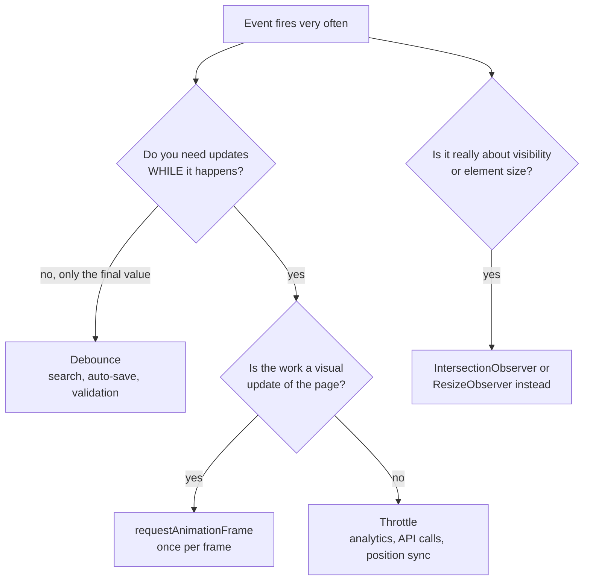
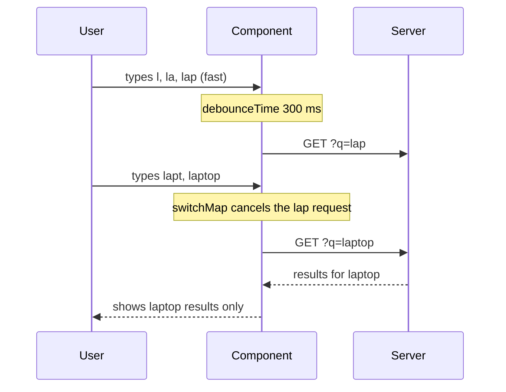

# Debounce, Throttle and Performance

> In this document you will learn debounce and throttle in depth (what they are, when to use each, and how to implement them with all the common options), plus the other everyday performance tools of a JavaScript developer: memoization, lazy evaluation, `requestAnimationFrame`, keeping the main thread free with chunking and Web Workers, measuring correctly, and a few V8 engine tips. "Implement debounce" and "debounce vs throttle" are classic interview tasks, so you will also practice explaining them out loud.

**Before this:** [Closures](05-closures.md) · [Event loop](16-event-loop.md) · [Functions and functional programming](04-functions-and-functional-programming.md) · **Interview questions:** [jump to the interview section](#interview-questions)

## Table of contents

1. [The problem: too many events](#the-problem-too-many-events)
2. [Debounce](#debounce)
3. [Throttle](#throttle)
4. [Debounce vs throttle](#debounce-vs-throttle)
5. [requestAnimationFrame for visual updates](#requestanimationframe-for-visual-updates)
6. [Debounce and throttle in frameworks and libraries](#debounce-and-throttle-in-frameworks-and-libraries)
7. [Memoization](#memoization)
8. [Lazy evaluation](#lazy-evaluation)
9. [Keeping the main thread free](#keeping-the-main-thread-free)
10. [Batching DOM reads and writes](#batching-dom-reads-and-writes)
11. [Measuring performance](#measuring-performance)
12. [Engine-level tips for V8](#engine-level-tips-for-v8)
13. [Best practices](#best-practices)
14. [How to explain this in an interview](#how-to-explain-this-in-an-interview)
15. [Interview questions](#interview-questions)
16. [Summary](#summary)
17. [References](#references)

---

## The problem: too many events

Some browser events fire **very often**:

| Event | How often it can fire |
|---|---|
| `input` / `keyup` in a search box | Once per keystroke (5–10 times per second while typing) |
| `scroll` | Many times per second while scrolling |
| `resize` | Many times per second while the user drags the window edge |
| `mousemove` / `pointermove` | Up to the screen refresh rate or more |

If each event triggers expensive work (an HTTP request, a big recalculation, a re-render of a table), the app becomes slow, the server gets flooded, and the UI janks.

```js
// ❌ Wrong: one HTTP request per keystroke
searchInput.addEventListener("input", (event) => {
  fetch(`/api/products?q=${encodeURIComponent(event.target.value)}`)
    .then((res) => res.json())
    .then(renderResults);
});
// Typing "laptop" sends 6 requests: "l", "la", "lap", "lapt", "lapto", "laptop".
// Five of them are useless, and their responses can even arrive out of order.
```

Two classic techniques control **how often** a function runs:

- **Debounce:** wait until the events **stop**, then run once.
- **Throttle:** run **at most once per time window** while events keep coming.

Both are built with closures and timers. If closures or `setTimeout` feel unclear, read [Closures](05-closures.md) and [Event loop](16-event-loop.md) first.

---

## Debounce

### What it is

A **debounced** function delays running until a certain time has passed **without new calls**. Every new call restarts the timer. So during a burst of calls, nothing runs. When the burst ends and the wait time passes, the function runs **once**, usually with the **last** arguments.

### Why it exists

You often care only about the **final** value after the user stops: the final search text, the final window size, the final form value to auto-save. Debounce turns "many calls" into "one call after the user pauses".

### Analogy

An elevator door. When someone walks in, the door waits a few seconds before closing. If another person walks in, the waiting starts again. The door closes only when nobody has entered for a few seconds.

Where the analogy breaks: a real elevator eventually closes anyway after a maximum time. A plain debounce never runs if the calls never stop. (The `maxWait` option, shown later, adds that maximum.)

### The basic implementation

```js
function debounce(fn, wait) {
  let timerId;
  return function (...args) {
    clearTimeout(timerId);                               // cancel the previous plan
    timerId = setTimeout(() => fn.apply(this, args), wait); // plan a new run
  };
}
```

Only five lines, but every line matters:

- `let timerId` lives in the closure. All calls to the debounced function share it. This is what lets a new call cancel the previous timer.
- `return function (...args)` is a **regular** function, not an arrow function, so it receives the `this` of the caller (for example, an object method call). `...args` collects all arguments.
- `clearTimeout(timerId)` cancels the previously planned run. Calling `clearTimeout(undefined)` the first time is safe.
- The arrow function inside `setTimeout` keeps the outer `this` and `args`, and `fn.apply(this, args)` passes both to the original function.

Using it:

```js
const searchInput = document.querySelector("#search");

function searchProducts(text) {
  console.log("Searching for", text);
}

const debouncedSearch = debounce(searchProducts, 300);
searchInput.addEventListener("input", (event) => debouncedSearch(event.target.value));
```

### Step-by-step walkthrough

The user types "laptop". Keystrokes arrive at these times, with `wait = 300` ms:

| Time | Call | What happens |
|---|---|---|
| 0 ms | `"l"` | No timer yet. Start timer → would run at 300 ms. |
| 200 ms | `"la"` | Cancel the 300 ms timer. Start a new one → 500 ms. |
| 400 ms | `"lap"` | Cancel. New timer → 700 ms. |
| 700 ms | — | No new call came. Timer fires: `searchProducts("lap")` runs. |
| 800 ms | `"lapt"` | Start timer → 1100 ms. |
| 1000 ms | `"lapto"` | Cancel. New timer → 1300 ms. |
| 1100 ms | `"laptop"` | Cancel. New timer → 1400 ms. |
| 1400 ms | — | Timer fires: `searchProducts("laptop")` runs. |

Six keystrokes produced two searches. The user paused for 300 ms after "lap", which is why "lap" was searched. (We ran this exact scenario with Node.js mock timers to confirm the times.)

### Leading and trailing edges

The basic version runs on the **trailing edge**: at the end of the burst. Sometimes you want the **leading edge**: run immediately on the first call, then ignore the rest of the burst.

| Option | Runs | Good for |
|---|---|---|
| Trailing (default) | Once, after the burst ends | Search box, auto-save, resize end |
| Leading | Once, at the start of the burst | Preventing double-clicks on a button, instant feedback |
| Leading + trailing | At the start, and again at the end if more calls came during the burst | Instant first reaction plus the final value |

### A complete implementation with options, cancel and flush

```js
function debounce(fn, wait = 300, { leading = false, trailing = true } = {}) {
  let timerId = null;
  let lastArgs = null;
  let lastThis = null;
  let result;

  function invoke() {
    const args = lastArgs;
    const context = lastThis;
    lastArgs = lastThis = null; // mark "nothing pending"
    result = fn.apply(context, args);
  }

  function debounced(...args) {
    lastArgs = args;
    lastThis = this;
    const isNewBurst = timerId === null;

    clearTimeout(timerId);
    timerId = setTimeout(() => {
      timerId = null;
      if (trailing && lastArgs) invoke(); // only if a call is still pending
      lastArgs = lastThis = null;
    }, wait);

    if (leading && isNewBurst) invoke();
    return result; // the result of the last run (may be from an earlier call)
  }

  debounced.cancel = function () {
    clearTimeout(timerId);
    timerId = null;
    lastArgs = lastThis = null;
  };

  debounced.flush = function () {
    if (timerId !== null) {
      clearTimeout(timerId);
      timerId = null;
      if (lastArgs) invoke(); // run the pending call right now
    }
    return result;
  };

  return debounced;
}
```

How the options work:

- `isNewBurst` is true when no timer is running, meaning the previous burst is over. Only then can the leading edge fire.
- After a leading run, `invoke()` sets `lastArgs` to `null`. So if the user called only once, the trailing edge sees nothing pending and does **not** run a second time. If more calls came during the burst, `lastArgs` is set again, and the trailing edge runs with the latest arguments.
- `cancel()` drops the pending call. Use it when a component is destroyed, so the function does not run on a dead component.
- `flush()` runs the pending call immediately. Use it, for example, to save a draft right now when the user clicks "Close".

We ran this implementation with Node.js mock timers. With calls at 0, 90, 180, 260, 330, 420, 900 and 950 ms and `wait = 300`:

| Variant | Runs (argument from the call at → run time) |
|---|---|
| trailing (default) | call 420 → 720 ms, call 950 → 1250 ms |
| leading only | call 0 → 0 ms, call 900 → 900 ms |
| leading + trailing | call 0 → 0 ms, call 420 → 720 ms, call 900 → 900 ms, call 950 → 1250 ms |

Using `cancel` and `flush`:

```js
const saveDraft = debounce((text) => {
  console.log("saved:", text);
  return text.length;
}, 1000);

saveDraft("Hello");
saveDraft("Hello wor");
saveDraft.cancel();          // nothing will be saved for these calls

saveDraft("Hello world");
const length = saveDraft.flush(); // logs "saved: Hello world" right now
console.log(length);              // 11
```

### Keeping `this` working

Because the wrapper is a regular function and uses `apply`, debounced methods keep their `this`:

```js
const searchBox = {
  query: "",
  search: debounce(function (text) {
    this.query = text; // 'this' is searchBox
    console.log("query:", this.query);
  }, 300),
};

searchBox.search("lap");
searchBox.search("laptop"); // after 300 ms: "query: laptop"
```

```js
// ❌ Wrong: an arrow wrapper loses the caller's 'this'
function brokenDebounce(fn, wait) {
  let timerId;
  return (...args) => {             // arrow: 'this' is NOT the caller
    clearTimeout(timerId);
    timerId = setTimeout(() => fn.apply(this, args), wait);
  };
}
```

More on `this` rules: [this, call, apply and bind](06-this-call-apply-bind.md).

### Adding maxWait

With a plain debounce, if events never pause (a user who scrolls without stopping), the function never runs. A `maxWait` option guarantees a run at least every `maxWait` milliseconds. Lodash's `debounce` supports `maxWait`, and lodash's `throttle` is actually implemented as a debounce with `maxWait` equal to `wait`. That shows how close the two ideas are.

### Debouncing async work: the stale response problem

Debounce reduces the number of requests, but it does not fix **ordering**. If the request for "lap" is slow and the request for "laptop" is fast, the old response can arrive last and overwrite the correct results.

```js
// ✅ Debounce + cancel the previous request with AbortController
let controller = null;

const debouncedSearch = debounce(async (text) => {
  controller?.abort();               // cancel the previous request
  controller = new AbortController();
  try {
    const res = await fetch(`/api/products?q=${encodeURIComponent(text)}`, {
      signal: controller.signal,
    });
    renderResults(await res.json());
  } catch (error) {
    if (error.name !== "AbortError") showError(error);
  }
}, 300);
```

In Angular, `debounceTime` plus `switchMap` does the same thing (see [frameworks](#debounce-and-throttle-in-frameworks-and-libraries)). More on cancellation: [async/await](18-async-await.md).

### Real-world uses of debounce

- Search-as-you-type and autocomplete.
- Auto-saving a form or a document after the user stops typing.
- Checking "is this username available?" while typing.
- Recalculating layout after the window **finished** resizing.
- Validating a field after typing stops instead of on every key.
- Sending analytics for "the user settled on this filter".

---

## Throttle

### What it is

A **throttled** function runs **at most once per time window**, no matter how often it is called. If you throttle to 300 ms and call it 100 times in one second, it runs about 3 or 4 times, evenly spaced.

### Why it exists

For some events, you want **regular updates during** the activity, not only after it ends. Example: while the user scrolls, you want to update a "back to top" button or load more items when they get near the bottom. Waiting until scrolling stops (debounce) would feel broken.

### Analogy

A security guard who lets **one person** through the gate every 5 seconds, no matter how big the crowd is. Some people are turned away (or, in the trailing version, the last person waiting goes through when the gate opens again).

### Version 1: timestamp (leading edge)

```js
function throttle(fn, wait) {
  let lastRun = -Infinity;
  return function (...args) {
    const now = Date.now();
    if (now - lastRun >= wait) {
      lastRun = now;
      fn.apply(this, args);
    }
    // calls inside the window are simply ignored
  };
}
```

It runs **immediately** on the first call, then ignores calls until `wait` has passed. Problem: the **last** call of a burst is often ignored. For scroll position, that means the final position might never be handled.

### Version 2: timer (trailing edge)

```js
function throttleTrailing(fn, wait) {
  let timerId = null;
  let lastArgs = null;
  let lastThis = null;
  return function (...args) {
    lastArgs = args; // always remember the newest call
    lastThis = this;
    if (timerId === null) {
      timerId = setTimeout(() => {
        timerId = null;
        fn.apply(lastThis, lastArgs); // run with the newest arguments
      }, wait);
    }
  };
}
```

The first call starts a timer. Calls during the window only update the arguments. When the timer fires, the function runs with the **newest** arguments. The problem is the opposite of version 1: the first reaction is delayed by `wait`. (This is the same behavior as RxJS `auditTime`.)

### Version 3: leading and trailing (the one to know for interviews)

This version runs immediately on the first call, runs at most once per window, and makes sure the **last** call is not lost.

```js
function throttle(fn, wait = 100, { leading = true, trailing = true } = {}) {
  let lastRun = null; // when fn last ran (null = not inside a window)
  let timerId = null;
  let pendingArgs = null;
  let pendingThis = null;

  function runTrailing() {
    timerId = null;
    lastRun = leading ? Date.now() : null;
    const args = pendingArgs;
    const context = pendingThis;
    pendingArgs = pendingThis = null;
    fn.apply(context, args);
  }

  function throttled(...args) {
    const now = Date.now();
    if (lastRun === null && !leading) lastRun = now; // open a window without running
    const remaining = lastRun === null ? 0 : wait - (now - lastRun);

    if (remaining <= 0) {
      // The window is over: run now
      clearTimeout(timerId);
      timerId = null;
      pendingArgs = pendingThis = null;
      lastRun = now;
      fn.apply(this, args);
    } else if (trailing) {
      // Inside the window: remember the newest call and plan one trailing run
      pendingArgs = args;
      pendingThis = this;
      if (timerId === null) timerId = setTimeout(runTrailing, remaining);
    }
  }

  throttled.cancel = function () {
    clearTimeout(timerId);
    timerId = null;
    lastRun = null;
    pendingArgs = pendingThis = null;
  };

  return throttled;
}
```

> `Date.now()` follows the system clock, which can jump if the user changes the time. `performance.now()` is monotonic (it never goes backwards), so it is slightly safer for real timing code. Both work for teaching.

### Step-by-step walkthrough

Calls at 0, 90, 180, 260, 330, 420, 900 and 950 ms, `wait = 300`, leading and trailing on:

| Time | Call | `remaining` | What happens |
|---|---|---|---|
| 0 | k0 | 0 (never ran) | Run now with k0. `lastRun = 0`. |
| 90 | k90 | 210 | Inside the window. Remember k90. Start timer for 210 ms → fires at 300. |
| 180 | k180 | 120 | Remember k180 (replaces k90). Timer already planned. |
| 260 | k260 | 40 | Remember k260. |
| 300 | — | — | Timer fires: run with k260. `lastRun = 300`. |
| 330 | k330 | 270 | Remember k330. Timer → fires at 600. |
| 420 | k420 | 180 | Remember k420. |
| 600 | — | — | Timer fires: run with k420. `lastRun = 600`. |
| 900 | k900 | 0 | Window over. Run now with k900. `lastRun = 900`. |
| 950 | k950 | 250 | Remember k950. Timer → fires at 1200. |
| 1200 | — | — | Timer fires: run with k950. |

Result: runs at 0, 300, 600, 900 and 1200 ms. Never more than once per 300 ms, the first call runs instantly, and the last call (k950) is not lost. We confirmed this table with Node.js mock timers.

### Real-world uses of throttle

- Scroll handlers: updating a progress bar, showing a "back to top" button, checking whether to load more items (though `IntersectionObserver` is often better, see below).
- `mousemove` / `pointermove` / drag handlers.
- Sending the user's cursor position in a collaborative editor at most N times per second.
- Live window `resize` updates while dragging (if you need updates during the drag).
- Limiting how often a client sends a "typing..." indicator in a chat app.
- Rate-limiting calls to an expensive API from the client.

---

## Debounce vs throttle

### Side-by-side timeline

Same input as above (calls at 0, 90, 180, 260, 330, 420, 900, 950 ms), `wait = 300`. Each `●` is one run of the real function. These results come from running the implementations above with Node.js mock timers.

```text
time (ms)              0     100   200   300   400   500   600   700   800   900   1000  1100  1200  1300
calls                  x    x     x    x   x    x                            x  x
debounce trailing                                                 ●                               ●
debounce leading       ●                                                     ●
throttle leading       ●                   ●                                 ●
throttle trailing                        ●                   ●                                 ●
throttle lead+trail    ●                 ●                 ●                 ●                 ●
```

Exact run times:

| Variant | Runs |
|---|---|
| debounce, trailing | 720 (k420), 1250 (k950) |
| debounce, leading | 0 (k0), 900 (k900) |
| throttle, leading only (timestamp) | 0 (k0), 330 (k330), 900 (k900) |
| throttle, trailing only (timer) | 300 (k260), 630 (k420), 1200 (k950) |
| throttle, leading + trailing | 0 (k0), 300 (k260), 600 (k420), 900 (k900), 1200 (k950) |

### Comparison table

| | Debounce | Throttle |
|---|---|---|
| Rule | Run after calls **stop** for `wait` ms | Run **at most once** every `wait` ms |
| During a long burst | Does not run (trailing) | Runs regularly |
| Runs during a continuous 2-second burst, `wait = 300` | 1 (after the burst) | About 7 or 8 (the exact number depends on the leading/trailing options) |
| Typical question it answers | "What is the final value?" | "What is the current value, sampled regularly?" |
| Typical uses | Search, auto-save, validation, resize end | Scroll, mousemove, drag, progress updates |
| RxJS operator | `debounceTime` | `throttleTime` (and `auditTime` for trailing) |

### How to choose



Often the best answer is **neither**: for "load more when the user reaches the bottom", an `IntersectionObserver` on a sentinel element fires only when visibility changes, with no scroll handler at all. For "react when this element's size changes", use `ResizeObserver`.

---

## requestAnimationFrame for visual updates

### What it is

`requestAnimationFrame(callback)` (rAF) is a browser API. It asks the browser to call your function **right before the next repaint**. Browsers usually repaint at the display refresh rate (often 60 times per second, so about 16.7 ms per frame, or more on high-refresh screens).

### Why use it instead of throttle for visual work

- Updating the DOM more often than the screen refreshes is wasted work: the user cannot see the extra updates.
- A fixed throttle like 16 ms is not aligned with the real frames. Updates can land in the middle of a frame or twice in one frame.
- rAF runs at the right moment in the [event loop](16-event-loop.md), before style, layout and paint, and browsers pause rAF in background tabs, which saves battery.

### rAF throttling

This pattern runs the visual update **at most once per frame**, with the latest data:

```js
function rafThrottle(fn) {
  let frameId = null;
  let lastArgs = null;
  return function (...args) {
    lastArgs = args;
    if (frameId === null) {
      frameId = requestAnimationFrame(() => {
        frameId = null;
        fn(...lastArgs);
      });
    }
  };
}

const progressBar = document.querySelector("#read-progress");

const updateProgress = rafThrottle(() => {
  const max = document.documentElement.scrollHeight - window.innerHeight;
  const percent = max > 0 ? (window.scrollY / max) * 100 : 0;
  progressBar.style.transform = `scaleX(${percent / 100})`;
});

window.addEventListener("scroll", updateProgress, { passive: true });
```

Notes:

- `{ passive: true }` tells the browser the listener will not call `preventDefault()`, so scrolling does not wait for your JavaScript.
- Animating `transform` (instead of `width`) avoids layout work. Why that is cheaper is explained in [Browser rendering](../01-cs-and-web-fundamentals/07-browser-architecture-and-rendering.md).
- rAF is browser-only. Node.js does not have it.

---

## Debounce and throttle in frameworks and libraries

### Angular with RxJS

In Angular you rarely write `debounce` by hand. RxJS operators do it on streams. Angular 16 works with RxJS 7.

| Operator | Behavior | Like |
|---|---|---|
| `debounceTime(300)` | Emits the latest value after 300 ms of silence | Trailing debounce |
| `throttleTime(300)` | Emits the first value, then ignores values for 300 ms | Leading throttle |
| `throttleTime(300, asyncScheduler, { leading: true, trailing: true })` | Also emits the last value at the end of the window | Leading + trailing throttle |
| `auditTime(300)` | On a value, waits 300 ms, then emits the latest value | Trailing throttle |
| `sampleTime(300)` | Every 300 ms, emits the latest value if a new one arrived | Periodic sampling |
| `distinctUntilChanged()` | Skips a value equal to the previous one | Often combined with `debounceTime` |

A product search box in Angular 16 (standalone component):

```ts
import { Component } from "@angular/core";
import { AsyncPipe, NgFor } from "@angular/common";
import { FormControl, ReactiveFormsModule } from "@angular/forms";
import { catchError, debounceTime, distinctUntilChanged, map, of, switchMap } from "rxjs";
import { ProductApi, Product } from "./product-api.service";

@Component({
  selector: "app-product-search",
  standalone: true,
  imports: [ReactiveFormsModule, NgFor, AsyncPipe],
  template: `
    <input [formControl]="query" placeholder="Search products" />
    <ul>
      <li *ngFor="let product of results$ | async">{{ product.name }}</li>
    </ul>
  `,
})
export class ProductSearchComponent {
  query = new FormControl("", { nonNullable: true });

  results$ = this.query.valueChanges.pipe(
    map((text) => text.trim()),
    debounceTime(300),          // wait for a pause in typing
    distinctUntilChanged(),     // ignore "lap" → "lap " → "lap" changes
    switchMap((text) =>         // cancel the previous request when a new search starts
      text.length < 2
        ? of([] as Product[])
        : this.api.search(text).pipe(catchError(() => of([] as Product[])))
    ),
  );

  constructor(private api: ProductApi) {}
}
```

Why each piece is there:

- `debounceTime(300)` cuts the number of requests.
- `distinctUntilChanged()` avoids searching for the same text twice.
- `switchMap` unsubscribes from the previous HTTP Observable when a new value comes, which **cancels** the old request. This solves the stale-response problem.
- `catchError` inside `switchMap` keeps the outer stream alive after one failed request.
- The `async` pipe subscribes and unsubscribes for you (see [memory in Angular](19-memory-management-and-garbage-collection.md#memory-in-angular-apps)).

A throttled scroll listener that also cleans up:

```ts
import { Component, DestroyRef, inject } from "@angular/core";
import { takeUntilDestroyed } from "@angular/core/rxjs-interop";
import { asyncScheduler, fromEvent, map, throttleTime } from "rxjs";

@Component({ selector: "app-back-to-top", standalone: true, template: "..." })
export class BackToTopComponent {
  visible = false;

  constructor() {
    fromEvent(window, "scroll", { passive: true })
      .pipe(
        throttleTime(200, asyncScheduler, { leading: true, trailing: true }),
        map(() => window.scrollY > 600),
        takeUntilDestroyed(), // developer preview in Angular 16
      )
      .subscribe((visible) => (this.visible = visible));
  }
}
```

> Angular with Zone.js runs change detection after every event that Zone.js sees. A very frequent listener can trigger many change detection cycles even if your callback is throttled, because the raw events still fire inside the Angular zone. For heavy cases, you can listen outside Angular with `NgZone.runOutsideAngular` and enter the zone only when state changes. Details: [Angular change detection](../06-angular-16/10-change-detection-and-signals.md) and [RxJS](../06-angular-16/09-rxjs.md).

### React

The classic React bug is creating a new debounced function on every render, so each render gets its own timer and nothing is debounced.

```jsx
// ❌ Wrong: a new debounced function (and a new timer) on every render
function SearchBox({ onSearch }) {
  const debounced = debounce(onSearch, 300);
  return <input onChange={(e) => debounced(e.target.value)} />;
}
```

```jsx
// ✅ Correct: create it once, cancel it on unmount
import { useEffect, useMemo, useRef } from "react";

function SearchBox({ onSearch }) {
  const onSearchRef = useRef(onSearch);
  onSearchRef.current = onSearch; // always call the latest callback

  const debounced = useMemo(
    () => debounce((text) => onSearchRef.current(text), 300),
    [] // created once per component instance
  );

  useEffect(() => () => debounced.cancel(), [debounced]); // cleanup on unmount

  return <input onChange={(e) => debounced(e.target.value)} />;
}
```

More: [React essentials](../05-frontend-engineering/08-react-essentials.md).

### Lodash

Lodash's `debounce(fn, wait, { leading, trailing, maxWait })` and `throttle(fn, wait, { leading, trailing })` are well-tested implementations with `cancel()` and `flush()`. Using them in production is fine. In interviews, you are expected to write the core yourself.

---

## Memoization

### What it is

**Memoization** means caching the result of a function call, keyed by its arguments. The next time the function is called with the same arguments, it returns the cached result instead of computing again.

### Why it exists

Some functions are expensive (heavy calculations, formatting big lists, recursive algorithms) and are called many times with the same inputs. Memoization trades **memory** for **speed**.

It is safe only for **pure functions**: the same input always gives the same output, and there are no side effects. Memoizing a function that reads the current time, a random number or mutable outside state returns wrong (stale) results.

### Basic implementation

```js
function memoize(fn, { getKey = (...args) => JSON.stringify(args), maxSize = 1000 } = {}) {
  const cache = new Map();
  return function memoized(...args) {
    const key = getKey(...args);
    if (cache.has(key)) return cache.get(key);
    const result = fn.apply(this, args);
    cache.set(key, result);
    if (cache.size > maxSize) cache.delete(cache.keys().next().value); // drop the oldest entry
    return result;
  };
}

let calls = 0;
const slowSquare = (n) => { calls++; return n * n; };
const fastSquare = memoize(slowSquare);

console.log(fastSquare(9), fastSquare(9), calls); // 81 81 1
```

Why `cache.has(key)` and not `if (cache.get(key))`? Because a cached result can be falsy (`0`, `""`, `false`, `null`). Checking `has` avoids recomputing those.

### Memoizing recursion: call the memoized version

```js
let fibCalls = 0;
function slowFib(n) {
  fibCalls++;
  return n < 2 ? n : slowFib(n - 1) + slowFib(n - 2);
}
console.log(slowFib(25), fibCalls); // 75025 242785

fibCalls = 0;
const fib = memoize((n) => {
  fibCalls++;
  return n < 2 ? n : fib(n - 1) + fib(n - 2); // recursive calls go through the cache
});
console.log(fib(25), fibCalls); // 75025 26
```

```js
// ❌ Wrong: only the outer call is cached, the inner recursion is still slow
fibCalls = 0;
const wrongFib = memoize(slowFib);
console.log(wrongFib(25), fibCalls); // 75025 242785
```

The memoized `fib` computes each `n` only once: 26 calls instead of 242,785. The time complexity goes from exponential to linear.

### Cache keys: the hard part

The cache key decides when two calls are "the same". Common pitfalls (all checked with Node.js):

```js
// ❌ String(args) mixes up different arguments
const badKey = (...args) => String(args);
console.log(badKey(1, 2) === badKey("1,2"));   // true — different inputs, same key
console.log(badKey([1, 2]) === badKey(1, 2));  // true

// ⚠️ JSON.stringify depends on property order and loses some values
console.log(JSON.stringify([{ a: 1, b: 2 }]) === JSON.stringify([{ b: 2, a: 1 }])); // false
console.log(JSON.stringify([undefined]), JSON.stringify([() => 1]));              // [null] [null]
console.log(JSON.stringify([NaN]), JSON.stringify([Infinity]));                   // [null] [null]
```

Rules for choosing a key:

| Arguments | Good key |
|---|---|
| One primitive (`id`, `"en-US"`) | The value itself (`getKey: (x) => x`) |
| A few primitives | `JSON.stringify(args)` or a joined string with a safe separator |
| One object, treated as immutable | The object itself in a `WeakMap` (no stringify, no leak) |
| Big objects | Do not stringify them on every call: stringifying can cost more than the function |

Object arguments with a `WeakMap` (the entry disappears when the object is collected):

```js
function memoizeByObject(fn) {
  const cache = new WeakMap();
  return function (obj) {
    if (cache.has(obj)) return cache.get(obj);
    const result = fn(obj);
    cache.set(obj, result);
    return result;
  };
}

const summarizeCart = memoizeByObject((cart) => ({
  count: cart.items.length,
  total: cart.items.reduce((sum, item) => sum + item.price, 0),
}));
```

This works perfectly with immutable state (NgRx, Redux, Angular `OnPush` inputs): a changed cart is a new object, so it gets a new entry automatically.

### Memoizing async functions

Cache the **promise**, not the result. Then several callers that ask at the same time share one request. But remove the entry if the promise rejects, or you will cache the failure forever.

```js
function memoizeAsync(fn) {
  const cache = new Map();
  return function (key) {
    if (cache.has(key)) return cache.get(key);
    const promise = fn(key).catch((error) => {
      cache.delete(key); // do not cache failures
      throw error;
    });
    cache.set(key, promise);
    return promise;
  };
}

let attempts = 0;
const fetchUser = memoizeAsync(async (id) => {
  attempts++;
  if (attempts === 1) throw new Error("network down");
  return { id, name: "Asha" };
});

const [first, second] = await Promise.allSettled([fetchUser(7), fetchUser(7)]);
console.log(first.status, second.status, attempts); // rejected rejected 1 (one shared request)

const user = await fetchUser(7);
console.log(user.name, attempts);                   // Asha 2 (the failure was not cached)
console.log((await fetchUser(7)) === user, attempts); // true 2
```

### The memory cost

Every memoization cache is a cache, so it can become a [memory leak](19-memory-management-and-garbage-collection.md#6-unbounded-caches-and-maps). Always decide:

- **Size:** a maximum number of entries (the simple version above drops the oldest; an LRU drops the least recently used).
- **Lifetime:** clear the cache on logout, on route change, or after a TTL.
- **Weak keys:** `WeakMap` when the key is an object.

### Where frameworks memoize for you

- **Angular pure pipes:** Angular calls a pure pipe's `transform` again only when an input changes by reference (or primitive value). That is memoization of the last call.
- **NgRx `createSelector`:** remembers the last arguments and result, so it recomputes only when the selected state slices change.
- **Angular signals (`computed`, developer preview in v16):** recomputes only when a signal it reads changes.
- **React:** `useMemo`, `useCallback` and `React.memo`.

Calling a method in an Angular template (`{{ formatTotal(cart) }}`) runs it on **every** change detection cycle. A pure pipe or a precomputed property is usually better for expensive formatting. See [Angular performance](../06-angular-16/12-performance.md).

---

## Lazy evaluation

**Lazy evaluation** means doing work only **when** its result is needed, and only **as much as** is needed. The opposite, **eager evaluation**, does all the work up front.

### Lazy initialization

```js
class ReportService {
  #summary; // not computed yet

  get summary() {
    if (this.#summary === undefined) {
      console.log("computing summary...");
      this.#summary = { rows: 1000 }; // imagine an expensive calculation
    }
    return this.#summary;
  }
}

const service = new ReportService();
console.log("created");
console.log(service.summary.rows);
console.log(service.summary.rows);
// created
// computing summary...
// 1000
// 1000
```

The expensive work happens only on first use, and only once. If the user never opens the summary, it never runs.

### Lazy sequences with iterator helpers

Array methods are **eager**: `filter` processes the whole array and creates a new array before `map` starts. Iterator helpers (ES2025) are **lazy**: each item flows through the whole chain one at a time, and processing stops as soon as you have enough.

```js
const orders = Array.from({ length: 1_000_000 }, (_, i) => ({ id: i, total: i % 500 }));

// Eager: filters all 1,000,000 orders, then takes 3
let checkedEager = 0;
const eager = orders
  .filter((order) => { checkedEager++; return order.total > 495; })
  .map((order) => order.id)
  .slice(0, 3);
console.log(eager, checkedEager); // [ 496, 497, 498 ] 1000000

// Lazy: stops after finding 3 matches
let checkedLazy = 0;
const lazy = Iterator.from(orders)
  .filter((order) => { checkedLazy++; return order.total > 495; })
  .map((order) => order.id)
  .take(3)
  .toArray();
console.log(lazy, checkedLazy); // [ 496, 497, 498 ] 499
```

Iterator helpers work in Node.js 22+ and all current major browsers. Details: [Iterators and generators](13-iterators-and-generators.md).

### Generators produce values on demand

```js
function* idGenerator() {
  let id = 1;
  while (true) yield id++; // an infinite sequence is fine: values are created only when asked
}

const ids = idGenerator();
console.log(ids.next().value, ids.next().value); // 1 2
```

### Lazy loading code

The biggest lazy-evaluation win in real apps is not loading code until it is needed:

```js
// Load the heavy chart library only when the user opens the chart tab
chartTab.addEventListener("click", async () => {
  const { renderChart } = await import("./charts.js");
  renderChart(document.querySelector("#chart"), salesData);
});
```

In Angular, lazy-loaded routes (`loadChildren`, `loadComponent`) do the same per feature. See [Routing and lazy loading](../06-angular-16/06-routing-guards-and-lazy-loading.md) and [Modules](14-modules-esm-and-commonjs.md).

**Trade-off:** lazy work moves the cost to the moment of first use. If the first use is a user interaction, the user may feel a delay. Prefetching (loading in idle time after the page is ready) balances this.

---

## Keeping the main thread free

In the browser, JavaScript, style calculation, layout, paint and input handling share **one main thread**. While your code runs, the page cannot respond to clicks or update the screen. Any task longer than **50 ms** is called a **long task**. Long tasks make the page feel frozen and hurt the Interaction to Next Paint (INP) metric (see [Web performance](../05-frontend-engineering/05-web-performance-and-core-web-vitals.md)).

You have four main tools.

### 1. Break work into chunks and yield

Do a bit of work, then give the main thread back so the browser can handle input and paint, then continue.

```js
function yieldToMain() {
  // scheduler.yield() is newer (Chrome 129+, Firefox 142+, not in Safari at the time of writing)
  if (globalThis.scheduler?.yield) return scheduler.yield();
  return new Promise((resolve) => setTimeout(resolve, 0));
}

async function processInChunks(items, processItem, budgetMs = 10) {
  let deadline = performance.now() + budgetMs;
  for (const item of items) {
    processItem(item);
    if (performance.now() >= deadline) {
      await yieldToMain(); // let the browser handle clicks and paint
      deadline = performance.now() + budgetMs;
    }
  }
}

// Usage: format 200,000 rows without freezing the page
await processInChunks(rows, (row) => {
  row.label = `${row.name} (${row.price.toFixed(2)})`;
});
```

Each chunk runs for about 10 ms, then the code yields. Total time grows a little, but the page stays responsive. (We ran this in Node.js with a 5 ms interval timer running at the same time: the timer kept firing during processing, which shows the work was really split into separate tasks.)

`scheduler.yield()` has an advantage over `setTimeout(0)`: the continuation is scheduled with priority, so other scripts' tasks do not jump in front of your remaining work. More on task scheduling: [Event loop](16-event-loop.md).

### 2. Run low-priority work when the browser is idle

`requestIdleCallback(callback)` runs your callback when the browser has free time, and tells you how much time is left in this idle period:

```js
function sendQueuedAnalytics(deadline) {
  while (deadline.timeRemaining() > 0 && analyticsQueue.length > 0) {
    sendBeaconEvent(analyticsQueue.shift());
  }
  if (analyticsQueue.length > 0) requestIdleCallback(sendQueuedAnalytics);
}

if ("requestIdleCallback" in window) {
  requestIdleCallback(sendQueuedAnalytics, { timeout: 2000 }); // run within 2 s at the latest
} else {
  setTimeout(() => sendQueuedAnalytics({ timeRemaining: () => 5 }), 200); // simple fallback
}
```

Chrome and Firefox support `requestIdleCallback`. Safari did not support it by default at the time of writing, so always keep a fallback.

### 3. Move CPU-heavy work to a Web Worker

A **Web Worker** runs JavaScript on a **separate thread**. It has no access to the DOM, and it talks to the page with messages. Use it for real CPU work: parsing big files, image processing, complex filtering of large datasets, encryption, compression.

```js
// main.js (page)
const worker = new Worker(new URL("./stats-worker.js", import.meta.url), { type: "module" });

worker.onmessage = (event) => {
  const { average, max } = event.data;
  renderStats(average, max); // back on the main thread: update the DOM
};

worker.onerror = (event) => console.error("Worker failed:", event.message);

const prices = new Float64Array(5_000_000).map(() => Math.random() * 100);
// Transfer the underlying buffer instead of copying it (fast, but 'prices' becomes unusable here)
worker.postMessage({ prices }, [prices.buffer]);
```

```js
// stats-worker.js (worker thread)
self.onmessage = (event) => {
  const { prices } = event.data;
  let sum = 0;
  let max = -Infinity;
  for (const price of prices) {
    sum += price;
    if (price > max) max = price;
  }
  self.postMessage({ average: sum / prices.length, max });
};
```

Things to know:

- Messages are **copied** with the structured clone algorithm. Large data can be **transferred** instead (the list of transferables in `postMessage`), which moves ownership without copying.
- Starting a worker costs time and memory. Reuse one worker (or a small pool) for many jobs.
- Call `worker.terminate()` when you no longer need it.
- Angular CLI can generate a worker with `ng generate web-worker <name>`. Libraries like Comlink make worker calls look like normal async function calls.
- Node.js has the same idea with `worker_threads`. See [Concurrency in Node.js](../07-nodejs-backend/12-concurrency-worker-threads-and-cluster.md).

### 4. Render less: virtualization

If the page renders 10,000 table rows, the problem is not JavaScript speed but DOM size. **List virtualization** renders only the rows that are visible (plus a small buffer) and reuses them while scrolling. In Angular, the CDK provides `<cdk-virtual-scroll-viewport>` with `*cdkVirtualFor`. In React, libraries like react-window do it. Details: [Web performance](../05-frontend-engineering/05-web-performance-and-core-web-vitals.md).

### Which tool when

| Problem | Tool |
|---|---|
| A long loop over data that must touch the DOM or app state | Chunking with yields |
| Non-urgent background work (analytics, prefetch, cache warm-up) | `requestIdleCallback` (with fallback) |
| Heavy pure computation | Web Worker |
| Too many DOM nodes | Virtualization, pagination |
| Too many event callbacks | Debounce, throttle, rAF, observers |

---

## Batching DOM reads and writes

Reading layout properties (`offsetHeight`, `getBoundingClientRect()`, `scrollTop`) forces the browser to calculate layout if something changed. If you **alternate** writes and reads in a loop, the browser recalculates layout on every iteration. This is called **layout thrashing** (forced synchronous layout).

```js
// ❌ Wrong: write, read, write, read... forces layout on every iteration
for (const card of cards) {
  card.style.width = `${container.offsetWidth / 3}px`; // read after the previous write → layout
}
```

```js
// ✅ Correct: read once (or read everything first), then write everything
const columnWidth = container.offsetWidth / 3; // one read
for (const card of cards) {
  card.style.width = `${columnWidth}px`;       // only writes
}
```

When reads and writes come from different parts of the code, schedule the writes for the next frame with `requestAnimationFrame`, so all reads happen first and all writes happen together. The rendering pipeline behind this is explained in [Browser rendering](../01-cs-and-web-fundamentals/07-browser-architecture-and-rendering.md).

---

## Measuring performance

Never optimize without measuring. Your guess about what is slow is often wrong, and many "optimizations" make no visible difference.

### performance.now()

`performance.now()` returns a high-resolution timestamp in milliseconds since the page (or Node.js process) started. It is monotonic, so it is better than `Date.now()` for durations.

```js
const start = performance.now();
const sorted = [...products].sort((a, b) => a.price - b.price);
const duration = performance.now() - start;
console.log(`sort took ${duration.toFixed(2)} ms`);
```

Browsers may reduce the precision of `performance.now()` slightly for security reasons. It is still fine for measuring work that takes more than a millisecond.

### console.time and console.timeEnd

Quick and simple, for development:

```js
console.time("filter products");
const visible = products.filter((p) => p.inStock && p.price < 100);
console.timeEnd("filter products"); // filter products: 3.21ms (example)
```

### Performance marks and measures

Marks and measures are named entries. They show up in the DevTools Performance panel timeline, and you can read them in code, which makes them good for real-user monitoring.

```js
performance.mark("table-render-start");
renderTable(rows);
performance.mark("table-render-end");

const measure = performance.measure("table-render", "table-render-start", "table-render-end");
console.log(measure.name, measure.duration); // "table-render" 12.7 (example)
```

`performance.mark`, `performance.measure` and `performance.getEntriesByName` work in browsers and in Node.js (the global `performance` object).

### Observing long tasks in the field

```js
// Browser (Chromium): report main-thread tasks longer than 50 ms
const observer = new PerformanceObserver((list) => {
  for (const entry of list.getEntries()) {
    console.log("Long task:", Math.round(entry.duration), "ms");
  }
});
observer.observe({ type: "longtask", buffered: true });
```

The Long Tasks API is supported in Chromium-based browsers. Chromium also has a newer **Long Animation Frames** API (`type: "long-animation-frame"`) that gives more detail about what blocked a frame, including script sources. Libraries like `web-vitals` collect INP and other metrics for you.

### The DevTools Performance panel

1. Open DevTools → **Performance**.
2. Click record, do the slow interaction, stop.
3. Look at the **Main** track. Long tasks have a red triangle in the corner.
4. Click a long task. The flame chart shows which functions ran. The **Bottom-Up** tab shows which functions used the most time in total.
5. Use CPU throttling (for example, 4× slowdown) to simulate a slower phone.

### Node.js tools

- `performance.now()`, marks and measures (global `performance`, or `node:perf_hooks`).
- `perf_hooks.monitorEventLoopDelay()` to measure how blocked the event loop is.
- `node --cpu-prof app.js` writes a CPU profile you can open in Chrome DevTools.
- `node --inspect` and the DevTools Performance or Profiler tab.

See [Debugging and profiling](../10-testing-security-production/07-debugging-and-profiling.md).

### Benchmarking pitfalls

Micro-benchmarks (timing tiny pieces of code) often lie:

- **JIT warm-up:** the first runs are slower, because V8 has not optimized the code yet. Warm up before measuring.
- **Dead code elimination:** if the result is never used, the engine may skip the work. Use the result.
- **Unrealistic data:** sorting 10 items tells you nothing about sorting 100,000.
- **Noise:** run many iterations and look at the median, not one run.
- **Different engines:** a trick that is faster in V8 may not be faster in Safari's JavaScriptCore.

Measure real user flows first. Optimize the slowest real thing.

---

## Engine-level tips for V8

> **These tips are V8-specific** (Chrome, Edge, Node.js, Electron). They describe how V8 optimizes code today. Other engines use similar ideas, but details differ. Apply them only to **hot code** that profiling shows is slow. In normal application code, readability matters more.

### Hidden classes (shapes)

JavaScript objects can get new properties at any time. To make property access fast anyway, V8 gives every object a hidden **shape** (V8 calls it a **Map**, unrelated to the `Map` collection). Objects created the same way, with the same properties **in the same order**, share one shape. V8 can then find a property at a known position instead of searching for it.

We checked shapes with V8's internal test function `%HaveSameMap` (only available with `node --allow-natives-syntax`, never in normal code):

```js
function Point(x, y) {
  this.x = x;
  this.y = y;
}
const p1 = new Point(1, 2);
const p2 = new Point(3, 4);
// %HaveSameMap(p1, p2) → true: same properties, same order

const a = { x: 1, y: 2 };
const b = { y: 2, x: 1 };
// %HaveSameMap(a, b) → false: same properties, different order

const c = { x: 1, y: 2 };
c.z = 3;                      // added later
const d = { x: 1, y: 2, z: 3 };
// %HaveSameMap(c, d) → false: different history, different shape
```

Practical rules:

```js
// ❌ Inconsistent shapes: properties added in different orders and later
function createUser(data) {
  const user = {};
  if (data.isAdmin) user.role = "admin";
  user.name = data.name;
  if (data.email) user.email = data.email;
  return user;
}

// ✅ Consistent shape: all properties, same order, every time
function createUser(data) {
  return {
    name: data.name,
    email: data.email ?? null,
    role: data.isAdmin ? "admin" : "user",
  };
}
```

Classes help naturally: a constructor (or class fields) that always assigns the same fields in the same order produces one shape.

### Inline caches and monomorphic code

When code like `user.name` runs, V8 remembers the shapes it has seen at that exact spot in the code. This memory is an **inline cache**.

- **Monomorphic:** the spot always sees one shape. Fastest.
- **Polymorphic:** a few shapes (V8 handles a small number well).
- **Megamorphic:** many shapes. V8 falls back to a slower generic lookup.

```js
function getTotal(item) {
  return item.price * item.qty; // fast when 'item' always has the same shape
}

// Monomorphic: all items are built by the same factory
const items = rows.map((row) => ({ price: row.price, qty: row.qty }));
```

If one hot function receives objects of many different shapes (for example, a generic "process anything" function in a tight loop), it can become megamorphic and slower.

### Avoid `delete` in hot paths

`delete obj.prop` can force V8 to switch the object to a slower **dictionary mode** (a hash-table representation). In our check, an object `{ x: 1, y: 2 }` lost its fast properties after `delete e.y` (`%HasFastProperties` returned `false`), but kept them after `f.y = undefined`.

```js
// ❌ In hot code: changes the object's representation
delete session.tempToken;

// ✅ Keep the shape
session.tempToken = undefined;

// ✅ Or, if keys come and go all the time, use a Map, which is designed for that
const activeSessions = new Map();
activeSessions.set(id, session);
activeSessions.delete(id);
```

Note the trade-off: a property set to `undefined` still exists (`"tempToken" in session` is `true`, and `Object.keys` lists it). Choose based on what your code needs.

### Keep property and array element types consistent

- V8 tracks how a field is stored (small integer, double, or any value). Changing a field from a number to a string forces V8 to generalize that field and can throw away optimized code (**deoptimization**).
- Arrays are fastest when they are **packed** (no holes) and hold one kind of element (all small integers, or all doubles, or all objects). `new Array(1000)` creates a holey array. `arr[5000] = x` on a short array creates holes. Prefer `push`, `Array.from({ length: n }, ...)` or `.fill()`.

```js
// ❌ Holey and mixed
const scores = [];
scores[999] = 10;         // 999 holes
scores.push("N/A");       // a string among numbers

// ✅ Packed and consistent
const scores2 = Array.from({ length: 1000 }, () => 0);
```

### Summary of V8 tips

| Tip | Why |
|---|---|
| Create objects with the same properties in the same order | Shared hidden class, fast property access |
| Initialize all fields in the constructor or as class fields | One shape for all instances |
| Keep hot functions monomorphic | Inline caches stay fast |
| Avoid `delete` on hot objects, use `undefined` or a `Map` | Avoids dictionary mode |
| Keep field and element types stable | Avoids generalization and deoptimization |
| Avoid holes in arrays | Packed arrays are faster |

---

## Best practices

1. **Measure first, then optimize.** Use the Performance panel, marks and measures. Reason: you will fix the real bottleneck instead of a guessed one.
2. **Pick the right rate-limiting tool.** Debounce for "final value", throttle for "regular updates", rAF for visual updates, observers for visibility and size. Reason: each one matches a different user experience.
3. **Create debounced or throttled functions once** (outside render functions, in constructors or `useMemo`), and **cancel them on destroy**. Reason: a new wrapper each time means no rate limiting, and pending timers on destroyed components cause bugs.
4. **Combine debounce with cancellation for requests** (`switchMap` or `AbortController`). Reason: debounce reduces requests, but only cancellation prevents stale responses.
5. **Memoize only pure, expensive functions, with a bounded cache.** Reason: memoizing cheap or impure functions adds cost and bugs. Unbounded caches leak memory.
6. **Keep tasks under about 50 ms.** Chunk long loops, yield to the main thread, or use a Web Worker. Reason: long tasks block input and make the app feel frozen.
7. **Load code lazily.** Dynamic `import()` and lazy routes. Reason: less JavaScript to download, parse and run at startup.
8. **Batch DOM reads before writes.** Reason: alternating them forces repeated layout calculation.
9. **Use passive listeners for scroll and touch.** Reason: the browser can scroll without waiting for your handler.
10. **Apply V8 micro-optimizations only to proven hot paths.** Reason: they make code less flexible, and the gain is invisible elsewhere.

---

## How to explain this in an interview

1. **Define it:** "Debounce delays a function until calls stop for a given time, then runs it once. Throttle runs a function at most once per time window, even if it is called continuously."
2. **Why it exists:** "Events like input, scroll, resize and mousemove fire many times per second. Running expensive work, like an API call or a re-render, on every event wastes CPU and network, and makes the UI janky."
3. **How it works:** "Both use a closure that keeps a timer ID between calls. Debounce clears the previous timer on every call and sets a new one, so only the last call survives. Throttle remembers when it last ran and ignores or postpones calls until the window has passed. Good implementations also keep `this` and the arguments, support leading and trailing options, and offer `cancel`."
4. **Small example:** "For a search box with a 300 ms debounce, typing 'laptop' quickly sends one request for 'laptop' instead of six. For a scroll handler throttled to 200 ms, a two-second scroll runs the handler about ten times instead of hundreds."
5. **Where it is useful:** "Debounce: search-as-you-type, auto-save, validation, resize end. Throttle: scroll position, drag, analytics, cursor sync. In Angular I use `debounceTime` with `switchMap`, which also cancels stale requests."
6. **Trade-offs / gotchas:** "Debounce adds delay and never fires if calls never stop, unless you use `maxWait`. Throttle can drop the final call unless it has a trailing edge. For visual updates, `requestAnimationFrame` is better than a fixed throttle, and for visibility checks an `IntersectionObserver` is better than either."

---

## Interview questions

### Q1. What is the difference between debounce and throttle?

**What the interviewer is checking:** Clear definitions, correct use cases, and awareness of edges.

**Short spoken answer (30–60 seconds):**
> Both limit how often a function runs when it is called very often. Debounce waits until the calls stop for a certain time and then runs once, usually with the last arguments. Throttle runs at most once per time window, so during a long burst it runs regularly. I use debounce when I only care about the final value, like a search box or auto-save. I use throttle when I need updates during the activity, like scroll position or drag. A detail people miss: a leading-only throttle can drop the last call, so for things like scroll position I use a version with a trailing edge too.

**Detailed explanation:** See the [timeline](#side-by-side-timeline) and [comparison table](#comparison-table). With a 300 ms wait and a continuous 2-second burst, debounce runs once after the burst, and a leading + trailing throttle runs about 7 or 8 times.

**Follow-up questions:**
- **What happens with debounce if events never stop?** — It never runs. A `maxWait` option forces a run at least every `maxWait` ms.
- **Which one for a resize handler?** — Debounce if you only need the final size (re-layout a chart once). Throttle or rAF if the layout must follow the drag smoothly. Often `ResizeObserver` is the best tool.
- **Which one for "load more on scroll"?** — An `IntersectionObserver` on a sentinel element is better than both, because it fires only when visibility changes.

**Common mistakes:** Mixing up the two. Saying throttle "delays" every call.

**Where this is used in real projects:** Search inputs, auto-save, infinite lists, drag-and-drop, analytics.

### Q2. Implement debounce.

**What the interviewer is checking:** Closures, timers, `this` and arguments.

**Short spoken answer (30–60 seconds):**
> I return a new function that keeps a timer ID in a closure. On every call, I clear the previous timer and start a new one with the wait time. When the timer finally fires, I call the original function with the latest arguments and the same `this`. I use a regular function for the wrapper so `this` comes from the caller, and rest parameters to forward all arguments.

**Code:**

```js
function debounce(fn, wait) {
  let timerId;
  return function (...args) {
    clearTimeout(timerId);
    timerId = setTimeout(() => fn.apply(this, args), wait);
  };
}
```

**Follow-up questions:**
- **Why not an arrow function for the returned wrapper?** — An arrow function takes `this` from where `debounce` was called, not from the caller, so debounced object methods would lose `this`.
- **Why the arrow function inside `setTimeout`?** — So it keeps the wrapper's `this` and `args`. With a regular function, `this` inside the timer callback would be wrong.
- **What is the time complexity of one call?** — O(1): clearing and setting a timer.

**Common mistakes:** Forgetting `clearTimeout`, calling `fn` without arguments, losing `this`, declaring `timerId` inside the wrapper (then every call has its own timer).

**Where this is used in real projects:** Everywhere events fire quickly.

### Q3. Extend your debounce with leading/trailing options and a cancel method.

**What the interviewer is checking:** Handling state carefully and edge cases.

**Short spoken answer (30–60 seconds):**
> I store the last arguments and `this` in the closure. A call starts a new burst if no timer is running. With `leading`, I run immediately at the start of a burst. With `trailing`, when the timer fires, I run only if a call is still pending, so a single call with both options does not run twice. After each run I clear the pending arguments. `cancel` clears the timer and the pending arguments, and `flush` runs the pending call immediately.

**Code:** See [the complete implementation](#a-complete-implementation-with-options-cancel-and-flush). We verified it with Node.js mock timers, including the "single call with leading and trailing runs once" case.

**Follow-up questions:**
- **Why does a debounced function return a value at all?** — Lodash returns the result of the last run. It may be stale, so for async work it is better to return nothing or a promise.
- **How would you test it?** — With fake timers: Jest `jest.useFakeTimers()`, Vitest `vi.useFakeTimers()`, or Node's `mock.timers`. Call it at controlled times, advance the clock, and assert when and with what it ran.

**Common mistakes:** Running twice for one call with both edges. Forgetting to reset state in `cancel`.

**Where this is used in real projects:** Buttons (leading), auto-save with "save now" on close (`flush`), cleanup on component destroy (`cancel`).

### Q4. Implement throttle.

**What the interviewer is checking:** Two strategies and their trade-offs.

**Short spoken answer (30–60 seconds):**
> The simplest version stores the time of the last run. On each call, if at least `wait` milliseconds have passed, it runs and updates the time. Otherwise it ignores the call. That gives a leading edge but can lose the last call. A timer version gives a trailing edge but delays the first reaction. The version I'd use combines both: run immediately if the window is over, otherwise remember the newest arguments and schedule one trailing run for the remaining time.

**Code:**

```js
function throttle(fn, wait) {
  let lastRun = -Infinity;
  return function (...args) {
    const now = Date.now();
    if (now - lastRun >= wait) {
      lastRun = now;
      fn.apply(this, args);
    }
  };
}
```

The leading + trailing version is [here](#version-3-leading-and-trailing-the-one-to-know-for-interviews).

**Follow-up questions:**
- **Why might the last scroll position be wrong with the simple version?** — Calls inside the final window are ignored, so the last position may never be processed. A trailing edge fixes this.
- **Throttle vs rAF for animation?** — rAF aligns with the screen's frames and pauses in background tabs. A fixed throttle does not.

**Common mistakes:** Implementing debounce and calling it throttle. Starting `lastRun` at `0` (works with real clocks but breaks tests where the fake clock starts at 0).

**Where this is used in real projects:** Scroll, pointer move, cursor sharing, client-side rate limiting.

### Q5. Output prediction: a debounced and a throttled search

```js
// debounce and throttle (timestamp version) are the implementations from this document
const log = (label) => (text) => console.log(`${label}: "${text}" at ${Date.now() - start} ms`);
const start = Date.now();
const d = debounce(log("debounce"), 300);
const t = throttle(log("throttle"), 300);

// The user types at these times (ms):
// 0 "l", 200 "la", 400 "lap", 800 "lapt", 1000 "lapto", 1100 "laptop"
// Each keystroke calls d(text) and t(text).
```

**Answer:**

```text
throttle: "l" at 0 ms
throttle: "lap" at 400 ms
debounce: "lap" at 700 ms
throttle: "lapt" at 800 ms
throttle: "laptop" at 1100 ms
debounce: "laptop" at 1400 ms
```

**Step-by-step explanation:**

1. Debounce: the gaps 0→200 and 200→400 are shorter than 300 ms, so the timer keeps restarting. After "lap" at 400 there is a 400 ms gap, so it runs at 700 with "lap". Then 800, 1000 and 1100 are close together, so it runs at 1100 + 300 = 1400 with "laptop".
2. Throttle (timestamp): runs at 0. At 200, only 200 ms passed → ignored. At 400, 400 ms passed → runs ("lap"). At 800 → runs. At 1000, only 200 ms since 800 → ignored. At 1100, exactly 300 ms since 800 → runs ("laptop").

We ran this exact scenario with Node.js mock timers. (A leading + trailing throttle would instead run at 0, 300, 600, 900 and 1200 ms with "l", "la", "lap", "lapt", "laptop".)

**What the interviewer is checking:** Whether you can simulate timers in your head.

### Q6. Why is `this` undefined inside my debounced method?

```js
class SearchBox {
  query = "";
  search = debounce((text) => { this.query = text; }, 300);
}
```

**Short answer:** This code actually works, because the arrow function is created inside a class field, so `this` is the instance. The common broken case is a debounce implementation whose wrapper is an arrow function, or passing a method reference like `debounce(this.search, 300)` without binding. Fixes: use a regular function wrapper with `fn.apply(this, args)` in `debounce`, and pass `this.search.bind(this)` or an arrow function `(text) => this.search(text)`. See [this rules](06-this-call-apply-bind.md).

### Q7. Debugging: "My debounce does not work in my component."

```jsx
function Filters({ onChange }) {
  return <input onChange={(e) => debounce(onChange, 300)(e.target.value)} />;
}
```

**What the interviewer is checking:** Understanding that debounce state lives in the closure of one wrapper.

**Short spoken answer (30–60 seconds):**
> A new debounced function is created on every keystroke, so each one has its own timer and nothing is ever cancelled. Every call runs after 300 ms, so it only adds delay. The debounced function must be created once and reused: in React with `useMemo` or `useRef`, cancelled in the effect cleanup. In Angular, create it once in the constructor or, better, use `debounceTime` on the `valueChanges` stream. The same bug happens in Angular if you call a method that creates a debounced function from the template.

**Follow-up questions:**
- **And the callback changes on every render?** — Keep the latest callback in a ref and call `ref.current` from the stable debounced function.
- **What else must you do on unmount?** — Call `cancel()`, otherwise a pending call runs after the component is gone.

**Common mistakes:** Blaming the implementation instead of where it is created.

**Where this is used in real projects:** Any framework component with debounced input.

### Q8. Build a typeahead search. How do you avoid too many requests and wrong results?

**What the interviewer is checking:** Debounce plus cancellation plus error handling.

**Short spoken answer (30–60 seconds):**
> I debounce the input by around 300 ms, trim it, skip duplicates and ignore very short queries. Then I cancel the previous request when a new search starts, because debounce alone doesn't stop an old slow response from overwriting a newer one. In Angular, that's `debounceTime`, `distinctUntilChanged` and `switchMap`, with `catchError` inside the `switchMap` so one failure doesn't kill the stream. Without RxJS, I use an AbortController per request. I also show loading and empty states, and on the server I'd add rate limiting and maybe caching of popular queries.

**Code:** See the [Angular example](#angular-with-rxjs) and the [AbortController example](#debouncing-async-work-the-stale-response-problem).



**Follow-up questions:**
- **`switchMap` vs `mergeMap` vs `concatMap` here?** — `switchMap` cancels the previous request, which is right for search. `mergeMap` runs all in parallel (stale results possible). `concatMap` queues them (slow).
- **How do you avoid searching for the same text again?** — `distinctUntilChanged`, and optionally a small memoized cache of recent results.

**Common mistakes:** Debounce only, no cancellation. Putting `catchError` on the outer stream.

**Where this is used in real projects:** Product search, user pickers, address autocomplete. See [Autocomplete system design](../09-system-design/11-case-study-autocomplete-search.md).

### Q9. A scroll handler makes the page janky. What do you do?

**What the interviewer is checking:** Choosing among throttle, rAF, passive listeners and observers.

**Short spoken answer (30–60 seconds):**
> First I record a Performance profile to see what the handler does. Usually it's heavy work per scroll event or layout thrashing, like reading `offsetTop` and writing styles in a loop. Then I ask what the handler is for. If it checks visibility, like lazy loading or infinite scroll, I replace it with an IntersectionObserver. If it updates something visual, I use requestAnimationFrame so it runs once per frame, and I animate with transform instead of layout properties. If it sends data or does non-visual work, I throttle it. I also mark the listener as passive so scrolling never waits for my code.

**Follow-up questions:**
- **What does `passive: true` do?** — It promises you will not call `preventDefault()`, so the browser can scroll immediately without waiting for the handler.
- **Why is `transform` cheaper than `top`?** — Changing `top` triggers layout. `transform` can usually be handled by the compositor without layout or paint.

**Common mistakes:** Throttling a handler that should not exist at all.

**Where this is used in real projects:** Sticky headers, reading progress bars, infinite feeds.

### Q10. Compare `debounceTime`, `throttleTime`, `auditTime` and `sampleTime` in RxJS.

**Short answer:**

| Operator | Emits |
|---|---|
| `debounceTime(t)` | The latest value after `t` ms of silence |
| `throttleTime(t)` | The first value, then ignores values for `t` ms (leading). With `{ leading: true, trailing: true }` it also emits the last value of the window |
| `auditTime(t)` | When a value arrives, waits `t` ms, then emits the latest value (trailing) |
| `sampleTime(t)` | Every `t` ms, the latest value, if a new one arrived since the last sample |

For a search box use `debounceTime`. For scroll-based UI state use `throttleTime` with trailing, or `auditTime`. For periodic snapshots (for example, a live chart updated every second) use `sampleTime`.

### Q11. Implement memoize. What are the pitfalls?

**What the interviewer is checking:** Caching, keys, `this`, purity and memory.

**Short spoken answer (30–60 seconds):**
> I return a wrapper that keeps a Map in a closure. I build a key from the arguments, return the cached value if the key exists, otherwise call the function, store and return the result. I check with `has` so falsy results are cached too. The pitfalls are mostly about keys and memory. `String(args)` makes different arguments collide, and `JSON.stringify` depends on property order and loses `undefined`, functions and `NaN`. For object arguments I use a WeakMap keyed by the object. The cache must be bounded, with a max size or LRU, or it leaks. And memoization is only correct for pure functions.

**Code:** See [Memoization](#memoization).

**Follow-up questions:**
- **How do you memoize a recursive function?** — The recursive calls must go through the memoized function, otherwise only the top call is cached. Fibonacci(25) drops from 242,785 calls to 26.
- **When is memoization a bad idea?** — Cheap functions (key building costs more than the work), impure functions, and arguments that are almost always different (cache fills with entries that are never reused).

**Common mistakes:** Unbounded cache, `if (cache.get(key))` instead of `has`, memoizing impure functions.

**Where this is used in real projects:** Selectors (NgRx, Reselect), pure pipes, expensive formatters, parsers.

### Q12. Find the bug in this async memoize.

```js
function memoizeAsync(fn) {
  const cache = new Map();
  return async (key) => {
    if (!cache.has(key)) cache.set(key, await fn(key));
    return cache.get(key);
  };
}
```

**Short answer:** Two bugs. (1) It caches the **result after awaiting**, so several callers that ask at the same time all miss the cache and start duplicate requests. Cache the **promise** immediately. (2) If you cache the promise, a rejected promise would stay in the cache forever, so remove the entry on rejection. The corrected version is in [Memoizing async functions](#memoizing-async-functions). We verified that two parallel calls share one request and that a failure is retried on the next call.

### Q13. What is lazy evaluation? Give examples in JavaScript.

**What the interviewer is checking:** The concept and real uses.

**Short spoken answer (30–60 seconds):**
> Lazy evaluation means doing work only when the result is needed, and only as much as needed. In JavaScript, examples are generators that produce values on demand, so even infinite sequences are fine; iterator helpers from ES2025, where `filter`, `map` and `take(3)` stop after three matches instead of processing the whole array; lazy getters that compute and cache a value on first access; and lazy loading code with dynamic `import()` or Angular lazy routes. The trade-off is that the cost moves to first use, which can add a delay at a bad moment, so sometimes you prefetch.

**Follow-up questions:**
- **Are array methods lazy?** — No. Each one processes the whole array and creates a new array before the next starts. In our example, the eager chain checked 1,000,000 items and the lazy one checked 499.
- **Are short-circuit operators lazy?** — Yes, in a small way: in `a && b()`, `b()` runs only if `a` is truthy.

### Q14. A heavy calculation freezes the UI for two seconds. What are your options?

**What the interviewer is checking:** Main-thread awareness and trade-offs.

**Short spoken answer (30–60 seconds):**
> First I profile to confirm it's really computation and not DOM work. Then, options: if it's pure computation, move it to a Web Worker and send the result back, transferring big buffers instead of copying them. If it must touch app state or the DOM, I split it into chunks of a few milliseconds and yield between them with `scheduler.yield()` or `setTimeout`, so the page stays responsive. I'd also check whether it's needed at all: maybe it can be memoized, done incrementally, paginated, virtualized, or done on the server. And I'd show progress if it still takes a while.

**Follow-up questions:**
- **Why not just use `async`/`await`?** — Making a function `async` does not move work off the main thread. The synchronous loop still blocks until it reaches an `await`.
- **Cost of a Web Worker?** — Startup time, memory, and copying data between threads. Reuse workers.

**Common mistakes:** Thinking promises run code in parallel.

**Where this is used in real projects:** Big CSV/Excel imports, client-side reporting, image processing.

### Q15. What is a long task and how do you find one?

**Short answer:** A long task is a main-thread task longer than 50 ms. During it, the page cannot respond to input or paint. Find them in the DevTools Performance panel (red triangles on the Main track), and in the field with `PerformanceObserver` for `longtask` entries or the Long Animation Frames API in Chromium. Fix them by chunking, moving work to a worker, or doing less work.

### Q16. How do you measure the performance of a function correctly?

**What the interviewer is checking:** Measurement discipline.

**Short spoken answer (30–60 seconds):**
> For a quick check I use `performance.now()` before and after, or `console.time`. For real work I add performance marks and measures, which show up in the DevTools timeline and can be sent to monitoring. I measure with realistic data sizes, run many iterations, warm up first because the JIT optimizes hot code, use the result so the engine can't skip the work, and look at medians. Most importantly, I measure the real user flow with the Performance panel and CPU throttling, because a micro-benchmark rarely tells you what users feel.

**Follow-up questions:**
- **`Date.now()` vs `performance.now()`?** — `performance.now()` is high resolution and monotonic. `Date.now()` follows the system clock, which can jump.
- **How do you measure in production?** — Real user monitoring: Web Vitals (INP, LCP, CLS), custom measures, long task observers.

### Q17. What are hidden classes and inline caches in V8?

**What the interviewer is checking:** Engine knowledge, labeled as engine-specific.

**Short spoken answer (30–60 seconds):**
> This is V8-specific. Because JavaScript objects are dynamic, V8 gives each object a hidden class, or shape, that describes its properties and their positions. Objects created with the same properties in the same order share a shape. At each property access in the code, V8 keeps an inline cache of the shapes it has seen. If it always sees one shape, the access is monomorphic and very fast, close to a fixed memory offset. If it sees many shapes, it becomes megamorphic and slower. So in hot code I create objects consistently, initialize all fields in the constructor and avoid deleting properties.

**Follow-up questions:**
- **Do `{ x, y }` and `{ y, x }` share a shape?** — No. Order matters. We confirmed it with V8's `%HaveSameMap`.
- **Should you always write code this way?** — Only in proven hot paths. Readable code first.

**Common mistakes:** Presenting these as JavaScript language rules.

### Q18. Why avoid `delete` in performance-sensitive code?

**Short answer:** In V8, `delete obj.prop` can switch the object to dictionary mode, a slower hash-table representation, and breaks shape sharing with similar objects. In hot code, set the property to `undefined` (it still exists) or use a `Map` when keys are added and removed often. In normal code, `delete` is fine.

### Q19. A "Submit order" button sometimes creates two orders. Debounce, throttle, or something else?

**What the interviewer is checking:** Not treating debounce as a correctness tool.

**Short spoken answer (30–60 seconds):**
> A leading debounce would reduce double clicks, but it's not a real fix. The client side fix is to disable the button and show a loading state while the request is in flight, and ignore clicks while it's pending. The real protection must be on the server: an idempotency key sent with the request, so a retried or duplicated request creates only one order. Network retries and multiple tabs can also cause duplicates, which client-side timing tricks can't stop.

**Follow-up questions:**
- **What is an idempotency key?** — A unique ID the client generates per logical operation. The server stores it and returns the same result for repeated requests with the same key. See [REST API design](../07-nodejs-backend/07-rest-api-design.md).

**Common mistakes:** Answering only "debounce the click".

### Q20. Should you rate-limit API calls on the client, the server, or both?

**Short answer:** Both, for different reasons. Client-side debounce and throttle improve UX and reduce wasted load from honest users. But the client is not trusted: scripts and other clients can ignore it. The server must enforce real limits (per user, per IP, per API key) and return `429 Too Many Requests` with a `Retry-After` header. The client should then back off. See [Reliability and resilience](../10-testing-security-production/09-reliability-and-resilience.md).

### Q21. What is layout thrashing?

**Short answer:** Alternating DOM writes (changing styles) and layout reads (`offsetWidth`, `getBoundingClientRect()`) in a loop. Each read after a write forces the browser to recalculate layout immediately, so one loop can trigger hundreds of layouts. Fix: read everything first, then write everything, or schedule writes with `requestAnimationFrame`. See [Batching DOM reads and writes](#batching-dom-reads-and-writes).

### Q22. Implement a rAF-based throttle. When is it better than a time-based throttle?

**Short answer:**

```js
function rafThrottle(fn) {
  let frameId = null;
  let lastArgs;
  return function (...args) {
    lastArgs = args;
    if (frameId === null) {
      frameId = requestAnimationFrame(() => {
        frameId = null;
        fn.apply(this, lastArgs);
      });
    }
  };
}
```

It is better for visual updates (moving elements, progress bars, drag previews), because it runs exactly once per frame, right before paint, adapts to 60 Hz or 120 Hz screens, and pauses in background tabs. For non-visual work (API calls, analytics), use a time-based throttle. rAF exists only in browsers.

---

## Summary

- **Debounce** runs once after calls stop for `wait` ms (final value). **Throttle** runs at most once per `wait` ms (regular updates).
- Both use a closure that keeps timer state. Good implementations keep `this` and arguments, support leading/trailing, and offer `cancel` (and `flush` for debounce).
- Debounce reduces requests but does not prevent stale responses. Add cancellation: `switchMap` in Angular, `AbortController` elsewhere.
- Create debounced or throttled functions **once** and cancel them on destroy.
- For visual updates use `requestAnimationFrame`. For visibility and size, use `IntersectionObserver` and `ResizeObserver`.
- **Memoization** trades memory for speed. Only for pure functions, with good keys and a bounded cache. For async, cache the promise and evict on rejection.
- **Lazy evaluation** (generators, iterator helpers, lazy getters, dynamic `import()`) does only the work that is needed.
- Keep main-thread tasks under ~50 ms: chunk and yield, use `requestIdleCallback` for low-priority work, Web Workers for heavy computation, virtualization for big lists.
- Batch DOM reads before writes to avoid layout thrashing.
- Measure with `performance.now()`, marks and measures, and the Performance panel before optimizing.
- V8-specific: consistent object shapes, monomorphic hot code, no `delete` on hot objects, packed arrays with stable types. Only for proven hot paths.

---

## References

- MDN — setTimeout: https://developer.mozilla.org/en-US/docs/Web/API/Window/setTimeout
- MDN — requestAnimationFrame: https://developer.mozilla.org/en-US/docs/Web/API/Window/requestAnimationFrame
- MDN — requestIdleCallback: https://developer.mozilla.org/en-US/docs/Web/API/Window/requestIdleCallback
- MDN — Scheduler.yield(): https://developer.mozilla.org/en-US/docs/Web/API/Scheduler/yield
- MDN — Using Web Workers: https://developer.mozilla.org/en-US/docs/Web/API/Web_Workers_API/Using_web_workers
- MDN — Performance API (mark, measure, now): https://developer.mozilla.org/en-US/docs/Web/API/Performance_API
- MDN — PerformanceLongTaskTiming: https://developer.mozilla.org/en-US/docs/Web/API/PerformanceLongTaskTiming
- MDN — Iterator helpers: https://developer.mozilla.org/en-US/docs/Web/JavaScript/Reference/Global_Objects/Iterator
- web.dev — Optimize long tasks: https://web.dev/articles/optimize-long-tasks
- web.dev — Interaction to Next Paint: https://web.dev/articles/inp
- Chrome DevTools — Performance panel: https://developer.chrome.com/docs/devtools/performance
- RxJS — debounceTime, throttleTime, auditTime, sampleTime: https://rxjs.dev/api/operators/debounceTime
- Lodash — debounce: https://lodash.com/docs/#debounce
- V8 blog — Fast properties in V8: https://v8.dev/blog/fast-properties
- Node.js — Performance measurement APIs: https://nodejs.org/api/perf_hooks.html
- Node.js — Mock timers in the test runner: https://nodejs.org/api/test.html#class-mocktimers
