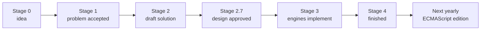
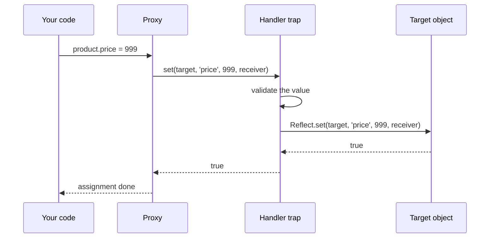

# Modern JavaScript Features

> In this document you will learn how JavaScript gets new features, and you will walk through every edition from ES2015 (ES6) to ES2025, plus what arrived in ES2026 and what is already finished for ES2027. Each feature has a short, tested example. Proxy, Reflect and the well-known symbols get their own deep sections. Interviewers use this topic to check that your JavaScript knowledge is current and that you know when and how to use new features safely in production.

**Before this:** [Basics: variables, types and operators](01-basics-variables-types-operators.md) · [Objects and copying](07-objects-and-copying.md) · [Classes](09-classes.md) · **Interview questions:** [jump to the interview section](#interview-questions)

## Table of contents

1. [How JavaScript gets new features](#how-javascript-gets-new-features)
2. [ES2015 (ES6): the big update](#es2015-es6-the-big-update)
3. [ES2016](#es2016)
4. [ES2017](#es2017)
5. [ES2018](#es2018)
6. [ES2019](#es2019)
7. [ES2020](#es2020)
8. [ES2021](#es2021)
9. [ES2022](#es2022)
10. [ES2023](#es2023)
11. [ES2024](#es2024)
12. [ES2025](#es2025)
13. [ES2026 and what is finished for ES2027](#es2026-and-what-is-finished-for-es2027)
14. [Proxy and Reflect](#proxy-and-reflect)
15. [Well-known symbols](#well-known-symbols)
16. [Proposals still in progress](#proposals-still-in-progress)
17. [Using modern features safely](#using-modern-features-safely)
18. [Quick reference: feature by year](#quick-reference-feature-by-year)
19. [Interview questions](#interview-questions)
20. [Summary](#summary)
21. [References](#references)

> **Version note:** This repository's baseline is ECMAScript 2025. ES2026 was approved by Ecma in June 2026, so it is covered too, clearly labeled. Support facts below were checked in October 2026 against the TC39 proposals repository, MDN browser-compatibility data and Node.js release notes. All examples marked with outputs were run on Node.js 22 unless a newer version is named.

---

## How JavaScript gets new features

### ECMAScript and TC39

**JavaScript** is the language you write. **ECMAScript** is the official specification that defines it (document ECMA-262). A committee called **TC39** (Technical Committee 39), made of browser vendors, companies and community members, decides what goes into the specification.

Since 2015, a new edition is published **every year**, usually in June. Each edition is named by its year: ES2015, ES2016, ... ES2025, ES2026. ES2015 is also called **ES6**, because it was the sixth edition. After that, the year names are the official ones ("ES7" for ES2016 is informal).

### The stages of a proposal

Every new feature starts as a **proposal** and moves through stages:

| Stage | Meaning |
|---|---|
| 0 | An idea. Anyone in TC39 can bring it. |
| 1 | The committee agrees the problem is worth solving. The design can still change completely. |
| 2 | A preferred solution and a first draft of the spec text exist. |
| 2.7 | The design is approved. The feature now needs tests and implementation experience. |
| 3 | Recommended for implementation. Engines start shipping it, sometimes behind flags. Changes happen only if implementations find problems. |
| 4 | Finished. At least two compatible implementations exist and tests are complete. It goes into the next yearly edition. |



Important consequences:

- A feature can work in browsers **before** it is in an official edition (engines often ship at Stage 3). The edition year tells you when it was standardized, not when it first worked.
- A proposal can move **backwards**. In May 2026, decorators were moved from Stage 3 back to Stage 2.7 (more in [Proposals still in progress](#proposals-still-in-progress)).
- Language features (syntax, built-in objects like `Array` and `Promise`) come from ECMAScript. **Browser APIs** (`fetch`, `setTimeout`, DOM, `structuredClone`) come from other standards (WHATWG, W3C). **Node.js APIs** (`fs`, `process`) come from Node.js. This document is about ECMAScript features.

---

## ES2015 (ES6): the big update

ES2015 was the largest update in the history of the language. Most "modern JavaScript" comes from here. Many features have their own deep documents, linked below. Here you get the short version.

### let and const

Block-scoped variables. `const` cannot be reassigned (but an object stored in it can still change).

```js
const taxRate = 0.2;
let total = 100;
if (total > 50) {
  let total = 10;      // a different variable, only inside this block
  console.log(total);  // 10
}
console.log(total);    // 100
```

Deep dive: [Scope, hoisting and TDZ](03-scope-hoisting-and-tdz.md).

### Arrow functions

Shorter functions that do not have their own `this`, `arguments`, `super` or `new.target`, and cannot be used with `new`.

```js
const prices = [10, 20, 30];
const withTax = prices.map((price) => price * 1.2);
console.log(withTax); // [ 12, 24, 36 ]
```

Deep dive: [Functions](04-functions-and-functional-programming.md) and [this](06-this-call-apply-bind.md).

### Classes

Syntax for constructor functions and prototypes, with `extends` and `super`.

```js
class Animal {
  constructor(name) { this.name = name; }
  speak() { return `${this.name} makes a sound`; }
}
class Dog extends Animal {
  speak() { return `${this.name} barks`; }
}
console.log(new Dog("Rex").speak()); // "Rex barks"
```

Deep dive: [Classes](09-classes.md) and [Prototypes](08-prototypes-and-inheritance.md).

### Template literals and tagged templates

Backtick strings with `${}` expressions and real line breaks. A **tag** function can process the parts.

```js
const user = "Asha";
console.log(`Hello, ${user}!`); // "Hello, Asha!"

function money(strings, ...values) {
  return strings.reduce(
    (out, str, i) => out + str + (i < values.length ? values[i].toFixed(2) : ""),
    ""
  );
}
console.log(money`Total: ${12.5} + tax ${1}`); // "Total: 12.50 + tax 1.00"
```

### Destructuring

Unpack values from arrays and objects into variables, with defaults and renaming.

```js
const [first = 1, , third = 3] = [undefined, 2];
console.log(first, third); // 1 3

function greet({ name = "Guest", role = "user" } = {}) {
  return `${name} (${role})`;
}
console.log(greet());                // "Guest (user)"
console.log(greet({ name: "Asha" })); // "Asha (user)"
```

Deep dive: [Objects and copying](07-objects-and-copying.md).

### Default parameters, rest parameters and spread

```js
function sum(...numbers) {          // rest: collects arguments into an array
  return numbers.reduce((a, b) => a + b, 0);
}
const values = [1, 2, 3];
console.log(sum(...values));        // spread: 6
console.log([0, ...values, 4]);     // [ 0, 1, 2, 3, 4 ]

function createOrder(item, quantity = 1) { // default parameter
  return { item, quantity };
}
console.log(createOrder("pen"));    // { item: 'pen', quantity: 1 }
```

(Object spread `{ ...obj }` came later, in ES2018.)

### Enhanced object literals

Shorthand properties, shorthand methods and computed keys:

```js
const name = "Laptop";
const field = "price";
const product = {
  name,                         // same as name: name
  [field]: 999,                 // computed key → price: 999
  describe() { return `${this.name}: ${this[field]}`; }, // method shorthand
};
console.log(product.describe()); // "Laptop: 999"
```

### Modules

`import` and `export` give each file its own scope and explicit dependencies.

```js
// cart.js
export function addItem(cart, item) { return [...cart, item]; }
export default class Cart {}

// app.js
import Cart, { addItem } from "./cart.js";
```

Deep dive: [Modules: ESM and CommonJS](14-modules-esm-and-commonjs.md).

### Promises

A standard object for a value that will be available later.

```js
const wait = (ms) => new Promise((resolve) => setTimeout(resolve, ms));
wait(100).then(() => console.log("100 ms later"));
```

Deep dive: [Callbacks and promises](17-callbacks-and-promises.md).

### Map, Set, WeakMap, WeakSet

Real collections: `Map` accepts any key type and keeps insertion order. `Set` stores unique values. The weak versions do not keep their keys alive.

```js
const visits = new Map([["home", 3]]);
visits.set("cart", 1);
console.log(visits.get("home"), visits.size); // 3 2
console.log([...new Set([1, 2, 2, 3])]);      // [ 1, 2, 3 ]
```

Deep dive: [Map, Set, WeakMap and WeakSet](12-map-set-weakmap-weakset.md).

### Symbols

A new primitive type for unique keys. Two symbols with the same description are still different.

```js
const id1 = Symbol("id");
const id2 = Symbol("id");
console.log(id1 === id2);                              // false
console.log(Symbol.for("app") === Symbol.for("app"));  // true (global registry)

const user = { name: "Asha", [id1]: 7 };
console.log(Object.keys(user), JSON.stringify(user));  // [ 'name' ] {"name":"Asha"}
```

Symbol keys are skipped by `Object.keys`, `for...in` and `JSON.stringify`. Built-in **well-known symbols** let you customize language behavior (see [below](#well-known-symbols)).

### Iterators, for...of and generators

The iteration protocol (`Symbol.iterator`) lets any object work with `for...of`, spread and destructuring. Generators (`function*`) make iterators easy to write.

```js
class Range {
  constructor(from, to) { this.from = from; this.to = to; }
  *[Symbol.iterator]() {
    for (let i = this.from; i <= this.to; i++) yield i;
  }
}
console.log([...new Range(1, 4)]); // [ 1, 2, 3, 4 ]
```

Deep dive: [Iterators and generators](13-iterators-and-generators.md).

### Proxy and Reflect

Intercept operations on objects. Covered in depth in [Proxy and Reflect](#proxy-and-reflect).

### New built-in methods and smaller features

```js
console.log(Array.from("abc"));                      // [ 'a', 'b', 'c' ]
console.log([5, 12, 8].find((n) => n > 10));         // 12
console.log(Object.assign({}, { a: 1 }, { b: 2 }));  // { a: 1, b: 2 }
console.log(Number.isNaN("abc"), isNaN("abc"));      // false true
console.log("JavaScript".startsWith("Java"), "ab".repeat(3)); // true ababab
console.log(0b1010, 0o17);                           // 10 15 (binary and octal literals)

function OnlyNew() {
  if (!new.target) return "call with new";           // new.target: was I called with new?
  this.ok = true;
}
console.log(OnlyNew(), new OnlyNew().ok);            // "call with new" true
```

ES2015 also added typed arrays (`Uint8Array` and friends), `String.raw`, `Object.is`, `Number.isInteger` and `Math.trunc`. Proper tail calls are in the spec, but only Safari implements them, so do not rely on them.

---

## ES2016

A small edition with two features.

```js
// Array.prototype.includes — uses SameValueZero, so it finds NaN
console.log([1, 2, NaN].includes(NaN)); // true
console.log([NaN].indexOf(NaN));        // -1 (indexOf uses ===)

// Exponentiation operator
console.log(2 ** 10);    // 1024
console.log((-2) ** 2);  // 4  (writing -2 ** 2 without parentheses is a SyntaxError)
```

---

## ES2017

### async and await

The most important feature since ES2015: write asynchronous code that reads like synchronous code.

```js
async function loadUser(id) {
  const res = await fetch(`/api/users/${id}`);
  if (!res.ok) throw new Error(`HTTP ${res.status}`);
  return res.json();
}
```

Deep dive: [async/await](18-async-await.md).

### Object.values, Object.entries, string padding, property descriptors

```js
console.log(Object.entries({ a: 1, b: 2 }));   // [ [ 'a', 1 ], [ 'b', 2 ] ]
console.log("5".padStart(3, "0"));              // "005"
console.log("ab".padEnd(4, "."));               // "ab.."

// Copy an object WITH its getters and setters (Object.assign would run the getter instead)
const source = { get now() { return Date.now(); } };
const clone = Object.defineProperties({}, Object.getOwnPropertyDescriptors(source));
```

ES2017 also added trailing commas in function parameter lists, and `SharedArrayBuffer` with `Atomics` for shared memory between workers.

---

## ES2018

### Object rest and spread

```js
const { password, ...publicUser } = { id: 1, name: "Asha", password: "x" };
console.log(publicUser);                  // { id: 1, name: 'Asha' }
console.log({ ...publicUser, role: "admin" }); // { id: 1, name: 'Asha', role: 'admin' }
```

Object spread makes a **shallow** copy. See [Objects and copying](07-objects-and-copying.md).

### Async iteration

`for await...of` and async generators, for data that arrives over time (pages of an API, stream chunks).

```js
async function* fetchAllPages(url) {
  let next = url;
  while (next) {
    const res = await fetch(next);
    const page = await res.json();
    yield page.items;
    next = page.nextUrl;
  }
}

for await (const items of fetchAllPages("/api/orders?page=1")) {
  console.log(items.length);
}
```

### Promise.prototype.finally

Runs cleanup whether the promise fulfilled or rejected:

```js
showSpinner();
loadUser(7)
  .then(renderUser)
  .catch(showError)
  .finally(hideSpinner);
```

### Regular expression improvements

```js
// Named capture groups
const { year, month } = /(?<year>\d{4})-(?<month>\d{2})/.exec("2026-10").groups;
console.log(year, month); // 2026 10

// Lookbehind
console.log("price: $30".match(/(?<=\$)\d+/)[0]); // "30"

// s (dotAll) flag: . also matches line breaks
console.log(/a.b/s.test("a\nb"), /a.b/.test("a\nb")); // true false
```

ES2018 also added Unicode property escapes such as `\p{Letter}` (with the `u` flag). More regex: [Strings, numbers and dates](11-strings-numbers-and-dates.md).

---

## ES2019

```js
console.log([1, [2, [3, [4]]]].flat());          // [ 1, 2, [ 3, [ 4 ] ] ]
console.log([1, [2, [3, [4]]]].flat(Infinity));  // [ 1, 2, 3, 4 ]
console.log(["a b", "c"].flatMap((s) => s.split(" "))); // [ 'a', 'b', 'c' ]

console.log(Object.fromEntries([["x", 1], ["y", 2]])); // { x: 1, y: 2 }
console.log("  hi  ".trimStart() + "|");          // "hi  |"

try {
  JSON.parse("{");
} catch {                                         // optional catch binding: no (error) needed
  console.log("invalid JSON");
}

console.log(Symbol("id").description);            // "id"
```

Also in ES2019:

- `Array.prototype.sort` must be **stable**: items that compare equal keep their original order. This matters when you sort a table by one column after another.
- `Function.prototype.toString` returns the exact source text.
- `JSON.stringify` outputs lone surrogates as escapes instead of broken characters.

---

## ES2020

### Optional chaining `?.`

Stops and returns `undefined` if the value on the left is `null` or `undefined`, instead of throwing. It works for properties (`a?.b`), computed keys (`a?.[key]`) and calls (`a.method?.()`).

```js
const user = { profile: { address: null }, getName() { return "Asha"; } };
console.log(user.profile?.address?.city); // undefined (no error)
console.log(user.getAge?.());             // undefined: the method does not exist, so it is not called
```

Two details to remember: it skips the **whole rest of the chain** (even function arguments), and it protects **only the spot where you put it** (`data.a?.b.c` still throws if `a` exists but `b` is `undefined`). The interview question [Q2](#q2-how-does-optional-chaining-work-what-exactly-does-it-short-circuit) shows both. Full explanation: [Optional chaining in Basics](01-basics-variables-types-operators.md#optional-chaining-).

### Nullish coalescing `??`

Returns the right side only when the left side is `null` or `undefined`. `||` returns the right side for **any falsy** value (`0`, `""`, `false`, `NaN` too).

```js
const settings = { volume: 0 };
console.log(settings.volume || 50);  // 50  ❌ 0 is a valid volume, but || replaced it
console.log(settings.volume ?? 50);  // 0   ✅
```

You cannot mix `??` with `||` or `&&` without parentheses (`null ?? 1 || 2` is a SyntaxError). Full explanation: [Nullish coalescing in Basics](01-basics-variables-types-operators.md#nullish-coalescing-).

### BigInt

Integers of any size, written with an `n` suffix.

```js
console.log(Number.MAX_SAFE_INTEGER + 2); // 9007199254740992 (wrong! precision lost)
console.log(9007199254740993n);           // 9007199254740993n (exact)
console.log(2n ** 64n);                    // 18446744073709551616n
console.log(typeof 10n);                   // "bigint"
// 1n + 1 → TypeError: you cannot mix BigInt and Number in arithmetic
```

Use it for large IDs, exact big integer math and 64-bit values. Not for money with decimals (use integer cents).

### Promise.allSettled

Waits for all promises and reports each result, never rejects.

```js
const results = await Promise.allSettled([
  Promise.resolve(1),
  Promise.reject(new Error("x")),
]);
console.log(results.map((r) => r.status)); // [ 'fulfilled', 'rejected' ]
```

### globalThis, dynamic import, matchAll, import.meta

```js
console.log(typeof globalThis); // "object" — the global object in browsers, Node.js and workers

const { renderChart } = await import("./charts.js"); // load a module on demand

console.log([..."a1b2".matchAll(/\d/g)].map((m) => m[0])); // [ '1', '2' ]

console.log(import.meta.url); // the URL of the current module (in ES modules)
```

ES2020 also fixed the order of `for...in` in more cases.

---

## ES2021

### Logical assignment operators

| Operator | Same as | Assigns when |
|---|---|---|
| `a ||= b` | `a || (a = b)` | `a` is falsy |
| `a &&= b` | `a && (a = b)` | `a` is truthy |
| `a ??= b` | `a ?? (a = b)` | `a` is `null` or `undefined` |

```js
const options = { retries: 0, name: "", cache: null };
options.retries ||= 3;        // 0 is falsy → becomes 3
options.name ??= "default";   // "" is not nullish → stays ""
options.cache ??= new Map();  // null → becomes a new Map
console.log(options.retries, JSON.stringify(options.name), options.cache instanceof Map); // 3 "" true

let level = 1;
level &&= level + 1;
console.log(level); // 2
```

They **short-circuit**: if no assignment is needed, the right side is not even evaluated.

```js
let calls = 0;
const config = { timeout: 5 };
config.timeout ||= ++calls; // timeout is truthy → right side never runs
console.log(config.timeout, calls); // 5 0
```

A common real use: lazy initialization, `this.cache ??= new Map();`.

### Numeric separators, replaceAll, Promise.any

```js
const budget = 1_000_000;                 // underscores only for readability
console.log(budget + 1);                  // 1000001

console.log("a-b-a".replaceAll("a", "x")); // "x-b-x" (replace() would change only the first)

const fastest = await Promise.any([Promise.reject(1), Promise.resolve(2)]);
console.log(fastest);                     // 2 — first FULFILLED promise
// If all reject, Promise.any rejects with an AggregateError (property .errors)
```

### WeakRef and FinalizationRegistry

Weak references to objects and callbacks after collection. Use rarely. See [Memory management](19-memory-management-and-garbage-collection.md#weak-references-for-caches-and-metadata).

---

## ES2022

### Class fields, private members and static blocks

```js
class Counter {
  static #instances = 0;           // private static field
  #count = 0;                      // private instance field
  static {                         // static initialization block
    Counter.ready = true;
  }
  constructor() { Counter.#instances++; }
  increment() { return ++this.#count; }
  static isCounter(obj) { return #count in obj; } // ergonomic brand check
  static get instances() { return Counter.#instances; }
}

const counter = new Counter();
counter.increment();
console.log(counter.increment(), Counter.isCounter(counter), Counter.isCounter({})); // 2 true false
console.log(Counter.instances, Counter.ready); // 1 true
// counter.#count → SyntaxError outside the class
```

`#private` is enforced at runtime by the engine. TypeScript's `private` keyword is only a compile-time check. Deep dive: [Classes](09-classes.md).

### Top-level await

In ES modules (not in classic scripts or CommonJS), you can use `await` at the top level:

```js
// config.mjs
const res = await fetch("/config.json");
export const config = await res.json();
```

Modules that import `config.mjs` wait until it finishes. Useful for loading configuration or initializing a database connection, but it delays every importer, so keep it short.

### at(), Object.hasOwn, error cause, regex match indices

```js
const scores = [10, 20, 30];
console.log(scores.at(-1), scores[scores.length - 1], "abc".at(-1)); // 30 30 c

const dict = Object.create(null);  // no prototype → no hasOwnProperty method
dict.key = 1;
console.log(Object.hasOwn(dict, "key")); // true (dict.hasOwnProperty would throw TypeError)

try {
  try {
    JSON.parse("{bad");
  } catch (err) {
    throw new Error("Config load failed", { cause: err }); // keep the original error
  }
} catch (error) {
  console.log(error.message, "|", error.cause.constructor.name); // Config load failed | SyntaxError
}

const match = /(?<year>\d{4})/d.exec("Year 2026"); // d flag: start/end positions
console.log(match.indices[1], match.indices.groups.year); // [ 5, 9 ] [ 5, 9 ]
```

More on `cause`: [Error handling](15-error-handling.md).

---

## ES2023

```js
// findLast / findLastIndex: search from the end
console.log([1, 2, 3, 4].findLast((n) => n % 2 === 1));     // 3
console.log([1, 2, 3, 4].findLastIndex((n) => n > 10));     // -1

// Change array by copy: return a NEW array, leave the original alone
const nums = [3, 1, 2];
console.log(nums.toSorted());      // [ 1, 2, 3 ]
console.log(nums.toReversed());    // [ 2, 1, 3 ]
console.log(nums.toSpliced(1, 1)); // [ 3, 2 ]
console.log(nums.with(0, 9));      // [ 9, 1, 2 ]
console.log(nums);                 // [ 3, 1, 2 ] — unchanged
```

Why change-by-copy matters: Angular `OnPush` components, NgRx reducers, signals (Angular 17+) and React all detect changes by **reference**. `sort()` and `reverse()` mutate the same array, so the reference does not change and the UI may not update. `toSorted()` gives you a new array in one call. Deep dive: [Arrays](10-arrays-and-array-methods.md).

Also in ES2023:

- **Hashbang grammar:** a file may start with `#!/usr/bin/env node`, which is standard now (Node.js CLIs).
- **Symbols as WeakMap keys:** non-registered symbols can be `WeakMap` keys and `WeakRef` targets. Registered ones (`Symbol.for(...)`) cannot, because they live forever.

```js
const wm = new WeakMap();
wm.set(Symbol("session"), { user: "Asha" }); // allowed
// wm.set(Symbol.for("reg"), 1) → TypeError
```

---

## ES2024

### Object.groupBy and Map.groupBy

```js
const products = [
  { name: "Pen", category: "office" },
  { name: "Apple", category: "food" },
  { name: "Stapler", category: "office" },
];

const byCategory = Object.groupBy(products, (p) => p.category);
console.log(Object.keys(byCategory), byCategory.office.length); // [ 'office', 'food' ] 2
console.log(Object.getPrototypeOf(byCategory));                 // null

const byLength = Map.groupBy(products, (p) => (p.category.length > 4 ? "long" : "short"));
console.log([...byLength.keys()]); // [ 'long', 'short' ]
```

Note: the result of `Object.groupBy` has a **null prototype**, so it has no `hasOwnProperty` or `toString`. Use `Object.hasOwn` or `in`. Use `Map.groupBy` when group keys are not strings (objects, numbers you want to keep as numbers). More: [Object.groupBy in Objects and copying](07-objects-and-copying.md#objectgroupby-es2024).

### Promise.withResolvers

Creates a promise and gives you its `resolve` and `reject` functions outside the executor:

```js
const { promise, resolve, reject } = Promise.withResolvers();
setTimeout(() => resolve("ready"), 10);
console.log(await promise); // "ready"
```

Useful when the code that creates the promise is not the code that settles it: request/response matching over WebSocket or IPC, waiting for an event, test helpers. Deep dive: [Promise.withResolvers in Callbacks and promises](17-callbacks-and-promises.md#promisewithresolvers-es2024).

### Other ES2024 features

```js
// Resizable ArrayBuffer and transfer
const buffer = new ArrayBuffer(4, { maxByteLength: 16 });
buffer.resize(8);
console.log(buffer.byteLength, buffer.resizable); // 8 true
const moved = buffer.transfer();                  // move the memory to a new buffer
console.log(buffer.detached, moved.byteLength);   // true 8

// Well-formed Unicode strings
console.log("ab\uD800".isWellFormed());               // false (lone surrogate)
console.log("ab\uD800".toWellFormed() === "ab�"); // true

// RegExp v flag: set operations in character classes
console.log(/[\p{L}--[a-z]]/v.test("a"), /[\p{L}--[a-z]]/v.test("Ä")); // false true
```

ES2024 also added `Atomics.waitAsync` (wait on shared memory without blocking, for advanced worker code) and growable `SharedArrayBuffer`.

---

## ES2025

ES2025 was approved in June 2025. Support: everything below works in current Chrome, Edge, Firefox and Safari. In Node.js, iterator helpers, Set methods and JSON modules work in Node.js 22. `Promise.try`, `RegExp.escape`, `Float16Array`, regex modifiers and duplicate named groups need **Node.js 24** (Node.js 22 does not ship them by default; we checked).

### Iterator helpers

Lazy `map`, `filter`, `take`, `drop`, `flatMap`, `reduce`, `toArray`, `forEach`, `some`, `every`, `find` directly on iterators, plus `Iterator.from()`.

```js
function* naturals() {
  let n = 1;
  while (true) yield n++;
}

console.log(naturals().filter((n) => n % 2 === 0).map((n) => n * n).take(3).toArray());
// [ 4, 16, 36 ] — works on an infinite sequence because it is lazy

const prices = new Map([["pen", 1], ["book", 2]]);
console.log(Iterator.from(prices.values()).reduce((sum, p) => sum + p, 0)); // 3
```

See [Iterators and generators](13-iterators-and-generators.md) and the lazy-vs-eager example in [Debounce, throttle and performance](20-debounce-throttle-and-performance.md#lazy-evaluation).

### New Set methods

```js
const frontend = new Set(["js", "ts", "css"]);
const backend = new Set(["js", "ts", "sql"]);

console.log([...frontend.union(backend)]);               // [ 'js', 'ts', 'css', 'sql' ]
console.log([...frontend.intersection(backend)]);        // [ 'js', 'ts' ]
console.log([...frontend.difference(backend)]);          // [ 'css' ]
console.log([...frontend.symmetricDifference(backend)]); // [ 'css', 'sql' ]
console.log(new Set(["js"]).isSubsetOf(frontend));       // true
console.log(frontend.isSupersetOf(new Set(["css"])));    // true
console.log(frontend.isDisjointFrom(new Set(["go"])));   // true
```

Real use: comparing permissions (`requiredRoles.isSubsetOf(userRoles)`), finding new and removed tags, merging selections. Deep dive: [Set methods in Map, Set, WeakMap and WeakSet](12-map-set-weakmap-weakset.md#set-methods-es2025).

### Import attributes and JSON modules

```js
import config from "./config.json" with { type: "json" };
console.log(config.retries); // 3 (for a config.json containing "retries": 3)

const { default: sameConfig } = await import("./config.json", { with: { type: "json" } });
```

The `with { type: "json" }` part is required. It tells the runtime what kind of file to expect, so a server cannot trick the page into running JavaScript when it expected JSON. In Node.js 22, importing JSON without it throws `ERR_IMPORT_ATTRIBUTE_MISSING`. (An older syntax used `assert { type: "json" }`. It was replaced by `with` and Node.js 22 removed `assert`.)

### Promise.try

Runs a function and always gives you a promise, even if the function throws synchronously or returns a plain value:

```js
// Node.js 24+, current browsers
function loadSettings(source) {
  return Promise.try(() => source.read()) // read() may throw, return a value, or return a promise
    .then(parseSettings)
    .catch(useDefaults);                  // one place to handle all three cases
}
// Before ES2025: new Promise((resolve) => resolve(source.read()))
```

Deep dive: [Promise.try in Callbacks and promises](17-callbacks-and-promises.md#promisetry-es2025).

### RegExp.escape

Escapes a string so it can be used safely inside a regular expression:

```js
// Node.js 24+, current browsers
const userInput = "$9.99";
const re = new RegExp(RegExp.escape(userInput));
console.log(re.test("Total: $9.99")); // true
console.log(re.test("Total: $9099")); // false — "." is now a literal dot
```

Without escaping, `.` matches any character and `$` means "end of input", so user input could change the meaning of the pattern.

### Regex modifiers and duplicate named groups

```js
// Node.js 24+, current browsers. We checked these on Node.js 22 with V8 flags.
console.log(/^(?i:hello) world$/.test("HELLO world")); // true — only "hello" ignores case
console.log(/^(?i:hello) world$/.test("HELLO WORLD")); // false

// The same group name in different alternatives
const dateRe = /(?<year>\d{4})-\d{2}|\d{2}\/(?<year>\d{4})/;
console.log(dateRe.exec("10/2026").groups.year); // "2026"
```

### Float16Array

A typed array of 16-bit floats (half precision), plus `Math.f16round` and `DataView` methods. Used in graphics, WebGPU and machine-learning code to save memory.

```js
// Node.js 24+, current browsers
console.log(Math.f16round(1.337));         // 1.3369140625 (nearest half-precision value)
console.log(new Float16Array([70000])[0]); // Infinity (too large for 16 bits)
```

ES2025 also made a small cleanup about `var` declarations created by `eval` in the global scope.

---

## ES2026 and what is finished for ES2027

> **Newer than the repository baseline.** ES2026 was approved in June 2026. The ES2027 features below are already Stage 4 (finished) but will be published in June 2027. Support varies, so check MDN before using them without a polyfill.

### ES2026

| Feature | Example | Support notes (October 2026) |
|---|---|---|
| `Array.fromAsync` | `await Array.fromAsync(asyncIterable)` | Node.js 22+, all major browsers |
| `Error.isError` | `Error.isError(value)` — reliable even across realms (iframes) | Node.js 24.3+, Chrome, Firefox; Safari in preview |
| `Math.sumPrecise` | `Math.sumPrecise([0.1, 0.2, 0.3])` adds without accumulating rounding errors | Chrome, Firefox, Safari 26.2; not yet in Node.js |
| Uint8Array to/from Base64 and hex | `Uint8Array.fromBase64(str)`, `bytes.toBase64()`, `bytes.toHex()` | Node.js 25+, all major browsers |
| Upsert | `map.getOrInsert(key, value)`, `map.getOrInsertComputed(key, fn)` (also on `WeakMap`) | Node.js 26, recent browsers |
| Iterator sequencing | `Iterator.concat(itA, itB)` | Node.js 26, recent browsers |
| `JSON.parse` source text access | The reviver gets the original source text, and `JSON.rawJSON()` keeps exact numbers | Node.js 21+; check browser support on MDN |

```js
// Upsert replaces this common pattern:
if (!groups.has(key)) groups.set(key, []);
groups.get(key).push(item);

// with (ES2026):
groups.getOrInsert(key, []).push(item);
```

### Finished for ES2027

**Temporal** — the modern date and time API that fixes the problems of `Date`: immutable values, separate types for dates, times, time zones and durations, and correct time zone math.

```js
// Chrome 144+, Firefox 139+, Node.js 26. Safari: not in a stable release at the time of writing.
const due = Temporal.PlainDate.from("2026-01-31").add({ months: 1 });
console.log(due.toString()); // "2026-02-28" (clamped to the last day of February)

const meeting = Temporal.ZonedDateTime.from("2026-03-29T09:00[Europe/Berlin]");
const duration = Temporal.Duration.from({ hours: 1, minutes: 30 });
console.log(duration.total("minutes")); // 90
```

Until all your target browsers support it, use the official polyfill (`@js-temporal/polyfill`) or a date library. Dates in depth: [Strings, numbers and dates](11-strings-numbers-and-dates.md).

**Explicit Resource Management** — `using` and `await using` declarations call a cleanup method automatically when the block ends, even if an error is thrown:

```js
// Node.js 24+, Chrome 134+, Firefox 141+. TypeScript supports it since 5.2.
function openLogFile(path) {
  const handle = fs.openSync(path, "a");
  return {
    write(line) { fs.writeSync(handle, line + "\n"); },
    [Symbol.dispose]() { fs.closeSync(handle); }, // cleanup method
  };
}

{
  using log = openLogFile("app.log");
  log.write("started");
} // log[Symbol.dispose]() runs here automatically, like try/finally

// async version: await using conn = await pool.connect(); // calls [Symbol.asyncDispose]()
```

Other finished ES2027 items: iterator `chunks()`/`windows()`, `Iterator.prototype.includes`, `Iterator.prototype.join`, joint iteration (`Iterator.zip`) and `Atomics.pause`.

---

## Proxy and Reflect

### What a Proxy is

A **Proxy** is an object that wraps another object (the **target**) and lets you intercept basic operations on it: reading a property, writing a property, checking `in`, deleting, listing keys, calling a function, using `new`. The functions that intercept are called **traps**, and they live in a **handler** object.

```js
const target = { name: "Laptop" };
const handler = {
  get(obj, prop, receiver) {
    console.log(`reading ${String(prop)}`);
    return Reflect.get(obj, prop, receiver); // do the normal operation
  },
};
const product = new Proxy(target, handler);
console.log(product.name);
// reading name
// Laptop
```

### Why it exists

Before ES2015, you could intercept only properties you defined in advance (with getters and setters). A Proxy intercepts **any** property, including ones that do not exist yet, and other operations like `in` and `delete`. This makes it possible to build validation layers, default values, observable/reactive objects, logging, mocks and access control without changing the target object.

### Analogy

A Proxy is like a receptionist in front of an office. Every visitor (operation) talks to the receptionist first. The receptionist can let the visitor through to the office (forward to the target), answer the question directly, or refuse entry (throw an error).

Where it breaks: a receptionist can be bypassed through a back door. A Proxy too: code that holds a direct reference to the target object skips the proxy completely.

### How it works



If a trap is not defined in the handler, the operation goes straight to the target.

### The traps

| Trap | Intercepts | Reflect method |
|---|---|---|
| `get` | `obj.prop`, `obj[key]` | `Reflect.get` |
| `set` | `obj.prop = value` | `Reflect.set` |
| `has` | `prop in obj` | `Reflect.has` |
| `deleteProperty` | `delete obj.prop` | `Reflect.deleteProperty` |
| `ownKeys` | `Object.keys`, `for...in`, `Reflect.ownKeys` | `Reflect.ownKeys` |
| `getOwnPropertyDescriptor` | `Object.getOwnPropertyDescriptor` | same name |
| `defineProperty` | `Object.defineProperty` | same name |
| `getPrototypeOf` / `setPrototypeOf` | prototype reads and changes | same names |
| `isExtensible` / `preventExtensions` | extensibility checks | same names |
| `apply` | calling a function proxy: `fn(...)` | `Reflect.apply` |
| `construct` | `new Fn(...)` | `Reflect.construct` |

### Reflect: why use it inside traps

**Reflect** is a built-in object with one method for each trap. Each method performs the **default** behavior of that operation. Inside a trap, `Reflect.xxx(...args)` means "now do the normal thing".

Why not just write `obj[prop]`? Because of the **receiver** (the object the operation was really performed on). With getters and inheritance, the difference shows:

```js
const base = {
  _name: "base",
  get name() { return this._name; },
};

const goodProxy = new Proxy(base, { get: (t, p, receiver) => Reflect.get(t, p, receiver) });
const badProxy = new Proxy(base, { get: (t, p) => t[p] });

const child1 = Object.create(goodProxy);
child1._name = "child";
const child2 = Object.create(badProxy);
child2._name = "child";

console.log(child1.name, child2.name); // child base
```

`Reflect.get(t, p, receiver)` runs the getter with `this = receiver` (the child). `t[p]` runs it with `this = target`, which is wrong. `Reflect` methods also return booleans for success (`Reflect.set` returns `false` instead of throwing in sloppy mode), which is exactly what traps need to return.

### Example 1: validation

```js
function createValidated(target, rules) {
  return new Proxy(target, {
    set(obj, prop, value, receiver) {
      const rule = rules[prop];
      if (rule && !rule(value)) {
        throw new TypeError(`Invalid value for ${String(prop)}: ${value}`);
      }
      return Reflect.set(obj, prop, value, receiver);
    },
  });
}

const product = createValidated({}, {
  price: (v) => typeof v === "number" && v >= 0,
  name: (v) => typeof v === "string" && v.length > 0,
});

product.name = "Laptop";
product.price = 999;
try {
  product.price = -5;
} catch (e) {
  console.log(e.message); // "Invalid value for price: -5"
}
console.log(product); // { name: 'Laptop', price: 999 }
```

A `set` trap must return `true` for success. Returning `false` makes the assignment throw a `TypeError` in strict mode.

### Example 2: default values and negative indexes

```js
const settings = new Proxy({ theme: "dark" }, {
  get: (t, p, r) => (p in t ? Reflect.get(t, p, r) : "not set"),
});
console.log(settings.theme, settings.language); // dark not set

function negativeArray(arr) {
  return new Proxy(arr, {
    get(t, p, r) {
      if (typeof p === "string" && /^-\d+$/.test(p)) p = String(t.length + Number(p));
      return Reflect.get(t, p, r);
    },
  });
}
const letters = negativeArray(["a", "b", "c"]);
console.log(letters[-1], letters[0], letters.length); // c a 3
```

Property keys reach traps as **strings** (or symbols), even for `letters[-1]`. That is why the code checks a string pattern. (Today, `arr.at(-1)` solves this specific case without a proxy.)

### Example 3: hiding properties and logging

```js
const log = [];
const account = new Proxy({ id: 1, secret: "token" }, {
  has(t, p) {
    log.push(`has ${String(p)}`);
    return p === "secret" ? false : Reflect.has(t, p);
  },
  ownKeys(t) {
    return Reflect.ownKeys(t).filter((key) => key !== "secret");
  },
  deleteProperty(t, p) {
    log.push(`delete ${String(p)}`);
    return Reflect.deleteProperty(t, p);
  },
});

console.log("secret" in account, Object.keys(account)); // false [ 'id' ]
delete account.id;
console.log(log); // [ 'has secret', 'delete id' ]
```

This hides the key from `in` and `Object.keys`, but `account.secret` still returns `"token"` (no `get` trap). A proxy is **not** a security boundary unless every trap is covered and nobody has the target.

### Example 4: function proxies

```js
const add = (a, b) => a + b;
const timedAdd = new Proxy(add, {
  apply(fn, thisArg, args) {
    const result = Reflect.apply(fn, thisArg, args);
    console.log(`add(${args}) = ${result}`);
    return result;
  },
});
timedAdd(2, 3); // logs "add(2,3) = 5"
```

### Example 5: the idea behind reactivity

Frameworks like Vue 3 (and MobX) build their reactivity on proxies: the `get` trap records which code read a property, and the `set` trap re-runs that code. A tiny version:

```js
let activeEffect = null;
const dependencies = new Map(); // property → Set of effects

function reactive(obj) {
  return new Proxy(obj, {
    get(t, p, r) {
      if (activeEffect) {
        if (!dependencies.has(p)) dependencies.set(p, new Set());
        dependencies.get(p).add(activeEffect); // remember: this effect reads p
      }
      return Reflect.get(t, p, r);
    },
    set(t, p, v, r) {
      const ok = Reflect.set(t, p, v, r);
      dependencies.get(p)?.forEach((effect) => effect()); // re-run readers of p
      return ok;
    },
  });
}

function effect(fn) {
  activeEffect = fn;
  fn();
  activeEffect = null;
}

const cart = reactive({ qty: 1, price: 20 });
effect(() => console.log(`Total: ${cart.qty * cart.price}`)); // Total: 20
cart.qty = 3;     // Total: 60
cart.price = 25;  // Total: 75
```

Angular uses a different approach: Zone.js plus change detection, and signals (developer preview in Angular 16), which track reads through function calls instead of proxies. See [Change detection and signals](../06-angular-16/10-change-detection-and-signals.md).

### Limits and gotchas (all checked with Node.js)

```js
// 1. A proxy is a different object
const target = {};
console.log(new Proxy(target, {}) === target); // false

// 2. Private fields do not work through a proxy
class Account {
  #balance = 100;
  get balance() { return this.#balance; }
}
const proxiedAccount = new Proxy(new Account(), {});
// proxiedAccount.balance → TypeError: Cannot read private member #balance
//   from an object whose class did not declare it
// (the getter runs with this = proxy, and the proxy has no #balance)

// 3. Built-ins with internal slots break the same way
const proxiedMap = new Proxy(new Map([["a", 1]]), {});
// proxiedMap.get("a") → TypeError: Method Map.prototype.get called on incompatible receiver
// Fix: in the get trap, bind methods to the target: value.bind(target)

// 4. Revocable proxies can be switched off
const { proxy, revoke } = Proxy.revocable({ token: "abc" }, {});
console.log(proxy.token); // "abc"
revoke();
// proxy.token → TypeError: Cannot perform 'get' on a proxy that has been revoked

// 5. Invariants: a trap cannot lie about non-configurable, read-only properties
const frozen = Object.freeze({ id: 1 });
const liar = new Proxy(frozen, { get: () => 2 });
// liar.id → TypeError: 'get' on proxy: property 'id' is a read-only and non-configurable ...
```

**Performance:** every operation through a proxy calls a function. In hot loops, proxies are noticeably slower than plain objects. Use them at boundaries (APIs, configuration, dev tools), not for every object in a big data set.

### Real-world uses

- Validation and schema enforcement on config objects.
- Reactive state (Vue 3, MobX, Immer's drafts for immutable updates).
- API client generators: `api.users.get(7)` built from property access.
- Test mocks and spies that record every call.
- Warnings for typos: a `get` trap that throws on unknown property names in development.
- Revocable access: give a plugin a revocable proxy, revoke it when the plugin is unloaded.

---

## Well-known symbols

**Well-known symbols** are built-in symbols, stored as static properties of `Symbol`, that the language looks up to decide how an object behaves. Defining them on your object customizes language behavior.

| Symbol | Customizes | Used by |
|---|---|---|
| `Symbol.iterator` | How the object is iterated | `for...of`, spread, destructuring, `Array.from` |
| `Symbol.asyncIterator` | Async iteration | `for await...of` |
| `Symbol.toPrimitive` | Conversion to a primitive | `+obj`, `${obj}`, `obj + 1`, `==` |
| `Symbol.toStringTag` | The tag in `[object Tag]` | `Object.prototype.toString` |
| `Symbol.hasInstance` | The result of `instanceof` | `x instanceof C` |
| `Symbol.isConcatSpreadable` | Whether `concat` spreads the object | `Array.prototype.concat` |
| `Symbol.species` | Which constructor derived objects use | `map`, `filter`, `then` on subclasses |
| `Symbol.match`, `matchAll`, `replace`, `search`, `split` | How an object acts as a pattern | String methods |
| `Symbol.unscopables` | Names hidden from `with` | Legacy `with` statement |
| `Symbol.dispose`, `Symbol.asyncDispose` | Cleanup for `using` (ES2027) | `using`, `await using` |

Examples (verified with Node.js):

```js
// Symbol.toPrimitive: control conversion by hint ("number", "string" or "default")
const price = {
  amount: 42,
  currency: "EUR",
  [Symbol.toPrimitive](hint) {
    return hint === "number" ? this.amount : `${this.amount} ${this.currency}`;
  },
};
console.log(+price);     // 42        (hint "number")
console.log(`${price}`); // "42 EUR"  (hint "string")
console.log(price + 1);  // "42 EUR1" (hint "default" → our code returns the string)

// Symbol.toStringTag
class Temperature {
  get [Symbol.toStringTag]() { return "Temperature"; }
}
console.log(Object.prototype.toString.call(new Temperature())); // "[object Temperature]"

// Symbol.hasInstance
class Even {
  static [Symbol.hasInstance](n) { return Number.isInteger(n) && n % 2 === 0; }
}
console.log(4 instanceof Even, 3 instanceof Even); // true false

// Symbol.isConcatSpreadable
const arrayLike = { length: 2, 0: "x", 1: "y", [Symbol.isConcatSpreadable]: true };
console.log([1].concat(arrayLike)); // [ 1, 'x', 'y' ]
```

The type conversion rules behind `Symbol.toPrimitive` are explained in [Type coercion and equality](02-type-coercion-and-equality.md).

---

## Proposals still in progress

These are **not** part of JavaScript yet. Status as of October 2026 (TC39 proposals repository):

| Proposal | Stage | What it is |
|---|---|---|
| Decorators | 2.7 (moved back from 3 in May 2026) | `@decorator` syntax for classes and class members |
| Decorator metadata | 2.7 | Attach metadata through decorators |
| Import defer | 3 | `import defer * as mod from "./x.js"` — load now, evaluate on first use |
| Source phase imports | 3 | Import a module's source (for example, WebAssembly) without running it |
| Import text | 3 | Import a file as a string with an import attribute |
| Error stack accessor | 3 | Standardize `error.stack` |
| Await dictionary | 3 | Await an object of promises and get an object of results |
| ShadowRealm | 2.7 | Run code in a separate global environment |

### The decorators story (important for Angular developers)

Decorators were at Stage 3 from March 2022, and TypeScript 5.0 implemented that Stage 3 version. But no browser shipped them, and engine teams reported spec and test problems. In May 2026, TC39 moved decorators back to **Stage 2.7**.

What this means for you:

- Decorators are **not** standard JavaScript today. No browser or Node.js runs `@decorator` syntax natively.
- **Angular uses TypeScript's older "experimental" decorators** (`experimentalDecorators: true` in `tsconfig.json`). `@Component`, `@Injectable` and `@Input` are compiled away by TypeScript and the Angular compiler, so this status change does not break Angular apps.
- TypeScript supports both the experimental decorators and the 2022-era standard version. See [TypeScript decorators](../03-typescript/10-decorators.md).

---

## Using modern features safely

### Syntax vs built-ins

There are two kinds of new features, and they need different tools for older environments:

| Kind | Examples | How to support older browsers |
|---|---|---|
| **New syntax** | `?.`, `??`, `#private`, `class`, arrow functions, `using` | **Transpile**: a compiler (TypeScript, Babel, esbuild, SWC) rewrites the code into older syntax |
| **New built-ins** | `Object.groupBy`, `Array.prototype.toSorted`, `Promise.withResolvers`, Set methods | **Polyfill**: code that adds the missing function if it does not exist (for example, core-js) |

You cannot polyfill syntax: an old engine fails to parse the file before any polyfill runs. And a transpiler does not add missing built-ins by itself.

```js
// A simple polyfill pattern (production code should use a tested library like core-js)
if (!Array.prototype.at) {
  Object.defineProperty(Array.prototype, "at", {
    value: function at(index) {
      const i = Math.trunc(index) || 0;
      return this[i < 0 ? this.length + i : i];
    },
    writable: true,
    configurable: true,
  });
}
```

Never extend built-in prototypes with your **own** non-standard methods. If the standard later adds a method with the same name and different behavior, your code breaks (this happened to the `flatten` and `contains` proposal names, which were renamed to `flat` and `includes` to avoid breaking old sites).

### How to decide if you can use a feature

1. **Know your targets.** Your browser support list (for example, a `browserslist` config or the Angular CLI's supported browsers) and your Node.js version (the `engines` field in `package.json`).
2. **Check support.** MDN's browser compatibility tables and the **Baseline** label (a feature is "Baseline widely available" after it has worked in all major browsers for about 30 months).
3. **Check your toolchain.** The TypeScript `target` and `lib` settings decide which syntax is rewritten and which built-in types are allowed. For example, `lib: ["ES2023"]` lets you call `toSorted`, but you still need the browser (or a polyfill) to provide it at runtime.
4. **Use feature detection** for optional APIs: `if ("groupBy" in Object) { ... }`.

### Node.js versions

| Node.js | V8 | Notable modern JS support |
|---|---|---|
| 22 (LTS) | 12.4 | ES2024, iterator helpers, Set methods, JSON modules, `Array.fromAsync` |
| 24 (LTS) | 13.6 | Adds `Promise.try`, `RegExp.escape`, `Float16Array`, regex modifiers, duplicate named groups, `using` / `DisposableStack`, `Error.isError` (24.3+) |
| 26 (Current, LTS from October 2026) | 14.6 | Adds Temporal, `Map.prototype.getOrInsert`, `Iterator.concat`, Uint8Array Base64/hex (first in Node.js 25) |

### Angular 16 projects

Angular 16 uses TypeScript 4.9–5.1 and compiles your code down to the syntax its supported browsers understand. You can use modern **syntax** freely (TypeScript transpiles it). For modern **built-ins**, check that all your supported browsers have them, or add a polyfill in `polyfills.ts` / the `polyfills` option.

---

## Quick reference: feature by year

| Edition | Key features |
|---|---|
| ES2015 | `let`/`const`, arrows, classes, template literals, destructuring, default/rest/spread, modules, promises, Map/Set/WeakMap/WeakSet, symbols, iterators, generators, Proxy/Reflect, typed arrays |
| ES2016 | `Array.prototype.includes`, `**` |
| ES2017 | `async`/`await`, `Object.values/entries`, `padStart/padEnd`, `getOwnPropertyDescriptors`, SharedArrayBuffer/Atomics |
| ES2018 | Object rest/spread, async iteration, `Promise.finally`, named groups, lookbehind, `s` flag, `\p{...}` |
| ES2019 | `flat`/`flatMap`, `Object.fromEntries`, optional catch binding, `trimStart/End`, stable sort, `Symbol.description` |
| ES2020 | `?.`, `??`, BigInt, `Promise.allSettled`, `globalThis`, dynamic `import()`, `matchAll`, `import.meta` |
| ES2021 | `||=` `&&=` `??=`, numeric separators, `replaceAll`, `Promise.any`, WeakRef/FinalizationRegistry |
| ES2022 | Class fields, `#private`, static blocks, `#x in obj`, top-level await, `at()`, `Object.hasOwn`, error `cause`, regex `d` flag |
| ES2023 | `findLast`/`findLastIndex`, `toSorted`/`toReversed`/`toSpliced`/`with`, hashbang, symbols as WeakMap keys |
| ES2024 | `Object.groupBy`/`Map.groupBy`, `Promise.withResolvers`, resizable ArrayBuffer and `transfer`, `isWellFormed`, regex `v` flag, `Atomics.waitAsync` |
| ES2025 | Iterator helpers, Set methods, import attributes and JSON modules, `Promise.try`, `RegExp.escape`, regex modifiers, duplicate named groups, Float16Array |
| ES2026 | `Array.fromAsync`, `Error.isError`, `Math.sumPrecise`, Uint8Array Base64/hex, `getOrInsert`, `Iterator.concat`, `JSON.parse` source access |
| ES2027 (finished) | Temporal, `using`/`await using`, iterator chunking/includes/join/zip, `Atomics.pause` |

---

## Interview questions

### Q1. What is the difference between `??` and `||`?

**What the interviewer is checking:** Falsy vs nullish, and real bugs caused by `||`.

**Short spoken answer (30–60 seconds):**
> Both return the right side as a fallback, but under different conditions. `||` falls back for any falsy value: `false`, `0`, an empty string, `NaN`, `null` and `undefined`. `??`, from ES2020, falls back only for `null` and `undefined`. So for values where zero or an empty string are valid, like a volume setting or a quantity, `??` is correct and `||` is a bug: `volume || 50` turns a real 0 into 50. One syntax detail: you can't mix `??` with `||` or `&&` without parentheses, it's a syntax error.

**Code:**

```js
const quantity = 0;
console.log(quantity || 1); // 1  ❌
console.log(quantity ?? 1); // 0  ✅
```

**Follow-up questions:**
- **What does `??=` do?** — Assigns only if the variable is `null` or `undefined`: `this.cache ??= new Map()`.
- **Why is `a ?? b || c` a SyntaxError?** — The committee required parentheses so the precedence is always clear to readers.
- **What about form values in Angular?** — An empty input gives `""`, and a number input can give `null`. Decide explicitly which values mean "missing", and use `??` when `0` or `""` are valid.

**Common mistakes:** Saying `??` checks for "falsy". Using `||` for numeric defaults.

**Where this is used in real projects:** Configuration defaults, API responses with optional fields, component inputs.

### Q2. How does optional chaining work? What exactly does it short-circuit?

**What the interviewer is checking:** Precise semantics.

**Short spoken answer (30–60 seconds):**
> `?.` checks the value on its left. If it is `null` or `undefined`, the whole expression stops and returns `undefined` instead of throwing. It works for properties `a?.b`, computed access `a?.[key]` and calls `a.method?.()`, where the method is called only if it exists. It short-circuits the rest of the chain, so in `a?.b.c.d`, if `a` is null nothing after it runs, including function arguments. But it only protects the spot where you put it: if `a` exists and `b` is undefined, `.c` still throws. You can't use it on the left side of an assignment.

**Output question:**

```js
const data = { a: {} };
let calls = 0;
const empty = null;
empty?.run(calls++);
console.log(calls);           // ?
console.log(data.a?.b);       // ?
console.log(data.x?.b.c);     // ?
console.log(data.a?.b.c);     // ?
```

**Answer:** `0`, `undefined`, `undefined`, then `TypeError: Cannot read properties of undefined (reading 'c')`. `calls++` never runs because the chain stopped at `empty?.`. `data.x?.b.c` stops at `x`. `data.a?.b.c`: `a` exists, so the chain continues, `b` is `undefined`, and `.c` throws.

**Follow-up questions:**
- **Is `?.` the same as checking truthiness?** — No. `0?.toFixed(1)` works (returns `"0.0"`), because `0` is not nullish.
- **Downside of overusing it?** — It can hide bugs: data that must exist silently becomes `undefined`. Use it for truly optional data, and validate required data at the boundary.

**Common mistakes:** Thinking it protects every later step.

**Where this is used in real projects:** Optional API fields, optional callbacks (`options.onSuccess?.(result)`), Angular templates use their own `?.` safe navigation operator with similar meaning.

### Q3. Output prediction: logical assignment

```js
const config = { retries: 0, label: "", cache: null, timeout: 5 };
let evaluated = 0;
config.retries ||= 3;
config.label ??= "none";
config.cache ??= "created";
config.timeout ||= ++evaluated;
config.timeout &&= config.timeout * 2;
console.log(config, evaluated);
```

**Answer:**

```text
{ retries: 3, label: '', cache: 'created', timeout: 10 } 0
```

**Step-by-step explanation:**

1. `retries` is `0` (falsy) → `||=` assigns 3.
2. `label` is `""` (not nullish) → `??=` does nothing.
3. `cache` is `null` → `??=` assigns `"created"`.
4. `timeout` is `5` (truthy) → `||=` does not assign and does **not** evaluate `++evaluated`.
5. `timeout` is truthy → `&&=` assigns `5 * 2 = 10`.
6. `evaluated` stayed 0 because of short-circuiting.

**What the interviewer is checking:** Short-circuit evaluation in logical assignment.

### Q4. What were the most important changes in ES2015 (ES6)?

**What the interviewer is checking:** Big-picture knowledge, explained by the problems solved.

**Short spoken answer (30–60 seconds):**
> ES2015 was the biggest update ever. The most important parts: `let` and `const` for block scope, which fixed many `var` bugs; arrow functions with lexical `this`; classes as clearer syntax over prototypes; template literals; destructuring, default parameters, rest and spread; native modules with `import` and `export`; promises as the standard for async work; Map and Set; symbols; iterators, `for...of` and generators; and Proxy and Reflect for metaprogramming. Together they made JavaScript practical for large applications, and everything later, like async/await and class fields, builds on them.

**Follow-up questions:**
- **Are classes real classes like in Java?** — They are mostly syntax over prototypes, with real differences: class code is always strict, classes must be called with `new`, methods are non-enumerable, and class declarations are in the TDZ until defined. See [Prototypes](08-prototypes-and-inheritance.md).
- **Why was `let` needed?** — `var` is function-scoped and hoisted with `undefined`, which causes bugs like the closure-in-a-loop problem. See [Closures](05-closures.md#the-loop-and-closure-problem).

**Common mistakes:** Listing features without saying which problems they solved.

### Q5. What has been added to JavaScript since ES2020? Which features do you use?

**What the interviewer is checking:** Up-to-date knowledge and practical judgment.

**Short spoken answer (30–60 seconds):**
> ES2020 gave us optional chaining, nullish coalescing, BigInt, `Promise.allSettled` and dynamic import. ES2021 added logical assignment, `replaceAll`, `Promise.any` and numeric separators. ES2022 brought class fields and real private `#` members, top-level await, `at()`, `Object.hasOwn` and error `cause`. ES2023 added `findLast` and the change-by-copy array methods like `toSorted`, which I like for immutable state in Angular and React. ES2024 added `Object.groupBy` and `Promise.withResolvers`. ES2025 added lazy iterator helpers, Set methods like `union` and `intersection`, JSON module imports, `Promise.try` and `RegExp.escape`. And ES2026 added things like `Map.getOrInsert`, while Temporal and `using` are finished for ES2027. Day to day I use `?.`, `??`, `toSorted`, `Object.groupBy` and `Promise.allSettled` the most.

**Follow-up questions:**
- **How do you check if you can use `Object.groupBy` in your app?** — Check MDN or Baseline against your supported browsers and Node.js version, then polyfill or avoid it if needed. See [Using modern features safely](#using-modern-features-safely).
- **Which of these need Node.js 24?** — Among ES2025: `Promise.try`, `RegExp.escape`, `Float16Array`, regex modifiers and duplicate named groups.

**Common mistakes:** Calling everything "ES6". Claiming Stage 3 proposals are part of the language.

### Q6. What is a Proxy, and what would you use it for?

**What the interviewer is checking:** Metaprogramming concept, practical uses and limits.

**Short spoken answer (30–60 seconds):**
> A Proxy wraps a target object and lets me intercept fundamental operations, like reading or writing properties, `in`, `delete`, listing keys, or calling a function, through trap functions in a handler. Inside a trap I can validate, log, transform or block the operation, and usually forward it with `Reflect`. Typical uses are validation of config objects, default values, logging and test spies, API clients built from property access, and reactivity: Vue 3 and MobX track property reads and writes with proxies. The trade-offs: every operation pays a function-call cost, the proxy is a different object from the target, and private fields and built-ins like Map don't work through a proxy without extra binding.

**Code:** See [Proxy and Reflect](#proxy-and-reflect).

**Follow-up questions:**
- **Proxy vs getters/setters?** — Getters and setters work only for properties you define in advance. A Proxy intercepts any property, including unknown ones, plus other operations like `in` and `delete`.
- **Can a Proxy make an object truly private?** — Not by itself. Anyone with a reference to the target bypasses it, and you must cover every trap. Use `#private` fields or closures for privacy.
- **What is `Proxy.revocable` for?** — Giving temporary access (for example, to a plugin) that you can turn off later.

**Common mistakes:** Forgetting to return `true` from `set`. Using `target[prop]` instead of `Reflect.get(target, prop, receiver)`.

**Where this is used in real projects:** Vue/MobX reactivity, Immer, mocking libraries, dev-mode warnings.

### Q7. Why do people use `Reflect` inside proxy traps?

**Short answer:** `Reflect` methods perform the default behavior of each operation with exactly the same arguments as the trap, including the **receiver**. With getters and inheritance, `Reflect.get(target, prop, receiver)` runs the getter with the correct `this`, while `target[prop]` uses the target as `this` (our example printed `child` vs `base`). `Reflect` methods also return success booleans (`Reflect.set`, `Reflect.defineProperty`), which is what traps must return. Outside proxies, `Reflect.ownKeys(obj)` is a handy way to get all own keys, including symbols and non-enumerable ones.

### Q8. Implement a Proxy that throws an error when someone reads a property that does not exist.

**What the interviewer is checking:** Writing traps correctly.

**Code:**

```js
function strict(obj, name = "object") {
  return new Proxy(obj, {
    get(target, prop, receiver) {
      if (typeof prop === "string" && !(prop in target)) {
        throw new ReferenceError(`${name} has no property "${prop}"`);
      }
      return Reflect.get(target, prop, receiver);
    },
  });
}

const env = strict({ API_URL: "https://api.example.com" }, "env");
console.log(env.API_URL);   // "https://api.example.com"
// env.API_ULR → ReferenceError: env has no property "API_ULR"
```

**Explanation:** The `typeof prop === "string"` check lets symbol lookups pass, because tools like `console.log`, `JSON.stringify` and string conversion ask for symbols such as `Symbol.toPrimitive` or `Symbol.toStringTag`. Using `in` also accepts inherited properties like `toString`.

**Follow-up questions:**
- **Where is this useful?** — Configuration and environment objects in development, to catch typos early.
- **Would you use it in production hot paths?** — No, because of the per-access cost.

### Q9. Debugging: why does this code throw?

```js
class Wallet {
  #balance = 50;
  get balance() { return this.#balance; }
}
const logged = new Proxy(new Wallet(), {
  get(target, prop, receiver) {
    console.log("get", String(prop));
    return Reflect.get(target, prop, receiver);
  },
});
console.log(logged.balance);
```

**Answer:** It logs `get balance` and then throws `TypeError: Cannot read private member #balance from an object whose class did not declare it`.

**Explanation:** `Reflect.get(target, prop, receiver)` runs the `balance` getter with `this = receiver`, which is the **proxy**. Private fields belong to the real instance only, so `this.#balance` on the proxy fails. Fixes: call `Reflect.get(target, prop)` without the receiver (so `this` is the target), or bind methods to the target. The same problem happens with built-ins that use internal slots, like `Map`, `Set` and `Date`.

**What the interviewer is checking:** Understanding the receiver and private fields.

### Q10. What are Symbols, and what are well-known symbols?

**What the interviewer is checking:** Primitive type knowledge and protocol customization.

**Short spoken answer (30–60 seconds):**
> A Symbol is a primitive value that is always unique, even if two symbols have the same description. They're used as property keys that can't clash with other keys, and they're skipped by `Object.keys`, `for...in` and `JSON.stringify`, so they're good for metadata. `Symbol.for` creates shared symbols in a global registry. Well-known symbols are built-in symbols the language itself looks for: `Symbol.iterator` makes an object iterable, `Symbol.asyncIterator` makes it work with `for await`, `Symbol.toPrimitive` controls conversion, `Symbol.toStringTag` changes the `[object X]` tag, and `Symbol.hasInstance` customizes `instanceof`. They let my objects plug into language features.

**Follow-up questions:**
- **Are symbol keys private?** — No. `Object.getOwnPropertySymbols` and `Reflect.ownKeys` list them. Use `#private` for real privacy.
- **What hint does `obj + 1` pass to `Symbol.toPrimitive`?** — `"default"`. `+obj` passes `"number"`, a template literal passes `"string"`.

**Common mistakes:** Thinking `Symbol("x") === Symbol("x")`.

**Where this is used in real projects:** Iterable data structures, Angular's DI uses `InjectionToken` objects for similar "unique key" reasons, library metadata keys.

### Q11. Output prediction: `Symbol.toPrimitive`

```js
const temperature = {
  value: 21,
  [Symbol.toPrimitive](hint) {
    if (hint === "number") return this.value;
    if (hint === "string") return `${this.value}°C`;
    return "default";
  },
};
console.log(+temperature);
console.log(`${temperature}`);
console.log(temperature + 1);
console.log(temperature * 2);
```

**Answer:**

```text
21
21°C
default1
42
```

**Explanation:** Unary `+` and `*` ask for the `"number"` hint. Template literals ask for `"string"`. Binary `+` asks for `"default"` (because `+` can mean addition or concatenation), and since our method returns the string `"default"`, the result is concatenation: `"default1"`. See [Type coercion](02-type-coercion-and-equality.md).

### Q12. Why does `toSorted()` matter in Angular and React apps?

**What the interviewer is checking:** Connecting a language feature to change detection.

**Short spoken answer (30–60 seconds):**
> `sort()` and `reverse()` mutate the array in place and return the same reference. Angular `OnPush` components, NgRx selectors, React and, from Angular 17, signals all decide whether something changed by comparing references. So if I sort the array that's already in state, the reference doesn't change, and the UI might not update, or I accidentally mutate store state. ES2023's `toSorted`, `toReversed`, `toSpliced` and `with` return a new array and leave the original alone. Before that I wrote `[...items].sort()`, which does the same thing.

**Follow-up questions:**
- **Is `toSorted` a deep copy?** — No. It is a new array, but the elements are the same objects.
- **Is it slower than `sort`?** — It allocates a new array, which costs memory and a little time. For UI-sized arrays this is negligible.

**Common mistakes:** Sorting `@Input()` arrays in place inside a child component.

### Q13. When would you use `Object.groupBy`? Any gotcha?

**Short answer:** When you need to group items by a key, for example orders by status, without writing a `reduce`. The gotcha: the result object has a **null prototype**, so `result.hasOwnProperty("x")` throws. Use `Object.hasOwn(result, "x")` or `"x" in result`. Use `Map.groupBy` when keys are not strings. Both arrived in ES2024 (Node.js 21+, all current browsers).

```js
const orders = [{ id: 1, status: "paid" }, { id: 2, status: "open" }, { id: 3, status: "paid" }];
const byStatus = Object.groupBy(orders, (o) => o.status);
console.log(byStatus.paid.length); // 2
```

### Q14. What is `Promise.withResolvers`, and when is it useful?

**What the interviewer is checking:** Understanding deferred promises.

**Short spoken answer (30–60 seconds):**
> `Promise.withResolvers()`, from ES2024, returns an object with a new promise and its `resolve` and `reject` functions. Before, I had to declare variables outside and capture them inside `new Promise`. It's useful when the code that creates the promise is different from the code that settles it: for example, matching responses to requests over a WebSocket or Electron IPC, where I store the resolvers in a map by request ID, or waiting for an event in tests.

**Code:**

```js
const pending = new Map();

function request(id, send) {
  const { promise, resolve, reject } = Promise.withResolvers();
  pending.set(id, { resolve, reject });
  send(id);
  return promise;
}

function onResponse(id, data) {
  pending.get(id)?.resolve(data);
  pending.delete(id);
}
```

**Follow-up questions:**
- **What can go wrong?** — If no response ever arrives, the entry stays in the map forever. Add a timeout that rejects and deletes it (see [pending requests leak](19-memory-management-and-garbage-collection.md#7-pending-requests-that-never-finish)).

### Q15. Iterator helpers vs array methods: what is the difference?

**What the interviewer is checking:** Lazy vs eager evaluation.

**Short spoken answer (30–60 seconds):**
> Array methods are eager: each step processes the whole array and creates a new array. Iterator helpers, added in ES2025, are lazy: values flow through the chain one at a time, and nothing runs until you consume the result, for example with `toArray`, `for...of` or `reduce`. So `filter`, `map`, `take(3)` on an iterator stops after three matches, and it works even on infinite generators. They also work on any iterator, like Map entries or generator output, without converting to an array first. For small arrays the difference doesn't matter; for big or infinite sequences, or when you need only the first few results, iterators save work and memory.

**Follow-up questions:**
- **Can you call `.map` on a Map's `.values()` directly?** — Yes, since ES2025, because those iterators inherit from `Iterator.prototype`.
- **Can you reuse an iterator?** — No. Once consumed, it is done. Arrays can be iterated many times.

### Q16. What are the new Set methods in ES2025?

**Short answer:** `union`, `intersection`, `difference`, `symmetricDifference` (return new Sets), and `isSubsetOf`, `isSupersetOf`, `isDisjointFrom` (return booleans). They accept any "set-like" argument (an object with `size`, `has` and `keys`), such as a `Map`.

```js
const required = new Set(["read", "write"]);
const userPermissions = new Set(["read", "write", "delete"]);
console.log(required.isSubsetOf(userPermissions)); // true
```

### Q17. `#private` fields vs TypeScript `private`: what is the difference?

**Short answer:** `#private` (ES2022) is enforced by the JavaScript engine at runtime: the field cannot be read from outside the class at all, not even with bracket access or by other code. TypeScript's `private` is only checked at compile time; in the emitted JavaScript it is a normal property, visible to anyone (`obj["secret"]` works). `#private` fields also do not work through a Proxy. Angular code mostly uses TypeScript `private` for injected services, which is fine for encapsulation in your own codebase. See [Classes](09-classes.md).

### Q18. How do you safely use new JavaScript features in a production app?

**What the interviewer is checking:** Senior judgment on tooling and browser support.

**Short spoken answer (30–60 seconds):**
> First I know my targets: the browsers in our support policy, usually a browserslist config, and the Node.js version in `engines`. Then I separate syntax from built-ins. New syntax, like `?.` or class fields, can be transpiled by TypeScript or Babel to older syntax. New built-ins, like `Object.groupBy` or `toSorted`, need either native support or a polyfill like core-js, because transpilers don't add missing functions. I check MDN compatibility or the Baseline status, make sure TypeScript's `target` and `lib` match what we really ship, and use feature detection for optional APIs. And I avoid Stage 3 proposals in production code unless the toolchain fully supports them, since they can still change. Decorators moving back to Stage 2.7 is a good example.

**Follow-up questions:**
- **Why can't you polyfill `?.`?** — Old engines fail while parsing the file, before any polyfill code runs. Syntax needs transpiling.
- **What is the cost of transpiling to old targets?** — Bigger, slower code (for example, generators and async functions become state machines). Target as modern as your users allow. Many builds ship modern code to modern browsers.
- **What does TypeScript's `lib` option do?** — It declares which built-in APIs exist for type checking. It does not add them at runtime.

**Common mistakes:** Assuming TypeScript polyfills built-ins. Assuming "works in my Chrome" means "works for users".

**Where this is used in real projects:** Every build configuration: Angular CLI, Vite, webpack, Node.js services.

### Q19. What is the TC39 process?

**What the interviewer is checking:** How the language evolves.

**Short spoken answer (30–60 seconds):**
> TC39 is the committee that evolves ECMAScript. A feature starts as a proposal and moves through stages: 0 is an idea, 1 means the problem is worth solving, 2 means there's a draft solution, 2.7 means the design is approved and it needs tests and implementations, 3 means engines should implement it, and 4 means it's finished, with two compatible implementations and full tests. Finished proposals go into the next yearly edition, published every June, like ES2025. Engines often ship at Stage 3, so a feature can work before its official year. And proposals can move backwards, as decorators did in 2026.

**Follow-up questions:**
- **Is it safe to use Stage 3 features?** — Sometimes, through a transpiler, but the details can still change. For production, prefer Stage 4 features that your targets support.
- **Who decides browser APIs like `fetch`?** — Not TC39. WHATWG and W3C standardize web APIs.

### Q20. Are decorators part of JavaScript? How can Angular use them?

**What the interviewer is checking:** Current, accurate knowledge, and the TypeScript vs JavaScript distinction.

**Short spoken answer (30–60 seconds):**
> Not yet. The standard decorators proposal reached Stage 3 in 2022 and TypeScript 5.0 implemented that version, but no browser shipped it, and in May 2026 TC39 moved it back to Stage 2.7 because of spec and testing issues. Angular doesn't depend on that: it uses TypeScript's older experimental decorators, enabled with `experimentalDecorators`. `@Component` and `@Injectable` are compiled away by TypeScript and the Angular compiler into plain JavaScript metadata and factory code, so browsers never see the `@` syntax.

**Follow-up questions:**
- **What do Angular decorators actually do?** — They attach metadata to classes (selector, template, providers) that the Angular compiler uses to generate component definitions and DI factories. See [Angular fundamentals](../06-angular-16/01-angular-fundamentals.md) and [TypeScript decorators](../03-typescript/10-decorators.md).
- **Can you write a decorator without TypeScript?** — Only with a transpiler like Babel that implements a proposal version. Plain JavaScript engines do not run it.

**Common mistakes:** Saying "decorators are ES2016" or "Stage 3 means it's standard".

### Q21. What is top-level await? Any trade-offs?

**Short answer:** Since ES2022, `await` can be used at the top level of an **ES module** (not in classic scripts or CommonJS). The module and everything that imports it wait until the awaited promise settles. Good for loading config, initializing a connection or choosing a module dynamically. Trade-offs: it delays all importers (a slow top-level await slows down the whole app start), errors can stop the module graph from loading, and in Node.js a CommonJS file cannot `require()` an ES module that uses top-level await. See [Modules](14-modules-esm-and-commonjs.md).

### Q22. Is `structuredClone` a JavaScript language feature?

**Short answer:** No, and that is the trick in the question. `structuredClone()` is defined by the HTML standard (a web platform API), not by ECMAScript. Browsers, Node.js (17+), Deno and workers provide it as a global. Similar examples: `fetch`, `setTimeout`, `URL`, `AbortController` and `queueMicrotask` are host APIs, not language features. The distinction matters when you target unusual environments (embedded engines, some edge runtimes) that implement ECMAScript but not every web API. Deep copying: [Objects and copying](07-objects-and-copying.md).

### Q23. What is the difference between `Promise.all`, `allSettled`, `any` and `race`?

**Short answer:**

| Method | Fulfills when | Rejects when | Added |
|---|---|---|---|
| `Promise.all` | All fulfill (array of values) | Any one rejects (first reason) | ES2015 |
| `Promise.allSettled` | All settle (array of `{status, value/reason}`) | Never | ES2020 |
| `Promise.any` | Any one fulfills (first value) | All reject (`AggregateError`) | ES2021 |
| `Promise.race` | The first to settle fulfills | The first to settle rejects | ES2015 |

Full details and use cases: [Callbacks and promises](17-callbacks-and-promises.md).

---

## Summary

- JavaScript is standardized as ECMAScript by TC39. A new edition comes every June. Proposals go through stages 0, 1, 2, 2.7, 3 and 4. Only Stage 4 features are part of the language.
- ES2015 was the big update: `let`/`const`, arrows, classes, modules, promises, destructuring, spread, Map/Set, symbols, iterators, generators, Proxy/Reflect.
- `??` falls back only for `null`/`undefined`. `||` falls back for any falsy value. `?.` stops at `null`/`undefined` and short-circuits the rest of the chain.
- Logical assignment (`||=`, `&&=`, `??=`) short-circuits: the right side runs only if an assignment happens.
- ES2022 brought class fields and runtime-enforced `#private`. ES2023 brought `toSorted` and friends, important for reference-based change detection.
- ES2024: `Object.groupBy` (null-prototype result), `Promise.withResolvers`. ES2025: lazy iterator helpers, Set methods, JSON modules with `with { type: "json" }`, `Promise.try`, `RegExp.escape`.
- ES2026 (June 2026) added `getOrInsert`, `Iterator.concat`, `Error.isError` and more. Temporal and `using` are finished for ES2027.
- A Proxy intercepts operations through traps. Use `Reflect` inside traps to keep correct defaults and the receiver. Private fields and internal-slot built-ins break through proxies.
- Well-known symbols (`Symbol.iterator`, `Symbol.toPrimitive`, ...) let your objects customize language behavior.
- Decorators are back at Stage 2.7 (May 2026). Angular uses TypeScript's experimental decorators, so it is not affected.
- Transpile new syntax, polyfill new built-ins, and check MDN/Baseline against your real targets before using new features.

---

## References

- TC39 — Finished proposals: https://github.com/tc39/proposals/blob/main/finished-proposals.md
- TC39 — Active proposals: https://github.com/tc39/proposals
- TC39 — The TC39 process: https://tc39.es/process-document/
- ECMA-262, ECMAScript 2026 language specification: https://262.ecma-international.org/
- TC39 meeting notes, May 2026 (decorators moved to Stage 2.7): https://github.com/tc39/notes/blob/main/meetings/2026-05/may-19.md
- MDN — JavaScript reference: https://developer.mozilla.org/en-US/docs/Web/JavaScript/Reference
- MDN — Proxy: https://developer.mozilla.org/en-US/docs/Web/JavaScript/Reference/Global_Objects/Proxy
- MDN — Reflect: https://developer.mozilla.org/en-US/docs/Web/JavaScript/Reference/Global_Objects/Reflect
- MDN — Symbol (well-known symbols): https://developer.mozilla.org/en-US/docs/Web/JavaScript/Reference/Global_Objects/Symbol
- MDN — Temporal: https://developer.mozilla.org/en-US/docs/Web/JavaScript/Reference/Global_Objects/Temporal
- MDN — Baseline: https://developer.mozilla.org/en-US/docs/Glossary/Baseline/Compatibility
- MDN browser-compat-data: https://github.com/mdn/browser-compat-data
- Node.js 24.0.0 release notes: https://nodejs.org/en/blog/release/v24.0.0
- Node.js 26.0.0 release notes: https://nodejs.org/en/blog/release/v26.0.0
- TypeScript — Decorators: https://www.typescriptlang.org/docs/handbook/decorators.html
- TypeScript 5.2 release notes (`using` declarations): https://www.typescriptlang.org/docs/handbook/release-notes/typescript-5-2.html
