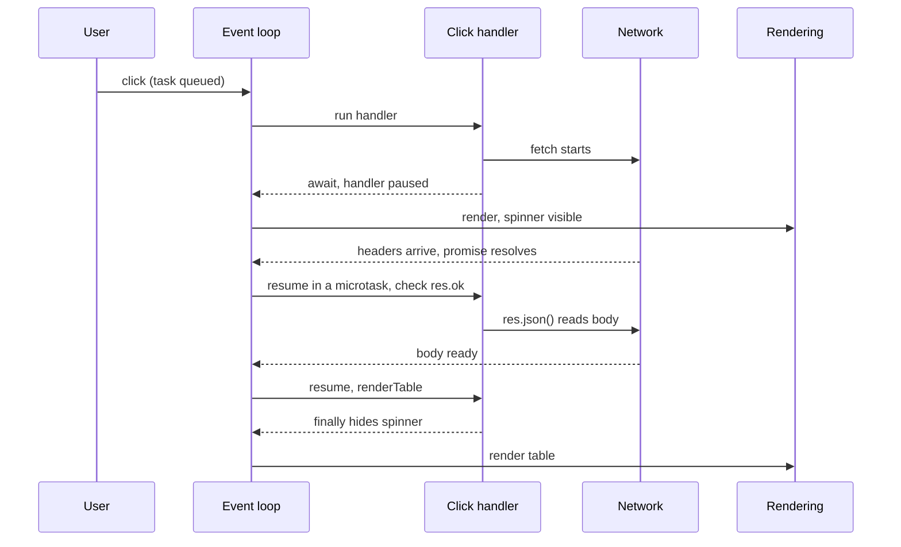

# JavaScript — Mixed Interview Questions

> This file is mixed and cross-topic practice for the whole JavaScript subject. Each topic document already has its own interview questions; use this file after you have studied the topics, and again in the days before an interview.

## Table of contents

1. [All topic questions at a glance](#all-topic-questions-at-a-glance)
2. [Mixed and cross-topic questions](#mixed-and-cross-topic-questions)
3. [Rapid revision round](#rapid-revision-round)
4. [Summary](#summary)

## All topic questions at a glance

Every interview question from the topic documents, in order. Click a question to jump to its full answer.

### [JavaScript Basics: Variables, Types and Operators](01-basics-variables-types-operators.md)

- [Q1. What is the difference between var, let and const?](01-basics-variables-types-operators.md#q1-what-is-the-difference-between-var-let-and-const)
- [Q2. Can you change an object declared with const?](01-basics-variables-types-operators.md#q2-can-you-change-an-object-declared-with-const)
- [Q3. What are the data types in JavaScript?](01-basics-variables-types-operators.md#q3-what-are-the-data-types-in-javascript)
- [Q4. Why does typeof null return "object"?](01-basics-variables-types-operators.md#q4-why-does-typeof-null-return-object)
- [Q5. Output: typeof puzzles](01-basics-variables-types-operators.md#q5-output-typeof-puzzles)
- [Q6. What is the difference between null and undefined?](01-basics-variables-types-operators.md#q6-what-is-the-difference-between-null-and-undefined)
- [Q7. Is JavaScript pass by value or pass by reference?](01-basics-variables-types-operators.md#q7-is-javascript-pass-by-value-or-pass-by-reference)
- [Q8. Output: reference copying](01-basics-variables-types-operators.md#q8-output-reference-copying)
- [Q9. What do && and || return?](01-basics-variables-types-operators.md#q9-what-do--and--return)
- [Q10. What is the difference between ?? and ||? Fix the bug.](01-basics-variables-types-operators.md#q10-what-is-the-difference-between--and--fix-the-bug)
- [Q11. Output: increment puzzles](01-basics-variables-types-operators.md#q11-output-increment-puzzles)
- [Q12. Which values are falsy?](01-basics-variables-types-operators.md#q12-which-values-are-falsy)
- [Q13. Output: var vs let in blocks](01-basics-variables-types-operators.md#q13-output-var-vs-let-in-blocks)
- [Q14. Output: switch fall-through and strict comparison](01-basics-variables-types-operators.md#q14-output-switch-fall-through-and-strict-comparison)
- [Q15. What is the difference between for...in and for...of?](01-basics-variables-types-operators.md#q15-what-is-the-difference-between-forin-and-forof)
- [Q16. Output: precedence](01-basics-variables-types-operators.md#q16-output-precedence)
- [Q17. What is optional chaining and when should you not use it?](01-basics-variables-types-operators.md#q17-what-is-optional-chaining-and-when-should-you-not-use-it)
- [Q18. Find the bug: implicit global](01-basics-variables-types-operators.md#q18-find-the-bug-implicit-global)
- [Q19. What is strict mode and what does it change?](01-basics-variables-types-operators.md#q19-what-is-strict-mode-and-what-does-it-change)
- [Q20. Output: delete and arrays](01-basics-variables-types-operators.md#q20-output-delete-and-arrays)
- [Q21. Primitives are immutable. So how does "hello".toUpperCase() work, and what does this print?](01-basics-variables-types-operators.md#q21-primitives-are-immutable-so-how-does-hellotouppercase-work-and-what-does-this-print)
- [Q22. How would you store multiple boolean permissions in one number?](01-basics-variables-types-operators.md#q22-how-would-you-store-multiple-boolean-permissions-in-one-number)
- [Q23. Output: comma operator and labels](01-basics-variables-types-operators.md#q23-output-comma-operator-and-labels)
- [Q24. Code review: what would you change?](01-basics-variables-types-operators.md#q24-code-review-what-would-you-change)

### [Type Coercion and Equality](02-type-coercion-and-equality.md)

- [Q1. What is type coercion? What is the difference between explicit and implicit conversion?](02-type-coercion-and-equality.md#q1-what-is-type-coercion-what-is-the-difference-between-explicit-and-implicit-conversion)
- [Q2. What is the difference between == and ===?](02-type-coercion-and-equality.md#q2-what-is-the-difference-between--and-)
- [Q3. Explain step by step how == compares values of different types.](02-type-coercion-and-equality.md#q3-explain-step-by-step-how--compares-values-of-different-types)
- [Q4. Output: + with arrays and objects](02-type-coercion-and-equality.md#q4-output--with-arrays-and-objects)
- [Q5. Why does {} + [] give 0 in some places and "[object Object]" in others?](02-type-coercion-and-equality.md#q5-why-does----give-0-in-some-places-and-object-object-in-others)
- [Q6. Output: [] == ![]](02-type-coercion-and-equality.md#q6-output---)
- [Q7. Output: null and undefined comparisons](02-type-coercion-and-equality.md#q7-output-null-and-undefined-comparisons)
- [Q8. Output: NaN](02-type-coercion-and-equality.md#q8-output-nan)
- [Q9. What is Object.is and how is it different from ===? What is SameValueZero?](02-type-coercion-and-equality.md#q9-what-is-objectis-and-how-is-it-different-from--what-is-samevaluezero)
- [Q10. Output: the + operator chain](02-type-coercion-and-equality.md#q10-output-the--operator-chain)
- [Q11. Why does ["1", "2", "3"].map(parseInt) return [1, NaN, NaN]?](02-type-coercion-and-equality.md#q11-why-does-1-2-3mapparseint-return-1-nan-nan)
- [Q12. What is the difference between parseInt, parseFloat, Number() and unary +?](02-type-coercion-and-equality.md#q12-what-is-the-difference-between-parseint-parsefloat-number-and-unary-)
- [Q13. Output: parseInt surprises](02-type-coercion-and-equality.md#q13-output-parseint-surprises)
- [Q14. How does JavaScript convert an object to a primitive?](02-type-coercion-and-equality.md#q14-how-does-javascript-convert-an-object-to-a-primitive)
- [Q15. Make this print true: `a == 1 && a == 2 && a == 3`](02-type-coercion-and-equality.md#q15-make-this-print-true-a--1--a--2--a--3)
- [Q16. Output: string comparisons](02-type-coercion-and-equality.md#q16-output-string-comparisons)
- [Q17. When is it acceptable to use ==?](02-type-coercion-and-equality.md#q17-when-is-it-acceptable-to-use-)
- [Q18. Scenario: a user details page shows "User not found" for every user](02-type-coercion-and-equality.md#q18-scenario-a-user-details-page-shows-user-not-found-for-every-user)
- [Q19. Find the bug: feature flag from environment variables](02-type-coercion-and-equality.md#q19-find-the-bug-feature-flag-from-environment-variables)
- [Q20. Output: truthiness vs loose equality](02-type-coercion-and-equality.md#q20-output-truthiness-vs-loose-equality)
- [Q21. Output: BigInt coercion](02-type-coercion-and-equality.md#q21-output-bigint-coercion)
- [Q22. Why does a template literal with a symbol throw?](02-type-coercion-and-equality.md#q22-why-does-a-template-literal-with-a-symbol-throw)
- [Q23. Does TypeScript solve coercion problems?](02-type-coercion-and-equality.md#q23-does-typescript-solve-coercion-problems)
- [Q24. Output: dates and coercion](02-type-coercion-and-equality.md#q24-output-dates-and-coercion)

### [Scope, Hoisting and the Temporal Dead Zone](03-scope-hoisting-and-tdz.md)

- [Q1. What is scope? What kinds of scope does JavaScript have?](03-scope-hoisting-and-tdz.md#q1-what-is-scope-what-kinds-of-scope-does-javascript-have)
- [Q2. What is lexical scope?](03-scope-hoisting-and-tdz.md#q2-what-is-lexical-scope)
- [Q3. What is the scope chain?](03-scope-hoisting-and-tdz.md#q3-what-is-the-scope-chain)
- [Q4. What is hoisting?](03-scope-hoisting-and-tdz.md#q4-what-is-hoisting)
- [Q5. Output: var hoisting inside a function](03-scope-hoisting-and-tdz.md#q5-output-var-hoisting-inside-a-function)
- [Q6. Output: hoisting in an if (false) block](03-scope-hoisting-and-tdz.md#q6-output-hoisting-in-an-if-false-block)
- [Q7. Are let and const hoisted? What is the temporal dead zone?](03-scope-hoisting-and-tdz.md#q7-are-let-and-const-hoisted-what-is-the-temporal-dead-zone)
- [Q8. Output: typeof and the TDZ](03-scope-hoisting-and-tdz.md#q8-output-typeof-and-the-tdz)
- [Q9. Output: let and var in the same function](03-scope-hoisting-and-tdz.md#q9-output-let-and-var-in-the-same-function)
- [Q10. Output: default parameters](03-scope-hoisting-and-tdz.md#q10-output-default-parameters)
- [Q11. Output: function declaration vs function expression](03-scope-hoisting-and-tdz.md#q11-output-function-declaration-vs-function-expression)
- [Q12. Output: function and var with the same name](03-scope-hoisting-and-tdz.md#q12-output-function-and-var-with-the-same-name)
- [Q13. What is an execution context?](03-scope-hoisting-and-tdz.md#q13-what-is-an-execution-context)
- [Q14. What is the call stack, and what causes a stack overflow?](03-scope-hoisting-and-tdz.md#q14-what-is-the-call-stack-and-what-causes-a-stack-overflow)
- [Q15. What is shadowing? What is illegal shadowing?](03-scope-hoisting-and-tdz.md#q15-what-is-shadowing-what-is-illegal-shadowing)
- [Q16. What is the difference between a top-level var and a top-level let in a browser script? What is globalThis?](03-scope-hoisting-and-tdz.md#q16-what-is-the-difference-between-a-top-level-var-and-a-top-level-let-in-a-browser-script-what-is-globalthis)
- [Q17. What happens when you assign to a variable that was never declared?](03-scope-hoisting-and-tdz.md#q17-what-happens-when-you-assign-to-a-variable-that-was-never-declared)
- [Q18. Output: var and let in a loop with setTimeout](03-scope-hoisting-and-tdz.md#q18-output-var-and-let-in-a-loop-with-settimeout)
- [Q19. What happens when a function is declared inside a block?](03-scope-hoisting-and-tdz.md#q19-what-happens-when-a-function-is-declared-inside-a-block)
- [Q20. Output: lexical scope with a returned function](03-scope-hoisting-and-tdz.md#q20-output-lexical-scope-with-a-returned-function)
- [Q21. How is scope different in a classic script, an ES module and a CommonJS file?](03-scope-hoisting-and-tdz.md#q21-how-is-scope-different-in-a-classic-script-an-es-module-and-a-commonjs-file)
- [Q22. Scenario: two scripts on a legacy page break each other](03-scope-hoisting-and-tdz.md#q22-scenario-two-scripts-on-a-legacy-page-break-each-other)
- [Q23. Code review: what would you change?](03-scope-hoisting-and-tdz.md#q23-code-review-what-would-you-change)

### [Functions and Functional Programming](04-functions-and-functional-programming.md)

- [Q1. What is the difference between a function declaration and a function expression?](04-functions-and-functional-programming.md#q1-what-is-the-difference-between-a-function-declaration-and-a-function-expression)
- [Q2. What are the differences between arrow functions and regular functions?](04-functions-and-functional-programming.md#q2-what-are-the-differences-between-arrow-functions-and-regular-functions)
- [Q3. Output: arrow functions and this](04-functions-and-functional-programming.md#q3-output-arrow-functions-and-this)
- [Q4. What is a higher-order function? Give examples.](04-functions-and-functional-programming.md#q4-what-is-a-higher-order-function-give-examples)
- [Q5. What is a pure function? Is this function pure?](04-functions-and-functional-programming.md#q5-what-is-a-pure-function-is-this-function-pure)
- [Q6. Implement a curry function.](04-functions-and-functional-programming.md#q6-implement-a-curry-function)
- [Q7. Implement compose and pipe.](04-functions-and-functional-programming.md#q7-implement-compose-and-pipe)
- [Q8. What is memoization? Implement a simple memoize.](04-functions-and-functional-programming.md#q8-what-is-memoization-implement-a-simple-memoize)
- [Q9. Output: default parameters](04-functions-and-functional-programming.md#q9-output-default-parameters)
- [Q10. Output: function length and name](04-functions-and-functional-programming.md#q10-output-function-length-and-name)
- [Q11. Output: return and automatic semicolon insertion](04-functions-and-functional-programming.md#q11-output-return-and-automatic-semicolon-insertion)
- [Q12. What is an IIFE and why was it used?](04-functions-and-functional-programming.md#q12-what-is-an-iife-and-why-was-it-used)
- [Q13. Explain recursion. How do you avoid stack overflow?](04-functions-and-functional-programming.md#q13-explain-recursion-how-do-you-avoid-stack-overflow)
- [Q14. Output: closures in a function factory](04-functions-and-functional-programming.md#q14-output-closures-in-a-function-factory)
- [Q15. What is the difference between currying and partial application?](04-functions-and-functional-programming.md#q15-what-is-the-difference-between-currying-and-partial-application)
- [Q16. What are side effects, and how do you handle them in a functional style?](04-functions-and-functional-programming.md#q16-what-are-side-effects-and-how-do-you-handle-them-in-a-functional-style)
- [Q17. Why does immutability matter in Angular and React?](04-functions-and-functional-programming.md#q17-why-does-immutability-matter-in-angular-and-react)
- [Q18. Find the bug: callbacks and lost context](04-functions-and-functional-programming.md#q18-find-the-bug-callbacks-and-lost-context)
- [Q19. Output: arguments vs rest parameters](04-functions-and-functional-programming.md#q19-output-arguments-vs-rest-parameters)
- [Q20. Code review: improve this function](04-functions-and-functional-programming.md#q20-code-review-improve-this-function)
- [Q21. What is "first-class functions" and what does it enable?](04-functions-and-functional-programming.md#q21-what-is-first-class-functions-and-what-does-it-enable)
- [Q22. Scenario: an Angular pure pipe does not update](04-functions-and-functional-programming.md#q22-scenario-an-angular-pure-pipe-does-not-update)

### [Closures](05-closures.md)

- [Q1. What is a closure?](05-closures.md#q1-what-is-a-closure)
- [Q2. How do closures work internally? Where are the captured variables stored?](05-closures.md#q2-how-do-closures-work-internally-where-are-the-captured-variables-stored)
- [Q3. What does this print?](05-closures.md#q3-what-does-this-print)
- [Q4. How do you fix the previous loop? Why does `let` fix it?](05-closures.md#q4-how-do-you-fix-the-previous-loop-why-does-let-fix-it)
- [Q5. What does this print?](05-closures.md#q5-what-does-this-print)
- [Q6. What does this print?](05-closures.md#q6-what-does-this-print)
- [Q7. What does this print?](05-closures.md#q7-what-does-this-print)
- [Q8. What does this print?](05-closures.md#q8-what-does-this-print)
- [Q9. What does this print?](05-closures.md#q9-what-does-this-print)
- [Q10. What does this print?](05-closures.md#q10-what-does-this-print)
- [Q11. Implement `once(fn)`.](05-closures.md#q11-implement-oncefn)
- [Q12. Implement a counter with `increment`, `decrement`, `reset` and `getValue`, where the count cannot be changed from outside.](05-closures.md#q12-implement-a-counter-with-increment-decrement-reset-and-getvalue-where-the-count-cannot-be-changed-from-outside)
- [Q13. Implement `memoize(fn)`.](05-closures.md#q13-implement-memoizefn)
- [Q14. Implement a private bank account using closures.](05-closures.md#q14-implement-a-private-bank-account-using-closures)
- [Q15. What is a stale closure? How do you fix it?](05-closures.md#q15-what-is-a-stale-closure-how-do-you-fix-it)
- [Q16. Can closures cause memory leaks? How do you find and fix them?](05-closures.md#q16-can-closures-cause-memory-leaks-how-do-you-find-and-fix-them)
- [Q17. Find the bug: the scroll listener is never removed.](05-closures.md#q17-find-the-bug-the-scroll-listener-is-never-removed)
- [Q18. Scenario: a rate limiter blocks searches after a few failed logins. Why?](05-closures.md#q18-scenario-a-rate-limiter-blocks-searches-after-a-few-failed-logins-why)
- [Q19. Closures or classes with `#private` fields for private state — which do you choose?](05-closures.md#q19-closures-or-classes-with-private-fields-for-private-state--which-do-you-choose)
- [Q20. What is the module pattern? Is it still relevant?](05-closures.md#q20-what-is-the-module-pattern-is-it-still-relevant)
- [Q21. Implement `sum` so that `sum(1)(2)(3)()` returns `6`.](05-closures.md#q21-implement-sum-so-that-sum123-returns-6)
- [Q22. Is every function a closure? Do arrow functions create closures?](05-closures.md#q22-is-every-function-a-closure-do-arrow-functions-create-closures)
- [Q23. What does this print?](05-closures.md#q23-what-does-this-print)
- [Q24. Do closures have a performance cost? When would you avoid creating them?](05-closures.md#q24-do-closures-have-a-performance-cost-when-would-you-avoid-creating-them)
- [Q25. How does `debounce` use a closure?](05-closures.md#q25-how-does-debounce-use-a-closure)

### [this, call, apply and bind](06-this-call-apply-bind.md)

- [Q1. What is `this` in JavaScript?](06-this-call-apply-bind.md#q1-what-is-this-in-javascript)
- [Q2. Explain the rules that decide `this`, and their precedence.](06-this-call-apply-bind.md#q2-explain-the-rules-that-decide-this-and-their-precedence)
- [Q3. What does this print?](06-this-call-apply-bind.md#q3-what-does-this-print)
- [Q4. What does this print when run as an ES module?](06-this-call-apply-bind.md#q4-what-does-this-print-when-run-as-an-es-module)
- [Q5. What does this print?](06-this-call-apply-bind.md#q5-what-does-this-print)
- [Q6. What does this print in a browser, and what changes in Node.js?](06-this-call-apply-bind.md#q6-what-does-this-print-in-a-browser-and-what-changes-in-nodejs)
- [Q7. What does this print?](06-this-call-apply-bind.md#q7-what-does-this-print)
- [Q8. What does this print?](06-this-call-apply-bind.md#q8-what-does-this-print)
- [Q9. What does this print in a classic (non-module) browser script?](06-this-call-apply-bind.md#q9-what-does-this-print-in-a-classic-non-module-browser-script)
- [Q10. What does this print?](06-this-call-apply-bind.md#q10-what-does-this-print)
- [Q11. What does this print?](06-this-call-apply-bind.md#q11-what-does-this-print)
- [Q12. What is the difference between `call`, `apply` and `bind`?](06-this-call-apply-bind.md#q12-what-is-the-difference-between-call-apply-and-bind)
- [Q13. Implement `Function.prototype.bind` (and the core of `call`).](06-this-call-apply-bind.md#q13-implement-functionprototypebind-and-the-core-of-call)
- [Q14. Why do methods lose `this` when passed as callbacks, and how do you fix it?](06-this-call-apply-bind.md#q14-why-do-methods-lose-this-when-passed-as-callbacks-and-how-do-you-fix-it)
- [Q15. Arrow functions vs normal functions regarding `this`. When should you not use an arrow function?](06-this-call-apply-bind.md#q15-arrow-functions-vs-normal-functions-regarding-this-when-should-you-not-use-an-arrow-function)
- [Q16. Arrow class fields vs prototype methods — what are the trade-offs?](06-this-call-apply-bind.md#q16-arrow-class-fields-vs-prototype-methods--what-are-the-trade-offs)
- [Q17. What is `this` inside a DOM event listener?](06-this-call-apply-bind.md#q17-what-is-this-inside-a-dom-event-listener)
- [Q18. What is top-level `this` in a browser script, an ES module and a CommonJS file?](06-this-call-apply-bind.md#q18-what-is-top-level-this-in-a-browser-script-an-es-module-and-a-commonjs-file)
- [Q19. Debugging: the Express route crashes with "Cannot read properties of undefined (reading 'findAll')". Why?](06-this-call-apply-bind.md#q19-debugging-the-express-route-crashes-with-cannot-read-properties-of-undefined-reading-findall-why)
- [Q20. Debugging: an Angular child component formats prices with the wrong currency. Why?](06-this-call-apply-bind.md#q20-debugging-an-angular-child-component-formats-prices-with-the-wrong-currency-why)
- [Q21. What does this print?](06-this-call-apply-bind.md#q21-what-does-this-print)
- [Q22. Can you call a class method or an object shorthand method with `new`?](06-this-call-apply-bind.md#q22-can-you-call-a-class-method-or-an-object-shorthand-method-with-new)
- [Q23. Why does this code work in a component's template but break in `setTimeout`?](06-this-call-apply-bind.md#q23-why-does-this-code-work-in-a-components-template-but-break-in-settimeout)

### [Objects and copying](07-objects-and-copying.md)

- [Q1. What is the difference between a shallow copy and a deep copy?](07-objects-and-copying.md#q1-what-is-the-difference-between-a-shallow-copy-and-a-deep-copy)
- [Q2. How do you deep clone an object? Compare `structuredClone`, JSON and a custom function.](07-objects-and-copying.md#q2-how-do-you-deep-clone-an-object-compare-structuredclone-json-and-a-custom-function)
- [Q3. What does this print?](07-objects-and-copying.md#q3-what-does-this-print)
- [Q4. What does this print?](07-objects-and-copying.md#q4-what-does-this-print)
- [Q5. What does this print?](07-objects-and-copying.md#q5-what-does-this-print)
- [Q6. What does this print?](07-objects-and-copying.md#q6-what-does-this-print)
- [Q7. What is the difference between `in`, `hasOwnProperty` and `Object.hasOwn`?](07-objects-and-copying.md#q7-what-is-the-difference-between-in-hasownproperty-and-objecthasown)
- [Q8. Why is `for...in` risky? What should you use instead?](07-objects-and-copying.md#q8-why-is-forin-risky-what-should-you-use-instead)
- [Q9. Compare `Object.freeze`, `Object.seal` and `Object.preventExtensions`. Is `freeze` deep?](07-objects-and-copying.md#q9-compare-objectfreeze-objectseal-and-objectpreventextensions-is-freeze-deep)
- [Q10. What does this print (in strict mode)?](07-objects-and-copying.md#q10-what-does-this-print-in-strict-mode)
- [Q11. What are property descriptors? What does this print?](07-objects-and-copying.md#q11-what-are-property-descriptors-what-does-this-print)
- [Q12. What does this print?](07-objects-and-copying.md#q12-what-does-this-print)
- [Q13. What does this print?](07-objects-and-copying.md#q13-what-does-this-print)
- [Q14. What does this print?](07-objects-and-copying.md#q14-what-does-this-print)
- [Q15. Implement a deep clone function.](07-objects-and-copying.md#q15-implement-a-deep-clone-function)
- [Q16. Implement a function that checks deep equality of two objects.](07-objects-and-copying.md#q16-implement-a-function-that-checks-deep-equality-of-two-objects)
- [Q17. How do you update a nested property immutably? Why does it matter in Angular and React?](07-objects-and-copying.md#q17-how-do-you-update-a-nested-property-immutably-why-does-it-matter-in-angular-and-react)
- [Q18. Scenario: an Angular `OnPush` child component does not show a newly added item. Why?](07-objects-and-copying.md#q18-scenario-an-angular-onpush-child-component-does-not-show-a-newly-added-item-why)
- [Q19. Transform an API response: group orders by status and compute the total per status.](07-objects-and-copying.md#q19-transform-an-api-response-group-orders-by-status-and-compute-the-total-per-status)
- [Q20. Why can using plain objects as dictionaries be dangerous? What are the alternatives?](07-objects-and-copying.md#q20-why-can-using-plain-objects-as-dictionaries-be-dangerous-what-are-the-alternatives)
- [Q21. What is the difference between spread and `Object.assign`?](07-objects-and-copying.md#q21-what-is-the-difference-between-spread-and-objectassign)
- [Q22. What does this print?](07-objects-and-copying.md#q22-what-does-this-print)

### [Prototypes and inheritance](08-prototypes-and-inheritance.md)

- [Q1. What is a prototype? Explain the prototype chain.](08-prototypes-and-inheritance.md#q1-what-is-a-prototype-explain-the-prototype-chain)
- [Q2. What is the difference between `__proto__` and `prototype`?](08-prototypes-and-inheritance.md#q2-what-is-the-difference-between-__proto__-and-prototype)
- [Q3. What does `new` do? Implement it.](08-prototypes-and-inheritance.md#q3-what-does-new-do-implement-it)
- [Q4. Implement inheritance without `class`.](08-prototypes-and-inheritance.md#q4-implement-inheritance-without-class)
- [Q5. How does `instanceof` work? Implement it.](08-prototypes-and-inheritance.md#q5-how-does-instanceof-work-implement-it)
- [Q6. Are JavaScript classes just syntactic sugar over prototypes?](08-prototypes-and-inheritance.md#q6-are-javascript-classes-just-syntactic-sugar-over-prototypes)
- [Q7. What is `Object.create(null)` and when do you use it?](08-prototypes-and-inheritance.md#q7-what-is-objectcreatenull-and-when-do-you-use-it)
- [Q8. What does this print?](08-prototypes-and-inheritance.md#q8-what-does-this-print)
- [Q9. What does this print?](08-prototypes-and-inheritance.md#q9-what-does-this-print)
- [Q10. What does this print?](08-prototypes-and-inheritance.md#q10-what-does-this-print)
- [Q11. What does this print?](08-prototypes-and-inheritance.md#q11-what-does-this-print)
- [Q12. What does this print?](08-prototypes-and-inheritance.md#q12-what-does-this-print)
- [Q13. Why should you not extend built-in prototypes? What about polyfills?](08-prototypes-and-inheritance.md#q13-why-should-you-not-extend-built-in-prototypes-what-about-polyfills)
- [Q14. What does this print?](08-prototypes-and-inheritance.md#q14-what-does-this-print)
- [Q15. Implement a helper `inherit(Child, Parent)` that sets up both instance and static inheritance.](08-prototypes-and-inheritance.md#q15-implement-a-helper-inheritchild-parent-that-sets-up-both-instance-and-static-inheritance)
- [Q16. Debugging: after adding a method to Circle, every Shape also has it. Why?](08-prototypes-and-inheritance.md#q16-debugging-after-adding-a-method-to-circle-every-shape-also-has-it-why)
- [Q17. What is prototype pollution?](08-prototypes-and-inheritance.md#q17-what-is-prototype-pollution)
- [Q18. Why is `Object.setPrototypeOf` discouraged?](08-prototypes-and-inheritance.md#q18-why-is-objectsetprototypeof-discouraged)
- [Q19. Prototypal inheritance vs classical inheritance — what is the difference?](08-prototypes-and-inheritance.md#q19-prototypal-inheritance-vs-classical-inheritance--what-is-the-difference)
- [Q20. When would you use `Object.create`, `new` with a constructor function, or `class`?](08-prototypes-and-inheritance.md#q20-when-would-you-use-objectcreate-new-with-a-constructor-function-or-class)

### [Classes](09-classes.md)

- [Q1. What is a class in JavaScript, and how is it related to prototypes?](09-classes.md#q1-what-is-a-class-in-javascript-and-how-is-it-related-to-prototypes)
- [Q2. What are the rules for `super()` in a constructor, and why do they exist?](09-classes.md#q2-what-are-the-rules-for-super-in-a-constructor-and-why-do-they-exist)
- [Q3. What does this print?](09-classes.md#q3-what-does-this-print)
- [Q4. What are private class fields? How are they different from TypeScript `private`?](09-classes.md#q4-what-are-private-class-fields-how-are-they-different-from-typescript-private)
- [Q5. What does this print?](09-classes.md#q5-what-does-this-print)
- [Q6. How do you create a custom error class correctly?](09-classes.md#q6-how-do-you-create-a-custom-error-class-correctly)
- [Q7. What is the difference between a class and a constructor function?](09-classes.md#q7-what-is-the-difference-between-a-class-and-a-constructor-function)
- [Q8. What does this print?](09-classes.md#q8-what-does-this-print)
- [Q9. When would you use static methods? Give examples.](09-classes.md#q9-when-would-you-use-static-methods-give-examples)
- [Q10. How do you emulate an abstract class in JavaScript?](09-classes.md#q10-how-do-you-emulate-an-abstract-class-in-javascript)
- [Q11. What does this print?](09-classes.md#q11-what-does-this-print)
- [Q12. Can a constructor be async? How do you initialize a class that needs async work?](09-classes.md#q12-can-a-constructor-be-async-how-do-you-initialize-a-class-that-needs-async-work)
- [Q13. Implement a `Stack` class with `push`, `pop`, `peek`, `size` and no way to corrupt its data from outside.](09-classes.md#q13-implement-a-stack-class-with-push-pop-peek-size-and-no-way-to-corrupt-its-data-from-outside)
- [Q14. Should you extend `Array`? What happens with `map` on a subclass?](09-classes.md#q14-should-you-extend-array-what-happens-with-map-on-a-subclass)
- [Q15. What does this print?](09-classes.md#q15-what-does-this-print)
- [Q16. Scenario: a junior developer built a 5-level class hierarchy (`BaseComponent` → `TableComponent` → `EditableTable` → `ProductTable` → `AdminProductTable`). Every change breaks something. What do you suggest?](09-classes.md#q16-scenario-a-junior-developer-built-a-5-level-class-hierarchy-basecomponent--tablecomponent--editabletable--producttable--adminproducttable-every-change-breaks-something-what-do-you-suggest)
- [Q17. What does this print?](09-classes.md#q17-what-does-this-print)
- [Q18. Why do Angular class methods sometimes lose `this`, while template calls never do?](09-classes.md#q18-why-do-angular-class-methods-sometimes-lose-this-while-template-calls-never-do)

### [Arrays and Array Methods](10-arrays-and-array-methods.md)

- [Q1. What is the difference between `map` and `forEach`?](10-arrays-and-array-methods.md#q1-what-is-the-difference-between-map-and-foreach)
- [Q2. What is the difference between `slice` and `splice`?](10-arrays-and-array-methods.md#q2-what-is-the-difference-between-slice-and-splice)
- [Q3. What does this print?](10-arrays-and-array-methods.md#q3-what-does-this-print)
- [Q4. How does the `sort` comparator work, and why is `sort` stability important?](10-arrays-and-array-methods.md#q4-how-does-the-sort-comparator-work-and-why-is-sort-stability-important)
- [Q5. What does this print, and why?](10-arrays-and-array-methods.md#q5-what-does-this-print-and-why)
- [Q6. Why does `[NaN].includes(NaN)` return `true` but `[NaN].indexOf(NaN)` return `-1`?](10-arrays-and-array-methods.md#q6-why-does-nanincludesnan-return-true-but-nanindexofnan-return--1)
- [Q7. What does this print?](10-arrays-and-array-methods.md#q7-what-does-this-print)
- [Q8. What does this print?](10-arrays-and-array-methods.md#q8-what-does-this-print)
- [Q9. How do you remove duplicates from an array? What about an array of objects?](10-arrays-and-array-methods.md#q9-how-do-you-remove-duplicates-from-an-array-what-about-an-array-of-objects)
- [Q10. Implement `groupBy`.](10-arrays-and-array-methods.md#q10-implement-groupby)
- [Q11. Write a function that flattens a nested array without using `flat`.](10-arrays-and-array-methods.md#q11-write-a-function-that-flattens-a-nested-array-without-using-flat)
- [Q12. Implement `chunk(array, size)`.](10-arrays-and-array-methods.md#q12-implement-chunkarray-size)
- [Q13. Find the bug: why does "Done" print before the items are saved?](10-arrays-and-array-methods.md#q13-find-the-bug-why-does-done-print-before-the-items-are-saved)
- [Q14. What is `toSorted`, and why would you use it instead of `sort`?](10-arrays-and-array-methods.md#q14-what-is-tosorted-and-why-would-you-use-it-instead-of-sort)
- [Q15. How do you check if a value is an array? Why not `instanceof Array`?](10-arrays-and-array-methods.md#q15-how-do-you-check-if-a-value-is-an-array-why-not-instanceof-array)
- [Q16. You need to show users who are not blocked. There are 50,000 users and 20,000 blocked ids. The current code is slow. Why, and how do you fix it?](10-arrays-and-array-methods.md#q16-you-need-to-show-users-who-are-not-blocked-there-are-50000-users-and-20000-blocked-ids-the-current-code-is-slow-why-and-how-do-you-fix-it)
- [Q17. Write your own `Array.prototype.map`.](10-arrays-and-array-methods.md#q17-write-your-own-arrayprototypemap)
- [Q18. What does this print?](10-arrays-and-array-methods.md#q18-what-does-this-print)
- [Q19. What does this print?](10-arrays-and-array-methods.md#q19-what-does-this-print)
- [Q20. What is the difference between `find`, `filter` and `some`?](10-arrays-and-array-methods.md#q20-what-is-the-difference-between-find-filter-and-some)
- [Q21. Code review: what would you change?](10-arrays-and-array-methods.md#q21-code-review-what-would-you-change)
- [Q22. What is the time complexity of `push`, `shift`, `includes` and `sort`?](10-arrays-and-array-methods.md#q22-what-is-the-time-complexity-of-push-shift-includes-and-sort)
- [Q23. What does this print?](10-arrays-and-array-methods.md#q23-what-does-this-print)
- [Q24. How would you implement pagination for an array in memory?](10-arrays-and-array-methods.md#q24-how-would-you-implement-pagination-for-an-array-in-memory)

### [Strings, Numbers and Dates](11-strings-numbers-and-dates.md)

- [Q1. What does it mean that strings are immutable?](11-strings-numbers-and-dates.md#q1-what-does-it-mean-that-strings-are-immutable)
- [Q2. Why is `"😀".length` equal to 2? How do you count characters correctly?](11-strings-numbers-and-dates.md#q2-why-is-length-equal-to-2-how-do-you-count-characters-correctly)
- [Q3. What is the difference between `slice`, `substring` and `substr`?](11-strings-numbers-and-dates.md#q3-what-is-the-difference-between-slice-substring-and-substr)
- [Q4. What does this print?](11-strings-numbers-and-dates.md#q4-what-does-this-print)
- [Q5. Write a function to reverse a string. What edge cases do you consider?](11-strings-numbers-and-dates.md#q5-write-a-function-to-reverse-a-string-what-edge-cases-do-you-consider)
- [Q6. Check if a string is a palindrome, ignoring case and punctuation.](11-strings-numbers-and-dates.md#q6-check-if-a-string-is-a-palindrome-ignoring-case-and-punctuation)
- [Q7. Check if two strings are anagrams. Compare two approaches.](11-strings-numbers-and-dates.md#q7-check-if-two-strings-are-anagrams-compare-two-approaches)
- [Q8. What are tagged templates? Give real examples.](11-strings-numbers-and-dates.md#q8-what-are-tagged-templates-give-real-examples)
- [Q9. Find the bug: why does this validation pass and fail every other time?](11-strings-numbers-and-dates.md#q9-find-the-bug-why-does-this-validation-pass-and-fail-every-other-time)
- [Q10. What is the difference between `replace` and `replaceAll`?](11-strings-numbers-and-dates.md#q10-what-is-the-difference-between-replace-and-replaceall)
- [Q11. Why is `0.1 + 0.2 !== 0.3`? How do you compare decimals?](11-strings-numbers-and-dates.md#q11-why-is-01--02--03-how-do-you-compare-decimals)
- [Q12. An order page sometimes opens the wrong order. The order IDs are 64-bit integers from the database. What is wrong?](11-strings-numbers-and-dates.md#q12-an-order-page-sometimes-opens-the-wrong-order-the-order-ids-are-64-bit-integers-from-the-database-what-is-wrong)
- [Q13. What is the difference between `isNaN` and `Number.isNaN`?](11-strings-numbers-and-dates.md#q13-what-is-the-difference-between-isnan-and-numberisnan)
- [Q14. What does this print?](11-strings-numbers-and-dates.md#q14-what-does-this-print)
- [Q15. Why does `(1.005).toFixed(2)` return `"1.00"`? How do you round reliably?](11-strings-numbers-and-dates.md#q15-why-does-1005tofixed2-return-100-how-do-you-round-reliably)
- [Q16. How do you handle money in a JavaScript application?](11-strings-numbers-and-dates.md#q16-how-do-you-handle-money-in-a-javascript-application)
- [Q17. How do you safely convert user input to a number? Compare `Number`, `parseInt` and unary `+`.](11-strings-numbers-and-dates.md#q17-how-do-you-safely-convert-user-input-to-a-number-compare-number-parseint-and-unary-)
- [Q18. Write a function that returns a random integer between `min` and `max`, inclusive. Is `Math.random` safe for tokens?](11-strings-numbers-and-dates.md#q18-write-a-function-that-returns-a-random-integer-between-min-and-max-inclusive-is-mathrandom-safe-for-tokens)
- [Q19. What does this print? (Assume the computer's time zone is New York, UTC−5 in winter.)](11-strings-numbers-and-dates.md#q19-what-does-this-print-assume-the-computers-time-zone-is-new-york-utc5-in-winter)
- [Q20. A user in the USA picks 10 March in a date picker, but your app shows 9 March after saving. What is going on?](11-strings-numbers-and-dates.md#q20-a-user-in-the-usa-picks-10-march-in-a-date-picker-but-your-app-shows-9-march-after-saving-what-is-going-on)
- [Q21. How would you store and display dates for a global application?](11-strings-numbers-and-dates.md#q21-how-would-you-store-and-display-dates-for-a-global-application)
- [Q22. How do you add one day to a date? Why is `date.getTime() + 86400000` not always correct?](11-strings-numbers-and-dates.md#q22-how-do-you-add-one-day-to-a-date-why-is-dategettime--86400000-not-always-correct)
- [Q23. What does this print?](11-strings-numbers-and-dates.md#q23-what-does-this-print)
- [Q24. What is Temporal, and why is it being added?](11-strings-numbers-and-dates.md#q24-what-is-temporal-and-why-is-it-being-added)
- [Q25. How do you format a price for different countries?](11-strings-numbers-and-dates.md#q25-how-do-you-format-a-price-for-different-countries)

### [Map, Set, WeakMap and WeakSet](12-map-set-weakmap-weakset.md)

- [Q1. When would you use a `Map` instead of a plain object?](12-map-set-weakmap-weakset.md#q1-when-would-you-use-a-map-instead-of-a-plain-object)
- [Q2. What does this print?](12-map-set-weakmap-weakset.md#q2-what-does-this-print)
- [Q3. What does this print?](12-map-set-weakmap-weakset.md#q3-what-does-this-print)
- [Q4. How does a `Set` decide whether two values are the same?](12-map-set-weakmap-weakset.md#q4-how-does-a-set-decide-whether-two-values-are-the-same)
- [Q5. What is a `WeakMap`, and how is it different from a `Map`?](12-map-set-weakmap-weakset.md#q5-what-is-a-weakmap-and-how-is-it-different-from-a-map)
- [Q6. Implement an LRU cache.](12-map-set-weakmap-weakset.md#q6-implement-an-lru-cache)
- [Q7. What are the new `Set` methods in ES2025?](12-map-set-weakmap-weakset.md#q7-what-are-the-new-set-methods-in-es2025)
- [Q8. Your single-page app's memory grows every time a user opens and closes a modal. You find a `Map` that stores data per DOM element. What is happening, and how do you fix it?](12-map-set-weakmap-weakset.md#q8-your-single-page-apps-memory-grows-every-time-a-user-opens-and-closes-a-modal-you-find-a-map-that-stores-data-per-dom-element-what-is-happening-and-how-do-you-fix-it)
- [Q9. What are `WeakRef` and `FinalizationRegistry`, and when should you use them?](12-map-set-weakmap-weakset.md#q9-what-are-weakref-and-finalizationregistry-and-when-should-you-use-them)
- [Q10. What does this print?](12-map-set-weakmap-weakset.md#q10-what-does-this-print)
- [Q11. How do you convert a `Map` to JSON and back?](12-map-set-weakmap-weakset.md#q11-how-do-you-convert-a-map-to-json-and-back)
- [Q12. Write a memoize function that works with an object argument without leaking memory.](12-map-set-weakmap-weakset.md#q12-write-a-memoize-function-that-works-with-an-object-argument-without-leaking-memory)
- [Q13. Why is using a plain object as a dictionary for user-provided keys risky?](12-map-set-weakmap-weakset.md#q13-why-is-using-a-plain-object-as-a-dictionary-for-user-provided-keys-risky)
- [Q14. What is the time complexity of `Map` and `Set` operations? Is it guaranteed?](12-map-set-weakmap-weakset.md#q14-what-is-the-time-complexity-of-map-and-set-operations-is-it-guaranteed)
- [Q15. Solve "two sum" with a `Map`: return the indexes of two numbers that add up to a target.](12-map-set-weakmap-weakset.md#q15-solve-two-sum-with-a-map-return-the-indexes-of-two-numbers-that-add-up-to-a-target)
- [Q16. When would you use a `WeakSet`?](12-map-set-weakmap-weakset.md#q16-when-would-you-use-a-weakset)
- [Q17. What does this print?](12-map-set-weakmap-weakset.md#q17-what-does-this-print)
- [Q18. Should you put a `Map` or `Set` in your NgRx or Redux store?](12-map-set-weakmap-weakset.md#q18-should-you-put-a-map-or-set-in-your-ngrx-or-redux-store)

### [Iterators and Generators](13-iterators-and-generators.md)

- [Q1. What is the difference between an iterable and an iterator?](13-iterators-and-generators.md#q1-what-is-the-difference-between-an-iterable-and-an-iterator)
- [Q2. What happens inside `for...of`?](13-iterators-and-generators.md#q2-what-happens-inside-forof)
- [Q3. Make this object iterable so that `[...team]` returns the member names.](13-iterators-and-generators.md#q3-make-this-object-iterable-so-that-team-returns-the-member-names)
- [Q4. What does this print?](13-iterators-and-generators.md#q4-what-does-this-print)
- [Q5. What is a generator, and why would you use one?](13-iterators-and-generators.md#q5-what-is-a-generator-and-why-would-you-use-one)
- [Q6. What does this print?](13-iterators-and-generators.md#q6-what-does-this-print)
- [Q7. How do `next()`, `return()` and `throw()` differ?](13-iterators-and-generators.md#q7-how-do-next-return-and-throw-differ)
- [Q8. What is `yield*`?](13-iterators-and-generators.md#q8-what-is-yield)
- [Q9. Write a lazy `take(iterable, n)` and use it with an infinite generator.](13-iterators-and-generators.md#q9-write-a-lazy-takeiterable-n-and-use-it-with-an-infinite-generator)
- [Q10. What are iterator helpers (ES2025), and how are they different from array methods?](13-iterators-and-generators.md#q10-what-are-iterator-helpers-es2025-and-how-are-they-different-from-array-methods)
- [Q11. What does this print?](13-iterators-and-generators.md#q11-what-does-this-print)
- [Q12. What are async iterators and `for await...of`? Give a real use case.](13-iterators-and-generators.md#q12-what-are-async-iterators-and-for-awaitof-give-a-real-use-case)
- [Q13. Write an async generator that retrieves all items from a cursor-based API.](13-iterators-and-generators.md#q13-write-an-async-generator-that-retrieves-all-items-from-a-cursor-based-api)
- [Q14. Why are plain objects not iterable, and how do you loop over them?](13-iterators-and-generators.md#q14-why-are-plain-objects-not-iterable-and-how-do-you-loop-over-them)
- [Q15. Implement the iterator protocol manually for a linked list.](13-iterators-and-generators.md#q15-implement-the-iterator-protocol-manually-for-a-linked-list)
- [Q16. When would you NOT use generators?](13-iterators-and-generators.md#q16-when-would-you-not-use-generators)
- [Q17. How does redux-saga use generators?](13-iterators-and-generators.md#q17-how-does-redux-saga-use-generators)

### [Modules: ESM and CommonJS](14-modules-esm-and-commonjs.md)

- [Q1. What are the main differences between ES modules and CommonJS?](14-modules-esm-and-commonjs.md#q1-what-are-the-main-differences-between-es-modules-and-commonjs)
- [Q2. What is a live binding? Show an example.](14-modules-esm-and-commonjs.md#q2-what-is-a-live-binding-show-an-example)
- [Q3. What is the difference between `module.exports` and `exports`?](14-modules-esm-and-commonjs.md#q3-what-is-the-difference-between-moduleexports-and-exports)
- [Q4. What does this print? (`a.cjs` is the entry file.)](14-modules-esm-and-commonjs.md#q4-what-does-this-print-acjs-is-the-entry-file)
- [Q5. How do circular dependencies behave in ESM, and how do you fix them?](14-modules-esm-and-commonjs.md#q5-how-do-circular-dependencies-behave-in-esm-and-how-do-you-fix-them)
- [Q6. What is dynamic `import()`, and when would you use it?](14-modules-esm-and-commonjs.md#q6-what-is-dynamic-import-and-when-would-you-use-it)
- [Q7. What is tree shaking, and why does it need ES modules?](14-modules-esm-and-commonjs.md#q7-what-is-tree-shaking-and-why-does-it-need-es-modules)
- [Q8. What does this print?](14-modules-esm-and-commonjs.md#q8-what-does-this-print)
- [Q9. How does Node.js decide whether a `.js` file is ESM or CommonJS?](14-modules-esm-and-commonjs.md#q9-how-does-nodejs-decide-whether-a-js-file-is-esm-or-commonjs)
- [Q10. Can you `require()` an ES module in Node.js?](14-modules-esm-and-commonjs.md#q10-can-you-require-an-es-module-in-nodejs)
- [Q11. Why are `__dirname` and `require` not defined in ES modules? What do you use instead?](14-modules-esm-and-commonjs.md#q11-why-are-__dirname-and-require-not-defined-in-es-modules-what-do-you-use-instead)
- [Q12. What happens when two modules import the same module? Is it executed twice?](14-modules-esm-and-commonjs.md#q12-what-happens-when-two-modules-import-the-same-module-is-it-executed-twice)
- [Q13. What is `type="module"` on a script tag, and how does it change behavior?](14-modules-esm-and-commonjs.md#q13-what-is-typemodule-on-a-script-tag-and-how-does-it-change-behavior)
- [Q14. What is an import map?](14-modules-esm-and-commonjs.md#q14-what-is-an-import-map)
- [Q15. Your Node.js service fails with `ERR_REQUIRE_ESM` (or, in newer versions, `ERR_REQUIRE_ASYNC_MODULE`) after upgrading a dependency. What happened, and how do you fix it?](14-modules-esm-and-commonjs.md#q15-your-nodejs-service-fails-with-err_require_esm-or-in-newer-versions-err_require_async_module-after-upgrading-a-dependency-what-happened-and-how-do-you-fix-it)
- [Q16. Are barrel files good or bad?](14-modules-esm-and-commonjs.md#q16-are-barrel-files-good-or-bad)
- [Q17. What are import attributes and why does JSON need `with { type: "json" }`?](14-modules-esm-and-commonjs.md#q17-what-are-import-attributes-and-why-does-json-need-with--type-json-)
- [Q18. Write the module pattern with an IIFE. Why was it used, and what replaced it?](14-modules-esm-and-commonjs.md#q18-write-the-module-pattern-with-an-iife-why-was-it-used-and-what-replaced-it)

### [Error Handling](15-error-handling.md)

- [Q1. What does this print?](15-error-handling.md#q1-what-does-this-print)
- [Q2. What does this print?](15-error-handling.md#q2-what-does-this-print)
- [Q3. What does this print?](15-error-handling.md#q3-what-does-this-print)
- [Q4. Why can't this `try/catch` catch the error? How do you fix it?](15-error-handling.md#q4-why-cant-this-trycatch-catch-the-error-how-do-you-fix-it)
- [Q5. How do you handle errors with promises and `async/await`?](15-error-handling.md#q5-how-do-you-handle-errors-with-promises-and-asyncawait)
- [Q6. How do you create a custom error class? Why would you?](15-error-handling.md#q6-how-do-you-create-a-custom-error-class-why-would-you)
- [Q7. What is `error.cause`, and why is it useful?](15-error-handling.md#q7-what-is-errorcause-and-why-is-it-useful)
- [Q8. What is the difference between `TypeError` and `ReferenceError`?](15-error-handling.md#q8-what-is-the-difference-between-typeerror-and-referenceerror)
- [Q9. Why should you throw `Error` objects instead of strings?](15-error-handling.md#q9-why-should-you-throw-error-objects-instead-of-strings)
- [Q10. What is the difference between `uncaughtException` and `unhandledRejection` in Node.js? How should you use them?](15-error-handling.md#q10-what-is-the-difference-between-uncaughtexception-and-unhandledrejection-in-nodejs-how-should-you-use-them)
- [Q11. What does this print?](15-error-handling.md#q11-what-does-this-print)
- [Q12. A colleague wrapped an entire 80-line function in one `try/catch` that shows "Something went wrong". What is wrong with this, and what would you suggest?](15-error-handling.md#q12-a-colleague-wrapped-an-entire-80-line-function-in-one-trycatch-that-shows-something-went-wrong-what-is-wrong-with-this-and-what-would-you-suggest)
- [Q13. Implement a `retry` function with exponential backoff. Which errors should not be retried?](15-error-handling.md#q13-implement-a-retry-function-with-exponential-backoff-which-errors-should-not-be-retried)
- [Q14. What is `AggregateError`, and when do you get one?](15-error-handling.md#q14-what-is-aggregateerror-and-when-do-you-get-one)
- [Q15. What does this print?](15-error-handling.md#q15-what-does-this-print)
- [Q16. What should an API return to the client when an error happens?](15-error-handling.md#q16-what-should-an-api-return-to-the-client-when-an-error-happens)
- [Q17. Why does `JSON.stringify(new Error("x"))` return `"{}"`? How do you log errors properly?](15-error-handling.md#q17-why-does-jsonstringifynew-errorx-return--how-do-you-log-errors-properly)
- [Q18. How do you handle errors in an RxJS stream so a search box keeps working after one failed request?](15-error-handling.md#q18-how-do-you-handle-errors-in-an-rxjs-stream-so-a-search-box-keeps-working-after-one-failed-request)

### [The Event Loop](16-event-loop.md)

- [Q1. What is the event loop?](16-event-loop.md#q1-what-is-the-event-loop)
- [Q2. JavaScript is single-threaded. How can it do asynchronous work?](16-event-loop.md#q2-javascript-is-single-threaded-how-can-it-do-asynchronous-work)
- [Q3. What is the difference between a task (macrotask) and a microtask?](16-event-loop.md#q3-what-is-the-difference-between-a-task-macrotask-and-a-microtask)
- [Q4. What does this print?](16-event-loop.md#q4-what-does-this-print)
- [Q5. What does this print?](16-event-loop.md#q5-what-does-this-print)
- [Q6. What does this print? (the classic async/await puzzle)](16-event-loop.md#q6-what-does-this-print-the-classic-asyncawait-puzzle)
- [Q7. What does this print? (nested promise chains)](16-event-loop.md#q7-what-does-this-print-nested-promise-chains)
- [Q8. What does this print? (microtask added by a microtask)](16-event-loop.md#q8-what-does-this-print-microtask-added-by-a-microtask)
- [Q9. What does this print? (timers created inside microtasks)](16-event-loop.md#q9-what-does-this-print-timers-created-inside-microtasks)
- [Q10. Does `setTimeout(fn, 0)` run the callback immediately? Why use it at all?](16-event-loop.md#q10-does-settimeoutfn-0-run-the-callback-immediately-why-use-it-at-all)
- [Q11. What does this print, and roughly when?](16-event-loop.md#q11-what-does-this-print-and-roughly-when)
- [Q12. What is microtask starvation? Show an example and the fix.](16-event-loop.md#q12-what-is-microtask-starvation-show-an-example-and-the-fix)
- [Q13. Browser: what is the order for a real click and for button.click()?](16-event-loop.md#q13-browser-what-is-the-order-for-a-real-click-and-for-buttonclick)
- [Q14. Scenario: when the user clicks "Export", the page freezes for 3 seconds and the loading spinner never appears. What is happening and how do you fix it?](16-event-loop.md#q14-scenario-when-the-user-clicks-export-the-page-freezes-for-3-seconds-and-the-loading-spinner-never-appears-what-is-happening-and-how-do-you-fix-it)
- [Q15. When would you use `requestAnimationFrame` instead of `setTimeout`?](16-event-loop.md#q15-when-would-you-use-requestanimationframe-instead-of-settimeout)
- [Q16. If I put CPU-heavy code inside an `async` function, does it stop blocking the main thread?](16-event-loop.md#q16-if-i-put-cpu-heavy-code-inside-an-async-function-does-it-stop-blocking-the-main-thread)
- [Q17. How do Web Workers relate to the event loop? When do you use them?](16-event-loop.md#q17-how-do-web-workers-relate-to-the-event-loop-when-do-you-use-them)
- [Q18. How is the Node.js event loop different from the browser's?](16-event-loop.md#q18-how-is-the-nodejs-event-loop-different-from-the-browsers)
- [Q19. Node.js: what does this print?](16-event-loop.md#q19-nodejs-what-does-this-print)
- [Q20. Write a function that processes a large array without freezing the page, and reports progress.](16-event-loop.md#q20-write-a-function-that-processes-a-large-array-without-freezing-the-page-and-reports-progress)
- [Q21. Scenario: an Angular 16 page becomes slow when the user moves the mouse over a chart. Why, and how do you fix it?](16-event-loop.md#q21-scenario-an-angular-16-page-becomes-slow-when-the-user-moves-the-mouse-over-a-chart-why-and-how-do-you-fix-it)
- [Q22. Scenario: in a Node.js API, response times go up for all endpoints whenever one specific endpoint is called. How do you investigate?](16-event-loop.md#q22-scenario-in-a-nodejs-api-response-times-go-up-for-all-endpoints-whenever-one-specific-endpoint-is-called-how-do-you-investigate)
- [Q23. How would you build an accurate countdown timer?](16-event-loop.md#q23-how-would-you-build-an-accurate-countdown-timer)
- [Q24. When would you use `queueMicrotask`, `Promise.resolve().then`, `setTimeout(fn, 0)` or `requestAnimationFrame`?](16-event-loop.md#q24-when-would-you-use-queuemicrotask-promiseresolvethen-settimeoutfn-0-or-requestanimationframe)

### [Callbacks and Promises](17-callbacks-and-promises.md)

- [Q1. What is a promise?](17-callbacks-and-promises.md#q1-what-is-a-promise)
- [Q2. Why were promises introduced? What is wrong with callbacks?](17-callbacks-and-promises.md#q2-why-were-promises-introduced-what-is-wrong-with-callbacks)
- [Q3. What are the states of a promise? Can a promise be resolved twice?](17-callbacks-and-promises.md#q3-what-are-the-states-of-a-promise-can-a-promise-be-resolved-twice)
- [Q4. What does this print?](17-callbacks-and-promises.md#q4-what-does-this-print)
- [Q5. What does this print?](17-callbacks-and-promises.md#q5-what-does-this-print)
- [Q6. What does this print? (catch, rethrow and recovery)](17-callbacks-and-promises.md#q6-what-does-this-print-catch-rethrow-and-recovery)
- [Q7. How does `finally` behave? What does this print?](17-callbacks-and-promises.md#q7-how-does-finally-behave-what-does-this-print)
- [Q8. What does this print? (a rejection travels slower than you think)](17-callbacks-and-promises.md#q8-what-does-this-print-a-rejection-travels-slower-than-you-think)
- [Q9. What is the difference between `then(onSuccess, onFailure)` and `then(onSuccess).catch(onFailure)`?](17-callbacks-and-promises.md#q9-what-is-the-difference-between-thenonsuccess-onfailure-and-thenonsuccesscatchonfailure)
- [Q10. Compare `Promise.all`, `Promise.allSettled`, `Promise.race` and `Promise.any`.](17-callbacks-and-promises.md#q10-compare-promiseall-promiseallsettled-promiserace-and-promiseany)
- [Q11. What does this print?](17-callbacks-and-promises.md#q11-what-does-this-print)
- [Q12. What happens when you pass an empty array to each combinator?](17-callbacks-and-promises.md#q12-what-happens-when-you-pass-an-empty-array-to-each-combinator)
- [Q13. Does `Promise.all` cancel the other promises when one rejects? How would you cancel them?](17-callbacks-and-promises.md#q13-does-promiseall-cancel-the-other-promises-when-one-rejects-how-would-you-cancel-them)
- [Q14. Implement `promisify`.](17-callbacks-and-promises.md#q14-implement-promisify)
- [Q15. Implement `Promise.all`.](17-callbacks-and-promises.md#q15-implement-promiseall)
- [Q16. Write a `withTimeout(promise, ms)` helper. What are its limits?](17-callbacks-and-promises.md#q16-write-a-withtimeoutpromise-ms-helper-what-are-its-limits)
- [Q17. Implement retry with exponential backoff.](17-callbacks-and-promises.md#q17-implement-retry-with-exponential-backoff)
- [Q18. Implement a concurrency-limited map (`mapLimit`).](17-callbacks-and-promises.md#q18-implement-a-concurrency-limited-map-maplimit)
- [Q19. How do you run a list of async tasks one after another with promises?](17-callbacks-and-promises.md#q19-how-do-you-run-a-list-of-async-tasks-one-after-another-with-promises)
- [Q20. What is an unhandled rejection? What happens in the browser and in Node.js?](17-callbacks-and-promises.md#q20-what-is-an-unhandled-rejection-what-happens-in-the-browser-and-in-nodejs)
- [Q21. What does this print? (resolving with a promise)](17-callbacks-and-promises.md#q21-what-does-this-print-resolving-with-a-promise)
- [Q22. Code review: what is wrong with this function?](17-callbacks-and-promises.md#q22-code-review-what-is-wrong-with-this-function)
- [Q23. Is an error thrown inside a setTimeout callback in the executor caught by catch?](17-callbacks-and-promises.md#q23-is-an-error-thrown-inside-a-settimeout-callback-in-the-executor-caught-by-catch)
- [Q24. Why should a callback-based API be "always async"? (Zalgo)](17-callbacks-and-promises.md#q24-why-should-a-callback-based-api-be-always-async-zalgo)
- [Q25. Scenario: your `catch` does not run when the API returns 404. Why?](17-callbacks-and-promises.md#q25-scenario-your-catch-does-not-run-when-the-api-returns-404-why)
- [Q26. What problem does `Promise.withResolvers` solve?](17-callbacks-and-promises.md#q26-what-problem-does-promisewithresolvers-solve)

### [Async/await](18-async-await.md)

- [Q1. What do `async` and `await` do?](18-async-await.md#q1-what-do-async-and-await-do)
- [Q2. What does this print?](18-async-await.md#q2-what-does-this-print)
- [Q3. What does `console.log(asyncFn())` print, and why can't `try`/`catch` catch this error?](18-async-await.md#q3-what-does-consolelogasyncfn-print-and-why-cant-trycatch-catch-this-error)
- [Q4. What does this print? (await mixed with timers and promises)](18-async-await.md#q4-what-does-this-print-await-mixed-with-timers-and-promises)
- [Q5. Why does returning a promise from an async function change the order?](18-async-await.md#q5-why-does-returning-a-promise-from-an-async-function-change-the-order)
- [Q6. Is async/await just syntactic sugar? How does it work under the hood?](18-async-await.md#q6-is-asyncawait-just-syntactic-sugar-how-does-it-work-under-the-hood)
- [Q7. How do you handle errors with async/await?](18-async-await.md#q7-how-do-you-handle-errors-with-asyncawait)
- [Q8. What does this print? Explain `return` vs `return await`.](18-async-await.md#q8-what-does-this-print-explain-return-vs-return-await)
- [Q9. Your page makes three API calls and takes 3 seconds. Each call takes about 1 second. What is wrong?](18-async-await.md#q9-your-page-makes-three-api-calls-and-takes-3-seconds-each-call-takes-about-1-second-what-is-wrong)
- [Q10. What does this print? (forEach with async)](18-async-await.md#q10-what-does-this-print-foreach-with-async)
- [Q11. Why does this crash Node.js even though both promises are awaited?](18-async-await.md#q11-why-does-this-crash-nodejs-even-though-both-promises-are-awaited)
- [Q12. How would you process 10,000 items with an async API, but at most 5 requests at a time?](18-async-await.md#q12-how-would-you-process-10000-items-with-an-async-api-but-at-most-5-requests-at-a-time)
- [Q13. How do you cancel an async operation in JavaScript?](18-async-await.md#q13-how-do-you-cancel-an-async-operation-in-javascript)
- [Q14. Scenario: in a search box, results sometimes do not match the typed text. What is happening and how do you fix it?](18-async-await.md#q14-scenario-in-a-search-box-results-sometimes-do-not-match-the-typed-text-what-is-happening-and-how-do-you-fix-it)
- [Q15. Can a constructor be async? How do you create an object that needs async setup?](18-async-await.md#q15-can-a-constructor-be-async-how-do-you-create-an-object-that-needs-async-setup)
- [Q16. What is top-level await? Where can you use it, and what are the risks?](18-async-await.md#q16-what-is-top-level-await-where-can-you-use-it-and-what-are-the-risks)
- [Q17. When would you use async/await and when Observables in Angular?](18-async-await.md#q17-when-would-you-use-asyncawait-and-when-observables-in-angular)
- [Q18. In Express, what happens when an async route handler throws?](18-async-await.md#q18-in-express-what-happens-when-an-async-route-handler-throws)
- [Q19. Does `await` block the main thread?](18-async-await.md#q19-does-await-block-the-main-thread)
- [Q20. Write an async generator that yields all items from a paginated API, and consume it.](18-async-await.md#q20-write-an-async-generator-that-yields-all-items-from-a-paginated-api-and-consume-it)
- [Q21. Electron: how do you call the main process from the renderer with async/await, and how do errors behave?](18-async-await.md#q21-electron-how-do-you-call-the-main-process-from-the-renderer-with-asyncawait-and-how-do-errors-behave)
- [Q22. Code review: find the problems in this function.](18-async-await.md#q22-code-review-find-the-problems-in-this-function)
- [Q23. Implement `withTimeout(asyncFn, ms)` that really cancels the work.](18-async-await.md#q23-implement-withtimeoutasyncfn-ms-that-really-cancels-the-work)
- [Q24. Scenario: a form submit handler uses `await` and `event.preventDefault()`, but the page reloads. Why?](18-async-await.md#q24-scenario-a-form-submit-handler-uses-await-and-eventpreventdefault-but-the-page-reloads-why)

### [Memory Management and Garbage Collection](19-memory-management-and-garbage-collection.md)

- [Q1. How does memory management work in JavaScript?](19-memory-management-and-garbage-collection.md#q1-how-does-memory-management-work-in-javascript)
- [Q2. How does the garbage collector decide what to free?](19-memory-management-and-garbage-collection.md#q2-how-does-the-garbage-collector-decide-what-to-free)
- [Q3. Mark-and-sweep vs reference counting: what is the difference, and why do circular references not leak in modern JavaScript?](19-memory-management-and-garbage-collection.md#q3-mark-and-sweep-vs-reference-counting-what-is-the-difference-and-why-do-circular-references-not-leak-in-modern-javascript)
- [Q4. Explain how V8's garbage collector works.](19-memory-management-and-garbage-collection.md#q4-explain-how-v8s-garbage-collector-works)
- [Q5. What is the difference between the stack and the heap in JavaScript?](19-memory-management-and-garbage-collection.md#q5-what-is-the-difference-between-the-stack-and-the-heap-in-javascript)
- [Q6. What is a memory leak in a garbage-collected language? Give real examples.](19-memory-management-and-garbage-collection.md#q6-what-is-a-memory-leak-in-a-garbage-collected-language-give-real-examples)
- [Q7. Find the bug: this component leaks memory. Why, and how do you fix it?](19-memory-management-and-garbage-collection.md#q7-find-the-bug-this-component-leaks-memory-why-and-how-do-you-fix-it)
- [Q8. After `createSession()` returns, which objects can be garbage collected?](19-memory-management-and-garbage-collection.md#q8-after-createsession-returns-which-objects-can-be-garbage-collected)
- [Q9. What is a detached DOM node, and how do you find one?](19-memory-management-and-garbage-collection.md#q9-what-is-a-detached-dom-node-and-how-do-you-find-one)
- [Q10. Users say your web app gets slow after a few hours. How do you investigate?](19-memory-management-and-garbage-collection.md#q10-users-say-your-web-app-gets-slow-after-a-few-hours-how-do-you-investigate)
- [Q11. A Node.js service's memory grows until it crashes with "JavaScript heap out of memory". What do you do?](19-memory-management-and-garbage-collection.md#q11-a-nodejs-services-memory-grows-until-it-crashes-with-javascript-heap-out-of-memory-what-do-you-do)
- [Q12. When would you use a WeakMap instead of a Map?](19-memory-management-and-garbage-collection.md#q12-when-would-you-use-a-weakmap-instead-of-a-map)
- [Q13. What are WeakRef and FinalizationRegistry, and why should you rarely use them?](19-memory-management-and-garbage-collection.md#q13-what-are-weakref-and-finalizationregistry-and-why-should-you-rarely-use-them)
- [Q14. In Angular, when do you need to unsubscribe, and how?](19-memory-management-and-garbage-collection.md#q14-in-angular-when-do-you-need-to-unsubscribe-and-how)
- [Q15. What does `MaxListenersExceededWarning` mean? Should you just raise the limit?](19-memory-management-and-garbage-collection.md#q15-what-does-maxlistenersexceededwarning-mean-should-you-just-raise-the-limit)
- [Q16. Can closures cause memory leaks?](19-memory-management-and-garbage-collection.md#q16-can-closures-cause-memory-leaks)
- [Q17. Can you force garbage collection in JavaScript?](19-memory-management-and-garbage-collection.md#q17-can-you-force-garbage-collection-in-javascript)
- [Q18. Does setting a variable to `null` free the memory?](19-memory-management-and-garbage-collection.md#q18-does-setting-a-variable-to-null-free-the-memory)
- [Q19. What is the difference between shallow size and retained size in a heap snapshot?](19-memory-management-and-garbage-collection.md#q19-what-is-the-difference-between-shallow-size-and-retained-size-in-a-heap-snapshot)
- [Q20. How do GC pauses affect performance, and how do you reduce GC pressure?](19-memory-management-and-garbage-collection.md#q20-how-do-gc-pauses-affect-performance-and-how-do-you-reduce-gc-pressure)
- [Q21. An Electron app's memory grows every time a user opens and closes a settings window. How do you investigate?](19-memory-management-and-garbage-collection.md#q21-an-electron-apps-memory-grows-every-time-a-user-opens-and-closes-a-settings-window-how-do-you-investigate)
- [Q22. Code review: what is wrong with this Express code?](19-memory-management-and-garbage-collection.md#q22-code-review-what-is-wrong-with-this-express-code)

### [Debounce, Throttle and Performance](20-debounce-throttle-and-performance.md)

- [Q1. What is the difference between debounce and throttle?](20-debounce-throttle-and-performance.md#q1-what-is-the-difference-between-debounce-and-throttle)
- [Q2. Implement debounce.](20-debounce-throttle-and-performance.md#q2-implement-debounce)
- [Q3. Extend your debounce with leading/trailing options and a cancel method.](20-debounce-throttle-and-performance.md#q3-extend-your-debounce-with-leadingtrailing-options-and-a-cancel-method)
- [Q4. Implement throttle.](20-debounce-throttle-and-performance.md#q4-implement-throttle)
- [Q5. Output prediction: a debounced and a throttled search](20-debounce-throttle-and-performance.md#q5-output-prediction-a-debounced-and-a-throttled-search)
- [Q6. Why is `this` undefined inside my debounced method?](20-debounce-throttle-and-performance.md#q6-why-is-this-undefined-inside-my-debounced-method)
- [Q7. Debugging: "My debounce does not work in my component."](20-debounce-throttle-and-performance.md#q7-debugging-my-debounce-does-not-work-in-my-component)
- [Q8. Build a typeahead search. How do you avoid too many requests and wrong results?](20-debounce-throttle-and-performance.md#q8-build-a-typeahead-search-how-do-you-avoid-too-many-requests-and-wrong-results)
- [Q9. A scroll handler makes the page janky. What do you do?](20-debounce-throttle-and-performance.md#q9-a-scroll-handler-makes-the-page-janky-what-do-you-do)
- [Q10. Compare `debounceTime`, `throttleTime`, `auditTime` and `sampleTime` in RxJS.](20-debounce-throttle-and-performance.md#q10-compare-debouncetime-throttletime-audittime-and-sampletime-in-rxjs)
- [Q11. Implement memoize. What are the pitfalls?](20-debounce-throttle-and-performance.md#q11-implement-memoize-what-are-the-pitfalls)
- [Q12. Find the bug in this async memoize.](20-debounce-throttle-and-performance.md#q12-find-the-bug-in-this-async-memoize)
- [Q13. What is lazy evaluation? Give examples in JavaScript.](20-debounce-throttle-and-performance.md#q13-what-is-lazy-evaluation-give-examples-in-javascript)
- [Q14. A heavy calculation freezes the UI for two seconds. What are your options?](20-debounce-throttle-and-performance.md#q14-a-heavy-calculation-freezes-the-ui-for-two-seconds-what-are-your-options)
- [Q15. What is a long task and how do you find one?](20-debounce-throttle-and-performance.md#q15-what-is-a-long-task-and-how-do-you-find-one)
- [Q16. How do you measure the performance of a function correctly?](20-debounce-throttle-and-performance.md#q16-how-do-you-measure-the-performance-of-a-function-correctly)
- [Q17. What are hidden classes and inline caches in V8?](20-debounce-throttle-and-performance.md#q17-what-are-hidden-classes-and-inline-caches-in-v8)
- [Q18. Why avoid `delete` in performance-sensitive code?](20-debounce-throttle-and-performance.md#q18-why-avoid-delete-in-performance-sensitive-code)
- [Q19. A "Submit order" button sometimes creates two orders. Debounce, throttle, or something else?](20-debounce-throttle-and-performance.md#q19-a-submit-order-button-sometimes-creates-two-orders-debounce-throttle-or-something-else)
- [Q20. Should you rate-limit API calls on the client, the server, or both?](20-debounce-throttle-and-performance.md#q20-should-you-rate-limit-api-calls-on-the-client-the-server-or-both)
- [Q21. What is layout thrashing?](20-debounce-throttle-and-performance.md#q21-what-is-layout-thrashing)
- [Q22. Implement a rAF-based throttle. When is it better than a time-based throttle?](20-debounce-throttle-and-performance.md#q22-implement-a-raf-based-throttle-when-is-it-better-than-a-time-based-throttle)

### [Modern JavaScript Features](21-modern-javascript-features.md)

- [Q1. What is the difference between `??` and `||`?](21-modern-javascript-features.md#q1-what-is-the-difference-between--and-)
- [Q2. How does optional chaining work? What exactly does it short-circuit?](21-modern-javascript-features.md#q2-how-does-optional-chaining-work-what-exactly-does-it-short-circuit)
- [Q3. Output prediction: logical assignment](21-modern-javascript-features.md#q3-output-prediction-logical-assignment)
- [Q4. What were the most important changes in ES2015 (ES6)?](21-modern-javascript-features.md#q4-what-were-the-most-important-changes-in-es2015-es6)
- [Q5. What has been added to JavaScript since ES2020? Which features do you use?](21-modern-javascript-features.md#q5-what-has-been-added-to-javascript-since-es2020-which-features-do-you-use)
- [Q6. What is a Proxy, and what would you use it for?](21-modern-javascript-features.md#q6-what-is-a-proxy-and-what-would-you-use-it-for)
- [Q7. Why do people use `Reflect` inside proxy traps?](21-modern-javascript-features.md#q7-why-do-people-use-reflect-inside-proxy-traps)
- [Q8. Implement a Proxy that throws an error when someone reads a property that does not exist.](21-modern-javascript-features.md#q8-implement-a-proxy-that-throws-an-error-when-someone-reads-a-property-that-does-not-exist)
- [Q9. Debugging: why does this code throw?](21-modern-javascript-features.md#q9-debugging-why-does-this-code-throw)
- [Q10. What are Symbols, and what are well-known symbols?](21-modern-javascript-features.md#q10-what-are-symbols-and-what-are-well-known-symbols)
- [Q11. Output prediction: `Symbol.toPrimitive`](21-modern-javascript-features.md#q11-output-prediction-symboltoprimitive)
- [Q12. Why does `toSorted()` matter in Angular and React apps?](21-modern-javascript-features.md#q12-why-does-tosorted-matter-in-angular-and-react-apps)
- [Q13. When would you use `Object.groupBy`? Any gotcha?](21-modern-javascript-features.md#q13-when-would-you-use-objectgroupby-any-gotcha)
- [Q14. What is `Promise.withResolvers`, and when is it useful?](21-modern-javascript-features.md#q14-what-is-promisewithresolvers-and-when-is-it-useful)
- [Q15. Iterator helpers vs array methods: what is the difference?](21-modern-javascript-features.md#q15-iterator-helpers-vs-array-methods-what-is-the-difference)
- [Q16. What are the new Set methods in ES2025?](21-modern-javascript-features.md#q16-what-are-the-new-set-methods-in-es2025)
- [Q17. `#private` fields vs TypeScript `private`: what is the difference?](21-modern-javascript-features.md#q17-private-fields-vs-typescript-private-what-is-the-difference)
- [Q18. How do you safely use new JavaScript features in a production app?](21-modern-javascript-features.md#q18-how-do-you-safely-use-new-javascript-features-in-a-production-app)
- [Q19. What is the TC39 process?](21-modern-javascript-features.md#q19-what-is-the-tc39-process)
- [Q20. Are decorators part of JavaScript? How can Angular use them?](21-modern-javascript-features.md#q20-are-decorators-part-of-javascript-how-can-angular-use-them)
- [Q21. What is top-level await? Any trade-offs?](21-modern-javascript-features.md#q21-what-is-top-level-await-any-trade-offs)
- [Q22. Is `structuredClone` a JavaScript language feature?](21-modern-javascript-features.md#q22-is-structuredclone-a-javascript-language-feature)
- [Q23. What is the difference between `Promise.all`, `allSettled`, `any` and `race`?](21-modern-javascript-features.md#q23-what-is-the-difference-between-promiseall-allsettled-any-and-race)

## Mixed and cross-topic questions

These questions combine two or more topics. Real interviews often work like this: one small snippet tests scope, the event loop and closures at the same time. Every output in this section was checked with Node.js 22.

### Q1. What does this print? (var, closures, microtasks and timers together)

```js
for (var i = 0; i < 3; i++) {
  setTimeout(() => console.log("timeout", i), 0);
  Promise.resolve().then(() => console.log("micro", i));
}
for (let j = 0; j < 2; j++) {
  queueMicrotask(() => console.log("let", j));
}
console.log("sync", i);
```

**What the interviewer is checking:** whether you can combine three ideas at once: `var` has one shared binding, closures capture variables (not values), and microtasks run before timers.

**Short spoken answer (30–60 seconds):**
> The output is `sync 3`, then `micro 3` three times, then `let 0` and `let 1`, then `timeout 3` three times. First, all synchronous code runs, so `sync 3` prints. By then the `var` loop has finished and the single variable `i` is 3. All six callbacks in the first loop close over that same `i`, so every one of them prints 3. After the synchronous code, the engine empties the microtask queue in order: the three `then` callbacks first, then the two `queueMicrotask` callbacks. The `let` loop creates a new `j` for each iteration, so those print 0 and 1. The timers run last, because each timer is a separate task.

**Detailed explanation:**

```text
sync 3
micro 3
micro 3
micro 3
let 0
let 1
timeout 3
timeout 3
timeout 3
```

Step by step:
1. The first loop runs three times. Each time it schedules one timer (a task) and one promise reaction (a microtask). Nothing prints yet.
2. `var i` is function-scoped (here: module or script scoped). There is only one `i`. After the loop, `i` is 3.
3. The second loop uses `let`. Each iteration gets a fresh `j`. Two microtasks are queued after the three promise microtasks.
4. `console.log("sync", i)` prints `sync 3`.
5. The call stack is empty. The event loop drains **all** microtasks in FIFO order: `micro 3` ×3, then `let 0`, `let 1`.
6. Then the timer tasks run one by one: `timeout 3` ×3.

**Follow-up questions:**
- **How do you make the first loop print 0, 1, 2?** — Change `var i` to `let i`. Each iteration then has its own `i`, and each closure captures a different binding.
- **Would the order change in a browser?** — No. Microtasks before timers is the same in browsers and Node.js for this code.
- **Is `queueMicrotask` different from `Promise.resolve().then`?** — Both add a microtask to the same queue. `queueMicrotask` does not create a promise, so it is a little cheaper and errors are reported like normal uncaught errors.

**Common mistakes:** printing `timeout 0, 1, 2` (forgetting that `var` is shared); putting timers before microtasks; thinking `let` changes the *order* (it only changes the *value*).

**Where this is used in real projects:** reading async logs during debugging; understanding why a value "is wrong" in a callback that runs later.

Topics: [Scope and hoisting](03-scope-hoisting-and-tdz.md) · [Closures](05-closures.md) · [Event loop](16-event-loop.md)

---

### Q2. What does this print? (class fields, arrow functions and bind)

```js
class Timer {
  label = "timer";
  arrow = () => this.label;
  regular() { return this?.label; }
}
const t = new Timer();
const { arrow, regular } = t;
console.log(arrow());
console.log(regular());
console.log(regular.call({ label: "other" }));
console.log(arrow.call({ label: "other" }));
console.log(regular.bind({ label: "b1" }).bind({ label: "b2" })());
```

**What the interviewer is checking:** how `this` is decided for arrow class fields vs prototype methods, that class bodies are strict mode, and that `bind` cannot be overridden.

**Short spoken answer (30–60 seconds):**
> It prints `timer`, `undefined`, `other`, `timer`, `b1`. The arrow function is a class field, so it is created inside the constructor and takes `this` from there, the instance. It keeps that `this` forever, even when I pull it out of the object or use `call`. The regular method lives on the prototype and gets `this` from how it is called. Called plainly, `this` is `undefined` because class code is always strict, so `this?.label` is `undefined`. With `call`, `this` is the object I pass. And `bind` returns a function with `this` locked; binding it again does nothing, so it prints `b1`.

**Detailed explanation:**

```text
timer
undefined
other
timer
b1
```

1. `arrow()` — arrow functions have no own `this`. The field initializer runs during construction, where `this` is the new instance. Result: `"timer"`.
2. `regular()` — a plain call. In strict mode (all class code is strict), `this` is `undefined`. Without the `?.`, this line would throw a `TypeError`.
3. `regular.call({ label: "other" })` — explicit binding. Result: `"other"`.
4. `arrow.call(...)` — `call` cannot change an arrow function's `this`. Result: `"timer"`.
5. A bound function ignores later `bind`, `call` and `apply` for `this`. Result: `"b1"`.

**Follow-up questions:**
- **What is the cost of arrow class fields?** — Each instance gets its own function object, so 10,000 instances means 10,000 functions. Prototype methods are shared. Also, arrow fields cannot be called with `super.method()` from a subclass.
- **Is there one case where a bound function's `this` changes?** — Yes, when you call it with `new`. Then `this` is the new object.
- **How does Angular avoid this problem in templates?** — Angular calls template methods on the component instance, so `this` is always correct. The problem appears when you pass `this.method` as a callback to `setTimeout`, `subscribe` or a third-party library.

**Common mistakes:** saying `regular()` returns the global object (only in sloppy-mode plain functions); thinking a second `bind` wins.

**Where this is used in real projects:** event handlers in classes, callbacks passed to libraries, React class components, Angular services passing methods to RxJS operators.

Topics: [this, call, apply and bind](06-this-call-apply-bind.md) · [Classes](09-classes.md) · [Functions](04-functions-and-functional-programming.md)

---

### Q3. What does this print? (async function, try/catch/finally and the event loop)

```js
async function saveOrder() {
  try {
    console.log("A");
    await Promise.reject(new Error("network"));
    console.log("B");
    return "saved";
  } catch (err) {
    console.log("C", err.message);
    return "failed";
  } finally {
    console.log("D");
  }
}
const result = saveOrder();
console.log("E", result instanceof Promise);
result.then((value) => console.log("F", value));
console.log("G");
```

**What the interviewer is checking:** that an async function runs synchronously until its first `await`, that a rejected `await` jumps to `catch`, and that `finally` runs before the returned promise settles.

**Short spoken answer (30–60 seconds):**
> It prints `A`, `E true`, `G`, `C network`, `D`, `F failed`. Calling an async function runs its body right away until the first `await`, so `A` prints first. At the `await`, the function pauses and returns a pending promise, so `E true` and `G` print next. When the call stack is empty, the rejection resumes the function inside the `catch` block, so `C network` prints. `B` never prints. `finally` runs before the function really finishes, so `D` prints, and only then is the promise fulfilled with `"failed"`, so `F failed` is last.

**Detailed explanation:**

```text
A
E true
G
C network
D
F failed
```

- An `await` on a rejected promise throws at that line, as if you wrote `throw err` there. The normal `try/catch` catches it.
- `return "failed"` inside `catch` does not finish the function immediately. `finally` runs first. If `finally` had its own `return`, it would replace `"failed"`.
- The `then` callback runs in a later microtask, after the function has completely finished.

**Follow-up questions:**
- **What does `function load() { try { return "from try"; } finally { return "from finally"; } }` return?** — `"from finally"`. A `return` in `finally` overrides the earlier return and also swallows thrown errors. Linters warn about it (`no-unsafe-finally`).
- **What if there were no `catch` block?** — `finally` still logs `D`, and then the returned promise rejects with the `network` error. You must handle it with `.catch` or `await` in `try/catch`, or you get an unhandled rejection.
- **Is `result` ever a plain string?** — No. An async function always returns a promise.

**Common mistakes:** printing `C` before `E` (forgetting that the function pauses at `await`); thinking `finally` runs after `F`; thinking `B` prints.

**Where this is used in real projects:** loading flags in Angular components (`finally { this.loading = false; }`), closing database connections, releasing locks.

Topics: [Async/await](18-async-await.md) · [Error handling](15-error-handling.md) · [Event loop](16-event-loop.md)

---

### Q4. What does this print? (spread, prototypes, getters and private fields)

```js
class Product {
  #price;
  constructor(name, price) {
    this.name = name;
    this.#price = price;
  }
  get price() { return this.#price; }
  describe() { return `${this.name}: ${this.#price}`; }
}
const p = new Product("Pen", 10);
const copy = { ...p };
console.log(copy);
console.log(copy.price);
console.log(typeof copy.describe);
const clone = Object.assign(Object.create(Product.prototype), p);
console.log(clone.name);
try {
  console.log(clone.price);
} catch (e) {
  console.log(e.constructor.name);
}
console.log(JSON.stringify(p));
```

**What the interviewer is checking:** that spread and `Object.assign` copy only own enumerable properties, that getters and methods live on the prototype, and that private fields are not real properties and cannot be copied.

**Short spoken answer (30–60 seconds):**
> It prints `{ name: 'Pen' }`, `undefined`, `undefined`, `Pen`, `TypeError`, and `{"name":"Pen"}`. Spread copies only the object's own enumerable properties. The only own property is `name`. The getter `price` and the method `describe` live on `Product.prototype`, and `#price` is a private field, which is not a property at all. So the copy has only `name`. The second clone has the right prototype, so it can see the getter. But the getter reads `this.#price`, and the clone was never constructed by `Product`, so it has no private slot. Reading it throws a `TypeError`. `JSON.stringify` also only sees own enumerable properties.

**Detailed explanation:**

```text
{ name: 'Pen' }
undefined
undefined
Pen
TypeError
{"name":"Pen"}
```

- A **private field** is stored in a hidden slot attached to the object by the class constructor. Only objects created by that constructor have the slot. Code that reads `#price` on any other object throws `TypeError`.
- `Object.create(Product.prototype)` gives the clone the prototype, but it does not run the constructor.
- This is why "clone a class instance" is hard. The safe way is to give the class its own `clone()` method that calls `new Product(this.name, this.#price)`.

**Follow-up questions:**
- **Does `structuredClone(p)` keep the class?** — No. It creates a plain object with own data properties only (`{ name: "Pen" }`), and the prototype is lost. Private fields are not copied.
- **How do you check if an object has the private field without throwing?** — Use `#price in obj` inside the class (an ergonomic brand check, ES2022).
- **How do you make `JSON.stringify` include the price?** — Add a `toJSON()` method that returns `{ name: this.name, price: this.#price }`.

**Common mistakes:** expecting `copy.price` to be 10; expecting spread to copy methods; thinking `Object.create(Proto)` runs the constructor.

**Where this is used in real projects:** NgRx and Redux state must be plain objects, partly for this reason. Class instances in state break copying, serialization and devtools.

Topics: [Objects and copying](07-objects-and-copying.md) · [Prototypes](08-prototypes-and-inheritance.md) · [Classes](09-classes.md)

---

### Q5. What does this print? (Map keys, object keys, coercion and SameValueZero)

```js
const map = new Map();
const obj = {};
map.set(1, "number one").set("1", "string one");
obj[1] = "number one";
obj["1"] = "string one";
console.log(map.size, Object.keys(obj).length);
console.log(map.get(1), obj[1]);

const key = { id: 7 };
map.set(key, "user");
console.log(map.get({ id: 7 }));
obj[key] = "user";
console.log(Object.keys(obj));

const set = new Set([NaN, NaN, 0, -0, "0"]);
console.log(set.size);
console.log([NaN].indexOf(NaN), [NaN].includes(NaN));
```

**What the interviewer is checking:** that object keys are coerced to strings, that `Map` keeps key types and compares by identity, and that `Map`, `Set` and `includes` use SameValueZero while `indexOf` uses `===`.

**Short spoken answer (30–60 seconds):**
> The output is `2 1`, `number one string one`, `undefined`, `[ '1', '[object Object]' ]`, `3`, and `-1 true`. Object property keys are always strings or symbols, so `obj[1]` and `obj["1"]` are the same key, and the second write wins. A `Map` keeps the real key type, so `1` and `"1"` are two entries. For object keys, a `Map` compares by reference, so a new `{ id: 7 }` is a different key. A plain object turns the object key into the string `"[object Object]"`. A `Set` uses SameValueZero: `NaN` equals `NaN`, and `0` equals `-0`, but `"0"` is a string, so the set has three values. `indexOf` uses `===`, where `NaN` is never equal to itself.

**Detailed explanation:**

```text
2 1
number one string one
undefined
[ '1', '[object Object]' ]
3
-1 true
```

| Comparison | Used by | `NaN` vs `NaN` | `0` vs `-0` |
|---|---|---|---|
| `===` (strict equality) | `indexOf`, `switch` | false | true |
| SameValueZero | `Map`, `Set`, `includes` | true | true |
| SameValue | `Object.is` | true | false |

**Follow-up questions:**
- **Why is `obj[key] = "user"` dangerous with many object keys?** — Every object becomes the same string key `"[object Object]"`, so all entries overwrite each other. Use a `Map` (or a `WeakMap` if the keys are objects that can be garbage collected).
- **How would you look up `{ id: 7 }` by value?** — Use a primitive key such as `map.set(user.id, user)` or a stable string like `` `${type}:${id}` ``.
- **What happens with `obj.__proto__ = ...` when keys come from users?** — It can change the prototype instead of storing data. A `Map` or `Object.create(null)` avoids this.

**Common mistakes:** saying the map size is 1; expecting `map.get({ id: 7 })` to find the value; saying the set size is 2 or 4.

**Where this is used in real projects:** caches keyed by id, deduplication of lists, counting words or events, grouping API data.

Topics: [Map, Set, WeakMap and WeakSet](12-map-set-weakmap-weakset.md) · [Type coercion](02-type-coercion-and-equality.md) · [Arrays](10-arrays-and-array-methods.md)

---

### Q6. What does this print? (async generators, for await and microtasks)

```js
async function* pages() {
  console.log("start");
  yield 1;
  console.log("after 1");
  yield 2;
  console.log("done");
}
async function main() {
  const it = pages();
  console.log("created");
  for await (const page of it) {
    console.log("page", page);
  }
  console.log("end");
}
main();
Promise.resolve().then(() => console.log("other microtask"));
console.log("sync");
```

**What the interviewer is checking:** that calling a generator does not run its body, that `for await` starts it synchronously, and that each value from an async generator arrives through promises (so other microtasks can run in between).

**Short spoken answer (30–60 seconds):**
> It prints `created`, `start`, `sync`, `other microtask`, `page 1`, `after 1`, `page 2`, `done`, `end`. Calling `pages()` only creates the generator object, so `created` prints first and the body has not started. The `for await` loop calls `next()` right away, which runs the body up to the first `yield`, so `start` prints synchronously. But an async generator delivers each value through a promise, and the loop must `await` it. So `main` pauses, and the rest of the synchronous code prints `sync`. The other microtask was queued before the value was ready, so it prints before `page 1`. After that, the loop and generator take turns until the generator finishes.

**Detailed explanation:**

```text
created
start
sync
other microtask
page 1
after 1
page 2
done
end
```

1. `pages()` returns an async generator object. No body code runs.
2. `for await` calls `it[Symbol.asyncIterator]().next()`. The body runs until `yield 1`. The yielded value is delivered by resolving a promise, which takes more than one microtask step.
3. `main` is paused at the hidden `await` of the loop. Control returns to the top level, which queues "other microtask" and prints `sync`.
4. Microtasks run in order. "other microtask" was queued before the promise for `page 1` was resolved, so it prints first.
5. Each later `next()` call resumes the generator after its last `yield`.

**Follow-up questions:**
- **Why use an async generator for paging?** — It hides the paging logic. The caller writes a simple `for await` loop and can `break` early. On `break`, the generator's `return()` is called, so `finally` blocks inside it run and cleanup happens.
- **Does `for await` fetch pages in parallel?** — No. It requests the next value only after the loop body finishes. That is good for back-pressure but slow if you need speed; then fetch several pages with `Promise.all`.
- **Where else do you see async iteration?** — Node.js readable streams, `readline`, and `events.on(emitter, "data")` are async iterables.

**Common mistakes:** thinking `start` prints when `pages()` is called; putting `page 1` before `sync`; not knowing that the loop pauses the whole `main` function.

**Where this is used in real projects:** cursor-based API paging, reading large files line by line in Node.js, processing message queues.

Topics: [Iterators and generators](13-iterators-and-generators.md) · [Async/await](18-async-await.md) · [Event loop](16-event-loop.md)

---

### Q7. What does this print? (typeof, hoisting and the TDZ for classes)

```js
console.log(typeof helper);
console.log(typeof notDeclared);
console.log(typeof Service);
function helper() {}
class Service {}
```

**What the interviewer is checking:** that function declarations are fully hoisted, that `typeof` is safe for undeclared names, and that class declarations are in the temporal dead zone (TDZ) like `let`, which makes even `typeof` throw.

**Short spoken answer (30–60 seconds):**
> It prints `function`, then `undefined`, and then the third line throws `ReferenceError: Cannot access 'Service' before initialization`. Function declarations are hoisted with their body, so `helper` is already a function. For a name that is not declared anywhere, `typeof` is special and returns `"undefined"` instead of throwing. But `Service` *is* declared, with `class`, later in the same scope. Classes behave like `let`: the name exists from the start of the scope, but it is in the temporal dead zone until the declaration line runs. Any access in the TDZ throws, even `typeof`.

**Detailed explanation:**

```text
function
undefined
ReferenceError: Cannot access 'Service' before initialization
```

| Declaration | Hoisted? | Value before the line |
|---|---|---|
| `function f() {}` | yes, with body | the function |
| `var x` | yes | `undefined` |
| `let`, `const`, `class` | yes, but in TDZ | access throws `ReferenceError` |
| not declared at all | — | `typeof` gives `"undefined"`; other reads throw |

**Follow-up questions:**
- **Why did the language make classes TDZ instead of hoisting them like functions?** — A class can `extends` an expression that must be evaluated in order. Also, class bodies may depend on values that are defined earlier. TDZ catches use-before-definition bugs.
- **Where does this bite in real code?** — Circular ES module imports. If module A uses a class from module B during A's top-level evaluation, while B is still loading, you get exactly this `ReferenceError`.
- **How does `typeof x === "undefined"` help with feature detection?** — It lets you check globals like `window` or `process` without throwing in environments where they do not exist.

**Common mistakes:** answering `undefined` for the third line; answering `function` for the class ("classes are just functions").

**Where this is used in real projects:** debugging circular imports in Angular or Node.js services, writing code that runs in both browser and Node.js.

Topics: [Scope, hoisting and TDZ](03-scope-hoisting-and-tdz.md) · [Classes](09-classes.md) · [Modules](14-modules-esm-and-commonjs.md)

---

### Q8. What does this print? (JSON, structuredClone and special values)

```js
const order = {
  id: 1,
  createdAt: new Date("2026-01-15T10:00:00Z"),
  tags: new Set(["gift"]),
  meta: new Map([["source", "web"]]),
  note: undefined,
  total: NaN,
  print() {},
  [Symbol("internal")]: true,
};
console.log(JSON.stringify(order));
const back = JSON.parse(JSON.stringify(order));
console.log(typeof back.createdAt, back.total, "note" in back);
const sc = structuredClone({ createdAt: order.createdAt, tags: order.tags, meta: order.meta, total: NaN });
console.log(sc.createdAt instanceof Date, sc.tags.has("gift"), sc.meta.get("source"), sc.total);
try { structuredClone(order); } catch (e) { console.log(e.name); }
try { JSON.stringify({ big: 10n }); } catch (e) { console.log(e.name); }
```

**What the interviewer is checking:** what JSON loses (dates, Map, Set, `undefined`, `NaN`, functions, symbols), what `structuredClone` keeps, and what each of them refuses.

**Short spoken answer (30–60 seconds):**
> The first line prints `{"id":1,"createdAt":"2026-01-15T10:00:00.000Z","tags":{},"meta":{},"total":null}`. JSON turns the date into a string through `toJSON`, turns `Map` and `Set` into empty objects, turns `NaN` into `null`, and drops `undefined`, functions and symbol keys. After parsing back, the date is a `string`, total is `null`, and `note` is gone, so the second line is `string null false`. `structuredClone` keeps dates, maps, sets and `NaN`, so the third line is `true true web NaN`. But `structuredClone` throws a `DataCloneError` for objects with functions. And `JSON.stringify` throws a `TypeError` for BigInt.

**Detailed explanation:**

```text
{"id":1,"createdAt":"2026-01-15T10:00:00.000Z","tags":{},"meta":{},"total":null}
string null false
true true web NaN
DataCloneError
TypeError
```

| Value | `JSON.stringify` | `structuredClone` |
|---|---|---|
| `Date` | ISO string | `Date` |
| `Map`, `Set` | `{}` | `Map`, `Set` |
| `undefined` property | dropped | kept |
| `NaN`, `Infinity` | `null` | kept |
| function | dropped | throws `DataCloneError` |
| symbol key | dropped | dropped |
| BigInt | throws `TypeError` | kept |
| class instance | own enumerable data only | own data only, prototype lost |
| circular reference | throws `TypeError` | supported |

**Follow-up questions:**
- **How do you send a `Map` to an API?** — Convert it: `Object.fromEntries(map)` for string keys, or `[...map]` (an array of pairs). Rebuild it with `new Map(Object.entries(obj))` or `new Map(pairs)`.
- **How do you turn date strings back into `Date` objects?** — Use a reviver: `JSON.parse(text, (key, value) => key === "createdAt" ? new Date(value) : value)`, or validate the response with a schema library that converts types.
- **Is `structuredClone` part of ECMAScript?** — No. It is a web platform API (HTML standard) that browsers, Node.js 17+ and Deno provide.

**Common mistakes:** believing JSON round-trip is a safe deep clone; expecting `Map` to serialize its entries; not knowing BigInt throws.

**Where this is used in real projects:** caching data in `localStorage`, sending data through `postMessage` to Web Workers or Electron IPC (which uses the structured clone algorithm), and HTTP APIs.

Topics: [Objects and copying](07-objects-and-copying.md) · [Strings, numbers and dates](11-strings-numbers-and-dates.md) · [Map and Set](12-map-set-weakmap-weakset.md)

---

### Q9. Find the bug: an async reducer returns `"[object Promise]30"`

```js
const getPrice = (id) => new Promise((r) => setTimeout(() => r(id * 10), 10));

async function cartTotal(ids) {
  return ids.reduce(async (sum, id) => sum + (await getPrice(id)), 0);
}

cartTotal([1, 2, 3]).then(console.log); // "[object Promise]30" — expected 60
```

**What the interviewer is checking:** that array methods do not understand promises, how `+` coerces a promise to a string, and the choice between parallel and sequential async work.

**Short spoken answer (30–60 seconds):**
> An async callback always returns a promise. `reduce` does not wait for it. So on the second step, `sum` is a promise, not a number. `promise + 20` uses the `+` operator, and because one side is an object, both sides become strings: `"[object Promise]20"`. The last step gives `"[object Promise]30"`. To fix it, I first get all prices in parallel with `Promise.all(ids.map(getPrice))`, and then I use a normal synchronous `reduce` on the numbers. If the calls must be sequential, I use a `for...of` loop with `await`.

**Detailed explanation:**

Step by step:
1. Step 1: `sum = 0`. The callback returns a promise that becomes `0 + 10 = 10`.
2. Step 2: `sum` is that promise. `await getPrice(2)` gives 20. `promise + 20` → `ToPrimitive(promise)` → `"[object Promise]"` → `"[object Promise]20"`.
3. Step 3: `sum` is again a promise → `"[object Promise]30"`.
4. `cartTotal` returns the last promise, which resolves to that string.

```js
// ✅ Correct: parallel requests, then a synchronous reduce
async function cartTotal(ids) {
  const prices = await Promise.all(ids.map(getPrice));
  return prices.reduce((sum, price) => sum + price, 0);
}

// ✅ Correct: sequential (when order or rate limits matter)
async function cartTotalSequential(ids) {
  let sum = 0;
  for (const id of ids) {
    sum += await getPrice(id);
  }
  return sum;
}
```

Both print `60`.

**Follow-up questions:**
- **Which is faster?** — The `Promise.all` version: the three requests run at the same time, so it takes about as long as the slowest one. The loop takes the sum of all three.
- **What if there are 5,000 ids?** — Do not fire 5,000 requests at once. Use a concurrency limit (for example, 5 at a time) or a batch endpoint on the server.
- **Same problem with `forEach`?** — Yes. `forEach` ignores the returned promises, so code after it runs before the work is done.

**Common mistakes:** adding `await` in front of `ids.reduce(...)` (it only awaits the last promise, which is still built on the string bug); using `forEach` with `async`.

**Where this is used in real projects:** cart totals, loading details for a list of ids, bulk updates in Node.js scripts.

Topics: [Arrays](10-arrays-and-array-methods.md) · [Async/await](18-async-await.md) · [Type coercion](02-type-coercion-and-equality.md) · [Promises](17-callbacks-and-promises.md)

---

### Q10. Production issue: the invoice total is one cent wrong

A customer buys 3 pens at 0.1, one clip at 0.2 and one roll of tape at 1.005. Business rules say "round half up to cents", so the total should be **1.51**. The app shows **1.50**.

```js
const items = [
  { name: "Pen", price: 0.1, qty: 3 },
  { name: "Clip", price: 0.2, qty: 1 },
  { name: "Tape", price: 1.005, qty: 1 },
];
const total = items.reduce((sum, i) => sum + i.price * i.qty, 0);
console.log(total);            // 1.505
console.log(total.toFixed(2)); // "1.50"
console.log((1.005).toFixed(2)); // "1.00"
console.log(Math.round(1.005 * 100)); // 100, not 101
```

**What the interviewer is checking:** understanding of binary floating point, why `toFixed` is not a business rounding function, and how to handle money correctly across the stack.

**Short spoken answer (30–60 seconds):**
> JavaScript numbers are 64-bit binary floating point. Most decimal fractions like 0.1 or 1.005 cannot be stored exactly. 1.505 is really stored as a number a tiny bit below 1.505, so `toFixed(2)` rounds it down to 1.50. Even `Math.round(1.005 * 100)` gives 100, because the multiplication result is just below 100.5. The fix is to never do money math with floating-point decimals. I keep money as integers in the smallest unit, like cents, from the moment it enters the system. The API should send integer cents or decimal strings. I round once, with a clear rule, at a defined point. I format only for display with `Intl.NumberFormat`.

**Detailed explanation:**
- The problem is not `reduce` or `toFixed` alone. The value is already slightly wrong when `1.005` is parsed.
- Converting floats to cents with `Math.round(price * 100)` is **not enough**, because the float is already inexact. Convert from the original **string**, or have the backend send integers.
- If prices can have more than two decimals (like 1.005), keep a smaller unit (tenths of a cent) and round at the end.

```js
// ✅ Correct: parse decimal strings into integer units, round once at the end
function toMills(priceText) { // 1 mill = 1/1000 of the currency unit
  const [whole, frac = ""] = priceText.split(".");
  return Number(whole) * 1000 + Number(frac.padEnd(3, "0").slice(0, 3));
}
const lines = [
  { price: "0.1", qty: 3 },
  { price: "0.2", qty: 1 },
  { price: "1.005", qty: 1 },
];
const totalMills = lines.reduce((s, l) => s + toMills(l.price) * l.qty, 0); // 1505
const totalCents = Math.round(totalMills / 10); // 151 (half up, positive amounts)
console.log((totalCents / 100).toFixed(2)); // "1.51"
```

(This small parser assumes positive prices with at most three decimals. In a real app, use a decimal library or do the calculation on the server.)

**Follow-up questions:**
- **Why not just use `Number.EPSILON` comparisons?** — Epsilon comparisons help when *comparing* floats. They do not make rounding follow business rules, and errors still add up over many lines.
- **Does `Math.round` round half up for negative numbers?** — No. `Math.round(-2.5)` is `-2`, it rounds toward positive infinity. Refunds need an explicit rule.
- **What about BigInt?** — BigInt works for integer minor units of any size, but you cannot mix it with numbers, and JSON does not support it directly.
- **Where should the "real" total be calculated?** — On the server. The client may show an estimate, but the server calculates the amount that is charged.

**Common mistakes:** "use `toFixed(2)` everywhere"; converting with `Math.round(price * 100)` and thinking the problem is solved; formatting with string concatenation instead of `Intl.NumberFormat`.

**Where this is used in real projects:** e-commerce carts, invoices, tax calculation, financial dashboards.

Topics: [Strings, numbers and dates](11-strings-numbers-and-dates.md) · [Arrays](10-arrays-and-array-methods.md) · [Type coercion](02-type-coercion-and-equality.md)

---

### Q11. Find the bug: a tooltip cache makes memory grow on every page change

```js
// tooltip.js — used by many pages of a single-page app
const tooltipCache = new Map();

export function attachTooltip(element, product) {
  const onEnter = () => showTooltip(element, product.description);
  element.addEventListener("mouseenter", onEnter);
  tooltipCache.set(element, { product, onEnter });
}
```

Each page renders a few hundred product cards and calls `attachTooltip` for each. After the user visits 20 pages, the heap snapshot shows thousands of **detached** `HTMLDivElement` nodes and product objects.

**What the interviewer is checking:** whether you can connect module-level state, closures, DOM references and garbage collection, and choose the right fix (`WeakMap`, explicit cleanup, `AbortController`).

**Short spoken answer (30–60 seconds):**
> The `Map` is a module-level variable, so it lives as long as the app. It holds a strong reference to every card element and every product as keys and values. When the router removes a page, the DOM nodes are detached, but the `Map` still points to them, so the garbage collector cannot free them, and each `onEnter` closure also keeps its `product`. I would fix it in two ways. First, use a `WeakMap`, so the cache entry disappears when the element is no longer reachable from anywhere else. Second, give every attach a cleanup path: return a function, or use an `AbortController` signal for the listener, and call it when the component is destroyed.

**Detailed explanation:**
- A **detached DOM node** is removed from the document but still reachable from JavaScript, so it cannot be collected.
- The retainer path in the heap snapshot looks like: `tooltipCache (Map)` → entry → `HTMLDivElement`. The "Retainers" panel in Chrome DevTools shows it.
- The event listener itself is not the main problem here. Once the element is unreachable, its listeners are collected with it. The `Map` is what keeps everything alive.

```js
// ✅ Correct
const tooltipData = new WeakMap(); // keys do not keep elements alive

export function attachTooltip(element, product) {
  const controller = new AbortController();
  element.addEventListener(
    "mouseenter",
    () => showTooltip(element, product.description),
    { signal: controller.signal }
  );
  tooltipData.set(element, product);
  return () => controller.abort(); // call from ngOnDestroy / component cleanup
}
```

**Follow-up questions:**
- **Why not just call `tooltipCache.delete(element)` on destroy?** — That also works, if every caller remembers to do it. A `WeakMap` is safer because forgetting does not leak. Explicit cleanup is still good for listeners on long-lived targets like `window`.
- **Can you iterate a `WeakMap` to count entries?** — No. `WeakMap` is not iterable and has no `size`, because the entries can disappear at any time during garbage collection.
- **How do you confirm the fix?** — Take a heap snapshot, navigate through several pages, force GC in DevTools, take another snapshot, and compare. The count of detached nodes should stop growing.
- **What is the Angular version of this bug?** — A subscription to a long-lived service `Observable` that is never unsubscribed; the subscription closure keeps the destroyed component alive.

**Common mistakes:** saying "closures always leak"; saying the garbage collector will free it "eventually"; using `WeakRef` when a `WeakMap` is the simple, correct tool.

**Where this is used in real projects:** tooltips, charts, third-party widget wrappers, per-element metadata in Angular directives.

Topics: [Memory management](19-memory-management-and-garbage-collection.md) · [Map, Set, WeakMap and WeakSet](12-map-set-weakmap-weakset.md) · [Closures](05-closures.md) · [Modules](14-modules-esm-and-commonjs.md)

---

### Q12. Production issue: one Node.js endpoint makes every request slow

Your Express API is normally fast (p95 = 40 ms). When one customer calls `GET /reports/export`, the p95 for **all** endpoints, even `/health`, goes up to 4 seconds. CPU on that process is at 100% during the export. The handler looks like this:

```js
app.get("/reports/export", async (req, res) => {
  const rows = await db.query("SELECT * FROM orders WHERE customer_id = $1", [req.query.customerId]);
  const sorted = rows.sort((a, b) => a.customerName.localeCompare(b.customerName));
  const csv = sorted.map(toCsvLine).join("\n");      // 2 million rows
  res.type("text/csv").send(csv);
});
```

**What the interviewer is checking:** that you understand the single JavaScript thread, that `async` does not move CPU work off that thread, and that you can propose layered fixes (streaming, chunking, worker threads, background jobs).

**Short spoken answer (30–60 seconds):**
> Node.js runs all JavaScript for a process on one main thread. The `await db.query` part is fine, because the waiting happens outside JavaScript. But after that, sorting 2 million rows with `localeCompare`, mapping them, and joining one huge string is synchronous CPU work. While it runs, the event loop cannot pick up any other callbacks, so every request waits, even health checks. Making the function `async` does not help. To fix it, I would first let the database do the sorting, then stream the rows to the response in chunks so memory stays flat and the event loop gets breaks. If the work is still heavy, I move it to a worker thread or a background job that writes the file and returns a download link.

**Detailed explanation:**
- **Blocking**: one long synchronous task stops the event loop. Timers, I/O callbacks and new connections all wait.
- `localeCompare` is slow for millions of comparisons. `Intl.Collator().compare` is faster, but `ORDER BY` in SQL is better still.
- The huge `join` creates a giant string. With 2 million rows, that is hundreds of MB. GC pauses grow, and you risk `JavaScript heap out of memory`.

Layered fixes, from simplest:
1. `ORDER BY customer_name` in SQL.
2. Stream: use a database cursor or stream, transform each row to a CSV line, and `pipeline()` it into `res`. Back-pressure keeps memory flat.
3. If CPU work per row is heavy: move it to `worker_threads` or a separate service.
4. For very large exports: create a background job (queue), write the file to storage, notify the user, and give a download link.

**Follow-up questions:**
- **How do you prove the event loop is blocked?** — Measure event loop delay with `perf_hooks.monitorEventLoopDelay()`, or take a CPU profile with `node --cpu-prof` or Chrome DevTools via `--inspect`. You will see one long function at the top.
- **Would `setImmediate` chunking help?** — Yes, as a quick fix: process 10,000 rows, then yield with `await new Promise(r => setImmediate(r))`. It keeps the server responsive, but the total work is the same.
- **Why not just add more instances?** — Other instances help other users, but the requests that land on the busy instance are still stuck. It hides the problem and costs money.
- **Is this the same in the browser?** — Yes. A long task on the main thread freezes clicks and rendering. The fix there is chunking with `setTimeout`/`scheduler.yield()` or a Web Worker.

**Common mistakes:** "wrap it in a Promise to make it async"; blaming the database; suggesting `cluster` as the only fix.

**Where this is used in real projects:** CSV/PDF exports, image processing, report generation, big JSON parsing.

Topics: [Event loop](16-event-loop.md) · [Async/await](18-async-await.md) · [Memory management](19-memory-management-and-garbage-collection.md) · [Performance](20-debounce-throttle-and-performance.md) · [Node.js event loop](../07-nodejs-backend/02-node-event-loop.md)

---

### Q13. Design a request cache that removes duplicate API calls

On a dashboard, five widgets call `getUser("u1")` at almost the same time. Each call makes an HTTP request. Write a small helper so that identical calls share one request, results are cached for a short time, failures are not cached, and the cache cannot grow forever.

**What the interviewer is checking:** closures for private state, `Map` insertion order for LRU, caching **promises** (not values) to deduplicate in-flight calls, and correct error handling.

**Short spoken answer (30–60 seconds):**
> I would write a factory function that wraps the real fetcher and keeps a private `Map` in a closure. The key idea is to cache the **promise**, not the result. Then the second caller gets the same in-flight promise, even before the response arrives, so five widgets make one request. Each entry has an expiry time. If the request fails, I remove it from the cache, so the next call can retry. And to limit memory, I use the fact that a `Map` remembers insertion order: on a hit I move the key to the end, and when the map is too big I delete the first key, which is the least recently used.

**Code:**

```js
function createCachedFetcher(fetcher, { ttlMs = 30_000, maxEntries = 100 } = {}) {
  const cache = new Map(); // key -> { promise, expiresAt }

  return function get(key) {
    const now = Date.now();
    const hit = cache.get(key);
    if (hit && hit.expiresAt > now) {
      cache.delete(key);      // move to the end: Map keeps insertion order,
      cache.set(key, hit);    // so the first key is the least recently used
      return hit.promise;
    }

    const promise = fetcher(key).catch((err) => {
      if (cache.get(key)?.promise === promise) cache.delete(key); // do not cache failures
      throw err;
    });
    cache.set(key, { promise, expiresAt: now + ttlMs });

    if (cache.size > maxEntries) {
      const oldestKey = cache.keys().next().value;
      cache.delete(oldestKey);
    }
    return promise;
  };
}

const getUser = createCachedFetcher((id) => fetch(`/api/users/${id}`).then((r) => {
  if (!r.ok) throw new Error(`HTTP ${r.status}`);
  return r.json();
}));

const [a, b] = await Promise.all([getUser("u1"), getUser("u1")]);
console.log(a === b); // true, and only one request was sent
```

**Detailed explanation:**
- **Why check `cache.get(key)?.promise === promise` before deleting?** If the entry was replaced by a newer request in the meantime, an old failure must not delete the new entry.
- **Why rethrow in `catch`?** The caller must still see the error. The `catch` here is only for cleanup.
- **Shared object danger:** all callers get the *same* resolved object. If one widget mutates it, the others see the change. Treat cached data as read-only (or `Object.freeze` it in development).

**Follow-up questions:**
- **How would you invalidate after a user edits their profile?** — Expose `invalidate(key)` and call it after a successful `PUT`, or update the cache entry with the new data.
- **What does this look like in Angular?** — Often an RxJS `shareReplay({ bufferSize: 1, refCount: true })` per key inside a service, or a store like NgRx. The idea is the same: share one in-flight request.
- **What about cancellation?** — If one caller aborts, you should not abort the shared request for the others. You need reference counting, or you let the request finish and just ignore the result.
- **Is this enough for server-side caching?** — No. In Node.js with several instances, each process has its own memory. Use Redis or HTTP caching for shared caches.

**Common mistakes:** caching the resolved value only (duplicates still happen while the first request is in flight); caching rejected promises forever; unbounded `Map` growth; forgetting that errors must still reach the caller.

**Where this is used in real projects:** data loaders, GraphQL DataLoader, React Query / TanStack Query, Angular services with `shareReplay`.

Topics: [Closures](05-closures.md) · [Map and Set](12-map-set-weakmap-weakset.md) · [Promises](17-callbacks-and-promises.md) · [Error handling](15-error-handling.md)

---

### Q14. Implement an `EventEmitter` with `on`, `off`, `once` and `emit`

**What the interviewer is checking:** data structure choice (`Map` of `Set`s), closures for `once` and unsubscribe functions, `this` handling, safe iteration while listeners change, and error isolation.

**Short spoken answer (30–60 seconds):**
> I store listeners in a `Map` from event name to a `Set` of functions. A `Set` prevents adding the same function twice and makes removal fast. `on` adds the listener and returns an unsubscribe function, which is a closure over the event name and listener. `once` wraps the listener in a function that removes itself first and then calls the original. In `emit`, I loop over a **copy** of the set, because a listener might unsubscribe during the loop. I also catch errors per listener, so one broken listener does not stop the others, and I report all errors at the end.

**Code:**

```js
class EventEmitter {
  #listeners = new Map(); // eventName -> Set of listeners

  on(eventName, listener) {
    if (typeof listener !== "function") {
      throw new TypeError("listener must be a function");
    }
    if (!this.#listeners.has(eventName)) {
      this.#listeners.set(eventName, new Set());
    }
    this.#listeners.get(eventName).add(listener);
    return () => this.off(eventName, listener); // unsubscribe function
  }

  off(eventName, listener) {
    const set = this.#listeners.get(eventName);
    if (!set) return;
    set.delete(listener);
    if (set.size === 0) this.#listeners.delete(eventName); // no empty sets left behind
  }

  once(eventName, listener) {
    const wrapper = (...args) => {
      this.off(eventName, wrapper);
      listener.apply(this, args);
    };
    return this.on(eventName, wrapper);
  }

  emit(eventName, ...args) {
    const set = this.#listeners.get(eventName);
    if (!set) return false;
    const errors = [];
    for (const listener of [...set]) { // copy: listeners may unsubscribe while we loop
      try {
        listener.apply(this, args);
      } catch (err) {
        errors.push(err);
      }
    }
    if (errors.length > 0) {
      throw new AggregateError(errors, `${errors.length} listener(s) failed for "${eventName}"`);
    }
    return true;
  }
}

const cart = new EventEmitter();
const stop = cart.on("add", (item) => console.log("analytics:", item));
cart.once("add", (item) => console.log("first item only:", item));
cart.emit("add", "pen");   // analytics: pen / first item only: pen
cart.emit("add", "book");  // analytics: book
stop();
console.log(cart.emit("add", "cup")); // false
```

**Detailed explanation:**
- Using a `Set` means `off(name, fn)` is O(1). With an array you need `indexOf` + `splice`.
- Because `once` registers a *wrapper*, calling `off(name, originalListener)` will not remove it. Node.js solves this by storing the original on the wrapper (`wrapper.listener = listener`) and checking both in `off`.
- Node's real `EventEmitter` is different on errors: it does **not** catch listener errors (the first throw stops `emit`), and emitting `"error"` with no listener throws. Mention which behavior you chose and why.

**Follow-up questions:**
- **How can this leak memory?** — Listeners keep their closures alive. A component that subscribes and never calls the returned unsubscribe function stays in memory as long as the emitter. Node warns with `MaxListenersExceededWarning` after 10 listeners for one event.
- **Should `emit` be sync or async?** — Node's emitter is synchronous: listeners run in order, inside `emit`. Async emit (with `queueMicrotask`) decouples the code but makes ordering and error handling harder.
- **How is this different from an RxJS `Subject`?** — A `Subject` is also multicast, but it adds operators, completion and error channels, and the subscription object for cleanup.

**Common mistakes:** iterating the live set while `once` removes items (works for `Set` in JS, but breaks with arrays and `splice`); losing `this`; no way to unsubscribe.

**Where this is used in real projects:** Node.js streams and servers, Electron `ipcMain`/`ipcRenderer`, custom pub/sub between Angular services, WebSocket message routing.

Topics: [Map and Set](12-map-set-weakmap-weakset.md) · [Closures](05-closures.md) · [this](06-this-call-apply-bind.md) · [Classes](09-classes.md) · [Error handling](15-error-handling.md) · [Memory management](19-memory-management-and-garbage-collection.md)

---

### Q15. Implement a tiny store (`createStore`) with `getState`, `dispatch` and `subscribe`

**What the interviewer is checking:** closures for private state, immutable updates and reference equality, subscriber management, and defensive error handling. This is the core idea behind Redux and NgRx.

**Short spoken answer (30–60 seconds):**
> `createStore` takes a reducer and an initial state. The state lives in a local variable, so the only way to change it is through `dispatch`. That is a closure giving me real privacy. `dispatch` calls the reducer, which must return a **new** object when something changes and the **same** object when nothing changes. That lets subscribers and UI frameworks detect changes with a cheap reference check. Subscribers are stored in a `Set`, and `subscribe` returns an unsubscribe function, which callers must use on destroy to avoid leaks. I also block dispatching inside a reducer, because reducers must be pure.

**Code:**

```js
function createStore(reducer, initialState) {
  let state = initialState;          // private: only reachable through the closure
  const listeners = new Set();
  let dispatching = false;

  return {
    getState: () => state,
    dispatch(action) {
      if (dispatching) throw new Error("Reducers may not dispatch actions");
      dispatching = true;
      try {
        state = reducer(state, action);
      } finally {
        dispatching = false;         // reset even if the reducer throws
      }
      for (const listener of [...listeners]) listener(state);
      return action;
    },
    subscribe(listener) {
      listeners.add(listener);
      return () => listeners.delete(listener); // call this on destroy, or it leaks
    },
  };
}

function cartReducer(state, action) {
  switch (action.type) {
    case "add":
      return { ...state, items: [...state.items, action.item] };
    case "clear":
      return { ...state, items: [] };
    default:
      return state;                  // same reference = "nothing changed"
  }
}

const store = createStore(cartReducer, { items: [] });
const unsubscribe = store.subscribe((s) => console.log("items:", s.items.length));
store.dispatch({ type: "add", item: "pen" }); // items: 1
const same = store.getState();
store.dispatch({ type: "unknown" });          // items: 1
console.log(same === store.getState());       // true
unsubscribe();
store.dispatch({ type: "clear" });            // (nothing printed)
console.log(store.getState().items);          // []
```

**Follow-up questions:**
- **What breaks if the reducer does `state.items.push(item); return state;`?** — The reference does not change. Subscribers that compare references, Angular `OnPush` components, and memoized selectors all think nothing changed, so the UI does not update. Time-travel debugging also breaks, because old states were mutated.
- **`getState()` returns the real object. Can a caller mutate it?** — Yes. Redux Toolkit and NgRx (with runtime checks) freeze state in development to catch this.
- **How would you add selectors with memoization?** — Cache the last input reference and last result. If `getState().items` is the same reference, return the cached result without recalculating.
- **Why notify listeners even when the state did not change?** — Simple stores (like this one and Redux) do. Listeners compare the slice they care about themselves. You could skip notification when `newState === oldState`.

**Common mistakes:** exposing `state` as a property; forgetting to return the old state in the `default` case (state becomes `undefined`); no unsubscribe.

**Where this is used in real projects:** Redux, NgRx `Store`, Zustand, Angular services with `BehaviorSubject`, Electron main-process state.

Topics: [Closures](05-closures.md) · [Objects and copying](07-objects-and-copying.md) · [Functions and FP](04-functions-and-functional-programming.md) · [Map and Set](12-map-set-weakmap-weakset.md)

---

### Q16. Code review: a "deep merge" for user settings

The API lets users save their UI settings. The server merges the request body into the stored settings:

```js
function deepMerge(target, source) {
  for (const key in source) {
    if (typeof source[key] === "object" && source[key] !== null) {
      if (!target[key]) target[key] = {};
      deepMerge(target[key], source[key]);
    } else {
      target[key] = source[key];
    }
  }
  return target;
}

app.put("/settings", (req, res) => {
  const settings = loadSettings(req.user.id);
  deepMerge(settings, req.body);
  saveSettings(req.user.id, settings);
  res.json(settings);
});
```

**What the interviewer is checking:** recognizing prototype pollution, connecting it to how prototypes and `JSON.parse` work, and giving layered defenses.

**Short spoken answer (30–60 seconds):**
> This code has a prototype pollution vulnerability. `JSON.parse` creates a normal **own** property called `"__proto__"` when the body contains that key. The `for...in` loop finds it, and then `target["__proto__"]` reads the real prototype of `target`, which is `Object.prototype`. The recursive merge then writes the attacker's values onto `Object.prototype`. After one request with `{"__proto__": {"isAdmin": true}}`, every object in the process has `isAdmin === true`, so a check like `if (user.isAdmin)` can pass for everyone. I would skip `__proto__`, `constructor` and `prototype` keys, loop with `Object.keys` instead of `for...in`, validate the body against a schema with only allowed fields, and consider null-prototype objects or `Map` for dynamic keys.

**Detailed explanation:**

```js
const body = JSON.parse('{"theme":"dark","__proto__":{"isAdmin":true}}');
console.log(Object.keys(body)); // [ 'theme', '__proto__' ]  (an own property!)
deepMerge({}, body);
console.log({}.isAdmin);        // true — every object is affected
```

```js
// ✅ Correct (plus schema validation before this runs)
function safeMerge(target, source) {
  for (const key of Object.keys(source)) {
    if (key === "__proto__" || key === "constructor" || key === "prototype") continue;
    const value = source[key];
    if (value !== null && typeof value === "object" && !Array.isArray(value)) {
      if (!Object.hasOwn(target, key) || typeof target[key] !== "object" || target[key] === null) {
        target[key] = {};
      }
      safeMerge(target[key], value);
    } else {
      target[key] = value;
    }
  }
  return target;
}
```

Other problems in the review:
- No validation: any field and any size of nested object is accepted (denial of service by deep nesting, unexpected fields saved).
- `for...in` also walks inherited enumerable properties.
- Arrays are merged index by index, which is rarely what users expect.

**Follow-up questions:**
- **Why does `{"constructor": {"prototype": {...}}}` also work as an attack?** — `target.constructor` is `Object`, and `Object.prototype` is the shared prototype. Writing into it pollutes all objects in the same way.
- **Does `Object.freeze(Object.prototype)` help?** — It blocks this attack class, but it can break libraries that patch prototypes. Node.js has a `--disable-proto=delete` flag that removes the `__proto__` accessor.
- **Does `structuredClone` or a schema validator fix it?** — A strict schema (only known keys) is the best defense. Cloning alone does not, if you still merge the result with an unsafe function.

**Common mistakes:** "JSON.parse is safe, so the body is safe"; only blocking `__proto__` and forgetting `constructor.prototype`; fixing it only on the client.

**Where this is used in real projects:** settings and preference APIs, config loaders, query-string parsers (`qs`), lodash `merge` (old versions had this exact CVE).

Topics: [Prototypes](08-prototypes-and-inheritance.md) · [Objects and copying](07-objects-and-copying.md) · [Map and Set](12-map-set-weakmap-weakset.md) · [Web security](../01-cs-and-web-fundamentals/08-browser-storage-and-web-security-basics.md)

---

### Q17. How do `for...of`, spread, destructuring, `Array.from` and `Promise.all` relate to each other?

```js
const range = {
  from: 1,
  to: 3,
  [Symbol.iterator]() {
    let current = this.from;
    const last = this.to;
    console.log("new iterator");
    return {
      next: () => (current <= last ? { value: current++, done: false } : { value: undefined, done: true }),
      return() { console.log("closed early"); return { done: true }; },
    };
  },
};
console.log([...range]);               // new iterator / [ 1, 2, 3 ]
const [first] = range;                 // new iterator / closed early
console.log(first);                    // 1
console.log(Array.from(range, (n) => n * 10)); // new iterator / [ 10, 20, 30 ]
for (const n of range) { if (n === 2) break; }  // new iterator / closed early
Promise.all(range).then((v) => console.log("all:", v)); // new iterator ... all: [ 1, 2, 3 ]
```

**What the interviewer is checking:** that the **iterable protocol** is one shared contract used by many language features, and that `return()` is the cleanup hook for early exit.

**Short spoken answer (30–60 seconds):**
> They all use the same iteration protocol. An object is iterable if it has a `Symbol.iterator` method that returns an iterator, an object with a `next()` method. `for...of`, spread, array destructuring, `Array.from`, `new Set`, `new Map`, `Promise.all` and `Math.max(...x)` all call that method and then call `next()` until `done` is true. So if I make one object iterable, all of these work with it. A detail people miss: when the consumer stops early, like `break` in a loop or destructuring only the first value, the engine calls the iterator's `return()` method. That is where generators run their `finally` blocks, so it is the cleanup hook.

**Detailed explanation:**
- Each consumer calls `[Symbol.iterator]()` again, so each one gets a fresh iterator. That is why "new iterator" prints every time.
- Destructuring `const [first] = range` reads one value and then closes the iterator, so `return()` runs. Spread reads until `done`, so `return()` does not run.
- Plain objects are not iterable. Use `Object.entries(obj)` to get an iterable array.
- Generators implement this protocol for you, including `return()`.

**Follow-up questions:**
- **Is an array an iterator?** — No, it is an iterable. `arr[Symbol.iterator]()` gives an iterator. Iterators returned by generators and built-ins are themselves iterable too (their `[Symbol.iterator]()` returns `this`), which is why you can `for...of` over `map.entries()`.
- **What about async data?** — Async iterables use `Symbol.asyncIterator`, `next()` returns a promise, and you consume them with `for await...of`.
- **Why does `Promise.all` accept any iterable?** — The spec defines it over iterables, so you can pass a `Set` of promises or a generator.

**Common mistakes:** "spread works on anything with `length`" (that is `Array.from`, which also accepts array-likes); not knowing that early exit calls `return()`.

**Where this is used in real projects:** custom collections (linked lists, trees), lazy pipelines with generators, Node.js streams as async iterables.

Topics: [Iterators and generators](13-iterators-and-generators.md) · [Arrays](10-arrays-and-array-methods.md) · [Map and Set](12-map-set-weakmap-weakset.md) · [Promises](17-callbacks-and-promises.md)

---

### Q18. What does this print? (ESM live bindings vs CommonJS copies)

```js
// config.mjs
export let apiUrl = "http://localhost:3000";
export function setApiUrl(url) { apiUrl = url; }

// main.mjs
import { apiUrl, setApiUrl } from "./config.mjs";
const saved = apiUrl;
setApiUrl("https://api.example.com");
console.log(saved);
console.log(apiUrl);
try { apiUrl = "x"; } catch (e) { console.log(e.name); }
```

```js
// config.cjs
let apiUrl = "http://localhost:3000";
function setApiUrl(url) { apiUrl = url; }
module.exports = { apiUrl, setApiUrl };

// main.cjs
const config = require("./config.cjs");
const { apiUrl, setApiUrl } = config;
setApiUrl("https://api.example.com");
console.log(apiUrl);
console.log(config.apiUrl);
```

**What the interviewer is checking:** live bindings in ES modules, value copying in CommonJS, read-only imports, and the design lesson about exported mutable state.

**Short spoken answer (30–60 seconds):**
> The ES module version prints `http://localhost:3000`, then `https://api.example.com`, then `TypeError`. An ES module import is a **live binding**: `apiUrl` in `main.mjs` is a read-only view of the variable inside `config.mjs`. When `setApiUrl` changes it, the import sees the new value. `saved` is a normal copy made earlier, so it keeps the old value. Assigning to an import throws `TypeError`, because imports are read-only. The CommonJS version prints the old URL twice. `module.exports` is a plain object, and `apiUrl` was copied into it when the module ran. Changing the local variable later does not update the object. The design lesson: do not export mutable variables. Export a function like `getApiUrl()` or a config object with clear ownership.

**Detailed explanation:**

```text
// node main.mjs
http://localhost:3000
https://api.example.com
TypeError

// node main.cjs
http://localhost:3000
http://localhost:3000
```

- In CJS, `require` returns the `module.exports` object. Destructuring copies the current values out of it.
- In ESM, the binding is resolved at link time. This is also why ESM supports static analysis and tree shaking.

**Follow-up questions:**
- **How would you make the CJS version see updates?** — Export a getter: `module.exports = { get apiUrl() { return apiUrl; }, setApiUrl }`, and do not destructure it.
- **Does the module code run twice if two files import it?** — No. Both ESM and CJS cache modules by resolved path. Both files share one instance, so module state is effectively a singleton.
- **Why is shared module state risky on a Node.js server?** — It is shared across all requests and users. Per-request data (like the current user) must never be stored in module variables. Use function parameters or `AsyncLocalStorage`.

**Common mistakes:** saying both versions behave the same; thinking `saved` also updates; thinking imports can be reassigned.

**Where this is used in real projects:** configuration modules, feature flags, singletons in Node.js services, Angular environment files.

Topics: [Modules](14-modules-esm-and-commonjs.md) · [Objects and copying](07-objects-and-copying.md) · [Basics: variables](01-basics-variables-types-operators.md)

---

### Q19. Walk me through everything that happens when a user clicks "Load orders"

```js
button.addEventListener("click", async () => {
  spinner.hidden = false;
  try {
    const res = await fetch("/api/orders");
    if (!res.ok) throw new Error(`HTTP ${res.status}`);
    const orders = await res.json();
    renderTable(orders);
  } catch (err) {
    showError(err);
  } finally {
    spinner.hidden = true;
  }
});
```

**What the interviewer is checking:** whether you can tell one complete story that connects tasks, microtasks, rendering, promises, `fetch` semantics and error handling.

**Short spoken answer (30–60 seconds):**
> The click creates a task. When the event loop runs it, my async listener starts and runs synchronously until the first `await`: it shows the spinner and calls `fetch`, which starts the network request outside JavaScript and returns a pending promise. The listener pauses, the stack empties, and the browser can now render, so the spinner appears. When the response headers arrive, the fetch promise resolves and my function continues in a microtask. I check `res.ok`, because `fetch` does not reject on 404 or 500. `res.json()` reads the body and parses it, which is another `await`. Then I render the table. Any failure, network error, HTTP error or invalid JSON, goes to the `catch`. `finally` always hides the spinner. After my code, the browser renders again and the user sees the table.

**Detailed explanation:**



Key points:
- `fetch` rejects only for network failures (and abort). HTTP errors are resolved responses; you must check `res.ok`.
- Code before the first `await` runs synchronously in the click task. If `renderTable` takes 2 seconds, it blocks everything; that part would need chunking or virtualization.
- If the user clicks twice quickly, two requests run, and the slower one may overwrite the newer result. Disable the button or abort the previous request.

**Follow-up questions:**
- **Why does the spinner show at all if JavaScript is single-threaded?** — Because the handler pauses at `await` and returns control to the event loop, which gets a chance to render. If the code did heavy synchronous work instead, the spinner would never paint.
- **How do you cancel the old request on a new click?** — Keep an `AbortController`. On each click call `controller.abort()` on the previous one and pass a new `signal` to `fetch`. Ignore `AbortError` in the `catch`.
- **Where would this live in Angular 16?** — In a service using `HttpClient`, which returns an Observable. `HttpClient` *does* error on non-2xx responses, unlike `fetch`. `switchMap` cancels the previous request.

**Common mistakes:** "the spinner shows immediately when `hidden = false` runs" (it shows at the next render); forgetting `res.ok`; no `finally`, so the spinner stays forever after an error.

**Where this is used in real projects:** every data-loading button and page.

Topics: [Event loop](16-event-loop.md) · [Promises](17-callbacks-and-promises.md) · [Async/await](18-async-await.md) · [Error handling](15-error-handling.md)

---

### Q20. Senior trade-off: module singleton, class, or factory function for a shared logger?

You need a `logger` used across a Node.js service and an Angular app. Options: (a) a module that exports functions and keeps state in module scope, (b) a `Logger` class you instantiate, (c) a factory `createLogger(options)` that returns an object of closures.

**What the interviewer is checking:** whether you can compare language mechanisms (modules, classes, closures) by testability, configuration, privacy, performance and framework fit, instead of just stating a preference.

**Short spoken answer (30–60 seconds):**
> All three work. The difference is how you configure, test and replace them. A module singleton is simplest, because module caching gives one instance automatically, but it is global state: tests must reset it, and you cannot have two differently configured loggers. A class is explicit and works well with dependency injection. In Angular I would make it an injectable service, and in tests I can provide a fake. Methods are shared on the prototype, which is efficient if there are many instances. A factory with closures gives real privacy and no `this` problems, so I can pass `logger.info` as a callback safely. For a service, I usually choose a class or factory that is **created once at the composition root and injected**, not imported as a global.

**Detailed explanation:**

| | Module singleton | Class | Factory with closures |
|---|---|---|---|
| Instances | one (module cache) | many | many |
| Privacy | module scope | `#private` fields | closure variables |
| `this` issues when passing methods | none | yes (bind or arrow fields) | none |
| Memory per instance | — | methods shared on prototype | new functions per instance |
| Testing | must reset or mock the module | inject a fake | inject a fake |
| DI fit (Angular) | poor | natural (`@Injectable`) | possible with `useFactory` |

**Follow-up questions:**
- **What is wrong with storing the current request id in a module-level logger variable?** — Concurrent requests overwrite each other. Use `AsyncLocalStorage` in Node.js, or create a child logger per request.
- **When is the module singleton fine?** — For truly global, stateless helpers (formatting functions) or when the app is tiny.
- **How do these choices affect tree shaking?** — Separate named function exports are easy to tree-shake. A class is kept whole if it is used at all, because bundlers cannot safely remove methods.

**Common mistakes:** "classes are always better for OOP"; ignoring testing and configuration; using a global logger with per-request state.

**Where this is used in real projects:** loggers, HTTP clients, config services, feature-flag clients.

Topics: [Modules](14-modules-esm-and-commonjs.md) · [Classes](09-classes.md) · [Closures](05-closures.md) · [this](06-this-call-apply-bind.md) · [Dependency injection](../04-oop-solid-design-patterns/05-dependency-inversion-and-injection.md)

---

### Q21. Code review: sorting a list that comes from `@Input()`

```js
// Angular 16 component (TypeScript shown as JS for brevity)
export class OrderTableComponent {
  @Input() orders = [];
  get sortedOrders() {
    return this.orders.sort((a, b) => b.total - a.total);
  }
}
```

The parent passes `orders` from an NgRx store. In development, the console shows `TypeError: Cannot assign to read only property '0' of object '[object Array]'`. In an older build without store runtime checks, the parent's list also changed order unexpectedly.

**What the interviewer is checking:** mutating vs copying array methods, frozen objects in strict mode, getters running on every change detection, and immutable data flow in Angular.

**Short spoken answer (30–60 seconds):**
> `sort` sorts **in place** and returns the same array. So this component mutates an array owned by its parent and by the store. NgRx freezes state in development with its runtime checks, and since module code is strict, writing to a frozen array throws that `TypeError`. Without the freeze, the parent's data silently changes order, which is a hidden side effect. A second issue: a getter in a template runs on every change detection cycle, so the list is sorted again and again. I would use `toSorted`, or `[...orders].sort()` for older targets, and compute the sorted list once in `ngOnChanges`, a pure pipe, a memoized selector, or a `computed` signal.

**Detailed explanation:**

```js
// ✅ Correct
export class OrderTableComponent {
  @Input() set orders(value) {
    this.sortedOrders = value.toSorted((a, b) => b.total - a.total); // ES2023, Node 20+
  }
  sortedOrders = [];
}
```

- `Object.freeze` in sloppy mode fails silently; in strict mode (all ES modules and classes) it throws.
- `toSorted`, `toReversed`, `toSpliced` and `with` (ES2023) return new arrays. TypeScript needs `"lib": ["ES2023"]` or newer for their types.
- Sorting by a number with `b.total - a.total` is fine. For strings, use `localeCompare` or `Intl.Collator`.

**Follow-up questions:**
- **Is `[...orders]` a deep copy?** — No, it is shallow. The order objects are shared. That is fine for sorting, but you must not mutate the objects.
- **How do you sort by date strings from an API?** — If they are ISO strings in the same format and time zone, string comparison works. Otherwise compare `Date.parse(a.createdAt) - Date.parse(b.createdAt)`.
- **What is the cost of a getter in a template?** — It runs on every change detection pass of that component. With the default strategy and many events, that can be hundreds of times per second.

**Common mistakes:** fixing only the error by removing NgRx runtime checks; "`sort` returns a new array"; leaving heavy work in template getters.

**Where this is used in real projects:** every table, list and dashboard that sorts data from a store or parent component.

Topics: [Arrays](10-arrays-and-array-methods.md) · [Objects and copying](07-objects-and-copying.md) · [Modern JavaScript features](21-modern-javascript-features.md) · [Debounce, throttle and performance](20-debounce-throttle-and-performance.md)

---

### Q22. Scenario: an error in a fire-and-forget call crashes the Node.js process

```js
app.post("/orders", async (req, res, next) => {
  try {
    const order = await orderService.create(req.body);
    auditLog.write(order);            // returns a promise, not awaited
    setTimeout(() => sendEmail(order.customerEmail), 0); // sendEmail may throw synchronously
    res.status(201).json(order);
  } catch (err) {
    next(err);
  }
});
```

Sometimes the whole process exits with an unhandled rejection or an uncaught exception, even though the handler has `try/catch`.

**What the interviewer is checking:** that `try/catch` only covers code that runs in the same call (or that is awaited), how unhandled rejections behave in Node.js, and how to design error boundaries for background work.

**Short spoken answer (30–60 seconds):**
> `try/catch` only catches errors thrown synchronously inside the block or from promises that are **awaited** inside it. `auditLog.write` returns a promise that nobody awaits or catches, so if it rejects, it is an unhandled rejection, and since Node.js 15 that crashes the process by default. The `setTimeout` callback runs later in a new task, long after the `try` block has finished, so an error thrown there is an uncaught exception, which also crashes the process. The fix: every fire-and-forget promise needs its own `.catch` that logs it. Better, move background work like emails and audit logs to a queue with retries. And keep global `unhandledRejection` and `uncaughtException` handlers only for logging and a clean shutdown, not for continuing.

**Detailed explanation:**

```js
// ✅ Correct
app.post("/orders", async (req, res, next) => {
  try {
    const order = await orderService.create(req.body);
    auditLog.write(order).catch((err) => logger.error({ err, orderId: order.id }, "audit failed"));
    jobs.enqueue("send-order-email", { orderId: order.id }); // worker retries on failure
    res.status(201).json(order);
  } catch (err) {
    next(err);
  }
});
```

- Express 4 does not catch rejected promises from async handlers; you need `try/catch` + `next(err)` or a wrapper. Express 5 forwards rejected promises to the error handler automatically.
- After an `uncaughtException`, the process may be in an unknown state. Log, stop accepting traffic, and exit; let the process manager (Kubernetes, PM2, systemd) restart it.

**Follow-up questions:**
- **Should the audit log be awaited instead?** — If the order must not exist without an audit entry, yes, and ideally in the same database transaction. If it is best-effort, fire-and-forget with `.catch` is fine.
- **How does the browser handle the same mistakes?** — An unhandled rejection fires the `unhandledrejection` event and logs to the console, but the page keeps running. That is why these bugs hide in the frontend and crash in Node.js.
- **What does `void auditLog.write(order)` do?** — It tells linters the promise is ignored on purpose. It does **not** handle the rejection.

**Common mistakes:** "my `try/catch` covers everything in the block"; adding a global handler that logs and keeps running; swallowing errors with an empty `.catch(() => {})`.

**Where this is used in real projects:** analytics calls, audit logs, cache warming, emails and notifications after a request.

Topics: [Error handling](15-error-handling.md) · [Promises](17-callbacks-and-promises.md) · [Async/await](18-async-await.md) · [Event loop](16-event-loop.md) · [Node validation and error handling](../07-nodejs-backend/08-validation-and-error-handling.md)

---

### Q23. Performance: filter and display 1 million records in the browser

A logistics dashboard loads 1 million shipment records. Users type in a filter box, and the page freezes for about 1.5 seconds on every key press. The filter code is:

```js
input.addEventListener("input", (e) => {
  const q = e.target.value.toLowerCase();
  const results = shipments
    .filter((s) => blockedIds.indexOf(s.id) === -1)
    .filter((s) => JSON.stringify(s).toLowerCase().includes(q));
  renderAll(results);
});
```

**What the interviewer is checking:** combining algorithmic complexity, data structures, memory, debouncing, the event loop and rendering into one plan.

**Short spoken answer (30–60 seconds):**
> There are several problems stacked together. `blockedIds.indexOf` inside `filter` is O(n × m); a `Set` makes each lookup O(1). `JSON.stringify` on every record, on every key press, creates a million temporary strings, which costs CPU and causes GC pauses. I would build a lower-case search field once when the data loads. The handler runs on every key press, so I debounce it by about 200 ms. Rendering all results creates a huge DOM, so I use virtual scrolling and only render visible rows. If filtering is still slow after that, I move it to a Web Worker, so typing stays smooth. And honestly, 1 million records in the browser is often a design smell: server-side filtering and pagination may be the real fix.

**Detailed explanation:**

```js
// ✅ Prepare once
const blocked = new Set(blockedIds);
const rows = shipments
  .filter((s) => !blocked.has(s.id))
  .map((s) => ({ ...s, searchText: `${s.id} ${s.city} ${s.customer}`.toLowerCase() }));

// ✅ Filter cheaply, not on every key press
const onInput = debounce((q) => {
  const query = q.toLowerCase();
  const results = query ? rows.filter((r) => r.searchText.includes(query)) : rows;
  virtualTable.setRows(results); // renders only ~50 visible rows
}, 200);
input.addEventListener("input", (e) => onInput(e.target.value));
```

| Problem | Fix | Topic |
|---|---|---|
| O(n × m) lookups | `Set` | Map and Set |
| Temporary strings per key press | precomputed search field | Memory and GC |
| Runs on every key | debounce | Debounce and throttle |
| Huge DOM | virtual scrolling | Frontend performance |
| Long task blocks input | Web Worker or chunking | Event loop |

**Follow-up questions:**
- **The precomputed field doubles memory. Is that OK?** — It is a trade-off. Short search strings are much smaller than full JSON. Measure with a heap snapshot. If memory is tight, store only the search strings in a separate array with the same index.
- **How do you send data to a Web Worker efficiently?** — `postMessage` uses structured cloning, which copies data. For big numeric data, use transferable `ArrayBuffer`s. For object lists, load the data inside the worker directly from the API.
- **How do you measure the improvement?** — Performance panel in DevTools: look for long tasks (over 50 ms) on input events, and check Interaction to Next Paint (INP).

**Common mistakes:** only adding debounce (the work is still 1.5 s, just less often); micro-optimizing loops before fixing the algorithm; ignoring the DOM cost.

**Where this is used in real projects:** admin tables, log viewers, analytics dashboards, autocomplete over local data.

Topics: [Arrays](10-arrays-and-array-methods.md) · [Map and Set](12-map-set-weakmap-weakset.md) · [Memory management](19-memory-management-and-garbage-collection.md) · [Debounce and throttle](20-debounce-throttle-and-performance.md) · [Event loop](16-event-loop.md) · [Large tables case study](../09-system-design/09-case-study-analytics-dashboard-and-large-tables.md)

---

### Q24. Senior: how would you migrate a large Node.js codebase from CommonJS to ES modules?

**What the interviewer is checking:** practical knowledge of ESM/CJS interop, Node.js version features, tooling, and risk management in a big change.

**Short spoken answer (30–60 seconds):**
> I would migrate step by step, not in one big change. First I upgrade to a Node.js LTS version where `require(esm)` works, which is 22.12 or newer, so CommonJS files can still load the new ES modules during the transition, as long as they do not use top-level await. I convert leaf modules first, the ones with no internal dependencies, then move up the tree. I replace `__dirname` with `import.meta.dirname`, `require.resolve` with `import.meta.resolve`, and dynamic `require` with `import()`. At the end I set `"type": "module"` in `package.json`. Tests, the TypeScript config, Jest or Vitest, and lint rules must change with it. For a library I publish, I also think about consumers: I add an `exports` map and may ship both formats for a while.

**Detailed explanation:**
- **Interop rules:** ESM can `import` CJS (you get `module.exports` as the default export, and Node tries to detect named exports). CJS can load ESM with `import()` everywhere, and with `require()` in Node 20.19+/22.12+ if the module graph has no top-level `await` (otherwise `ERR_REQUIRE_ASYNC_MODULE`).
- **Behavior differences to watch:** ESM is always strict mode; there is no `this` at module top level (`undefined`); file extensions are required in relative imports; JSON imports need `with { type: "json" }`; module evaluation order can change for circular dependencies.
- **Tooling:** TypeScript `"module": "nodenext"`; Jest needs ESM configuration (or switch to Vitest); check that every dependency works with your chosen format.
- **Rollout:** convert a folder, run the full test suite, deploy, watch errors, and repeat.

**Follow-up questions:**
- **What is the "dual package hazard"?** — If a package ships both CJS and ESM builds, an app can load both copies. Then there are two instances of its state, and `instanceof` checks between them fail.
- **Why not keep CommonJS forever?** — CJS still works, but the ecosystem is moving to ESM-only packages, ESM enables better tree shaking for shared code, and top-level await and browser code sharing need ESM.
- **How do you find circular dependencies before migrating?** — Use a tool like `madge --circular`, and break cycles by moving shared code into a separate module.

**Common mistakes:** flipping `"type": "module"` first and fixing hundreds of errors at once; forgetting file extensions; adding top-level await in a module that CJS code still `require`s.

**Where this is used in real projects:** upgrading old Express services, publishing internal npm packages, sharing validation code between Angular and Node.js.

Topics: [Modules](14-modules-esm-and-commonjs.md) · [Async/await](18-async-await.md) · [Modern JavaScript features](21-modern-javascript-features.md) · [Node modules and packages](../07-nodejs-backend/03-modules-npm-and-packages.md)

---

### Q25. Find the bug: a retry wrapper loses `this` and retries the wrong errors

```js
function withRetry(fn, retries = 3) {
  return async function (...args) {
    for (let attempt = 1; attempt <= retries; attempt++) {
      try {
        return fn(...args);
      } catch (err) {
        if (attempt === retries) throw err;
        await new Promise((r) => setTimeout(r, 2 ** attempt * 100));
      }
    }
  };
}

class PaymentClient {
  constructor(http) { this.http = http; }
  async charge(orderId) { return this.http.post(`/charge/${orderId}`); }
}

const client = new PaymentClient(http);
client.charge = withRetry(client.charge);
await client.charge("o-1"); // TypeError: Cannot read properties of undefined (reading 'http')
```

**What the interviewer is checking:** `this` in wrapped methods, `return` vs `return await` inside `try`, and safe retry design (which errors to retry, idempotency, jitter).

**Short spoken answer (30–60 seconds):**
> There are three bugs. First, `fn(...args)` is a plain call, so inside `charge`, `this` is `undefined`. The wrapper must forward `this` with `fn.apply(this, args)`. Second, `return fn(...args)` inside `try` returns the promise without awaiting it. If it rejects, the rejection happens after the `try` block has already finished, so the `catch` never runs and nothing is retried. It must be `return await`. Third, it retries every error. A 400 validation error will never succeed, and retrying a **payment** that may have gone through can charge the customer twice. I would retry only network errors, timeouts and 5xx or 429 responses, add jitter to the delay, and send an idempotency key so the server can ignore duplicates.

**Detailed explanation:**

```js
// ✅ Correct
function withRetry(fn, { retries = 3, shouldRetry = isTransient } = {}) {
  return async function (...args) {
    for (let attempt = 1; ; attempt++) {
      try {
        return await fn.apply(this, args);           // keep `this`, and await inside try
      } catch (err) {
        if (attempt >= retries || !shouldRetry(err)) throw err;
        const delay = 2 ** attempt * 100 * (0.5 + Math.random()); // backoff with jitter
        await new Promise((r) => setTimeout(r, delay));
      }
    }
  };
}

function isTransient(err) {
  return err.name === "TypeError" /* fetch network error */ ||
    err.status === 429 || (err.status >= 500 && err.status < 600);
}
```

**Follow-up questions:**
- **Why does `return await` matter only inside `try`?** — Outside `try/catch`, `return promise` and `return await promise` give the same result to the caller. Inside `try`, only `await` makes the rejection happen *within* the block, so `catch` and `finally` see it.
- **What is jitter and why add it?** — Random variation in the delay. Without it, many clients that failed at the same moment all retry at the same moment and overload the recovering server again.
- **What is an idempotency key?** — A unique id per logical operation (for example, a UUID per checkout) sent in a header. The server stores the result for that key and returns it again for duplicates instead of charging twice.

**Common mistakes:** fixing only `this` with an arrow function (arrow functions do not have their own `this`, so that makes it worse); retrying all errors; no maximum delay.

**Where this is used in real projects:** HTTP clients, payment and email providers, message consumers, Angular interceptors (RxJS `retry` with a `delay` function).

Topics: [this](06-this-call-apply-bind.md) · [Async/await](18-async-await.md) · [Error handling](15-error-handling.md) · [Functions and FP](04-functions-and-functional-programming.md) · [Production Node.js](../07-nodejs-backend/14-production-nodejs.md)

---

### Q26. Explain how the same "stale value" bug appears in closures, React hooks and Angular

**What the interviewer is checking:** that you can see one root cause (a closure captured an old binding or an old object) behind bugs that look different in different frameworks.

**Short spoken answer (30–60 seconds):**
> A closure remembers the variables from the place where the function was created. If a callback is created once and the variable it refers to is later **replaced**, the callback may still see the old one. In React, each render creates new variables, so a `setInterval` created in a `useEffect` with an empty dependency array keeps reading the `count` from the first render; it always sees 0. In plain JavaScript, a handler that captured an old config object keeps using it after the module replaced the object. In Angular, a callback passed to a third-party library at init time may use an old `@Input` value if it copied the value into a local variable instead of reading `this.value` when it runs. The fixes are the same idea: read the current value when the callback runs, re-create the callback when the value changes, or use a functional update.

**Detailed explanation:**

```js
// Plain JS: the callback captured `settings`, then the variable was replaced
let settings = { currency: "USD" };
const format = (n) => `${n} ${settings.currency}`; // reads the variable each time: OK

const currency = settings.currency;                  // copies the value once
const formatStale = (n) => `${n} ${currency}`;       // ❌ Wrong: stale forever

settings = { currency: "EUR" };
console.log(format(5));      // 5 EUR
console.log(formatStale(5)); // 5 USD
```

```js
// React: stale state in an interval
useEffect(() => {
  const id = setInterval(() => setCount(count + 1), 1000);  // ❌ Wrong: count is always 0 here
  return () => clearInterval(id);
}, []);

useEffect(() => {
  const id = setInterval(() => setCount((c) => c + 1), 1000); // ✅ Correct: functional update
  return () => clearInterval(id);
}, []);
```

**Follow-up questions:**
- **Is this a closure "bug"?** — No. Closures work as designed: they keep the binding they were created with. The bug is in which binding we capture, or in copying a value too early.
- **How does RxJS avoid it?** — You model the changing value as a stream (`BehaviorSubject`, `combineLatest`). The callback receives the current value as an argument instead of capturing it.
- **How do Angular signals help?** — A `computed` or `effect` reads the signal by calling it, so it always reads the current value and re-runs when it changes.

**Common mistakes:** "closures copy values" (they keep variables, but you can copy values into new variables yourself); fixing with global variables.

**Where this is used in real projects:** timers, WebSocket handlers, chart libraries with callbacks, React hooks, Electron IPC listeners registered once.

Topics: [Closures](05-closures.md) · [Scope](03-scope-hoisting-and-tdz.md) · [Functions and FP](04-functions-and-functional-programming.md) · [React essentials](../05-frontend-engineering/08-react-essentials.md)

## Rapid revision round

Short questions with short answers. Read them out loud and answer before you read the answer.

### R1. How many primitive types does JavaScript have?
Seven: `string`, `number`, `bigint`, `boolean`, `undefined`, `symbol` and `null`. Everything else is an object, including arrays and functions. → [Basics](01-basics-variables-types-operators.md)

### R2. What does `typeof function () {}` return?
`"function"`. Functions are objects, but `typeof` has a special result for callable objects. → [Basics](01-basics-variables-types-operators.md)

### R3. What is the result of `"5" - 2` and `"5" + 2`?
`3` and `"52"`. `-` always converts to numbers. `+` concatenates if either side is a string after conversion to primitives. → [Type coercion](02-type-coercion-and-equality.md)

### R4. Is `null == 0` true?
No. With `==`, `null` is only equal to `undefined` (and itself). But `null >= 0` is `true`, because relational operators convert `null` to `0`. → [Type coercion](02-type-coercion-and-equality.md)

### R5. Which check finds `NaN` reliably?
`Number.isNaN(x)` or `Object.is(x, NaN)`. Global `isNaN("abc")` is `true` because it converts first. → [Strings, numbers and dates](11-strings-numbers-and-dates.md)

### R6. What is the temporal dead zone?
The time between the start of a scope and the line where a `let`, `const` or `class` is declared. Accessing the name in that time throws a `ReferenceError`. → [Scope and TDZ](03-scope-hoisting-and-tdz.md)

### R7. What is the scope of `var` inside a block?
The whole enclosing function (or the script/module if there is no function). Blocks like `if` and `for` do not limit `var`. → [Scope and TDZ](03-scope-hoisting-and-tdz.md)

### R8. Name two things arrow functions do not have.
Their own `this` and their own `arguments`. They also cannot be used with `new` and have no `prototype` property. → [Functions](04-functions-and-functional-programming.md)

### R9. What is a pure function in one sentence?
A function whose result depends only on its arguments and that has no side effects, so the same input always gives the same output. → [Functions](04-functions-and-functional-programming.md)

### R10. What does a closure keep: the value or the variable?
The variable (the binding). If the variable changes later, the closure sees the new value. → [Closures](05-closures.md)

### R11. Name three real uses of closures.
Private state (counters, the module pattern), function factories and partial application, and callbacks such as debounce timers or event handlers that remember data. → [Closures](05-closures.md)

### R12. What decides `this` in a normal function?
How the function is called: `new` → the new object; `call`/`apply`/`bind` → the given object; `obj.method()` → `obj`; plain call → `undefined` in strict mode (global object in sloppy mode). → [this](06-this-call-apply-bind.md)

### R13. `call` vs `apply` in one line?
Both call the function now with a given `this`. `call` takes arguments one by one; `apply` takes them as an array. → [this](06-this-call-apply-bind.md)

### R14. Does `Object.freeze` freeze nested objects?
No, it is shallow. Nested objects stay mutable unless you freeze them too (a "deep freeze"). → [Objects and copying](07-objects-and-copying.md)

### R15. Which is better for a deep copy of plain data: `structuredClone` or JSON?
`structuredClone`. It keeps `Date`, `Map`, `Set`, `undefined` and circular references. It throws on functions and drops prototypes. → [Objects and copying](07-objects-and-copying.md)

### R16. What is the difference between `Object.hasOwn(obj, k)` and `k in obj`?
`Object.hasOwn` checks only the object's own properties. `in` also checks the prototype chain. → [Objects and copying](07-objects-and-copying.md)

### R17. Where does property lookup go when the object does not have the property?
Up the prototype chain: `obj.__proto__`, then its prototype, until `Object.prototype` and finally `null`. If nothing is found, the result is `undefined`. → [Prototypes](08-prototypes-and-inheritance.md)

### R18. What is `Foo.prototype` used for?
It becomes the prototype of objects created with `new Foo()`. Methods placed there are shared by all instances. → [Prototypes](08-prototypes-and-inheritance.md)

### R19. Why must you call `super()` before using `this` in a derived class constructor?
In a derived class, the parent constructor creates the object. Before `super()` returns, `this` does not exist yet, so accessing it throws a `ReferenceError`. → [Classes](09-classes.md)

### R20. Are `static` methods available on instances?
No. They live on the class (constructor function) itself: `MathUtils.round()`, not `new MathUtils().round()`. → [Classes](09-classes.md)

### R21. What does `[1, 10, 2].sort()` return?
`[1, 10, 2]`. Without a comparator, `sort` compares values as strings. Use `sort((a, b) => a - b)` for numbers. → [Arrays](10-arrays-and-array-methods.md)

### R22. Which array methods mutate the array?
`push`, `pop`, `shift`, `unshift`, `splice`, `sort`, `reverse`, `fill` and `copyWithin`. Copying versions: `toSorted`, `toReversed`, `toSpliced`, `with` (ES2023). → [Arrays](10-arrays-and-array-methods.md)

### R23. What does `reduce` do without an initial value on an empty array?
It throws a `TypeError`. Always pass an initial value. → [Arrays](10-arrays-and-array-methods.md)

### R24. What is `Number.MAX_SAFE_INTEGER` and why does it matter?
`2^53 - 1` (9007199254740991). Larger integers lose precision, so 64-bit database ids must be sent as strings or handled with `BigInt`. → [Strings, numbers and dates](11-strings-numbers-and-dates.md)

### R25. Which month is `new Date(2026, 0, 15)`?
January. Months in `Date` are 0-based (0 = January), but days are 1-based. → [Strings, numbers and dates](11-strings-numbers-and-dates.md)

### R26. How do you format a number as a price for a locale?
`new Intl.NumberFormat("de-DE", { style: "currency", currency: "EUR" }).format(1234.5)` → `"1.234,50 €"` (the space before € is a non-breaking space). → [Strings, numbers and dates](11-strings-numbers-and-dates.md)

### R27. Why can a `WeakMap` not be iterated?
Its entries can disappear at any time when the key object is garbage collected, so there is no stable list of entries to iterate or count. → [Map and Set](12-map-set-weakmap-weakset.md)

### R28. Does a `Map` remember insertion order?
Yes. Iteration follows insertion order, which makes a `Map` a simple base for an LRU cache. → [Map and Set](12-map-set-weakmap-weakset.md)

### R29. What does calling a generator function return?
A generator object (an iterator). The function body does not run until the first `next()` call. → [Iterators and generators](13-iterators-and-generators.md)

### R30. What makes an object iterable?
A `[Symbol.iterator]()` method that returns an iterator: an object with `next()` that returns `{ value, done }`. → [Iterators and generators](13-iterators-and-generators.md)

### R31. Are ES module imports copies of values?
No. They are live, read-only bindings to the exporting module's variables. → [Modules](14-modules-esm-and-commonjs.md)

### R32. Is a module's top-level code run again when another file imports it?
No. Modules are evaluated once and cached. All importers share the same instance. → [Modules](14-modules-esm-and-commonjs.md)

### R33. When is ES module code in strict mode?
Always. ES modules and class bodies are strict automatically, with no `"use strict"` needed. → [Modules](14-modules-esm-and-commonjs.md)

### R34. Can `try/catch` catch an error thrown inside a `setTimeout` callback started in the `try`?
No. The callback runs later in a new task, after the `try` block has finished. Put the `try/catch` inside the callback. → [Error handling](15-error-handling.md)

### R35. What is `error.cause` for?
It wraps a low-level error inside a higher-level one without losing the original: `throw new Error("Could not load order", { cause: err })`. → [Error handling](15-error-handling.md)

### R36. What does a `finally` block with `return` do?
It overrides the earlier `return` value and also swallows any thrown error. Avoid `return` in `finally`. → [Error handling](15-error-handling.md)

### R37. Which runs first: a resolved promise's `then` callback or `setTimeout(fn, 0)`?
The `then` callback. All microtasks run before the next task, and timers are tasks. → [Event loop](16-event-loop.md)

### R38. When does the browser render during the event loop?
Between tasks, after the microtask queue is empty, usually around 60 times per second. Long tasks or endless microtasks delay rendering. → [Event loop](16-event-loop.md)

### R39. Is `setTimeout(fn, 100)` guaranteed to run after exactly 100 ms?
No. 100 ms is the minimum delay. The callback runs when the timer has expired **and** the call stack and microtask queue are empty. → [Event loop](16-event-loop.md)

### R40. What are the three states of a promise?
Pending, fulfilled and rejected. Fulfilled and rejected are "settled", and a settled promise never changes again. → [Promises](17-callbacks-and-promises.md)

### R41. Does `fetch` reject on HTTP 404?
No. It resolves with a response where `ok` is `false`. It rejects only on network failure or abort. → [Promises](17-callbacks-and-promises.md)

### R42. `Promise.all` vs `Promise.allSettled` in one line?
`all` rejects as soon as one promise rejects. `allSettled` waits for all and gives each result as `{ status, value }` or `{ status, reason }`. → [Promises](17-callbacks-and-promises.md)

### R43. What does an `async` function always return?
A promise. Returned values fulfill it; thrown errors reject it. → [Async/await](18-async-await.md)

### R44. How do you run two independent `await` calls in parallel?
Start both before awaiting: `const [user, orders] = await Promise.all([getUser(), getOrders()]);` → [Async/await](18-async-await.md)

### R45. How do you cancel a `fetch`?
Pass `signal` from an `AbortController` and call `controller.abort()`. The fetch promise rejects with an `AbortError`. For a timeout, use `AbortSignal.timeout(ms)`. → [Async/await](18-async-await.md)

### R46. How does the garbage collector decide what to free?
It frees objects that are not **reachable** from the roots (global object, current call stack, active closures and handles). Being unused is not enough; being unreachable is required. → [Memory management](19-memory-management-and-garbage-collection.md)

### R47. Name four common causes of memory leaks in frontend apps.
Forgotten event listeners on `window`/`document`, uncleared timers, unsubscribed Observables, and caches or module-level arrays that keep growing (often holding detached DOM nodes). → [Memory management](19-memory-management-and-garbage-collection.md)

### R48. Debounce or throttle for a search box?
Debounce: wait until the user stops typing, then search once. Throttle fits continuous events like scroll or resize, where you want regular updates. → [Debounce and throttle](20-debounce-throttle-and-performance.md)

### R49. What is a long task?
A task that blocks the main thread for more than 50 ms. During it, the page cannot respond to input or render. → [Performance](20-debounce-throttle-and-performance.md)

### R50. What is the difference between `??` and `||`?
`??` falls back only for `null` or `undefined`. `||` falls back for any falsy value, including `0`, `""` and `false`. → [Basics](01-basics-variables-types-operators.md)

### R51. Which ECMAScript edition added `Promise.try`, `RegExp.escape` and iterator helpers?
ES2025. In Node.js, `Promise.try` and `RegExp.escape` need Node 24 LTS (not 22); iterator helpers work in Node 22. → [Modern JavaScript features](21-modern-javascript-features.md)

### R52. Are decorators standard JavaScript?
No. The TC39 proposal moved from Stage 3 back to Stage 2.7 in May 2026, and no engine runs them natively. Angular uses TypeScript's `experimentalDecorators`, which TypeScript compiles away. → [Modern JavaScript features](21-modern-javascript-features.md)

### R53. Is Temporal ready to use?
It reached Stage 4 in March 2026 and is planned for ES2027. It is enabled in Node.js 26, Chrome 144+ and Firefox 139+. For older runtimes (including Node 22 and 24), use a polyfill. → [Modern JavaScript features](21-modern-javascript-features.md)

### R54. What is a `Proxy`?
An object that wraps another object and intercepts operations like `get`, `set` and `has` through "trap" functions. Vue 3 reactivity and validation layers use it. → [Modern JavaScript features](21-modern-javascript-features.md)

## Summary

- **Execution order is the most tested skill.** For any async snippet, say it out loud in this order: synchronous code first, then all microtasks (promise callbacks, code after `await`), then one task (timers, events), then microtasks again. Rendering happens between tasks.
- **Closures keep variables, not values.** Most "why does it print 3, 3, 3" and "stale value" bugs come from one shared binding (`var`) or from capturing an old variable. Fix with `let`, by reading the current value when the callback runs, or by passing the value in.
- **`this` depends on the call, not on where the function is written** (except arrow functions, which take `this` from the outer scope). Every "method lost `this`" bug is a method passed as a callback.
- **Copying is shallow unless you say otherwise.** Spread, `Object.assign`, `slice` and `[...arr]` copy one level. Mutating shared objects or calling `sort` on shared arrays breaks Angular `OnPush`, NgRx, React and caches.
- **Know what each equality check does.** `===` for normal code, SameValueZero in `Map`, `Set` and `includes`, `Object.is` for `NaN`/`-0` details, and `==` only for the `x == null` shortcut.
- **Async errors need an owner.** `try/catch` only covers awaited promises and synchronous code in the same call. Every fire-and-forget promise needs a `.catch`, and Node.js crashes on unhandled rejections.
- **Performance problems are usually algorithm, memory or main-thread problems.** Pick the right data structure (`Set`/`Map`), avoid temporary garbage in hot paths, do not block the event loop, and debounce or throttle frequent events.
- **Memory leaks are about reachability.** Long-lived things (module variables, `window` listeners, services, emitters) holding short-lived things (components, DOM nodes) is the pattern. Clean up, or use `WeakMap`.
- **Be precise about versions.** Say which ECMAScript year a feature came from and whether your runtime supports it (for example, `Promise.try` is ES2025 but needs Node.js 24, and Temporal needs Node.js 26 or a polyfill). Separate language features from browser and Node.js APIs.
- **Answer in a structure.** Define it, say why it exists, explain how it works, give a small example, say where you used it, and finish with a trade-off or gotcha.
