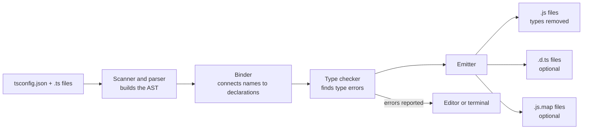
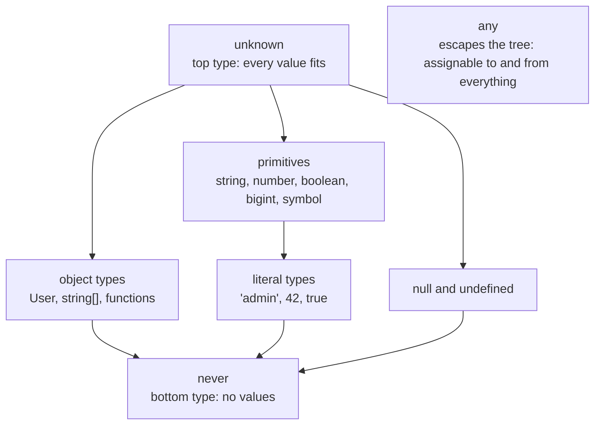
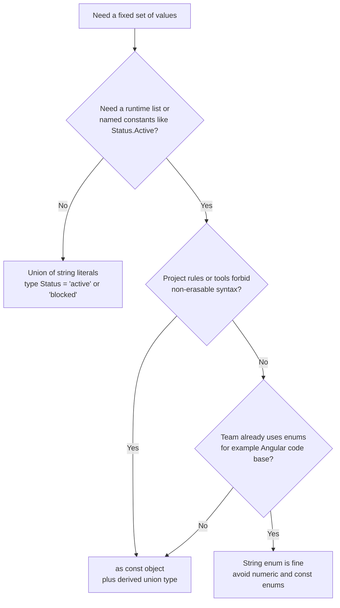

# TypeScript Basics and Types

> In this document you learn what TypeScript really is, what happens to your types when the code runs, and how every basic type works (`any`, `unknown`, `never`, `void`, literal types, tuples, enums, `as const`, `satisfies` and more). These are the first questions in almost every TypeScript interview, and many candidates answer them in a shallow way. After this document you can answer them with depth.

**Before this:** [JavaScript basics, variables, types and operators](../02-javascript/01-basics-variables-types-operators.md) · [Type coercion and equality](../02-javascript/02-type-coercion-and-equality.md) · **Interview questions:** [jump to questions](#interview-questions)

## Table of contents

1. [What TypeScript is and why it exists](#what-typescript-is-and-why-it-exists)
2. [Compile time vs runtime and type erasure](#compile-time-vs-runtime-and-type-erasure)
3. [How the TypeScript compiler works](#how-the-typescript-compiler-works)
4. [Type annotations and type inference](#type-annotations-and-type-inference)
5. [Structural typing in short](#structural-typing-in-short)
6. [Primitive types](#primitive-types)
7. [Arrays and tuples](#arrays-and-tuples)
8. [The special types any unknown never and void](#the-special-types-any-unknown-never-and-void)
9. [object vs Object vs empty object type](#object-vs-object-vs-empty-object-type)
10. [Literal types widening and as const](#literal-types-widening-and-as-const)
11. [Enums and their alternatives](#enums-and-their-alternatives)
12. [Type assertions and the non-null operator](#type-assertions-and-the-non-null-operator)
13. [strictNullChecks and the strict flag](#strictnullchecks-and-the-strict-flag)
14. [The satisfies operator](#the-satisfies-operator)
15. [How to explain TypeScript in an interview](#how-to-explain-typescript-in-an-interview)
16. [Interview questions](#interview-questions)
17. [Summary](#summary)
18. [References](#references)

> **Version note:** The examples in this repository are type-checked with **TypeScript 5.9** in strict mode. TypeScript 6.0 (March 2026) turned `strict` on by default. TypeScript 7.0 (July 2026) is the same language with a new, much faster compiler written in Go (a "native port"); it also removes the options that 6.0 deprecated. The type rules in these documents work the same way in all of these versions. Angular 16 projects use TypeScript 4.9 to 5.1, so when a feature is newer than that, the text says so.

---

## What TypeScript is and why it exists

### What it is

**TypeScript** is JavaScript with a type system added on top. You write normal JavaScript, and you can add **types** that describe what kind of values your variables, parameters and return values hold.

A tool called the **TypeScript compiler** (`tsc`) reads your code, checks the types, and then outputs plain JavaScript. Browsers and Node.js run that JavaScript. They never see your types.

People often say TypeScript is a **superset** of JavaScript. That means every valid JavaScript program is also valid TypeScript syntax. You can rename a `.js` file to `.ts` and it will still be accepted as code (you may get type errors, but the syntax is fine).

```ts
// JavaScript with one type annotation added
function greet(name: string): string {
  return `Hello, ${name}!`;
}

greet("Asha"); // "Hello, Asha!"
greet(42);     // ❌ compile error: Argument of type 'number' is not assignable to parameter of type 'string'.
```

### Why it exists

JavaScript is **dynamically typed**. A variable can hold any value, and you only find out that something is wrong when that line runs.

```js
// Plain JavaScript
function getTotal(cart) {
  return cart.items.reduce((sum, item) => sum + item.price, 0);
}

getTotal({ item: [] }); // TypeError at runtime: Cannot read properties of undefined (reading 'reduce')
```

The typo `item` instead of `items` is only found when a user clicks the button that calls this function. In a big app, this line may run rarely. The bug may reach production.

With TypeScript, the same bug is found while you type:

```ts
interface CartItem {
  name: string;
  price: number;
}

interface Cart {
  items: CartItem[];
}

function getTotal(cart: Cart): number {
  return cart.items.reduce((sum, item) => sum + item.price, 0);
}

getTotal({ item: [] });
// ❌ compile error: Object literal may only specify known properties,
//    but 'item' does not exist in type 'Cart'. Did you mean to write 'items'?
```

TypeScript solves these problems:

| Problem in plain JavaScript | How TypeScript helps |
|---|---|
| Typos in property names are found only at runtime | The editor shows the error immediately |
| You do not know what shape a function expects | The type is the documentation, and it never gets out of date |
| Renaming a property in a big codebase is scary | The compiler shows every place that must change |
| `undefined is not a function` crashes | `strictNullChecks` forces you to handle `null` and `undefined` |
| Weak autocomplete | The editor knows every property and method |

### Analogy

Think of TypeScript as a **spell checker for your code**. A spell checker underlines mistakes while you write a letter. When you print the letter, the red underlines are not printed. In the same way, TypeScript shows errors while you write code, but the types are removed from the final JavaScript.

Where the analogy breaks down: a spell checker only checks single words. TypeScript checks how all the pieces of your program connect: which function receives which object, what it returns, and who uses that return value.

### Real-world usage

- **Angular** is written in TypeScript and every Angular project uses it. Decorators like `@Component`, typed `HttpClient` calls and typed reactive forms all depend on it.
- **Node.js backends** (Express, NestJS) use TypeScript for typed request bodies, database models and configuration.
- **Electron apps** use it to type the messages sent between the main process and the renderer.
- **React** projects use it for typed props and hooks.

### Advantages and disadvantages

| Advantages | Disadvantages |
|---|---|
| Many bugs are caught before the code runs | There is a build step (or a tool that strips types) |
| Great autocomplete and safe refactoring | You must learn the type system |
| Types document the code | Complex types can be hard to read |
| Large teams can change code with confidence | Types give **no protection** for data that arrives at runtime (API responses, user input) unless you validate it |

---

## Compile time vs runtime and type erasure

This is the most important idea in this whole document. Many interview mistakes come from not understanding it.

- **Compile time** is when `tsc` (or your editor) checks your code. Types exist only here.
- **Runtime** is when the JavaScript actually runs in the browser or Node.js. Types do not exist here.

**Type erasure** means that the compiler removes type annotations, interfaces and type aliases when it produces JavaScript. They leave no trace.

### See it with your own eyes

Here is a TypeScript file:

```ts
interface User {
  id: number;
  name: string;
}

type Role = "admin" | "viewer";

function greet(user: User, role: Role): string {
  return `Hello ${user.name} (${role})`;
}

console.log(greet({ id: 1, name: "Asha" }, "admin"));
```

And here is the exact JavaScript that `tsc` outputs (target ES2022):

```js
function greet(user, role) {
    return `Hello ${user.name} (${role})`;
}
console.log(greet({ id: 1, name: "Asha" }, "admin"));
```

Look at what happened:

1. The `interface User` is gone completely.
2. The `type Role` is gone completely.
3. `: User`, `: Role` and `: string` are gone.
4. The logic of the function did not change at all.

### Why this matters

Because types are gone at runtime:

- You **cannot** check a type at runtime with TypeScript types. `if (value instanceof User)` does not work when `User` is an interface, because there is no `User` value at runtime.
- Data that comes from outside (an HTTP response, `JSON.parse`, `localStorage`, a form, a file) is **not checked** by TypeScript. If the server sends the wrong shape, TypeScript cannot stop it.

```ts
interface Product {
  id: number;
  price: number;
}

// TypeScript trusts you here. It does NOT check the real JSON.
const product = JSON.parse('{"id": 1, "price": "free"}') as Product;

console.log(product.price.toFixed(2));
// Compiles fine. At runtime: TypeError: product.price.toFixed is not a function
```

To protect runtime data, you must validate it with real JavaScript checks or a schema library. This is covered in [Runtime validation and type-safe APIs](./11-runtime-validation-and-type-safe-apis.md).

### Not everything is erased

Most TypeScript syntax is erased, but a few features **generate JavaScript code**. They are not just types:

| Feature | What it emits |
|---|---|
| `enum` (normal) | A real JavaScript object |
| `namespace` with values | A real JavaScript object (an IIFE) |
| Constructor parameter properties (`constructor(private name: string)`) | `this.name = name` assignments |
| Decorators (with `experimentalDecorators` or standard decorators) | Helper calls that run at runtime |

Because of this, an accurate interview answer is: "Most TypeScript syntax is erased. A few features, like enums and parameter properties, produce runtime code."

> **Modern note:** Node.js can now run `.ts` files directly by **stripping** the types (enabled by default since Node.js 23.6 and 22.18). It only removes erasable syntax. Features that need code generation, such as `enum`, do not work in this mode. TypeScript 5.8 added the `erasableSyntaxOnly` compiler flag, which reports an error when you use such features. This is one reason many teams now prefer union types and `as const` objects over enums (see [Enums and their alternatives](#enums-and-their-alternatives)).

---

## How the TypeScript compiler works

When you run `tsc`, these steps happen:

1. **Read the config.** `tsc` reads `tsconfig.json` to know which files to compile and which rules to use.
2. **Scan and parse.** It reads each `.ts` file and builds a tree that represents your code. This tree is called the **AST** (abstract syntax tree).
3. **Bind.** It connects every name (variable, function, type) to its declaration. It builds **symbols**.
4. **Check.** The **type checker** works out the type of every expression and checks that values are used correctly. This is where type errors are found.
5. **Emit.** It writes `.js` files (types removed). It can also write `.d.ts` files (type declarations for other projects) and `.map` files (source maps for debugging).



### Type errors do not stop the output by default

This surprises many developers. By default, **`tsc` still writes the `.js` files even when there are type errors**. The errors are reported, but the JavaScript is produced anyway, because type checking and emitting are separate steps.

```ts
// app.ts
let count: number = "five"; // type error
console.log(count);
```

```bash
npx tsc app.ts
# app.ts(2,5): error TS2322: Type 'string' is not assignable to type 'number'.
# ...but app.js is still created:
#   let count = "five";
#   console.log(count);
```

If you want no output when there are errors, set `"noEmitOnError": true` in `tsconfig.json`.

### Other tools that compile TypeScript

In real projects `tsc` is not always the tool that produces the JavaScript:

| Tool | What it does | Does it type-check? |
|---|---|---|
| `tsc` | Checks types and emits JS | Yes |
| esbuild, SWC, Babel | Remove types very fast, file by file | **No** |
| Vite (React, Vue and similar projects) | Uses esbuild to remove types during development | **No** — run `tsc --noEmit` separately |
| Angular CLI | Uses the Angular compiler, which is built on top of the TypeScript compiler | Yes — type errors fail `ng build` |
| Node.js type stripping | Removes erasable types and runs the file | **No** |

Because fast tools do not check types, teams usually run `tsc --noEmit` in CI to make sure type errors fail the build.

### The basic workflow

```bash
npm install --save-dev typescript   # install locally in the project
npx tsc --init                      # create tsconfig.json
npx tsc                             # compile the whole project
npx tsc --noEmit                    # only check types, write no files
npx tsc --watch                     # recompile when files change
```

The full list of `tsconfig.json` options is explained in [Modules, declaration files and tsconfig](./09-modules-declaration-files-and-tsconfig.md).

---

## Type annotations and type inference

### Annotations

A **type annotation** is when you write the type yourself, after a colon.

```ts
let userName: string = "Asha";
let age: number = 30;
let isAdmin: boolean = false;

function add(a: number, b: number): number {
  return a + b;
}
```

### Inference

**Type inference** means TypeScript works out the type for you from the value.

```ts
let userName = "Asha";   // inferred: string
let age = 30;            // inferred: number
let tags = ["new", "sale"]; // inferred: string[]

function add(a: number, b: number) {
  return a + b;          // return type inferred: number
}

userName = 5; // ❌ Type 'number' is not assignable to type 'string'.
```

Inference is not "no type". The variable still has a fixed type. You just did not write it.

### When to annotate and when to let TypeScript infer

| Situation | Recommendation | Reason |
|---|---|---|
| Local variable with an obvious value | Let TypeScript infer | Less noise, same safety |
| Function parameters | Always annotate | TypeScript cannot infer them (they become `any` or an error under `noImplicitAny`) |
| Return type of a public or exported function | Annotate | It is a contract. A wrong change inside the function gives an error at the function, not far away at the caller |
| Variable declared without a value | Annotate | `let result;` would be `any` until assigned |
| Empty array | Annotate | `const ids: number[] = []` is clearer than relying on inference |
| Callback parameters passed to `map`, `filter`, event handlers | Let TypeScript infer | **Contextual typing** gives them the right type |

**Contextual typing** means TypeScript uses the place where a function is written to know its parameter types:

```ts
const prices = [10, 20, 30];

// 'price' is inferred as number from the array type. No annotation needed.
const withTax = prices.map((price) => price * 1.2);

// In the browser, 'event' is inferred as MouseEvent because of the "click" string.
document.addEventListener("click", (event) => {
  console.log(event.clientX);
});
```

Why annotate return types of exported functions? Look at this example:

```ts
// Without a return type annotation
export function findUser(id: number) {
  if (id < 0) return null;
  return { id, name: "Asha" };
}
// Inferred return type: { id: number; name: string } | null
// If someone later adds "return 'not found'", the return type silently changes
// and the errors appear in many other files.

// With an annotation, the mistake is caught inside the function itself
interface User { id: number; name: string }

export function findUserSafe(id: number): User | null {
  if (id < 0) return null;
  return { id, name: "Asha" };
}
```

---

## Structural typing in short

TypeScript uses **structural typing**. Two types are compatible if they have the same **shape** (the same properties with compatible types). The name of the type does not matter.

```ts
interface Point {
  x: number;
  y: number;
}

class Pixel {
  constructor(public x: number, public y: number) {}
}

function draw(point: Point) {
  console.log(point.x, point.y);
}

draw({ x: 1, y: 2 });     // ✅ object literal with the right shape
draw(new Pixel(5, 10));   // ✅ Pixel never mentions Point, but it has x and y

const homePoint = { x: 3, y: 4, label: "home" };
draw(homePoint);          // ✅ extra properties are fine for a variable
```

This is called "duck typing at compile time": if it has the properties of a duck, it is a duck.

Languages like Java and C# use **nominal typing**: a class is only compatible with an interface if it explicitly says `implements`. In TypeScript, `implements` is optional. It only adds an extra check.

Structural typing fits JavaScript well, because JavaScript code passes plain objects around all the time.

The full story (excess property checks, assignability rules, function compatibility) is in [Interfaces and type aliases](./02-interfaces-and-type-aliases.md).

---

## Primitive types

JavaScript has seven primitive types. TypeScript has a type for each of them. Always use the **lowercase** names.

| Type | Example values | Notes |
|---|---|---|
| `string` | `"hi"`, `'hi'`, `` `hi ${name}` `` | All string forms |
| `number` | `42`, `3.14`, `-1`, `NaN`, `Infinity` | Integers and decimals are the same type |
| `boolean` | `true`, `false` | |
| `bigint` | `10n`, `BigInt(10)` | Whole numbers of any size. Needs target ES2020 or later |
| `symbol` | `Symbol("id")` | Unique values, often used as keys |
| `null` | `null` | "Intentionally empty" |
| `undefined` | `undefined` | "Not set" |

```ts
let title: string = "Laptop";
let price: number = 999.99;
let inStock: boolean = true;
let views: bigint = 9007199254740993n; // larger than Number.MAX_SAFE_INTEGER
let secretKey: symbol = Symbol("secret");
let middleName: null = null;
let nickname: undefined = undefined;
```

### Use lowercase, not wrapper types

```ts
// ❌ Wrong: String, Number, Boolean are wrapper object types
let a: String = "hello";
let b: Number = 5;

// ✅ Correct: lowercase primitive types
let c: string = "hello";
let d: number = 5;
```

`String` with a capital S is the type of the JavaScript wrapper object (`new String("x")`). Using it is almost always a mistake.

### bigint and number do not mix

```ts
const big: bigint = 10n;
const total = big + 1;   // ❌ Operator '+' cannot be applied to types 'bigint' and 'number'.
const ok = big + 1n;     // ✅ 11n
```

This matches JavaScript, where `10n + 1` throws a `TypeError` at runtime. TypeScript just finds it earlier.

### unique symbol

A `const` declared with `Symbol()` can have the special type `unique symbol`. It means "this exact symbol and no other". It is mostly used for keys in library types.

```ts
const userIdKey: unique symbol = Symbol("userId");
```

---

## Arrays and tuples

### Arrays

There are two ways to write an array type. They mean exactly the same thing.

```ts
const scores: number[] = [90, 85, 77];
const names: Array<string> = ["Asha", "Ravi"];

scores.push("100"); // ❌ Argument of type 'string' is not assignable to parameter of type 'number'.
```

Most teams use `number[]` for simple types. `Array<T>` is the generic form (see [Generics](./05-generics.md)).

Mixed arrays get a union type:

```ts
const mixed = [1, "two", 3];       // inferred: (string | number)[]
const ids: (string | number)[] = []; // parentheses matter
```

Be careful with parentheses: `string | number[]` means "a string, or an array of numbers". `(string | number)[]` means "an array that holds strings and numbers".

### Readonly arrays

```ts
const roles: readonly string[] = ["admin", "editor"];
// Same as: ReadonlyArray<string>

roles.push("viewer"); // ❌ Property 'push' does not exist on type 'readonly string[]'.
roles[0] = "owner";   // ❌ Index signature in type 'readonly string[]' only permits reading.
```

`readonly` is checked only at compile time. At runtime it is a normal array. Use `readonly` for function parameters when the function must not change the caller's array:

```ts
function sumPrices(prices: readonly number[]): number {
  return prices.reduce((sum, p) => sum + p, 0);
}
```

### Tuples

A **tuple** is an array with a fixed length, where each position has its own type.

```ts
let entry: [string, number] = ["apples", 5];

entry = [5, "apples"];        // ❌ wrong order
entry = ["apples", 5, true];  // ❌ Source has 3 element(s) but target allows only 2.

const [fruit, count] = entry; // fruit: string, count: number
```

Real uses of tuples:

- Returning two values from a function, like React's `useState` returns `[value, setValue]`.
- `Object.entries()` returns `[string, T][]`.
- A coordinate `[x, y]`.

```ts
function useToggle(initial: boolean): [boolean, () => void] {
  let value = initial;
  const toggle = () => { value = !value; };
  return [value, toggle];
}

const [isOpen, toggleOpen] = useToggle(false);
```

#### Optional, named and readonly tuples

```ts
// Optional element: the second position may be missing
type HttpResult = [status: number, body?: string];
const ok: HttpResult = [204];
const withBody: HttpResult = [200, "OK"];

// Named (labeled) elements: the names are only for readability and editor hints (TS 4.0+)
type Range = [start: number, end: number];

// Readonly tuple: cannot be changed
const origin: readonly [number, number] = [0, 0];
origin[0] = 5; // ❌ Cannot assign to '0' because it is a read-only property.

// Rest element: a string followed by any number of numbers
type LogLine = [level: string, ...values: number[]];
const line: LogLine = ["info", 1, 2, 3];
```

#### Common tuple mistake

Tuples are not inferred automatically from array literals:

```ts
const point = [10, 20];          // inferred: number[] (not a tuple!)
const point2: [number, number] = [10, 20]; // tuple by annotation
const point3 = [10, 20] as const;          // readonly [10, 20]
```

---

## The special types any unknown never and void

These four types confuse people the most. Learn them well.

### any: "turn off type checking"

**`any`** tells TypeScript: "Do not check this value. Allow everything."

```ts
let data: any = "hello";
data = 42;              // ✅ allowed
data.foo.bar();         // ✅ compiles! Crashes at runtime.
const n: number = data; // ✅ any can be assigned to anything
```

The real danger of `any` is that it **spreads**. Anything you get from an `any` is also `any`:

```ts
function getConfig(): any {
  return { port: "8080" }; // a string by mistake
}

const config = getConfig();
const port = config.port;        // any
const nextPort: number = port + 1; // ✅ compiles, but the value is "80801" at runtime
```

When to use `any`: almost never in new code. Acceptable cases are temporary migration from JavaScript, or a very rare case where the types are impossible to express (and then you hide it inside one small function).

`noImplicitAny` (part of `strict`) gives an error when TypeScript would silently fall back to `any`, for example on a parameter without a type.

### unknown: "I do not know yet, so check first"

**`unknown`** also accepts any value. The difference: you **cannot use** an `unknown` value until you **narrow** it (prove what it is with a check).

```ts
let input: unknown = JSON.parse('"hello"');

input.toUpperCase();          // ❌ 'input' is of type 'unknown'.

if (typeof input === "string") {
  console.log(input.toUpperCase()); // ✅ inside this block, input is string
}

const n: number = input;      // ❌ unknown cannot be assigned to number without a check
```

Use `unknown` for any value that comes from outside your control: `JSON.parse` results, API responses before validation, `catch (error)` variables, messages from `postMessage` or Electron IPC.

```ts
function getErrorMessage(error: unknown): string {
  if (error instanceof Error) return error.message;
  if (typeof error === "string") return error;
  return "Unknown error";
}

try {
  throw new Error("Network down");
} catch (error) {
  // With strict (useUnknownInCatchVariables), 'error' is unknown here
  console.log(getErrorMessage(error)); // "Network down"
}
```

| | `any` | `unknown` |
|---|---|---|
| Accepts any value? | Yes | Yes |
| Can you call methods on it? | Yes, without checks | No, you must narrow first |
| Can you assign it to `string`, `number`...? | Yes | No (only to `unknown` and `any`) |
| Safe? | No, it turns off checking | Yes, it forces checking |

A short way to remember: **`any` trusts everything. `unknown` trusts nothing until you check.**

### void: "this function returns nothing useful"

**`void`** is the return type of a function that does not return a value.

```ts
function logMessage(message: string): void {
  console.log(message);
  // no return statement, or just "return;"
}

const result = logMessage("hi"); // result: void (at runtime it is undefined)
```

`void` is about **intent**: "do not use the return value". There is one special rule for callback types: a function type that returns `void` can be given a function that returns something. The value is simply ignored.

```ts
const ids: number[] = [];

// Array.prototype.push returns a number, but forEach expects a callback returning void.
// This is allowed on purpose:
[1, 2, 3].forEach((id) => ids.push(id));
```

This rule is explained in detail in [Functions and classes](./04-functions-and-classes.md).

### never: "this can never happen"

**`never`** is the type with **no values at all**. You see it in three places:

1. A function that never returns normally (it always throws or loops forever):

```ts
function fail(message: string): never {
  throw new Error(message);
}
```

2. A variable after all possibilities have been removed by narrowing:

```ts
function format(value: string | number) {
  if (typeof value === "string") {
    return value.trim();
  } else if (typeof value === "number") {
    return value.toFixed(2);
  } else {
    value; // never: no type is left
  }
}
```

3. **Exhaustiveness checking**: making the compiler tell you when you forgot a case.

```ts
type PaymentMethod = "card" | "upi" | "cash";

function assertNever(value: never): never {
  throw new Error(`Unhandled value: ${value}`);
}

function getFee(method: PaymentMethod): number {
  switch (method) {
    case "card": return 2;
    case "upi":  return 0;
    case "cash": return 0;
    default:     return assertNever(method); // ✅ compiles: method is never here
  }
}

// If someone adds "wallet" to PaymentMethod and forgets a case,
// the default branch gets an error:
// Argument of type 'string' is not assignable to parameter of type 'never'.
```

This pattern is covered in depth in [Unions, narrowing and type guards](./03-unions-narrowing-and-type-guards.md).

### void vs never vs undefined

| Type | Meaning | Example |
|---|---|---|
| `void` | The function finishes, but returns nothing useful | `console.log` wrapper |
| `undefined` | The value is exactly `undefined`, and you may use it | `function find(): User \| undefined` |
| `never` | The function never finishes normally, or the code is unreachable | `throw` helper, exhaustive `default` |

### The type hierarchy

It helps to picture all types as a tree. `unknown` is at the top (every value fits in it). `never` is at the bottom (no value fits in it, and it fits into every type). `any` is special: it acts like both top and bottom, which is exactly why it breaks safety.



The rule: a value of a lower type can be assigned to a variable of a higher type. `"admin"` can go into `string`. `string` can go into `unknown`. `never` can go anywhere. Nothing (except `never` and `any`) can go into `never`.

---

## object vs Object vs empty object type

These three look similar but mean different things.

| Type | What it accepts | Use it? |
|---|---|---|
| `object` (lowercase) | Any **non-primitive**: objects, arrays, functions. Not `string`, `number`, `null`... | Yes, when you need "some object" |
| `Object` (uppercase) | Almost everything except `null` and `undefined` (primitives too, because they have object wrappers) | No |
| `{}` (empty object type) | Every value except `null` and `undefined` | Rarely; it does not mean "empty object" |

```ts
let a: object = { id: 1 }; // ✅
let b: object = [1, 2];    // ✅ arrays are objects
let c: object = "text";    // ❌ Type 'string' is not assignable to type 'object'.

let d: {} = "text";        // ✅ surprising! {} means "anything that is not null or undefined"
let e: {} = 42;            // ✅
let f: {} = null;          // ❌

let g: Object = "text";    // ✅ also accepted
```

The most common mistake is writing `{}` to mean "an empty object" or "any object". If you want "an object with any keys", use `Record<string, unknown>`. If you want "an object with no keys at all", use `Record<string, never>`.

```ts
function logKeys(value: Record<string, unknown>) {
  console.log(Object.keys(value));
}
logKeys({ a: 1, b: "x" }); // ["a", "b"]
logKeys("text");            // ❌ error, good
```

---

## Literal types widening and as const

### Literal types

A **literal type** is a type that allows exactly one value.

```ts
let direction: "left" = "left";
direction = "right"; // ❌ Type '"right"' is not assignable to type '"left"'.
```

One literal alone is not very useful. Combined in a **union**, literal types become very powerful:

```ts
type Theme = "light" | "dark" | "system";
type HttpMethod = "GET" | "POST" | "PUT" | "DELETE";
type DiceValue = 1 | 2 | 3 | 4 | 5 | 6;

function setTheme(theme: Theme) {
  document.body.dataset.theme = theme;
}

setTheme("dark");  // ✅
setTheme("blue");  // ❌ Argument of type '"blue"' is not assignable to parameter of type 'Theme'.
```

You get autocomplete for the allowed values, and typos become compile errors.

### Widening

**Widening** is when TypeScript chooses a wider type (like `string`) instead of the literal type (like `"dark"`), because it expects the value may change.

```ts
const theme1 = "dark";  // type: "dark"   (const can never change, so keep the literal)
let theme2 = "dark";    // type: string   (let can change, so widen)
```

Widening also happens inside objects and arrays, because their properties can change, even when the variable is `const`:

```ts
const settings = { theme: "dark" };
// type: { theme: string }  ← widened!

setTheme(settings.theme);
// ❌ Argument of type 'string' is not assignable to parameter of type 'Theme'.
```

This is a very common real bug. Three ways to fix it:

```ts
// Fix 1: annotate the object
const settings1: { theme: Theme } = { theme: "dark" };

// Fix 2: as const on the value
const settings2 = { theme: "dark" as const };

// Fix 3: as const on the whole object
const settings3 = { theme: "dark" } as const;

setTheme(settings1.theme); // ✅
setTheme(settings2.theme); // ✅
setTheme(settings3.theme); // ✅
```

### as const

**`as const`** is called a **const assertion**. It tells TypeScript: "Infer the narrowest possible type for this value." It does three things:

1. Literal values keep their literal types (`"dark"`, not `string`).
2. Object properties become `readonly`.
3. Arrays become `readonly` tuples.

```ts
const routes = {
  home: "/",
  users: "/users",
} as const;
// type: { readonly home: "/"; readonly users: "/users" }

const roles = ["admin", "editor", "viewer"] as const;
// type: readonly ["admin", "editor", "viewer"]

// Very common trick: derive a union type from the array
type Role = (typeof roles)[number];
// "admin" | "editor" | "viewer"
```

The trick `(typeof roles)[number]` means: "take the type of `roles`, and give me the type you get when you index it with any number". This gives the union of all elements. You get one source of truth: a runtime array (for a dropdown) and a type (for checking) from the same list. `typeof` and indexed access types are explained in [keyof, typeof, indexed and mapped types](./06-keyof-typeof-indexed-and-mapped-types.md).

### as const does not freeze anything at runtime

`as const` is a compile-time instruction. It is erased. The object can still be changed at runtime if someone escapes the type system:

```ts
const routes = { home: "/", users: "/users" } as const;

console.log(Object.isFrozen(routes)); // false
(routes as any).home = "/changed";   // escaping the type system on purpose
console.log(routes.home);            // "/changed"
```

If you need real runtime protection, use `Object.freeze()` (which TypeScript also understands: it returns a `Readonly<T>` type).

---

## Enums and their alternatives

### What an enum is

An **enum** is a named set of constant values. It is one of the few TypeScript features that creates real JavaScript code.

#### Numeric enums

```ts
enum Direction {
  Up,     // 0
  Down,   // 1
  Left,   // 2
  Right,  // 3
}

console.log(Direction.Up);   // 0
console.log(Direction[0]);   // "Up"  ← reverse mapping

function move(direction: Direction) {
  console.log(`Moving ${Direction[direction]}`);
}
move(Direction.Left); // "Moving Left"
```

Values start at 0 and go up by one. You can set a start value: `enum Level { Low = 1, Medium, High }` gives 1, 2, 3.

Here is the JavaScript that `tsc` emits for `Direction` (only Up and Down shown):

```js
var Direction;
(function (Direction) {
    Direction[Direction["Up"] = 0] = "Up";
    Direction[Direction["Down"] = 1] = "Down";
})(Direction || (Direction = {}));
```

`Direction["Up"] = 0` returns `0`, so the outer assignment becomes `Direction[0] = "Up"`. That is why numeric enums have **reverse mapping**: you can go from the number back to the name. The real object at runtime is:

```js
{ "0": "Up", "1": "Down", Up: 0, Down: 1 }
```

So `Object.keys(Direction)` gives `["0", "1", "Up", "Down"]`, which surprises many people when they try to build a dropdown from an enum.

#### String enums

```ts
enum OrderStatus {
  Pending = "PENDING",
  Shipped = "SHIPPED",
  Delivered = "DELIVERED",
}

console.log(OrderStatus.Shipped); // "SHIPPED"
```

String enums have **no reverse mapping**. They are easier to debug, because the logs show `"SHIPPED"` instead of `1`.

A strict rule of string enums: you cannot pass a plain string, even if it has the same value.

```ts
function updateStatus(status: OrderStatus) {}

updateStatus(OrderStatus.Shipped); // ✅
updateStatus("SHIPPED");           // ❌ Argument of type '"SHIPPED"' is not assignable to parameter of type 'OrderStatus'.
```

This is a problem when the value comes from an API as a plain string: you need a check or a cast.

#### Numeric enums are looser

Since TypeScript 5.0, assigning a number literal that is not an enum member is an error. But any value of type `number` is still accepted:

```ts
enum Priority { Low, High }

let p1: Priority = 5;      // ❌ (TS 5.0+) Type '5' is not assignable to type 'Priority'.
const fromApi: number = 5;
let p2: Priority = fromApi; // ✅ allowed, even though 5 is not a member
```

#### const enum

A **`const enum`** is removed completely. Every use is replaced by the value itself (this is called **inlining**).

```ts
const enum Size { Small = 1, Large = 2 }
const s = Size.Large;
```

Emitted JavaScript:

```js
const s = 2 /* Size.Large */;
```

Smaller output, but there are problems:

- Tools that compile one file at a time (esbuild, SWC, Babel, `isolatedModules`) cannot inline a `const enum` that is declared in another file, because they do not read the other file.
- Exporting `const enum` from a library is risky. If the library changes a value, code compiled against the old version keeps the old inlined number.
- There is no object at runtime, so you cannot loop over the members.

For these reasons the TypeScript docs warn about `const enum` pitfalls, and many teams avoid it.

### Alternative 1: union of string literals

```ts
type OrderStatus = "PENDING" | "SHIPPED" | "DELIVERED";

function updateStatus(status: OrderStatus) {}

updateStatus("SHIPPED"); // ✅ plain strings work, with autocomplete
updateStatus("LOST");    // ❌ compile error
```

Zero runtime code. Works with JSON from an API directly. But you have no runtime list of values (for a dropdown or validation).

### Alternative 2: `as const` object plus a derived type

```ts
export const OrderStatus = {
  Pending: "PENDING",
  Shipped: "SHIPPED",
  Delivered: "DELIVERED",
} as const;

// "PENDING" | "SHIPPED" | "DELIVERED"
export type OrderStatus = (typeof OrderStatus)[keyof typeof OrderStatus];

function updateStatus(status: OrderStatus) {}

updateStatus(OrderStatus.Shipped); // ✅ like an enum
updateStatus("SHIPPED");           // ✅ plain string also works

const allStatuses = Object.values(OrderStatus); // ["PENDING", "SHIPPED", "DELIVERED"]
```

You get named constants **and** a runtime list **and** plain-string compatibility. The same name is used for the value and the type; TypeScript allows this because values and types live in different "spaces".

### Choosing between them



| | Numeric enum | String enum | `const enum` | Literal union | `as const` object |
|---|---|---|---|---|---|
| Runtime code | Yes | Yes | No | No | Yes (the object) |
| Accepts plain value | Any `number` (loose) | No | Like the enum | Yes | Yes |
| Readable in logs | No (`1`) | Yes | Depends | Yes | Yes |
| Can loop over values | Yes, but keys include numbers | Yes | No | No | Yes |
| Works with type stripping / `erasableSyntaxOnly` | No | No | No | Yes | Yes |

**Practical recommendation:** for new code, prefer a literal union (when you only need the type) or an `as const` object (when you also need values at runtime). If your team already uses string enums (common in Angular code bases), they are fine. Avoid numeric enums for values that come from or go to an API, and avoid `const enum` in shared libraries.

---

## Type assertions and the non-null operator

### Type assertions with as

A **type assertion** tells the compiler: "Trust me, I know the type better than you." It changes the type at compile time only. **It does not convert or check anything at runtime.**

```ts
const input = document.getElementById("email") as HTMLInputElement;
console.log(input.value); // TypeScript now knows .value exists
```

Here the assertion is reasonable: you know the element with id `email` is an `<input>`. `getElementById` can only promise `HTMLElement | null`.

There is an older syntax with angle brackets: `<HTMLInputElement>document.getElementById("email")`. It does the same thing, but it does not work in `.tsx` files (it looks like JSX), so `as` is the standard today.

### Assertion is not casting

In Java or C#, a cast can convert a value or throw an exception if the type is wrong. In TypeScript, `as` does **nothing** at runtime. It is erased.

```ts
const value = "123" as unknown as number;
console.log(typeof value);  // "string" — no conversion happened
console.log(value + 1);     // "1231" at runtime, even though TypeScript thinks it is a number
```

To really convert, use JavaScript: `Number("123")`, `String(5)`, `parseInt(...)`.

### The overlap rule

TypeScript only allows `as` between types that **overlap** (one is assignable to the other). Clearly impossible assertions are rejected:

```ts
const n = "hello" as number;
// ❌ Conversion of type 'string' to type 'number' may be a mistake because neither type
//    sufficiently overlaps with the other. If this was intentional, convert the expression to 'unknown' first.
```

The **double assertion** `as unknown as T` bypasses this rule. If you see it in a code review, it is a red flag: someone forced the compiler to accept something it believes is wrong.

### Why assertions are dangerous

```ts
interface User {
  id: number;
  email: string;
}

// ❌ Wrong: the assertion hides a missing property
const user = {} as User;
console.log(user.email.toLowerCase()); // compiles; runtime TypeError

// ✅ Correct: an annotation checks the object
const user2: User = { id: 1, email: "asha@example.com" };
const user3: User = {}; // ❌ Type '{}' is missing the following properties from type 'User': id, email
```

The difference: an **annotation** (`: User`) asks TypeScript to **check** the value. An **assertion** (`as User`) asks TypeScript to **stop checking**.

When an assertion is acceptable:

- DOM elements where you know the HTML (`as HTMLInputElement`).
- After you have checked the data yourself and TypeScript cannot follow the logic.
- In tests, for partial mock objects (with care).

Prefer narrowing with checks (`typeof`, `instanceof`, type guards) whenever you can. See [Unions, narrowing and type guards](./03-unions-narrowing-and-type-guards.md).

### The non-null assertion operator

The **non-null assertion** `!` (written after an expression) tells TypeScript: "This value is not `null` or `undefined`." Like `as`, it is erased and does no runtime check.

```ts
const button = document.querySelector("#save")!; // type: Element (null removed)
button.addEventListener("click", save);
// If #save does not exist, this crashes at runtime: Cannot read properties of null

function save() {}
```

Safer alternatives:

```ts
// ✅ Check and fail with a clear message
const saveButton = document.querySelector("#save");
if (!saveButton) {
  throw new Error("Save button not found in the page");
}
saveButton.addEventListener("click", save); // narrowed to Element

// ✅ Optional chaining when it is fine to do nothing
document.querySelector("#save")?.addEventListener("click", save);
```

### Definite assignment assertion

A related use of `!` is on declarations. It says "this will be assigned before use, even if you cannot see it".

```ts
class ProfileComponent {
  // Angular sets @Input values after construction. TypeScript cannot see that,
  // so with strictPropertyInitialization it would complain.
  userId!: string;
}

let token!: string;
initialize();
console.log(token.length); // TypeScript trusts that initialize() assigned it

function initialize() {
  token = "abc";
}
```

This is common in Angular for `@Input()` and `@ViewChild()` properties. It is still a promise you make, so use it only when a framework really guarantees the assignment.

---

## strictNullChecks and the strict flag

### Without strictNullChecks

Without `strictNullChecks`, `null` and `undefined` can be assigned to **every** type. TypeScript does not warn you when a value may be missing.

```ts
// strictNullChecks: false
let userName: string = null; // allowed!
userName.toUpperCase();      // compiles; runtime TypeError
```

### With strictNullChecks

With `strictNullChecks: true`, `null` and `undefined` are separate types. If a value can be missing, the type must say so, and you must handle it before use.

```ts
// strictNullChecks: true
let userName: string = null; // ❌ Type 'null' is not assignable to type 'string'.

let maybeName: string | null = localStorage.getItem("userName"); // browser API: string | null
maybeName.toUpperCase();     // ❌ 'maybeName' is possibly 'null'.

if (maybeName !== null) {
  maybeName.toUpperCase();   // ✅ narrowed to string
}

maybeName?.toUpperCase();    // ✅ optional chaining
const display = maybeName ?? "Guest"; // ✅ nullish coalescing
```

It also changes the types of many built-in APIs:

```ts
const users = [{ id: 1, name: "Asha" }];
const found = users.find((u) => u.id === 2);
// found: { id: number; name: string } | undefined

console.log(found.name); // ❌ 'found' is possibly 'undefined'.
console.log(found?.name ?? "Not found"); // ✅ "Not found"
```

This one flag prevents a large class of real bugs ("Cannot read properties of undefined"). It is the most valuable flag in TypeScript.

### The strict flag

`"strict": true` turns on a family of checks at once, including `strictNullChecks`, `noImplicitAny`, `strictFunctionTypes`, `strictPropertyInitialization`, `useUnknownInCatchVariables` and others. New flags added to the family in future versions are turned on automatically.

- In TypeScript 5.x, `strict` is off unless you set it, but `tsc --init` and the Angular CLI create projects with `strict: true`.
- Since TypeScript 6.0, `strict` is on by default.

Every flag is explained in [Modules, declaration files and tsconfig](./09-modules-declaration-files-and-tsconfig.md). For new projects: always use `strict: true`.

---

## The satisfies operator

### The problem

Sometimes you want two things at once:

1. Check that a value matches a type.
2. Keep the **more specific** type that TypeScript infers.

A type annotation gives you 1 but loses 2:

```ts
type Color = "red" | "green" | "blue";
type RGB = [number, number, number];

const palette: Record<Color, string | RGB> = {
  red: [255, 0, 0],
  green: "#00ff00",
  blue: [0, 0, 255],
};

palette.green.toUpperCase();
// ❌ Property 'toUpperCase' does not exist on type 'string | RGB'.
// The annotation widened every property to string | RGB.
```

Without the annotation you get 2 but lose 1 (a typo like `bleu` would not be caught).

### The solution: satisfies (TypeScript 4.9)

**`satisfies`** checks that a value matches a type **without changing the inferred type** of the value.

```ts
const palette = {
  red: [255, 0, 0],
  green: "#00ff00",
  blue: [0, 0, 255],
} satisfies Record<Color, string | RGB>;

palette.green.toUpperCase(); // ✅ green is known to be string
palette.red.map((n) => n / 255); // ✅ red is known to be an array

const broken = {
  red: [255, 0, 0],
  green: "#00ff00",
  bleu: [0, 0, 255], // ❌ Object literal may only specify known properties, and 'bleu' does not exist...
} satisfies Record<Color, string | RGB>;
```

### Annotation vs as vs satisfies

| Syntax | Checks the value? | Resulting type |
|---|---|---|
| `const x: T = value` | Yes | `T` (the declared type) |
| `const x = value as T` | Barely (only overlap) | `T` (forced) |
| `const x = value satisfies T` | Yes | The inferred type of `value` (more specific) |

### A realistic example: route config

```ts
type RouteConfig = { path: string; title: string; requiresAuth?: boolean };

const appRoutes = {
  home:     { path: "/", title: "Home" },
  orders:   { path: "/orders", title: "Orders", requiresAuth: true },
  settings: { path: "/settings", title: "Settings", requiresAuth: true },
} satisfies Record<string, RouteConfig>;

// The keys are still known exactly:
type RouteName = keyof typeof appRoutes; // "home" | "orders" | "settings"

function navigate(route: RouteName) {
  console.log(`Go to ${appRoutes[route].path}`);
}

navigate("orders");  // ✅
navigate("profile"); // ❌ not a known route
```

With `: Record<string, RouteConfig>` the keys would be widened to `string`, and `navigate("profile")` would compile.

You can combine both: `as const satisfies T` keeps literal values **and** checks the shape.

```ts
const httpStatus = {
  ok: 200,
  notFound: 404,
} as const satisfies Record<string, number>;
// type: { readonly ok: 200; readonly notFound: 404 }
```

Angular 16 projects use TypeScript 4.9 to 5.1, so `satisfies` is available there.

---

## How to explain TypeScript in an interview

### How to explain this in an interview

1. **Define it:** "TypeScript is JavaScript with a static type system. The compiler checks the types and then outputs plain JavaScript."
2. **Why it exists:** "JavaScript only finds type mistakes when the line runs. TypeScript finds them while I write the code, which matters a lot in large code bases and teams."
3. **How it works:** "The types exist only at compile time. The compiler erases them, so at runtime it is normal JavaScript. Only a few features like enums and parameter properties generate code."
4. **Small example:** "If a function expects a `Cart` with `items` and I pass `{ item: [] }`, TypeScript shows an error immediately. In JavaScript I would get 'cannot read properties of undefined' in production."
5. **Where it is useful:** "Angular is built on it. I use it for typed HTTP responses, typed forms, and safe refactoring when I rename a model property."
6. **Trade-offs / gotchas:** "Types do not check runtime data. An API can still send the wrong shape, so I treat external data as `unknown` and validate it. Also, `any` and `as` can silently turn off safety, so I keep them rare."

---

## Interview questions

### Q1. What is TypeScript, and why would you use it instead of JavaScript?

**What the interviewer is checking:** Whether you understand that TypeScript is a compile-time tool, and whether you can explain real benefits, not just "it has types".

**Short spoken answer (30–60 seconds):**
> TypeScript is JavaScript plus a static type system. I write normal JavaScript with type annotations, and the compiler checks that values are used correctly before the code runs. Then it outputs plain JavaScript, so it runs anywhere JavaScript runs. The main benefit is catching bugs early: typos in property names, wrong arguments, forgetting that something can be null. It also gives me great autocomplete and safe refactoring. If I rename a property on a model, the compiler shows every place I need to update. The main limit is that types are erased at runtime, so data from an API is not checked unless I validate it.

**Detailed explanation:**
- TypeScript is a superset of JavaScript syntax. Any JavaScript is valid TypeScript syntax.
- The compiler (`tsc`) parses, type-checks and emits JavaScript. Types are removed during emit.
- Benefits: early error detection, self-documenting code, editor tooling, refactoring confidence, better collaboration in large teams.
- Costs: a build step, a learning curve, and the risk of over-complex types.
- It is not a different runtime. It does not make code faster or slower at runtime.

**Follow-up questions:**
- **Does TypeScript make your app faster?** — No. The output is normal JavaScript. Performance is the same as hand-written JavaScript. It can make development faster because you find bugs earlier.
- **Can a valid JavaScript file be a TypeScript file?** — Yes, the syntax is valid. With `strict` you may get type errors (for example, implicit `any` parameters), but the code is accepted as TypeScript syntax.
- **Who runs TypeScript in the browser?** — Nobody. The browser only runs the JavaScript that the compiler or bundler produced.

**Common mistakes:** Saying TypeScript "checks types at runtime"; saying it is "a different language that compiles to JavaScript like Java"; only listing "it has types" without explaining what problem types solve.

**Where this is used in real projects:** Every Angular project, most modern Node.js backends (NestJS, Express with TypeScript), Electron apps and large React apps.

### Q2. What is type erasure? Does TypeScript protect you at runtime?

**What the interviewer is checking:** The compile-time vs runtime boundary. This is the single most important concept in TypeScript.

**Short spoken answer (30–60 seconds):**
> Type erasure means the compiler removes all type information when it produces JavaScript. Interfaces, type aliases and annotations simply disappear. So TypeScript gives no protection at runtime by itself. If my API returns a price as a string while my interface says number, TypeScript cannot know, and the app may crash. That is why I treat external data as `unknown` and validate it, either with type guards or with a schema library like Zod. One detail: not everything is erased. Enums, namespaces and constructor parameter properties produce real JavaScript code.

**Detailed explanation:**
- Interfaces and type aliases have no runtime representation. You cannot use `instanceof` with an interface.
- Assertions (`as`) and non-null assertions (`!`) are erased too. They change what the compiler believes, not what the value is.
- Runtime data sources: HTTP responses, `JSON.parse`, `localStorage`, URL parameters, form inputs, IPC messages, environment variables, files.
- Exceptions to erasure: `enum`, `namespace` with values, parameter properties, decorators.

**Code:**

```ts
interface Product { id: number; price: number }

async function loadProduct(): Promise<Product> {
  const response = await fetch("/api/products/1");
  return response.json(); // returns Promise<any> — no check happens here
}
// If the server sends { id: 1, price: "9.99" }, product.price.toFixed(2) crashes later.
```

**Follow-up questions:**
- **How do you check the type of something at runtime then?** — With JavaScript checks: `typeof`, `instanceof` (for classes), `Array.isArray`, `"key" in obj`, or a validation library. TypeScript understands these checks and narrows the type.
- **Why can you use `instanceof` with a class but not an interface?** — A class is also a JavaScript value (a constructor function) that exists at runtime. An interface exists only at compile time.
- **Which TypeScript features are not erased?** — Enums, namespaces with values, parameter properties and decorators. That is why Node.js type stripping and `erasableSyntaxOnly` reject them.

**Common mistakes:** Believing `response.json() as User` validates data; believing `private` hides a property at runtime; trying to `instanceof` an interface.

**Where this is used in real projects:** Validating API responses in Angular services, validating request bodies in Express, validating IPC messages in Electron.

### Q3. Does tsc still produce JavaScript if there are type errors?

**Short answer:** Yes, by default. Type checking and emitting are separate steps, so `tsc` reports the errors and still writes the `.js` files. To stop emitting on errors, set `"noEmitOnError": true`. In CI, teams usually run `tsc --noEmit` so that any type error fails the pipeline.

Also remember that many build tools (esbuild, SWC, Babel, Node.js type stripping) **never** check types. They only remove them. So the type check must be a separate step in those setups.

### Q4. What is structural typing? How is it different from nominal typing?

**What the interviewer is checking:** Whether you understand why TypeScript accepts objects that never mention an interface.

**Short spoken answer (30–60 seconds):**
> TypeScript uses structural typing, which means compatibility depends on shape, not on names. If an object has all the properties a type needs, with compatible types, it is accepted, even if it never says `implements`. Java and C# use nominal typing, where the class must explicitly declare that it implements the interface. Structural typing fits JavaScript because we pass plain objects around all the time. The downside is that two types with the same shape are interchangeable, so a `UserId` string and an `OrderId` string can be mixed up. For that case, I can use branded types.

**Detailed explanation:**
- Assignability is checked property by property.
- Extra properties are allowed when you pass a variable, but object literals get an **excess property check** (a typo safety net).
- Classes are compared structurally too, except when they have `private` or `protected` members, which make them behave nominally.

**Code:**

```ts
interface Point { x: number; y: number }
class Vector { constructor(public x: number, public y: number) {} }

const p: Point = new Vector(1, 2); // ✅ no "implements" needed

type UserId = string;
type OrderId = string;
function cancelOrder(id: OrderId) {}
const userId: UserId = "u-1";
cancelOrder(userId); // ✅ compiles — both are just string
```

**Follow-up questions:**
- **How do you get nominal-like types in TypeScript?** — Use a brand: `type UserId = string & { readonly __brand: "UserId" }`. A plain string is no longer assignable. Details in [Runtime validation and type-safe APIs](./11-runtime-validation-and-type-safe-apis.md).
- **Why does `{ x: 1, y: 2, z: 3 }` fail when passed directly but work through a variable?** — Excess property checks apply only to fresh object literals, because an unknown property in a literal is probably a typo.

**Common mistakes:** Saying TypeScript requires `implements`; not knowing about excess property checks.

**Where this is used in real projects:** Passing plain objects from an API to functions that expect an interface; mocking services in tests with plain objects of the right shape.

### Q5. What is the difference between any and unknown?

**What the interviewer is checking:** Whether you know how to handle untrusted data safely.

**Short spoken answer (30–60 seconds):**
> Both `any` and `unknown` accept any value. The difference is what you can do with it afterwards. With `any`, TypeScript turns off checking: I can call any method, read any property, and assign it to any type, and errors only appear at runtime. With `unknown`, I cannot do anything until I narrow it with a check like `typeof` or `instanceof`. So `unknown` is the safe version. I use `unknown` for data from outside, like `JSON.parse` results, API responses before validation, and caught errors. I avoid `any` because it also spreads: every value I get from an `any` is also `any`.

**Detailed explanation:**
- `unknown` is the **top type**: every type is assignable to it, but it is assignable only to `unknown` and `any`.
- `any` is both assignable to and from everything. It disables checking.
- Since TypeScript 4.4, `useUnknownInCatchVariables` (part of `strict`) makes `catch (e)` variables `unknown`.

**Code:**

```ts
function parse(json: string): unknown {
  return JSON.parse(json);
}

const value = parse('{"name":"Asha"}');

value.name; // ❌ 'value' is of type 'unknown'.

if (typeof value === "object" && value !== null && "name" in value) {
  console.log(value.name); // ✅ narrowed; value.name is unknown, still safe
}
```

**Follow-up questions:**
- **When is `any` acceptable?** — During a JavaScript-to-TypeScript migration, for a third-party library without types (temporarily), or deep inside a small, well-tested helper whose public signature is properly typed.
- **What does `JSON.parse` return?** — `any`. That is why it is good practice to immediately treat the result as `unknown`.
- **How do you stop `any` from spreading in a code base?** — Turn on `strict`/`noImplicitAny`, use typescript-eslint rules like `no-explicit-any` and `no-unsafe-*`, and type boundaries with `unknown`.

**Common mistakes:** Saying `unknown` is "like any but newer"; not knowing you must narrow `unknown`; casting with `as` instead of narrowing.

**Where this is used in real projects:** Error handling in `catch` blocks, parsing `localStorage`, validating `window.postMessage` data, Electron IPC handlers.

### Q6. What is the difference between void and never?

**What the interviewer is checking:** Precise understanding of special types.

**Short spoken answer (30–60 seconds):**
> `void` means a function finishes normally but does not return a useful value, like a function that only logs. `never` means something can never happen: a function that never finishes because it always throws or loops forever, or a code path that is impossible after narrowing. The most practical use of `never` is exhaustiveness checking: in the `default` of a switch over a union, I pass the value to a function that takes `never`. If someone adds a new case to the union and forgets to handle it, the compiler shows an error.

**Detailed explanation:**
- At runtime, a `void` function returns `undefined`.
- `never` is the **bottom type**: it is assignable to every type, but no type (except `never`) is assignable to it.
- A union with `never` disappears: `string | never` is `string`.
- An intersection of incompatible types becomes `never`: `string & number` is `never`.

**Follow-up questions:**
- **What is the inferred return type of a function expression that only throws?** — For an arrow function or function expression, TypeScript infers `never`. For a function **declaration** that only throws, it infers `void`, for historical compatibility. That is why you usually write `: never` explicitly on helpers like `fail()`.
- **Why can a callback typed `() => void` return a value?** — Because a `void` return type in a function type means "the caller ignores the result", so returning something is harmless. This allows `arr.forEach(x => list.push(x))`.

**Common mistakes:** Saying `never` and `void` are the same; not knowing exhaustiveness checking.

**Where this is used in real projects:** NgRx reducers and switch statements over action types; `assertNever` helpers; error helper functions that always throw.

### Q7. What does this code print?

```ts
enum Direction {
  Up,
  Down,
  Left = 10,
  Right,
}

console.log(Direction.Down);
console.log(Direction.Right);
console.log(Direction[10]);
console.log(Object.keys(Direction));
```

**Answer:**

```text
1
11
Left
[
  '0',    '1',
  '10',   '11',
  'Up',   'Down',
  'Left', 'Right'
]
```

(Node.js prints arrays with more than six items in columns. The array is `['0', '1', '10', '11', 'Up', 'Down', 'Left', 'Right']`.)

**Step-by-step explanation:**

1. `Up` has no value, so it starts at `0`. `Down` is the next number: `1`.
2. `Left` is set to `10`. `Right` continues from the previous member: `11`.
3. Numeric enums get **reverse mapping**: the compiled object also has keys `"0"`, `"1"`, `"10"`, `"11"` that map back to the names. So `Direction[10]` is `"Left"`.
4. `Object.keys` returns all own keys. JavaScript lists integer-like keys first in ascending order, then string keys in insertion order. So the numeric keys come first, then the names.

Lesson: if you build a dropdown with `Object.keys(SomeNumericEnum)`, you get the numbers too. Filter them out, or use a string enum or an `as const` object.

### Q8. Enums or union types: which do you prefer and why?

**What the interviewer is checking:** Whether you know the runtime cost and pitfalls of enums and can make a reasoned choice.

**Short spoken answer (30–60 seconds):**
> For new code I usually prefer string literal unions, like `type Status = "active" | "blocked"`. They have zero runtime cost, they work directly with JSON from an API, and they give the same autocomplete and typo checking. If I also need the values at runtime, for example for a dropdown, I use an `as const` object and derive the union type from it. Enums generate a real object, numeric enums accept any number and have confusing reverse mappings, and `const enum` breaks with tools that compile file by file. Also, Node's type stripping and the `erasableSyntaxOnly` flag do not allow enums. That said, if a team already uses string enums consistently, for example in an Angular project, that is fine, and I would follow the existing convention.

**Detailed explanation:** See [Enums and their alternatives](#enums-and-their-alternatives). Key points:
- String enum: readable values, no reverse mapping, but a plain string is not accepted.
- Numeric enum: reverse mapping, loose (any `number` variable is accepted).
- `const enum`: inlined; problems with `isolatedModules` and with libraries.
- Union: no runtime code, no runtime list.
- `as const` object: named constants, runtime list, union type, plain strings accepted.

**Follow-up questions:**
- **How do you get a list of values from a union type?** — You cannot; types are erased. Start from a runtime array or object with `as const`, and derive the type from it: `const ROLES = ["admin", "viewer"] as const; type Role = (typeof ROLES)[number];`.
- **How do you check if a string from an API is a valid status?** — With the runtime list: `(Object.values(OrderStatus) as string[]).includes(value)`, wrapped in a type guard function.
- **Do enums support declaration merging?** — Yes, two `enum` declarations with the same name merge. This is rarely useful and can surprise people.

**Common mistakes:** Saying enums are "zero cost"; not knowing about reverse mapping; using `const enum` in a shared library.

**Where this is used in real projects:** Order status, user roles, HTTP methods, NgRx action types, feature flags.

### Q9. What is a const enum and why can it cause problems?

**Short answer:** A `const enum` is erased at compile time, and every use is replaced by its literal value (`Size.Large` becomes `2`). This makes the output smaller, but:

1. Single-file transpilers (esbuild, SWC, Babel, `isolatedModules: true`) cannot inline values declared in other files.
2. In a published library, consumers inline the values at their compile time. If the library later changes a value, old consumers keep the old value.
3. There is no runtime object, so you cannot iterate over the members.

Prefer a normal string enum, a literal union or an `as const` object.

### Q10. What is the type of each variable?

```ts
const a = "save";
let b = "save";
const c = { action: "save" };
const d = { action: "save" } as const;
const e = ["save", "load"];
const f = ["save", "load"] as const;
```

**Answer:**

| Variable | Type | Why |
|---|---|---|
| `a` | `"save"` | `const` primitive cannot change, so the literal type is kept |
| `b` | `string` | `let` can change, so it widens |
| `c` | `{ action: string }` | Object properties can change, so they widen |
| `d` | `{ readonly action: "save" }` | `as const` keeps literals and adds `readonly` |
| `e` | `string[]` | Array elements can change, so they widen |
| `f` | `readonly ["save", "load"]` | `as const` makes a readonly tuple of literals |

**Follow-up:** **Why does widening matter?** — Because `c.action` cannot be passed to a function that expects `"save" | "load"`. This is a frequent real error when passing config objects to typed functions.

### Q11. What does as const do? Does it make an object immutable?

**What the interviewer is checking:** Compile-time vs runtime understanding, and knowledge of a very common modern pattern.

**Short spoken answer (30–60 seconds):**
> `as const` is a const assertion. It tells TypeScript to infer the narrowest type: string and number values keep their literal types, object properties become readonly, and arrays become readonly tuples. I use it to create a single source of truth, for example an array of roles, and then derive a union type from it with `typeof ROLES[number]`. But it does not make anything immutable at runtime. It is erased like every other type annotation. If I need runtime immutability, I use `Object.freeze`.

**Code:**

```ts
const ROLES = ["admin", "editor", "viewer"] as const;
type Role = (typeof ROLES)[number]; // "admin" | "editor" | "viewer"

function isRole(value: string): value is Role {
  return (ROLES as readonly string[]).includes(value);
}

console.log(isRole("editor")); // true
console.log(isRole("owner"));  // false
```

**Follow-up questions:**
- **What is the difference between `as const` and `Object.freeze`?** — `as const` is compile-time only and works deeply (nested properties become readonly in the type). `Object.freeze` works at runtime but only on the top level (shallow), and its type is `Readonly<T>` (also shallow).
- **Why do you need `as readonly string[]` in `isRole`?** — `ROLES.includes` expects an argument of type `Role`. Passing a plain `string` is an error. Widening the array type to `readonly string[]` lets you check any string.

**Common mistakes:** Thinking `as const` freezes the object; confusing it with `const` declarations (a `const` variable cannot be reassigned, but its properties can change).

**Where this is used in real projects:** Route names, permission lists, dropdown options, Redux/NgRx action type constants, config objects.

### Q12. What is a type assertion? How is it different from a type cast in other languages?

**What the interviewer is checking:** Whether you know `as` is unchecked and dangerous.

**Short spoken answer (30–60 seconds):**
> A type assertion with `as` tells the compiler to treat a value as a certain type. It only affects compile time. It does not convert the value and it does not check it at runtime, so it is not like a cast in Java or C#, which can convert or throw. If I write `JSON.parse(text) as User`, nothing verifies that the data is really a user. TypeScript only blocks assertions between types that clearly do not overlap, and even that can be bypassed with `as unknown as`. So I use assertions rarely: for DOM elements when I know the HTML, or after I have validated the data myself. Otherwise, I prefer annotations, which check the value, and narrowing, which proves the type.

**Code:**

```ts
interface User { id: number; name: string }

const a = { id: 1 } as User;   // ✅ compiles — missing name is hidden
const b: User = { id: 1 };     // ❌ Property 'name' is missing — the annotation checks

const c = "42" as unknown as number;
console.log(typeof c);         // "string" — nothing was converted
```

**Follow-up questions:**
- **When does TypeScript reject an assertion?** — When neither type is assignable to the other, for example `"hello" as number`. The error says to convert to `unknown` first if it is intentional.
- **What is the angle-bracket syntax?** — `<User>value`. It is equivalent, but it does not work in `.tsx` files, so `as` is preferred.
- **Is `as const` a type assertion?** — It is called a const assertion, but it is safe: it narrows the type based on the actual value instead of overriding it.

**Common mistakes:** Calling `as` a cast that converts values; using `as` to silence errors instead of fixing them.

**Where this is used in real projects:** `document.getElementById(...) as HTMLInputElement`, Angular `event.target as HTMLInputElement` in templates' event handlers, test mocks.

### Q13. What does the non-null assertion operator do? When is it acceptable?

**Short spoken answer (30–60 seconds):**
> The `!` after an expression removes `null` and `undefined` from its type. Like `as`, it is erased and does no runtime check, so if the value is actually null, the code crashes. I accept it only when something outside TypeScript's view guarantees the value, for example an Angular `@ViewChild` that is used only after `ngAfterViewInit`. In most other cases I prefer a real check with a clear error message, or optional chaining when doing nothing is fine.

**Code:**

```ts
// ❌ Risky: crashes if the element is missing
const header = document.querySelector("header")!;

// ✅ Explicit check
const header2 = document.querySelector("header");
if (!header2) throw new Error("Header element is missing");
header2.classList.add("sticky");
```

**Follow-up:** **What is `name!: string` in a class?** — A definite assignment assertion. It tells `strictPropertyInitialization` that the property will be set before it is used, for example by Angular for `@Input()` properties.

**Common mistakes:** Sprinkling `!` everywhere to silence `strictNullChecks`, which brings back the exact bugs the flag prevents.

### Q14. What is the satisfies operator? How is it different from a type annotation and from as?

**What the interviewer is checking:** Knowledge of modern TypeScript (4.9+) and understanding of inference.

**Short spoken answer (30–60 seconds):**
> `satisfies` checks that a value matches a type, but it keeps the type that TypeScript inferred from the value. With a normal annotation, the variable gets the declared type, which can be wider and lose information. With `as`, there is almost no check at all. For example, if I have a config object checked against `Record<string, RouteConfig>`, an annotation turns the keys into plain `string`, but with `satisfies` the keys stay as the exact literal names, so I can still derive `keyof typeof routes`. And typos in the object are still caught.

**Detailed explanation:**
- Annotation: checks, then the variable's type is the annotation.
- `as`: forces the type; checks only for overlap.
- `satisfies`: checks; the variable's type is the inferred type (with contextual typing from the target type, so literals in unions stay literal where needed).

**Code:**

```ts
type Theme = { primary: string; spacing: number | string };

const theme = {
  primary: "#3355ff",
  spacing: 8,
} satisfies Theme;

theme.spacing.toFixed(0); // ✅ spacing is number, not number | string

const theme2: Theme = { primary: "#3355ff", spacing: 8 };
theme2.spacing.toFixed(0); // ❌ Property 'toFixed' does not exist on type 'string | number'.
```

**Follow-up questions:**
- **Can you combine `as const` and `satisfies`?** — Yes: `as const satisfies T` keeps literal and readonly types while checking against `T`. Write `as const` first.
- **Which TypeScript version added it?** — 4.9. It works in Angular 16 projects (TypeScript 4.9–5.1).

**Common mistakes:** Thinking `satisfies` changes the type to the target type; confusing it with `as`.

**Where this is used in real projects:** Config objects, route tables, theme tokens, lookup maps like `Record<Status, Label>`, i18n dictionaries.

### Q15. What is the difference between object, Object and {}?

**Short answer:**
- `object` means any non-primitive value (objects, arrays, functions). Use it when you need "some object".
- `{}` means any value except `null` and `undefined`. It does **not** mean "empty object". `const x: {} = 5` compiles.
- `Object` is similar to `{}` (any non-nullish value). Avoid it.

For "an object with any properties", use `Record<string, unknown>`. For "an empty object", use `Record<string, never>`.

### Q16. What is a tuple, and when would you use one instead of an object?

**Short answer:** A tuple is an array with a fixed length where each position has its own type, like `[string, number]`. Use a tuple for short, positional data where the order is obvious: `[value, setValue]` from a hook, `[key, value]` pairs from `Object.entries`, `[lat, lng]`. Use an object when there are more than two or three fields or the meaning is not obvious, because `user.email` is clearer than `user[2]`.

Tuples can be **optional** (`[number, string?]`), **named** (`[start: number, end: number]`, TS 4.0+), **readonly** (`readonly [number, number]`) and have **rest** elements (`[string, ...number[]]`). Remember that `const p = [1, 2]` is inferred as `number[]`, not a tuple; use an annotation or `as const`.

### Q17. Debugging: this code compiles, but crashes in production. Why, and how do you fix it?

```ts
interface Order {
  id: string;
  total: number;
  items: { sku: string; qty: number }[];
}

async function loadOrder(id: string): Promise<Order> {
  const res = await fetch(`/api/orders/${id}`);
  return (await res.json()) as Order;
}

const order = await loadOrder("42");
console.log(order.items.length);
// TypeError: Cannot read properties of undefined (reading 'length')
```

**What the interviewer is checking:** Whether you understand that `as` and return types do not validate runtime data.

**Short spoken answer (30–60 seconds):**
> The function promises an `Order`, but nothing checks the JSON. `res.json()` returns `any`, and the `as Order` just tells the compiler to trust it. So if the server returns an error body like `{ message: "Not found" }` with a 404, or an order without `items`, TypeScript cannot know. To fix it, I first check `res.ok`, then treat the body as `unknown` and validate it with a type guard or a schema library like Zod before returning it. Then the type `Order` is actually true.

**Fixed code:**

```ts
function isOrder(value: unknown): value is Order {
  if (typeof value !== "object" || value === null) return false;
  const v = value as Record<string, unknown>;
  return (
    typeof v.id === "string" &&
    typeof v.total === "number" &&
    Array.isArray(v.items) &&
    v.items.every(
      (item) =>
        typeof item === "object" && item !== null &&
        typeof (item as Record<string, unknown>).sku === "string" &&
        typeof (item as Record<string, unknown>).qty === "number"
    )
  );
}

async function loadOrderSafe(id: string): Promise<Order> {
  const res = await fetch(`/api/orders/${id}`);
  if (!res.ok) throw new Error(`Order request failed with status ${res.status}`);
  const body: unknown = await res.json();
  if (!isOrder(body)) throw new Error("Invalid order data from server");
  return body;
}
```

**Follow-up questions:**
- **Is writing type guards by hand scalable?** — Not for many models. Schema libraries (Zod, Valibot) let you write the schema once and infer the TypeScript type from it. See [Runtime validation and type-safe APIs](./11-runtime-validation-and-type-safe-apis.md).
- **Does Angular's `http.get<Order>()` validate the response?** — No. The generic is only a compile-time assertion, exactly like `as Order`.

**Common mistakes:** Believing the return type `Promise<Order>` checks the data.

### Q18. What does strictNullChecks change?

**What the interviewer is checking:** Understanding of the most valuable strictness flag.

**Short spoken answer (30–60 seconds):**
> Without `strictNullChecks`, `null` and `undefined` are allowed in every type, so TypeScript never warns that something might be missing. With it turned on, they become separate types. If a value can be null, the type must say so, like `string | null`, and I must handle it before using it, with a check, optional chaining or a default with `??`. It also makes built-ins more honest: `array.find()` returns `T | undefined`, and `getElementById` returns `HTMLElement | null`. It prevents the classic "Cannot read properties of undefined" errors. It is part of `strict`, which I always enable.

**Follow-up questions:**
- **How do you migrate a big project to `strictNullChecks`?** — Turn it on, fix errors module by module, or use a tool that adds `// @ts-expect-error` to existing errors and remove them over time. Avoid fixing everything with `!`. See [TypeScript in real projects](./12-typescript-in-real-projects.md).
- **What is the difference between `?:` and `| undefined` on a property?** — `name?: string` means the property may be missing entirely. `name: string | undefined` means the property must exist, but its value may be `undefined`. With `exactOptionalPropertyTypes`, TypeScript enforces this difference strictly.

**Common mistakes:** Not knowing it is off without `strict` in TypeScript 5.x; "fixing" errors with `!` everywhere.

**Where this is used in real projects:** Angular `strict` mode, which the Angular CLI enables by default for new projects.

### Q19. Should you write type annotations everywhere?

**What the interviewer is checking:** Practical judgment and knowledge of inference.

**Short spoken answer (30–60 seconds):**
> No. Inference is just as safe as annotations, so for local variables with obvious values I let TypeScript infer. I always annotate function parameters, because TypeScript cannot infer them, and I annotate the return types of exported or public functions, because they are contracts. If I make a mistake inside the function, the error appears in the function instead of in some caller far away. I also annotate empty arrays and variables declared without a value. For callbacks passed to `map` or event listeners, contextual typing already gives the parameters the right types, so I do not annotate them.

**Follow-up:** **Do explicit return types affect performance?** — On very large projects, explicit return types on exported functions can make type checking and `.d.ts` generation faster, because the compiler does not need to infer them. TypeScript 5.5 added `isolatedDeclarations`, which requires explicit types on exports so other tools can generate declaration files quickly.

**Common mistakes:** Annotating every variable (noise); never annotating anything (public contracts drift).

### Q20. Code review: what problems do you see?

```ts
function getDiscount(user: any) {
  const plan = user.plan as "free" | "pro";
  const element = document.getElementById("discount")!;
  let rate;
  if (plan === "pro") rate = 0.2;
  element.textContent = String(rate * 100) + "%";
}
```

**Answer:**

1. **`user: any`** turns off checking for everything that comes from `user`. Define an interface (`interface User { plan: "free" | "pro" }`) or accept `unknown` and validate it.
2. **`as "free" | "pro"`** does not check anything. If `user.plan` is `"enterprise"`, the code silently treats it as not `"pro"`.
3. **`!` on `getElementById`** crashes with an unclear error if the element is missing. Check and throw a clear error, or return early.
4. **`let rate;`** has no initial value. For a free user, `rate` is `undefined`, and `undefined * 100` is `NaN`, so the page shows `"NaN%"`. TypeScript does catch this one in strict mode: "'rate' is possibly 'undefined'". The fix is `let rate = 0;`.
5. **No return type and a side effect on the DOM** mixed with business logic. Better: a pure function `getDiscountRate(plan: Plan): number` and separate DOM code.

Improved version:

```ts
type Plan = "free" | "pro";
interface User { plan: Plan }

function getDiscountRate(plan: Plan): number {
  return plan === "pro" ? 0.2 : 0;
}

function renderDiscount(user: User): void {
  const element = document.getElementById("discount");
  if (!element) return;
  element.textContent = `${getDiscountRate(user.plan) * 100}%`;
}
```

### Q21. What is the difference between a type annotation and a type assertion on an object literal?

**Short answer:** `const u: User = {...}` checks the object: missing properties and unknown extra properties are errors. `const u = {...} as User` only checks that the types overlap, so missing properties are **not** reported. Use annotations (or `satisfies`) for object literals. Use assertions only when you know more than the compiler.

```ts
interface User { id: number; name: string }

const u1: User = { id: 1 };        // ❌ Property 'name' is missing
const u2 = { id: 1 } as User;      // ✅ compiles, but name is undefined at runtime
const u3 = { id: 1, name: "A" } satisfies User; // ✅ checked, keeps inferred type
```

### Q22. Scenario: your team wants to start using TypeScript in an existing JavaScript project. What do you do first?

**Short spoken answer (30–60 seconds):**
> I would make it gradual. First, add TypeScript with `allowJs` so `.ts` and `.js` files can live together, and add `tsc --noEmit` to CI. Then I would turn on `checkJs` or add JSDoc types for important JavaScript files, and convert files one at a time, starting with shared models and utilities because everything depends on them. I would turn on `strict` early for new files, or enable strict flags one by one, starting with `noImplicitAny` and `strictNullChecks`. I would avoid adding `any` everywhere just to make it compile, because it hides the bugs we want to find.

The full migration strategy is in [TypeScript in real projects](./12-typescript-in-real-projects.md).

---

## Summary

- TypeScript is JavaScript plus a **static type system**. `tsc` checks types and outputs plain JavaScript.
- Types exist only at **compile time**. They are **erased**. Only a few features (enums, namespaces, parameter properties, decorators) produce runtime code.
- TypeScript does **not** validate runtime data. Treat API responses, `JSON.parse` and caught errors as `unknown` and validate them.
- By default `tsc` emits JavaScript even with type errors. Use `noEmitOnError` or `tsc --noEmit` in CI.
- Let TypeScript **infer** obvious local types. **Annotate** parameters and exported return types.
- TypeScript is **structural**: shape matters, not names.
- `any` turns off checking and spreads. `unknown` is safe: you must narrow it first.
- `void` = returns nothing useful. `never` = cannot happen. Use `never` for exhaustiveness checks.
- `{}` does not mean "empty object". Use `object` or `Record<string, unknown>`.
- Literal types plus unions give precise types. `let` and object properties **widen**. `as const` keeps literals and adds `readonly`, but does not freeze at runtime.
- Prefer literal unions or `as const` objects over enums for new code. Avoid numeric enums for API values and `const enum` in libraries.
- `as` and `!` are unchecked promises. `satisfies` (TS 4.9) checks a value and keeps its inferred type. Always enable `strict`.

## References

- TypeScript Handbook: The Basics — https://www.typescriptlang.org/docs/handbook/2/basic-types.html
- TypeScript Handbook: Everyday Types — https://www.typescriptlang.org/docs/handbook/2/everyday-types.html
- TypeScript Handbook: Narrowing (the `never` type and exhaustiveness) — https://www.typescriptlang.org/docs/handbook/2/narrowing.html
- TypeScript Handbook: Enums — https://www.typescriptlang.org/docs/handbook/enums.html
- TypeScript Handbook: Object Types (tuples, readonly arrays) — https://www.typescriptlang.org/docs/handbook/2/objects.html
- TypeScript Handbook: Type Compatibility — https://www.typescriptlang.org/docs/handbook/type-compatibility.html
- TypeScript 4.9 release notes (`satisfies`) — https://www.typescriptlang.org/docs/handbook/release-notes/typescript-4-9.html
- TypeScript 5.0 release notes (enum changes) — https://www.typescriptlang.org/docs/handbook/release-notes/typescript-5-0.html
- TypeScript 5.8 release notes (`erasableSyntaxOnly`) — https://www.typescriptlang.org/docs/handbook/release-notes/typescript-5-8.html
- TSConfig reference: `strict`, `strictNullChecks`, `noEmitOnError` — https://www.typescriptlang.org/tsconfig/
- Announcing TypeScript 6.0 — https://devblogs.microsoft.com/typescript/announcing-typescript-6-0/
- Node.js documentation: Modules: TypeScript (type stripping) — https://nodejs.org/api/typescript.html
- Angular version compatibility (TypeScript versions per Angular release) — https://angular.dev/reference/versions
