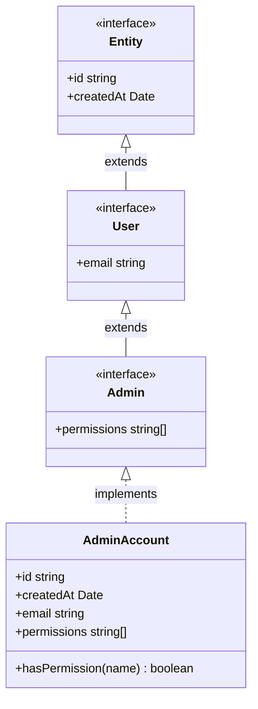
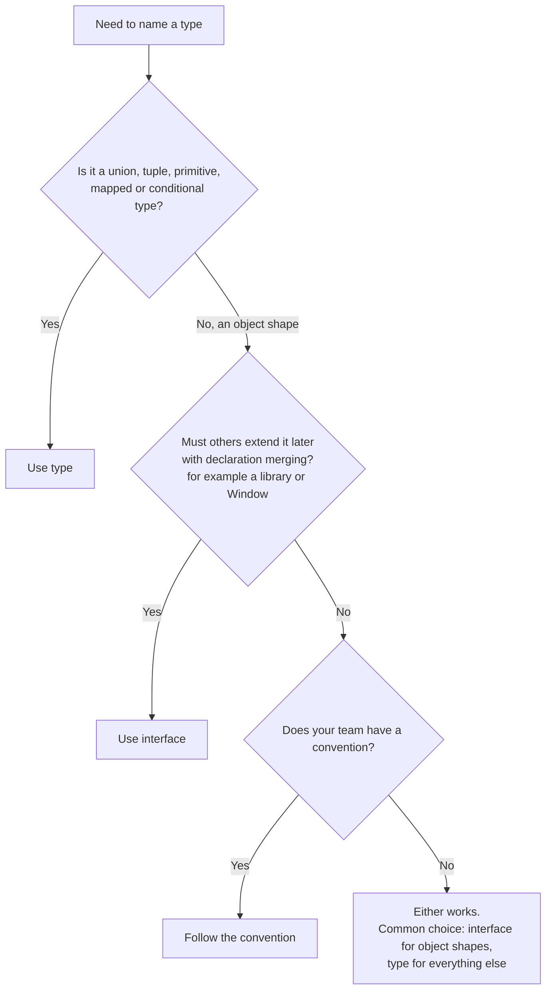
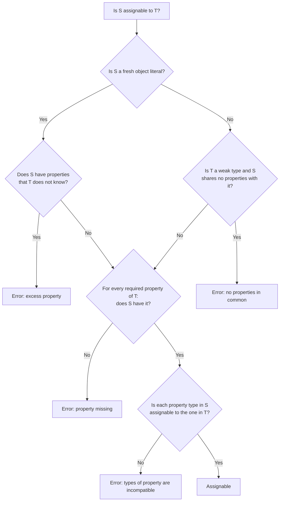

# Interfaces and Type Aliases

> In this document you learn how to describe the shape of objects in TypeScript: object types, optional and readonly properties, index signatures, interfaces, type aliases, intersections, function types and classes that implement interfaces. You also learn exactly how TypeScript decides if one type is compatible with another. "Interface vs type" is one of the most common TypeScript interview questions, and a good answer needs the details in this document.

**Before this:** [TypeScript basics and types](./01-typescript-basics-and-types.md) · [Objects and copying in JavaScript](../02-javascript/07-objects-and-copying.md) · **Interview questions:** [jump to questions](#interview-questions)

## Table of contents

1. [Object types](#object-types)
2. [Optional and readonly properties](#optional-and-readonly-properties)
3. [Interfaces](#interfaces)
4. [Type aliases](#type-aliases)
5. [Extending interfaces and intersecting types](#extending-interfaces-and-intersecting-types)
6. [Interface vs type alias](#interface-vs-type-alias)
7. [Index signatures and Record](#index-signatures-and-record)
8. [Excess property checks](#excess-property-checks)
9. [Structural typing and assignability in depth](#structural-typing-and-assignability-in-depth)
10. [Function types call signatures and construct signatures](#function-types-call-signatures-and-construct-signatures)
11. [Classes implementing interfaces](#classes-implementing-interfaces)
12. [Recursive types](#recursive-types)
13. [Modeling real data](#modeling-real-data)
14. [Interview questions](#interview-questions)
15. [Summary](#summary)
16. [References](#references)

---

## Object types

An **object type** describes which properties an object has and what type each property is.

You can write an object type directly where you need it. This is called an **anonymous** or **inline** object type:

```ts
function printUser(user: { id: number; name: string }) {
  console.log(`${user.id}: ${user.name}`);
}

printUser({ id: 1, name: "Asha" }); // "1: Asha"
printUser({ id: 2 });               // ❌ Property 'name' is missing in type '{ id: number; }'
```

Inline types are fine for one-off use. When you use the same shape in many places, give it a name. There are two ways to name an object type:

```ts
// 1. Interface
interface User {
  id: number;
  name: string;
}

// 2. Type alias
type UserAlias = {
  id: number;
  name: string;
};
```

For plain object shapes, these two are almost the same. The differences are explained in [Interface vs type alias](#interface-vs-type-alias).

You can separate properties with `;`, `,` or new lines. Most code styles use `;` or just new lines.

### Nested objects and arrays

```ts
interface Address {
  street: string;
  city: string;
  zip: string;
}

interface Customer {
  id: number;
  name: string;
  address: Address;            // nested object type
  tags: string[];              // array of primitives
  orders: { id: string; total: number }[]; // array of inline objects
}

const customer: Customer = {
  id: 7,
  name: "Ravi",
  address: { street: "MG Road 1", city: "Pune", zip: "411001" },
  tags: ["vip"],
  orders: [{ id: "o-1", total: 250 }],
};

console.log(customer.address.city); // "Pune"
```

Naming nested shapes (`Address`) makes them reusable and gives clearer error messages.

---

## Optional and readonly properties

### Optional properties

Add `?` after a property name to make it **optional**. The property may be missing.

```ts
interface UserProfile {
  id: number;
  name: string;
  phone?: string;   // optional
}

const a: UserProfile = { id: 1, name: "Asha" };                 // ✅ phone missing
const b: UserProfile = { id: 2, name: "Ravi", phone: "98765" }; // ✅
```

When you read an optional property, its type includes `undefined`. With `strictNullChecks`, you must handle that case:

```ts
function formatPhone(profile: UserProfile): string {
  profile.phone.trim();                 // ❌ 'profile.phone' is possibly 'undefined'.
  return profile.phone?.trim() ?? "No phone"; // ✅
}
```

### Optional vs `| undefined`

These two look similar but are different:

```ts
interface A {
  nickname?: string;              // the property may be missing
}

interface B {
  nickname: string | undefined;   // the property must exist, value may be undefined
}

const a: A = {};                       // ✅
const b1: B = {};                      // ❌ Property 'nickname' is missing
const b2: B = { nickname: undefined }; // ✅
```

Use `?` for "may not be provided" (like an optional form field). Use `| undefined` when the property must always be present, even if empty, so that callers do not forget it.

> With the `exactOptionalPropertyTypes` compiler flag, TypeScript also stops you from writing `{ nickname: undefined }` into an optional property `nickname?: string`. Without that flag, both "missing" and "explicitly undefined" are allowed. See [tsconfig](./09-modules-declaration-files-and-tsconfig.md).

### Readonly properties

Add `readonly` before a property to stop reassignment after the object is created.

```ts
interface Product {
  readonly id: string;
  name: string;
  price: number;
}

const laptop: Product = { id: "p-1", name: "Laptop", price: 1000 };
laptop.price = 900;   // ✅
laptop.id = "p-2";    // ❌ Cannot assign to 'id' because it is a read-only property.
```

Three important facts about `readonly`:

**1. It is compile-time only.** At runtime, the property is a normal property. Nothing is frozen.

**2. It is shallow.** Only the property itself is readonly, not the object inside it.

```ts
interface Order {
  readonly items: string[];
}

const order: Order = { items: ["pen"] };
order.items = [];        // ❌ cannot reassign the property
order.items.push("ink"); // ✅ allowed! The array itself is not readonly

// To protect the array too:
interface SafeOrder {
  readonly items: readonly string[];
}
```

**3. It does not affect assignability.** A readonly object can be assigned to a mutable type, and then changed through that other variable:

```ts
interface Point { readonly x: number }

const fixed: Point = { x: 1 };
const loose: { x: number } = fixed; // ✅ allowed
loose.x = 5;                        // ✅ changes 'fixed' too
console.log(fixed.x);               // 5
```

So `readonly` is a helpful guard against mistakes, not a security feature. For real runtime protection use `Object.freeze` (shallow) or immutable update patterns.

`Readonly<T>` is a utility type that makes every property readonly. See [Utility types](./08-utility-types.md).

---

## Interfaces

An **interface** gives a name to an object shape. Think of it as a **contract**: "Any object of this type must have these properties."

```ts
interface Logger {
  level: "debug" | "info" | "error";
  log(message: string): void;     // method signature
}

const consoleLogger: Logger = {
  level: "info",
  log(message) {
    console.log(`[${this.level}] ${message}`);
  },
};

consoleLogger.log("Server started"); // "[info] Server started"
```

Notice that `message` in the implementation has no annotation. TypeScript knows its type from the `Logger` interface. This is **contextual typing**.

### Analogy

An interface is like a **job description**. It lists what the person must be able to do ("can log messages", "has a level"). It does not care who the person is or where they came from. Anyone who meets the description gets the job. This matches structural typing: TypeScript cares about the shape, not the name.

Where the analogy breaks down: a job interview checks people when they apply. TypeScript checks only at compile time. At runtime, nobody checks the "job description" at all, because interfaces are erased.

### Interfaces are erased

An interface produces **no JavaScript**. It exists only for the compiler.

```ts
interface User { id: number }

// ❌ Wrong: there is no 'User' value at runtime
if (data instanceof User) {}
// error: 'User' only refers to a type, but is being used as a value here.
```

To check data at runtime, use a type guard. See [Unions, narrowing and type guards](./03-unions-narrowing-and-type-guards.md).

### Declaration merging

If you declare two interfaces with the same name in the same scope, TypeScript **merges** them into one. This is called **declaration merging**.

```ts
interface AppSettings {
  theme: string;
}

interface AppSettings {
  language: string;
}

// Both declarations are combined:
const settings: AppSettings = {
  theme: "dark",
  language: "en",
}; // ✅ both properties are required
```

This sounds strange, but it is very useful for **extending types you do not own**:

```ts
// Add a property to the browser's global Window type
declare global {
  interface Window {
    appVersion: string;
  }
}

window.appVersion = "1.4.2"; // ✅ TypeScript now knows this property

export {};
```

```ts
// Add a 'user' property to Express's Request type (Node.js backend)
declare global {
  namespace Express {
    interface Request {
      user?: { id: string; role: "admin" | "member" };
    }
  }
}
```

Libraries rely on this: they declare an interface, and you (or plugins) can add to it. More on this in [Modules, declaration files and tsconfig](./09-modules-declaration-files-and-tsconfig.md).

The danger: merging can happen **by accident**. If two files in the same global scope both declare `interface Config`, they silently merge. This is one reason to keep code in modules (files with `import`/`export`), where each file has its own scope.

If two merged declarations give the **same property different types**, it is an error:

```ts
interface Box { size: number }
interface Box { size: string }
// ❌ Subsequent property declarations must have the same type.
```

---

## Type aliases

A **type alias** gives a name to **any** type, not only object types. You create it with the `type` keyword.

```ts
type UserId = string;                         // alias for a primitive
type Status = "active" | "suspended";         // union of literals
type Point = { x: number; y: number };        // object type
type Pair = [string, number];                 // tuple
type Callback = (error: Error | null) => void; // function type
type Nullable<T> = T | null;                  // generic alias
```

An alias is just a **name**. It does not create a new, separate type. `UserId` and `string` are the same type, and you can use them interchangeably:

```ts
type UserId = string;
type OrderId = string;

function cancelOrder(id: OrderId) {}

const userId: UserId = "u-42";
cancelOrder(userId); // ✅ compiles: both are just string
```

If you need `UserId` and `OrderId` to be incompatible, use a **branded type**. See [Runtime validation and type-safe APIs](./11-runtime-validation-and-type-safe-apis.md).

Type aliases cannot be declared twice. There is no merging:

```ts
type Config = { theme: string };
type Config = { language: string }; // ❌ Duplicate identifier 'Config'.
```

Some things can **only** be written with a type alias:

```ts
// Unions
type Shape = Circle | Square;

// Mapped types
type Flags<T> = { [K in keyof T]: boolean };

// Conditional types
type ElementOf<T> = T extends (infer U)[] ? U : never;

// Template literal types
type EventName = `on${string}`;

// Tuples and primitives with a name
type Rgb = [number, number, number];

interface Circle { kind: "circle"; radius: number }
interface Square { kind: "square"; side: number }
```

---

## Extending interfaces and intersecting types

Both interfaces and type aliases can build bigger types from smaller ones.

### Interfaces use extends

```ts
interface Entity {
  id: string;
  createdAt: Date;
}

interface User extends Entity {
  email: string;
}

interface Admin extends User {
  permissions: string[];
}

const admin: Admin = {
  id: "a-1",
  createdAt: new Date(),
  email: "lead@example.com",
  permissions: ["users:delete"],
};
```

An interface can extend **several** interfaces at once:

```ts
interface Timestamped { createdAt: Date; updatedAt: Date }
interface SoftDeletable { deletedAt: Date | null }

interface Article extends Timestamped, SoftDeletable {
  title: string;
}
```

An interface can also extend a type alias, as long as the alias is an object type (not a union):

```ts
type Base = { id: string };
interface Product extends Base { name: string } // ✅
```

### Type aliases use intersections

An **intersection** type, written with `&`, means "has everything from both types".

```ts
type Entity = { id: string; createdAt: Date };
type UserFields = { email: string };

type User = Entity & UserFields;
// User has id, createdAt and email

type WithPermissions<T> = T & { permissions: string[] };
type Admin = WithPermissions<User>;
```

Intersections are great for **combining** types on the fly, for example adding a field to a generic type.

### The difference when properties conflict

This is the most important difference between `extends` and `&`:

```ts
// With extends: an error at the declaration — easy to find
interface A { id: string }
interface B extends A { id: number }
// ❌ Interface 'B' incorrectly extends interface 'A'.
//    Types of property 'id' are incompatible.

// With &: no error at the declaration — the property silently becomes 'never'
type C = { id: string };
type D = { id: number };
type CD = C & D;

const x: CD = { id: "1" }; // ❌ Type 'string' is not assignable to type 'never'.
// The error appears only when you try to use the type, far from the cause.
```

`string & number` is `never` because no value can be both a string and a number at the same time.

| | `interface X extends Y` | `type X = Y & Z` |
|---|---|---|
| Works with | Object types (interfaces or object type aliases) | Any types |
| Conflicting property | Error at the declaration | Property becomes `never` (or a merged function overload) silently |
| Error messages | Show the interface name | Sometimes show the full expanded shape |
| Type-check performance | Cached by name, usually faster | Recomputed more often in very large types |

### Diagram: extends and implements



---

## Interface vs type alias

### The practical summary

For a plain object shape, `interface` and `type` are almost interchangeable. Choose based on these real differences:

| Feature | `interface` | `type` |
|---|---|---|
| Object shapes | Yes | Yes |
| Unions (`A \| B`) | No | Yes |
| Primitives, tuples, function types with a name | Function types yes (call signature); others no | Yes |
| Mapped and conditional types | No | Yes |
| Declaration merging | Yes | No (duplicate name is an error) |
| Extending | `extends` (errors on conflicts) | `&` (conflicts become `never`) |
| Can a class `implements` it? | Yes | Yes, if it is an object type (not a union) |
| Implicit index signature | No | Yes (see below) |
| Name shown in error messages and hovers | Always | Usually, but sometimes expanded |

### A hidden difference: implicit index signatures

A type alias for an object literal type can be assigned to `Record<string, unknown>`. An interface cannot. This surprises many developers.

```ts
interface UserInterface { name: string }
type UserType = { name: string };

const u1: UserInterface = { name: "Asha" };
const u2: UserType = { name: "Asha" };

function logAll(obj: Record<string, unknown>) {
  console.log(Object.entries(obj));
}

logAll(u2); // ✅
logAll(u1); // ❌ Argument of type 'UserInterface' is not assignable to parameter of type
            //    'Record<string, unknown>'. Index signature for type 'string' is missing.
```

Why? Interfaces can be **merged** later with more properties, so TypeScript cannot be sure that all properties fit the index signature. A type alias is closed, so TypeScript can check it.

Fixes: use a type alias, add an index signature to the interface, or make the parameter generic: `function logAll<T extends object>(obj: T)`.

### Choosing in practice



**Recommendation:**

- Use `interface` for object shapes that describe "things" (models, service contracts, component inputs), especially in public APIs and libraries, because they can be extended and give clear errors.
- Use `type` for unions, tuples, function types, mapped and conditional types, and when you combine types with `&`.
- Most important: **be consistent** within a code base. The TypeScript handbook itself says you can choose based on personal preference, and suggests `interface` until you need a feature of `type`.

Angular code bases often use interfaces for models and DTOs. That is a convention, not a rule.

---

## Index signatures and Record

### Index signatures

Sometimes you do not know the property names in advance, only the type of their values. An **index signature** describes such an object.

```ts
interface Translations {
  [key: string]: string;
}

const en: Translations = {
  greeting: "Hello",
  farewell: "Goodbye",
};

en.welcome = "Welcome";  // ✅ any string key is allowed
en.count = 5;            // ❌ Type 'number' is not assignable to type 'string'.
```

The name `key` is only a label. It can be anything (`[lang: string]`, `[id: string]`).

Allowed key types: `string`, `number`, `symbol`, template literal patterns (TS 4.4+), and unions of these.

```ts
// Number keys (arrays-like objects)
interface ScoreBoard {
  [position: number]: string;
}

// Template literal pattern keys (TS 4.4+)
interface DataAttributes {
  [attr: `data-${string}`]: string;
}

const attrs: DataAttributes = { "data-id": "42", "data-role": "button" }; // ✅
const wrong: DataAttributes = { id: "42" }; // ❌ 'id' does not match `data-${string}`
```

### All named properties must fit the index signature

```ts
interface Config {
  [key: string]: string;
  version: number; // ❌ Property 'version' of type 'number' is not assignable to 'string' index type 'string'.
}

// ✅ Fix: widen the index signature
interface ConfigFixed {
  [key: string]: string | number;
  version: number;
  name: string;
}
```

This rule exists because `config["version"]` and `config[someKey]` must agree: if `someKey` happens to be `"version"`, the index signature must cover that type.

### The big danger: missing keys

Without extra settings, TypeScript assumes **every** key exists:

```ts
const en: Translations = { greeting: "Hello" };

const text = en["checkout"]; // type: string — but the value is undefined!
console.log(text.toUpperCase()); // compiles; runtime TypeError
```

Two fixes:

1. Include `undefined` in the value type: `[key: string]: string | undefined`.
2. Turn on `noUncheckedIndexedAccess` in `tsconfig.json`. Then every index access returns `T | undefined` and you must check it. See [tsconfig](./09-modules-declaration-files-and-tsconfig.md).

### Record

`Record<K, V>` is a built-in utility type for "an object whose keys are `K` and whose values are `V`".

```ts
type Translations = Record<string, string>;
// same as: { [key: string]: string }
```

The real power of `Record` is with a **union of literal keys**. Then **every** key is required:

```ts
type OrderStatus = "pending" | "shipped" | "delivered";

const statusLabels: Record<OrderStatus, string> = {
  pending: "Waiting for payment",
  shipped: "On the way",
  delivered: "Delivered",
}; // ✅

const incomplete: Record<OrderStatus, string> = {
  pending: "Waiting",
  shipped: "On the way",
};
// ❌ Property 'delivered' is missing in type ...
```

This is excellent for lookup tables: when someone adds a new status to the union, every `Record<OrderStatus, ...>` in the code base becomes an error until it is updated.

If not every key is needed, use `Partial<Record<OrderStatus, string>>`.

### Record vs index signature vs Map

| Need | Use |
|---|---|
| Fixed, known set of keys, all required | `Record<"a" \| "b", V>` |
| Any string keys, values of one type | `Record<string, V>` or `{ [key: string]: V }` (same thing) |
| Index signature plus some named properties | Interface with an index signature and named properties |
| Keys that are not strings (objects), frequent add and delete, or you need size and insertion order | `Map<K, V>` (a real runtime structure) |

`Map` is a runtime choice, not only a type. See [Map, Set, WeakMap and WeakSet](../02-javascript/12-map-set-weakmap-weakset.md).

---

## Excess property checks

### What it is

When you assign an **object literal** directly to a typed variable or parameter, TypeScript reports properties that the type does not know. This is called an **excess property check**.

```ts
interface ButtonProps {
  label: string;
  disabled?: boolean;
}

const props: ButtonProps = {
  label: "Save",
  disabeld: true, // ❌ Object literal may only specify known properties,
                  //    but 'disabeld' does not exist in type 'ButtonProps'. Did you mean to write 'disabled'?
};
```

### Why it exists

Structural typing normally allows extra properties. But in an object literal, an unknown property is almost always a **typo** (like `disabeld`). Without this check, the typo would be silently ignored and `disabled` would stay `undefined`. So TypeScript adds this extra check, only for **fresh object literals**.

### When the check does not happen

A **fresh** object literal is one written directly at the place where the type is expected. If the object first goes into a variable, it is no longer fresh, and only normal structural rules apply:

```ts
const raw = { label: "Save", disabeld: true };
const props2: ButtonProps = raw; // ✅ no error! Extra property is allowed here
```

Step by step:

1. `raw` gets the inferred type `{ label: string; disabeld: boolean }`.
2. Assigning `raw` to `ButtonProps` checks only: does `raw` have `label: string`? Yes. Is `disabled` (optional) compatible? It is missing, which is fine.
3. Extra properties are allowed by structural typing. No excess check, because `raw` is not fresh.

### Weak types: a second safety net

A **weak type** is an object type where **all** properties are optional. TypeScript reports an error if you assign something that shares **no** properties with a weak type, even through a variable:

```ts
interface ChartOptions {
  color?: string;
  width?: number;
}

const userInput = { colour: "red" };
const opts: ChartOptions = userInput;
// ❌ Type '{ colour: string; }' has no properties in common with type 'ChartOptions'.

const userInput2 = { colour: "red", width: 10 };
const opts2: ChartOptions = userInput2; // ✅ shares 'width', so no error
```

### Ways around the check (and when they are OK)

```ts
// 1. Add an index signature when extra properties are really expected
interface ButtonPropsOpen {
  label: string;
  [extra: string]: unknown;
}

// 2. Assign through a variable (legitimate when the object really has more data,
//    for example a full API object passed to a function that needs only some fields)
interface HasId { id: string }
function trackById(item: HasId) { console.log(item.id); }
const product = { id: "p-1", name: "Laptop", price: 1000 };
trackById(product); // ✅ fine and intended

// 3. A type assertion — avoid, it hides real typos
const props3 = { label: "Save", disabeld: true } as ButtonProps;
```

---

## Structural typing and assignability in depth

**Assignability** is the question: "Can a value of type `S` (source) be used where type `T` (target) is expected?" Every assignment, function call and return checks this.

### Rules for object types

`S` is assignable to `T` when:

1. Every **required** property of `T` exists in `S`.
2. Each property in `S` has a type that is assignable to the matching property type in `T`.
3. Optional properties in `T` may be missing in `S`. If present, their types must match.
4. Extra properties in `S` are fine (except the excess property check for fresh literals).

```ts
interface Named { name: string }
interface Person { name: string; age: number }

let named: Named;
let person: Person = { name: "Asha", age: 30 };

named = person; // ✅ Person has everything Named needs (plus more)
person = named; // ❌ Property 'age' is missing in type 'Named'
```

A useful way to think: **more properties = more specific = a subtype**. `Person` is a subtype of `Named`. You can always use a more specific type where a more general type is expected.

### The checker's decision, step by step



### Rules for function types

Functions are compared by parameters and return type:

**Return type: the source may return something more specific.**

```ts
type GetNamed = () => { name: string };
const getPerson = () => ({ name: "Asha", age: 30 });
const fn: GetNamed = getPerson; // ✅ returning more is fine
```

**Parameter count: the source may take fewer parameters.**

```ts
type Handler = (item: string, index: number) => void;
const logItem: Handler = (item) => console.log(item); // ✅ ignoring index is fine
```

This is why you can pass `(x) => ...` to `array.map`, even though `map` calls the callback with three arguments. JavaScript ignores extra arguments, so TypeScript allows it.

**Parameter types: the source must accept at least what the target will pass.** With `strictFunctionTypes` (part of `strict`), parameters are checked **contravariantly**: the source's parameter type must be the same or **wider** than the target's.

```ts
interface Animal { name: string }
interface Dog extends Animal { bark(): void }

type AnimalHandler = (animal: Animal) => void;

const handleDog = (dog: Dog) => dog.bark();
const handler: AnimalHandler = handleDog;
// ❌ with strictFunctionTypes: Type 'Animal' is not assignable to type 'Dog'.
// Reason: someone may call handler({ name: "Cat" }), and handleDog would call .bark() on a cat.
```

The opposite direction is fine: a function that accepts any `Animal` can be used where a `Dog` handler is expected.

### The method exception (bivariance)

Methods written with **method syntax** are checked more loosely (bivariantly), even with `strictFunctionTypes`. Function-typed **properties** are checked strictly.

```ts
interface HandlerMethod {
  handle(animal: Animal): void;           // method syntax
}

interface HandlerProperty {
  handle: (animal: Animal) => void;       // property with function type
}

const m: HandlerMethod = { handle: handleDog };   // ✅ allowed (unsafe, but allowed)
const p: HandlerProperty = { handle: handleDog }; // ❌ error (strict and safe)
```

TypeScript keeps methods loose for compatibility, mainly so that types like `Array<Dog>` remain assignable to `Array<Animal>`. If you want the strict check in your own contracts, write callbacks as **properties**. More on variance in [Generics](./05-generics.md).

### Classes are structural too, except for private members

```ts
class Cat { name = "Tom" }
class Robot { name = "R2" }

const pet: Cat = new Robot(); // ✅ same shape, so compatible

class Account {
  private balance = 0;
}
class FakeAccount {
  private balance = 0;
}
const acc: Account = new FakeAccount();
// ❌ Types have separate declarations of a private property 'balance'.
```

A class with a `private` or `protected` member is only compatible with itself and its subclasses. This makes such classes behave **nominally**.

---

## Function types call signatures and construct signatures

There are several ways to describe a function's type.

### Function type expressions

The most common form, usually with a type alias:

```ts
type Comparator<T> = (a: T, b: T) => number;

const byPrice: Comparator<{ price: number }> = (a, b) => a.price - b.price;

const products = [{ price: 30 }, { price: 10 }];
products.sort(byPrice);
console.log(products); // [ { price: 10 }, { price: 30 } ]
```

The parameter names (`a`, `b`) are required in the type but are only labels. `(string) => void` means "a function with a parameter **named** `string` of type `any`", which is a common mistake. Always write `(value: string) => void`.

### Method signatures and property signatures in an interface

```ts
interface CartService {
  addItem(sku: string, qty: number): void;        // method signature
  removeItem: (sku: string) => void;              // property signature with a function type
  total(): number;
}
```

Both describe a function. The difference is the variance rule shown above: property signatures are checked strictly.

### Call signatures: functions with properties

In JavaScript, functions are objects, so they can have properties. A **call signature** describes a function that also has properties. You write it inside an object type, with `:` instead of `=>`:

```ts
interface Formatter {
  (value: number): string;   // call signature: it can be called
  locale: string;            // and it has a property
}

function createFormatter(locale: string): Formatter {
  const format = (value: number) => value.toLocaleString(locale);
  format.locale = locale;    // TypeScript allows adding properties to a function declared with const
  return format;
}

const inr = createFormatter("en-IN");
console.log(inr(1234567));   // "12,34,567"
console.log(inr.locale);     // "en-IN"
```

Real examples of callable objects: jQuery's `$` (a function with methods like `$.ajax`), Express's `app` (a request handler function that also has `app.get`, `app.listen`), and `debounce` helpers that return a function with a `.cancel()` method.

```ts
interface DebouncedFn<A extends unknown[]> {
  (...args: A): void;
  cancel(): void;
}
```

### Construct signatures: things you call with new

A **construct signature** describes something you can call with `new`. Add `new` before the call signature:

```ts
interface Plugin {
  name: string;
  init(): void;
}

interface PluginConstructor {
  new (name: string): Plugin;
}

class AnalyticsPlugin implements Plugin {
  constructor(public name: string) {}
  init() { console.log(`${this.name} ready`); }
}

function registerPlugin(Ctor: PluginConstructor, name: string): Plugin {
  const plugin = new Ctor(name);
  plugin.init();
  return plugin;
}

registerPlugin(AnalyticsPlugin, "analytics"); // "analytics ready"
```

A class is assignable to a construct signature when its constructor matches. You can also write it inline as `new (name: string) => Plugin`. This is how dependency injection containers and plugin systems accept classes as arguments. Angular's `Type<T>` is a similar construct type. More on class types in [Functions and classes](./04-functions-and-classes.md).

---

## Classes implementing interfaces

A class can declare that it **implements** an interface. TypeScript then checks that the class has everything the interface requires.

```ts
interface PaymentGateway {
  readonly name: string;
  charge(amountInCents: number): Promise<string>; // returns a transaction id
  refund(transactionId: string): Promise<void>;
}

class StripeGateway implements PaymentGateway {
  readonly name = "stripe";

  async charge(amountInCents: number): Promise<string> {
    console.log(`Charging ${amountInCents} via Stripe`);
    return "txn_123";
  }

  async refund(transactionId: string): Promise<void> {
    console.log(`Refunding ${transactionId}`);
  }
}

class BrokenGateway implements PaymentGateway {
  readonly name = "broken";
  async charge(amountInCents: number) { return "x"; }
}
// ❌ Class 'BrokenGateway' incorrectly implements interface 'PaymentGateway'.
//    Property 'refund' is missing in type 'BrokenGateway'.
```

Code that depends on the interface (not the class) can work with any gateway. This is the basis of the **dependency inversion principle**. See [Dependency inversion and injection](../04-oop-solid-design-patterns/05-dependency-inversion-and-injection.md).

```ts
class CheckoutService {
  constructor(private gateway: PaymentGateway) {}

  async pay(amount: number) {
    const id = await this.gateway.charge(amount);
    console.log(`Paid with ${this.gateway.name}: ${id}`);
  }
}

await new CheckoutService(new StripeGateway()).pay(5000);
// "Charging 5000 via Stripe"
// "Paid with stripe: txn_123"
```

### What implements does and does not do

- It **checks** the class against the interface.
- It does **not** change the class's type. It does not add properties, and it does not give types to method parameters:

```ts
interface Clickable {
  onClick(event: MouseEvent): void;
}

class SaveButton implements Clickable {
  onClick(event) {} // ❌ Parameter 'event' implicitly has an 'any' type.
}
```

You must still annotate the parameters in the class. `implements` is only a check, not a source of types.

- A class can implement several interfaces: `class Repo implements Readable, Writable {}`.
- A class can implement an object-type alias, but not a union type.
- `implements` is optional. Because of structural typing, a class that has the right shape is already compatible. `implements` gives you the error **at the class**, which is easier to find.

In Angular, lifecycle interfaces like `OnInit` and `OnDestroy` work this way. `class UserComponent implements OnInit` makes TypeScript check that you wrote `ngOnInit()` correctly (no typo like `ngOninit`). Angular itself calls the method whether or not you write `implements`. See [Lifecycle hooks](../06-angular-16/04-lifecycle-hooks.md).

---

## Recursive types

A type can refer to itself. This is how you describe trees, menus, comment threads and JSON.

```ts
interface MenuItem {
  label: string;
  route?: string;
  children?: MenuItem[];   // refers to itself
}

const menu: MenuItem[] = [
  { label: "Home", route: "/" },
  {
    label: "Settings",
    children: [
      { label: "Profile", route: "/settings/profile" },
      { label: "Security", route: "/settings/security" },
    ],
  },
];

function countItems(items: MenuItem[]): number {
  return items.reduce((total, item) => total + 1 + countItems(item.children ?? []), 0);
}

console.log(countItems(menu)); // 4
```

Type aliases can be recursive too. A classic example is a type for any JSON value:

```ts
type Json =
  | string
  | number
  | boolean
  | null
  | Json[]
  | { [key: string]: Json };

const payload: Json = { user: { name: "Asha", tags: ["vip", 1, null] } }; // ✅
const bad: Json = { createdAt: new Date() }; // ❌ Date is not valid JSON
```

---

## Modeling real data

### Separate API shapes from UI shapes when they really differ

An API often sends data in a shape that is not ideal for the UI. It is common to have:

- A **DTO** (data transfer object): the exact shape that travels over the network.
- A **domain model** or **view model**: the shape your app works with.

```ts
// What the server sends (JSON has no Date type, so dates are strings)
interface UserDto {
  id: string;
  full_name: string;
  created_at: string;   // ISO string
  role: "ADMIN" | "MEMBER";
}

// What the app uses
interface User {
  id: string;
  fullName: string;
  createdAt: Date;
  isAdmin: boolean;
}

function toUser(dto: UserDto): User {
  return {
    id: dto.id,
    fullName: dto.full_name,
    createdAt: new Date(dto.created_at),
    isAdmin: dto.role === "ADMIN",
  };
}

const user = toUser({ id: "1", full_name: "Asha Rao", created_at: "2024-05-01T10:00:00Z", role: "ADMIN" });
console.log(user.fullName, user.isAdmin); // "Asha Rao" true
```

Do not create three copies of every model by habit. Create a separate type only when the shapes really differ. Utility types like `Omit`, `Pick` and `Partial` help derive related shapes from one source (for example `type CreateUserDto = Omit<User, "id">`). See [Utility types](./08-utility-types.md).

### Best practices

- **Name important shapes.** Named types give clearer errors and are reusable.
- **Be honest about optional and nullable values.** If the API can omit a field, mark it optional, so the compiler makes you handle it.
- **Use literal unions for fixed values** (`role: "ADMIN" | "MEMBER"`) instead of `string`.
- **Use `readonly`** for data that should not be changed, such as state in NgRx stores or Redux.
- **Prefer `Record<Union, V>`** for lookup tables, so new union members force updates.
- **Write callbacks as property signatures** in your own contracts if you want strict parameter checking.
- **Keep code in modules** to avoid accidental global interface merging.
- **Remember that all of this is erased.** Validate external data at runtime.

---

## Interview questions

### How to explain this in an interview

1. **Define it:** "Interfaces and type aliases both give a name to a type. An interface describes an object shape. A type alias can name any type: objects, unions, tuples, functions, mapped and conditional types."
2. **Why it exists:** "They let me describe contracts once and reuse them, so the compiler can check every place that uses the shape."
3. **How it works:** "TypeScript is structural, so any value with the right properties fits, no matter how it was created. Both are erased at runtime."
4. **Small example:** "`interface User { id: string; name: string }`, and `type Status = 'active' | 'blocked'`. The second one can only be a type alias, because it is a union."
5. **Where it is useful:** "API models, component inputs, service contracts, and lookup tables like `Record<Status, string>`."
6. **Trade-offs / gotchas:** "Interfaces support declaration merging, which is great for extending `Window` or Express's `Request`, but can merge by accident. Interfaces give errors on conflicting `extends`, while intersections silently create `never`. And a type alias is assignable to `Record<string, unknown>`, but an interface is not."

### Q1. What is the difference between an interface and a type alias?

**What the interviewer is checking:** Whether you know the real technical differences, not just "interface is for OOP".

**Short spoken answer (30–60 seconds):**
> For plain object shapes, they are almost the same, and both can be extended and implemented by classes. The real differences: a type alias can name any type, like unions, tuples, primitives, and mapped or conditional types, while an interface only describes object shapes. Interfaces support declaration merging, so two declarations with the same name combine. That is how we extend `Window` or Express's `Request`. Extending also behaves differently: if an interface `extends` another with a conflicting property, I get an error right there, but with an intersection the property silently becomes `never`. In practice, I use interfaces for object models and contracts, and type aliases for unions and type transformations, and I follow the team's convention.

**Detailed explanation:**

| Point | Interface | Type alias |
|---|---|---|
| Unions, tuples, mapped, conditional types | No | Yes |
| Declaration merging | Yes | No |
| Extend | `extends` (checked) | `&` (conflicts become `never`) |
| `implements` by a class | Yes | Yes, for object types |
| Assignable to `Record<string, unknown>` | No (no implicit index signature) | Yes |
| Performance | Interfaces are cached by name; the TypeScript performance wiki recommends interfaces over large intersections | Intersections are recomputed |

**Follow-up questions:**
- **Can an interface extend a type alias?** — Yes, if the alias is an object type. It cannot extend a union type.
- **Can a class implement a type alias?** — Yes, if it is an object type. Not if it is a union, because the class cannot know which member it must satisfy.
- **Which one does the TypeScript team recommend?** — The handbook says it is mostly preference, and suggests using `interface` until you need features of `type`.

**Common mistakes:** "Type aliases cannot be extended" (they can, with `&`); "Classes cannot implement types" (they can); "Interfaces are faster at runtime" (both are erased; the performance difference is only in type checking).

**Where this is used in real projects:** API models and DTOs (interfaces), state and action unions in NgRx/Redux (types), component input types.

### Q2. What is declaration merging, and where is it useful?

**What the interviewer is checking:** Knowledge of a unique interface feature and real use cases.

**Short spoken answer (30–60 seconds):**
> Declaration merging means that if I declare two interfaces with the same name in the same scope, TypeScript combines them into one interface with all the properties. It is mainly useful to extend types I do not own. For example, I can add a property to the global `Window` interface, or add a `user` property to Express's `Request` type after my auth middleware sets it. Libraries are designed for this. The risk is accidental merging when two global declarations happen to use the same name, so I keep code in modules.

**Code:**

```ts
// types/express.d.ts
import "express";

declare module "express-serve-static-core" {
  interface Request {
    requestId: string;
  }
}
```

**Follow-up questions:**
- **Can type aliases merge?** — No. A second `type` with the same name is a "Duplicate identifier" error.
- **What happens if the same property has different types in two merged declarations?** — An error: "Subsequent property declarations must have the same type."
- **What else can merge?** — Namespaces merge with other namespaces, classes, functions and enums. Enums merge with enums. Interfaces can merge with classes (adding to the instance type). These are rare in modern code.

**Common mistakes:** Not knowing merging exists, then being confused when an interface has properties "from nowhere".

**Where this is used in real projects:** Extending `Window`, Express `Request`, environment types like `ProcessEnv`, Vue/Pinia or i18n plugin types, Angular `@angular/localize` global declarations.

### Q3. Will this compile? Explain.

```ts
interface User {
  name: string;
  age?: number;
}

const u1: User = { name: "Asha", agee: 30 };

const data = { name: "Ravi", agee: 30 };
const u2: User = data;
```

**What the interviewer is checking:** Excess property checks and freshness.

**Answer:**
- `u1` is an **error**: "Object literal may only specify known properties, and 'agee' does not exist in type 'User'."
- `u2` **compiles**.

**Short spoken answer (30–60 seconds):**
> The first line fails because of the excess property check. When I assign an object literal directly to a type, TypeScript reports properties that the type does not know, because they are usually typos, like `agee` here. The second case compiles, because `data` is a variable, not a fresh literal. Then only normal structural rules apply: `data` has a `name` string, `age` is optional so it can be missing, and extra properties are allowed. So the typo goes unnoticed. That is why I prefer to annotate object literals at the point of creation, or use `satisfies`.

**Follow-up questions:**
- **What if all properties of `User` were optional?** — Then `User` is a weak type. Assigning `{ agee: 30 }` through a variable would be an error, because it shares no properties with `User`. Here `data` shares `name`, so it would still compile.
- **How do you allow extra properties on purpose?** — Add an index signature like `[key: string]: unknown`.

**Common mistakes:** Thinking TypeScript object types are "exact" and always reject extra properties.

### Q4. Will this compile?

```ts
interface Point2D { x: number; y: number }
interface Point3D { x: number; y: number; z: number }

let p2: Point2D = { x: 1, y: 2 };
let p3: Point3D = { x: 1, y: 2, z: 3 };

p2 = p3;
p3 = p2;
```

**Answer:** `p2 = p3` compiles. `p3 = p2` is an error: "Property 'z' is missing in type 'Point2D' but required in type 'Point3D'."

**Explanation:** Assignability is checked property by property. `Point3D` has every property `Point2D` needs, so it is a subtype and can be used as a `Point2D`. The reverse is missing `z`. Extra properties (`z`) are fine because `p3` is a variable, not a fresh literal.

### Q5. What are index signatures? What problems can they cause?

**What the interviewer is checking:** Understanding of dynamic keys and their safety holes.

**Short spoken answer (30–60 seconds):**
> An index signature describes an object where I do not know the keys in advance, only the value type, like `{ [key: string]: string }` for a translation dictionary. It has two problems. First, all named properties must be compatible with it, so I cannot mix `[key: string]: string` with a `count: number` property. Second, and more important, TypeScript assumes every key exists, so `dict["missing"]` has type `string` even though it is `undefined` at runtime. To fix that, I turn on `noUncheckedIndexedAccess`, or include `undefined` in the value type. If the keys are actually known, I use `Record` with a union of literal keys instead, so every key is required and checked.

**Code:**

```ts
const prices: Record<string, number> = { apple: 1.2 };
const banana = prices["banana"];  // number (but really undefined)
console.log(banana.toFixed(2));    // runtime TypeError

// With noUncheckedIndexedAccess: banana is number | undefined, and the line above is an error.
```

**Follow-up questions:**
- **What key types are allowed?** — `string`, `number`, `symbol`, template literal patterns like `` `data-${string}` `` (TS 4.4+), and unions of these.
- **What is the difference between `Record<string, T>` and `{ [key: string]: T }`?** — None for a plain `string` key; `Record` is defined as a mapped type that produces the same thing. The difference appears with literal union keys, where `Record` requires every key.
- **When would you use a `Map` instead?** — When keys are not strings, when you add and remove keys often, or when you need `size` and insertion-ordered iteration without prototype issues.

**Common mistakes:** Not knowing that missing keys are typed as present.

**Where this is used in real projects:** Translation dictionaries, caches keyed by id, form error maps, HTTP headers, feature flag maps.

### Q6. Is readonly deep? Does it protect data at runtime?

**What the interviewer is checking:** Compile-time vs runtime, and shallow vs deep.

**Short spoken answer (30–60 seconds):**
> No to both. `readonly` is checked only at compile time and is erased. It is also shallow: a `readonly items: string[]` cannot be reassigned, but I can still `push` into the array. For that, I need `readonly string[]` too. There is one more hole: a readonly object can be assigned to a variable of a mutable type, and then changed through that variable. So `readonly` prevents mistakes, but it is not a guarantee. For real runtime immutability, I use `Object.freeze`, which is also shallow, or I follow immutable update patterns, which is what NgRx and Redux rely on.

**Code:**

```ts
interface State { readonly user: { name: string } }
const state: State = { user: { name: "Asha" } };
state.user.name = "Ravi"; // ✅ compiles — readonly is shallow
```

**Follow-up questions:**
- **How do you make a type deeply readonly?** — With a recursive mapped type such as `DeepReadonly<T>`. See [Conditional types and infer](./07-conditional-types-and-infer.md) and [Utility types](./08-utility-types.md).
- **What is the difference between `readonly` and `const`?** — `const` is for variables (the binding cannot be reassigned). `readonly` is for properties and arrays in types.

**Common mistakes:** Believing `readonly` freezes the object; believing it is deep.

### Q7. What is the difference between `prop?: T` and `prop: T | undefined`?

**Short answer:** `prop?: T` means the property can be **missing**. `prop: T | undefined` means the property must be **present**, but its value can be `undefined`. Use the second when you want callers to make a conscious choice. With `exactOptionalPropertyTypes`, an optional property also rejects an explicit `undefined` value unless you write `prop?: T | undefined`.

### Q8. What is the difference between extends and an intersection (&)?

**What the interviewer is checking:** How conflicts are handled and when each is useful.

**Short spoken answer (30–60 seconds):**
> Both combine properties from several types. `extends` is only for interfaces and is checked: if the child declares a property with a type that is not compatible with the parent, I get an error at the declaration. An intersection with `&` works with any types, including generics, and is not checked at the declaration. If two members have conflicting property types, like `id: string` and `id: number`, the property becomes `never`, and I only see an error later when I try to create a value. I use `extends` for clear model hierarchies, and `&` for quick combinations like `T & { id: string }` in generic code.

**Code:**

```ts
type WithId<T> = T & { id: string };

function save<T>(item: T): WithId<T> {
  return { ...item, id: crypto.randomUUID() };
}

const saved = save({ name: "Laptop" });
console.log(saved.id.length); // 36
```

**Follow-up questions:**
- **What is `string & number`?** — `never`, because no value can be both.
- **What is `{ a: string } & { b: number }`?** — An object type with both `a` and `b`.
- **What happens when two intersected types have the same method with different signatures?** — The method becomes an intersection of function types, which behaves like overloads.

**Common mistakes:** Thinking `&` means "either" (that is `|`); not knowing about silent `never`.

### Q9. How do you describe a function in an interface? What is the difference between a method and a function property?

**What the interviewer is checking:** Function type syntax and the variance difference.

**Short spoken answer (30–60 seconds):**
> There are three ways. A method signature, like `save(user: User): void`. A property with a function type, like `save: (user: User) => void`. And a call signature, like `(value: number): string`, when the object itself is callable. Methods and function properties look the same, but they are checked differently. With `strictFunctionTypes`, function properties are checked contravariantly, which is safe: a handler that only accepts `Dog` cannot be used where any `Animal` can be passed. Methods are checked bivariantly for backward compatibility, so that unsafe assignment is allowed. If I want strict checking in my own contracts, I write callbacks as properties.

**Code:** See [the method exception](#the-method-exception-bivariance).

**Follow-up questions:**
- **Why does TypeScript keep methods bivariant?** — Many built-in types, like `Array<T>`, have methods that take `T`. Strict checking would make `Dog[]` not assignable to `Animal[]`, which would break a lot of existing code.
- **What is wrong with `type Fn = (string) => void`?** — `string` is the parameter **name**, and its type is implicitly `any`. Write `(value: string) => void`.

### Q10. What is a construct signature? How do you type a function that takes a class as an argument?

**Short answer:** A construct signature, written `new (...args) => T` or `{ new (...args): T }`, describes something you call with `new`. Use it to accept a class as a value:

```ts
type Constructor<T> = new (...args: any[]) => T;

function createInstance<T>(Ctor: Constructor<T>): T {
  return new Ctor();
}

class Logger { log(msg: string) { console.log(msg); } }
const logger = createInstance(Logger); // type: Logger
logger.log("created");                 // "created"
```

`any[]` is acceptable here because the constructor arguments are not used for typing; it is a common pattern in mixins and DI containers. For abstract classes, use `abstract new (...args: any[]) => T` (TS 4.2+). Angular's `Type<T>` serves the same purpose. More in [Functions and classes](./04-functions-and-classes.md).

### Q11. Does `implements` give types to the class members?

**What the interviewer is checking:** A common misconception.

**Short spoken answer (30–60 seconds):**
> No. `implements` only checks that the class matches the interface. It does not change the type of the class and does not contextually type the method parameters. So if the interface says `onClick(event: MouseEvent)` and I write `onClick(event)` in the class, `event` is implicitly `any`, and with `noImplicitAny` I get an error. I still need to annotate the parameters. Also, because TypeScript is structural, `implements` is optional for compatibility. Its value is that errors show up at the class declaration.

### Q12. Debugging: why does this fail?

```ts
interface Product {
  id: string;
  price: number;
}

function toQueryString(params: Record<string, unknown>): string {
  return Object.entries(params).map(([k, v]) => `${k}=${String(v)}`).join("&");
}

const product: Product = { id: "p1", price: 10 };
toQueryString(product);
// ❌ Index signature for type 'string' is missing in type 'Product'.
```

**What the interviewer is checking:** The implicit index signature difference between interfaces and type aliases.

**Short spoken answer (30–60 seconds):**
> `Record<string, unknown>` has a string index signature. A type alias for an object literal type gets an implicit index signature, so it would be accepted. But an interface does not, because interfaces can be extended later through declaration merging, so TypeScript cannot guarantee all its properties fit. The simplest fixes are: change `Product` to a type alias, make the function generic with `<T extends object>`, or spread the object, `toQueryString({ ...product })`, because the spread creates a fresh object type.

**Fixed code:**

```ts
function toQueryStringFixed<T extends object>(params: T): string {
  return Object.entries(params).map(([k, v]) => `${k}=${String(v)}`).join("&");
}

console.log(toQueryStringFixed(product)); // "id=p1&price=10"
```

### Q13. What is a weak type?

**Short answer:** An object type where every property is optional, like `interface Options { color?: string; width?: number }`. Because almost any object would match it structurally, TypeScript adds a rule: you cannot assign a value that shares **no** properties with a weak type. This catches typos even when the object comes through a variable:

```ts
const input = { colour: "red" };
const options: Options = input;
// ❌ Type '{ colour: string; }' has no properties in common with type 'Options'.
```

### Q14. Code review: how would you improve this model?

```ts
interface Order {
  id: any;
  status: string;
  items: Array<any>;
  customer: { name: string; email: string; };
  meta: {};
}
```

**What the interviewer is checking:** Practical type design.

**Answer:**

1. `id: any` → `id: string` (or a branded `OrderId`). `any` disables checking for everything that touches it.
2. `status: string` → a literal union: `"pending" | "paid" | "shipped" | "cancelled"`. Typos become errors and switches can be exhaustive.
3. `items: Array<any>` → a named `OrderItem` interface with `sku`, `qty`, `unitPrice`.
4. `customer` inline type → a named `Customer` interface, reusable and clearer in errors.
5. `meta: {}` → `{}` accepts almost anything (even `5`). Use `Record<string, unknown>` or a specific type.
6. Consider `readonly` for `id`, and `readonly OrderItem[]` if orders are immutable state (NgRx).

```ts
type OrderStatus = "pending" | "paid" | "shipped" | "cancelled";

interface OrderItem {
  sku: string;
  qty: number;
  unitPrice: number;
}

interface Customer {
  name: string;
  email: string;
}

interface Order {
  readonly id: string;
  status: OrderStatus;
  items: readonly OrderItem[];
  customer: Customer;
  meta: Record<string, unknown>;
}
```

### Q15. How do you type a lookup table so that adding a new enum or union member forces you to update it?

**Short answer:** Use `Record<Union, Value>` (optionally with `satisfies` to keep literal types). Every key is required, so a new union member breaks compilation until the table is updated.

```ts
type Role = "admin" | "editor" | "viewer";

const roleLabels = {
  admin: "Administrator",
  editor: "Editor",
  viewer: "Read-only",
} satisfies Record<Role, string>;

// Later someone adds "owner" to Role:
// ❌ Property 'owner' is missing in type ...
```

### Q16. How do you type a recursive structure like a category tree or a comment thread?

**Short answer:** Let the type refer to itself:

```ts
interface Comment {
  id: string;
  text: string;
  replies: Comment[];
}

function countComments(comments: Comment[]): number {
  return comments.reduce((n, c) => n + 1 + countComments(c.replies), 0);
}
```

Interfaces and object type aliases can both be recursive. Recursive union aliases like `type Json = ... | Json[] | { [key: string]: Json }` are also allowed.

### Q17. Senior: interfaces or intersections for large types? Does it matter for performance?

**What the interviewer is checking:** Awareness of type-checker performance in big code bases.

**Short spoken answer (30–60 seconds):**
> It can matter in very large projects. The TypeScript team's performance guide recommends interfaces over intersections for composing object types. An interface that extends others is a single named type that the checker can cache, and it checks the properties once at the declaration. Big intersections are recomputed more often and can produce long, expanded error messages. So for a model built from many parts, I prefer `interface X extends A, B, C`. I still use intersections for small generic combinations like `T & { id: string }`. For runtime, there is no difference at all, because both are erased.

**Follow-up:** **How do you investigate slow type checking?** — Use `tsc --extendedDiagnostics` to see check time, and `tsc --generateTrace` to find which types are expensive. More in [TypeScript in real projects](./12-typescript-in-real-projects.md).

### Q18. Scenario: a third-party library's type is missing a property that exists at runtime. What do you do?

**Short spoken answer (30–60 seconds):**
> If the library's types are an interface, I can use module augmentation: in a `.d.ts` file, `declare module "library-name"` and redeclare the interface with the extra property. Declaration merging adds it. If it is a type alias, I cannot merge it, so I create my own type that extends or intersects it and use that in my code. I avoid casting to `any` at every call site. And I check if a newer version of the library or its `@types` package already fixes it, or I contribute the fix to DefinitelyTyped.

Details in [Modules, declaration files and tsconfig](./09-modules-declaration-files-and-tsconfig.md).

### Q19. Can you use `instanceof` with an interface?

**Short answer:** No. Interfaces are erased, so there is no runtime value to compare against: "'User' only refers to a type, but is being used as a value here." Use `instanceof` with classes, or write a type guard function that checks properties (`"email" in value`), or use a discriminant property like `kind`. See [Unions, narrowing and type guards](./03-unions-narrowing-and-type-guards.md).

---

## Summary

- An **object type** lists properties and their types. Name shared shapes with an `interface` or a `type` alias.
- `?` makes a property **optional** (may be missing). `| undefined` means present but possibly undefined.
- `readonly` is compile-time only, shallow, and does not block assignment to mutable types.
- **Declaration merging** combines interfaces with the same name. Use it to extend `Window`, Express `Request` and library types.
- A **type alias** can name any type: unions, tuples, functions, mapped and conditional types. It cannot merge.
- `extends` reports conflicts at the declaration. `&` silently turns conflicting properties into `never`.
- A type alias is assignable to `Record<string, unknown>`. An interface is not (no implicit index signature).
- **Index signatures** assume every key exists. Use `noUncheckedIndexedAccess` or `| undefined`. Use `Record<Union, V>` for complete lookup tables.
- **Excess property checks** catch typos only in fresh object literals. Weak types reject values with no common properties.
- Assignability is **structural**: more properties = subtype. Function parameters are checked contravariantly for function properties, bivariantly for methods.
- **Call signatures** describe callable objects. **Construct signatures** describe things you call with `new`.
- `implements` only checks a class. It does not add types to its members.

## References

- TypeScript Handbook: Object Types — https://www.typescriptlang.org/docs/handbook/2/objects.html
- TypeScript Handbook: Everyday Types (differences between type aliases and interfaces) — https://www.typescriptlang.org/docs/handbook/2/everyday-types.html#differences-between-type-aliases-and-interfaces
- TypeScript Handbook: More on Functions (call and construct signatures) — https://www.typescriptlang.org/docs/handbook/2/functions.html
- TypeScript Handbook: Declaration Merging — https://www.typescriptlang.org/docs/handbook/declaration-merging.html
- TypeScript Handbook: Type Compatibility — https://www.typescriptlang.org/docs/handbook/type-compatibility.html
- TypeScript Handbook: Classes (`implements`) — https://www.typescriptlang.org/docs/handbook/2/classes.html
- TSConfig reference: `strictFunctionTypes`, `noUncheckedIndexedAccess`, `exactOptionalPropertyTypes` — https://www.typescriptlang.org/tsconfig/
- TypeScript 4.4 release notes (template string pattern index signatures) — https://www.typescriptlang.org/docs/handbook/release-notes/typescript-4-4.html
- TypeScript wiki: Performance (preferring interfaces over intersections) — https://github.com/microsoft/TypeScript/wiki/Performance
