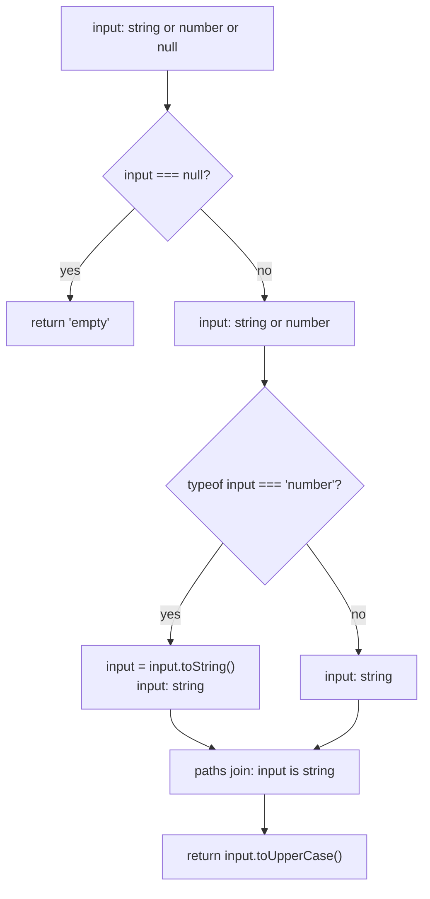
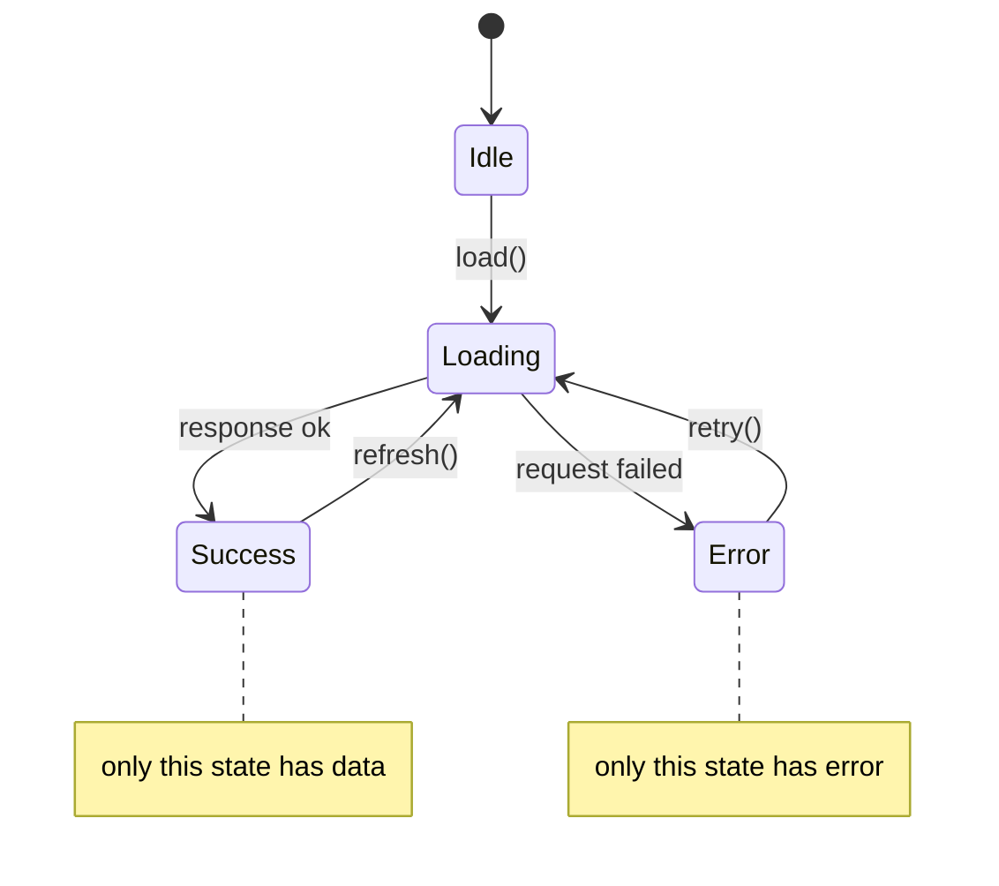
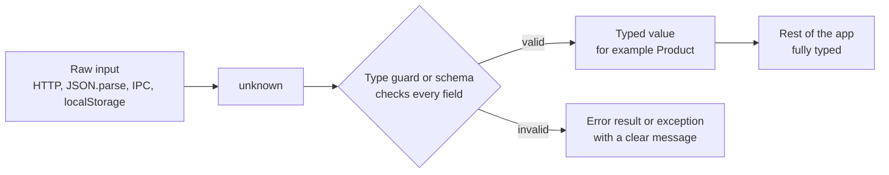
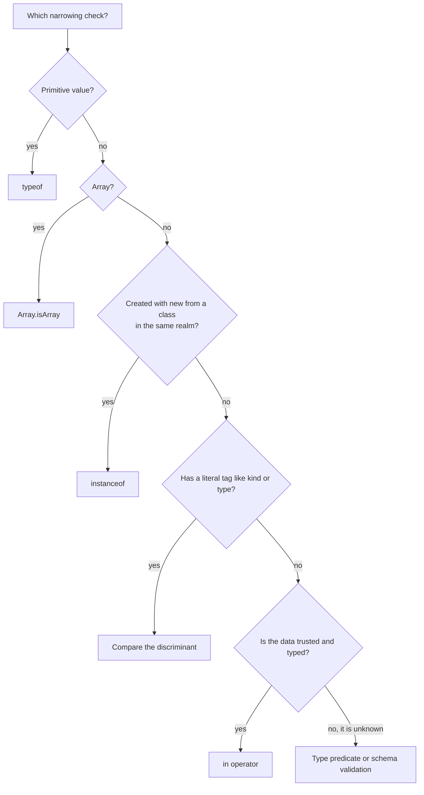

# Unions, Narrowing and Type Guards

> In this document you learn how to work with values that can be one of several types. You learn union types, how TypeScript **narrows** a union to one type after a check, how to write your own type guards and assertion functions, and how to model application state with **discriminated unions** that the compiler checks for you. These ideas are used every day in Angular, NgRx, Redux and Node.js code, and they are tested in interviews through design questions ("how would you model a loading state?") and debugging questions.

**Before this:** [TypeScript basics and types](./01-typescript-basics-and-types.md) · [Interfaces and type aliases](./02-interfaces-and-type-aliases.md) · **Interview questions:** [jump to questions](#interview-questions)

## Table of contents

1. [Union types](#union-types)
2. [Intersections in short](#intersections-in-short)
3. [What narrowing is](#what-narrowing-is)
4. [Narrowing with typeof](#narrowing-with-typeof)
5. [Truthiness narrowing](#truthiness-narrowing)
6. [Equality narrowing](#equality-narrowing)
7. [Narrowing with in](#narrowing-with-in)
8. [Narrowing with instanceof and Array.isArray](#narrowing-with-instanceof-and-arrayisarray)
9. [Control flow analysis](#control-flow-analysis)
10. [User-defined type guards](#user-defined-type-guards)
11. [Assertion functions](#assertion-functions)
12. [Discriminated unions](#discriminated-unions)
13. [Exhaustiveness checking with never](#exhaustiveness-checking-with-never)
14. [Narrowing pitfalls](#narrowing-pitfalls)
15. [Narrowing unknown API data](#narrowing-unknown-api-data)
16. [Interview questions](#interview-questions)
17. [Summary](#summary)
18. [References](#references)

---

## Union types

### What it is

A **union type** describes a value that can be **one of several types**. You write it with `|` (read it as "or").

```ts
let id: string | number;

id = "u-42"; // ✅
id = 42;     // ✅
id = true;   // ❌ Type 'boolean' is not assignable to type 'string | number'.
```

### Why it exists

JavaScript values are often flexible. A function may accept an id as a string or a number. A value may be "a user or null". An API may return "data or an error". Unions let you describe this honestly instead of using `any`.

```ts
type Id = string | number;
type MaybeUser = User | null;
type Theme = "light" | "dark" | "system";   // union of literal types
type ApiResult = { ok: true; data: User } | { ok: false; error: string };

interface User { id: Id; name: string }
```

### What you can do with a union

With a union, TypeScript only lets you use what is **safe for every member**.

```ts
function printId(id: string | number) {
  console.log(id.toString());   // ✅ both string and number have toString()
  console.log(id.toUpperCase()); // ❌ Property 'toUpperCase' does not exist on type 'number'.
}
```

This surprises beginners: "a union of A and B" does **not** give you all the properties of A and B. It gives you only the **common** ones, because at any moment the value is only one of them. To use a member-specific property, you first need to **narrow** the type. That is what most of this document is about.

### Analogy

A union is like a **sealed parcel** that contains either a book or a mug. Before you open it, you can only do things that work for both: carry it, weigh it. To read it, you must first open it and check that it is a book. Narrowing is "opening the parcel and checking".

### Unions with null and undefined

The most common union in real code is `T | null` or `T | undefined`:

```ts
function findUser(users: User[], id: Id): User | undefined {
  return users.find((u) => u.id === id);
}

const user = findUser([], 1);
console.log(user.name);           // ❌ 'user' is possibly 'undefined'.
console.log(user?.name ?? "Guest"); // ✅ "Guest"
```

With `strictNullChecks`, TypeScript forces you to handle the missing case. See [strictNullChecks](./01-typescript-basics-and-types.md#strictnullchecks-and-the-strict-flag).

---

## Intersections in short

An **intersection type** (`A & B`) means "both A and B at the same time". For object types, the result has **all** properties of both.

```ts
type HasId = { id: string };
type HasTimestamps = { createdAt: Date; updatedAt: Date };

type Entity = HasId & HasTimestamps;

const row: Entity = { id: "1", createdAt: new Date(), updatedAt: new Date() };
```

| | Union `A \| B` | Intersection `A & B` |
|---|---|---|
| Meaning | The value is A **or** B | The value is A **and** B |
| Properties you can use | Only the common ones (until you narrow) | All properties from both |
| Values that fit | More values (wider) | Fewer values (narrower) |
| `string` and `number` | `string \| number`: either | `string & number`: `never` |

It sounds backwards at first: a **union** of object types gives you **fewer** usable properties, and an **intersection** gives you **more**. The reason: a union accepts more kinds of values, so you know less about each one. An intersection accepts fewer values, so you know more about them.

Intersections and their conflicts are covered in [Interfaces and type aliases](./02-interfaces-and-type-aliases.md#extending-interfaces-and-intersecting-types).

---

## What narrowing is

**Narrowing** is when TypeScript makes a type **more specific** inside a block of code, because of a check you wrote.

```ts
function formatPrice(price: string | number): string {
  // here: price is string | number
  if (typeof price === "string") {
    // here: price is string
    return price;
  }
  // here: price is number (the string case returned above)
  return `$${price.toFixed(2)}`;
}

console.log(formatPrice(9.5));     // "$9.50"
console.log(formatPrice("Free"));  // "Free"
```

A check that narrows a type is called a **type guard**. TypeScript understands many normal JavaScript checks as type guards:

| Check | Example | Narrows to |
|---|---|---|
| `typeof` | `typeof x === "string"` | Primitive types, `function`, `object` |
| Truthiness | `if (x)` | Removes `null`, `undefined` (and other falsy literal types) |
| Equality | `x === null`, `x === "admin"` | The compared type or literal |
| `in` | `"swim" in animal` | Union members that have the property |
| `instanceof` | `err instanceof HttpError` | The class type |
| `Array.isArray` | `Array.isArray(x)` | The array type |
| Discriminant check | `action.type === "add"` | The matching union member |
| Your own function | `isUser(x)` | Whatever the predicate says |

The important idea: **narrowing is real JavaScript code**. The `typeof` check runs at runtime and protects your program. TypeScript only reads that code to understand which type is possible on each line. This is the safe alternative to `as`, which checks nothing.

---

## Narrowing with typeof

The `typeof` operator returns one of these strings at runtime: `"string"`, `"number"`, `"bigint"`, `"boolean"`, `"symbol"`, `"undefined"`, `"object"`, `"function"`. TypeScript narrows based on them.

```ts
function describe(value: string | number | boolean | (() => void)) {
  if (typeof value === "string") {
    return `text of length ${value.length}`;
  }
  if (typeof value === "number") {
    return `number ${value.toFixed(1)}`;
  }
  if (typeof value === "function") {
    value();
    return "called a function";
  }
  return `boolean ${value}`; // only boolean is left
}

console.log(describe("hi"));   // "text of length 2"
console.log(describe(3));      // "number 3.0"
console.log(describe(false));  // "boolean false"
```

### The typeof null trap

In JavaScript, `typeof null` is `"object"`. This is a historical bug in the language that cannot be fixed. TypeScript knows this, so a `typeof x === "object"` check does **not** remove `null`:

```ts
function countItems(items: string[] | null) {
  if (typeof items === "object") {
    return items.length; // ❌ 'items' is possibly 'null'.
  }
  return 0;
}

// ✅ Correct: check for null explicitly
function countItemsFixed(items: string[] | null) {
  if (items !== null && typeof items === "object") {
    return items.length;
  }
  return 0;
}
```

TypeScript catches this bug for you, which is a good example of why narrowing is better than assertions.

---

## Truthiness narrowing

In JavaScript, `if (x)` converts `x` to a boolean. These values are **falsy**: `false`, `0`, `-0`, `0n`, `""`, `null`, `undefined`, `NaN`. Everything else is truthy. (See [Type coercion and equality](../02-javascript/02-type-coercion-and-equality.md).)

TypeScript uses truthiness checks to remove `null` and `undefined`:

```ts
function greet(name: string | null | undefined) {
  if (name) {
    return `Hello, ${name.toUpperCase()}`; // name: string
  }
  return "Hello, guest";
}
```

### The falsy zero and empty string trap

Truthiness also removes **valid** values like `0` and `""`. TypeScript cannot know that you wanted to keep them.

```ts
// ❌ Wrong: a discount of 0 is treated as "no discount provided"
function applyDiscount(price: number, discount?: number) {
  if (discount) {
    return price - discount;
  }
  console.log("No discount given");
  return price;
}

applyDiscount(100, 0); // logs "No discount given" — a bug if 0 has meaning

// ✅ Correct: check exactly what you mean
function applyDiscountFixed(price: number, discount?: number) {
  if (discount !== undefined) {
    return price - discount;
  }
  return price;
}
```

The same trap happens in Angular templates and React JSX: `*ngIf="count"` hides the element when `count` is `0`, and `{count && <Badge />}` renders the text `0` in React.

Rule: use truthiness for objects (which are never falsy). For numbers and strings, compare with `undefined` or `null` explicitly, or use `??` for defaults (`??` only replaces `null` and `undefined`, not `0` or `""`).

---

## Equality narrowing

Checks with `===`, `!==`, `==` and `!=` narrow types too.

```ts
function setTimeoutMs(ms: number | null) {
  if (ms === null) {
    return 1000;   // default
  }
  return ms * 2;   // ms: number
}
```

### Loose equality with null

`x == null` is true for **both** `null` and `undefined` (and nothing else). It is the one place where many style guides allow `==`:

```ts
function normalize(value: string | null | undefined): string {
  if (value != null) {
    return value.trim(); // value: string (both null and undefined removed)
  }
  return "";
}
```

### Comparing two unions

When you compare two values with `===`, TypeScript narrows both to the types they have in common:

```ts
function compare(a: string | number, b: string | boolean) {
  if (a === b) {
    // The only type both can share is string
    console.log(a.toUpperCase(), b.toUpperCase()); // ✅ both are string here
  }
}
```

### Literal equality

Comparing with a literal narrows to that literal. This is the basis of discriminated unions:

```ts
type Theme = "light" | "dark" | "system";

function resolveTheme(theme: Theme, prefersDark: boolean): "light" | "dark" {
  if (theme === "system") {
    return prefersDark ? "dark" : "light";
  }
  return theme; // theme: "light" | "dark"
}
```

---

## Narrowing with in

The `in` operator checks at runtime if an object has a property (own or inherited). TypeScript narrows the union to the members that have that property.

```ts
interface Fish { swim(): void }
interface Bird { fly(): void }

function move(animal: Fish | Bird) {
  if ("swim" in animal) {
    animal.swim(); // animal: Fish
  } else {
    animal.fly();  // animal: Bird
  }
}
```

A realistic example: an API that returns either a list of results or an error object, with no shared tag property.

```ts
interface SearchSuccess { results: string[]; total: number }
interface SearchFailure { error: { code: number; message: string } }

function handleSearch(response: SearchSuccess | SearchFailure) {
  if ("error" in response) {
    console.log(`Search failed: ${response.error.message}`);
    return;
  }
  console.log(`Found ${response.total} results`);
}

handleSearch({ results: ["laptop"], total: 1 });              // "Found 1 results"
handleSearch({ error: { code: 500, message: "Timeout" } });   // "Search failed: Timeout"
```

### in with unknown objects (TypeScript 4.9+)

Since TypeScript 4.9, `in` can also narrow objects whose type does **not** list the property. After `"id" in value`, TypeScript knows that `value` has an `id` property of type `unknown`. This makes it very useful for validating unknown data:

```ts
function getId(value: unknown): string | undefined {
  if (typeof value === "object" && value !== null && "id" in value) {
    // value: object & Record<"id", unknown>
    if (typeof value.id === "string") {
      return value.id;
    }
  }
  return undefined;
}

console.log(getId({ id: "u-1" })); // "u-1"
console.log(getId({ id: 1 }));     // undefined
console.log(getId(null));          // undefined
```

### Limits of in

- `in` checks that the key **exists**, not its type. `{ swim: undefined }` passes `"swim" in x`.
- An object of type `Bird` could still have a `swim` property at runtime (structural typing allows extra properties). So `in` is safest when the property really only exists on one member. A **discriminant** property (see [Discriminated unions](#discriminated-unions)) is more reliable.

---

## Narrowing with instanceof and Array.isArray

### instanceof

`x instanceof C` checks at runtime whether `C.prototype` is in the prototype chain of `x`. TypeScript narrows `x` to the class type. It only works with **classes** (things that exist at runtime), not interfaces or type aliases. See [Prototypes and inheritance](../02-javascript/08-prototypes-and-inheritance.md).

```ts
class HttpError extends Error {
  constructor(public status: number, message: string) {
    super(message);
    this.name = "HttpError";
  }
}

class ValidationError extends Error {
  constructor(public fields: string[]) {
    super("Validation failed");
    this.name = "ValidationError";
  }
}

function toUserMessage(error: unknown): string {
  if (error instanceof HttpError) {
    return error.status === 404 ? "Not found" : "Server problem, try again";
  }
  if (error instanceof ValidationError) {
    return `Please check: ${error.fields.join(", ")}`;
  }
  if (error instanceof Error) {
    return error.message;
  }
  return "Something went wrong";
}

console.log(toUserMessage(new HttpError(404, "Missing")));           // "Not found"
console.log(toUserMessage(new ValidationError(["email", "phone"]))); // "Please check: email, phone"
console.log(toUserMessage("boom"));                                   // "Something went wrong"
```

Order matters: check the most specific class first. `HttpError` is also an `Error`, so `instanceof Error` first would catch everything.

### When instanceof fails

`instanceof` compares prototype chains, so it can fail when:

- The object came from **JSON** (`JSON.parse` creates plain objects, not class instances).
- The object came from **another realm**: an iframe, a Node.js `vm` context, or an Electron process boundary. Each has its own `Array`, `Error`, etc.
- Two copies of the same library are loaded (two different `HttpError` classes).

For arrays, always prefer `Array.isArray(x)`, which works across realms. For data from JSON or IPC, use property checks or a discriminant.

### Array.isArray

```ts
function toList(input: string | string[]): string[] {
  if (Array.isArray(input)) {
    return input;          // input: string[]
  }
  return input.split(","); // input: string
}

console.log(toList("a,b")); // ["a", "b"]
console.log(toList(["c"])); // ["c"]
```

One limit: `Array.isArray` is typed as `arg is any[]`. When you call it on `unknown`, the result is `any[]`, so the element types are not checked. Validate the elements too.

---

## Control flow analysis

**Control flow analysis** is how TypeScript follows your code path by path: `if`/`else`, `return`, `throw`, `switch`, `&&`, `||`, loops and assignments. On every line, it knows which types are still possible.

```ts
function process(input: string | number | null) {
  if (input === null) {
    return "empty";        // path 1 ends here
  }
  // input: string | number

  if (typeof input === "number") {
    input = input.toString(); // assignment changes the type
  }
  // input: string (both paths now have a string)

  return input.toUpperCase();
}
```



### Early returns are the cleanest narrowing

```ts
interface Order { id: string; items: string[] }

function shipOrder(order: Order | undefined) {
  if (!order) throw new Error("Order not found");
  if (order.items.length === 0) return "Nothing to ship";

  // From here on, order is Order — no nesting needed
  return `Shipping ${order.items.length} items for ${order.id}`;
}
```

### Narrowing through && and ||

```ts
function getCity(user?: { address?: { city: string } }) {
  return user && user.address && user.address.city; // each step is narrowed
  // Modern equivalent: user?.address?.city
}
```

### Narrowing saved in a constant (TypeScript 4.4+)

You can store a check in a `const` and TypeScript still narrows when you use it:

```ts
function format(value: string | number) {
  const isText = typeof value === "string";
  if (isText) {
    return value.toUpperCase(); // value: string
  }
  return value.toFixed(2);
}
```

This only works when the checked variable is a `const`, a `readonly` property, or a parameter that is never reassigned.

### switch (true) (TypeScript 5.3+)

```ts
function label(value: string | number | boolean): string {
  switch (true) {
    case typeof value === "string":
      return value.toUpperCase();
    case typeof value === "number":
      return value.toFixed(1);
    default:
      return value ? "yes" : "no"; // value: boolean
  }
}
```

Angular 16 uses TypeScript up to 5.1, so this particular form is not narrowed there. Use `if` / `else if` instead.

---

## User-defined type guards

### What it is

Sometimes the check is too complex for TypeScript to understand by itself. You can write a function that does the check and returns a **type predicate**: a return type of the form `value is Type`.

```ts
interface Cat { name: string; meow(): void }
interface Dog { name: string; bark(): void }

function isCat(animal: Cat | Dog): animal is Cat {
  return "meow" in animal;
}

function speak(animal: Cat | Dog) {
  if (isCat(animal)) {
    animal.meow(); // animal: Cat
  } else {
    animal.bark(); // animal: Dog
  }
}
```

The function returns a normal `boolean` at runtime. The predicate `animal is Cat` tells TypeScript: "If this returns `true`, treat the argument as `Cat`. If it returns `false`, treat it as the other members."

### Why it exists

- To **reuse** a complex check in many places.
- To narrow **unknown data** after validating it.
- To narrow inside **array methods** like `filter` and `find`.

### Guards for unknown data

```ts
interface Product {
  id: string;
  name: string;
  price: number;
}

function isRecord(value: unknown): value is Record<string, unknown> {
  return typeof value === "object" && value !== null && !Array.isArray(value);
}

function isProduct(value: unknown): value is Product {
  return (
    isRecord(value) &&
    typeof value.id === "string" &&
    typeof value.name === "string" &&
    typeof value.price === "number" &&
    Number.isFinite(value.price)
  );
}

const data: unknown = JSON.parse('{"id":"p1","name":"Pen","price":2.5}');

if (isProduct(data)) {
  console.log(data.price.toFixed(2)); // "2.50" — data: Product
}
```

### Guards with filter

A very common need is removing `null` or `undefined` from an array:

```ts
const maybeUsers: (User | undefined)[] = [{ id: 1, name: "Asha" }, undefined, { id: 2, name: "Ravi" }];

// A reusable generic guard
function isDefined<T>(value: T): value is NonNullable<T> {
  return value !== undefined && value !== null;
}

const users: User[] = maybeUsers.filter(isDefined); // ✅ User[]

interface User { id: number; name: string }
```

`Array.prototype.filter` has an overload that accepts a type predicate and returns `S[]` instead of `T[]`.

#### filter(Boolean) does not narrow

```ts
const values = [1, undefined, 2];
const a: number[] = values.filter(Boolean);
// ❌ Type '(number | undefined)[]' is not assignable to type 'number[]'.
```

`Boolean` is not declared as a type predicate, so TypeScript keeps the original element type. (It also removes `0`, which may be a bug.)

#### Inferred type predicates (TypeScript 5.5+)

Since TypeScript 5.5, TypeScript can **infer** a type predicate from a simple arrow function:

```ts
const values = [1, undefined, 2];
const nums = values.filter((x) => x !== undefined); // TS 5.5+: number[]
```

TypeScript infers `(x) => x is number` because the function returns a boolean check that is true exactly when `x` is a `number`. It does not infer a predicate for `(x) => !!x`, because `!!x` is also false for `0`, so "false" does not prove "undefined". In TypeScript versions before 5.5 (including Angular 16 projects), write the predicate yourself: `.filter((x): x is number => x !== undefined)`.

### Type predicates can lie

TypeScript does **not** check that your predicate function is correct. It trusts the return type completely.

```ts
// ❌ Wrong: this "guard" checks the wrong thing, but TypeScript accepts it
function isProductBroken(value: unknown): value is Product {
  return typeof value === "object"; // also true for null and for { foo: 1 }
}

const bad: unknown = { foo: 1 };
if (isProductBroken(bad)) {
  console.log(bad.price.toFixed(2)); // compiles; runtime TypeError
}
```

A type predicate is as dangerous as `as` if its logic is wrong. Rules:

- Keep guards small and test them with unit tests (including invalid inputs).
- Check every property you rely on.
- For many complex models, use a schema library (Zod, Valibot) that generates both the check and the type. See [Runtime validation and type-safe APIs](./11-runtime-validation-and-type-safe-apis.md).

---

## Assertion functions

### What it is

An **assertion function** (TypeScript 3.7+) is a function that **throws** if a condition is false. Its return type tells TypeScript that, **after the call**, the condition is true.

There are two forms:

```ts
// Form 1: asserts a condition is truthy
function assert(condition: unknown, message: string): asserts condition {
  if (!condition) {
    throw new Error(message);
  }
}

// Form 2: asserts a value has a type
function assertIsString(value: unknown, name: string): asserts value is string {
  if (typeof value !== "string") {
    throw new TypeError(`${name} must be a string, got ${typeof value}`);
  }
}
```

### Using them

```ts
function connect(config: { host?: string; port?: number }) {
  assert(config.host, "host is required");
  assert(config.port !== undefined, "port is required");

  // After the asserts: config.host is string, config.port is number
  console.log(`Connecting to ${config.host}:${config.port}`);
}

const envPort: unknown = "3000";
assertIsString(envPort, "PORT");
console.log(Number.parseInt(envPort, 10)); // envPort: string here — 3000
```

Notice the difference from a type predicate: there is no `if`. The narrowing applies to **all the code after the call**, because if the check failed, the function would have thrown and the code below would never run.

### Type predicate vs assertion function

| | Type predicate `x is T` | Assertion function `asserts x is T` |
|---|---|---|
| Returns | `boolean` | Nothing (`void`), or throws |
| How you use it | Inside `if (isT(x)) { ... }` | As a statement: `assertIsT(x);` |
| Where narrowing applies | Inside the `if` branch (and `else` gets the rest) | All code after the call |
| Good for | Branching: handle both cases | Preconditions: "this must be true, otherwise stop" |

### The explicit annotation rule

Assertion functions have one strange rule: when you call one, **every name in the call must have an explicit type annotation**. An arrow function stored in a `const` without a type does not work:

```ts
// ❌ Wrong
const assertNumber = (value: unknown): asserts value is number => {
  if (typeof value !== "number") throw new TypeError("Not a number");
};

function useIt(value: unknown) {
  assertNumber(value);
  // ❌ Assertions require every name in the call target to be declared with an explicit type annotation.
}

// ✅ Correct: use a function declaration, or annotate the const with a function type
type AssertNumber = (value: unknown) => asserts value is number;

const assertNumberOk: AssertNumber = (value) => {
  if (typeof value !== "number") throw new TypeError("Not a number");
};
```

The reason is technical: TypeScript must know that a call is an assertion **before** it infers types, during control flow analysis. So it needs the type to be written down. Function declarations always work, which is why most assertion helpers are declared with `function`.

### Real-world usage

- Node.js has `assert` in `node:assert`, which is typed as an assertion function (`asserts value`).
- Test code: `assertIsDefined(user)` before checking user fields.
- Startup code: validate environment variables once and stop the app with a clear error if they are wrong.

```ts
import assert from "node:assert";

function startServer(port: number | undefined) {
  assert(port !== undefined, "PORT must be set");
  console.log(`Listening on ${port.toFixed(0)}`); // port: number here
}
```

---

## Discriminated unions

This is the most important pattern in this document.

### What it is

A **discriminated union** (also called a **tagged union**) is a union of object types where every member has a **common property with a different literal type**. That common property is called the **discriminant** (or tag). Checking it narrows the union to exactly one member.

```ts
type Shape =
  | { kind: "circle"; radius: number }
  | { kind: "rectangle"; width: number; height: number }
  | { kind: "triangle"; base: number; height: number };

function area(shape: Shape): number {
  switch (shape.kind) {
    case "circle":
      return Math.PI * shape.radius ** 2;    // shape: circle member
    case "rectangle":
      return shape.width * shape.height;      // shape: rectangle member
    case "triangle":
      return (shape.base * shape.height) / 2; // shape: triangle member
  }
}

console.log(area({ kind: "rectangle", width: 2, height: 3 })); // 6
console.log(area({ kind: "triangle", base: 4, height: 5 }));   // 10
```

The discriminant must be a **literal type** (string, number or boolean literal, or `null`/`undefined`). `kind: string` does not work, because then checking `kind === "circle"` cannot rule out other members.

### Why it exists: make invalid states impossible

The classic example is a loading state. Many apps model it with separate booleans:

```ts
// ❌ Wrong: many invalid combinations are possible
interface UsersState {
  isLoading: boolean;
  error: string | null;
  data: User[] | null;
}

// Nothing stops these impossible states:
const weird1: UsersState = { isLoading: true, error: "Timeout", data: [] };   // loading AND error AND data?
const weird2: UsersState = { isLoading: false, error: null, data: null };     // not loading, no error, no data?

interface User { id: number; name: string }
```

With three fields there are many combinations, and most of them make no sense. Every component must guess which combination means what. With a discriminated union, only valid states can exist:

```ts
// ✅ Correct: exactly four possible states
type LoadState<T> =
  | { status: "idle" }
  | { status: "loading" }
  | { status: "success"; data: T }
  | { status: "error"; error: string };

function renderUsers(state: LoadState<User[]>): string {
  switch (state.status) {
    case "idle":
      return "Click to load users";
    case "loading":
      return "Loading...";
    case "success":
      return state.data.map((u) => u.name).join(", "); // data exists only here
    case "error":
      return `Error: ${state.error}`;                   // error exists only here
  }
}

console.log(renderUsers({ status: "success", data: [{ id: 1, name: "Asha" }] })); // "Asha"
console.log(renderUsers({ status: "error", error: "Timeout" }));                  // "Error: Timeout"
console.log(renderUsers({ status: "loading" }));                                   // "Loading..."
```

You cannot write `state.data` when the status is `"loading"`: TypeScript reports an error. "Success without data" cannot be expressed.



### Real-world example: NgRx and Redux actions

Actions in Redux and NgRx are a natural discriminated union, with `type` as the discriminant.

```ts
interface CartItem { sku: string; qty: number }

type CartAction =
  | { type: "cart/add"; item: CartItem }
  | { type: "cart/remove"; sku: string }
  | { type: "cart/clear" };

interface CartState {
  readonly items: readonly CartItem[];
}

function cartReducer(state: CartState, action: CartAction): CartState {
  switch (action.type) {
    case "cart/add":
      return { items: [...state.items, action.item] };          // action.item is available
    case "cart/remove":
      return { items: state.items.filter((i) => i.sku !== action.sku) };
    case "cart/clear":
      return { items: [] };
  }
}

let state: CartState = { items: [] };
state = cartReducer(state, { type: "cart/add", item: { sku: "pen", qty: 2 } });
state = cartReducer(state, { type: "cart/add", item: { sku: "ink", qty: 1 } });
state = cartReducer(state, { type: "cart/remove", sku: "pen" });
console.log(state.items); // [ { sku: 'ink', qty: 1 } ]
```

NgRx's `createAction` and `createReducer` with `on(...)` build the same idea for you: each action creator has a unique `type` string, and `on(addItem, (state, { item }) => ...)` gives you the correctly typed payload. See [State management and NgRx](../06-angular-16/11-state-management-and-ngrx.md).

### Real-world example: API results

```ts
type ApiResult<T> =
  | { ok: true; data: T }
  | { ok: false; error: { code: string; message: string } };

async function fetchJson<T>(url: string, isT: (v: unknown) => v is T): Promise<ApiResult<T>> {
  try {
    const res = await fetch(url);
    if (!res.ok) {
      return { ok: false, error: { code: `HTTP_${res.status}`, message: res.statusText } };
    }
    const body: unknown = await res.json();
    if (!isT(body)) {
      return { ok: false, error: { code: "BAD_SHAPE", message: "Unexpected response" } };
    }
    return { ok: true, data: body };
  } catch (e) {
    return { ok: false, error: { code: "NETWORK", message: e instanceof Error ? e.message : "Unknown" } };
  }
}

// The caller must check ok before using data:
async function showProduct() {
  const result = await fetchJson("/api/products/1", isProduct);
  if (!result.ok) {
    console.log(result.error.message);
    return;
  }
  console.log(result.data.name); // result.data: Product
}
```

A boolean discriminant (`ok: true` / `ok: false`) works because `true` and `false` are literal types.

### Destructuring and discriminants (TypeScript 4.6+)

You can destructure the discriminant into a `const` and still narrow the original object:

```ts
function handle(action: CartAction) {
  const { type } = action;
  if (type === "cart/add") {
    console.log(action.item.sku); // ✅ narrowed via the destructured 'type'
  }
}
```

---

## Exhaustiveness checking with never

### What it is

**Exhaustiveness checking** means making the compiler prove that you handled **every** member of a union. If someone adds a new member later, the compiler shows an error at every place that forgot to handle it.

### How it works

After all cases of a `switch` are handled, the remaining type is `never`. If you try to assign the value to a variable of type `never` in the `default` branch, it compiles only when there is nothing left.

```ts
function assertNever(value: never): never {
  throw new Error(`Unhandled case: ${JSON.stringify(value)}`);
}

function statusColor(state: LoadState<unknown>): string {
  switch (state.status) {
    case "idle":    return "gray";
    case "loading": return "blue";
    case "success": return "green";
    case "error":   return "red";
    default:        return assertNever(state); // ✅ state is never here
  }
}
```

Now someone adds `{ status: "cancelled" }` to `LoadState`:

```ts
// default: return assertNever(state);
// ❌ Argument of type '{ status: "cancelled"; }' is not assignable to parameter of type 'never'.
```

The error message even tells you which case is missing.

### Two benefits

1. **Compile time:** the error forces you to update every `switch` when the union grows.
2. **Runtime:** if bad data reaches the function anyway (for example, a new status from a newer server version), `assertNever` throws a clear error instead of silently returning `undefined`.

### Other ways to write it

```ts
// With satisfies (TS 4.9+): no helper function needed
function statusColor2(state: LoadState<unknown>): string {
  switch (state.status) {
    case "idle":    return "gray";
    case "loading": return "blue";
    case "success": return "green";
    case "error":   return "red";
    default:
      state satisfies never;
      throw new Error("Unhandled state");
  }
}

// With a Record lookup: missing keys are errors
const colors: Record<LoadState<unknown>["status"], string> = {
  idle: "gray",
  loading: "blue",
  success: "green",
  error: "red",
};
```

`LoadState<unknown>["status"]` is an **indexed access type**: it gives the union of all `status` values, `"idle" | "loading" | "success" | "error"`. See [keyof, typeof, indexed and mapped types](./06-keyof-typeof-indexed-and-mapped-types.md).

### Implicit exhaustiveness through return types

If a function has an explicit return type that does not include `undefined`, and a `switch` does not handle every case, TypeScript reports "Function lacks ending return statement and return type does not include 'undefined'". That is why the `area` and `renderUsers` examples above compile without a `default`: all cases are covered. But this only works for functions that return a value. The `assertNever` pattern works everywhere, including in functions that return `void`.

---

## Narrowing pitfalls

Narrowing is powerful, but it has limits. Knowing them separates senior answers from junior ones.

### Pitfall 1: narrowing of properties is lost inside callbacks

```ts
interface Address { city: string }
interface Customer { name: string; address?: Address }

function printCities(customer: Customer, orderIds: string[]) {
  if (customer.address) {
    orderIds.forEach((id) => {
      console.log(id, customer.address.city);
      // ❌ 'customer.address' is possibly 'undefined'.
    });
  }
}
```

Why? The callback may run **later** (TypeScript does not know that `forEach` calls it immediately). By then, some other code could have set `customer.address = undefined`. So TypeScript resets the narrowing of the property inside the callback.

Fix: copy the narrowed value into a `const`. A `const` can never change, so its narrowing is kept:

```ts
function printCitiesFixed(customer: Customer, orderIds: string[]) {
  const address = customer.address;
  if (address) {
    orderIds.forEach((id) => {
      console.log(id, address.city); // ✅ address: Address
    });
  }
}
```

### Pitfall 2: let variables reassigned after the callback

Since **TypeScript 5.4**, narrowing of `let` variables and parameters **is** kept inside callbacks, **if the variable is not assigned again after the callback is created**:

```ts
function logLength(value: string | null, items: string[]) {
  if (value !== null) {
    items.forEach(() => console.log(value.length)); // ✅ TS 5.4+: value is string
  }
}

function logLength2(items: string[]) {
  let value: string | null = Math.random() > 0.5 ? "text" : null;
  if (value !== null) {
    items.forEach(() => console.log(value.length));
    // ❌ 'value' is possibly 'null'. — because of the assignment below
  }
  value = null;
}
```

In TypeScript versions before 5.4 (including Angular 16 projects), both examples report an error. The `const` copy trick works in every version.

### Pitfall 3: mutable properties can make narrowing wrong

TypeScript assumes that function calls do **not** change the properties you already narrowed. This makes code pleasant to write, but it is not always true:

```ts
interface Draft { status: "draft" | "sent"; body: string }

function send(message: Draft) {
  message.status = "sent";
}

function publish(message: Draft) {
  if (message.status === "draft") {
    send(message);
    // TypeScript still thinks message.status is "draft" here — it is "sent" at runtime!
    const s: "draft" = message.status; // compiles, but wrong
    console.log(s);                    // "sent"
  }
}
```

This is a known, deliberate trade-off: if TypeScript reset every narrowing after every function call, normal code would need endless re-checks. The lesson: be careful when you mutate objects inside helper functions. Immutable updates (return a new object) avoid the problem completely.

### Pitfall 4: narrowing does not survive across function boundaries

A check in one function does not narrow the variable in another function:

```ts
function isValid(order: { items?: string[] }) {
  return order.items !== undefined && order.items.length > 0; // returns boolean only
}

function ship(order: { items?: string[] }) {
  if (isValid(order)) {
    console.log(order.items.length); // ❌ 'order.items' is possibly 'undefined'.
  }
}
```

Fix: return a type predicate (`order is { items: string[] }`), or do the check inline.

### Pitfall 5: typeof on objects

`typeof x === "object"` is true for `null`, arrays, dates and plain objects. It narrows very little. Use `x !== null`, `Array.isArray`, `instanceof Date`, or a discriminant.

### Pitfall 6: "else" of a type predicate

If a predicate returns `false`, TypeScript narrows the `else` branch to "not that type". If your predicate also checks something extra (like `price > 0`), the `else` branch is wrong:

```ts
function isPaidProduct(p: Product | null): p is Product {
  return p !== null && p.price > 0;
}

function show(p: Product | null) {
  if (isPaidProduct(p)) {
    console.log(p.name);
  } else {
    // TypeScript thinks p is null here, but a free Product also ends up here!
    console.log(p); // type: null — wrong for free products
  }
}
```

Rule: a type predicate should only check the **type**, nothing else. Put extra business conditions in a separate check.

---

## Narrowing unknown API data

All the tools come together when you handle data from outside your program. The data starts as `unknown` (or as `any`, which you should immediately treat as `unknown`). You narrow it step by step.



### A complete example: validating a list of orders

```ts
type OrderStatus = "pending" | "paid" | "shipped";

interface OrderLine { sku: string; qty: number }

interface Order {
  id: string;
  status: OrderStatus;
  lines: OrderLine[];
  note?: string;
}

const ORDER_STATUSES = ["pending", "paid", "shipped"] as const;

function isRecord(value: unknown): value is Record<string, unknown> {
  return typeof value === "object" && value !== null && !Array.isArray(value);
}

function isOrderStatus(value: unknown): value is OrderStatus {
  return typeof value === "string" && (ORDER_STATUSES as readonly string[]).includes(value);
}

function isOrderLine(value: unknown): value is OrderLine {
  return (
    isRecord(value) &&
    typeof value.sku === "string" &&
    typeof value.qty === "number" &&
    Number.isInteger(value.qty) &&
    value.qty > 0
  );
}

function parseOrder(value: unknown): Order {
  if (!isRecord(value)) throw new TypeError("Order must be an object");
  if (typeof value.id !== "string") throw new TypeError("Order id must be a string");
  if (!isOrderStatus(value.status)) throw new TypeError(`Invalid status: ${String(value.status)}`);
  if (!Array.isArray(value.lines) || !value.lines.every(isOrderLine)) {
    throw new TypeError("Order lines are invalid");
  }
  if (value.note !== undefined && typeof value.note !== "string") {
    throw new TypeError("Order note must be a string");
  }
  // Build a new object: only known fields, correctly typed
  return {
    id: value.id,
    status: value.status,
    lines: value.lines,
    ...(value.note !== undefined && { note: value.note }),
  };
}

const raw: unknown = JSON.parse(
  '{"id":"o-1","status":"paid","lines":[{"sku":"pen","qty":2}],"internalFlag":true}'
);

const order = parseOrder(raw);
console.log(order); // { id: 'o-1', status: 'paid', lines: [ { sku: 'pen', qty: 2 } ] }

try {
  parseOrder({ id: "o-2", status: "lost", lines: [] });
} catch (e) {
  console.log((e as Error).message); // "Invalid status: lost"
}
```

Step by step:

1. `JSON.parse` returns `any`. We store it as `unknown` so nothing can use it unchecked.
2. `isRecord` narrows it to `Record<string, unknown>`, so we can read properties (each is `unknown`).
3. Each field is checked with `typeof`, `Array.isArray`, or a smaller guard. After each check, TypeScript knows the field's type.
4. `value.lines.every(isOrderLine)` narrows the array to `OrderLine[]`, because `every` also has a type-predicate overload.
5. We return a **new** object with only the known fields. The unknown `internalFlag` is dropped. This idea is called **"parse, don't validate"**: the output is a clean, typed value, not the raw input with a stamp on it.

For real projects with many models, a schema library writes this code for you and infers the type from the schema. See [Runtime validation and type-safe APIs](./11-runtime-validation-and-type-safe-apis.md).

### Best practices

- **Start untrusted data as `unknown`**, never as the target type.
- **Prefer narrowing over `as`.** A narrowing check runs at runtime; an assertion does not.
- **Use discriminated unions for state** (loading, forms, wizards, WebSocket connection state) instead of multiple booleans.
- **Use a literal discriminant** (`kind`, `type`, `status`) that exists on every member.
- **Add exhaustiveness checks** (`assertNever` or `satisfies never`) to switches over unions.
- **Copy narrowed properties into a `const`** before using them in callbacks.
- **Keep type predicates honest**: check only the type, test them with bad input.
- **Use function declarations for assertion functions**, or annotate the variable with the function type.

---

## Interview questions

### How to explain this in an interview

1. **Define it:** "Narrowing is how TypeScript refines a union type to a more specific type inside a block, based on runtime checks I write, like `typeof`, `instanceof`, `in`, or comparing a discriminant property."
2. **Why it exists:** "Real values are often one of several types: a user or null, data or an error. Unions describe that honestly, and narrowing lets me use the specific type safely without `as`."
3. **How it works:** "The compiler does control flow analysis. It follows every `if`, `return`, `switch` and assignment, and knows which types are still possible on each line."
4. **Small example:** "For `LoadState = idle | loading | success with data | error with message`, inside `case 'success'` I can read `state.data`, and anywhere else it is a compile error."
5. **Where it is useful:** "Loading states in Angular components, NgRx reducers, API result types, error handling with `unknown` in catch blocks, and validating JSON."
6. **Trade-offs / gotchas:** "Narrowing of properties is lost inside callbacks, custom type predicates are not verified by the compiler, and TypeScript assumes function calls do not mutate narrowed properties."

### Q1. What is type narrowing in TypeScript?

**What the interviewer is checking:** Whether you understand that narrowing comes from real runtime checks and control flow analysis.

**Short spoken answer (30–60 seconds):**
> Narrowing is when TypeScript makes a type more specific in part of the code because of a check. If a parameter is `string | number` and I write `if (typeof value === "string")`, inside that block TypeScript treats it as a `string`, and after an early return it knows the rest is `number`. TypeScript understands `typeof`, truthiness, equality, `in`, `instanceof`, `Array.isArray`, discriminant properties, and my own type predicate functions. The key point is that these are real JavaScript checks that run at runtime, so narrowing is safe, unlike a type assertion with `as`, which checks nothing.

**Follow-up questions:**
- **What is control flow analysis?** — The compiler's process of following each code path (branches, returns, throws, assignments) to know which types are possible at each point.
- **Does narrowing exist in the emitted JavaScript?** — The checks do, because you wrote them. The narrowed types do not; they are erased like all types.
- **What does a variable's type become when two paths join?** — The union of the types from each path.

**Common mistakes:** Confusing narrowing with casting; thinking narrowing works across function boundaries without a type predicate.

**Where this is used in real projects:** Handling `T | null` from `find`, `getElementById`, optional inputs; error handling in `catch`; reducers.

### Q2. What is a discriminated union, and why is it useful?

**What the interviewer is checking:** The most important modeling pattern in TypeScript.

**Short spoken answer (30–60 seconds):**
> A discriminated union is a union of object types that all share one property with a different literal value, like `status: "loading"`, `status: "success"`, `status: "error"`. When I check that property, TypeScript narrows to exactly one member, so I get access to the fields that only exist in that state, like `data` in success or `error` in error. The big benefit is that invalid states become impossible to write. With three separate fields, `isLoading`, `error` and `data`, I could have loading and error at the same time. With the union, there are exactly four valid states. Combined with an exhaustiveness check, the compiler also tells me everywhere I need to update when a new state is added.

**Code:**

```ts
type PaymentState =
  | { step: "form" }
  | { step: "processing"; paymentId: string }
  | { step: "done"; receiptUrl: string }
  | { step: "failed"; reason: string; canRetry: boolean };

function message(state: PaymentState): string {
  switch (state.step) {
    case "form":       return "Enter card details";
    case "processing": return `Processing ${state.paymentId}...`;
    case "done":       return `Done. Receipt: ${state.receiptUrl}`;
    case "failed":     return state.canRetry ? `Failed: ${state.reason}. Retry?` : "Payment failed";
  }
}
```

**Follow-up questions:**
- **What can the discriminant be?** — Any literal type: string, number, boolean literals, or `null`/`undefined`. It must be present in every member. `kind: string` does not narrow.
- **Can you narrow with `if` instead of `switch`?** — Yes, `if (state.step === "done")` narrows the same way. You can also destructure the discriminant into a `const` (TS 4.6+).
- **How is this used in NgRx/Redux?** — Every action has a `type` string; reducers switch on it and get the correct payload type in each case.

**Common mistakes:** Using `kind: string` instead of literals; putting optional fields on a single big interface instead of separate members.

**Where this is used in real projects:** Loading states, payment and checkout wizards, WebSocket connection states, NgRx actions, API result types, form field configuration (`type: "text" | "select"` with different options).

### Q3. What is exhaustiveness checking and how do you implement it?

**What the interviewer is checking:** Use of `never` for compile-time safety.

**Short spoken answer (30–60 seconds):**
> Exhaustiveness checking means the compiler proves that I handled every member of a union. After I handle all the cases in a switch, the remaining type is `never`. In the default branch, I pass the value to a helper `assertNever(value: never)`. If all cases are handled, that compiles. If someone adds a new member to the union and forgets a case, the value in default is no longer `never`, so I get a compile error that even names the missing case. At runtime, the helper throws, which protects me if unexpected data arrives. Since TypeScript 4.9 I can also write `value satisfies never`.

**Code:** See [Exhaustiveness checking with never](#exhaustiveness-checking-with-never).

**Follow-up questions:**
- **Why is `never` assignable to everything but nothing assignable to `never`?** — `never` is the empty set of values. An empty set fits inside every set, but no non-empty set fits inside it.
- **Is there another way to get exhaustiveness?** — A `Record<Union, Value>` lookup table (every key required), or an explicit return type that excludes `undefined` so a missing case means a missing return.

**Common mistakes:** Using `default: return null` which silently hides new cases.

**Where this is used in real projects:** Reducers, status-to-label mappings, permission checks, message handlers in Electron IPC or WebSocket code.

### Q4. What is a user-defined type guard? What is the risk?

**What the interviewer is checking:** Type predicates and their unchecked nature.

**Short spoken answer (30–60 seconds):**
> A user-defined type guard is a function whose return type is a type predicate, like `value is Product`. At runtime it just returns a boolean, but TypeScript uses it to narrow: if it returns true, the argument is treated as `Product`. I use them to reuse complex checks, to validate unknown JSON, and to narrow inside `filter`. The risk is that TypeScript does not verify the logic. If my guard only checks `typeof value === "object"` but claims `value is Product`, the compiler believes it, and I get runtime errors. So I keep guards small, check every field I rely on, and unit test them with bad data. For large models, I prefer a schema library.

**Follow-up questions:**
- **What happens in the `else` branch?** — TypeScript narrows to the union members that are not the predicate type. If the guard checks extra business rules, that `else` type becomes wrong.
- **How do you remove `undefined` from an array with types?** — `arr.filter((x): x is T => x !== undefined)` or a generic `isDefined` helper. Since TypeScript 5.5, `arr.filter(x => x !== undefined)` infers the predicate automatically.
- **Why does `filter(Boolean)` not narrow?** — `Boolean` is not typed as a type predicate. It also drops `0` and `""`.

**Common mistakes:** Treating a predicate as verified; checking extra conditions in it.

### Q5. What is an assertion function? How is it different from a type predicate?

**What the interviewer is checking:** Knowledge of `asserts` and when to use it.

**Short spoken answer (30–60 seconds):**
> An assertion function throws if a condition is false, and its return type, like `asserts value is string` or `asserts condition`, tells TypeScript that after the call the condition holds. So I call it as a statement, without an `if`, and all the code after it is narrowed. A type predicate returns a boolean and narrows only inside the `if`. I use assertions for preconditions where continuing makes no sense, like required config or test setup, and predicates when I want to handle both cases. One gotcha: an assertion function must be called through a name with an explicit type, so an un-annotated arrow function in a `const` gives an error. I use function declarations for them.

**Code:**

```ts
function assertIsDefined<T>(value: T, name: string): asserts value is NonNullable<T> {
  if (value === undefined || value === null) {
    throw new Error(`${name} is required`);
  }
}

function initApp(config: { apiUrl?: string }) {
  assertIsDefined(config.apiUrl, "apiUrl");
  console.log(config.apiUrl.toUpperCase()); // string
}
```

**Follow-up questions:**
- **Which TypeScript version added them?** — 3.7.
- **Is Node's `assert` an assertion function?** — Yes, `assert(value)` from `node:assert` is typed with `asserts value`.

### Q6. Debugging: what is wrong with this code, and does TypeScript catch it?

```ts
function getLength(items: string[] | null): number {
  if (typeof items === "object") {
    return items.length;
  }
  return 0;
}
```

**Answer:** `typeof null` is `"object"` in JavaScript, so `null` passes the check and `items.length` would throw. TypeScript **does** catch it: "'items' is possibly 'null'." The fix is `if (items !== null)` or `if (items)` (safe here because arrays are always truthy) or simply `return items?.length ?? 0;`.

**What the interviewer is checking:** Knowledge of the `typeof null` quirk and trust in the compiler's narrowing.

### Q7. Debugging: a user reports that a quantity of 0 is shown as "not set". Find the bug.

```ts
function formatQuantity(qty: number | undefined): string {
  if (qty) {
    return `${qty} pcs`;
  }
  return "not set";
}

console.log(formatQuantity(0));
```

**Answer:** Prints `"not set"`. Truthiness narrowing treats `0` as falsy, so a real value is handled as missing. TypeScript cannot detect this, because removing `undefined` with a truthiness check is valid code. Fix: `if (qty !== undefined)`. The same bug appears with empty strings and with `*ngIf="qty"` in Angular templates.

### Q8. When do you use typeof, instanceof, in, or a discriminant to narrow?

**What the interviewer is checking:** Choosing the right tool for the data.

**Short spoken answer (30–60 seconds):**
> I use `typeof` for primitives: strings, numbers, booleans, functions. I use `instanceof` for class instances, mainly errors, dates and my own classes, but it only works with real class instances, not JSON data or interfaces, and it can fail across iframes or two copies of a library. I use `in` for object unions without a shared tag, but it only checks that a key exists. For anything I design myself, I prefer a discriminant property like `kind` or `type` with literal values, because it is explicit, works with plain JSON, survives serialization and works with exhaustiveness checks.

| Data | Best narrowing |
|---|---|
| Primitives | `typeof` |
| Class instances (errors, dates) | `instanceof` |
| Arrays | `Array.isArray` |
| Object unions you designed | Discriminant property |
| Object unions you did not design | `in` or a type predicate |
| Unknown external data | Type predicates or a schema library |



### Q9. Why does TypeScript lose narrowing inside a callback?

**What the interviewer is checking:** A real-world pitfall and its fix.

**Short spoken answer (30–60 seconds):**
> Because TypeScript does not know when the callback runs. It may run later, after some other code has changed the value. So when I narrow a property like `customer.address` and then use it inside a `forEach` or `setTimeout` callback, TypeScript resets the narrowing. The fix is to copy the narrowed value into a `const` before the callback, because a `const` cannot change. For local `let` variables and parameters, TypeScript 5.4 improved this: narrowing is kept in the callback if the variable is not assigned again after the callback is created.

**Code:** See [Pitfall 1](#pitfall-1-narrowing-of-properties-is-lost-inside-callbacks) and [Pitfall 2](#pitfall-2-let-variables-reassigned-after-the-callback).

**Follow-up:** **Does this matter for Angular 16?** — Yes. Angular 16 uses TypeScript 5.1 or older, so even the parameter case loses narrowing. The `const` copy works in every version.

### Q10. Design: how would you model the state of a data table that loads from an API?

**What the interviewer is checking:** Applying discriminated unions to real UI.

**Short spoken answer (30–60 seconds):**
> I would use a discriminated union instead of separate booleans. Something like: `idle`, `loading`, `success` with the rows and the total count, `empty` if the result has no rows, and `error` with a message and maybe a retry flag. If I want to keep showing old rows while refreshing, I add a `refreshing` state that also has the previous rows. Then the template switches on the status, and each state only has the fields that make sense. With `assertNever` in the switch, adding a new state later forces me to update every view.

**Code:**

```ts
interface Row { id: string; name: string }

type TableState =
  | { status: "idle" }
  | { status: "loading" }
  | { status: "refreshing"; rows: Row[]; total: number }
  | { status: "success"; rows: Row[]; total: number }
  | { status: "empty" }
  | { status: "error"; message: string; canRetry: boolean };

function visibleRows(state: TableState): Row[] {
  switch (state.status) {
    case "success":
    case "refreshing":
      return state.rows; // both members have rows
    case "idle":
    case "loading":
    case "empty":
    case "error":
      return [];
    default:
      return assertNever(state);
  }
}
```

**Follow-up questions:**
- **How do you use this in an Angular 16 template?** — Use `[ngSwitch]="state.status"` with `*ngSwitchCase`. Templates do not narrow as well as TypeScript code, so it is common to expose small getters or use a pipe. In Angular 17+, the `@switch` block narrows types in templates much better.
- **Where would you keep this state?** — In a component with a signal or `BehaviorSubject`, or in an NgRx store or component store.

**Common mistakes:** `isLoading`, `hasError`, `data` booleans that can contradict each other.

### Q11. What is the type of `value` at each marked line?

```ts
function check(value: string | number | null | undefined) {
  if (value == null) {
    return;                     // A: value is ?
  }
  // B: value is ?
  if (typeof value === "number" && value > 10) {
    // C: value is ?
    return;
  }
  // D: value is ?
}
```

**Answer:**
- **A:** `null | undefined` (loose `== null` matches both).
- **B:** `string | number`.
- **C:** `number`.
- **D:** `string | number`. The `if` at C combined two conditions. A number that is 10 or less reaches D, so TypeScript cannot remove `number`.

**Explanation:** Narrowing removes a type only when a check **fully proves** it. `typeof value === "number" && value > 10` being false does not prove "not a number".

### Q12. How do you filter `null` and `undefined` out of an array with correct types?

**Short answer:** Write a generic type predicate and pass it to `filter`:

```ts
function isPresent<T>(value: T): value is NonNullable<T> {
  return value !== null && value !== undefined;
}

const ids = ["a", null, "b", undefined];
const clean = ids.filter(isPresent); // string[]
```

In TypeScript 5.5+, `ids.filter((x) => x != null)` also gives `string[]`, because TypeScript infers the predicate. `ids.filter(Boolean)` does not narrow, and it would also remove empty strings.

### Q13. How do you safely handle data from an API in TypeScript?

**What the interviewer is checking:** Combining `unknown`, narrowing and validation.

**Short spoken answer (30–60 seconds):**
> I never trust the generic or the `as` cast on a response, because TypeScript does not check runtime data. I treat the body as `unknown`, then validate it: either with type guards that check every field I use, or with a schema library like Zod, which gives me both the runtime check and the inferred type. I return a new, clean object with only the known fields, and I return or throw a clear error if the data is invalid. After that boundary, the rest of the app works with fully typed data. I also handle the HTTP status first, because error bodies have a different shape.

**Code:** See [Narrowing unknown API data](#narrowing-unknown-api-data).

**Follow-up questions:**
- **Isn't validating every response slow?** — The cost is usually tiny compared with the network. For very large payloads, validate at the boundary once, or validate only the fields you use.
- **Where do you put the validation in Angular?** — In the data service, right after `HttpClient` (for example in a `map` operator), so components never see unvalidated data.

### Q14. With `type Pet = Cat | Dog`, why can't you access `pet.meow()` directly?

**Short answer:** Because the value is only **one** of the members at a time. A union only exposes properties that are safe for **every** member. `meow` exists only on `Cat`, so you must narrow first (`if ("meow" in pet)`, a discriminant, or `isCat(pet)`). If you need all properties of both, you want an intersection (`Cat & Dog`), which means the value is both at once.

### Q15. How do you type a reducer so that each action has the correct payload?

**Short answer:** Define the actions as a discriminated union on `type`, and switch on `action.type`. In each case, TypeScript narrows `action` to the matching member, so `action.item` or `action.sku` is available and typed. Add `assertNever(action)` in `default` for exhaustiveness. See the [cart reducer example](#real-world-example-ngrx-and-redux-actions). NgRx's `createAction` + `props<...>()` + `on()` produces the same typing automatically.

### Q16. Senior: is TypeScript's narrowing always sound? Give an example where it is wrong.

**What the interviewer is checking:** Deep understanding of the type system's trade-offs.

**Short spoken answer (30–60 seconds):**
> No, it is not fully sound, on purpose. One example: TypeScript assumes function calls do not change properties I already narrowed. If I check `order.status === "draft"`, then call a helper that sets `order.status = "sent"`, TypeScript still thinks it is `"draft"` after the call. Resetting all narrowings after every call would make normal code very annoying, so the team chose convenience. Other unsound spots are type predicates and assertions, which are trusted without verification, array index access without `noUncheckedIndexedAccess`, and method parameter bivariance. In practice, I reduce the risk with immutable updates and by keeping mutations inside the object that owns them.

**Code:** See [Pitfall 3](#pitfall-3-mutable-properties-can-make-narrowing-wrong).

### Q17. What does this JavaScript code print?

This is the compiled output of a TypeScript narrowing function. Predict the result.

```js
function describe(input) {
  if (input == null) return "nothing";
  if (Array.isArray(input)) return `list of ${input.length}`;
  if (typeof input === "object") return `object with ${Object.keys(input).length} keys`;
  if (typeof input === "number" && !input) return "zero-ish";
  return `value ${String(input)}`;
}

console.log(describe(undefined));
console.log(describe([]));
console.log(describe(null));
console.log(describe({ a: 1, b: 2 }));
console.log(describe(0));
console.log(describe(NaN));
console.log(describe(""));
```

**Answer:**

```text
nothing
list of 0
nothing
object with 2 keys
zero-ish
zero-ish
value 
```

**Step-by-step explanation:**

1. `undefined == null` is `true` → `"nothing"`.
2. `[]` is not null; `Array.isArray([])` is `true` → `"list of 0"`.
3. `null == null` → `"nothing"`. The `typeof null === "object"` trap is avoided because the null check comes first.
4. `{a, b}` → not an array, `typeof` is `"object"` → `"object with 2 keys"`.
5. `0` is a number and falsy → `"zero-ish"`.
6. `NaN` is of type number and falsy → `"zero-ish"`.
7. `""` is a string, so the number check fails → `"value "` (with an empty string after the space).

### Q18. Implement `assertNever` and explain both its compile-time and runtime roles.

**Short answer:**

```ts
function assertNever(value: never, message = "Unexpected value"): never {
  throw new Error(`${message}: ${JSON.stringify(value)}`);
}
```

- **Compile time:** its parameter type is `never`, so a call compiles only when narrowing has removed every union member. A forgotten case is a compile error.
- **Runtime:** if invalid data reaches the code anyway (an old client receiving a new status from the server, or a value cast with `as`), it throws a clear error instead of continuing with `undefined`.

### Q19. Why does this discriminated union not narrow?

```ts
type Event =
  | { kind: string; payload: unknown }
  | { kind: "click"; x: number; y: number };

function handle(e: Event) {
  if (e.kind === "click") {
    console.log(e.x); // ❌ Property 'x' does not exist on type 'Event'.
  }
}
```

**Answer:** The first member has `kind: string`, not a literal. `"click"` is also a valid `string`, so `e.kind === "click"` cannot rule out the first member. Narrowing leaves both members, and `x` only exists on one. Fix: give every member a literal discriminant, for example `{ kind: "custom"; name: string; payload: unknown }`.

### Q20. Scenario: an Electron renderer sends messages to the main process. How do you type and validate them?

**Short spoken answer (30–60 seconds):**
> I define the messages as a discriminated union, with a `type` field for each channel and its payload. In the main process, I treat the incoming message as `unknown`, because the renderer is less trusted, and I validate it: check that `type` is one of the known values and that the payload has the right shape. Then I switch on `type`, and each case has a typed payload, with `assertNever` at the end so new message types cannot be forgotten. This way, a compromised or buggy renderer cannot send unexpected data into privileged code.

```ts
type IpcMessage =
  | { type: "file/open"; path: string }
  | { type: "window/minimize" };

function isIpcMessage(value: unknown): value is IpcMessage {
  if (typeof value !== "object" || value === null || !("type" in value)) return false;
  if (value.type === "window/minimize") return true;
  return value.type === "file/open" && "path" in value && typeof value.path === "string";
}
```

See [IPC and preload scripts](../08-electron-desktop/03-ipc-and-preload-scripts.md) for the full Electron side.

---

## Summary

- A **union** (`A | B`) means one of several types. You can only use members common to all, until you **narrow**.
- An **intersection** (`A & B`) means both at once. Incompatible primitives intersect to `never`.
- **Narrowing** uses real runtime checks: `typeof`, truthiness, equality, `in`, `instanceof`, `Array.isArray`, discriminants and custom guards. It is the safe alternative to `as`.
- Beware: `typeof null === "object"`, and truthiness removes `0` and `""`.
- **Control flow analysis** follows returns, throws and assignments. Early returns are the cleanest narrowing.
- **Type predicates** (`x is T`) narrow inside `if`; **assertion functions** (`asserts x is T`) narrow everything after the call. Neither is verified by the compiler.
- **Discriminated unions** with a literal tag make invalid states impossible. Use them for loading states, actions and API results.
- **Exhaustiveness checking** with `never` (`assertNever` or `satisfies never`) makes the compiler find unhandled cases.
- Narrowing of properties is lost in callbacks; copy to a `const`. TS 5.4 keeps narrowing for unreassigned `let` and parameters.
- TypeScript assumes calls do not mutate narrowed properties, which can be wrong.
- Handle external data as `unknown`, validate every field, and return a clean typed object.

## References

- TypeScript Handbook: Narrowing — https://www.typescriptlang.org/docs/handbook/2/narrowing.html
- TypeScript Handbook: Everyday Types (union types) — https://www.typescriptlang.org/docs/handbook/2/everyday-types.html#union-types
- TypeScript 3.7 release notes (assertion functions) — https://www.typescriptlang.org/docs/handbook/release-notes/typescript-3-7.html
- TypeScript 4.4 release notes (control flow analysis of aliased conditions) — https://www.typescriptlang.org/docs/handbook/release-notes/typescript-4-4.html
- TypeScript 4.6 release notes (destructured discriminated unions) — https://www.typescriptlang.org/docs/handbook/release-notes/typescript-4-6.html
- TypeScript 4.9 release notes (`in` narrowing for unlisted properties, `satisfies`) — https://www.typescriptlang.org/docs/handbook/release-notes/typescript-4-9.html
- TypeScript 5.3 release notes (`switch (true)` narrowing) — https://www.typescriptlang.org/docs/handbook/release-notes/typescript-5-3.html
- TypeScript 5.4 release notes (preserved narrowing in closures) — https://www.typescriptlang.org/docs/handbook/release-notes/typescript-5-4.html
- TypeScript 5.5 release notes (inferred type predicates) — https://www.typescriptlang.org/docs/handbook/release-notes/typescript-5-5.html
- MDN: typeof — https://developer.mozilla.org/en-US/docs/Web/JavaScript/Reference/Operators/typeof
- MDN: instanceof — https://developer.mozilla.org/en-US/docs/Web/JavaScript/Reference/Operators/instanceof
- Node.js documentation: assert — https://nodejs.org/api/assert.html
