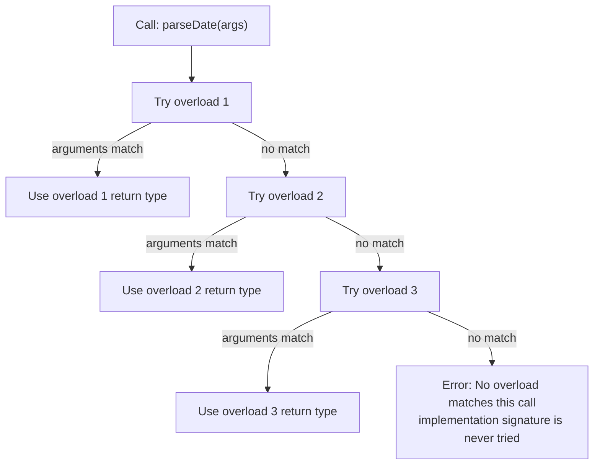
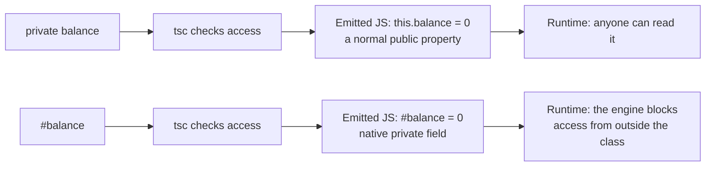
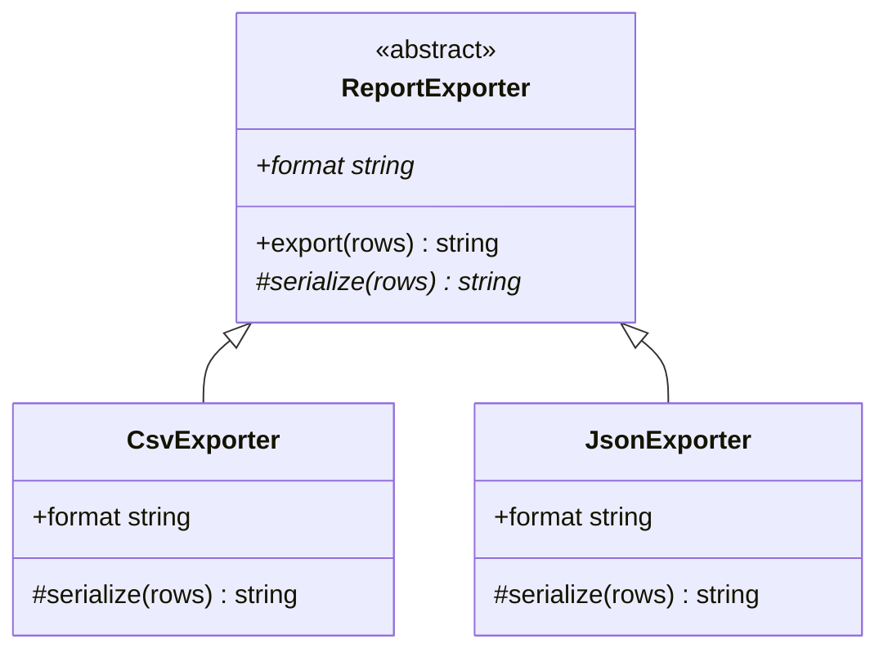

# Functions and Classes in TypeScript

> In this document you learn how TypeScript types functions (parameters, return types, overloads, the `this` parameter, the special rule for callbacks that return `void`) and classes (access modifiers, `#private` fields, `readonly`, parameter properties, abstract classes, static members, accessors, `override`, and the difference between a class type and an instance type). Angular services, components and Node.js backends are built from these pieces, and interviewers often ask about `private` vs `#private`, abstract classes vs interfaces, and overloads.

**Before this:** [Functions and functional programming in JavaScript](../02-javascript/04-functions-and-functional-programming.md) · [JavaScript classes](../02-javascript/09-classes.md) · [this, call, apply and bind](../02-javascript/06-this-call-apply-bind.md) · [Interfaces and type aliases](./02-interfaces-and-type-aliases.md) · **Interview questions:** [jump to questions](#interview-questions)

## Table of contents

1. [Typing functions](#typing-functions)
2. [Optional default and rest parameters](#optional-default-and-rest-parameters)
3. [Function type expressions and callbacks](#function-type-expressions-and-callbacks)
4. [The void callback rule](#the-void-callback-rule)
5. [Function overloads](#function-overloads)
6. [The this parameter](#the-this-parameter)
7. [Generic functions in short](#generic-functions-in-short)
8. [Classes and property declarations](#classes-and-property-declarations)
9. [Access modifiers public private and protected](#access-modifiers-public-private-and-protected)
10. [JavaScript private fields with hash](#javascript-private-fields-with-hash)
11. [readonly and parameter properties](#readonly-and-parameter-properties)
12. [Accessors get and set](#accessors-get-and-set)
13. [Static members](#static-members)
14. [Inheritance override and noImplicitOverride](#inheritance-override-and-noimplicitoverride)
15. [Abstract classes](#abstract-classes)
16. [Classes and interfaces together](#classes-and-interfaces-together)
17. [Class type vs instance type](#class-type-vs-instance-type)
18. [The this type and fluent APIs](#the-this-type-and-fluent-apis)
19. [Class pitfalls](#class-pitfalls)
20. [Interview questions](#interview-questions)
21. [Summary](#summary)
22. [References](#references)

---

## Typing functions

### Parameters and return types

You annotate each parameter after its name. You can annotate the return type after the parameter list.

```ts
function calculateTotal(price: number, quantity: number): number {
  return price * quantity;
}

calculateTotal(10, 3);    // 30
calculateTotal("10", 3);  // ❌ Argument of type 'string' is not assignable to parameter of type 'number'.
calculateTotal(10);       // ❌ Expected 2 arguments, but got 1.
```

Unlike JavaScript, TypeScript checks the **number** of arguments too. Calling with too few or too many arguments is an error (unless parameters are optional or rest).

The same annotations work for function expressions and arrow functions:

```ts
const applyTax = function (amount: number, rate: number): number {
  return amount * (1 + rate);
};

const formatMoney = (amount: number, currency: string = "USD"): string =>
  new Intl.NumberFormat("en-US", { style: "currency", currency }).format(amount);

console.log(formatMoney(applyTax(100, 0.18))); // "$118.00"
```

### Return type inference

If you leave out the return type, TypeScript infers it from the `return` statements:

```ts
function findDiscount(code: string) {
  if (code === "SAVE10") return 0.1;
  if (code === "SAVE20") return 0.2;
  return null;
}
// inferred return type: 0.1 | 0.2 | null
```

As explained in [Type annotations and type inference](./01-typescript-basics-and-types.md#type-annotations-and-type-inference), annotate the return type of exported functions and public methods. It makes the function a clear contract and catches mistakes inside the function.

### Special return types

```ts
// void: returns nothing useful
function logOrder(orderId: string): void {
  console.log(`Order ${orderId} saved`);
}

// never: never returns normally
function failValidation(message: string): never {
  throw new Error(`Validation failed: ${message}`);
}

// Promise<T>: every async function returns a Promise
async function fetchUserName(id: number): Promise<string> {
  const response = await fetch(`/api/users/${id}`);
  const user: { name: string } = await response.json();
  return user.name; // you return a string; the function returns Promise<string>
}
```

An `async` function's return type must be `Promise<...>`. Writing `async function f(): string` is an error.

### Parameter destructuring

When you destructure a parameter, the type annotation goes after the whole pattern, not inside it:

```ts
// ❌ Wrong: this renames 'name' to a variable called 'string'
function greetUser({ name: string }) {}

// ✅ Correct
function greetUserFixed({ name, age }: { name: string; age?: number }): string {
  return age ? `${name} (${age})` : name;
}

// ✅ Better with a named type
interface GreetOptions {
  name: string;
  age?: number;
}
function greetUserNamed({ name, age = 18 }: GreetOptions): string {
  return `${name} (${age})`;
}

console.log(greetUserNamed({ name: "Asha" })); // "Asha (18)"
```

An **options object** parameter like this is a good habit when a function has more than two or three parameters. Calls become readable (`createUser({ name, role, sendEmail: true })`), and you can add optional options later without breaking callers.

---

## Optional default and rest parameters

### Optional parameters

Add `?` to make a parameter optional. Its type inside the function includes `undefined`.

```ts
function formatName(first: string, last?: string): string {
  // last: string | undefined
  return last ? `${first} ${last}` : first;
}

formatName("Asha");        // "Asha"
formatName("Asha", "Rao"); // "Asha Rao"
```

Optional parameters must come **after** required ones. `function f(a?: string, b: string)` is an error.

### Default parameters

A **default parameter** has a value that is used when the argument is missing **or `undefined`**. TypeScript infers its type from the default value, and the parameter becomes optional for callers.

```ts
function greet(name: string, greeting = "Hello", punctuation?: string): string {
  return `${greeting}, ${name}${punctuation ?? "!"}`;
}

console.log(greet("Asha"));                  // "Hello, Asha!"
console.log(greet("Asha", undefined, "?"));  // "Hello, Asha?"  ← undefined triggers the default
greet("Asha", null);                         // ❌ Argument of type 'null' is not assignable to parameter of type 'string | undefined'.
```

Remember the JavaScript rule: only `undefined` triggers a default. `null`, `0` and `""` do not.

| | Optional `x?: T` | Default `x = value` |
|---|---|---|
| Type inside the function | `T \| undefined` | `T` (never undefined) |
| Value when not passed | `undefined` | The default value |
| Needs a check inside? | Yes | No |

### Rest parameters

A **rest parameter** collects any number of arguments into an array. Its type must be an array or tuple type.

```ts
function sum(...numbers: number[]): number {
  return numbers.reduce((total, n) => total + n, 0);
}

console.log(sum(1, 2, 3));   // 6
console.log(sum());          // 0
const values = [4, 5];
console.log(sum(...values)); // 9
```

A rest parameter with a **tuple** type gives a fixed list of typed arguments. This is useful for event emitters and wrappers:

```ts
function logEvent(...args: [name: string, durationMs: number]): void {
  const [name, durationMs] = args;
  console.log(`${name} took ${durationMs}ms`);
}

logEvent("page-load", 120);  // "page-load took 120ms"
logEvent("page-load");       // ❌ Expected 2 arguments, but got 1.
```

---

## Function type expressions and callbacks

A **function type** describes the shape of a function: its parameters and return type.

```ts
type PriceFormatter = (amount: number) => string;

const toRupees: PriceFormatter = (amount) => `₹${amount.toFixed(2)}`;
const toDollars: PriceFormatter = (amount) => `$${amount.toFixed(2)}`;

function renderPrices(prices: number[], format: PriceFormatter): string[] {
  return prices.map(format);
}

console.log(renderPrices([10, 2.5], toDollars)); // [ '$10.00', '$2.50' ]
```

Notice that `amount` in `toRupees` has no annotation. Its type comes from `PriceFormatter`. This is **contextual typing**.

Other ways to write function types (call signatures, method signatures, construct signatures) are explained in [Interfaces and type aliases](./02-interfaces-and-type-aliases.md#function-types-call-signatures-and-construct-signatures).

### Avoid the Function type

```ts
// ❌ Wrong: Function accepts any function and returns any
function runLater(callback: Function) {
  setTimeout(() => callback(1, 2, 3), 100); // no checking at all
}

// ✅ Correct: describe the exact signature
function runLaterFixed(callback: () => void) {
  setTimeout(callback, 100);
}
```

### Do not make callback parameters optional by mistake

If a callback **will** receive an argument, do not mark it optional in the type. An optional callback parameter means "the caller may call me without it", which forces every implementation to handle `undefined`:

```ts
// ❌ Wrong: every callback must now handle index being undefined
type ForEachCallback = (item: string, index?: number) => void;

// ✅ Correct: you always pass index; callbacks may simply ignore it
type ForEachCallbackFixed = (item: string, index: number) => void;

const logItem: ForEachCallbackFixed = (item) => console.log(item); // ✅ fewer parameters are fine
```

Callbacks with **fewer** parameters are always allowed (JavaScript ignores extra arguments). So you never need `?` just to let callers ignore a parameter.

---

## The void callback rule

This rule confuses many developers, so it gets its own section.

### The rule

When a **function type** has a `void` return type, a function that returns a value **can** still be assigned to it. The returned value is ignored.

```ts
type OnSave = () => void;

const saveAndCount: OnSave = () => {
  return 42; // ✅ allowed
};

const result = saveAndCount(); // result: void — you cannot use the 42 in a typed way
```

But when you write `void` as the return type of a **function declaration or expression itself**, returning a value is an error:

```ts
function save(): void {
  return 42; // ❌ Type 'number' is not assignable to type 'void'.
}
```

### Why this rule exists

Look at this very common code:

```ts
const sourceIds = [1, 2, 3];
const targetIds: number[] = [];

sourceIds.forEach((id) => targetIds.push(id));
```

`forEach` expects a callback of type `(value: number, index: number, array: number[]) => void`. But `targetIds.push(id)` returns a `number` (the new length), so the arrow function returns a number.

If TypeScript rejected this, you would have to write `sourceIds.forEach((id) => { targetIds.push(id); })` everywhere. The rule says: "`void` in a callback type means the caller does not care about the return value". Returning something is harmless, so it is allowed.

### Where it matters

- Event handlers: `button.addEventListener("click", () => counter.increment())` even if `increment` returns a value.
- Angular `subscribe(value => this.items.push(value))`.
- Express middleware callbacks.

The one risk: a callback typed `() => void` might return a Promise that nobody awaits, so its errors are not handled. For example, `items.forEach(async (item) => await save(item))` compiles, but `forEach` does not wait. The typescript-eslint rule `no-misused-promises` catches this.

---

## Function overloads

### What it is

**Function overloads** let one function have several different call signatures. You write the **overload signatures** first (without bodies), and then one **implementation signature** with the body.

```ts
// Overload signatures: what callers can see
function parseDate(isoString: string): Date;
function parseDate(timestamp: number): Date;
function parseDate(year: number, month: number, day: number): Date;

// Implementation signature: not visible to callers
function parseDate(a: string | number, month?: number, day?: number): Date {
  if (typeof a === "string") return new Date(a);
  if (month !== undefined && day !== undefined) return new Date(a, month - 1, day);
  return new Date(a);
}

parseDate("2024-05-01");    // ✅ overload 1
parseDate(1714521600000);   // ✅ overload 2
parseDate(2024, 5, 1);      // ✅ overload 3
parseDate(2024, 5);         // ❌ No overload expects 2 arguments...
```

The last call is rejected even though the implementation signature would accept it. **Callers only see the overload signatures.** The implementation signature must be general enough to handle all overloads, but it is hidden.

### Why it exists

Overloads are useful when the **return type depends on the arguments** in a way a single signature cannot express simply:

```ts
function getElement(selector: "canvas"): HTMLCanvasElement;
function getElement(selector: "input"): HTMLInputElement;
function getElement(selector: string): HTMLElement;
function getElement(selector: string): HTMLElement {
  const el = document.querySelector<HTMLElement>(selector);
  if (!el) throw new Error(`No element for ${selector}`);
  return el;
}

const canvas = getElement("canvas"); // HTMLCanvasElement — getContext() is available
const box = getElement(".box");      // HTMLElement
```

The DOM itself uses this idea: `document.createElement("canvas")` returns `HTMLCanvasElement`.

### How TypeScript picks an overload



TypeScript checks the overloads **from top to bottom** and uses the **first** one that matches. So put the **most specific** overloads first. If `getElement(selector: string)` came first, it would match everything and the specific ones would never be used.

### When a union is better than overloads

Overloads have a big limitation: a call must match **one** overload completely. A value whose type is a union does not match any single overload:

```ts
function getLength(value: string): number;
function getLength(value: unknown[]): number;
function getLength(value: string | unknown[]): number {
  return value.length;
}

const input: string | string[] = Math.random() > 0.5 ? "abc" : ["a"];
getLength(input);
// ❌ No overload matches this call. (string | string[] matches neither overload alone)

// ✅ A single signature with a union is simpler and works for every case
function getLengthFixed(value: string | unknown[]): number {
  return value.length;
}
getLengthFixed(input); // ✅
```

The TypeScript handbook gives this advice: **prefer parameters with union types instead of overloads when possible.** Use overloads only when the return type really changes with the argument types. Generics or conditional types can also replace some overloads (see [Generics](./05-generics.md)).

### Overloads in classes and interfaces

Methods can be overloaded the same way:

```ts
class Logger {
  log(message: string): void;
  log(level: "info" | "error", message: string): void;
  log(a: string, b?: string): void {
    const [level, message] = b === undefined ? ["info", a] : [a, b];
    console.log(`[${level}] ${message}`);
  }
}

const logger = new Logger();
logger.log("Started");               // "[info] Started"
logger.log("error", "Disk is full"); // "[error] Disk is full"
```

And in object types:

```ts
type Formatter = {
  (value: number): string;
  (value: Date): string;
};
```

---

## The this parameter

### What it is

In JavaScript, the value of `this` depends on **how a function is called** (see [this, call, apply and bind](../02-javascript/06-this-call-apply-bind.md)). TypeScript lets you declare the expected type of `this` with a fake first parameter named `this`.

```ts
interface Button {
  label: string;
  clicks: number;
}

function handleClick(this: Button, event: { x: number; y: number }): void {
  this.clicks++;
  console.log(`${this.label} clicked at ${event.x},${event.y} (${this.clicks} times)`);
}
```

The `this` parameter is **not a real parameter**. It is erased from the JavaScript output, and callers do not pass it:

```js
// Emitted JavaScript
function handleClick(event) {
    this.clicks++;
    console.log(`${this.label} clicked at ${event.x},${event.y} (${this.clicks} times)`);
}
```

### What TypeScript checks

```ts
const saveButton = { label: "Save", clicks: 0, onClick: handleClick };
saveButton.onClick({ x: 1, y: 2 });      // ✅ this = saveButton — "Save clicked at 1,2 (1 times)"

handleClick({ x: 1, y: 2 });
// ❌ The 'this' context of type 'void' is not assignable to method's 'this' of type 'Button'.

handleClick.call({ label: "Call", clicks: 0 }, { x: 3, y: 4 }); // ✅ "Call clicked at 3,4 (1 times)"
```

TypeScript now catches the classic bug of calling a method without its object.

### Real-world usage

- DOM event handlers written with `function` (not arrows), where `this` is the element:

```ts
function highlight(this: HTMLElement) {
  this.classList.add("active");
}
document.querySelector(".card")?.addEventListener("click", highlight);
```

- Library APIs that call your callback with a specific `this`, like Mocha's `this.timeout()` or some jQuery plugins.
- Declaring `this: void` in a callback type to say "I will call this without a `this`". Then methods that use `this` cannot be passed by mistake.

With `noImplicitThis` (part of `strict`), TypeScript reports an error when `this` would implicitly be `any`, for example inside a plain function that is not a method.

---

## Generic functions in short

When the return type depends on the type of an argument, you use a **generic** function. A type parameter like `<T>` is a placeholder that TypeScript fills in at each call.

```ts
function firstItem<T>(items: T[]): T | undefined {
  return items[0];
}

const firstName = firstItem(["Asha", "Ravi"]); // string | undefined
const firstPrice = firstItem([10, 20]);        // number | undefined
```

Generics have their own document: [Generics](./05-generics.md).

---

## Classes and property declarations

TypeScript classes are JavaScript classes plus types. The class mechanics (constructors, `extends`, `super`, methods on the prototype) are explained in [JavaScript classes](../02-javascript/09-classes.md). This part covers what TypeScript adds.

### Declaring properties

In TypeScript, you must **declare** class properties with their types. In plain JavaScript you can just assign `this.x = ...` in the constructor; in TypeScript that is an error unless `x` is declared.

```ts
class ShoppingCart {
  items: string[] = [];        // declared with an initializer
  ownerId: string;             // declared, assigned in the constructor
  discountCode?: string;       // optional: may be undefined

  constructor(ownerId: string) {
    this.ownerId = ownerId;
  }

  addItem(sku: string): void {
    this.items.push(sku);
  }

  get count(): number {
    return this.items.length;
  }
}

const cart = new ShoppingCart("u-1");
cart.addItem("pen");
console.log(cart.count); // 1
```

### strictPropertyInitialization

With `strictPropertyInitialization` (part of `strict`), every declared property must be **definitely assigned**: either with an initializer or in the constructor. This catches properties that would be `undefined` at runtime.

```ts
class ProfilePage {
  title: string;
  // ❌ Property 'title' has no initializer and is not definitely assigned in the constructor.
}
```

Fixes, in order of preference:

1. Give it an initial value: `title = "";`
2. Assign it in the constructor.
3. Make it optional if it really can be missing: `title?: string;`
4. Use the **definite assignment assertion** `title!: string;` only when a framework guarantees assignment (for example Angular `@Input()` or `@ViewChild()`), because TypeScript cannot see that.

```ts
// Angular 16 example
import { Component, Input } from "@angular/core";

@Component({ selector: "app-user-card", template: "<h3>{{ name }}</h3>" })
export class UserCardComponent {
  @Input() name!: string; // Angular sets it before the first render, if the parent binds [name]
}
```

Angular 16 also added `@Input({ required: true })`. With it, the template compiler reports an error when a parent forgets the `[name]` binding, so the `!` becomes a safe promise.

> **Newer Angular (17.1+):** signal inputs (`name = input.required<string>()`) avoid the `!` completely. They are not available in Angular 16.

---

## Access modifiers public private and protected

TypeScript has three **access modifiers**:

| Modifier | Accessible from |
|---|---|
| `public` (the default) | Anywhere |
| `protected` | The class and its subclasses |
| `private` | Only inside the class that declares it |

```ts
class BankAccount {
  public owner: string;
  protected balance = 0;
  private transactionLog: string[] = [];

  constructor(owner: string) {
    this.owner = owner;
  }

  deposit(amount: number): void {
    this.balance += amount;
    this.transactionLog.push(`+${amount}`);
  }
}

class SavingsAccount extends BankAccount {
  addInterest(rate: number): void {
    this.balance *= 1 + rate;        // ✅ protected is visible in subclasses
    this.transactionLog.push("int"); // ❌ Property 'transactionLog' is private and only accessible within class 'BankAccount'.
  }
}

const account = new SavingsAccount("Asha");
account.owner;    // ✅
account.balance;  // ❌ Property 'balance' is protected and only accessible within class 'BankAccount' and its subclasses.
```

### These modifiers exist only at compile time

`private` and `protected` are **TypeScript-only** checks. They are erased. At runtime the property is a normal, public property:

```ts
class Account {
  private balance = 100;
}

const acc = new Account();
console.log((acc as any).balance);  // 100 — accessible at runtime
console.log(acc["balance"]);        // 100 — TypeScript allows bracket access to private members
console.log(JSON.stringify(acc));   // {"balance":100}
console.log(Object.keys(acc));      // [ 'balance' ]
```

Two surprises here:

1. **Bracket notation** (`acc["balance"]`) is a deliberate escape hatch. TypeScript allows it, mainly for tests.
2. `private` data appears in `JSON.stringify`, `Object.keys` and in the browser's devtools. **Never** rely on `private` to hide secrets.

`private` is a tool for **design** ("other code should not depend on this"), not for **security**.

---

## JavaScript private fields with hash

### What it is

JavaScript itself (ES2022) has **private fields**, written with a `#` prefix. TypeScript supports them fully. Unlike `private`, they are private **at runtime**.

```ts
class Wallet {
  #pin: string;
  #balance = 0;

  constructor(pin: string) {
    this.#pin = pin;
  }

  withdraw(pin: string, amount: number): number {
    if (pin !== this.#pin) throw new Error("Wrong PIN");
    this.#balance -= amount;
    return this.#balance;
  }

  static isWallet(value: object): boolean {
    return #pin in value; // ergonomic brand check (ES2022, TS 4.5+)
  }
}

const wallet = new Wallet("1234");
console.log(JSON.stringify(wallet));     // {}
console.log(Object.keys(wallet));        // []
console.log(Wallet.isWallet(wallet));    // true
console.log(Wallet.isWallet({}));        // false
// wallet.#pin;    ❌ syntax error outside the class — even in plain JavaScript
// wallet["#pin"]; undefined — "#pin" is not a property name
```

### private vs #private

| | `private` (TypeScript) | `#field` (JavaScript) |
|---|---|---|
| Checked when | Compile time only | Compile time **and** runtime |
| Visible in `JSON.stringify`, `Object.keys` | Yes | No |
| Accessible with `obj["name"]` or `as any` | Yes | No |
| Accessible in subclasses | No (but `protected` exists) | No (there is no `#protected`) |
| Two classes with the same private name are compatible? | No (nominal-like) | No |
| Emitted code | Normal property | Native `#field` (ES2022 target) or `WeakMap` helpers (older targets) |
| Works with method decorators, mocking in tests | Easy | Harder (cannot reach from outside) |



**When to use which:**

- Use `#private` when you need **real** encapsulation: library code, security-sensitive values, objects shared with untrusted code.
- Use `private` when compile-time protection is enough, when you need `protected` for subclasses, or when frameworks or tests need to reach the member. Angular code bases mostly use `private` (for example `constructor(private http: HttpClient)`).

---

## readonly and parameter properties

### readonly

A `readonly` property can be assigned only where it is declared or in the constructor.

```ts
class Order {
  readonly id: string;
  readonly createdAt = new Date();
  status: "new" | "paid" = "new";

  constructor(id: string) {
    this.id = id; // ✅ allowed in the constructor
  }

  pay(): void {
    this.status = "paid";
    this.id = "x"; // ❌ Cannot assign to 'id' because it is a read-only property.
  }
}
```

Like `private`, `readonly` is compile-time only and shallow (`readonly items: string[]` still allows `push`). See [readonly in interfaces](./02-interfaces-and-type-aliases.md#optional-and-readonly-properties).

### Parameter properties

**Parameter properties** are a TypeScript shortcut. If you put an access modifier (`public`, `private`, `protected`) or `readonly` in front of a constructor parameter, TypeScript declares the property **and** assigns it for you.

```ts
// Long form
class UserServiceLong {
  private readonly apiUrl: string;
  private readonly timeoutMs: number;

  constructor(apiUrl: string, timeoutMs: number) {
    this.apiUrl = apiUrl;
    this.timeoutMs = timeoutMs;
  }
}

// Short form with parameter properties — same result
class UserService {
  constructor(
    private readonly apiUrl: string,
    private readonly timeoutMs: number,
  ) {}

  describe(): string {
    return `${this.apiUrl} (timeout ${this.timeoutMs}ms)`;
  }
}

console.log(new UserService("/api/users", 5000).describe()); // "/api/users (timeout 5000ms)"
```

The emitted JavaScript contains the assignments:

```js
class UserService {
    apiUrl;
    timeoutMs;
    constructor(apiUrl, timeoutMs) {
        this.apiUrl = apiUrl;
        this.timeoutMs = timeoutMs;
    }
    // ...
}
```

### Real-world usage: Angular dependency injection

Parameter properties are everywhere in Angular 16 code, because constructor injection is the standard style:

```ts
import { Injectable } from "@angular/core";
import { HttpClient } from "@angular/common/http";
import { Observable } from "rxjs";

interface Product { id: string; name: string }

@Injectable({ providedIn: "root" })
export class ProductService {
  constructor(private readonly http: HttpClient) {}

  getProducts(): Observable<Product[]> {
    return this.http.get<Product[]>("/api/products");
  }
}
```

Angular reads the constructor parameter types to know what to inject. See [Angular dependency injection](../06-angular-16/05-dependency-injection.md).

### Downsides of parameter properties

- They generate code, so they are **not erasable syntax**. Node.js type stripping does not support them, and the TypeScript 5.8 flag `erasableSyntaxOnly` reports them as errors.
- Mixing parameter properties with normal parameters can make long constructors hard to read.
- Modern Angular (14+) also offers the `inject()` function (`private http = inject(HttpClient);`), which some teams prefer because it works without parameter properties and is easier to use with inheritance.

---

## Accessors get and set

**Accessors** look like properties to the caller, but run code when read (`get`) or written (`set`).

```ts
class Temperature {
  #celsius = 0;

  get celsius(): number {
    return this.#celsius;
  }

  get fahrenheit(): number {
    return (this.#celsius * 9) / 5 + 32;
  }

  set fahrenheit(value: number) {
    if (value < -459.67) throw new RangeError("Below absolute zero");
    this.#celsius = ((value - 32) * 5) / 9;
  }
}

const temp = new Temperature();
temp.fahrenheit = 212;           // calls the setter
console.log(temp.celsius);       // 100
console.log(temp.fahrenheit);    // 212
temp.celsius = 5;                // ❌ Cannot assign to 'celsius' because it is a read-only property.
```

Rules:

- A property with only a `get` is treated as **readonly** by TypeScript. (At runtime in strict mode, which classes always use, assigning to it throws a `TypeError`.)
- Since TypeScript 5.1, the getter and setter can have **unrelated types**. Before that (TS 4.3 to 5.0), the getter type had to be assignable to the setter type. A common use is a setter that accepts `string | number` and a getter that returns `number`:

```ts
class Pagination {
  #pageSize = 10;
  get pageSize(): number { return this.#pageSize; }
  set pageSize(value: string | number) { this.#pageSize = Number(value); }
}

const p = new Pagination();
p.pageSize = "25";          // ✅ e.g. from a URL query parameter
console.log(p.pageSize);    // 25 (a number)
```

Angular 16 uses TypeScript up to 5.1. Angular `@Input()` setters are a common place for accessors:

```ts
import { Component, Input } from "@angular/core";

@Component({ selector: "app-avatar", template: "" })
export class AvatarComponent {
  url = "/assets/default-avatar.png";

  @Input() set imageUrl(value: string | null) {
    this.url = value || "/assets/default-avatar.png";
  }
}
```

---

## Static members

**Static members** belong to the class itself, not to instances. You access them through the class name.

```ts
class IdGenerator {
  static prefix = "ord";
  static #counter = 0;          // private static field

  static next(): string {
    IdGenerator.#counter++;
    return `${IdGenerator.prefix}-${IdGenerator.#counter}`;
  }
}

console.log(IdGenerator.next()); // "ord-1"
console.log(IdGenerator.next()); // "ord-2"
```

### Static blocks (TypeScript 4.4+, ES2022)

A `static { ... }` block runs once when the class is defined. It is useful for complex static initialization:

```ts
class FeatureFlags {
  static readonly enabled = new Set<string>();

  static {
    const fromEnv = "checkout-v2,dark-mode"; // e.g. read from config
    for (const flag of fromEnv.split(",")) FeatureFlags.enabled.add(flag);
  }
}

console.log(FeatureFlags.enabled.has("dark-mode")); // true
```

### Statics and generics do not mix

A static member cannot use the class's type parameters, because there is only **one** static member for all instances:

```ts
class Cache<T> {
  static empty: T; // ❌ Static members cannot reference class type parameters.
  constructor(public value: T) {}
}
```

`Cache<string>` and `Cache<number>` share the same class object and the same `empty`, so `T` would be meaningless there.

### Real-world usage

- Factory methods: `User.fromJson(json)`.
- Constants related to the class: `HttpStatus.NOT_FOUND`.
- Singletons (see the interview questions).

Prefer plain module-level functions and constants when the class has no other reason to exist. In JavaScript modules, a function exported from a file is usually simpler than a class with only static members.

---

## Inheritance override and noImplicitOverride

A class can extend one other class (single inheritance). TypeScript checks that the subclass is compatible with the base class: overriding methods must have compatible signatures.

```ts
class Notifier {
  send(message: string): void {
    console.log(`Generic: ${message}`);
  }
}

class EmailNotifier extends Notifier {
  send(message: string): void {
    console.log(`Email: ${message}`);
  }
}

class BrokenNotifier extends Notifier {
  send(message: number): void {} // ❌ Property 'send' in type 'BrokenNotifier' is not assignable to the same property in base type 'Notifier'.
}
```

### The override keyword (TypeScript 4.3+)

The **`override`** keyword says "this method replaces a method from the base class". TypeScript then checks that the base class really has that method.

```ts
class BaseRepository {
  findAll(): string[] {
    return [];
  }
}

class UserRepository extends BaseRepository {
  override findAll(): string[] {
    return ["Asha", "Ravi"];
  }

  override findAllActive(): string[] { // ❌ This member cannot have an 'override' modifier
    return [];                          //    because it is not declared in the base class 'BaseRepository'.
  }
}
```

### noImplicitOverride

With the compiler flag **`noImplicitOverride`**, you **must** write `override` when you replace a base method. This protects you from two silent bugs:

1. **Accidental override:** you add a method `save()` to a subclass without knowing the base class already has `save()`. Without the flag, you silently replace it.
2. **Base method renamed:** someone renames `findAll` to `getAll` in the base class. Your subclass's `findAll` no longer overrides anything, but nothing tells you. With `override`, it becomes an error.

```json
{
  "compilerOptions": {
    "noImplicitOverride": true
  }
}
```

`noImplicitOverride` is **not** part of `strict`. You turn it on separately. It is a good setting for code bases that use inheritance (Angular base components, NestJS services, repository hierarchies).

---

## Abstract classes

### What it is

An **abstract class** is a base class that **cannot be created directly**. It can have:

- **Concrete members** with real code that subclasses inherit.
- **Abstract members** without code that subclasses **must** implement.

```ts
abstract class ReportExporter {
  // abstract: every subclass must provide these
  abstract readonly format: string;
  protected abstract serialize(rows: Record<string, unknown>[]): string;

  // concrete: shared logic, written once
  export(rows: Record<string, unknown>[]): string {
    if (rows.length === 0) throw new Error("Nothing to export");
    const content = this.serialize(rows);
    return `[${this.format}] ${content.length} bytes`;
  }
}

class CsvExporter extends ReportExporter {
  readonly format = "csv";

  protected serialize(rows: Record<string, unknown>[]): string {
    const headers = Object.keys(rows[0]);
    const lines = rows.map((row) => headers.map((h) => String(row[h])).join(","));
    return [headers.join(","), ...lines].join("\n");
  }
}

class JsonExporter extends ReportExporter {
  readonly format = "json";

  protected serialize(rows: Record<string, unknown>[]): string {
    return JSON.stringify(rows);
  }
}

const rows = [{ id: 1, name: "Pen" }, { id: 2, name: "Ink" }];
console.log(new CsvExporter().export(rows));  // "[csv] 19 bytes"
console.log(new JsonExporter().export(rows)); // "[json] 45 bytes"

new ReportExporter(); // ❌ Cannot create an instance of an abstract class.
```

This structure is the **template method pattern**: the base class defines the steps (`export`), and subclasses fill in one step (`serialize`). See [Behavioral patterns](../04-oop-solid-design-patterns/08-behavioral-patterns.md).



### Abstract is compile-time only

`abstract` is erased. The emitted JavaScript is a normal class, so plain JavaScript code (or `as any`) can still call `new ReportExporter()`. It would then crash when it calls the missing `serialize` method.

If a subclass forgets an abstract member, TypeScript reports: "Non-abstract class 'X' does not implement inherited abstract member 'serialize' from class 'ReportExporter'."

### Abstract class vs interface

| | Interface | Abstract class |
|---|---|---|
| Contains code | No, only shape | Yes, shared implementation |
| Exists at runtime | No (erased) | Yes (a real class) |
| Can have constructor, fields with values | No | Yes |
| A class can use many | Yes, `implements A, B, C` | No, only one `extends` |
| Can use `protected` and `private` | No | Yes |
| Usable with `instanceof` | No | Yes |
| Usable as an Angular DI token | No (erased) | Yes |

**Choose an interface** for a pure contract with no shared code, especially when different, unrelated classes implement it.

**Choose an abstract class** when subclasses share real code or state, and you want to force them to implement a few specific steps.

The Angular DI point is practical: you cannot inject by an interface because it does not exist at runtime. A common Angular pattern uses an abstract class as both the contract and the token:

```ts
import { Injectable } from "@angular/core";

export abstract class StorageService {
  abstract get(key: string): string | null;
  abstract set(key: string, value: string): void;
}

@Injectable()
export class LocalStorageService extends StorageService {
  get(key: string) { return localStorage.getItem(key); }
  set(key: string, value: string) { localStorage.setItem(key, value); }
}

// In a module or component: providers: [{ provide: StorageService, useClass: LocalStorageService }]
// Consumers: constructor(private storage: StorageService) {}
```

The alternative is an `InjectionToken<T>` with an interface. See [Angular dependency injection](../06-angular-16/05-dependency-injection.md).

---

## Classes and interfaces together

A class can extend one class and implement many interfaces:

```ts
interface Serializable {
  toJSON(): Record<string, unknown>;
}

interface Validatable {
  validate(): string[];
}

class Entity {
  constructor(public readonly id: string) {}
}

class Customer extends Entity implements Serializable, Validatable {
  constructor(id: string, public email: string) {
    super(id);
  }

  validate(): string[] {
    return this.email.includes("@") ? [] : ["Invalid email"];
  }

  toJSON() {
    return { id: this.id, email: this.email };
  }
}

const customer = new Customer("c-1", "asha.example.com");
console.log(customer.validate());          // [ 'Invalid email' ]
console.log(JSON.stringify(customer));     // {"id":"c-1","email":"asha.example.com"}
```

Remember from [Classes implementing interfaces](./02-interfaces-and-type-aliases.md#classes-implementing-interfaces): `implements` only checks. It does not add members or types to the class.

---

## Class type vs instance type

### A class creates two things

When you write `class User {}`, you create:

1. A **type** named `User`: the type of **instances** (objects created with `new User()`).
2. A **value** named `User`: the constructor function itself, which exists at runtime.

```ts
class User {
  static count = 0;
  constructor(public name: string) {
    User.count++;
  }
  greet(): string {
    return `Hi, ${this.name}`;
  }
}

const asha: User = new User("Asha"); // 'User' as a type = the instance type
const Ctor = User;                   // 'User' as a value = the class itself
```

### typeof MyClass is the class type

To talk about the type of the class **itself** (the constructor, with its static members), use `typeof User`:

```ts
function createAndGreet(UserClass: typeof User, name: string): string {
  const instance = new UserClass(name); // can call new
  console.log(UserClass.count);         // can use static members
  return instance.greet();
}

createAndGreet(User, "Ravi");

const wrong: User = User;         // ❌ the class is not an instance
const right: typeof User = User;  // ✅
```

| Expression | Meaning |
|---|---|
| `User` (in a type position) | Instance type: has `name`, `greet()` |
| `typeof User` | Class type: can be called with `new`, has static `count` |
| `InstanceType<typeof User>` | Gets the instance type from the class type (same as `User`) |
| `ConstructorParameters<typeof User>` | The constructor parameter types as a tuple: `[name: string]` |

### When you need InstanceType

`InstanceType` is useful when you only have the class as a value, for example in a generic factory or a registry:

```ts
type Constructor<T = object> = new (...args: any[]) => T;

class EmailService { send(to: string) { return `Email to ${to}`; } }
class SmsService { send(to: string) { return `SMS to ${to}`; } }

const services = { email: EmailService, sms: SmsService };

function createService<K extends keyof typeof services>(
  kind: K,
): InstanceType<(typeof services)[K]> {
  return new services[kind]() as InstanceType<(typeof services)[K]>;
}

const sms = createService("sms"); // SmsService
console.log(sms.send("98765"));   // "SMS to 98765"
```

For abstract classes, use an abstract construct signature (TS 4.2+): `abstract new (...args: any[]) => T`. A normal `new () => T` type does not accept an abstract class, because you cannot call `new` on it.

Angular uses this idea in its `Type<T>` interface (a constructor type) for things like `TestBed.inject(UserService)` and dynamic component creation.

---

## The this type and fluent APIs

Inside a class, the special type **`this`** means "the type of the current instance, whatever subclass it is". It is perfect for **fluent APIs** (methods that return the object so calls can be chained).

```ts
class QueryBuilder {
  protected parts: string[] = [];

  where(condition: string): this {
    this.parts.push(`WHERE ${condition}`);
    return this;
  }

  build(): string {
    return this.parts.join(" ");
  }
}

class PagedQueryBuilder extends QueryBuilder {
  limit(count: number): this {
    this.parts.push(`LIMIT ${count}`);
    return this;
  }
}

const sql = new PagedQueryBuilder()
  .where("active = 1")   // returns PagedQueryBuilder, not QueryBuilder
  .limit(10)             // ✅ still available
  .build();

console.log(sql); // "WHERE active = 1 LIMIT 10"
```

If `where` returned `QueryBuilder` instead of `this`, the chain would lose the subclass type, and `.limit(10)` would be an error after `.where(...)`.

---

## Class pitfalls

### Pitfall 1: losing this when passing a method as a callback

Methods are defined on the prototype and use the `this` of the call. If you pass a method by reference, `this` is lost:

```ts
class Counter {
  count = 0;

  increment(): void {
    this.count++;
  }

  incrementArrow = (): void => {
    this.count++;
  };
}

const counter = new Counter();

const inc = counter.increment;
inc(); // ❌ runtime TypeError: Cannot read properties of undefined (reading 'count')

const incArrow = counter.incrementArrow;
incArrow(); // ✅ arrow function property captured 'this' when the instance was created

console.log(counter.count); // 1
```

TypeScript does **not** catch the first bug by default (methods have no `this` parameter unless you write one). Fixes: use an arrow function (`() => counter.increment()`), `.bind(counter)`, or an arrow function property.

Trade-offs of arrow function properties:

| | Method | Arrow function property |
|---|---|---|
| Location | On the prototype (shared by all instances) | A new function on **each instance** |
| `this` | Depends on the call | Always the instance |
| Subclass can override and call `super.method()` | Yes | No (`super` does not see instance properties) |
| Spy or mock on the prototype in tests | Easy | Harder |

Use arrow properties for callbacks you pass around (event handlers in React classes, `setTimeout`). Use normal methods for everything else.

### Pitfall 2: redeclaring a base class field

With modern compile targets (ES2022+, where `useDefineForClassFields` is `true` by default), class fields follow the JavaScript standard: each field is (re)defined on the instance **after** `super()` returns. Redeclaring a base field in a subclass without a value resets it to `undefined`:

```ts
class Animal {
  constructor(public sound: string) {}
}

class Dog extends Animal {
  sound: string; // ❌ TS2612: Property 'sound' will overwrite the base property in 'Animal'.
                 //    If this is intentional, add an initializer. Otherwise, add a 'declare' modifier...
}

class Cat extends Animal {
  declare sound: "meow"; // ✅ 'declare' only changes the type; no field is emitted
}
```

If the `Dog` version were compiled anyway, `new Dog("woof").sound` would be `undefined` at runtime. Use `declare` when you only want to narrow the type of an inherited property.

### Pitfall 3: thinking access modifiers protect data

`private`, `protected`, `readonly` and `abstract` are all erased. Use `#private` fields, `Object.freeze`, and server-side checks when protection really matters.

### Pitfall 4: classes as plain data holders

In TypeScript, a class is not needed just to describe data. An interface or type alias with plain objects is lighter, works directly with JSON, and has no `instanceof` problems after serialization. Use classes when you need behavior, encapsulated state, inheritance, or a runtime value (for example as an Angular DI token).

### Best practices

- **Annotate parameters and public return types.** Let inference handle local variables.
- **Prefer union parameters over overloads**; use overloads only when the return type depends on the arguments.
- **Order overloads from most specific to most general.**
- **Use an options object** for functions with many or optional parameters.
- **Use `#private` for real encapsulation**, `private` for design-time intent.
- **Turn on `noImplicitOverride`** and use `override` in class hierarchies.
- **Use `readonly`** for properties that must not change after construction (injected services, ids).
- **Prefer composition over deep inheritance.** Use abstract classes only for real shared behavior. See [Composition, inheritance and mixins](../04-oop-solid-design-patterns/02-composition-inheritance-and-mixins.md).
- **Return `this`** from fluent methods so subclasses keep their type.

---

## Interview questions

### How to explain this in an interview

1. **Define it:** "TypeScript classes are JavaScript classes with type annotations, plus compile-time features: access modifiers, `readonly`, parameter properties, abstract classes and `override`."
2. **Why it exists:** "These features let me express design intent, like 'this is internal' or 'subclasses must implement this', and the compiler enforces it."
3. **How it works:** "Most of these checks are erased. `private` is a compile-time rule, while JavaScript's `#private` fields are enforced by the engine at runtime. Parameter properties generate assignment code."
4. **Small example:** "In Angular, `constructor(private readonly http: HttpClient) {}` declares, assigns and protects the property in one line."
5. **Where it is useful:** "Services, repositories, components, and template-method base classes like a report exporter with a shared `export` and an abstract `serialize`."
6. **Trade-offs / gotchas:** "`private` data still shows up in `JSON.stringify`; methods lose `this` when passed as callbacks; overloads do not accept union arguments; and redeclaring a base field can reset it to undefined."

### Q1. What is the difference between `private` and `#private`?

**What the interviewer is checking:** Compile-time vs runtime privacy.

**Short spoken answer (30–60 seconds):**
> `private` is a TypeScript keyword. It is checked only at compile time and then erased, so at runtime the property is a normal public property: it shows up in `JSON.stringify` and `Object.keys`, and code can reach it with bracket notation or `as any`. `#private` is a JavaScript feature from ES2022. The JavaScript engine enforces it at runtime, so nothing outside the class can read it, not even with tricks, and it does not appear in JSON or in `Object.keys`. I use `#private` for real encapsulation, like library internals or sensitive values, and `private` when compile-time protection is enough, when I need `protected`, or when tests need access.

**Code:**

```ts
class Session {
  private token = "abc";
  #refreshToken = "xyz";
}

const s = new Session();
console.log(JSON.stringify(s)); // {"token":"abc"}
console.log(s["token"]);        // "abc" — allowed by TypeScript
```

**Follow-up questions:**
- **Can subclasses access `#private` fields?** — No. There is no `#protected`. Each class's private names are visible only inside that class body.
- **What does `#field` compile to for old targets?** — For targets before ES2022, TypeScript emits `WeakMap`-based helper code that gives the same runtime privacy.
- **What is `#field in obj`?** — An ES2022 brand check: it returns `true` if the object was created by that class (has that private field). TypeScript supports it since 4.5.

**Common mistakes:** Saying `private` hides data at runtime; saying `#private` is "the same thing with different syntax".

**Where this is used in real projects:** Angular services use `private` for injected dependencies; libraries and SDKs use `#private` for internal state.

### Q2. What are function overloads? When should you use a union type instead?

**What the interviewer is checking:** Correct use of overloads and awareness of their limits.

**Short spoken answer (30–60 seconds):**
> Overloads let one function have several call signatures. I write the overload signatures without bodies, then one implementation signature that handles all cases. Callers only see the overload signatures. They are useful when the return type depends on the argument types, like `createElement("canvas")` returning `HTMLCanvasElement`. TypeScript picks the first overload that matches, so the most specific ones go first. But overloads have a limit: a call with a union-typed argument does not match any single overload. So if the return type does not change, I use one signature with a union parameter, which is simpler. For more complex relationships, generics can also replace overloads.

**Follow-up questions:**
- **Is the implementation signature callable?** — No. It is hidden from callers. If you want a general form to be callable, add it as the last overload.
- **Do overloads exist at runtime?** — No. JavaScript has only one function. The implementation must check the arguments itself, with `typeof` or similar.
- **How do you overload an arrow function?** — You cannot write overload signatures for an arrow directly. Use a type with multiple call signatures, `type F = { (x: string): string; (x: number): number }`, and assign a function to it (usually with a cast inside), or use a function declaration.

**Common mistakes:** Ordering general overloads first; expecting the implementation signature to be visible; using overloads where a union works.

**Where this is used in real projects:** DOM APIs (`createElement`, `querySelector`), RxJS operators and `pipe` (many overloads for different numbers of operators), Node.js `fs.readFile` (string vs Buffer depending on the encoding argument).

### Q3. Why can a callback typed `() => void` return a value, but a function declared `(): void` cannot?

**What the interviewer is checking:** The void substitutability rule and its reason.

**Short spoken answer (30–60 seconds):**
> When `void` is the return type in a function type, like a callback parameter, it means "the caller ignores the return value". So a function that returns something is still allowed, because ignoring a value is harmless. That is what lets me write `ids.forEach(id => list.push(id))`, even though `push` returns a number. But when I write `: void` on a function declaration itself, I am saying this function returns nothing, so `return 42` is an error. One risk is that an async callback can be passed where a void callback is expected, and its promise is ignored, so errors are lost. Linters can catch that.

**Code:**

```ts
type Handler = () => void;
const h: Handler = () => 42; // ✅
function f(): void { return 42; } // ❌
```

**Follow-up:** **What is the type of `h()`?** — `void`. You cannot use the 42 as a number without an assertion, which is the point: the type says not to rely on it.

### Q4. What is the `this` parameter in TypeScript?

**What the interviewer is checking:** Understanding of `this` typing and erased parameters.

**Short spoken answer (30–60 seconds):**
> It is a fake first parameter named `this` that declares what `this` must be when the function is called. It is erased from the output and callers do not pass it. TypeScript then checks every call: if I call the function without the right object, for example as a plain function where `this` would be undefined, I get a compile error. It is useful for DOM event handlers written as normal functions, where `this` is the element, and for library callbacks that are called with a specific context. With `noImplicitThis`, TypeScript also reports places where `this` would silently be `any`.

**Code:**

```ts
function onCardClick(this: HTMLElement, event: MouseEvent) {
  this.classList.toggle("selected");
  console.log(event.clientX);
}
document.querySelector<HTMLElement>(".card")?.addEventListener("click", onCardClick);
// querySelector<HTMLElement> matters: plain querySelector returns Element,
// and TypeScript would reject a handler that needs this: HTMLElement.
```

**Follow-up:** **What does `this: void` in a callback type mean?** — That the callback will be called without a `this`. TypeScript then rejects functions that require a `this`, preventing the "method passed as callback" bug.

### Q5. Abstract class vs interface: when do you use each?

**What the interviewer is checking:** Design judgment, plus runtime vs compile-time knowledge.

**Short spoken answer (30–60 seconds):**
> An interface is a pure contract: it only describes the shape and disappears at runtime. A class can implement many interfaces. An abstract class is a real class that cannot be created directly. It can contain shared code, fields, a constructor and protected members, plus abstract members that subclasses must implement. A class can extend only one. So I use an interface when unrelated classes just need to share a shape, and an abstract class when subclasses share real logic, like a template method. In Angular, an abstract class has one extra advantage: it exists at runtime, so I can use it as a DI token, which I cannot do with an interface.

**Follow-up questions:**
- **Can you `new` an abstract class?** — Not in TypeScript ("Cannot create an instance of an abstract class"). At runtime it is a normal class, so JavaScript code could still create it.
- **Can an abstract class implement an interface without implementing all methods?** — Yes. It can leave them abstract; the first concrete subclass must implement them.
- **Can abstract classes have constructors?** — Yes. Subclasses call them with `super(...)`.

**Common mistakes:** "Abstract classes and interfaces are the same"; not knowing interfaces cannot be DI tokens in Angular.

**Where this is used in real projects:** Base repository or exporter classes (abstract), service contracts (interfaces), Angular `abstract class StorageService` tokens.

### Q6. What are parameter properties? Why does Angular code use them so much?

**What the interviewer is checking:** TypeScript-specific syntax and its runtime effect.

**Short spoken answer (30–60 seconds):**
> Parameter properties are a shortcut: if I put `private`, `public`, `protected` or `readonly` before a constructor parameter, TypeScript declares a class property with that name and assigns the argument to it. So `constructor(private readonly http: HttpClient) {}` replaces a property declaration and an assignment. Angular uses constructor injection, so services and components are full of these. Unlike most TypeScript syntax, they generate code, so they are not supported by Node's type stripping or the `erasableSyntaxOnly` flag. Modern Angular also has the `inject()` function, which avoids them.

**Follow-up:** **What is emitted for `constructor(private x: number) {}`?** — A field declaration (for ES2022 targets with define semantics) and `this.x = x;` inside the constructor.

### Q7. What does `override` do, and why turn on `noImplicitOverride`?

**Short answer:** `override` marks a method or property that replaces a base class member; TypeScript errors if the base class has no such member. `noImplicitOverride` makes `override` mandatory for every override. Together they catch two silent bugs: overriding a base method by accident (same name, not intended), and a base method being renamed so your "override" no longer overrides anything. `noImplicitOverride` is not part of `strict`; enable it separately.

### Q8. What is the difference between `User` and `typeof User` when User is a class?

**What the interviewer is checking:** Value space vs type space.

**Short spoken answer (30–60 seconds):**
> A class declaration creates both a type and a value with the same name. Used as a type, `User` means the instance type: an object with the instance properties and methods. `typeof User` means the type of the class itself: the constructor, which I can call with `new`, and which has the static members. So a function that receives an instance takes `user: User`, and a factory that receives the class takes `UserClass: typeof User`. If I only have the class type, I can get the instance type with `InstanceType<typeof User>`, and the constructor arguments with `ConstructorParameters<typeof User>`.

**Follow-up questions:**
- **How do you type "any class that creates a T"?** — `new (...args: any[]) => T`, or `abstract new (...args: any[]) => T` to also accept abstract classes.
- **Does an interface create a value?** — No, only a type. That is why `typeof SomeInterface` is an error.

### Q9. What does this code print?

```ts
class Ticket {
  static issued = 0;
  private code: string;
  #secret: string;

  constructor(public readonly event: string) {
    Ticket.issued++;
    this.code = `${event.slice(0, 3).toUpperCase()}-${Ticket.issued}`;
    this.#secret = "s3cr3t";
  }
}

const a = new Ticket("concert");
const b = new Ticket("theatre");

console.log(Ticket.issued);
console.log(JSON.stringify(b));
console.log(Object.keys(a));
console.log("issued" in a);
```

**Answer:**

```text
2
{"event":"theatre","code":"THE-2"}
[ 'event', 'code' ]
false
```

**Step-by-step explanation:**

1. Each `new Ticket(...)` increases the static counter. After two tickets, `Ticket.issued` is `2`.
2. `b` has two normal properties: `event` (parameter property) and `code` (TypeScript `private`, which is a normal property at runtime). The `#secret` field is a real private field, so `JSON.stringify` skips it. The order is the order in which the properties were created: `event` is assigned first by the parameter property, then `code`.
3. `Object.keys(a)` lists the same two own properties.
4. `issued` is a static property on the class, not on instances, so `"issued" in a` is `false`.

### Q10. What is the difference between an optional parameter and a default parameter? What does this print?

```ts
function connect(host: string, port = 8080, secure?: boolean): string {
  return `${secure ? "https" : "http"}://${host}:${port}`;
}

console.log(connect("api.local"));
console.log(connect("api.local", undefined, true));
console.log(connect("api.local", 0));
```

**Answer:**

```text
http://api.local:8080
https://api.local:8080
http://api.local:0
```

**Explanation:**
- `port = 8080` is a default parameter: inside the function its type is `number`, and the default is used when the argument is missing **or `undefined`**. So the second call also gets `8080`.
- `0` is not `undefined`, so the third call keeps `0`.
- `secure?: boolean` is optional: inside the function it is `boolean | undefined`. `undefined` is falsy, so the protocol is `http` unless `true` is passed.

### Q11. Can you create an instance of an abstract class at runtime?

**Short answer:** TypeScript forbids it at compile time. But `abstract` is erased, so the emitted JavaScript is a normal class, and JavaScript code (or TypeScript code using `as any`) can call `new` on it. The object would be missing the abstract methods, so calling them would throw "is not a function". If you need a runtime guard, check `new.target` in the base constructor:

```ts
abstract class Base {
  constructor() {
    if (new.target === Base) throw new TypeError("Base is abstract");
  }
}
```

### Q12. Arrow function property or method: which should you use in a class?

**What the interviewer is checking:** `this` binding and memory/inheritance trade-offs.

**Short spoken answer (30–60 seconds):**
> A normal method lives on the prototype, so all instances share one function, subclasses can override it and call `super`, and it is easy to spy on in tests. But its `this` depends on how it is called, so passing it as a callback loses `this`. An arrow function property is created per instance and captures `this` permanently, so it is safe to pass around. The cost: it uses a bit more memory, a subclass cannot call it with `super`, and it is harder to mock on the prototype. I use methods by default, and arrow properties only for handlers that I pass as callbacks.

**Follow-up:** **How else can you keep `this` when passing a method?** — Wrap it in an arrow at the call site (`() => this.save()`), or bind it once in the constructor (`this.save = this.save.bind(this)`).

### Q13. Debugging: why does this crash?

```ts
class Timer {
  seconds = 0;
  tick() {
    this.seconds++;
    console.log(this.seconds);
  }
  start() {
    setInterval(this.tick, 1000);
  }
}

new Timer().start();
// TypeError: Cannot read properties of undefined (reading 'seconds')
// (in Node.js, 'this' is the Timeout object, so it logs NaN instead)
```

**Answer:** `this.tick` passes the method **without** its object. When `setInterval` calls it, `this` is not the `Timer`. In a browser, timer callbacks get `this` as `window` (or `undefined` in some contexts), and in Node.js `this` is the `Timeout` object, so the result is a crash or `NaN`. TypeScript does not report it because `tick` has no `this` parameter.

**Fix:** `setInterval(() => this.tick(), 1000);` or make `tick` an arrow function property. The arrow wrapper is the most reliable fix. Adding a `this: Timer` parameter to `tick` does not help here, because the callback type of `setInterval` does not declare a `this` type, so TypeScript still accepts `this.tick`.

### Q14. Why can't a static property use the class's generic type parameter?

**Short answer:** There is only one class object shared by every instantiation. `Box<string>` and `Box<number>` use the same `Box` constructor and the same static properties, so a static `T` would have no single meaning. TypeScript reports "Static members cannot reference class type parameters". Make the static member generic itself (`static create<T>(value: T): Box<T>`) instead.

### Q15. How do getters and setters work in TypeScript classes?

**Short answer:** `get name()` runs code when the property is read; `set name(v)` runs when it is written. A property with only a getter is treated as `readonly` (and assigning to it throws at runtime in strict mode). Since TypeScript 5.1, the getter and setter types can be unrelated (for example, a setter accepting `string | number` and a getter returning `number`). Accessors are often used for validation, derived values, and Angular `@Input()` setters.

### Q16. Code review: what would you change in this class?

```ts
class UserManager {
  public users: any[] = [];
  public apiKey = "sk_live_123";

  public addUser(u) {
    this.users.push(u);
  }

  public getUser(id) {
    return this.users.find(u => u.id == id);
  }
}
```

**Answer:**

1. `users: any[]` → define a `User` interface and use `User[]`. Make it `private` (or `#users`) so callers cannot change the array directly; expose read access through methods or a `readonly User[]` getter.
2. `apiKey` is a secret in source code and publicly readable. `private` would not help (it is still visible at runtime and in JSON). Load it from configuration on the server, never ship it to a browser.
3. `addUser(u)` and `getUser(id)` have implicit `any` parameters. Under `strict` they are errors. Annotate them.
4. `u.id == id` uses loose equality. Use `===` with the correct id type.
5. `getUser` returns `User | undefined`; annotate it so callers must handle the missing case.
6. `public` is the default; writing it everywhere is noise (some teams require it; follow the style guide).

```ts
interface User { id: string; name: string }

class UserManager {
  #users: User[] = [];

  get users(): readonly User[] {
    return this.#users;
  }

  addUser(user: User): void {
    this.#users.push(user);
  }

  getUser(id: string): User | undefined {
    return this.#users.find((u) => u.id === id);
  }
}
```

### Q17. Implement a singleton in TypeScript.

**Short answer:** Use a `private` constructor and a static accessor:

```ts
class AppConfig {
  private static instance: AppConfig | undefined;

  private constructor(public readonly apiUrl: string) {}

  static get(): AppConfig {
    return (AppConfig.instance ??= new AppConfig("/api"));
  }
}

console.log(AppConfig.get() === AppConfig.get()); // true
new AppConfig("/x"); // ❌ Constructor of class 'AppConfig' is private and only accessible within the class declaration.
```

**Follow-up:** **Is a singleton a good idea?** — It creates hidden global state and makes testing harder. In Angular, prefer `@Injectable({ providedIn: "root" })`, which gives one instance per injector and is easy to replace in tests. In Node.js, a module that exports one instance is already a singleton (modules are cached). See [Creational patterns](../04-oop-solid-design-patterns/06-creational-patterns.md).

### Q18. How do you build a fluent API that still works in subclasses?

**Short answer:** Return the polymorphic `this` type from chainable methods (`where(c: string): this`). Then a subclass's chain keeps the subclass type, so subclass-only methods stay available after base methods. Returning the base class type would lose them. See [The this type and fluent APIs](#the-this-type-and-fluent-apis).

### Q19. Senior: why would redeclaring a property in a subclass make it undefined?

**What the interviewer is checking:** Knowledge of class field semantics (`useDefineForClassFields`).

**Short spoken answer (30–60 seconds):**
> Since ES2022, class fields are part of JavaScript, and they are defined on the instance after `super()` returns. TypeScript follows that when `useDefineForClassFields` is true, which is the default for ES2022 and newer targets. So if a base class sets `this.sound` in its constructor, and a subclass redeclares `sound: string` without a value, the subclass field is defined as `undefined` right after the base constructor ran, which overwrites the value. TypeScript warns about this. If I only want to change the type of an inherited property, I use `declare sound: "woof"`, which emits no field. Older code compiled with the legacy behavior may change behavior when the target is upgraded, so this matters during upgrades, including Angular upgrades.

### Q20. What are the ways to type a function in TypeScript?

**Short answer:**

```ts
// 1. Annotations on the function itself
function add(a: number, b: number): number { return a + b; }

// 2. Function type expression
type BinaryOp = (a: number, b: number) => number;

// 3. Call signature in an object type (can add properties or overloads)
type BinaryOpWithName = { (a: number, b: number): number; opName: string };

// 4. Method signature in an interface (checked bivariantly)
interface Calculator { add(a: number, b: number): number }

// 5. Property signature with a function type (checked strictly)
interface Calculator2 { add: (a: number, b: number) => number }

// 6. Construct signature (called with new)
type Factory = new (name: string) => object;
```

### Q21. How do you type a function that accepts a variable number of typed arguments?

**Short answer:** Use a rest parameter with an array type for "any number of the same type" (`...ids: string[]`), or a tuple type for "a fixed list of different types" (`...args: [event: string, payload: unknown]`). Tuple rest parameters are also how generic wrappers keep the exact arguments of another function: `function wrap<A extends unknown[], R>(fn: (...args: A) => R): (...args: A) => R`. See [Generics](./05-generics.md).

---

## Summary

- Annotate **parameters** always and **return types** of public functions; TypeScript checks argument count too.
- **Optional** parameters (`x?`) are `T | undefined` inside; **default** parameters are `T` and trigger on `undefined` only.
- **Rest parameters** take array or tuple types. Avoid the `Function` type.
- A function type returning `void` accepts functions that return values (the **void callback rule**); a function declared `: void` cannot return a value.
- **Overloads**: callers see only overload signatures, checked top to bottom. Prefer union parameters unless the return type depends on the arguments.
- The **`this` parameter** types `this` for a function and is erased.
- `public`/`protected`/`private`, `readonly` and `abstract` are **compile-time only**. `#private` fields are enforced at **runtime**.
- **Parameter properties** declare and assign in one step (common with Angular DI) but generate code.
- Getter-only properties are readonly; since TS 5.1 getters and setters can have unrelated types.
- Use `override` with **`noImplicitOverride`** to catch accidental or broken overrides.
- **Abstract classes** share code and force subclasses to implement steps; interfaces are pure contracts and cannot be Angular DI tokens.
- `User` is the instance type; `typeof User` is the class type; `InstanceType` and `ConstructorParameters` convert between them. Return `this` for fluent APIs.

## References

- TypeScript Handbook: More on Functions — https://www.typescriptlang.org/docs/handbook/2/functions.html
- TypeScript Handbook: Classes — https://www.typescriptlang.org/docs/handbook/2/classes.html
- TypeScript Handbook: Type Compatibility (void return rule, parameter bivariance) — https://www.typescriptlang.org/docs/handbook/type-compatibility.html
- TypeScript Handbook: Do's and Don'ts (overloads, callback types) — https://www.typescriptlang.org/docs/handbook/declaration-files/do-s-and-don-ts.html
- TypeScript 4.3 release notes (`override`, `noImplicitOverride`) — https://www.typescriptlang.org/docs/handbook/release-notes/typescript-4-3.html
- TypeScript 4.4 release notes (static blocks) — https://www.typescriptlang.org/docs/handbook/release-notes/typescript-4-4.html
- TypeScript 5.1 release notes (unrelated types for getters and setters) — https://www.typescriptlang.org/docs/handbook/release-notes/typescript-5-1.html
- TSConfig reference: `useDefineForClassFields`, `strictPropertyInitialization`, `noImplicitThis` — https://www.typescriptlang.org/tsconfig/
- MDN: Private properties (`#`) — https://developer.mozilla.org/en-US/docs/Web/JavaScript/Reference/Classes/Private_properties
- MDN: Public class fields — https://developer.mozilla.org/en-US/docs/Web/JavaScript/Reference/Classes/Public_class_fields
- Angular: Dependency injection (v16) — https://v16.angular.io/guide/dependency-injection
