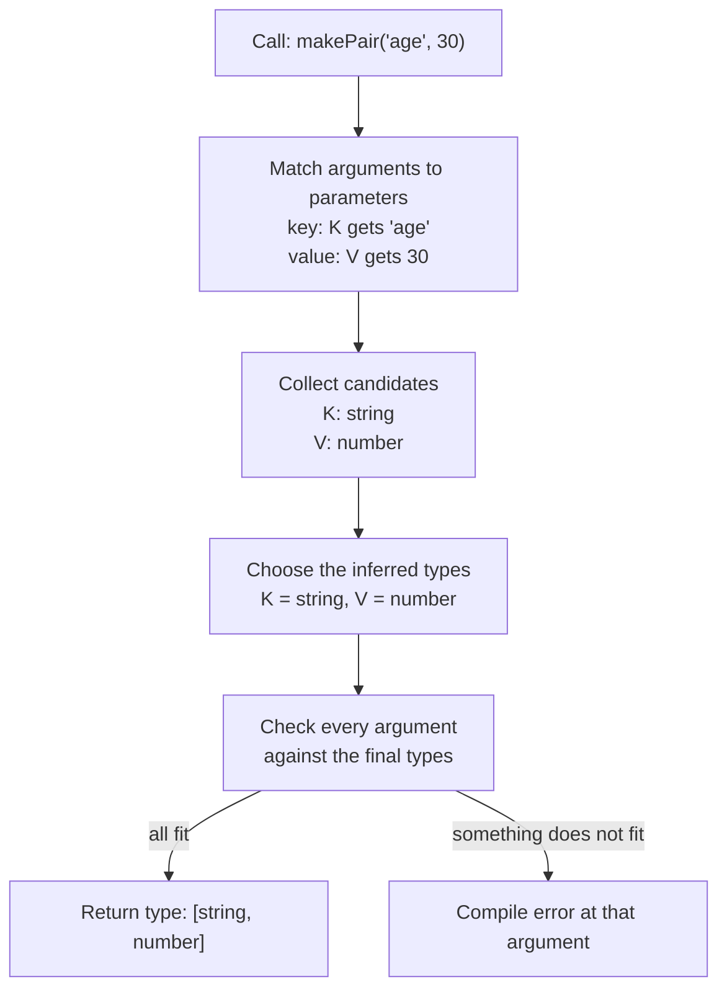
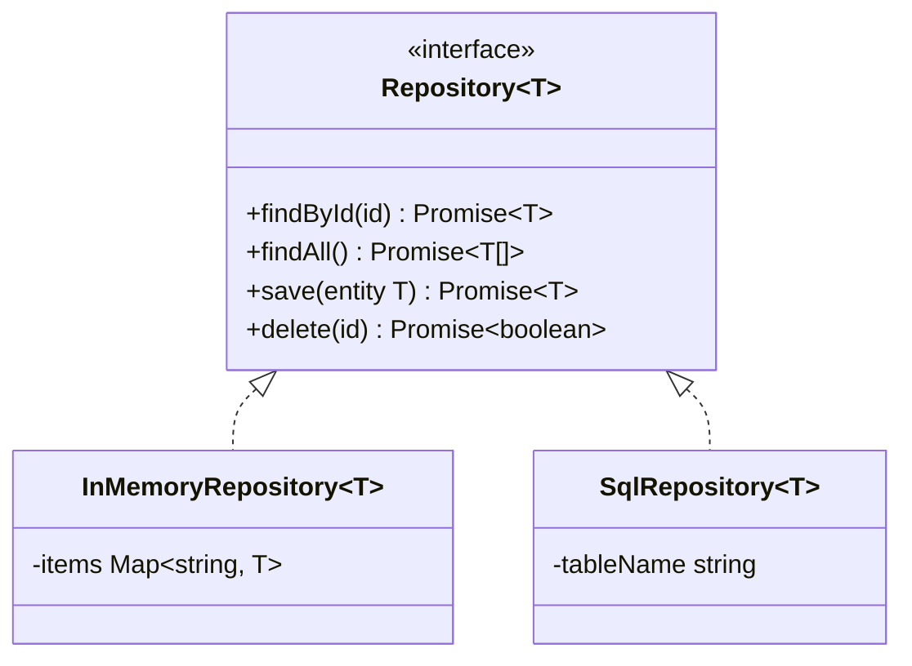
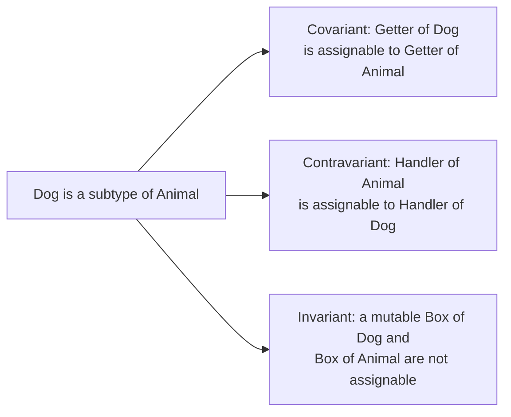

# Generics

> In this document you learn generics: how to write functions, interfaces and classes that work with many types **without losing type information**. You learn type parameters, inference, constraints, defaults, realistic examples (typed HTTP calls, repositories, API responses, `groupBy`), the basics of variance, `const` type parameters (TS 5.0), and the most common mistakes. Generics are the foundation of every advanced TypeScript topic, and interviewers use them to tell the difference between someone who uses TypeScript and someone who understands it.

**Before this:** [Functions and classes](./04-functions-and-classes.md) · [Interfaces and type aliases](./02-interfaces-and-type-aliases.md) · **Interview questions:** [jump to questions](#interview-questions)

## Table of contents

1. [Why generics exist](#why-generics-exist)
2. [Generic functions](#generic-functions)
3. [Type argument inference](#type-argument-inference)
4. [Constraints with extends](#constraints-with-extends)
5. [Constraints with keyof](#constraints-with-keyof)
6. [Default type parameters](#default-type-parameters)
7. [Generic interfaces and type aliases](#generic-interfaces-and-type-aliases)
8. [Generic classes](#generic-classes)
9. [Realistic examples](#realistic-examples)
10. [Generics you already use every day](#generics-you-already-use-every-day)
11. [Variance basics](#variance-basics)
12. [const type parameters](#const-type-parameters)
13. [Common mistakes with generics](#common-mistakes-with-generics)
14. [Interview questions](#interview-questions)
15. [Summary](#summary)
16. [References](#references)

---

## Why generics exist

### The problem

Imagine a function that returns the first element of an array. How do you type it?

```ts
// Attempt 1: only works for numbers
function firstNumber(items: number[]): number | undefined {
  return items[0];
}

// Attempt 2: works for everything, but the type information is lost
function firstAny(items: any[]): any {
  return items[0];
}

const name = firstAny(["Asha", "Ravi"]); // any — no autocomplete, no checks
name.toFixed(2);                         // compiles! Crashes at runtime.

// Attempt 3: unknown is safe, but the caller must check the type again
function firstUnknown(items: unknown[]): unknown {
  return items[0];
}
const name2 = firstUnknown(["Asha"]);    // unknown — we know it is a string, but TypeScript forgot
```

None of these is good. We want to say: **"whatever type the array contains, the function returns that same type."**

### The solution

A **generic** function has a **type parameter** — a placeholder for a type, written in angle brackets.

```ts
function first<T>(items: T[]): T | undefined {
  return items[0];
}

const name = first(["Asha", "Ravi"]); // string | undefined
const price = first([10, 20]);        // number | undefined
const user = first([{ id: 1 }]);      // { id: number } | undefined

name?.toUpperCase(); // ✅ autocomplete works
price?.toFixed(2);   // ✅
name?.toFixed(2);    // ❌ Property 'toFixed' does not exist on type 'string'.
```

`T` is like a function parameter, but for types. When you call `first(["Asha"])`, TypeScript sees that `items` is `string[]`, so `T` becomes `string`, and the return type becomes `string | undefined`.

### Simple explanation

A generic **connects** types. It says "the type that goes in decides the type that comes out" or "these two parameters must have the same type". That connection is the whole point.

### Analogy

A generic is like a **labeled storage box** at a shop. The box design is the same for all products, but when you put shoes in it, the label says "shoes", and whoever opens it knows exactly what is inside. With `any`, the box has no label at all. With `unknown`, the label says "something", so you must open and inspect it every time.

Where the analogy breaks down: generics exist only at compile time. At runtime, there is no label. `first<string>` and `first<number>` are the **same** JavaScript function.

### Generics are erased

```ts
function first<T>(items: T[]): T | undefined {
  return items[0];
}
```

Emitted JavaScript:

```js
function first(items) {
    return items[0];
}
```

Because of erasure, you cannot use `T` at runtime. `typeof T`, `new T()` and `value instanceof T` do not work. If you need a runtime type, pass a value (for example a class or a validation function) as a normal parameter.

---

## Generic functions

### Syntax

```ts
// Function declaration
function wrapInArray<T>(value: T): T[] {
  return [value];
}

// Arrow function
const wrap = <T>(value: T): T[] => [value];

// Function type
type Wrapper = <T>(value: T) => T[];

// Several type parameters
function makePair<K, V>(key: K, value: V): [K, V] {
  return [key, value];
}

const entry = makePair("age", 30); // [string, number]
```

In `.tsx` files (React), `<T>` before an arrow function looks like a JSX tag. Write `<T,>(value: T) => ...` or `<T extends unknown>(...)` to avoid that.

### Naming type parameters

- Single letters are the convention for simple cases: `T` (type), `K` (key), `V` (value), `E` (element or error), `R` (result).
- Use descriptive names when there are several or the meaning is not obvious: `TItem`, `TResponse`, `TKey`.

### A realistic generic function

```ts
function findById<T extends { id: string }>(items: readonly T[], id: string): T | undefined {
  return items.find((item) => item.id === id);
}

interface Product { id: string; name: string; price: number }
interface Customer { id: string; email: string }

const products: Product[] = [{ id: "p1", name: "Pen", price: 2 }];
const customers: Customer[] = [{ id: "c1", email: "asha@example.com" }];

findById(products, "p1")?.price;  // ✅ Product
findById(customers, "c1")?.email; // ✅ Customer
```

One function works for every entity type, and each call keeps its exact type. The `extends { id: string }` part is a **constraint**, explained below.

---

## Type argument inference

Most of the time you do **not** write the type argument. TypeScript **infers** it from the arguments.

```ts
function identity<T>(value: T): T {
  return value;
}

const a = identity("hello");        // T inferred as "hello" (a literal, because a is const)
const b = identity<string>("hello"); // T given explicitly: string
```

### How inference works

1. TypeScript looks at each argument and the matching parameter type.
2. It collects **candidates** for each type parameter (for example, `T` from `items: T[]` and the argument `string[]` gives `T = string`).
3. It picks the best common type from the candidates.
4. It checks every argument against the result.



### When inference gives an error

If one type parameter gets conflicting candidates, TypeScript picks one and reports the other:

```ts
function sameType<T>(a: T, b: T): [T, T] {
  return [a, b];
}

sameType(1, 2);        // ✅ T = number
sameType(1, "two");    // ❌ Argument of type 'string' is not assignable to parameter of type 'number'.
sameType<string | number>(1, "two"); // ✅ explicit type argument allows both
```

This is often what you want: the generic enforces that both arguments have the same type.

### When to write type arguments explicitly

- When there are **no arguments** to infer from: `new Map<string, number>()`, `useState<User | null>(null)`, `http.get<User[]>(url)`.
- When inference picks something too narrow: `createState(null)` infers `T = null`, so you need `createState<User | null>(null)`.
- When you want a wider union, as in `sameType<string | number>`.

```ts
function createState<T>(initial: T) {
  let value = initial;
  return {
    get: () => value,
    set: (next: T) => { value = next; },
  };
}

const counter = createState(0);
counter.set("x");                     // ❌ T is number

const selected = createState<string | null>(null);
selected.set("row-1");                // ✅
```

You cannot give **some** type arguments and let TypeScript infer the rest. It is all or nothing (for a single call), except when the remaining parameters have defaults.

---

## Constraints with extends

### What it is

Inside a generic function, `T` could be **anything**, so TypeScript only allows operations that work on every type. A **constraint** (`T extends Something`) limits which types can be used, and in exchange lets you use the properties of `Something`.

```ts
function logLength<T>(value: T): void {
  console.log(value.length); // ❌ Property 'length' does not exist on type 'T'.
}

function logLengthFixed<T extends { length: number }>(value: T): void {
  console.log(value.length); // ✅ every T has a length
}

logLengthFixed("hello");     // 5 — strings have length
logLengthFixed([1, 2, 3]);   // 3 — arrays have length
logLengthFixed({ length: 7 }); // 7 — any object with length
logLengthFixed(42);          // ❌ Argument of type 'number' is not assignable to parameter of type '{ length: number; }'.
```

Read `T extends X` as "T must be assignable to X" (T has at least what X requires). It is not class inheritance.

### Why not just use the constraint type directly?

Because the generic **keeps the exact type**:

```ts
// Without a generic: the result loses its specific type
function longestPlain(a: { length: number }, b: { length: number }) {
  return a.length >= b.length ? a : b;
}
const r1 = longestPlain("abc", "de"); // { length: number } — it was a string, but now we can't call toUpperCase

// With a generic: the result keeps its type
function longest<T extends { length: number }>(a: T, b: T): T {
  return a.length >= b.length ? a : b;
}
const r2 = longest("abc", "de");      // string
r2.toUpperCase();                     // ✅ "ABC"
const r3 = longest([1, 2], [3]);      // number[]
```

This is the key rule: **use a generic when you need to return or connect the specific type; use a plain parameter type when you don't.**

### Common constraints

| Constraint | Meaning |
|---|---|
| `T extends object` | Any non-primitive |
| `T extends Record<string, unknown>` | An object with string keys (careful: interfaces do not match, see [Interfaces and type aliases](./02-interfaces-and-type-aliases.md#a-hidden-difference-implicit-index-signatures)) |
| `T extends { id: string }` | Has at least a string `id` |
| `T extends string` | A string or a string literal type |
| `K extends PropertyKey` | `string \| number \| symbol` — anything usable as an object key |
| `T extends unknown[]` | Any array or tuple |
| `F extends (...args: any[]) => unknown` | Any function |

---

## Constraints with keyof

`keyof T` is the union of the property names of `T`. Combining it with a second type parameter gives one of the most useful patterns in TypeScript:

```ts
function getProperty<T, K extends keyof T>(obj: T, key: K): T[K] {
  return obj[key];
}

const user = { id: 1, name: "Asha", active: true };

const userName = getProperty(user, "name");     // string
const isActive = getProperty(user, "active");   // boolean
getProperty(user, "email");                     // ❌ Argument of type '"email"' is not assignable to parameter of type '"id" | "name" | "active"'.
```

Step by step:

1. `T` is inferred from `user`: `{ id: number; name: string; active: boolean }`.
2. `keyof T` is `"id" | "name" | "active"`, so `K` can only be one of those.
3. For the call with `"name"`, `K` is inferred as the literal `"name"`.
4. The return type `T[K]` is an **indexed access type**: the type of property `K` in `T`, which is `string`.

Without the second type parameter, the result would be a union of all property types:

```ts
function getPropertyLoose<T>(obj: T, key: keyof T): T[keyof T] {
  return obj[key];
}
const v = getPropertyLoose(user, "name"); // string | number | boolean — less useful
```

A realistic version: a typed "pluck" for tables.

```ts
function pluck<T, K extends keyof T>(rows: readonly T[], key: K): T[K][] {
  return rows.map((row) => row[key]);
}

const orders = [
  { id: "o1", total: 120, status: "paid" },
  { id: "o2", total: 80, status: "pending" },
];

const totals = pluck(orders, "total"); // number[]
console.log(totals);                   // [ 120, 80 ]
```

`keyof`, `typeof` and indexed access types are covered in depth in [keyof, typeof, indexed and mapped types](./06-keyof-typeof-indexed-and-mapped-types.md).

---

## Default type parameters

A type parameter can have a **default**, used when the type argument is not given and cannot be inferred.

```ts
interface ApiResponse<TData = unknown, TError = string> {
  data: TData | null;
  error: TError | null;
  status: number;
}

const raw: ApiResponse = { data: { anything: true }, error: null, status: 200 };
// raw.data is unknown | null — safe default

const users: ApiResponse<{ id: string }[]> = { data: [{ id: "u1" }], error: null, status: 200 };
// TError uses its default: string
```

Rules:

- Parameters with defaults must come **after** parameters without defaults.
- A default must satisfy the constraint: `<T extends object = {}>` is fine; `<T extends object = string>` is an error.
- A default type is **not** a default value. `function f<T = string>(value: T)` still requires the `value` argument at runtime. Defaults only fill in the **type** when nothing else decides it.

```ts
function createPair<T = string, U = number>(first: T, second: U): [T, U] {
  return [first, second];
}

createPair("a", 1); // ✅ inferred: [string, number]
createPair();       // ❌ Expected 2 arguments, but got 0. — type defaults do not supply values
```

Angular uses defaults in many places: `EventEmitter<T = any>`, `FormControl<TValue = any>`, `HttpResponse<T>`.

---

## Generic interfaces and type aliases

Interfaces and type aliases can have type parameters too. This is how you describe reusable data shapes.

```ts
interface Page<TItem> {
  items: TItem[];
  page: number;
  pageSize: number;
  total: number;
}

type Nullable<T> = T | null;

type Result<T, E = Error> =
  | { ok: true; value: T }
  | { ok: false; error: E };

interface Order { id: string; total: number }

const ordersPage: Page<Order> = {
  items: [{ id: "o1", total: 99 }],
  page: 1,
  pageSize: 20,
  total: 1,
};

function safeDivide(a: number, b: number): Result<number, string> {
  return b === 0 ? { ok: false, error: "Division by zero" } : { ok: true, value: a / b };
}

console.log(safeDivide(6, 3)); // { ok: true, value: 2 }
console.log(safeDivide(1, 0)); // { ok: false, error: 'Division by zero' }
```

A generic interface is not a type by itself. `Page` alone is an error in most places ("Generic type 'Page' requires 1 type argument(s)"), unless all parameters have defaults. `Page<Order>` is a type.

### Generic function types inside interfaces

There are two different places to put a type parameter, and they mean different things:

```ts
// 1. The interface is generic: T is chosen once, when you use the interface
interface Transformer<T> {
  transform(value: T): T;
}
const upper: Transformer<string> = { transform: (s) => s.toUpperCase() };

// 2. The method is generic: T is chosen at every call
interface Cloner {
  clone<T>(value: T): T;
}
const cloner: Cloner = { clone: (v) => structuredClone(v) };
const copy = cloner.clone({ a: 1 }); // T = { a: number } for this call
```

Choose 1 when the whole object works with one type. Choose 2 when each call can use a different type.

---

## Generic classes

A class can have type parameters that are available to all its instance members.

```ts
class Stack<T> {
  #items: T[] = [];

  push(item: T): void {
    this.#items.push(item);
  }

  pop(): T | undefined {
    return this.#items.pop();
  }

  peek(): T | undefined {
    return this.#items[this.#items.length - 1];
  }

  get size(): number {
    return this.#items.length;
  }
}

const history = new Stack<string>();
history.push("/home");
history.push("/products");
console.log(history.pop());  // "/products"
history.push(42);            // ❌ Argument of type 'number' is not assignable to parameter of type 'string'.
```

The type argument can be inferred from the constructor:

```ts
class Box<T> {
  constructor(public value: T) {}
  map<U>(fn: (value: T) => U): Box<U> {
    return new Box(fn(this.value));
  }
}

const priceBox = new Box(100);                       // Box<number>
const label = priceBox.map((p) => `$${p}`).value;    // string
console.log(label);                                  // "$100"
```

Notice `map<U>`: the class has `T`, and the method adds its own type parameter `U` for the result.

Remember: **static members cannot use the class type parameter** (see [Static members](./04-functions-and-classes.md#static-members)).

---

## Realistic examples

### Example 1: a typed HTTP client (Angular HttpClient)

Angular's `HttpClient.get` is generic:

```ts
import { Injectable } from "@angular/core";
import { HttpClient } from "@angular/common/http";
import { Observable } from "rxjs";

export interface User {
  id: string;
  name: string;
  email: string;
}

@Injectable({ providedIn: "root" })
export class UserApi {
  constructor(private readonly http: HttpClient) {}

  getUsers(): Observable<User[]> {
    return this.http.get<User[]>("/api/users");
  }

  getUser(id: string): Observable<User> {
    return this.http.get<User>(`/api/users/${encodeURIComponent(id)}`);
  }
}
```

Very important: **`get<User[]>` does not check the response.** The type argument is only a promise you make to the compiler. If the server returns something else, TypeScript cannot know. Writing `http.get<User[]>(url)` is the same as writing `http.get(url) as Observable<User[]>`. For untrusted or changing APIs, validate the response (for example with a `map` operator and a schema). See [Runtime validation and type-safe APIs](./11-runtime-validation-and-type-safe-apis.md).

A small generic wrapper around `fetch`, with the validator as a parameter so that the type is really checked:

```ts
async function getJson<T>(url: string, validate: (data: unknown) => data is T): Promise<T> {
  const response = await fetch(url);
  if (!response.ok) {
    throw new Error(`GET ${url} failed with ${response.status}`);
  }
  const data: unknown = await response.json();
  if (!validate(data)) {
    throw new Error(`GET ${url} returned an unexpected shape`);
  }
  return data;
}

function isUser(value: unknown): value is User {
  return (
    typeof value === "object" && value !== null &&
    "id" in value && typeof value.id === "string" &&
    "name" in value && typeof value.name === "string" &&
    "email" in value && typeof value.email === "string"
  );
}

// T is inferred as User from the validator — no type argument needed
const user = await getJson("/api/users/1", isUser);
```

Here `T` is **inferred from a real runtime check**, which is much safer than `getJson<User>(url)` with no validation.

### Example 2: a generic repository

```ts
interface Entity {
  id: string;
}

interface Repository<T extends Entity> {
  findById(id: string): Promise<T | undefined>;
  findAll(): Promise<T[]>;
  save(entity: T): Promise<T>;
  delete(id: string): Promise<boolean>;
}

class InMemoryRepository<T extends Entity> implements Repository<T> {
  #items = new Map<string, T>();

  async findById(id: string): Promise<T | undefined> {
    return this.#items.get(id);
  }

  async findAll(): Promise<T[]> {
    return [...this.#items.values()];
  }

  async save(entity: T): Promise<T> {
    this.#items.set(entity.id, entity);
    return entity;
  }

  async delete(id: string): Promise<boolean> {
    return this.#items.delete(id);
  }
}

interface Product extends Entity {
  name: string;
  price: number;
}

const productRepo = new InMemoryRepository<Product>();
await productRepo.save({ id: "p1", name: "Pen", price: 2 });
const pen = await productRepo.findById("p1");
console.log(pen?.name);                         // "Pen"

new InMemoryRepository<{ name: string }>();      // ❌ Property 'id' is missing — violates the constraint
```



In tests you use `InMemoryRepository<Product>`; in production a database-backed class implements the same interface. Services depend on `Repository<Product>`, not on a specific class. This is dependency inversion (see [Dependency inversion and injection](../04-oop-solid-design-patterns/05-dependency-inversion-and-injection.md)).

A word of caution: do not force every entity into the same generic CRUD shape if their real behavior is different (for example, orders that cannot be deleted, only cancelled). A generic should describe what really is shared.

### Example 3: a generic API response envelope

Many backends wrap every response in the same envelope:

```ts
interface ApiEnvelope<T> {
  success: boolean;
  data: T;
  meta?: { requestId: string; durationMs: number };
}

interface PagedData<T> {
  items: T[];
  nextCursor: string | null;
}

// Nested generics
type ProductListResponse = ApiEnvelope<PagedData<Product>>;

function unwrap<T>(envelope: ApiEnvelope<T>): T {
  if (!envelope.success) throw new Error("Request failed");
  return envelope.data;
}

const response: ProductListResponse = {
  success: true,
  data: { items: [{ id: "p1", name: "Pen", price: 2 }], nextCursor: null },
};

const page = unwrap(response);     // PagedData<Product>
console.log(page.items[0].name);   // "Pen"
```

In Express, the same idea types your responses: `res: Response<ApiEnvelope<User>>` makes `res.json(...)` check the body you send.

### Example 4: a typed groupBy

```ts
function groupBy<T, K extends PropertyKey>(
  items: readonly T[],
  getKey: (item: T) => K,
): Record<K, T[]> {
  const result = {} as Record<K, T[]>;
  for (const item of items) {
    const key = getKey(item);
    (result[key] ??= []).push(item);
  }
  return result;
}

type OrderStatus = "paid" | "pending";
interface Order { id: number; status: OrderStatus }

const orders: Order[] = [
  { id: 1, status: "paid" },
  { id: 2, status: "pending" },
  { id: 3, status: "paid" },
];

const byStatus = groupBy(orders, (order) => order.status);
// type: Record<OrderStatus, Order[]>

console.log(byStatus);
// {
//   paid: [ { id: 1, status: 'paid' }, { id: 3, status: 'paid' } ],
//   pending: [ { id: 2, status: 'pending' } ]
// }
console.log(byStatus.paid.length); // 2
```

Step by step:

1. `T` is inferred from `orders`: `Order`.
2. `K` is inferred from the callback's return type: `OrderStatus`.
3. The result type `Record<OrderStatus, Order[]>` lets you write `byStatus.paid` with autocomplete.
4. `{} as Record<K, T[]>` is an assertion, because an empty object does not have all keys yet. This small, local assertion inside a well-tested helper is acceptable. Note that if no order is `"pending"`, `byStatus.pending` is actually `undefined` at runtime, even though the type says `Order[]`. A stricter version returns `Partial<Record<K, T[]>>`.

> **Note:** ES2024 added `Object.groupBy` (and `Map.groupBy`) to JavaScript. TypeScript types it in `lib.es2024` as returning `Partial<Record<K, T[]>>`. Node.js 21+ and modern browsers support it. See [Modern JavaScript features](../02-javascript/21-modern-javascript-features.md).

### Example 5: wrapping any function and keeping its types

Generics over **parameter lists** let you write decorators and wrappers that keep the exact signature:

```ts
function withLogging<A extends unknown[], R>(
  fn: (...args: A) => R,
  label: string,
): (...args: A) => R {
  return (...args) => {
    console.log(`${label} called with`, args);
    return fn(...args);
  };
}

const add = (a: number, b: number) => a + b;
const loggedAdd = withLogging(add, "add");

console.log(loggedAdd(2, 3)); // "add called with [ 2, 3 ]" then 5
loggedAdd("2", 3);            // ❌ Argument of type 'string' is not assignable to parameter of type 'number'.
```

`A` is inferred as the tuple `[a: number, b: number]` and `R` as `number`. The same technique powers `debounce`, `memoize` and retry helpers. See [Debounce, throttle and performance](../02-javascript/20-debounce-throttle-and-performance.md).

---

## Generics you already use every day

| Generic type | Where you see it |
|---|---|
| `Array<T>` / `T[]` | Every array |
| `Promise<T>` | Every `async` function returns `Promise<T>` |
| `Map<K, V>`, `Set<T>` | Collections |
| `Record<K, V>`, `Partial<T>`, `Pick<T, K>` | [Utility types](./08-utility-types.md) |
| `Observable<T>` | RxJS and Angular (`HttpClient`, `ActivatedRoute.params`) |
| `EventEmitter<T>` | Angular `@Output()` |
| `FormControl<T>`, `FormGroup<T>` | Angular typed reactive forms (Angular 14+) |
| `InjectionToken<T>` | Angular DI tokens for non-class values |
| `Request<Params, ResBody, ReqBody>` | Express types |
| `useState<T>`, `useRef<T>` | React hooks |

```ts
// Angular examples
import { EventEmitter, InjectionToken, Output, Component } from "@angular/core";

export interface AppConfig { apiUrl: string; retries: number }
export const APP_CONFIG = new InjectionToken<AppConfig>("APP_CONFIG");
// inject(APP_CONFIG) now returns AppConfig, not any

@Component({ selector: "app-product-row", template: "" })
export class ProductRowComponent {
  @Output() selected = new EventEmitter<string>(); // emits a product id
}
```

`Array.prototype.map` itself is generic in its result type:

```ts
// From lib.es5.d.ts (simplified):
// map<U>(callbackfn: (value: T, index: number, array: T[]) => U): U[];

const ids = [1, 2, 3].map((n) => `id-${n}`); // U inferred as string → string[]
```

---

## Variance basics

**Variance** answers this question: if `Dog` is a subtype of `Animal`, is `Box<Dog>` a subtype of `Box<Animal>`? The answer depends on **how** the generic type uses `T`.

```ts
interface Animal { name: string }
interface Dog extends Animal { bark(): void }
```

### Covariance: T only comes out

If a type only **produces** `T` (returns it, reads it), then `Producer<Dog>` can be used as `Producer<Animal>`. Every dog you get out is also an animal. This is **covariance**: the direction is the same as `Dog → Animal`.

```ts
type Getter<T> = () => T;

const getDog: Getter<Dog> = () => ({ name: "Rex", bark: () => console.log("Woof") });
const getAnimal: Getter<Animal> = getDog; // ✅ safe
```

### Contravariance: T only goes in

If a type only **consumes** `T` (takes it as a parameter), the direction flips. A handler of any `Animal` can be used where a handler of `Dog` is needed, but not the other way around. This is **contravariance**.

```ts
type Handler<T> = (value: T) => void;

const handleAnimal: Handler<Animal> = (a) => console.log(a.name);
const handleDog: Handler<Dog> = handleAnimal; // ✅ safe: it can handle any dog

const barkAtIt: Handler<Dog> = (d) => d.bark();
const handleAny: Handler<Animal> = barkAtIt;
// ❌ with strictFunctionTypes: someone could pass a cat, and cats cannot bark
```

`strictFunctionTypes` (part of `strict`) enables this contravariant check for function types. As explained in [Interfaces and type aliases](./02-interfaces-and-type-aliases.md#the-method-exception-bivariance), **methods** are still checked bivariantly for compatibility.

### Invariance: T goes in and out

If a type both reads and writes `T`, the only safe rule is **invariance**: `Box<Dog>` and `Box<Animal>` should not be assignable either way.

### TypeScript arrays are covariant (and that is unsound)

Arrays read **and** write their elements, so strictly they should be invariant. TypeScript treats them as covariant for convenience, which allows this:

```ts
const dogs: Dog[] = [];
const animals: Animal[] = dogs;   // ✅ allowed (covariant)
animals.push({ name: "Cat" });    // ✅ compiles: a cat is an Animal
// dogs now contains a cat. dogs[0].bark() would crash at runtime.
```

This is a known, deliberate hole. A defense: accept `readonly T[]` in functions that do not modify the array. A `readonly Dog[]` can safely be used as `readonly Animal[]`, because nobody can push into it.



### Variance annotations (TypeScript 4.7+)

You can document variance on a type parameter with `out` (covariant) and `in` (contravariant):

```ts
interface Producer<out T> { get(): T }
interface Consumer<in T> { accept(value: T): void }
```

TypeScript checks that the annotation matches how `T` is used. These annotations are rarely needed in application code; TypeScript computes variance by itself. They are mainly used in libraries for clarity and type-checking speed.

---

## const type parameters

### The problem

When a generic function receives an array or object literal, TypeScript infers a **widened** type:

```ts
function defineRoutes<T extends readonly string[]>(routes: T): T {
  return routes;
}

const routes = defineRoutes(["home", "users"]); // string[] — the names are lost
```

Before TypeScript 5.0, callers had to write `defineRoutes(["home", "users"] as const)`.

### The solution (TypeScript 5.0)

Add the `const` modifier to the type parameter. TypeScript then infers the argument as if it were written with `as const`:

```ts
function defineRoutesConst<const T extends readonly string[]>(routes: T): T {
  return routes;
}

const routes2 = defineRoutesConst(["home", "users"]); // readonly ["home", "users"]
type RouteName = (typeof routes2)[number];           // "home" | "users"
```

Notes:

- Use a `readonly` array constraint (`readonly string[]`). In TypeScript 5.0 (the version Angular 16 projects can use), a mutable constraint like `string[]` made inference fall back to `string[]`, because a readonly tuple is not assignable to a mutable array. Newer versions (checked with 5.9) infer a mutable tuple of literals in that case, but the `readonly` constraint works in every version.
- It only affects literals written directly in the call. A variable you pass keeps its own type.
- TypeScript 5.0 is supported by Angular 16, so you can use it there.

Real uses: configuration builders, event name lists, permission lists, typed route tables, and libraries that build types from your literals.

---

## Common mistakes with generics

### Mistake 1: a type parameter used only once

A type parameter should **connect** at least two places (two parameters, or a parameter and the return type). If it appears only once, it does nothing useful.

```ts
// ❌ Wrong: T appears once — it is just a complicated 'unknown'
function logValue<T>(value: T): void {
  console.log(value);
}

// ✅ Correct
function logValueFixed(value: unknown): void {
  console.log(value);
}
```

The TypeScript handbook states this as a guideline: "If a type parameter only appears in one location, strongly reconsider if you actually need it."

### Mistake 2: a generic return type that is really a cast

```ts
// ❌ Wrong: looks type-safe, but T is never checked
function parseJson<T>(text: string): T {
  return JSON.parse(text);
}

const config = parseJson<{ port: number }>('{"port":"8080"}');
config.port.toFixed(0); // compiles; runtime TypeError
```

`T` appears only in the return type, and nothing produces a real `T`. It is an assertion disguised as a generic. The same is true for `http.get<T>()` and `localStorage` helpers. Honest alternatives:

```ts
// ✅ Return unknown and let the caller validate
function parseJsonSafe(text: string): unknown {
  return JSON.parse(text);
}

// ✅ Or require a validator, so T comes from a real check
function parseJsonWith<T>(text: string, isT: (v: unknown) => v is T): T {
  const value: unknown = JSON.parse(text);
  if (!isT(value)) throw new Error("Invalid JSON shape");
  return value;
}
```

### Mistake 3: over-generic code

```ts
// ❌ Too clever: four type parameters for a simple job
function updateEntity<TEntity, TKey extends keyof TEntity, TValue extends TEntity[TKey], TResult extends TEntity>(
  entity: TEntity, key: TKey, value: TValue,
): TResult {
  return { ...entity, [key]: value } as TResult;
}

// ✅ Simple and still type-safe
function updateField<T, K extends keyof T>(entity: T, key: K, value: T[K]): T {
  return { ...entity, [key]: value };
}
```

Signs of over-generic code: many type parameters, unreadable error messages, assertions needed inside, and teammates who cannot explain the signature. Generics are a tool to connect types, not a goal.

### Mistake 4: constraint where a union would do

```ts
// ❌ Unnecessary generic
function formatId<T extends string | number>(id: T): string {
  return String(id);
}

// ✅ The return type does not depend on T, so a plain union is enough
function formatIdFixed(id: string | number): string {
  return String(id);
}
```

### Mistake 5: expecting T to exist at runtime

```ts
function create<T>(): T {
  return new T(); // ❌ 'T' only refers to a type, but is being used as a value here.
}

// ✅ Pass the class as a value
function createFrom<T>(Ctor: new () => T): T {
  return new Ctor();
}
```

### Mistake 6: using a generic when the element type is fixed by the API

If a function always returns `User[]`, write `User[]`. Generic return types should be decided by the caller's arguments, not by a hidden choice.

### Best practices

- **Start without generics.** Add a type parameter when you need to connect an input type to an output type.
- **Each type parameter should appear at least twice.**
- **Constrain only what the implementation needs.** Too-strict constraints reduce reuse; no constraint blocks useful operations.
- **Let inference work.** Callers should rarely need to write type arguments.
- **Prefer `readonly T[]` parameters** when the function does not modify the array.
- **Never use a generic return type to hide a cast.** Require a validator or return `unknown`.
- **Use descriptive names** (`TItem`, `TKey`) when there is more than one type parameter.

---

## Interview questions

### How to explain this in an interview

1. **Define it:** "Generics are type parameters. They let a function, interface or class work with many types while keeping the exact type, instead of falling back to `any`."
2. **Why it exists:** "Without them, I either duplicate code for each type or use `any` and lose all checking. Generics connect the input type to the output type."
3. **How it works:** "At each call, TypeScript infers the type parameter from the arguments, checks constraints, and computes the return type. It all happens at compile time; generics are erased in the JavaScript."
4. **Small example:** "`first<T>(items: T[]): T | undefined`. Called with `string[]`, it returns `string | undefined`; with `number[]`, `number | undefined`."
5. **Where it is useful:** "Typed HTTP calls, repositories, API response envelopes, utilities like `groupBy` or `pluck`, and every collection: `Array<T>`, `Promise<T>`, `Observable<T>`."
6. **Trade-offs / gotchas:** "`http.get<T>()` does not validate anything, so it is really a cast. A type parameter used only once is pointless. And over-generic code becomes hard to read, so I keep generics as simple as possible."

### Q1. What are generics and why do we need them?

**What the interviewer is checking:** Whether you understand that generics preserve type relationships.

**Short spoken answer (30–60 seconds):**
> Generics are type parameters, like function parameters but for types. They let me write one function, interface or class that works with many types while keeping the specific type. For example, a `first` function: with `any`, the result is `any` and I lose autocomplete and checks. With `unknown`, I must check the type again. With a generic `first<T>(items: T[]): T | undefined`, passing a string array returns a string. So the main idea is that a generic connects types: the input type decides the output type, or two parameters must have the same type. They exist only at compile time, so there is no runtime cost.

**Follow-up questions:**
- **What is the difference between a generic and `any`?** — `any` turns off checking and forgets the type. A generic keeps the exact type and checks every use.
- **What is the difference between a generic and a union?** — A union means "one of these, I don't know which". A generic means "a specific type chosen by the caller, kept consistent across parameters and return value".
- **Do generics exist at runtime?** — No. They are erased. You cannot use `T` as a value.

**Common mistakes:** "Generics are like `any`"; not mentioning the connection between input and output.

**Where this is used in real projects:** `Observable<T>`, `HttpClient.get<T>`, `Repository<T>`, `EventEmitter<T>`, `useState<T>`.

### Q2. What is a generic constraint? Give an example.

**What the interviewer is checking:** `extends` in generics and why it is needed.

**Short spoken answer (30–60 seconds):**
> Inside a generic function, `T` can be anything, so TypeScript only allows what works on every type. A constraint, `T extends X`, says T must be assignable to X, so it must have at least X's properties. In exchange, I can use those properties inside the function. For example, `function longest<T extends { length: number }>(a: T, b: T): T` can compare `a.length` and `b.length`, works with strings and arrays, and still returns the exact type, so calling it with strings returns a string. Passing a number is an error because numbers have no length.

**Follow-up questions:**
- **Why not just type the parameters as `{ length: number }`?** — Then the return type would be `{ length: number }`, and you would lose the specific type (`string` or `number[]`).
- **What does `K extends keyof T` mean?** — K must be one of the property names of T. Combined with `T[K]`, it lets you return the exact property type.
- **Is `extends` in a constraint the same as class inheritance?** — No. It means "is assignable to". Any type with the right shape fits, because TypeScript is structural.

<a id="q3-explain-this-signature-function-getpropertyt-k-extends-keyof-tobj-t-key-k-tk"></a>

### Q3. Explain this signature: `function getProperty<T, K extends keyof T>(obj: T, key: K): T[K]`.

**What the interviewer is checking:** `keyof`, indexed access types and inference of literal keys.

**Short spoken answer (30–60 seconds):**
> It has two type parameters. `T` is inferred from the object. `K` is constrained to `keyof T`, the union of T's property names, so I can only pass a real key, and typos are compile errors. Because `K` is its own type parameter, TypeScript infers the specific literal key, like `"name"`. The return type `T[K]` is an indexed access type: the type of that property. So for `{ id: number, name: string }`, `getProperty(user, "name")` returns `string`, not `string | number`. If I used `key: keyof T` without the second parameter, the return type would be the union of all property types.

**Code:**

```ts
const config = { port: 8080, host: "localhost", debug: false };
const port = getProperty(config, "port");   // number
const debug = getProperty(config, "debug"); // boolean
getProperty(config, "timeout");             // ❌ not a key
```

**Follow-up:** **How would you write a typed `setProperty`?** — `function setProperty<T, K extends keyof T>(obj: T, key: K, value: T[K]): void { obj[key] = value; }`. The value must match that property's type.

<a id="q4-does-httpgetuserurl-in-angular-guarantee-that-you-get-users"></a>

### Q4. Does `http.get<User[]>(url)` in Angular guarantee that you get users?

**What the interviewer is checking:** Compile time vs runtime with generics.

**Short spoken answer (30–60 seconds):**
> No. The type argument only tells the compiler what to assume. HttpClient parses the JSON and returns whatever the server sent, typed as `User[]`. It is effectively a type assertion. If the API changes or returns an error shape, my code gets the wrong data and may crash later, far from the cause. For important or external APIs, I validate the response at the service boundary, for example with a `map` operator that runs a type guard or a Zod schema, and I make sure the generic type comes from that validation.

**Follow-up questions:**
- **Is a generic function that only uses T in its return type always suspicious?** — Usually yes. If no argument produces a T, the function cannot really guarantee T, so it is a hidden cast. Examples: `parseJson<T>()`, `getItem<T>(key)` for localStorage.
- **How do you fix it?** — Return `unknown`, or accept a validator parameter (`(v: unknown) => v is T`) so that T is inferred from a real check.

### Q5. What are default type parameters, and do they provide default values?

**Short answer:** A default type parameter (`<T = string>`) is used when the type argument is not given and cannot be inferred. It does **not** provide a runtime value: `function f<T = string>(value: T)` still requires `value`. Defaults must come after parameters without defaults, and must satisfy the constraint. Example: `interface ApiResponse<T = unknown>`, so that `ApiResponse` alone means "data of unknown type". Angular's `EventEmitter<T = any>` and `FormControl<TValue = any>` use defaults.

### Q6. Write a generic `groupBy` function.

**What the interviewer is checking:** Practical generic design with two type parameters and a callback.

**Short spoken answer (30–60 seconds):**
> I need two type parameters: `T` for the items and `K` for the key, constrained to `PropertyKey` so it can be an object key. The callback takes a `T` and returns a `K`, and the result is `Record<K, T[]>`. Both are inferred, so calling it with orders and `o => o.status` gives me a record keyed by the status union. Inside, I build the object with `??=` to create each group on first use. I would also mention that modern JavaScript has `Object.groupBy`, and that a strict type for the result is `Partial<Record<K, T[]>>`, because not every key is guaranteed to have items.

**Code:** See [Example 4: a typed groupBy](#example-4-a-typed-groupby).

### Q7. What does this code print, and what are the types?

```ts
function wrap<T>(value: T) {
  return { value, createdAt: 0 };
}

const a = wrap("hello");
const b = wrap([1, 2, 3]);
const c = wrap({ id: 7 });

console.log(typeof a.value, Array.isArray(b.value), c.value.id);
```

**Answer:**

```text
string true 7
```

**Types:**
- `a`: `{ value: string; createdAt: number }`
- `b`: `{ value: number[]; createdAt: number }`
- `c`: `{ value: { id: number }; createdAt: number }`

**Explanation:** `T` is inferred from each argument. The return type is inferred from the object literal: `value` has type `T`, and `createdAt` widens to `number` because object properties are mutable. At runtime, generics do not exist; the function simply returns an object, so the output is plain JavaScript behavior.

(`a.value` is `string`, not `"hello"`, because the literal type is widened when it is placed in a mutable object property.)

### Q8. Why is this generic function considered bad practice?

```ts
function printAll<T>(items: T[]): void {
  items.forEach((item) => console.log(item));
}
```

**Short answer:** `T` appears only once (in the parameter). It does not connect anything: the function never returns a `T` or compares two `T`s. It is equivalent to `items: unknown[]` (or `readonly unknown[]`), which is simpler. The handbook guideline: a type parameter that appears in only one place is probably unnecessary. (One exception people discuss: in some libraries, a generic is used to infer a literal type for better hints, but that is rare.)

### Q9. What is variance? Explain covariance and contravariance with an example.

**What the interviewer is checking:** Senior-level understanding of assignability of generic types.

**Short spoken answer (30–60 seconds):**
> Variance describes how subtyping of a type parameter affects the generic type. If Dog is a subtype of Animal, a type that only gives out T, like a getter returning T, is covariant: a getter of Dog can be used as a getter of Animal. A type that only takes T in, like a handler function, is contravariant: a handler of any Animal can be used where a Dog handler is needed, but not the other way around, because the Dog handler might call `bark` on a cat. TypeScript checks function parameters contravariantly with `strictFunctionTypes`. But arrays are treated as covariant even though you can write to them, so you can assign `Dog[]` to `Animal[]` and push a cat. That is a known unsound spot, and using `readonly` arrays avoids it.

**Follow-up questions:**
- **What is invariance?** — When neither direction is allowed, which is the correct rule for types that both read and write T (like a mutable box).
- **What are `in` and `out` on type parameters?** — Variance annotations added in TypeScript 4.7. `out T` declares covariance, `in T` contravariance. TypeScript verifies them. They are mostly useful in libraries.
- **Why are methods bivariant?** — For backward compatibility, so that types like `Array<Dog>` stay assignable to `Array<Animal>`.

### Q10. What are `const` type parameters?

**Short answer:** Added in TypeScript 5.0. Writing `<const T extends readonly string[]>` makes TypeScript infer literal arguments as if the caller wrote `as const`: `defineRoutes(["home", "users"])` gives `readonly ["home", "users"]` instead of `string[]`. Use a `readonly` constraint; in TypeScript 5.0 a mutable `string[]` constraint made inference fall back to `string[]` (newer versions infer a mutable literal tuple instead). It only applies to literals written in the call. Angular 16 supports TypeScript 5.0, so it is available there.

### Q11. Debugging: why does this not compile, and how do you fix it?

```ts
function createInstance<T>(): T {
  return new T();
}
```

**Answer:** Error: "'T' only refers to a type, but is being used as a value here." Type parameters are erased; there is no `T` at runtime to call `new` on. Pass the class as a value with a construct signature:

```ts
function createInstance<T>(Ctor: new () => T): T {
  return new Ctor();
}

class Logger { log(msg: string) { console.log(msg); } }
createInstance(Logger).log("ready"); // "ready" — T inferred as Logger
```

### Q12. How do you type a function that wraps another function and keeps its parameter and return types?

**What the interviewer is checking:** Generic rest parameters (variadic tuple inference).

**Short spoken answer (30–60 seconds):**
> I use two type parameters: `A extends unknown[]` for the argument list and `R` for the return type, and type the input as `(...args: A) => R`. TypeScript infers `A` as a tuple of the original parameters and `R` as the return type. The wrapper returns `(...args: A) => R`, so callers get exactly the same signature and errors as with the original function. That is how I would type `debounce`, `memoize`, logging or retry wrappers. For async functions, R would be a Promise type, and I can keep it as is.

**Code:** See [Example 5](#example-5-wrapping-any-function-and-keeping-its-types).

**Follow-up:** **What about `Parameters<F>` and `ReturnType<F>`?** — They work too: `function wrap<F extends (...args: any[]) => any>(fn: F): (...args: Parameters<F>) => ReturnType<F>`. The `A`/`R` form usually gives cleaner inference. See [Utility types](./08-utility-types.md).

### Q13. Design: create a type-safe in-memory cache with expiry.

**Short answer:**

```ts
class TtlCache<K, V> {
  #store = new Map<K, { value: V; expiresAt: number }>();

  constructor(private readonly ttlMs: number) {}

  set(key: K, value: V): void {
    this.#store.set(key, { value, expiresAt: Date.now() + this.ttlMs });
  }

  get(key: K): V | undefined {
    const entry = this.#store.get(key);
    if (!entry) return undefined;
    if (Date.now() > entry.expiresAt) {
      this.#store.delete(key);
      return undefined;
    }
    return entry.value;
  }
}

const userCache = new TtlCache<string, { name: string }>(60_000);
userCache.set("u1", { name: "Asha" });
console.log(userCache.get("u1")?.name); // "Asha"
console.log(userCache.get("u2"));       // undefined
```

Points to mention: two type parameters for key and value, `Map` instead of an object so any key type works, `V | undefined` return so callers handle misses, and `#store` for real privacy. For production you would add a maximum size (LRU eviction) to avoid memory growth. See [Caching](../07-nodejs-backend/11-caching.md).

<a id="q14-why-does-sametype1-two-fail-for-function-sametypeta-t-b-t"></a>

### Q14. Why does `sameType(1, "two")` fail for `function sameType<T>(a: T, b: T)`?

**Short answer:** TypeScript infers `T` from the candidates `number` and `string`. It does not automatically create the union `string | number`; it picks the first candidate (`number`) and then reports that `"two"` is not a `number`. This is usually what you want: the signature says both arguments have the same type. If you really want a union, pass it explicitly: `sameType<string | number>(1, "two")`.

### Q15. When should you not use generics?

**What the interviewer is checking:** Judgment and simplicity.

**Short spoken answer (30–60 seconds):**
> When the type parameter does not connect anything. If it appears only once, `unknown` or a union is simpler. When the return type does not depend on the input, a fixed type is clearer. When the generic is only used in the return type, it is a hidden cast, so I would return `unknown` or take a validator. And when a signature needs four or five type parameters and assertions inside, it is usually over-engineered. I would rather have a simple, slightly less flexible API that the team understands and that gives readable errors.

### Q16. What is the difference between a generic interface and an interface with a generic method?

**Short answer:** In `interface Transformer<T> { transform(v: T): T }`, `T` is fixed when you use the interface (`Transformer<string>`), so every call uses the same type. In `interface Cloner { clone<T>(v: T): T }`, each call chooses its own `T`. Use the first when an object is specialized for one type (a `Repository<Product>`); use the second for general utilities that work on any value per call (a `clone` or `serialize` function).

<a id="q17-scenario-your-teams-repositoryt-forces-every-entity-to-support-delete-but-orders-must-never-be-deleted-what-do-you-do"></a>

### Q17. Scenario: your team's `Repository<T>` forces every entity to support `delete`, but orders must never be deleted. What do you do?

**Short spoken answer (30–60 seconds):**
> The generic is promising something that is not true for every entity, which breaks the Liskov principle. I would split the interface by capability: for example `ReadRepository<T>` with find methods, `WriteRepository<T>` with save, and a separate `Deletable<T>` with delete. Order repositories implement only read and write, and add a `cancel` method. Generics should describe what is really shared. This is also interface segregation from SOLID. See [SOLID principles](../04-oop-solid-design-patterns/03-solid-principles.md).

### Q18. Can you specify only some type arguments and let TypeScript infer the others?

**Short answer:** Not for a single generic call. If you write any type arguments, you must write all of them (except those with defaults, which then use their defaults instead of being inferred). Common workarounds: split the function into two calls (currying: `createSelector<State>()((s) => s.user)`), put the type parameter you want to fix on an outer function or class, or pass a value that lets TypeScript infer it.

---

## Summary

- **Generics** are type parameters. They let code work with many types while **keeping** the exact type.
- A generic should **connect** types: input to output, or parameter to parameter. A type parameter used once is unnecessary.
- TypeScript usually **infers** type arguments. Write them explicitly when there is nothing to infer from (`new Map<string, number>()`, `createState<User | null>(null)`).
- **Constraints** (`T extends X`) limit which types are allowed and unlock X's properties inside the function.
- **`K extends keyof T`** with **`T[K]`** returns the exact property type.
- **Default type parameters** fill in types, not values.
- Interfaces, type aliases and classes can be generic. Static members cannot use the class type parameter.
- Generics are **erased**: no `new T()`, no `instanceof T`. Pass classes or validators as values.
- `http.get<T>()` and `parseJson<T>()` are **hidden casts**. Validate, or infer `T` from a type guard.
- **Variance**: producers are covariant, consumers are contravariant (`strictFunctionTypes`). Arrays are covariant and unsound; `readonly` arrays help.
- **`const` type parameters** (TS 5.0) infer literal types like `as const`.
- Keep generics simple. Over-generic signatures hurt readability and error messages.

## References

- TypeScript Handbook: Generics — https://www.typescriptlang.org/docs/handbook/2/generics.html
- TypeScript Handbook: More on Functions (generic functions, guidelines for writing good generic functions) — https://www.typescriptlang.org/docs/handbook/2/functions.html#generic-functions
- TypeScript Handbook: Type Compatibility (variance) — https://www.typescriptlang.org/docs/handbook/type-compatibility.html
- TypeScript Handbook: keyof and indexed access types — https://www.typescriptlang.org/docs/handbook/2/indexed-access-types.html
- TypeScript 4.7 release notes (variance annotations) — https://www.typescriptlang.org/docs/handbook/release-notes/typescript-4-7.html
- TypeScript 5.0 release notes (`const` type parameters) — https://www.typescriptlang.org/docs/handbook/release-notes/typescript-5-0.html
- TSConfig reference: `strictFunctionTypes` — https://www.typescriptlang.org/tsconfig/#strictFunctionTypes
- Angular HttpClient guide (v16) — https://v16.angular.io/guide/http
- MDN: Object.groupBy — https://developer.mozilla.org/en-US/docs/Web/JavaScript/Reference/Global_Objects/Object/groupBy
