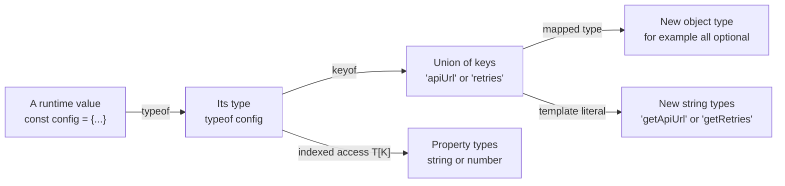
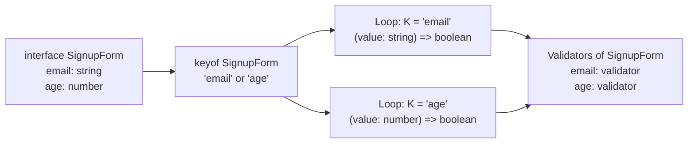
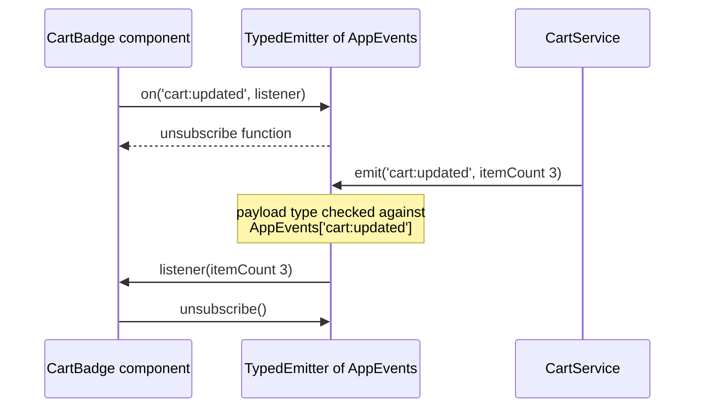

# keyof, typeof, Indexed Access and Mapped Types

> In this document you learn the type operators that let you **build new types from existing ones**: `keyof`, type-level `typeof`, indexed access types (`T[K]`, `T[number]`), mapped types with `readonly` and `?` modifiers, key remapping with `as`, and template literal types. You will build `Partial`, `Readonly`, `Pick` and `Record` yourself, and use these tools for typed configuration, a typed event emitter and form models. Interviewers use these topics to check whether you can keep types in sync with code instead of copying them by hand.

**Before this:** [Generics](./05-generics.md) · [Interfaces and type aliases](./02-interfaces-and-type-aliases.md) · **Interview questions:** [jump to questions](#interview-questions)

## Table of contents

1. [Why type operators exist](#why-type-operators-exist)
2. [The keyof operator](#the-keyof-operator)
3. [Type-level typeof](#type-level-typeof)
4. [Indexed access types](#indexed-access-types)
5. [Combining keyof typeof and indexed access](#combining-keyof-typeof-and-indexed-access)
6. [Mapped types](#mapped-types)
7. [Mapping modifiers for readonly and optional](#mapping-modifiers-for-readonly-and-optional)
8. [Building Partial Readonly Pick and Record from scratch](#building-partial-readonly-pick-and-record-from-scratch)
9. [Key remapping with as](#key-remapping-with-as)
10. [Template literal types](#template-literal-types)
11. [Real-world example typed configuration](#real-world-example-typed-configuration)
12. [Real-world example typed event emitter](#real-world-example-typed-event-emitter)
13. [Real-world example form models](#real-world-example-form-models)
14. [Common mistakes and best practices](#common-mistakes-and-best-practices)
15. [Interview questions](#interview-questions)
16. [Summary](#summary)
17. [References](#references)

---

## Why type operators exist

Imagine you have a `User` interface, and you need:

- a type for "any property name of `User`",
- a type for "a `User` where every field is optional" (for an update form),
- a type for "one error message per field",
- a union of all event names like `"nameChanged" | "emailChanged"`.

You could write each of these by hand. But then, when someone adds `phone` to `User`, you must remember to update four other types. You will forget one, and the types will lie.

**Type operators** let you **derive** these types from `User`. When `User` changes, the derived types change automatically. This idea is often called **a single source of truth**.

```ts
interface User {
  id: number;
  name: string;
  email: string;
}

type UserKey = keyof User;                       // "id" | "name" | "email"
type UserUpdate = { [K in keyof User]?: User[K] }; // all optional
type UserErrors = { [K in keyof User]?: string };  // one message per field
```

Think of these operators as **functions that run on types** at compile time:

| Operator | Input | Output |
|---|---|---|
| `keyof T` | An object type | A union of its keys |
| `typeof value` | A value (variable) | Its TypeScript type |
| `T[K]` | A type and a key | The type of that property |
| `{ [K in Keys]: ... }` | A union of keys | A new object type |
| `` `prefix${T}` `` | String literal types | New string literal types |



Everything in this document happens at **compile time**. None of it exists in the JavaScript output.

---

## The keyof operator

### What it is

**`keyof T`** produces a **union of the property names** (keys) of the type `T`, as literal types.

```ts
interface Product {
  id: string;
  title: string;
  price: number;
}

type ProductKey = keyof Product; // "id" | "title" | "price"

let sortBy: ProductKey = "price"; // ✅
sortBy = "colour";                // ❌ Type '"colour"' is not assignable to type 'keyof Product'.
```

### Why it is useful

It lets you accept "any valid property name" and have TypeScript reject typos:

```ts
function sortProducts(products: Product[], key: keyof Product): Product[] {
  return [...products].sort((a, b) => (a[key] < b[key] ? -1 : a[key] > b[key] ? 1 : 0));
}

const products: Product[] = [
  { id: "p2", title: "Mug", price: 8 },
  { id: "p1", title: "Pen", price: 2 },
];

console.log(sortProducts(products, "price").map((p) => p.title)); // [ 'Pen', 'Mug' ]
sortProducts(products, "cost"); // ❌ compile error — typo caught
```

With generics, `keyof` becomes even more powerful (`K extends keyof T`). See [Constraints with keyof](./05-generics.md#constraints-with-keyof).

### keyof with special types

| Type | `keyof` result | Why |
|---|---|---|
| `{ a: 1; b: 2 }` | `"a" \| "b"` | Normal object type |
| `{ [key: string]: boolean }` | `string \| number` | String index signatures also accept number keys (JavaScript converts `obj[1]` to `obj["1"]`) |
| `{ [key: number]: boolean }` | `number` | |
| `string[]` | `number \| "length" \| "push" \| ...` | Array index plus all array methods |
| `any` | `string \| number \| symbol` | Any key is possible |
| `A \| B` | Only keys that exist in **both** | A value of a union may be either type |
| `A & B` | Keys from **either** | A value of an intersection has all properties |

The union/intersection rule surprises people. Think about it with values: if a value is "an `A` or a `B`", you can only safely access the properties they share. If it is "an `A` and a `B`", you can access all of them.

```ts
type Cat = { name: string; meow(): void };
type Dog = { name: string; bark(): void };

type PetKey = keyof (Cat | Dog);    // "name"
type BothKey = keyof (Cat & Dog);   // "name" | "meow" | "bark"
```

### keyof returns types, not values

`keyof` works only on **types**. To get the keys of an object at **runtime**, you need `Object.keys`, which returns `string[]` (not `(keyof T)[]`). The reason is explained in [Interview question 9](#q9-why-does-objectkeys-return-string-instead-of-keyof-t).

---

## Type-level typeof

### Two different typeof operators

JavaScript already has a `typeof` operator. It runs at **runtime** and returns a string:

```ts
const price = 9.99;
console.log(typeof price); // "number" — JavaScript typeof, a runtime string
```

TypeScript adds a second `typeof` that is used **in a type position**. It gives you the **TypeScript type** of a variable or property:

```ts
const defaultSettings = {
  theme: "dark",
  pageSize: 20,
  notifications: { email: true, sms: false },
};

type Settings = typeof defaultSettings;
// {
//   theme: string;
//   pageSize: number;
//   notifications: { email: boolean; sms: boolean };
// }
```

How do you tell them apart? By **position**:

| Where it appears | Which typeof | Result |
|---|---|---|
| In an expression: `if (typeof x === "string")`, `console.log(typeof x)` | JavaScript | A runtime string like `"number"` |
| After `:`, in `type X = ...`, inside `<...>` | TypeScript | A compile-time type |

### Why it exists

Sometimes the **value** is the natural source of truth, and you want the type to follow it:

- A default configuration object: the type is "whatever shape the defaults have".
- A function: you want the type of what it returns (`ReturnType<typeof fn>`).
- A constant list: you want a union of its values.

```ts
function createSession(userId: string) {
  return {
    userId,
    startedAt: new Date(),
    token: crypto.randomUUID(),
  };
}

type Session = ReturnType<typeof createSession>;
// { userId: string; startedAt: Date; token: string }
```

If someone adds a field to `createSession`, `Session` updates automatically. `ReturnType` is a built-in utility type; see [Utility types](./08-utility-types.md).

### Limits of type-level typeof

Type-level `typeof` only works on **identifiers and property accesses** (`typeof config`, `typeof config.theme`). It cannot evaluate expressions:

```ts
type A = typeof defaultSettings.theme;          // ✅ string
type B = typeof createSession("u1");            // ❌ error — you cannot call functions in a type
type C = ReturnType<typeof createSession>;      // ✅ the correct way
```

Remember that `typeof` gives the **widened** type for mutable values. `theme: "dark"` became `string` above. Use `as const` to keep literal types (see [Literal types, widening and as const](./01-typescript-basics-and-types.md#literal-types-widening-and-as-const)).

---

## Indexed access types

### What it is

An **indexed access type** `T[K]` looks up the type of property `K` in type `T`. It uses the same bracket syntax as property access in JavaScript, but on types.

```ts
interface Order {
  id: string;
  total: number;
  status: "pending" | "paid" | "shipped";
  customer: {
    name: string;
    address: { city: string; zip: string };
  };
  items: { sku: string; qty: number; price: number }[];
}

type OrderId = Order["id"];             // string
type OrderStatus = Order["status"];     // "pending" | "paid" | "shipped"
type Customer = Order["customer"];      // { name: string; address: {...} }
```

### Unions of keys

The index can be a union. The result is the union of the property types:

```ts
type IdOrTotal = Order["id" | "total"];  // string | number
type AnyOrderValue = Order[keyof Order]; // the union of all property types
```

`T[keyof T]` is a common pattern called **ValueOf**: "the type of any value in `T`".

### Nested lookups

You can chain lookups to reach deep properties:

```ts
type City = Order["customer"]["address"]["city"]; // string
```

### T[number]: element types of arrays and tuples

Arrays are indexed by numbers, so `T[number]` gives the **element type**:

```ts
type OrderItem = Order["items"][number];
// { sku: string; qty: number; price: number }

type Qty = Order["items"][number]["qty"]; // number

type Tuple = [string, number, boolean];
type Second = Tuple[1];        // number
type AnyElement = Tuple[number]; // string | number | boolean
type Length = Tuple["length"];   // 3 — tuples have a literal length
```

This is very useful when an API type is given to you (for example, generated from OpenAPI) and you need the type of one nested piece:

```ts
function renderItem(item: Order["items"][number]): string {
  return `${item.sku} x${item.qty}`;
}
```

### Errors you will see

```ts
type Phone = Order["phone"];
// ❌ Property 'phone' does not exist on type 'Order'.

const key = "total";
type Total = Order[key];
// ❌ 'key' refers to a value, but is being used as a type here. Did you mean 'typeof key'?

type TotalFixed = Order[typeof key]; // ✅ number
```

The index must be a **type**. A variable is a value, so you need `typeof` to turn it into a type.

---

## Combining keyof typeof and indexed access

These three operators are often used together. The most common combination turns a constant object or array into types.

### From an array to a union

```ts
const ROLES = ["admin", "editor", "viewer"] as const;

type Role = (typeof ROLES)[number]; // "admin" | "editor" | "viewer"
```

Step by step:

1. `as const` makes `ROLES` a readonly tuple of literal types: `readonly ["admin", "editor", "viewer"]`.
2. `typeof ROLES` turns the value into that type.
3. `[number]` gets the type of any element: the union of the three literals.

Now `ROLES` can feed a dropdown at runtime, and `Role` checks values at compile time. One list, two uses.

### From an object to key and value unions

```ts
const ORDER_STATUS = {
  Pending: "PENDING",
  Paid: "PAID",
  Shipped: "SHIPPED",
} as const;

type OrderStatusKey = keyof typeof ORDER_STATUS;                      // "Pending" | "Paid" | "Shipped"
type OrderStatusValue = (typeof ORDER_STATUS)[keyof typeof ORDER_STATUS]; // "PENDING" | "PAID" | "SHIPPED"
```

Read `keyof typeof ORDER_STATUS` from right to left: take the **value** `ORDER_STATUS`, get its **type** with `typeof`, then get its **keys** with `keyof`.

This is the enum alternative shown in [Enums and their alternatives](./01-typescript-basics-and-types.md#enums-and-their-alternatives).

### From a lookup table to a typed function

```ts
const PERMISSIONS = {
  viewOrders: ["admin", "editor", "viewer"],
  editOrders: ["admin", "editor"],
  deleteOrders: ["admin"],
} as const satisfies Record<string, readonly Role[]>;

type Permission = keyof typeof PERMISSIONS; // "viewOrders" | "editOrders" | "deleteOrders"

function can(role: Role, permission: Permission): boolean {
  return (PERMISSIONS[permission] as readonly Role[]).includes(role);
}

console.log(can("editor", "editOrders"));   // true
console.log(can("viewer", "deleteOrders")); // false
can("viewer", "exportOrders");              // ❌ not a known permission
```

`satisfies` checks that every value is a list of valid roles while `as const` keeps the exact keys. Adding a new permission to the object automatically adds it to the `Permission` type.

---

## Mapped types

### What it is

A **mapped type** creates a new object type by **looping over a union of keys**. The syntax looks like an index signature with `in`:

```ts
type Flags = {
  [K in "darkMode" | "betaSearch" | "newCheckout"]: boolean;
};
// { darkMode: boolean; betaSearch: boolean; newCheckout: boolean }
```

Read it as: "for each key `K` in this union, create a property `K` of type `boolean`".

### Mapping over another type's keys

The most common form maps over `keyof T`, so the new type has the same keys as `T`:

```ts
type Validators<T> = {
  [K in keyof T]: (value: T[K]) => boolean;
};

interface SignupForm {
  email: string;
  age: number;
}

const signupValidators: Validators<SignupForm> = {
  email: (value) => value.includes("@"), // value: string
  age: (value) => value >= 18,           // value: number
};

console.log(signupValidators.email("asha@example.com")); // true
console.log(signupValidators.age(16));                   // false
```

Step by step for `Validators<SignupForm>`:

1. `keyof SignupForm` is `"email" | "age"`.
2. For `K = "email"`: property `email` with type `(value: SignupForm["email"]) => boolean`, which is `(value: string) => boolean`.
3. For `K = "age"`: property `age` with type `(value: number) => boolean`.
4. If `SignupForm` gets a new field, `signupValidators` becomes a compile error until you add its validator.



### Homomorphic mapped types keep modifiers

A mapped type of the form `{ [K in keyof T]: ... }` is called **homomorphic** ("same shape"). It **keeps** the `readonly` and `?` modifiers of the original properties:

```ts
interface Profile {
  readonly id: string;
  nickname?: string;
}

type Copy<T> = { [K in keyof T]: T[K] };
type ProfileCopy = Copy<Profile>;
// { readonly id: string; nickname?: string } — modifiers preserved
```

A mapped type over a plain union (`[K in "a" | "b"]`) has no original properties, so there is nothing to preserve.

---

## Mapping modifiers for readonly and optional

Inside a mapped type, you can **add** or **remove** the `readonly` and `?` modifiers:

| Syntax | Effect |
|---|---|
| `readonly [K in keyof T]` or `+readonly` | Add readonly |
| `-readonly [K in keyof T]` | Remove readonly |
| `[K in keyof T]?` or `+?` | Make optional |
| `[K in keyof T]-?` | Make required (and remove `undefined` that came from `?`) |

```ts
interface Settings {
  readonly version: number;
  theme?: "light" | "dark";
  language?: string;
}

// Remove readonly: useful for a draft object you build step by step
type Mutable<T> = { -readonly [K in keyof T]: T[K] };
type EditableSettings = Mutable<Settings>;
// { version: number; theme?: "light" | "dark"; language?: string }

// Make everything required: useful after you have applied defaults
type Complete<T> = { [K in keyof T]-?: T[K] };
type ResolvedSettings = Complete<Settings>;
// { readonly version: number; theme: "light" | "dark"; language: string }

const defaults: Complete<Omit<Settings, "version">> = { theme: "light", language: "en" };

function resolveSettings(input: Settings): ResolvedSettings {
  return { ...defaults, ...stripUndefined(input) } as ResolvedSettings;
}

function stripUndefined<T extends object>(obj: T): Partial<T> {
  return Object.fromEntries(Object.entries(obj).filter(([, v]) => v !== undefined)) as Partial<T>;
}

console.log(resolveSettings({ version: 2, theme: "dark" }));
// { theme: 'dark', language: 'en', version: 2 }
```

`Mutable<T>` is not built in, but it is a very common custom utility. `Required<T>` is the built-in version of `Complete<T>`.

---

## Building Partial Readonly Pick and Record from scratch

The built-in utility types are just mapped types. Writing them yourself is a common interview task, and it proves you understand mapped types. (All built-in utility types are covered in [Utility types](./08-utility-types.md).)

```ts
// Partial: every property optional
type MyPartial<T> = {
  [K in keyof T]?: T[K];
};

// Required: every property required
type MyRequired<T> = {
  [K in keyof T]-?: T[K];
};

// Readonly: every property readonly
type MyReadonly<T> = {
  readonly [K in keyof T]: T[K];
};

// Pick: keep only some keys
type MyPick<T, K extends keyof T> = {
  [P in K]: T[P];
};

// Record: an object with keys K and values V
type MyRecord<K extends keyof any, V> = {
  [P in K]: V;
};
```

Using them:

```ts
interface Article {
  id: string;
  title: string;
  body: string;
  publishedAt: Date | null;
}

type ArticleDraft = MyPartial<Article>;           // all optional
type ArticlePreview = MyPick<Article, "id" | "title">; // { id: string; title: string }
type FrozenArticle = MyReadonly<Article>;         // all readonly
type ArticleCountByAuthor = MyRecord<string, number>;

const preview: ArticlePreview = { id: "a1", title: "Generics explained" };
const draft: ArticleDraft = { title: "Untitled" };
```

Key details to explain:

- **`K extends keyof T` in `Pick`**: it prevents picking keys that do not exist. `MyPick<Article, "author">` is an error.
- **`keyof any` in `Record`**: it means `string | number | symbol`, every type that can be an object key. The built-in version uses the same constraint.
- **`MyPick` is homomorphic** too (because `K` is constrained to `keyof T`), so it keeps `readonly` and `?` from `T`.
- These are **shallow**: nested objects are not made optional or readonly. Deep versions need recursion; see [Conditional types and infer](./07-conditional-types-and-infer.md).

`Omit` needs one more tool (`Exclude`, a conditional type):

```ts
type MyOmit<T, K extends keyof any> = MyPick<T, Exclude<keyof T, K>>;

type ArticleWithoutBody = MyOmit<Article, "body">; // { id; title; publishedAt }
```

---

## Key remapping with as

### What it is

Since **TypeScript 4.1**, a mapped type can **rename** keys with an `as` clause:

```ts
type Renamed<T> = {
  [K in keyof T as NewKeyExpression]: T[K];
};
```

The `as` clause computes the new key from `K`. This unlocks two powerful tricks: **renaming** keys and **filtering** keys.

### Renaming keys

Combined with template literal types and the built-in `Capitalize`:

```ts
type Getters<T> = {
  [K in keyof T as `get${Capitalize<string & K>}`]: () => T[K];
};

interface Person {
  name: string;
  age: number;
}

type PersonGetters = Getters<Person>;
// { getName: () => string; getAge: () => number }

const personApi: PersonGetters = {
  getName: () => "Asha",
  getAge: () => 30,
};
```

Why `string & K`? `keyof T` can include `number` and `symbol` keys, and `Capitalize` only accepts strings. Intersecting with `string` keeps only the string keys.

### Filtering keys

If the `as` clause produces `never`, the key is **removed**:

```ts
// Keep only properties whose value is a string
type StringProps<T> = {
  [K in keyof T as T[K] extends string ? K : never]: T[K];
};

interface Employee {
  id: number;
  name: string;
  email: string;
  salary: number;
}

type EmployeeText = StringProps<Employee>; // { name: string; email: string }

// Remove a specific key (like Omit, but written as a mapped type)
type WithoutId<T> = {
  [K in keyof T as Exclude<K, "id">]: T[K];
};

type NewEmployee = WithoutId<Employee>; // { name; email; salary }
```

`T[K] extends string ? K : never` is a **conditional type**. It is explained fully in [Conditional types and infer](./07-conditional-types-and-infer.md). Here, all you need is: "if the property type is a string, keep the key, otherwise drop it".

### A realistic use: change handlers for a component

```ts
type ChangeHandlers<T> = {
  [K in keyof T as `on${Capitalize<string & K>}Change`]?: (value: T[K]) => void;
};

interface FilterState {
  search: string;
  minPrice: number;
  inStockOnly: boolean;
}

type FilterHandlers = ChangeHandlers<FilterState>;
// {
//   onSearchChange?: (value: string) => void;
//   onMinPriceChange?: (value: number) => void;
//   onInStockOnlyChange?: (value: boolean) => void;
// }

const handlers: FilterHandlers = {
  onSearchChange: (value) => console.log(`search: ${value.trim()}`),
  onMinPriceChange: (value) => console.log(`min price: ${value.toFixed(2)}`),
};
```

This is how React component libraries type `onXxxChange` props, and how state libraries generate setter names.

---

## Template literal types

### What it is

**Template literal types** (TypeScript 4.1) use the same backtick syntax as JavaScript template strings, but at the type level. They build new **string literal types**.

```ts
type Greeting = `hello ${"world" | "team"}`; // "hello world" | "hello team"

type Version = `v${number}`;   // any string like "v1", "v2.5"
const v: Version = "v2";       // ✅
const bad: Version = "2";      // ❌
```

### Unions multiply

When you put unions inside a template literal type, TypeScript creates **every combination** (the cross product):

```ts
type Size = "sm" | "md" | "lg";
type Variant = "primary" | "danger";

type ButtonClass = `btn-${Variant}-${Size}`;
// "btn-primary-sm" | "btn-primary-md" | "btn-primary-lg"
// | "btn-danger-sm" | "btn-danger-md" | "btn-danger-lg"
```

Be careful: 10 × 10 × 10 combinations is already 1,000 members. Very large unions slow down the compiler, and TypeScript stops with an error when a union becomes too large (around 100,000 members).

### Pattern types with string, number and bigint

You can use `${string}`, `${number}` and `${bigint}` as placeholders that accept any value of that type:

```ts
type CssPixels = `${number}px`;
type DataAttribute = `data-${string}`;
type ApiPath = `/api/${string}`;

const width: CssPixels = "120px"; // ✅
const height: CssPixels = "4em";  // ❌ Type '"4em"' is not assignable to type '`${number}px`'.

function callApi(path: ApiPath) {}
callApi("/api/users"); // ✅
callApi("/users");     // ❌
```

### Intrinsic string manipulation types

TypeScript has four built-in types that change the case of string literal types:

| Type | Example | Result |
|---|---|---|
| `Uppercase<S>` | `Uppercase<"get">` | `"GET"` |
| `Lowercase<S>` | `Lowercase<"POST">` | `"post"` |
| `Capitalize<S>` | `Capitalize<"name">` | `"Name"` |
| `Uncapitalize<S>` | `Uncapitalize<"UserId">` | `"userId"` |

### Event names from keys

A classic use: derive event names from an object's keys.

```ts
type ChangeEvent<T> = `${string & keyof T}Changed`;

interface CartState {
  items: string[];
  coupon: string | null;
}

type CartEvent = ChangeEvent<CartState>; // "itemsChanged" | "couponChanged"

function onCartEvent(event: CartEvent, handler: () => void) {}
onCartEvent("couponChanged", () => {}); // ✅
onCartEvent("totalChanged", () => {});  // ❌ not a CartState key
```

Template literal types can also be **parsed** with `infer` (for example, extracting `id` from `"/users/:id"`). That is covered in [Conditional types and infer](./07-conditional-types-and-infer.md).

Remember: template literal types check **compile-time** strings. A string from a URL or user input is just `string` and must be validated at runtime.

---

## Real-world example typed configuration

A configuration object is read in many places. You want:

- a single definition of all settings,
- a `get` function that returns the **exact** type of each setting,
- a compile error for unknown keys.

```ts
interface AppConfig {
  apiUrl: string;
  retries: number;
  theme: "light" | "dark";
  features: {
    newCheckout: boolean;
    betaSearch: boolean;
  };
}

const config: AppConfig = {
  apiUrl: "https://api.example.com",
  retries: 3,
  theme: "dark",
  features: { newCheckout: true, betaSearch: false },
};

function getConfig<K extends keyof AppConfig>(key: K): AppConfig[K] {
  return config[key];
}

const retries = getConfig("retries");          // number
const theme = getConfig("theme");              // "light" | "dark"
const features = getConfig("features");        // { newCheckout: boolean; betaSearch: boolean }
getConfig("timeout");                          // ❌ not a config key

// Feature flags typed by their own keys
type FeatureName = keyof AppConfig["features"]; // "newCheckout" | "betaSearch"

function isEnabled(feature: FeatureName): boolean {
  return config.features[feature];
}

console.log(isEnabled("newCheckout")); // true
isEnabled("darkMode");                 // ❌
```

### Typed environment overrides

Environment variables are always strings. A mapped type can describe "the same keys, but as strings from the environment":

```ts
type EnvOverrides<T> = {
  [K in keyof T as `APP_${Uppercase<string & K>}`]?: string;
};

type AppEnv = EnvOverrides<Pick<AppConfig, "apiUrl" | "retries" | "theme">>;
// { APP_APIURL?: string; APP_RETRIES?: string; APP_THEME?: string }
```

The types describe the names, but the **values** still need runtime parsing and validation (`Number(process.env.APP_RETRIES)`, checking that the theme is `"light"` or `"dark"`). See [Runtime validation and type-safe APIs](./11-runtime-validation-and-type-safe-apis.md).

In Angular, the same idea appears with `InjectionToken<AppConfig>`: inject the config once, and every consumer gets the exact types.

---

## Real-world example typed event emitter

An event bus lets parts of an app talk to each other: "user logged in", "cart updated". Without types, any string and any payload are accepted, so typos and wrong payloads are found only at runtime. With an **event map** type, `on` and `emit` become fully checked.

```ts
// 1. One type that maps each event name to its payload type
type AppEvents = {
  "user:login": { userId: string };
  "cart:updated": { itemCount: number };
  logout: void;
};

// 2. A generic emitter that uses keyof and indexed access
class TypedEmitter<Events extends Record<string, unknown>> {
  #listeners: { [E in keyof Events]?: Array<(payload: Events[E]) => void> } = {};

  on<E extends keyof Events>(event: E, listener: (payload: Events[E]) => void): () => void {
    (this.#listeners[event] ??= []).push(listener);
    // return an "unsubscribe" function
    return () => {
      this.#listeners[event] = this.#listeners[event]?.filter((l) => l !== listener);
    };
  }

  emit<E extends keyof Events>(event: E, payload: Events[E]): void {
    this.#listeners[event]?.forEach((listener) => listener(payload));
  }
}

// 3. Usage
const bus = new TypedEmitter<AppEvents>();

const unsubscribe = bus.on("cart:updated", ({ itemCount }) => {
  console.log(`Cart has ${itemCount} items`); // itemCount: number
});

bus.emit("cart:updated", { itemCount: 3 }); // "Cart has 3 items"
unsubscribe();
bus.emit("cart:updated", { itemCount: 4 }); // nothing is printed

bus.emit("cart:updated", { count: 3 });     // ❌ 'count' does not exist in type '{ itemCount: number; }'
bus.emit("cart:update", { itemCount: 3 });  // ❌ '"cart:update"' is not assignable to 'keyof AppEvents'
```



How the types work, step by step:

1. `Events extends Record<string, unknown>` means the event map must be an object type with string keys.
2. In `on<E extends keyof Events>`, `E` is inferred as the exact literal event name, like `"cart:updated"`.
3. `Events[E]` looks up the payload type for that event: `{ itemCount: number }`.
4. The listener's parameter and the emitted payload must both match `Events[E]`.
5. The private `#listeners` field is a mapped type: for each event, an optional array of correctly typed listeners.

Real uses: an Electron app's IPC channel map (channel name → payload type), a micro-frontend event bus, Node.js's `EventEmitter` (whose `@types/node` definitions accept an event map type parameter in recent versions), and typed WebSocket messages. In Angular, a service with typed `Subject`s often replaces a generic event bus. See [IPC and preload scripts](../08-electron-desktop/03-ipc-and-preload-scripts.md).

---

## Real-world example form models

Forms need several parallel structures with the **same keys** as the form model: values, errors, "touched" flags and validators. Mapped types keep them in sync.

```ts
interface SignupModel {
  email: string;
  password: string;
  age: number;
  acceptTerms: boolean;
}

type FormErrors<T> = { [K in keyof T]?: string };
type FormTouched<T> = { [K in keyof T]: boolean };
type FormValidators<T> = { [K in keyof T]?: (value: T[K], all: T) => string | null };

const validators: FormValidators<SignupModel> = {
  email: (value) => (value.includes("@") ? null : "Enter a valid email"),
  password: (value) => (value.length >= 8 ? null : "At least 8 characters"),
  age: (value) => (value >= 18 ? null : "You must be 18 or older"),
  acceptTerms: (value) => (value ? null : "Please accept the terms"),
};

function validate<T>(values: T, rules: FormValidators<T>): FormErrors<T> {
  const errors: FormErrors<T> = {};
  for (const key in rules) {
    const rule = rules[key];
    const message = rule?.(values[key], values);
    if (message) errors[key] = message;
  }
  return errors;
}

console.log(validate({ email: "asha", password: "secret", age: 30, acceptTerms: true }, validators));
// { email: 'Enter a valid email', password: 'At least 8 characters' }
```

Notice `for (const key in rules)`: when you loop over a mapped type value with `for...in` inside a generic function, TypeScript types `key` as `Extract<keyof T, string>`, so `values[key]` and `errors[key]` are correctly typed.

### Angular typed reactive forms

Since Angular 14, reactive forms are typed. A mapped type can derive the `FormGroup` controls type from a model:

```ts
import { FormControl, FormGroup } from "@angular/forms";

type ControlsOf<T> = {
  [K in keyof T]: FormControl<T[K]>;
};

interface ProfileModel {
  displayName: string;
  age: number;
  newsletter: boolean;
}

const profileForm = new FormGroup<ControlsOf<ProfileModel>>({
  displayName: new FormControl("", { nonNullable: true }),
  age: new FormControl(18, { nonNullable: true }),
  newsletter: new FormControl(false, { nonNullable: true }),
});

const age: number = profileForm.controls.age.value; // typed
```

This version is simplified: it treats every property as a single control. Nested objects would need `FormGroup<ControlsOf<...>>` for those properties (a conditional type). See [Angular forms](../06-angular-16/07-forms.md).

---

## Common mistakes and best practices

### Common mistakes

**1. Using a value where a type is needed.**

```ts
const field = "email";
type FieldType = SignupModel[field];        // ❌ 'field' refers to a value
type FieldTypeFixed = SignupModel[typeof field]; // ✅ string
```

**2. Forgetting `as const`, so `typeof` gives wide types.**

```ts
const SIZES = ["sm", "md", "lg"];
type Size = (typeof SIZES)[number]; // string — not useful
// ✅ const SIZES = ["sm", "md", "lg"] as const;
```

**3. Forgetting `string &` with template literal key remapping.** `` `get${Capitalize<K>}` `` fails when `K` can be a `number` or `symbol` key. Use `Capitalize<string & K>`.

**4. Expecting `Object.keys` to return `(keyof T)[]`.** It returns `string[]` because objects can have extra properties at runtime (see Q9).

**5. Confusing JavaScript `typeof` and TypeScript `typeof`.** In `if (typeof x === "string")` it is JavaScript. In `type X = typeof x` it is TypeScript.

**6. Building giant unions with template literal types.** Cross products grow very fast and slow down the editor.

**7. Thinking mapped types are deep.** `Partial<Order>` does not make `order.customer.name` optional.

### Best practices

- **Have one source of truth.** Derive related types with `keyof`, `typeof`, `T[K]` and mapped types instead of copying.
- **Prefer the built-in utility types** (`Partial`, `Pick`, `Omit`, `Record`, `Readonly`) when they fit. They are well known and readable.
- **Name derived types.** `type OrderItem = Order["items"][number]` is easier to read than repeating the lookup.
- **Use `as const` (and `satisfies`)** on constant objects and arrays that you derive types from.
- **Keep mapped types readable.** If a type needs a comment to explain it, write the comment, or simplify it.
- **Remember it is all compile time.** Derived types do not validate runtime data.

---

## Interview questions

### How to explain this in an interview

1. **Define it:** "`keyof` gives the union of a type's keys, type-level `typeof` gives the type of a value, `T[K]` looks up a property type, and mapped types loop over keys to build new object types."
2. **Why it exists:** "So I can derive types from one source of truth. When the model changes, everything derived from it updates, instead of drifting."
3. **How it works:** "It is all compile-time computation. For example, `{ [K in keyof T]?: T[K] }` loops over each key of T and makes it optional; that is exactly how `Partial` is defined."
4. **Small example:** "`const ROLES = ['admin', 'viewer'] as const; type Role = typeof ROLES[number];` gives `'admin' | 'viewer'` from the runtime array."
5. **Where it is useful:** "Typed config getters with `K extends keyof Config`, typed event emitters with an event map, form error types, and Angular typed forms."
6. **Trade-offs / gotchas:** "`Object.keys` still returns `string[]`, mapped types are shallow, and very clever type-level code can be hard to read, so I keep it simple and named."

### Q1. What does keyof do?

**What the interviewer is checking:** Basic understanding plus edge cases.

**Short spoken answer (30–60 seconds):**
> `keyof` takes an object type and gives me a union of its property names as literal types. For `interface User { id: number; name: string }`, `keyof User` is `"id" | "name"`. I use it to accept only valid property names, so typos become compile errors, and together with generics, like `K extends keyof T`, to look up the exact property type with `T[K]`. A few edge cases: with a string index signature, `keyof` gives `string | number`; for a union of types it gives only the shared keys; and for an intersection it gives all keys.

**Follow-up questions:**
- **What is `keyof any`?** — `string | number | symbol`, every possible key type. The built-in `PropertyKey` type is the same union.
- **Why does `keyof { [k: string]: X }` include `number`?** — Because JavaScript converts number keys to strings, so `obj[1]` is valid for a string-indexed object.
- **Does `keyof` work on values?** — No. It works on types. For a value, combine it with `typeof`: `keyof typeof obj`.

### Q2. What is the difference between JavaScript typeof and TypeScript typeof?

**What the interviewer is checking:** Value space vs type space.

**Short spoken answer (30–60 seconds):**
> They share a keyword but live in different worlds. JavaScript's `typeof` runs at runtime and returns a string like `"number"` or `"object"`; I use it in conditions, and TypeScript uses those checks for narrowing. TypeScript's `typeof` appears in type positions, like after a colon or in a type alias, and gives me the compile-time type of a variable, including the full shape of objects. For example, `type Config = typeof defaultConfig` creates a type from a default config object, and `ReturnType<typeof createSession>` gets the return type of a function. The position tells you which one it is.

**Code:**

```ts
const settings = { theme: "dark", pageSize: 20 };

if (typeof settings.pageSize === "number") {} // JavaScript typeof → runtime string
type Settings = typeof settings;               // TypeScript typeof → { theme: string; pageSize: number }
```

**Follow-up:** **Can TypeScript `typeof` take any expression?** — No, only identifiers and property access paths (`typeof a.b.c`). Not function calls; use `ReturnType<typeof fn>` instead.

### Q3. How do you get a union type from an array of strings?

**What the interviewer is checking:** The `as const` + `typeof` + `[number]` pattern.

**Short spoken answer (30–60 seconds):**
> I declare the array with `as const`, so TypeScript keeps it as a readonly tuple of literal types instead of `string[]`. Then `typeof ROLES` gives me that tuple type, and indexing it with `[number]` gives the type of any element, which is the union of the literals. So `const ROLES = ["admin", "editor"] as const; type Role = typeof ROLES[number];` gives `"admin" | "editor"`. The benefit is a single source of truth: the array is available at runtime for dropdowns or validation, and the type is derived from it, so they never drift.

**Follow-up questions:**
- **What happens without `as const`?** — `typeof ROLES` is `string[]`, and `[number]` gives just `string`.
- **How do you check at runtime if a string is a valid role?** — `(ROLES as readonly string[]).includes(value)` inside a type guard `value is Role`.
- **How do you get the union of an object's values?** — `(typeof OBJ)[keyof typeof OBJ]`, also with `as const`.

### Q4. What is an indexed access type? Give examples with nested objects and arrays.

**Short answer:** `T[K]` gives the type of property `K` in `T`. The index can be a union (`T["a" | "b"]` gives the union of both property types) or `keyof T` (all value types). Lookups can be chained: `Order["customer"]["address"]["city"]`. For arrays and tuples, `T[number]` gives the element type: `Order["items"][number]` is the type of one item. The index must be a type, so to use a constant you write `T[typeof key]`.

### Q5. What is a mapped type? Implement Partial and Readonly.

**What the interviewer is checking:** Core mapped type syntax.

**Short spoken answer (30–60 seconds):**
> A mapped type builds a new object type by looping over a union of keys, usually `keyof T`. The syntax is `{ [K in keyof T]: ... }`, and for each key I can decide the new property type, often based on `T[K]`. Partial is `{ [K in keyof T]?: T[K] }`, which adds the optional modifier to every property. Readonly is `{ readonly [K in keyof T]: T[K] }`. Mapped types over `keyof T` are called homomorphic: they keep the existing readonly and optional modifiers. Both of these are shallow: nested objects are not affected.

**Code:**

```ts
type MyPartial<T> = { [K in keyof T]?: T[K] };
type MyReadonly<T> = { readonly [K in keyof T]: T[K] };
```

**Follow-up questions:**
- **How do you remove readonly or optional?** — With minus modifiers: `-readonly [K in keyof T]` and `[K in keyof T]-?`. `Required<T>` uses `-?`.
- **Implement Pick.** — `type MyPick<T, K extends keyof T> = { [P in K]: T[P] };` The constraint stops you from picking keys that do not exist.
- **Implement Record.** — `type MyRecord<K extends keyof any, V> = { [P in K]: V };`
- **How would you make Partial deep?** — Recursion with a conditional type: `type DeepPartial<T> = { [K in keyof T]?: T[K] extends object ? DeepPartial<T[K]> : T[K] };` (with extra care for arrays and functions). See [Conditional types and infer](./07-conditional-types-and-infer.md).

### Q6. What is key remapping with as in a mapped type?

**What the interviewer is checking:** TS 4.1 feature and its two uses.

**Short spoken answer (30–60 seconds):**
> Since TypeScript 4.1, a mapped type can have an `as` clause that computes a new key name for each property. I use it for two things. First, renaming: with template literal types I can turn `name` into `getName`, like `[K in keyof T as \`get${Capitalize<string & K>}\`]: () => T[K]`. Second, filtering: if the `as` clause produces `never`, the property is removed, so `[K in keyof T as T[K] extends string ? K : never]` keeps only string properties. The `string &` part is needed because keys can also be numbers or symbols, and `Capitalize` only accepts strings.

**Follow-up:** **How would you write `Omit` with key remapping?** — `type MyOmit<T, K extends PropertyKey> = { [P in keyof T as P extends K ? never : P]: T[P] };`. Unlike `Pick<T, Exclude<keyof T, K>>`, this form stays homomorphic, so it keeps modifiers and works better with some generic types.

### Q7. What are template literal types? Give a practical example.

**Short spoken answer (30–60 seconds):**
> They are string literal types built with the backtick syntax at the type level, added in TypeScript 4.1. If I put unions inside, TypeScript creates every combination, so `` `btn-${"primary" | "danger"}-${"sm" | "lg"}` `` gives four class names. I can also use patterns like `` `${number}px` `` or `` `/api/${string}` `` to accept a family of strings. A practical use is deriving event or handler names from an object's keys, like `` `on${Capitalize<K>}Change` ``, so when I add a field to the state, its handler type appears automatically. They only check compile-time strings, though; runtime strings still need validation, and large cross products can slow the compiler.

### Q8. Write a function `getConfig` that returns the exact type of each config key.

**Short answer:**

```ts
function getConfig<K extends keyof AppConfig>(key: K): AppConfig[K] {
  return config[key];
}
```

`K` is inferred as the literal key, so `getConfig("retries")` returns `number` and `getConfig("theme")` returns `"light" | "dark"`. Unknown keys are compile errors. See [Real-world example typed configuration](#real-world-example-typed-configuration).

### Q9. Why does Object.keys return string[] instead of (keyof T)[]?

**What the interviewer is checking:** Structural typing consequences.

**Short spoken answer (30–60 seconds):**
> Because of structural typing. A value of type `User` can have more properties at runtime than the type lists, for example if it came from a variable with extra fields, or from an API. `Object.keys` returns all of them. If TypeScript typed it as `(keyof User)[]`, it would lie whenever there were extra keys, and code like `user[key]` would look safe when it is not. So `string[]` is the honest type. If I know the object is exactly that shape, for example a constant I created, I can write a small helper that casts to `(keyof T)[]`, but I keep that cast in one place.

**Code:**

```ts
interface Point { x: number; y: number }

const point3d = { x: 1, y: 2, z: 3 };
const point: Point = point3d; // allowed: extra property through a variable

console.log(Object.keys(point)); // [ 'x', 'y', 'z' ] — 'z' is not in keyof Point

function typedKeys<T extends object>(obj: T): (keyof T)[] {
  return Object.keys(obj) as (keyof T)[]; // only for objects you control
}
```

### Q10. Implement a type-safe event emitter.

**What the interviewer is checking:** Combining generics, `keyof`, indexed access and mapped types in a practical design.

**Short spoken answer (30–60 seconds):**
> I start with an event map type: an object type where each key is an event name and each value is the payload type. The emitter class is generic over that map. The `on` method has a type parameter `E extends keyof Events`, takes the event name and a listener whose parameter is `Events[E]`. The `emit` method has the same `E` and requires a payload of type `Events[E]`. Internally, the listeners are stored in a mapped type: for each event, an array of listeners with the right payload type. Then wrong event names and wrong payloads are compile errors, and listeners get typed payloads for free. I would return an unsubscribe function from `on` to avoid memory leaks.

**Code:** See [Real-world example typed event emitter](#real-world-example-typed-event-emitter).

**Follow-up questions:**
- **How do you handle events without payload?** — Use `void` as the payload type. You then call `emit("logout", undefined)`. A more polished version uses a conditional type to make the payload parameter optional for `void` events.
- **Where would you use this?** — Electron IPC channel maps, micro-frontend communication, WebSocket message routers.

### Q11. What is the type of each alias?

```ts
interface Product {
  readonly id: string;
  name: string;
  tags?: string[];
}

type A = keyof Product;
type B = Product["tags"];
type C = { [K in keyof Product]: boolean };
type D = { -readonly [K in keyof Product]-?: Product[K] };
type E = Product[keyof Product];
```

**Answer:**

| Alias | Type |
|---|---|
| `A` | `"id" \| "name" \| "tags"` |
| `B` | `string[] \| undefined` (an optional property's type includes `undefined`) |
| `C` | `{ readonly id: boolean; name: boolean; tags?: boolean }` — homomorphic, modifiers kept |
| `D` | `{ id: string; name: string; tags: string[] }` — readonly and optional removed, and `-?` also removes the `undefined` that came from `?` |
| `E` | `string \| string[] \| undefined` |

### Q12. Scenario: your API types are generated from OpenAPI into one huge `paths` type. How do you get the response type for one endpoint?

**Short spoken answer (30–60 seconds):**
> I use indexed access types to drill into the generated type instead of copying the shape by hand. For example, with openapi-typescript the shape is roughly `paths["/users/{id}"]["get"]["responses"][200]["content"]["application/json"]`. I give that a name, like `type UserResponse = ...`, and use it in my service. If the backend changes the contract and I regenerate the types, my code updates or fails to compile in the right places. I might also write a small generic helper type that takes a path and method, so the long lookup is in one place.

### Q13. How do you create a type where every property of T becomes a function returning that property?

**Short answer:**

```ts
type Lazy<T> = { [K in keyof T]: () => T[K] };

interface Totals { subtotal: number; tax: number }
const lazyTotals: Lazy<Totals> = { subtotal: () => 100, tax: () => 18 };
console.log(lazyTotals.tax()); // 18
```

With key remapping you can also rename them, for example to `getSubtotal` and `getTax`.

### Q14. Code review: what would you change?

```ts
interface User { id: string; name: string; email: string; role: "admin" | "member" }

interface UserUpdate { name?: string; email?: string; role?: "admin" | "member" }
interface UserErrors { name?: string; email?: string; role?: string }
type UserSortKey = "id" | "name" | "email" | "role";
```

**Answer:** Three types duplicate `User`'s keys by hand. When `User` gets a `phone` field, they silently fall out of sync. Derive them:

```ts
type UserUpdate = Partial<Omit<User, "id">>;   // id should not be updatable
type UserErrors = { [K in keyof User]?: string };
type UserSortKey = keyof User;
```

Also notice that the hand-written `UserUpdate` copied the role union; if a `"viewer"` role is added to `User`, the copy would reject it. Derived types avoid this.

### Q15. Senior: when do derived types become a problem?

**What the interviewer is checking:** Judgment about type-level complexity.

**Short spoken answer (30–60 seconds):**
> Derived types are great for keeping things in sync, but they can go too far. Problems appear in four cases. Teammates cannot read the types. Error messages expand into huge unreadable types. Template literal cross products or deep recursion slow down the editor. Or a derived type couples two things that should change separately. For example, a public API DTO derived directly from a database entity means a database change silently changes the API contract. So I derive when two types really must always match, I write separate types at boundaries that should be independent, and I name intermediate types so errors are readable.

---

## Summary

- **`keyof T`** gives a union of `T`'s keys. Index signatures give `string | number`; unions give shared keys; intersections give all keys.
- **TypeScript `typeof`** (in type positions) gets the type of a value. JavaScript `typeof` (in expressions) returns a runtime string.
- **`T[K]`** looks up a property type. It accepts unions, `keyof T`, chains, and `[number]` for array elements.
- **`(typeof ARR)[number]`** with `as const` turns a runtime list into a union type; **`keyof typeof OBJ`** gives an object's keys.
- **Mapped types** (`{ [K in keyof T]: ... }`) build new object types. Homomorphic mapped types keep `readonly` and `?`.
- **Modifiers** `+`/`-` add or remove `readonly` and `?`. `-?` makes properties required.
- `Partial`, `Required`, `Readonly`, `Pick` and `Record` are simple mapped types you can write yourself. They are shallow.
- **Key remapping with `as`** (TS 4.1) renames keys or filters them out with `never`. Use `string & K` with string helpers.
- **Template literal types** (TS 4.1) build string literal types; unions multiply; `${number}` and `${string}` create patterns.
- **`Object.keys`** returns `string[]` because of structural typing.
- Use these tools for typed config getters, typed event emitters and form models, but keep derived types readable.

## References

- TypeScript Handbook: Creating Types from Types — https://www.typescriptlang.org/docs/handbook/2/types-from-types.html
- TypeScript Handbook: Keyof Type Operator — https://www.typescriptlang.org/docs/handbook/2/keyof-types.html
- TypeScript Handbook: Typeof Type Operator — https://www.typescriptlang.org/docs/handbook/2/typeof-types.html
- TypeScript Handbook: Indexed Access Types — https://www.typescriptlang.org/docs/handbook/2/indexed-access-types.html
- TypeScript Handbook: Mapped Types — https://www.typescriptlang.org/docs/handbook/2/mapped-types.html
- TypeScript Handbook: Template Literal Types — https://www.typescriptlang.org/docs/handbook/2/template-literal-types.html
- TypeScript 4.1 release notes (template literal types, key remapping) — https://www.typescriptlang.org/docs/handbook/release-notes/typescript-4-1.html
- TypeScript Handbook: Utility Types — https://www.typescriptlang.org/docs/handbook/utility-types.html
- Angular: Typed reactive forms (v16) — https://v16.angular.io/guide/typed-forms
