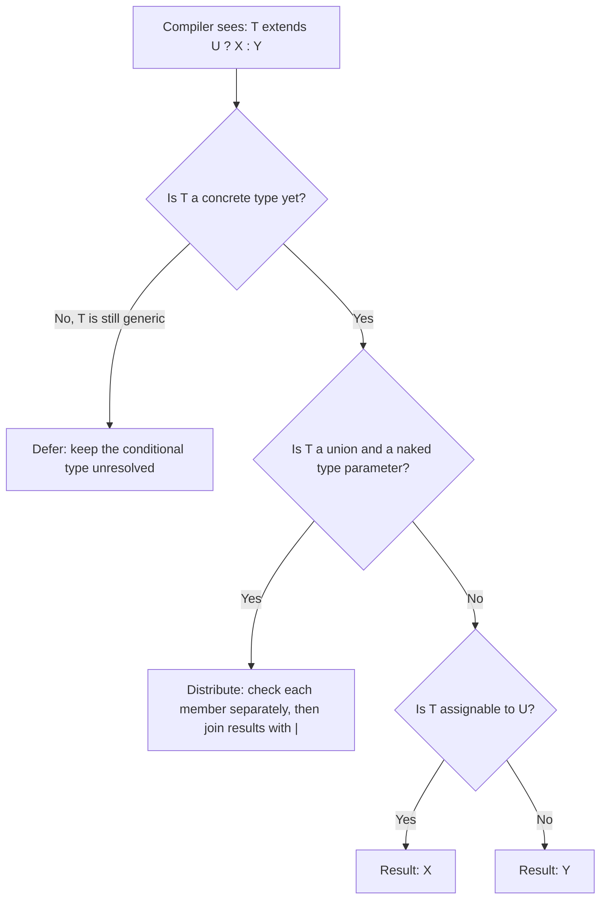
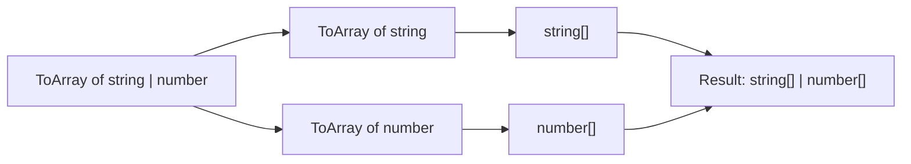
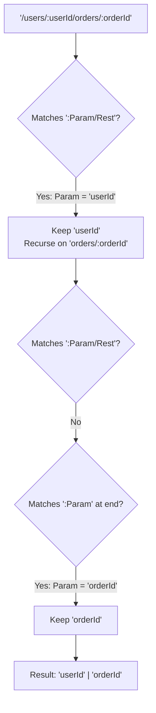

# Conditional Types and infer

> In this document you will learn how TypeScript can choose a type based on a condition, how conditional types spread over unions, and how the `infer` keyword pulls types out of other types. These ideas power `ReturnType`, `Awaited`, typed routers and many library types, and they are a favorite topic for senior-level TypeScript interview questions.

**Before this:** [Generics](05-generics.md) · [keyof, typeof, indexed and mapped types](06-keyof-typeof-indexed-and-mapped-types.md) · [Unions, narrowing and type guards](03-unions-narrowing-and-type-guards.md) · **Interview questions:** [jump to the interview section](#interview-questions)

## Table of contents

1. [What a conditional type is](#what-a-conditional-type-is)
2. [Conditional types with generics](#conditional-types-with-generics)
3. [Distributive conditional types](#distributive-conditional-types)
4. [never in conditional types](#never-in-conditional-types)
5. [The infer keyword](#the-infer-keyword)
6. [Recursive conditional types](#recursive-conditional-types)
7. [Template literal types with infer](#template-literal-types-with-infer)
8. [Real-world usage](#real-world-usage)
9. [Readability and when not to use type-level programming](#readability-and-when-not-to-use-type-level-programming)
10. [Advantages, disadvantages and alternatives](#advantages-disadvantages-and-alternatives)
11. [Common mistakes](#common-mistakes)
12. [Best practices](#best-practices)
13. [How to explain this in an interview](#how-to-explain-this-in-an-interview)
14. [Interview questions](#interview-questions)
15. [Summary](#summary)
16. [References](#references)

---

## What a conditional type is

A **conditional type** is a type that picks one of two types based on a check. It looks like the JavaScript ternary operator, but it works on types, not on values.

```ts
// Syntax:  CheckType extends ExtendsType ? TrueType : FalseType

type IsString<T> = T extends string ? true : false;

type A = IsString<"hello">; // true
type B = IsString<42>;      // false
type C = IsString<string>;  // true
```

Read `T extends string ? true : false` like this:

- "Is `T` **assignable to** `string`?"
- If yes, the result is `true`.
- If no, the result is `false`.

### What "extends" means here

Inside a conditional type, `extends` does **not** mean class inheritance. It means "is assignable to". In other words: "Can a value of type `T` be stored in a variable of type `string`?"

```ts
type Check1 = "admin" extends string ? "yes" : "no";            // "yes" — a literal fits in string
type Check2 = string extends "admin" ? "yes" : "no";            // "no"  — not every string is "admin"
type Check3 = { id: number; name: string } extends { id: number } ? "yes" : "no"; // "yes" — extra props are fine
type Check4 = number[] extends readonly number[] ? "yes" : "no"; // "yes"
type Check5 = readonly number[] extends number[] ? "yes" : "no"; // "no"  — readonly array cannot become mutable
```

`Check3` is "yes" because TypeScript uses **structural typing**: an object with more properties still fits a type that asks for fewer properties.

### Why conditional types exist

Without conditional types, a type can only describe a fixed shape. With conditional types, you can write types that **react** to their input. This lets you:

- Return a different type depending on the argument type.
- Remove members from a union (for example, remove `null`).
- Extract a part of another type (for example, the return type of a function).
- Describe library APIs precisely, so users get good autocomplete and errors.

### Analogy

Think of a conditional type as a **sorting machine in a post office**. A parcel (a type) arrives. The machine checks one rule: "Does it fit in the small box?" If yes, it goes to the left belt. If no, it goes to the right belt. The machine never opens the parcel at runtime. It only looks at the label (the type) while the code is being compiled.

Where the analogy breaks: a real machine checks real parcels while the program runs. A conditional type runs only inside the compiler. After compilation, all of this disappears from the JavaScript output.

### How it works inside

When the compiler sees `T extends U ? X : Y`, it does one of three things:

1. **`T` is known and assignable to `U`** — the type becomes `X`.
2. **`T` is known and not assignable to `U`** — the type becomes `Y`.
3. **`T` is still a generic type parameter** (for example, inside a generic function body) — the compiler cannot decide yet. It **defers** the conditional type and keeps it as `T extends U ? X : Y` until `T` is known.



The "distribute" step is explained in [Distributive conditional types](#distributive-conditional-types).

### Chaining conditions

You can chain conditional types like an `if / else if / else` chain:

```ts
type TypeName<T> =
  T extends string ? "string" :
  T extends number ? "number" :
  T extends boolean ? "boolean" :
  T extends undefined ? "undefined" :
  T extends (...args: any[]) => any ? "function" :
  "object";

type T1 = TypeName<"hi">;         // "string"
type T2 = TypeName<() => void>;   // "function"
type T3 = TypeName<Date>;         // "object"
type T4 = TypeName<string[]>;     // "object"
```

The order matters. The first matching branch wins, just like in `if / else if`.

---

## Conditional types with generics

Conditional types are almost always used with generics. The generic gives the input, and the conditional type decides the output.

### Example 1: a type that depends on a flag

```ts
type ApiResult<T, HasError extends boolean> =
  HasError extends true
    ? { ok: false; error: string }
    : { ok: true; data: T };

type Success = ApiResult<string[], false>; // { ok: true; data: string[] }
type Failure = ApiResult<string[], true>;  // { ok: false; error: string }
```

### Example 2: the return type depends on the argument type

Imagine a function that formats an ID. If you pass a number, it returns a number. If you pass a string, it returns a string.

```ts
type Formatted<T extends string | number> = T extends string ? string : number;

function formatId<T extends string | number>(id: T): Formatted<T> {
  if (typeof id === "string") {
    return id.trim().toUpperCase() as Formatted<T>;
  }
  return Math.floor(id as number) as Formatted<T>;
}

const a = formatId(" ab12 "); // type: string
const b = formatId(42.7);     // type: number
console.log(a, b);            // AB12 42
```

Notice the `as Formatted<T>` casts in the function body. Inside the body, `T` is still generic, so `Formatted<T>` is **deferred**. TypeScript cannot prove that the string branch returns `Formatted<T>`. It does not connect "I checked `typeof id === "string"`" with "so `T` must be `string`". This is a known limitation, so the implementation needs a type assertion.

### Alternative: function overloads

For a small number of cases, **overloads** are often easier to read than a conditional return type:

```ts
function formatCode(id: string): string;
function formatCode(id: number): number;
function formatCode(id: string | number): string | number {
  return typeof id === "string" ? id.trim().toUpperCase() : Math.floor(id);
}

const c = formatCode(" x9 "); // string
const d = formatCode(3.9);    // number
```

Choose like this:

| Situation | Better choice |
| --- | --- |
| Two or three fixed input/output pairs | Overloads (simple, clear error messages) |
| The output must follow the input for **any** type, including unions | Conditional type |
| You are writing a reusable type helper (not a function) | Conditional type |

One difference: if you call `formatCode` with a value of type `string | number`, the overloads above reject it (no single overload matches). The conditional version accepts it and returns `string | number`, because the conditional type distributes over the union (next section).

### Real example: a typed API helper

```ts
interface User { id: number; name: string }
interface Product { id: number; title: string; price: number }

// Map each endpoint to the type it returns
interface Endpoints {
  "/users": User[];
  "/products": Product[];
  "/health": { status: "ok" };
}

// If the endpoint returns an array, the "single item" type is the element type
type ItemOf<T> = T extends (infer Item)[] ? Item : never;

type UserItem = ItemOf<Endpoints["/users"]>;    // User
type HealthItem = ItemOf<Endpoints["/health"]>; // never — not an array

async function getJson<P extends keyof Endpoints>(path: P): Promise<Endpoints[P]> {
  const response = await fetch(`https://api.example.com${path}`);
  return (await response.json()) as Endpoints[P]; // compile-time promise only — validate at runtime!
}
```

The `as Endpoints[P]` line is a promise you make to the compiler. The server could send anything. See [Runtime validation and type-safe APIs](11-runtime-validation-and-type-safe-apis.md) for how to check the data for real. The `infer Item` part is explained in [The infer keyword](#the-infer-keyword).

---

## Distributive conditional types

This is the part most developers find surprising.

### What it is

When the checked type is a **naked type parameter** (just `T`, not wrapped in anything) and you pass a **union**, TypeScript applies the conditional type **to each member of the union separately**. Then it joins the results with `|`. This is called a **distributive conditional type**.

```ts
type ToArray<T> = T extends unknown ? T[] : never;

type Result = ToArray<string | number>;
// string[] | number[]      <- NOT (string | number)[]
```

### Step-by-step walkthrough

How does the compiler get `string[] | number[]`?

1. `T` is `string | number`. `T` is naked in `T extends unknown`, so the type distributes.
2. It splits the union: first `ToArray<string>`, then `ToArray<number>`.
3. `string extends unknown` is true, so the first result is `string[]`.
4. `number extends unknown` is true, so the second result is `number[]`.
5. It joins the results with `|`: `string[] | number[]`.



### Why distribution exists

Distribution makes **filtering unions** easy. This is how the built-in `Exclude` and `Extract` work:

```ts
type MyExclude<T, U> = T extends U ? never : T;
type MyExtract<T, U> = T extends U ? T : never;

type Status = "idle" | "loading" | "success" | "error";

type Finished = MyExtract<Status, "success" | "error">; // "success" | "error"
type Busy = MyExclude<Status, "success" | "error">;     // "idle" | "loading"
```

Walkthrough for `MyExclude<Status, "success" | "error">`:

| Member | `extends "success" \| "error"`? | Result |
| --- | --- | --- |
| `"idle"` | no | `"idle"` |
| `"loading"` | no | `"loading"` |
| `"success"` | yes | `never` |
| `"error"` | yes | `never` |

Joined: `"idle" | "loading" | never | never`. A union with `never` simply drops the `never` parts, so the result is `"idle" | "loading"`.

### When distribution happens and when it does not

Distribution happens **only** when all of these are true:

- The checked type is a **type parameter** (like `T`).
- It is **naked**: not wrapped in an array, tuple, object, or another type.
- The type argument you pass is a union (or `boolean`, or `never` — see below).

```ts
type Naked<T> = T extends string ? "S" : "N";       // distributes
type Wrapped<T> = T[] extends string[] ? "S" : "N"; // does not distribute

type R1 = Naked<string | number>;   // "S" | "N"
type R2 = Wrapped<string | number>; // "N"  — (string | number)[] is not string[]
```

Also, distribution only happens when the conditional type is written with a type parameter. If you write the union directly, there is nothing to distribute:

```ts
type Direct = (string | number) extends string ? "S" : "N"; // "N"
```

### How to turn distribution off: `[T] extends [U]`

Sometimes you want to check the union **as a whole**. Wrap both sides in a one-element tuple:

```ts
type ToArrayAll<T> = [T] extends [unknown] ? T[] : never;

type R3 = ToArrayAll<string | number>; // (string | number)[]
```

Wrapping makes `T` no longer naked, so the compiler checks `[string | number]` against `[unknown]` in one step.

A realistic case: "Is this type **only** strings?"

```ts
type IsOnlyString<T> = [T] extends [string] ? true : false;
type IsStringDistributed<T> = T extends string ? true : false;

type Q1 = IsOnlyString<"a" | "b">;        // true
type Q2 = IsOnlyString<"a" | 1>;          // false
type Q3 = IsStringDistributed<"a" | 1>;   // boolean  (true | false)
```

`Q3` is `boolean` because distribution gives `true` for `"a"` and `false` for `1`, and `true | false` is `boolean`. This is usually not what you want for a yes/no check.

### Surprise 1: `boolean` is a union

`boolean` is really `true | false`. So it distributes too:

```ts
type ToArray<T> = T extends unknown ? T[] : never;

type R4 = ToArray<boolean>; // false[] | true[]   <- not boolean[]
```

### Surprise 2: `never` gives `never`

`never` is the **empty union**. Distributing over zero members gives zero results, which is `never`. The conditional is never even checked:

```ts
type IsStr<T> = T extends string ? "yes" : "no";

type R5 = IsStr<never>; // never  <- not "yes" and not "no"
```

This matters when you write a check for `never` itself. See the next section.

---

## never in conditional types

`never` is the type with **no values**. In conditional types it plays two roles:

1. **As a result** — it means "remove this member".
2. **As an input** — it is an empty union, so distributive types return `never`.

### Role 1: `never` removes members

Because `A | never` is just `A`, returning `never` from a distributive conditional type drops that member. You saw this in `Exclude`. Here is a practical one: remove `null` and `undefined`.

```ts
type NoNull<T> = T extends null | undefined ? never : T;

type MaybeUser = { name: string } | null | undefined;
type DefinitelyUser = NoNull<MaybeUser>; // { name: string }
```

(The built-in `NonNullable<T>` does the same job. Today it is written as `T & {}`, which you can read about in [Utility types](08-utility-types.md).)

### Filtering object keys by value type

A very common helper: "give me the keys of `T` whose values are of type `V`". It combines a mapped type, a conditional type and an indexed access:

```ts
type KeysOfType<T, V> = {
  [K in keyof T]-?: T[K] extends V ? K : never;
}[keyof T];

interface Employee {
  id: number;
  name: string;
  email?: string;
  salary: number;
  manager: Employee | null;
}

type NumericKeys = KeysOfType<Employee, number>; // "id" | "salary"
type StringKeys = KeysOfType<Employee, string>;  // "name"
```

Step by step for `KeysOfType<Employee, number>`:

1. The mapped type turns every property into either its own key name or `never`:
   `{ id: "id"; name: never; email: never; salary: "salary"; manager: never }`.
2. `-?` removes optional markers, so `email` does not add `undefined` to the result.
3. `[keyof T]` reads all the values at once: `"id" | never | never | "salary" | never`.
4. `never` disappears: `"id" | "salary"`.

Real use: a sortable table that only allows sorting by numeric columns.

```ts
type KeysOfType<T, V> = { [K in keyof T]-?: T[K] extends V ? K : never }[keyof T];

interface Order { id: number; customer: string; total: number; createdAt: Date }

function sortBy<T, K extends KeysOfType<T, number>>(rows: T[], key: K): T[] {
  return [...rows].sort((a, b) => (a[key] as number) - (b[key] as number));
}

const orders: Order[] = [
  { id: 2, customer: "Asha", total: 300, createdAt: new Date() },
  { id: 1, customer: "Ravi", total: 120, createdAt: new Date() },
];

sortBy(orders, "total");     // ✅ OK
// sortBy(orders, "customer"); // ❌ Error: "customer" is not assignable to "id" | "total"
```

### Role 2: checking for `never` correctly

```ts
// ❌ Wrong: distributes over the empty union, so the result is never
type IsNeverWrong<T> = T extends never ? true : false;
type W = IsNeverWrong<never>; // never

// ✅ Correct: wrap in a tuple to stop distribution
type IsNever<T> = [T] extends [never] ? true : false;
type R = IsNever<never>;  // true
type S = IsNever<string>; // false
```

### Exhaustiveness checks use `never` too

The same idea appears in normal code: when every member of a union is handled, the remaining type is `never`. You can learn the full pattern in [Unions, narrowing and type guards](03-unions-narrowing-and-type-guards.md). A short reminder:

```ts
type Shape = { kind: "circle"; r: number } | { kind: "square"; size: number };

function area(shape: Shape): number {
  switch (shape.kind) {
    case "circle": return Math.PI * shape.r ** 2;
    case "square": return shape.size ** 2;
    default: {
      const unreachable: never = shape; // error here if a new kind is added and not handled
      return unreachable;
    }
  }
}
```

---

## The infer keyword

### What it is

`infer` lets you **declare a new type variable inside the `extends` part** of a conditional type. TypeScript tries to match the pattern. If the match works, the variable holds the matched piece, and you can use it in the true branch.

Think of it as **pattern matching with a blank to fill in**:

```ts
// "If T looks like an array of SOMETHING, give me that SOMETHING."
type ElementType<T> = T extends (infer Item)[] ? Item : never;

type E1 = ElementType<string[]>;            // string
type E2 = ElementType<{ id: number }[]>;    // { id: number }
type E3 = ElementType<number>;              // never — not an array
```

Rules:

- `infer` can be used **only** in the `extends` clause of a conditional type.
- The inferred variable can be used **only** in the true branch.
- If the pattern does not match, you get the false branch.

### Analogy

`infer` is like a **form with a blank field**: "Name: ____". You hold the form against a document. If the document has the same layout, you can read what is written in the blank. If the layout is different, you cannot read anything, and you go to the "no match" branch.

### Example 1: ReturnType from scratch

```ts
type MyReturnType<T> = T extends (...args: any[]) => infer R ? R : never;

function createUser(name: string) {
  return { id: crypto.randomUUID(), name, createdAt: new Date() };
}

type User = MyReturnType<typeof createUser>;
// { id: `${string}-${string}-${string}-${string}-${string}`; name: string; createdAt: Date }
```

Walkthrough:

1. `typeof createUser` gives the function type `(name: string) => { id: ...; name: string; createdAt: Date }`.
2. The pattern is `(...args: any[]) => infer R`. Any function matches this.
3. TypeScript fills `R` with the return type.
4. The true branch returns `R`.

This is a very useful trick: write the function once, and **derive** the type from it. You do not have to keep a separate `interface User` in sync.

### Example 2: function parameters

```ts
type MyParameters<T> = T extends (...args: infer P) => any ? P : never;
type FirstArg<T> = T extends (first: infer A, ...rest: any[]) => any ? A : never;

function sendEmail(to: string, subject: string, options?: { cc?: string[] }) {
  /* ... */
}

type SendEmailArgs = MyParameters<typeof sendEmail>;
// [to: string, subject: string, options?: { cc?: string[] } | undefined]

type Recipient = FirstArg<typeof sendEmail>; // string
```

`P` is inferred as a **tuple type**, and it even keeps the parameter names as labels.

### Example 3: unwrap a Promise

```ts
type UnwrapPromise<T> = T extends Promise<infer V> ? V : T;

type P1 = UnwrapPromise<Promise<string>>; // string
type P2 = UnwrapPromise<number>;          // number — not a promise, returned as is

async function loadOrders() {
  return [{ id: 1, total: 99 }];
}

type Orders = UnwrapPromise<ReturnType<typeof loadOrders>>;
// { id: number; total: number }[]
```

The built-in `Awaited<T>` (TypeScript 4.5+) does this better: it unwraps nested promises and any "thenable" object. Use `Awaited` in real code. The recursive version is shown in [Recursive conditional types](#recursive-conditional-types).

### Example 4: first and last element of a tuple

```ts
type First<T extends readonly unknown[]> = T extends readonly [infer F, ...unknown[]] ? F : undefined;
type Last<T extends readonly unknown[]> = T extends readonly [...unknown[], infer L] ? L : undefined;

type F1 = First<[1, 2, 3]>; // 1
type L1 = Last<[1, 2, 3]>;  // 3
type F2 = First<[]>;        // undefined
```

### Example 5: inferring from objects and classes

```ts
// Get the type of the `data` property, if there is one
type DataOf<T> = T extends { data: infer D } ? D : never;

type Res = DataOf<{ status: 200; data: { token: string } }>; // { token: string }

// Get the instance type of a class constructor (like the built-in InstanceType)
type MyInstanceType<T> = T extends abstract new (...args: any[]) => infer I ? I : never;

class OrderService {
  getAll() { return []; }
}

type Service = MyInstanceType<typeof OrderService>; // OrderService
```

`typeof OrderService` is the type of the **class itself** (the constructor function). `OrderService` used as a type is the type of an **instance**. `infer` bridges the two.

### infer with a constraint (TypeScript 4.7+)

You can add `extends` to the inferred variable. The match only succeeds if the inferred type also fits the constraint:

```ts
// Only match if the first element is a string
type FirstString<T> = T extends [infer S extends string, ...unknown[]] ? S : never;

type FS1 = FirstString<["a", 1]>; // "a"
type FS2 = FirstString<[1, "a"]>; // never

// Turn a numeric string into a number literal type
type ToNumber<S> = S extends `${infer N extends number}` ? N : never;

type N1 = ToNumber<"42">;  // 42
type N2 = ToNumber<"abc">; // never
```

### When the same variable is inferred twice

If you use the same `infer U` in two places, TypeScript has two candidates. What it does depends on the position:

- **Covariant positions** (normal positions such as property types or return types) — it makes a **union**.
- **Contravariant positions** (function parameter positions) — it makes an **intersection**.

```ts
type FromProps<T> = T extends { a: infer U; b: infer U } ? U : never;
type U1 = FromProps<{ a: string; b: number }>; // string | number

type FromParams<T> = T extends { a: (x: infer U) => void; b: (x: infer U) => void } ? U : never;
type U2 = FromParams<{ a: (x: string) => void; b: (x: number) => void }>; // never (string & number)
```

Why an intersection for parameters? A function that must accept "the parameter of `a`" **and** "the parameter of `b`" needs a value that is both. For `string & number`, no such value exists, so it is `never`. For object types it gives a useful result. This is the basis of the famous `UnionToIntersection` helper:

```ts
type UnionToIntersection<U> =
  (U extends unknown ? (arg: U) => void : never) extends (arg: infer I) => void ? I : never;

type Merged = UnionToIntersection<{ a: 1 } | { b: 2 }>; // { a: 1 } & { b: 2 }
```

Walkthrough:

1. The first conditional distributes: `((arg: { a: 1 }) => void) | ((arg: { b: 2 }) => void)`.
2. The second conditional asks for one `infer I` in a parameter position, but there are two candidates.
3. Parameter position is contravariant, so TypeScript intersects them: `{ a: 1 } & { b: 2 }`.

You rarely need this in application code, but it is a good example of how `infer` really works.

### infer and overloaded functions

If a function has several overload signatures, `infer` uses the **last** signature:

```ts
function parse(input: string): object;
function parse(input: string, asArray: true): object[];
function parse(input: string, asArray?: boolean): object | object[] {
  const value = JSON.parse(input);
  return asArray ? [value] : value;
}

type ParseResult = ReturnType<typeof parse>; // object[]  <- the LAST overload only
```

This surprises people. If you need a specific overload, write that signature's type yourself.

---

## Recursive conditional types

### What it is

A **recursive conditional type** refers to itself in one of its branches. It works like a recursive function: it keeps calling itself until it reaches a **base case**. TypeScript 4.1 added good support for this.

### Example 1: unwrap nested promises

```ts
type DeepUnwrap<T> = T extends Promise<infer V> ? DeepUnwrap<V> : T;

type D1 = DeepUnwrap<Promise<Promise<Promise<string>>>>; // string
```

Walkthrough:

1. `Promise<Promise<Promise<string>>>` matches `Promise<infer V>`, so `V = Promise<Promise<string>>`. Call again.
2. `Promise<Promise<string>>` matches, so `V = Promise<string>`. Call again.
3. `Promise<string>` matches, so `V = string`. Call again.
4. `string` does not match `Promise<...>`. This is the base case. The result is `string`.

### Example 2: flatten nested arrays

```ts
type Flatten<T> = T extends readonly (infer E)[] ? Flatten<E> : T;

type F1 = Flatten<number[][][]>;     // number
type F2 = Flatten<(string | number[])[]>; // string | number
```

### Example 3: DeepPartial

The built-in `Partial<T>` only makes the **top level** optional. For nested settings objects you often want every level optional:

```ts
type DeepPartial<T> =
  T extends (...args: any[]) => any ? T :            // keep functions as they are
  T extends readonly (infer E)[] ? DeepPartial<E>[] : // arrays: make the elements deep partial
  T extends object ? { [K in keyof T]?: DeepPartial<T[K]> } : // objects: recurse into each key
  T;                                                  // primitives: stop here

interface AppSettings {
  theme: { mode: "light" | "dark"; fontSize: number };
  notifications: { email: boolean; push: boolean };
  languages: string[];
}

const defaults: AppSettings = {
  theme: { mode: "light", fontSize: 14 },
  notifications: { email: true, push: false },
  languages: ["en"],
};

// The user only changes one nested value
const userOverrides: DeepPartial<AppSettings> = {
  theme: { mode: "dark" }, // fontSize can be left out
};
```

Real use: merging user preferences, test data builders (`buildUser({ address: { city: "Pune" } })`), and NgRx or Redux state patches.

### Example 4: DeepReadonly

```ts
type DeepReadonly<T> =
  T extends (...args: any[]) => any ? T :
  T extends readonly (infer E)[] ? ReadonlyArray<DeepReadonly<E>> :
  T extends object ? { readonly [K in keyof T]: DeepReadonly<T[K]> } :
  T;

interface CartState {
  items: { productId: string; qty: number }[];
  coupon: { code: string } | null;
}

const state: DeepReadonly<CartState> = {
  items: [{ productId: "p1", qty: 2 }],
  coupon: null,
};

// state.items.push({ productId: "p2", qty: 1 }); // ❌ Error: push does not exist on readonly array
// state.items[0].qty = 5;                         // ❌ Error: qty is read-only
```

Important: `DeepReadonly` is **compile-time only**. At runtime the object is still mutable. Use `Object.freeze` (shallow) or a library like Immer if you need runtime protection.

Notice that `DeepReadonly` and `DeepPartial` treat functions and arrays specially. Without the function check, methods would be turned into mapped objects. Without the array check, arrays would become objects with index keys. Real-world versions often also keep `Date`, `Map` and `Set` as they are.

### Recursion limits

The compiler protects itself from infinite recursion:

- Normal recursive instantiation stops at a depth of about **50**. Past that you get error **TS2589: "Type instantiation is excessively deep and possibly infinite."**
- Since TypeScript 4.5, if the recursive call is in **tail position** (the branch result is *directly* the recursive call, not wrapped in a tuple or template), the compiler can go up to about **1000** levels.

```ts
// Tail-recursive: the branch IS the recursive call. Works for large N.
type BuildTuple<N extends number, Acc extends unknown[] = []> =
  Acc["length"] extends N ? Acc : BuildTuple<N, [...Acc, unknown]>;

type Len = BuildTuple<500>["length"]; // 500
```

If you hit TS2589 in a real project, it is usually a sign that the type is too clever. Simplify it instead of fighting the limit.

---

## Template literal types with infer

**Template literal types** (TypeScript 4.1+) are string types built with backticks, like `` `user:${string}` ``. You can learn the basics in [keyof, typeof, indexed and mapped types](06-keyof-typeof-indexed-and-mapped-types.md). Here we combine them with `infer` to **parse strings at the type level**.

### Example 1: split an event name

```ts
type EventName = "user:created" | "user:deleted" | "order:paid";

type Domain<E> = E extends `${infer D}:${string}` ? D : never;
type Action<E> = E extends `${string}:${infer A}` ? A : never;

type Domains = Domain<EventName>; // "user" | "order"
type Actions = Action<EventName>; // "created" | "deleted" | "paid"
```

How matching works: `${infer D}:` means "match as few characters as possible until the first `:`". The rest of the string must then match `${string}`.

### Example 2: parse route parameters

Goal: from the type `"/users/:userId/orders/:orderId"`, produce `{ userId: string; orderId: string }`.

```ts
type ExtractParams<Path extends string> =
  Path extends `${string}:${infer Param}/${infer Rest}`
    ? Param | ExtractParams<Rest>  // found ":param/" — keep it and parse the rest
    : Path extends `${string}:${infer Param}`
      ? Param                      // found a last ":param" at the end
      : never;                     // no params left

type RouteParams<Path extends string> = { [K in ExtractParams<Path>]: string };

type P1 = RouteParams<"/users/:id">;                      // { id: string }
type P2 = RouteParams<"/users/:userId/orders/:orderId">; // { userId: string; orderId: string }
type P3 = RouteParams<"/about">;                          // {}
```

Step-by-step for `ExtractParams<"/users/:userId/orders/:orderId">`:

1. First pattern: `${string}:${infer Param}/${infer Rest}`.
   - `${string}` matches `"/users/"` (everything before the first `:`).
   - `Param` matches `"userId"` (up to the next `/`).
   - `Rest` matches `"orders/:orderId"`.
   - Result so far: `"userId" | ExtractParams<"orders/:orderId">`.
2. `ExtractParams<"orders/:orderId">`: the first pattern needs a `/` after the param. There is none. So try the second pattern `${string}:${infer Param}`. `Param = "orderId"`.
3. Final: `"userId" | "orderId"`.
4. `RouteParams` maps each key to `string`.



### Making it useful: a type-safe URL builder

Now connect the type to real runtime code:

```ts
type ExtractParams<Path extends string> =
  Path extends `${string}:${infer Param}/${infer Rest}`
    ? Param | ExtractParams<Rest>
    : Path extends `${string}:${infer Param}`
      ? Param
      : never;

type RouteParams<Path extends string> = { [K in ExtractParams<Path>]: string | number };

function buildUrl<Path extends string>(path: Path, params: RouteParams<Path>): string {
  return path.replace(/:([A-Za-z0-9_]+)/g, (_match, name: string) => {
    const value = (params as Record<string, string | number>)[name];
    return encodeURIComponent(String(value));
  });
}

console.log(buildUrl("/users/:userId/orders/:orderId", { userId: 7, orderId: "A-19" }));
// /users/7/orders/A-19

// buildUrl("/users/:userId", {});              // ❌ Error: property 'userId' is missing
// buildUrl("/users/:userId", { userid: 1 });   // ❌ Error: 'userid' does not exist (typo caught)
```

The type and the runtime code agree because both look for `:name` segments. The type gives autocomplete and catches typos. The runtime code does the real replacement.

This is the same idea used by the Express type definitions: in `@types/express-serve-static-core`, a type called `RouteParameters` parses the route string, so `app.get("/users/:id", (req) => req.params.id)` knows that `req.params.id` exists.

### Example 3: string utilities

```ts
type Trim<S extends string> =
  S extends ` ${infer R}` ? Trim<R> :
  S extends `${infer L} ` ? Trim<L> :
  S;

type T1 = Trim<"  hello  ">; // "hello"

type Split<S extends string, D extends string> =
  S extends `${infer Head}${D}${infer Tail}` ? [Head, ...Split<Tail, D>] : [S];

type Parts = Split<"settings.theme.color", ".">; // ["settings", "theme", "color"]
```

`Split` is the starting point for typed "dot path" helpers like `get(config, "settings.theme.color")`. Libraries such as form and i18n libraries use similar types.

---

## Real-world usage

You meet conditional types and `infer` every day, often without noticing:

| Where | What it does |
| --- | --- |
| `ReturnType`, `Parameters`, `InstanceType`, `Awaited`, `Exclude`, `Extract` | Built-in utility types are conditional types with `infer`. See [Utility types](08-utility-types.md). |
| `ReturnType<typeof setTimeout>` | Gets the timer type that works in both browser and Node.js (`number` vs `NodeJS.Timeout`). |
| Express `req.params` | Parses the route string with template literal types and `infer`. |
| Zod `z.infer<typeof schema>` | Derives a TypeScript type from a runtime schema. See [Runtime validation and type-safe APIs](11-runtime-validation-and-type-safe-apis.md). |
| NgRx / Redux action creators | `ReturnType<typeof loadUsersSuccess>` gives the action type without writing it twice. |
| Typed event emitters | Map `"user:created"` to its payload type, and extract domains or actions with template literals. |
| Form libraries | `DeepPartial` for initial values, dot-path types for field names. |

### A realistic Angular example: typed store selectors

```ts
interface AppState {
  auth: { userId: string | null; roles: string[] };
  cart: { items: { productId: string; qty: number }[]; total: number };
}

// A selector is a function from state to some value
type Selector<R> = (state: AppState) => R;

// Pull the result type from any selector
type SelectorResult<S> = S extends Selector<infer R> ? R : never;

const selectCartTotal = (state: AppState) => state.cart.total;
const selectRoles = (state: AppState) => state.auth.roles;

type CartTotal = SelectorResult<typeof selectCartTotal>; // number
type Roles = SelectorResult<typeof selectRoles>;         // string[]
```

The selectors are the single source of truth. Components and tests can use `SelectorResult<typeof selectX>` and stay in sync automatically.

### A realistic Node.js example: typed event bus

```ts
interface AppEvents {
  "user:created": { userId: string; email: string };
  "user:deleted": { userId: string };
  "order:paid": { orderId: string; amount: number };
}

type EventKey = keyof AppEvents;
type EventsOfDomain<D extends string> = Extract<EventKey, `${D}:${string}`>;

type UserEvents = EventsOfDomain<"user">; // "user:created" | "user:deleted"

class EventBus {
  private handlers = new Map<string, Array<(payload: unknown) => void>>();

  on<K extends EventKey>(event: K, handler: (payload: AppEvents[K]) => void): void {
    const list = this.handlers.get(event) ?? [];
    list.push(handler as (payload: unknown) => void);
    this.handlers.set(event, list);
  }

  emit<K extends EventKey>(event: K, payload: AppEvents[K]): void {
    for (const handler of this.handlers.get(event) ?? []) handler(payload);
  }
}

const bus = new EventBus();
bus.on("order:paid", (p) => console.log(`Paid ${p.amount} for ${p.orderId}`));
bus.emit("order:paid", { orderId: "o-1", amount: 250 }); // Paid 250 for o-1
// bus.emit("order:paid", { orderId: "o-1" });           // ❌ Error: amount is missing
```

`Extract` (a distributive conditional type) filters the event names by a template literal pattern.

---

## Readability and when not to use type-level programming

Conditional types are powerful. That is exactly why they are easy to overuse.

### The costs

- **Hard to read.** A ten-line nested conditional type is harder to review than ten lines of normal code. Many teammates cannot change it safely.
- **Bad error messages.** When a complex type fails, the error can be many lines long and point to the wrong place.
- **Slower compile and editor.** Deep recursion and huge unions make `tsc` and your editor slower.
- **No runtime effect.** All this work disappears in JavaScript. It does not validate any real data.
- **Fragile.** Library upgrades or TypeScript upgrades can change how a clever type is inferred.

### Rules of thumb

1. **Start simple.** Prefer a plain interface, a union, or a generic with a constraint. Use a conditional type only when the simple version cannot express the rule.
2. **Prefer built-ins.** `ReturnType`, `Awaited`, `Exclude`, `Extract`, `NonNullable` are well known and well tested.
3. **Name the steps.** Split a big type into small named helpers (`ExtractParams`, then `RouteParams`).
4. **Comment the intent.** One line saying what the type does, with an input/output example.
5. **Test your types.** Use `@ts-expect-error` for cases that must fail, and an `Equal` helper for cases that must produce an exact type:

```ts
type Equal<X, Y> =
  (<T>() => T extends X ? 1 : 2) extends (<T>() => T extends Y ? 1 : 2) ? true : false;
type Expect<T extends true> = T;

type ElementType<T> = T extends (infer Item)[] ? Item : never;

// These lines fail to compile if the helper changes behavior
type Test1 = Expect<Equal<ElementType<string[]>, string>>;
type Test2 = Expect<Equal<ElementType<number>, never>>;

// @ts-expect-error — must fail: the result is string, not number
type Test3 = Expect<Equal<ElementType<string[]>, number>>;
```

6. **Keep library-level types in libraries.** Application code (components, services, controllers) should mostly *use* clever types, not define them.

---

## Advantages, disadvantages and alternatives

**Advantages**

- Types follow the input automatically, so you write the type once and derive the rest.
- Library APIs become precise: autocomplete and errors match what the code really does.
- Union filtering (`Exclude`, `Extract`, `KeysOfType`) is short and reusable.
- Many typos and wrong combinations are caught at compile time.

**Disadvantages**

- Harder to read and maintain than plain types.
- Error messages can be long and confusing.
- Implementation bodies often need type assertions (`as`), because deferred conditional types cannot be narrowed.
- Compile-time only — no runtime safety.

**Alternatives**

| Alternative | When to choose it |
| --- | --- |
| Plain union or interface | The set of shapes is fixed and small. |
| Function overloads | A function has a few fixed input/output pairs. |
| Mapped types | You transform every property of an object the same way (see [doc 06](06-keyof-typeof-indexed-and-mapped-types.md)). |
| Generic with a constraint | You only need "the output type equals the input type" (`<T extends X>(v: T): T`). |
| Lookup through an interface map | `Endpoints[P]` style maps are simpler than a chain of `extends` checks. |
| Runtime schemas (Zod) | You need the data to be checked for real, not only typed. |

---

## Common mistakes

1. **Thinking `extends` means inheritance.** In a conditional type it means "is assignable to". `{ id: 1, name: "x" }` "extends" `{ id: number }` with no classes involved.
2. **Forgetting about distribution.** `ToArray<string | number>` gives `string[] | number[]`, not `(string | number)[]`. Use `[T] extends [U]` when you want to check the union as a whole.
3. **Writing `T extends never` to check for never.** It returns `never` for `never`. Use `[T] extends [never]`.
4. **Expecting `boolean` to stay `boolean`.** It distributes as `true | false`.
5. **Using `infer` outside a conditional type.** `type X = infer R` is a syntax error. `infer` is allowed only in the `extends` clause.
6. **Using the inferred variable in the false branch.** It exists only in the true branch.
7. **Assuming `ReturnType` sees all overloads.** It uses the last overload signature only.
8. **Expecting narrowing to resolve a conditional return type.** Inside a generic function, the conditional type stays deferred. You need an assertion or overloads.
9. **Building unbounded recursion.** Without a clear base case, or with very deep input, you hit TS2589.
10. **Thinking types validate data.** A type parsed from a route string does not check the real URL at runtime.

---

## Best practices

- **Use a conditional type only when the output really depends on the input type.** Otherwise a simpler type is easier to read.
- **Reach for built-ins first** (`ReturnType`, `Parameters`, `Awaited`, `Exclude`, `Extract`, `NonNullable`). Reason: everyone knows them, and they handle edge cases you might miss.
- **Decide on distribution on purpose.** Write `T extends ...` when you want per-member behavior, and `[T] extends [...]` when you want a whole-union check. Reason: accidental distribution creates subtle bugs.
- **Derive types from a single source of truth** with `ReturnType<typeof fn>` or `z.infer<typeof schema>`. Reason: types cannot drift away from the code.
- **Give every recursive type a clear base case** and handle functions and arrays explicitly. Reason: avoids infinite recursion and broken method types.
- **Keep clever types small, named and tested.** Reason: future readers can understand and safely change them.
- **Pair compile-time types with runtime checks at system boundaries.** Reason: types disappear at runtime.

---

## How to explain this in an interview

### How to explain conditional types in an interview

1. **Define it:** "A conditional type picks one of two types based on an assignability check. The syntax is `T extends U ? X : Y`, like a ternary for types."
2. **Why it exists:** "It lets a type react to its input. That is how you filter unions or derive one type from another."
3. **How it works:** "If `T` is known, the compiler checks if it is assignable to `U`. If `T` is still generic, the check is deferred. If `T` is a naked type parameter and you pass a union, it distributes over each member."
4. **Small example:** "`Exclude<T, U>` is just `T extends U ? never : T`. With a union, each member is checked, and members that match become `never`, which disappears."
5. **Where it is useful:** "Utility types like `ReturnType` and `Awaited`, typed API clients, typed event names, Express route params."
6. **Trade-offs / gotchas:** "They are compile-time only, they can be hard to read, and distribution surprises people — `boolean` and `never` behave strangely. I wrap in a tuple to turn distribution off."

### How to explain infer in an interview

1. **Define it:** "`infer` declares a type variable inside the `extends` clause of a conditional type. It is pattern matching for types."
2. **Why it exists:** "To pull a piece out of another type — a return type, an array element, a promise value — without writing it by hand."
3. **How it works:** "TypeScript tries to match the pattern. If it matches, the variable holds the matched part and I can use it in the true branch."
4. **Small example:** "`ReturnType` is `T extends (...args: any[]) => infer R ? R : never`."
5. **Where it is useful:** "Deriving types from functions, unwrapping promises, parsing route strings with template literal types."
6. **Trade-offs / gotchas:** "It only works in conditional types, it uses the last overload, and the same variable inferred twice becomes a union in normal positions but an intersection in parameter positions."

---

## Interview questions

### Q1. What is a conditional type in TypeScript?

**What the interviewer is checking:** Basic definition, the meaning of `extends`, and that you know it is compile-time only.

**Short spoken answer (30–60 seconds):**
> A conditional type chooses between two types based on a check. The syntax is `T extends U ? X : Y`, so it reads like a ternary operator for types. The `extends` here means "is assignable to", not class inheritance. If `T` fits into `U`, I get `X`, otherwise `Y`. For example, `IsString<T> = T extends string ? true : false`. They are mostly used with generics so the output type can depend on the input type. Many built-ins like `Exclude`, `ReturnType` and `NonNullable` are built this way. It all happens at compile time, so nothing of it exists in the JavaScript output.

**Detailed explanation:**
The compiler checks assignability using structural typing. Literal types are assignable to their base types (`"a" extends string`), objects with extra properties are assignable to smaller object types, and mutable arrays are assignable to readonly arrays but not the other way round. When `T` is still a type parameter, the conditional type is deferred until `T` is known.

**Code:**

```ts
type IsArray<T> = T extends readonly unknown[] ? true : false;

type A1 = IsArray<string[]>;          // true
type A2 = IsArray<readonly number[]>; // true
type A3 = IsArray<{ length: 3 }>;     // false
```

**Follow-up questions:**
- **Is `extends` here the same as in `class A extends B`?** — No. In a conditional type it is an assignability check between types. No classes are needed.
- **What happens when `T` is generic inside a function?** — The conditional type is deferred. The compiler cannot pick a branch, so inside the function body it stays as an unresolved conditional type.
- **Can you chain conditional types?** — Yes, like `else if`: `T extends string ? "s" : T extends number ? "n" : "other"`. The first match wins.

**Common mistakes:** Saying it runs at runtime. Saying `extends` means inheritance. Not knowing what "deferred" means.

**Where this is used in real projects:** Utility types, typed API clients, library type definitions (Express, Zod, NgRx).

### Q2. What is a distributive conditional type? How do you turn distribution off?

**What the interviewer is checking:** Whether you understand the most surprising behavior of conditional types and can control it.

**Short spoken answer (30–60 seconds):**
> When the checked type is a naked type parameter and I pass a union, TypeScript applies the conditional to each union member separately and joins the results. So `ToArray<T> = T extends unknown ? T[] : never` with `string | number` gives `string[] | number[]`, not an array of the union. This is what makes `Exclude` and `Extract` work — members that map to `never` disappear. If I want to check the union as a whole, I wrap both sides in a tuple: `[T] extends [unknown]`. Then `T` is no longer naked, and I get `(string | number)[]`.

**Detailed explanation:**
Distribution happens only when the type before `extends` is a bare type parameter. `T[] extends ...` or `{ value: T } extends ...` do not distribute. Two special cases follow from the rule: `boolean` is `true | false`, so it distributes; `never` is the empty union, so a distributive conditional over `never` returns `never` without checking anything.

**Code:**

```ts
type ToArray<T> = T extends unknown ? T[] : never;
type ToArrayAll<T> = [T] extends [unknown] ? T[] : never;

type R1 = ToArray<string | number>;    // string[] | number[]
type R2 = ToArrayAll<string | number>; // (string | number)[]
type R3 = ToArray<boolean>;            // false[] | true[]
type R4 = ToArray<never>;              // never
```

**Follow-up questions:**
- **Why would you want distribution?** — To filter or transform each member of a union, for example removing `null` or extracting events of one domain.
- **What does `[T] extends [never]` do?** — It checks whether `T` is exactly `never`. Without the tuple, the check itself would be distributed over an empty union and return `never`.
- **Does `T extends any` distribute?** — Yes. `T extends any ? ... : ...` and `T extends unknown ? ...` are common tricks to *force* distribution in a helper.

**Common mistakes:** Expecting `(string | number)[]`. Forgetting that `boolean` is a union. Wrapping only one side (`[T] extends U`) — both sides should be wrapped so the comparison is still meaningful.

**Where this is used in real projects:** `Exclude`, `Extract`, `NonNullable`-style helpers, filtering event names, `DistributiveOmit` for unions of object types.

### Q3. What does this produce?

```ts
type IsString<T> = T extends string ? "yes" : "no";

type A = IsString<"a" | 1>;
type B = IsString<never>;
type C = [never] extends [string] ? "yes" : "no";
type D = IsString<any>;
```

**Answer:**
- `A` is `"yes" | "no"` — distribution: `"a"` gives `"yes"`, `1` gives `"no"`.
- `B` is `never` — distribution over the empty union gives nothing.
- `C` is `"yes"` — no distribution here, and `never` is assignable to every type.
- `D` is `"yes" | "no"` — `any` is special: the compiler cannot decide, so it returns the union of both branches.

**Step by step:**
1. For `A`, `T` is a naked type parameter and the argument is a union, so each member is checked alone.
2. For `B`, there are zero members, so the result is `never` without evaluating any branch.
3. For `C`, the tuple stops distribution. `never` is the bottom type, so it is assignable to `string`.
4. For `D`, `any` can be "both" assignable and not assignable, so TypeScript takes both branches.

(All four results were confirmed with the TypeScript 5.9 compiler.)

### Q4. What is the `infer` keyword? Implement `ReturnType` yourself.

**What the interviewer is checking:** Pattern matching with types, and whether you can write a basic utility type.

**Short spoken answer (30–60 seconds):**
> `infer` declares a new type variable inside the `extends` part of a conditional type. TypeScript tries to match the pattern, and if it matches, it fills that variable with the matching piece. I can then use it in the true branch. `ReturnType` is the classic example: `T extends (...args: any[]) => infer R ? R : never`. Any function type matches the pattern, and `R` captures what it returns. I use this to derive types from existing code — for example the return type of a factory function — so I don't keep two definitions in sync by hand.

**Detailed explanation:**
`infer` can appear only in the `extends` clause, and the variable is visible only in the true branch. The pattern can be any type shape: a function, an array, a tuple, a promise, an object, or a template literal.

**Code:**

```ts
type MyReturnType<T extends (...args: any) => any> =
  T extends (...args: any) => infer R ? R : any;

const makeCart = () => ({ items: [] as string[], total: 0 });
type Cart = MyReturnType<typeof makeCart>; // { items: string[]; total: number }
```

This is the same definition the TypeScript standard library uses (`lib.es5.d.ts`), including the constraint on `T` and the `any` fallback.

**Follow-up questions:**
- **Why `typeof makeCart` and not `makeCart`?** — `makeCart` is a value. Type positions need a type, so `typeof` turns the value into its type.
- **Can you use `infer` outside a conditional type?** — No, it is a syntax error.
- **What does `ReturnType` give for an overloaded function?** — The return type of the last overload signature.
- **How would you get the element type of an array?** — `T extends (infer E)[] ? E : never`, or simply `T[number]` for array types.

**Common mistakes:** Forgetting `typeof`. Using the inferred variable in the false branch. Not knowing it already exists as a built-in.

**Where this is used in real projects:** NgRx action types, deriving DTO types from factory functions, `ReturnType<typeof setTimeout>` for timers.

### Q5. Write a type that unwraps a Promise, including nested promises.

**What the interviewer is checking:** `infer` plus recursion, and awareness of the built-in `Awaited`.

**Short spoken answer (30–60 seconds):**
> I match the type against `Promise<infer V>`. If it matches, I call the type again with `V`, because the value itself could be another promise. If it doesn't match, that is my base case and I return the type as is. So `DeepUnwrap<Promise<Promise<string>>>` becomes `string`. In real code I would just use the built-in `Awaited`, which does the same thing and also handles any "thenable" object, not only real `Promise` instances.

**Code:**

```ts
type DeepUnwrap<T> = T extends Promise<infer V> ? DeepUnwrap<V> : T;

type U1 = DeepUnwrap<Promise<Promise<number>>>; // number
type U2 = Awaited<Promise<Promise<number>>>;    // number (built-in, TS 4.5+)
```

**Follow-up questions:**
- **Why does the built-in `Awaited` check for a `then` method instead of `Promise`?** — Because `await` works with any thenable object, so the type must match what `await` really does at runtime.
- **Where is `Awaited` used automatically?** — In the type of `await` expressions and in the return type of `Promise.all`.
- **What happens with `DeepUnwrap<string | Promise<number>>`?** — It distributes: `string | number`.

**Common mistakes:** Forgetting the recursion, so only one level is unwrapped. Forgetting the base case.

**Where this is used in real projects:** Getting the resolved type of an async service method: `Awaited<ReturnType<typeof userService.getAll>>`.

### Q6. Debugging: why is this result `never`?

```ts
type IsNever<T> = T extends never ? true : false;
type Result = IsNever<never>; // expected true, got never
```

**What the interviewer is checking:** Understanding of distribution over `never`.

**Short spoken answer (30–60 seconds):**
> `T` is a naked type parameter, so the conditional is distributive. `never` is the empty union, so there is nothing to distribute over, and the result is `never` — the branches are never even evaluated. The fix is to wrap both sides in a tuple: `[T] extends [never] ? true : false`. Now the compiler compares the tuple types as a whole, and `IsNever<never>` is `true`.

**Code:**

```ts
type IsNever<T> = [T] extends [never] ? true : false;

type R1 = IsNever<never>;     // true
type R2 = IsNever<undefined>; // false
```

**Follow-up questions:**
- **Where do you need `IsNever` in practice?** — In type tests and in helpers that must behave differently when a union becomes empty, for example to show a custom error type.
- **Is `never` assignable to `string`?** — Yes. `never` is the bottom type, assignable to everything. That is why `[never] extends [string]` is true.

**Common mistakes:** Blaming `never` itself instead of the distribution rule.

**Where this is used in real projects:** Type-testing utilities, exhaustiveness helpers, library types.

### Q7. Implement `Exclude`, `Extract` and `NonNullable` yourself.

**What the interviewer is checking:** Using distribution and `never` to filter unions.

**Short spoken answer (30–60 seconds):**
> All three rely on distribution. `Exclude<T, U>` is `T extends U ? never : T` — each member that matches `U` becomes `never` and disappears. `Extract` is the opposite: `T extends U ? T : never`. `NonNullable` used to be `T extends null | undefined ? never : T`. Since TypeScript 4.8 the library writes it as `T & {}`, because intersecting with `{}` removes `null` and `undefined` and also works better with narrowing of generic values.

**Code:**

```ts
type MyExclude<T, U> = T extends U ? never : T;
type MyExtract<T, U> = T extends U ? T : never;
type MyNonNullable<T> = T & {};

type Role = "admin" | "editor" | "viewer" | null;

type Writers = MyExtract<Role, "admin" | "editor">; // "admin" | "editor"
type NotAdmin = MyExclude<Role, "admin">;          // "editor" | "viewer" | null
type RealRole = MyNonNullable<Role>;               // "admin" | "editor" | "viewer"
```

**Follow-up questions:**
- **Why does `T & {}` remove `null`?** — `{}` means "any value except `null` and `undefined`". Intersecting `null` with it gives `never`, which drops out of the union.
- **Does `Exclude` work on object unions?** — Yes. `Exclude<A | B, { kind: "a" }>` removes members assignable to `{ kind: "a" }`, which is handy with discriminated unions.

**Common mistakes:** Writing `Exclude` without a type parameter (no distribution). Confusing `Exclude` (works on unions) with `Omit` (works on object keys).

**Where this is used in real projects:** Removing states from a status union, filtering action types, cleaning nullable API fields.

### Q8. Write a type that turns `"/users/:id/posts/:postId"` into `{ id: string; postId: string }`.

**What the interviewer is checking:** Template literal types, `infer`, recursion, and mapped types together.

**Short spoken answer (30–60 seconds):**
> I split it into two steps. First, a recursive conditional type extracts the parameter names as a union. It matches `${string}:${infer Param}/${infer Rest}` — that finds the first parameter followed by a slash — and recurses on the rest. If there is no slash after the parameter, a second pattern `${string}:${infer Param}` catches the last one. If nothing matches, it returns `never`. Second, a mapped type turns the union of names into an object with `string` values. Express's type definitions do something very similar for `req.params`.

**Code:**

```ts
type ExtractParams<P extends string> =
  P extends `${string}:${infer Param}/${infer Rest}` ? Param | ExtractParams<Rest> :
  P extends `${string}:${infer Param}` ? Param :
  never;

type RouteParams<P extends string> = { [K in ExtractParams<P>]: string };

type R = RouteParams<"/users/:id/posts/:postId">; // { id: string; postId: string }
```

**Follow-up questions:**
- **How would you support optional params like `:id?`?** — Add a branch that matches `${infer Name}?`, collect those names separately, and use `Partial<...>` for them — this is exactly what Express's `RouteParameters` type does.
- **Does this validate the real URL?** — No. It only types the route pattern string. Runtime routing still has to parse the URL.
- **What if the path is just `string` (not a literal)?** — The patterns cannot match specific names, so you get `{}`. Real libraries detect this case (`string extends P`) and fall back to `Record<string, string>`.

**Common mistakes:** Forgetting the last parameter (no trailing slash). Not stopping recursion (no `never` base case).

**Where this is used in real projects:** Typed routers, `buildUrl` helpers, typed API clients, Express request params.

### Q9. What happens when the same `infer` variable appears in two places?

**What the interviewer is checking:** Deep understanding of variance in inference — a senior-level question.

**Short spoken answer (30–60 seconds):**
> TypeScript collects two candidates for the same variable and has to combine them. If both positions are covariant — normal positions like property types or return types — it makes a union. If both are contravariant — function parameter positions — it makes an intersection, because a function that has to accept both inputs needs a value that satisfies both. This is the trick behind `UnionToIntersection`: you distribute a union into a union of functions, then infer the parameter once, and you get an intersection.

**Code:**

```ts
type FromProps<T> = T extends { a: infer U; b: infer U } ? U : never;
type P = FromProps<{ a: string; b: number }>; // string | number

type FromParams<T> = T extends { a: (x: infer U) => void; b: (x: infer U) => void } ? U : never;
type Q = FromParams<{ a: (x: { id: 1 }) => void; b: (x: { name: "n" }) => void }>;
// { id: 1 } & { name: "n" }
```

**Follow-up questions:**
- **Why is a parameter position contravariant?** — A function that accepts a wider input can safely replace one that accepts a narrower input. So the direction of compatibility is reversed for parameters.
- **When have you needed this?** — Mostly in library-level helpers, like merging the props of several plugin objects into one type.

**Common mistakes:** Guessing "always a union".

**Where this is used in real projects:** Plugin systems, merging mixin types, advanced library typings.

<a id="q10-implement-deeppartialt-what-edge-cases-must-you-handle"></a>

### Q10. Implement `DeepPartial<T>`. What edge cases must you handle?

**What the interviewer is checking:** Recursion, mapped types, and practical edge cases.

**Short spoken answer (30–60 seconds):**
> `DeepPartial` makes every property optional at every level. The core is a mapped type `{ [K in keyof T]?: DeepPartial<T[K]> }` applied when `T` is an object. The edge cases matter: functions should stay functions, arrays should stay arrays with deep-partial elements, and primitives are the base case. Real-world versions also keep `Date`, `Map` and `Set` untouched. I use it for settings overrides and test data builders.

**Code:**

```ts
type DeepPartial<T> =
  T extends (...args: any[]) => any ? T :
  T extends Date ? T :
  T extends readonly (infer E)[] ? DeepPartial<E>[] :
  T extends object ? { [K in keyof T]?: DeepPartial<T[K]> } :
  T;

interface Profile { name: string; address: { city: string; zip: string }; birthday: Date }

const patch: DeepPartial<Profile> = { address: { city: "Pune" } }; // ✅ OK
```

**Follow-up questions:**
- **What happens without the function check?** — Methods become mapped objects with weird keys, so objects with methods break.
- **Is `DeepPartial` safe for merging?** — The type is fine, but the merge function must still handle `undefined` and arrays correctly at runtime.
- **How is it different from `Partial`?** — `Partial` is shallow: nested objects stay fully required.

**Common mistakes:** Forgetting arrays and functions. Forgetting that it is compile-time only.

**Where this is used in real projects:** Config overrides, test factories, state patches, form initial values.

### Q11. Why does this function need a type assertion?

```ts
type Formatted<T extends string | number> = T extends string ? string : number;

function format<T extends string | number>(value: T): Formatted<T> {
  if (typeof value === "string") {
    return value.toUpperCase(); // ❌ Error: string is not assignable to Formatted<T>
  }
  return value as number;       // ❌ Error as well
}
```

**What the interviewer is checking:** Understanding deferred conditional types and the limits of narrowing.

**Short spoken answer (30–60 seconds):**
> Inside the function, `T` is still a generic type parameter, so `Formatted<T>` is deferred — the compiler doesn't know which branch it will be. Narrowing `value` with `typeof` narrows the *value*, but it doesn't narrow the *type parameter* `T`. So the compiler can't prove that `string` equals `Formatted<T>`. The usual fixes are a type assertion like `as Formatted<T>`, or using overloads instead of a conditional return type, which give the same call-site types with a simpler implementation.

**Follow-up questions:**
- **Is the assertion safe?** — Only if your logic really matches the type. The compiler stops checking that part, so keep the function small and test it.
- **Which do you prefer?** — Overloads for two or three cases. A conditional return type when the type is reused elsewhere or must handle unions.

**Common mistakes:** Thinking it is a TypeScript bug, or using `any` everywhere instead of a targeted assertion.

**Where this is used in real projects:** Generic helpers whose return type depends on the input, such as parsers and formatters.

### Q12. What does `ReturnType` return for an overloaded function?

**Short answer:** The return type of the **last** overload signature. `infer` cannot choose between overloads, so it uses the last one.

```ts
function load(id: string): { id: string };
function load(ids: string[]): { id: string }[];
function load(arg: string | string[]) {
  return Array.isArray(arg) ? arg.map((id) => ({ id })) : { id: arg };
}

type R = ReturnType<typeof load>; // { id: string }[]
```

A good follow-up answer: put the most general overload last, or write the needed type yourself.

<a id="q13-what-is-the-difference-between-t-extends-u--x--y-and-a-generic-constraint-t-extends-u"></a>

### Q13. What is the difference between `T extends U ? X : Y` and a generic constraint `<T extends U>`?

**What the interviewer is checking:** Not confusing the two uses of `extends`.

**Short spoken answer (30–60 seconds):**
> A constraint `<T extends U>` is a rule for callers: it rejects any type argument that isn't assignable to `U`, with a compile error. A conditional type `T extends U ? X : Y` never rejects anything — it's a question, and it picks a branch. So the constraint is a gate, and the conditional type is a switch. I often use both: the constraint to limit valid inputs and the conditional to compute the output.

**Code:**

```ts
type Len<T extends { length: number }> = T["length"];           // constraint: gate
type LenOrZero<T> = T extends { length: infer L } ? L : 0;       // conditional: switch

type L1 = Len<[1, 2]>;      // 2
// type L2 = Len<number>;   // ❌ Error: number does not satisfy the constraint
type L3 = LenOrZero<number>; // 0
```

**Follow-up questions:**
- **Can `infer` have a constraint?** — Yes, since TypeScript 4.7: `infer S extends string`.

**Common mistakes:** Thinking a conditional type causes errors for non-matching types.

**Where this is used in real projects:** Library signatures that both restrict input and compute output.

### Q14. How would you get the type of one element of an array constant, and the keys of a nested object?

**Short answer:** Use indexed access with `number` for arrays, and `infer` only when you need pattern matching.

```ts
const ROLES = ["admin", "editor", "viewer"] as const;
type Role = (typeof ROLES)[number]; // "admin" | "editor" | "viewer"

type ElementOf<T> = T extends readonly (infer E)[] ? E : never;
type Role2 = ElementOf<typeof ROLES>; // same result

const config = { db: { host: "localhost", port: 5432 } };
type DbKeys = keyof (typeof config)["db"]; // "host" | "port"
```

The follow-up point: `T[number]` is simpler than `infer` here. Use `infer` when the shape is not directly indexable (promises, functions, template strings).

### Q15. Your team's type helper is 40 lines of nested conditional types, and compile time got slow. What do you do?

**What the interviewer is checking:** Senior judgment about type-level complexity.

**Short spoken answer (30–60 seconds):**
> First I measure: `tsc --extendedDiagnostics` shows check time and instantiation counts, and `--generateTrace` shows which types are expensive. Then I ask if we need this precision at all. Often a simpler type — a union, an interface map, or overloads — gives 90% of the value. If we keep it, I split it into small named helpers, make recursion tail-recursive, avoid huge unions and deep recursion, and add type tests so we can refactor safely. Clever types belong in a small shared library with tests, not spread through application code.

**Follow-up questions:**
- **What is TS2589?** — "Type instantiation is excessively deep and possibly infinite." It appears around 50 levels of recursion, or about 1000 for tail-recursive conditional types.
- **How do you test a type?** — With `Expect<Equal<A, B>>` helpers for exact results and `// @ts-expect-error` for cases that must fail.

**Common mistakes:** Optimizing without measuring, or adding `any` to silence the slow type instead of simplifying it.

**Where this is used in real projects:** Large monorepos, design-system libraries and typed API layers where types get complex.

### Q16. Code review: what is wrong with this type?

```ts
type ApiResponse<T> = T extends unknown[] ? { items: T; total: number } : { item: T };

type R = ApiResponse<string[] | number>;
```

**Answer:** It distributes. `R` is `{ items: string[]; total: number } | { item: number }`. That may be what you want — or it may be a bug if the author expected one combined shape. Also `T extends unknown[]` rejects `readonly` arrays; use `readonly unknown[]` to accept both. In code review, I would ask the author to decide on distribution on purpose and add a type test that shows the intended result.

### Q17. Where have you used conditional types or infer in a real project?

**What the interviewer is checking:** Practical experience, not only theory.

**Short spoken answer (30–60 seconds):**
> The most common one for me is deriving types instead of duplicating them. In an Angular app with NgRx, I used `ReturnType<typeof someSelector>` so components get the right type when the selector changes. On a Node backend, I used `Awaited<ReturnType<typeof repository.findById>>` to type the result of a service method. I also built a typed event bus where event names are template literal types like `"user:created"`, and I used `Extract` with a template pattern to list all user events. I keep these helpers in a shared types file with type tests, and I avoid writing complex conditional types inside components.

**Follow-up questions:**
- **Would you write this in a junior-heavy team?** — I would still use the built-ins, but keep custom helpers few, documented, and tested.

**Where this is used in real projects:** NgRx/Redux typing, typed event systems, API clients, form libraries.

---

## Summary

- A conditional type is `T extends U ? X : Y`. `extends` means "is assignable to", not inheritance.
- If `T` is still generic, the conditional type is **deferred** until `T` is known.
- A naked type parameter with a union **distributes**: each member is checked separately and the results are joined.
- Turn distribution off with `[T] extends [U]`. Remember that `boolean` distributes and `never` gives `never`.
- Returning `never` removes a member from a union. This is how `Exclude`, `Extract` and `KeysOfType` work.
- `infer` declares a type variable inside `extends`. It is pattern matching for types, used by `ReturnType`, `Parameters` and `Awaited`.
- `infer X extends C` (TS 4.7+) adds a constraint. Repeated `infer` gives a union in normal positions and an intersection in parameter positions. Overloads infer from the last signature.
- Recursive conditional types (`DeepPartial`, `DeepReadonly`, promise unwrapping) need a clear base case. Deep recursion causes TS2589.
- Template literal types plus `infer` can parse strings, for example route parameters.
- Everything here is compile-time only. Keep clever types small, named, tested, and pair them with runtime validation at system boundaries.

---

## References

- TypeScript Handbook — Conditional Types: https://www.typescriptlang.org/docs/handbook/2/conditional-types.html
- TypeScript Handbook — Template Literal Types: https://www.typescriptlang.org/docs/handbook/2/template-literal-types.html
- TypeScript Handbook — Utility Types: https://www.typescriptlang.org/docs/handbook/utility-types.html
- TypeScript 2.8 release notes (conditional types and `infer`): https://www.typescriptlang.org/docs/handbook/release-notes/typescript-2-8.html
- TypeScript 4.1 release notes (template literal types, recursive conditional types): https://www.typescriptlang.org/docs/handbook/release-notes/typescript-4-1.html
- TypeScript 4.5 release notes (`Awaited`, tail-recursion elimination on conditional types): https://www.typescriptlang.org/docs/handbook/release-notes/typescript-4-5.html
- TypeScript 4.7 release notes (`extends` constraints on `infer`): https://www.typescriptlang.org/docs/handbook/release-notes/typescript-4-7.html
- TypeScript 4.8 release notes (`NonNullable` as `T & {}`): https://www.typescriptlang.org/docs/handbook/release-notes/typescript-4-8.html
- TypeScript standard library definitions (`lib.es5.d.ts`): https://github.com/microsoft/TypeScript/blob/main/src/lib/es5.d.ts
