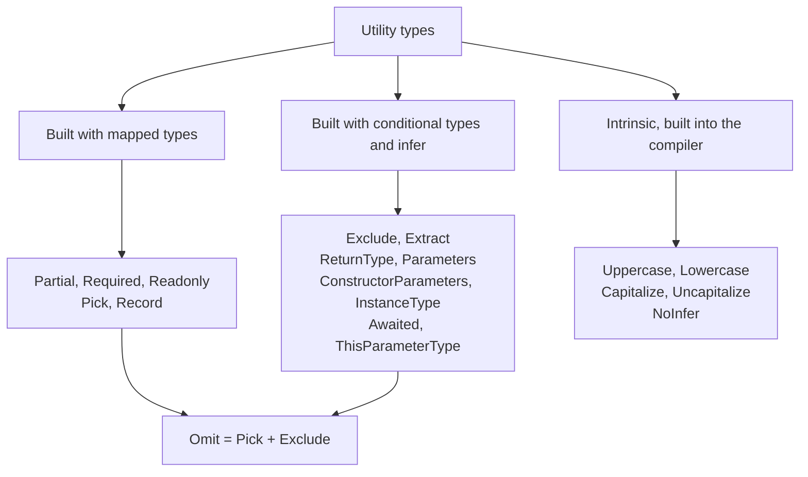
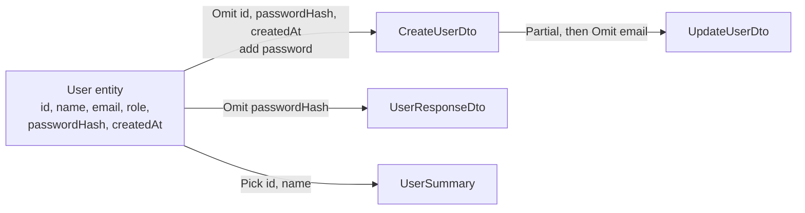

# Utility Types

> In this document you will learn every built-in TypeScript utility type: what it does, when to use it, and how to build most of them yourself from mapped and conditional types. You will also learn how real projects use them to create DTOs, and how to write your own helpers. "Implement `Pick` or `Omit` yourself" is a common practical interview task, so this document shows each step.

**Before this:** [keyof, typeof, indexed and mapped types](06-keyof-typeof-indexed-and-mapped-types.md) · [Conditional types and infer](07-conditional-types-and-infer.md) · **Interview questions:** [jump to the interview section](#interview-questions)

## Table of contents

1. [What utility types are](#what-utility-types-are)
2. [All built-in utility types at a glance](#all-built-in-utility-types-at-a-glance)
3. [Partial, Required and Readonly](#partial-required-and-readonly)
4. [Record](#record)
5. [Pick and Omit](#pick-and-omit)
6. [Exclude, Extract and NonNullable](#exclude-extract-and-nonnullable)
7. [ReturnType and Parameters](#returntype-and-parameters)
8. [ConstructorParameters and InstanceType](#constructorparameters-and-instancetype)
9. [Awaited](#awaited)
10. [ThisType, ThisParameterType and OmitThisParameter](#thistype-thisparametertype-and-omitthisparameter)
11. [NoInfer](#noinfer)
12. [String manipulation types](#string-manipulation-types)
13. [Practical DTO design with utility types](#practical-dto-design-with-utility-types)
14. [Writing your own utility types](#writing-your-own-utility-types)
15. [Advantages, disadvantages and alternatives](#advantages-disadvantages-and-alternatives)
16. [Common mistakes](#common-mistakes)
17. [Best practices](#best-practices)
18. [How to explain this in an interview](#how-to-explain-this-in-an-interview)
19. [Interview questions](#interview-questions)
20. [Summary](#summary)
21. [References](#references)

---

## What utility types are

A **utility type** is a ready-made generic type that **transforms another type**. You give it a type, and it gives you a new type. For example, `Partial<User>` gives you a version of `User` where every property is optional.

```ts
interface User {
  id: number;
  name: string;
  email: string;
}

type UserPatch = Partial<User>;
// { id?: number; name?: string; email?: string }

const patch: UserPatch = { email: "new@example.com" }; // ✅ only one field
```

### Why they exist

Real applications have many *versions* of the same data:

- The full `User` stored in the database.
- The data needed to **create** a user (no `id` yet).
- The data allowed in an **update** (every field optional).
- The data you **send to the browser** (no password hash).

You could write four separate interfaces. But then you must keep them in sync by hand. When someone adds a field to `User`, the other three can go out of date. Utility types let you write the main type **once** and **derive** the others from it.

### Analogy

Think of a utility type as a **photo filter**. You take one photo (your base type) and apply a filter: "black and white" (`Readonly`), "crop to faces" (`Pick`), "remove the background" (`Omit`). The original photo does not change. You get a new version. If you retake the original photo, every filtered version updates automatically.

Where the analogy breaks: filters change pixels. Utility types change nothing at runtime. They exist only while the compiler checks your code, and they disappear from the JavaScript output.

### How they work inside

Utility types are not magic. Almost all of them are written in plain TypeScript in the standard library file `lib.es5.d.ts`, using two tools you already know:

- **Mapped types** (`{ [K in keyof T]: ... }`) — for types that change every property: `Partial`, `Required`, `Readonly`, `Pick`, `Record`.
- **Conditional types** with `infer` (`T extends U ? X : Y`) — for types that filter or extract: `Exclude`, `Extract`, `ReturnType`, `Parameters`, `Awaited`.

A few are **intrinsic**: the compiler implements them internally. These are `Uppercase`, `Lowercase`, `Capitalize`, `Uncapitalize` and `NoInfer`. `ThisType` is a special marker interface with no body.



Utility types are **global**. You never import them.

---

## All built-in utility types at a glance

| Utility type | What it does | Built with | Since |
| --- | --- | --- | --- |
| `Partial<T>` | Makes all properties optional | Mapped type | 2.1 |
| `Required<T>` | Makes all properties required | Mapped type | 2.8 |
| `Readonly<T>` | Makes all properties `readonly` | Mapped type | 2.1 |
| `Record<K, T>` | Object type with keys `K` and values `T` | Mapped type | 2.1 |
| `Pick<T, K>` | Keeps only keys `K` | Mapped type | 2.1 |
| `Omit<T, K>` | Removes keys `K` | `Pick` + `Exclude` | 3.5 |
| `Exclude<T, U>` | Removes union members assignable to `U` | Conditional type | 2.8 |
| `Extract<T, U>` | Keeps union members assignable to `U` | Conditional type | 2.8 |
| `NonNullable<T>` | Removes `null` and `undefined` | `T & {}` | 2.8 |
| `ReturnType<T>` | Return type of a function type | `infer` | 2.8 |
| `Parameters<T>` | Parameter types as a tuple | `infer` | 3.1 |
| `ConstructorParameters<T>` | Constructor parameter types as a tuple | `infer` | 3.1 |
| `InstanceType<T>` | Instance type of a constructor type | `infer` | 2.8 |
| `ThisParameterType<T>` | Type of the `this` parameter of a function | `infer` | 3.3 |
| `OmitThisParameter<T>` | Function type without the `this` parameter | `infer` | 3.3 |
| `ThisType<T>` | Marker that sets the type of `this` in object literals | Marker | 2.3 |
| `Awaited<T>` | The value a promise resolves to, unwrapped deeply | Recursive conditional | 4.5 |
| `Uppercase<S>` / `Lowercase<S>` | Changes case of a string literal type | Intrinsic | 4.1 |
| `Capitalize<S>` / `Uncapitalize<S>` | Changes the first character's case | Intrinsic | 4.1 |
| `NoInfer<T>` | Stops TypeScript from inferring a type parameter from this position | Intrinsic | 5.4 |

The rest of this document goes through them in groups.

---

## Partial, Required and Readonly

These three change the **modifiers** of every property: optional (`?`) and `readonly`.

### Partial

`Partial<T>` makes every property optional.

```ts
// How it is defined in the standard library:
type MyPartial<T> = {
  [P in keyof T]?: T[P];
};
```

Read it as: "For every key `P` of `T`, create the same property, with the same type `T[P]`, but optional."

**Example: an update function**

```ts
interface Product {
  id: string;
  title: string;
  price: number;
  inStock: boolean;
}

function updateProduct(product: Product, changes: Partial<Product>): Product {
  return { ...product, ...changes };
}

const laptop: Product = { id: "p1", title: "Laptop", price: 900, inStock: true };
const updated = updateProduct(laptop, { price: 850 });
console.log(updated); // { id: 'p1', title: 'Laptop', price: 850, inStock: true }
```

Two gotchas:

1. **`Partial` is shallow.** Nested objects stay fully required. For deep optional types, see `DeepPartial` in [Conditional types and infer](07-conditional-types-and-infer.md#recursive-conditional-types).
2. **`Partial<Product>` allows `id` to change.** In the example above, a caller could pass `{ id: "other" }`. A safer update type removes keys that must never change: `Partial<Omit<Product, "id">>`. See [Practical DTO design](#practical-dto-design-with-utility-types).

```ts
interface Settings {
  theme: { mode: "light" | "dark"; fontSize: number };
}

// ❌ Wrong assumption: Partial does not reach nested objects
// const s: Partial<Settings> = { theme: { mode: "dark" } }; // Error: fontSize is missing

// ✅ Correct: the whole nested object is optional, but if present it must be complete
const s: Partial<Settings> = {};
```

### Required

`Required<T>` removes the `?` from every property. The `-?` modifier means "remove optional".

```ts
type MyRequired<T> = {
  [P in keyof T]-?: T[P];
};

interface ServerOptions {
  port?: number;
  host?: string;
  logLevel?: "debug" | "info" | "error";
}

const DEFAULTS: Required<ServerOptions> = {
  port: 3000,
  host: "localhost",
  logLevel: "info",
};

function startServer(options: ServerOptions = {}): Required<ServerOptions> {
  const finalOptions: Required<ServerOptions> = { ...DEFAULTS, ...options };
  return finalOptions; // every field is guaranteed to have a value
}

console.log(startServer({ port: 8080 }));
// { port: 8080, host: 'localhost', logLevel: 'info' }
```

This is a very common pattern: public options are optional, and internally you work with a "resolved" `Required<...>` version after merging defaults.

One detail: `-?` also removes the `undefined` that came from the `?`. So `Required<{ a?: string }>` is `{ a: string }`, not `{ a: string | undefined }`.

Another runtime detail: `{ ...DEFAULTS, ...options }` copies a key even when its value is `undefined`. If a caller passes `{ port: undefined }`, the result has `port: undefined` at runtime, even though the type says `number`. The compiler option `exactOptionalPropertyTypes` (see [tsconfig](09-modules-declaration-files-and-tsconfig.md)) can forbid passing `undefined` explicitly to catch this.

### Readonly

`Readonly<T>` adds `readonly` to every property, so you cannot reassign them.

```ts
type MyReadonly<T> = {
  readonly [P in keyof T]: T[P];
};

interface AppConfig {
  apiUrl: string;
  retries: number;
}

const config: Readonly<AppConfig> = { apiUrl: "https://api.example.com", retries: 3 };
// config.retries = 5; // ❌ Error: Cannot assign to 'retries' because it is a read-only property
```

Important facts about `Readonly`:

- It is **shallow**. Nested objects can still be changed.
- It is **compile-time only**. At runtime, the object can still be changed by JavaScript code that ignores types.
- On arrays, `Readonly<string[]>` becomes `readonly string[]`. Methods like `push` and `splice` disappear from the type.
- `Object.freeze(obj)` returns `Readonly<typeof obj>`. Freeze gives (shallow) runtime protection, and the type matches it.

```ts
const roles: Readonly<string[]> = ["admin", "editor"];
// roles.push("viewer"); // ❌ Error: Property 'push' does not exist on type 'readonly string[]'

const frozen = Object.freeze({ currency: "INR", decimals: 2 });
// frozen.decimals = 3; // ❌ Error at compile time, and ignored or a TypeError at runtime
```

**Real use:** NgRx and Redux state are treated as immutable. Typing state as `Readonly<...>` (or a deep readonly helper) stops accidental mutation in reducers and components.

---

## Record

`Record<K, T>` creates an object type whose keys are `K` and whose values are `T`.

```ts
// Standard library definition
type MyRecord<K extends keyof any, T> = {
  [P in K]: T;
};
```

`keyof any` is `string | number | symbol` — every valid key type. (The built-in name for this is `PropertyKey`.)

### Example 1: a dictionary

```ts
const priceById: Record<string, number> = {
  p1: 900,
  p2: 25,
};
priceById["p3"] = 40; // ✅ any string key is allowed
```

### Example 2: an exhaustive map from a union

When `K` is a union of literal types, `Record` forces you to provide **every** key. This is one of the most useful patterns in real code:

```ts
type OrderStatus = "pending" | "paid" | "shipped" | "cancelled";

const statusLabel: Record<OrderStatus, string> = {
  pending: "Waiting for payment",
  paid: "Paid",
  shipped: "On the way",
  cancelled: "Cancelled",
};

const statusColor: Record<OrderStatus, "grey" | "green" | "blue" | "red"> = {
  pending: "grey",
  paid: "green",
  shipped: "blue",
  cancelled: "red",
};
```

If someone adds `"refunded"` to `OrderStatus`, both objects become compile errors until a label and a color are added. This is a cheap, reliable way to keep UI mappings complete.

If only some keys are needed, combine it with `Partial`:

```ts
type OrderStatus = "pending" | "paid" | "shipped" | "cancelled";

const statusIcon: Partial<Record<OrderStatus, string>> = {
  shipped: "truck",
};
```

### Record vs index signature

```ts
type A = Record<string, number>;
type B = { [key: string]: number };
```

These two mean the same thing. The differences are practical:

| | `Record<K, T>` | Index signature `{ [key: string]: T }` |
| --- | --- | --- |
| Keys from a union of literals | Yes — `Record<"a" \| "b", T>` creates exact keys | No — index signature keys must be `string`, `number`, `symbol`, or template literal patterns |
| Can mix with fixed properties | Use an intersection | Yes, in the same type: `{ total: number; [key: string]: number }` |
| Readability | Short | A bit longer, but you can name the key (`[productId: string]`) |

**A safety note:** with `Record<string, number>`, reading `priceById["unknown"]` has type `number`, but the real value is `undefined`. Turn on `noUncheckedIndexedAccess` to make such reads `number | undefined` (see [tsconfig](09-modules-declaration-files-and-tsconfig.md)). For dynamic keys, a `Map<string, number>` is often a better runtime choice.

---

## Pick and Omit

### Pick

`Pick<T, K>` creates a type with only the keys `K` from `T`.

```ts
// Standard library definition
type MyPick<T, K extends keyof T> = {
  [P in K]: T[P];
};
```

Step by step:

1. `K extends keyof T` — `K` must be one or more real keys of `T`. A typo is a compile error.
2. `[P in K]` — loop over only the chosen keys.
3. `T[P]` — keep each property's original type.

```ts
interface User {
  id: number;
  name: string;
  email: string;
  passwordHash: string;
  createdAt: Date;
}

type UserPreview = Pick<User, "id" | "name">;
// { id: number; name: string }

// type Bad = Pick<User, "nmae">; // ❌ Error: '"nmae"' does not satisfy the constraint 'keyof User'

function toPreview(user: User): UserPreview {
  return { id: user.id, name: user.name };
}
```

**Important:** `Pick` only changes the type. It does not remove properties from a real object. If you pass a full `User` object where a `UserPreview` is expected, the extra fields are still there at runtime. To really remove fields (for example before sending JSON), you must copy only the fields you want, like `toPreview` does.

### Omit

`Omit<T, K>` creates a type with all keys of `T` **except** `K`.

```ts
// Standard library definition
type MyOmit<T, K extends keyof any> = Pick<T, Exclude<keyof T, K>>;
```

Step by step for `Omit<User, "passwordHash">`:

1. `keyof User` is `"id" | "name" | "email" | "passwordHash" | "createdAt"`.
2. `Exclude<keyof User, "passwordHash">` removes that member: `"id" | "name" | "email" | "createdAt"`.
3. `Pick<User, ...those keys>` builds the object type.

```ts
interface User {
  id: number;
  name: string;
  email: string;
  passwordHash: string;
}

type PublicUser = Omit<User, "passwordHash">;
// { id: number; name: string; email: string }
```

You can also write `Omit` directly with key remapping (TypeScript 4.1+):

```ts
type MyOmit2<T, K extends PropertyKey> = {
  [P in keyof T as P extends K ? never : P]: T[P];
};
```

### Gotcha 1: Omit does not check the keys

Look at the constraint: `K extends keyof any`, not `K extends keyof T`. So typos are **not** caught:

```ts
interface User { id: number; name: string; passwordHash: string }

type Oops = Omit<User, "passwordhash">; // no error! nothing removed, passwordHash is still there
```

The TypeScript team chose this on purpose, so you can omit keys that may or may not exist (useful in generic code). If you want typo safety, define a strict version:

```ts
type StrictOmit<T, K extends keyof T> = Omit<T, K>;

interface User { id: number; name: string; passwordHash: string }

type Safe = StrictOmit<User, "passwordHash">;     // ✅
// type Bad = StrictOmit<User, "passwordhash">;   // ❌ Error: not a key of User
```

### Gotcha 2: Omit on a union collapses it

`keyof (A | B)` gives only the keys **common** to both. So `Omit` on a union loses the members' own fields:

```ts
type Circle = { kind: "circle"; id: string; radius: number };
type Square = { kind: "square"; id: string; size: number };
type Shape = Circle | Square;

type ShapeWithoutId = Omit<Shape, "id">;
// { kind: "circle" | "square" }   <- radius and size are gone!
```

Fix it with a **distributive** version that applies `Omit` to each member separately (distribution is explained in [Conditional types and infer](07-conditional-types-and-infer.md#distributive-conditional-types)):

```ts
type Circle = { kind: "circle"; id: string; radius: number };
type Square = { kind: "square"; id: string; size: number };
type Shape = Circle | Square;

type DistributiveOmit<T, K extends PropertyKey> = T extends unknown ? Omit<T, K> : never;

type NewShape = DistributiveOmit<Shape, "id">;
// Omit<Circle, "id"> | Omit<Square, "id">

const c: NewShape = { kind: "circle", radius: 4 }; // ✅ discriminated union still works
```

This matters for discriminated unions such as NgRx actions, API result types and form states.

### Pick vs Omit: which one?

- Use **`Pick`** when you need a **small, stable** subset ("just id and name"). New fields on the base type do not leak in.
- Use **`Omit`** when you need **almost everything** except a few fields. New fields on the base type are included automatically.

For security-sensitive output (what you send to clients), `Pick` is safer: a new secret field added later will not be exposed by accident.

---

## Exclude, Extract and NonNullable

These three work on **union types**, not on object keys. They are distributive conditional types. The full mechanics are in [Conditional types and infer](07-conditional-types-and-infer.md#distributive-conditional-types). Here is the practical view.

```ts
// Standard library definitions
type MyExclude<T, U> = T extends U ? never : T;
type MyExtract<T, U> = T extends U ? T : never;
type MyNonNullable<T> = T & {};
```

### Exclude

Removes union members that are assignable to `U`.

```ts
type Status = "draft" | "review" | "published" | "archived";

type ActiveStatus = Exclude<Status, "archived">; // "draft" | "review" | "published"
```

### Extract

Keeps only the members assignable to `U`.

```ts
type Status = "draft" | "review" | "published" | "archived";
type Editable = Extract<Status, "draft" | "review">; // "draft" | "review"

// Works with object unions too: pick members of a discriminated union
type Action =
  | { type: "add"; item: string }
  | { type: "remove"; id: number }
  | { type: "clear" };

type AddAction = Extract<Action, { type: "add" }>; // { type: "add"; item: string }
```

### NonNullable

Removes `null` and `undefined`.

```ts
type MaybeEmail = string | null | undefined;
type Email = NonNullable<MaybeEmail>; // string

function requireValue<T>(value: T, message: string): NonNullable<T> {
  if (value === null || value === undefined) throw new Error(message);
  return value; // narrowed to T & {}, which is NonNullable<T>
}

const token = requireValue(process.env.API_TOKEN, "API_TOKEN is missing"); // string
```

Since TypeScript 4.8, `NonNullable<T>` is defined as `T & {}`. The `{}` type means "any value except `null` and `undefined`", so the intersection removes exactly those two. This new definition also lets the compiler narrow generic values better, which is why `return value;` above compiles without a cast.

**Exclude vs Omit:** `Exclude` removes members from a **union**. `Omit` removes **keys** from an **object type**. `Omit` uses `Exclude` on `keyof T` internally.

---

## ReturnType and Parameters

These extract parts of a **function type**. They take a type, not a value, so you usually combine them with `typeof`.

```ts
// Standard library definitions
type MyReturnType<T extends (...args: any) => any> = T extends (...args: any) => infer R ? R : any;
type MyParameters<T extends (...args: any) => any> = T extends (...args: infer P) => any ? P : never;
```

### ReturnType

```ts
function createSession(userId: string) {
  return {
    userId,
    token: Math.random().toString(36).slice(2),
    expiresAt: Date.now() + 60 * 60 * 1000,
  };
}

type Session = ReturnType<typeof createSession>;
// { userId: string; token: string; expiresAt: number }
```

You get a `Session` type for free. If the function changes, the type changes too.

Two very common real uses:

```ts
// 1. Timer IDs that work in both browser and Node.js typings
let timer: ReturnType<typeof setTimeout> | undefined;

function debounceSave(save: () => void): void {
  if (timer !== undefined) clearTimeout(timer);
  timer = setTimeout(save, 300);
}

// 2. Action types from action creators (Redux / NgRx style)
const addToCart = (productId: string, qty: number) => ({ type: "cart/add" as const, productId, qty });
type AddToCartAction = ReturnType<typeof addToCart>;
// { type: "cart/add"; productId: string; qty: number }
```

### Parameters

`Parameters<T>` gives the parameter types as a **tuple**, with labels.

```ts
function sendNotification(userId: string, message: string, channel: "email" | "sms" = "email") {
  return `${channel} to ${userId}: ${message}`;
}

type NotifyArgs = Parameters<typeof sendNotification>;
// [userId: string, message: string, channel?: "email" | "sms"]

type Channel = Parameters<typeof sendNotification>[2]; // "email" | "sms" | undefined
```

### A realistic wrapper: logging any function without losing types

```ts
function withLogging<F extends (...args: any[]) => any>(fn: F) {
  return (...args: Parameters<F>): ReturnType<F> => {
    console.log("calling", fn.name, args);
    return fn(...args);
  };
}

const add = (a: number, b: number) => a + b;
const loggedAdd = withLogging(add);

console.log(loggedAdd(2, 3));
// calling add [ 2, 3 ]
// 5

// loggedAdd("2", 3); // ❌ Error: string is not assignable to number
```

The wrapper keeps the exact parameter list and return type of whatever function you pass. This pattern appears in retry helpers, caching helpers, analytics wrappers and test spies.

**Gotchas:**

- For an **overloaded** function, both use the **last** overload signature.
- They need a function **type**: `ReturnType<createSession>` is an error; write `ReturnType<typeof createSession>`.
- For an async function, `ReturnType` gives `Promise<...>`. Wrap it in `Awaited` to get the resolved value.

---

## ConstructorParameters and InstanceType

These are the class versions of `Parameters` and `ReturnType`. They work on a **constructor type** — the type of the class itself, which you get with `typeof MyClass`.

```ts
// Standard library definitions
type MyConstructorParameters<T extends abstract new (...args: any) => any> =
  T extends abstract new (...args: infer P) => any ? P : never;

type MyInstanceType<T extends abstract new (...args: any) => any> =
  T extends abstract new (...args: any) => infer R ? R : any;
```

### Class type vs instance type

This difference confuses many developers:

```ts
class HttpService {
  constructor(public baseUrl: string, public timeoutMs = 5000) {}
  get(path: string) { return `${this.baseUrl}${path}`; }
}

const api: HttpService = new HttpService("https://api.example.com"); // instance type
const Ctor: typeof HttpService = HttpService;                        // class (constructor) type

type Args = ConstructorParameters<typeof HttpService>; // [baseUrl: string, timeoutMs?: number]
type Instance = InstanceType<typeof HttpService>;      // HttpService
```

- `HttpService` used as a **type** = the shape of an **instance** (has `get`, `baseUrl`).
- `typeof HttpService` = the shape of the **class itself** (can be called with `new`, has static members).

### A realistic factory

```ts
class Logger {
  constructor(public prefix: string) {}
  log(msg: string) { console.log(`[${this.prefix}] ${msg}`); }
}

class Cache {
  private store = new Map<string, unknown>();
  constructor(public ttlMs: number) {}
}

function create<C extends new (...args: any[]) => any>(
  Ctor: C,
  ...args: ConstructorParameters<C>
): InstanceType<C> {
  return new Ctor(...args);
}

const logger = create(Logger, "orders"); // type: Logger
logger.log("started");                   // [orders] started

const cache = create(Cache, 60_000);     // type: Cache
// create(Cache, "60s");                 // ❌ Error: string is not assignable to number
```

This is the core idea behind a simple dependency injection container or a plugin registry: you pass a class, and the factory returns a correctly typed instance.

The `abstract new` in the standard definitions means these utilities also accept abstract classes.

---

## Awaited

`Awaited<T>` (TypeScript 4.5+) gives the type you get after `await`. It unwraps promises **recursively** and works with any "thenable" (an object with a `then` method), because that is how `await` behaves at runtime.

```ts
type A = Awaited<Promise<string>>;                   // string
type B = Awaited<Promise<Promise<number>>>;          // number
type C = Awaited<boolean | Promise<number>>;         // number | boolean
```

The standard library definition (simplified slightly for reading):

```ts
type MyAwaited<T> =
  T extends null | undefined ? T :                       // keep null/undefined
  T extends object & { then(onfulfilled: infer F, ...args: infer _): any } ? // is it a thenable?
    F extends (value: infer V, ...args: infer _) => any  // get the value type from the callback
      ? MyAwaited<V>                                     // unwrap again (recursion)
      : never
  : T;                                                   // not a thenable: return as is
```

### The most common real use

```ts
async function fetchOrders(customerId: string) {
  return [{ id: "o1", customerId, total: 120 }];
}

type OrdersPromise = ReturnType<typeof fetchOrders>;          // Promise<{ id: string; customerId: string; total: number }[]>
type Orders = Awaited<ReturnType<typeof fetchOrders>>;        // { id: string; customerId: string; total: number }[]
type Order = Awaited<ReturnType<typeof fetchOrders>>[number]; // { id: string; customerId: string; total: number }
```

`Awaited<ReturnType<typeof fn>>` is a pattern you will write often in Node.js services and tests.

The compiler also uses `Awaited` itself: the result of `Promise.all` is typed with it, and `await` expressions follow the same rules.

```ts
async function load() {
  const [user, settings] = await Promise.all([
    Promise.resolve({ id: 1, name: "Asha" }),
    Promise.resolve({ theme: "dark" as const }),
  ]);
  return { user, settings }; // user: { id: number; name: string }, settings: { theme: "dark" }
}
```

---

## ThisType, ThisParameterType and OmitThisParameter

These three are about the `this` keyword. They are used less often in application code but appear in libraries and in interviews.

### ThisType

`ThisType<T>` is a **marker**. It has no properties. When an object literal's contextual type includes `ThisType<T>`, TypeScript types `this` inside that object's methods as `T`. It only works with `noImplicitThis` enabled (which `strict` includes).

Use case: a "define a store" or "define a component" API where methods need to see both the state and the other methods through `this`:

```ts
type StoreDefinition<S, M> = {
  state: S;
  methods: M & ThisType<S & M>; // inside methods, `this` is state + methods
};

function defineStore<S, M>(def: StoreDefinition<S, M>): S & M {
  return Object.assign({}, def.state, def.methods) as S & M;
}

const counter = defineStore({
  state: { count: 0 },
  methods: {
    increment() {
      this.count++;       // `this.count` is number
    },
    add(n: number) {
      this.count += n;
      this.increment();   // other methods are visible too
    },
  },
});

counter.add(2);
console.log(counter.count); // 3
```

Without `ThisType`, `this` inside `increment` would only be the `methods` object itself, which has no `count`. Libraries such as Vue 2's options API typings used this pattern.

### ThisParameterType and OmitThisParameter

TypeScript lets you declare a fake first parameter called `this` to type what `this` must be (see [Functions and classes](04-functions-and-classes.md)).

```ts
function greet(this: { name: string }, greeting: string) {
  return `${greeting}, ${this.name}`;
}

type Ctx = ThisParameterType<typeof greet>;   // { name: string }
type Plain = OmitThisParameter<typeof greet>; // (greeting: string) => string

const greetAsha: Plain = greet.bind({ name: "Asha" });
console.log(greetAsha("Hi")); // Hi, Asha
```

`OmitThisParameter` is useful when you bind a function and want to store it as a normal callback.

---

## NoInfer

`NoInfer<T>` (TypeScript **5.4+**) tells the compiler: "Do not use this position to **infer** the type parameter. Only **check** it."

### The problem it solves

```ts
function createMachine<S extends string>(config: { states: S[]; initial: S }) {
  return config;
}

createMachine({ states: ["idle", "loading", "done"], initial: "finished" });
// No error! TypeScript infers S = "idle" | "loading" | "done" | "finished"
```

TypeScript collected candidates for `S` from **both** `states` and `initial`. So the typo `"finished"` simply became a new valid state.

### The fix

```ts
function createMachine<S extends string>(config: { states: S[]; initial: NoInfer<S> }) {
  return config;
}

createMachine({ states: ["idle", "loading", "done"], initial: "idle" });        // ✅
// createMachine({ states: ["idle", "loading", "done"], initial: "finished" }); // ❌ Error
```

Now `S` is inferred only from `states`. `initial` is checked against it.

Other typical uses:

```ts
// A default value must match the list, not widen it
function pickOrDefault<T>(items: T[], index: number, fallback: NoInfer<T>): T {
  return items[index] ?? fallback;
}

const sizes = ["S", "M", "L"] as const;
pickOrDefault([...sizes], 5, "M");     // ✅
// pickOrDefault([...sizes], 5, "XL"); // ❌ Error: "XL" is not "S" | "M" | "L"
```

Before TypeScript 5.4, people used tricks like a second type parameter (`<S, I extends S>`) or `T & {}` to get a similar effect. Angular 16 projects use TypeScript 4.9–5.1, so `NoInfer` is **not available** there.

---

## String manipulation types

Four **intrinsic** types change the case of string literal types (TypeScript 4.1+):

```ts
type A = Uppercase<"get" | "post">;     // "GET" | "POST"
type B = Lowercase<"Content-Type">;     // "content-type"
type C = Capitalize<"userName">;        // "UserName"
type D = Uncapitalize<"UserName">;      // "userName"
```

They are most useful together with **template literal types** and **key remapping** (from [doc 06](06-keyof-typeof-indexed-and-mapped-types.md)):

```ts
interface ProfileForm {
  name: string;
  age: number;
}

// Generate change-handler names: onNameChange, onAgeChange
type ChangeHandlers<T> = {
  [K in keyof T as `on${Capitalize<string & K>}Change`]: (value: T[K]) => void;
};

type ProfileHandlers = ChangeHandlers<ProfileForm>;
// { onNameChange: (value: string) => void; onAgeChange: (value: number) => void }

// Generate getter names
type Getters<T> = {
  [K in keyof T as `get${Capitalize<string & K>}`]: () => T[K];
};

type ProfileGetters = Getters<ProfileForm>;
// { getName: () => string; getAge: () => number }
```

`string & K` is needed because `keyof T` can include `number` and `symbol` keys, and `Capitalize` only accepts strings.

Another real example: HTTP methods.

```ts
type Method = "get" | "post" | "put" | "delete";
type HttpMethod = Uppercase<Method>; // "GET" | "POST" | "PUT" | "DELETE"

function request(method: HttpMethod, url: string) {
  return fetch(url, { method });
}
```

These types only change **types**. At runtime you still need `str.toUpperCase()` or similar.

---

## Practical DTO design with utility types

A **DTO** (Data Transfer Object) is the shape of data that crosses a boundary: an HTTP request body, an API response, a message on a queue. Utility types are the standard way to derive DTOs from one main entity type.



### The entity and its DTOs

```ts
// The main type — what the database stores
interface User {
  id: string;
  name: string;
  email: string;
  role: "admin" | "member";
  passwordHash: string;
  createdAt: Date;
}

// POST /users — the client sends this. The server creates id, createdAt and passwordHash.
type CreateUserDto = Omit<User, "id" | "createdAt" | "passwordHash"> & { password: string };
// { name: string; email: string; role: "admin" | "member"; password: string }

// PATCH /users/:id — every field optional, but email cannot be changed here
type UpdateUserDto = Partial<Omit<CreateUserDto, "email">>;
// { name?: string; role?: "admin" | "member"; password?: string }

// Response — never send the password hash. Dates become strings in JSON.
type UserResponseDto = Omit<User, "passwordHash" | "createdAt"> & { createdAt: string };

// Small summary for lists and dropdowns
type UserSummary = Pick<User, "id" | "name">;
```

### Using them in a service

```ts
interface User {
  id: string; name: string; email: string; role: "admin" | "member";
  passwordHash: string; createdAt: Date;
}
type CreateUserDto = Omit<User, "id" | "createdAt" | "passwordHash"> & { password: string };
type UserResponseDto = Omit<User, "passwordHash" | "createdAt"> & { createdAt: string };

const users = new Map<string, User>();

function hashPassword(password: string): string {
  return `hashed:${password.length}`; // placeholder for a real hash like bcrypt or argon2
}

function toResponse(user: User): UserResponseDto {
  // Copy fields explicitly: this really removes passwordHash at runtime
  return {
    id: user.id,
    name: user.name,
    email: user.email,
    role: user.role,
    createdAt: user.createdAt.toISOString(),
  };
}

function createUser(dto: CreateUserDto): UserResponseDto {
  const user: User = {
    id: crypto.randomUUID(),
    name: dto.name,
    email: dto.email,
    role: dto.role,
    passwordHash: hashPassword(dto.password),
    createdAt: new Date(),
  };
  users.set(user.id, user);
  return toResponse(user);
}

const created = createUser({ name: "Asha", email: "asha@example.com", role: "member", password: "s3cret!" });
console.log(Object.keys(created)); // [ 'id', 'name', 'email', 'role', 'createdAt' ]
```

Note the explicit copy in `toResponse`. If you wrote `const { passwordHash, ...rest } = user; return rest;`, that would also work. But `return user as UserResponseDto` would **leak** the hash — the type says it is gone, but the object still has it.

### Readability tip: show the final shape

Long chains like `Partial<Omit<CreateUserDto, "email">>` show up in editor tooltips as the chain, not the final object. A small helper makes tooltips readable:

```ts
type Prettify<T> = { [K in keyof T]: T[K] } & {};

interface User { id: string; name: string; email: string; passwordHash: string }
type CreateUserDto = Prettify<Omit<User, "id" | "passwordHash"> & { password: string }>;
// Tooltip: { name: string; email: string; password: string }
```

### DTOs in Angular and NestJS

- **Angular:** services often return `Observable<UserResponseDto[]>`, and forms use `Pick` or `Omit` of a DTO to model the form value. Remember that `HttpClient.get<T>()` does **not** check the data. See [Runtime validation and type-safe APIs](11-runtime-validation-and-type-safe-apis.md).
- **NestJS:** DTOs are usually **classes** (not type aliases), because validation decorators from `class-validator` need a runtime class. Type-only utilities like `Partial<CreateUserDto>` would lose those decorators. That is why NestJS provides runtime helpers `PartialType`, `PickType`, `OmitType` and `IntersectionType` in `@nestjs/mapped-types` (and `@nestjs/swagger`). For example `class UpdateUserDto extends PartialType(CreateUserDto) {}` creates a real class that keeps the validation rules but makes them optional.

---

## Writing your own utility types

When the built-ins are not enough, you can write your own with the same tools. Here are the helpers that are actually useful in projects.

### Mutable — remove readonly

```ts
type Mutable<T> = { -readonly [K in keyof T]: T[K] };

interface FrozenPoint { readonly x: number; readonly y: number }

const p: Mutable<FrozenPoint> = { x: 1, y: 2 };
p.x = 10; // ✅ allowed now
```

`-readonly` removes the modifier, just like `-?` removes optional. Use it in builders and tests, not to bypass immutability in production code.

### ValueOf — the union of all value types

```ts
type ValueOf<T> = T[keyof T];

const ORDER_STATUS = {
  Pending: "pending",
  Paid: "paid",
  Shipped: "shipped",
} as const;

type OrderStatus = ValueOf<typeof ORDER_STATUS>; // "pending" | "paid" | "shipped"

function setStatus(status: OrderStatus) { /* ... */ }
setStatus(ORDER_STATUS.Paid); // ✅
setStatus("shipped");         // ✅
```

This "`as const` object + `ValueOf`" pattern is a popular alternative to `enum`.

### PartialBy — make only some keys optional

```ts
type PartialBy<T, K extends keyof T> = Omit<T, K> & Partial<Pick<T, K>>;

interface Product { id: string; title: string; price: number; currency: string }

// When creating, id is generated and currency has a default
type NewProduct = PartialBy<Product, "id" | "currency">;

const p: NewProduct = { title: "Mouse", price: 25 }; // ✅ id and currency optional
```

The opposite, `RequiredBy<T, K>`, is `Omit<T, K> & Required<Pick<T, K>>`.

### Nullable

```ts
type Nullable<T> = { [K in keyof T]: T[K] | null };

interface Address { street: string; city: string }
type AddressForm = Nullable<Address>; // { street: string | null; city: string | null }
```

Useful for form models where fields start empty.

### RequireAtLeastOne

A search API needs **at least one** filter, but any of them is fine:

```ts
type RequireAtLeastOne<T, Keys extends keyof T = keyof T> =
  Omit<T, Keys> &
  {
    [K in Keys]-?: Required<Pick<T, K>> & Partial<Pick<T, Exclude<Keys, K>>>;
  }[Keys];

interface ContactInfo {
  name: string;
  email?: string;
  phone?: string;
}

type Contact = RequireAtLeastOne<ContactInfo, "email" | "phone">;

const a: Contact = { name: "Asha", email: "asha@example.com" }; // ✅
const b: Contact = { name: "Ravi", phone: "+91-98000-00000" };  // ✅
// const c: Contact = { name: "Meena" };                        // ❌ Error: needs email or phone
```

How it works:

1. `Omit<T, Keys>` keeps the fields that are not part of the rule (`name`).
2. The mapped type creates one option **per key**: "email is required, phone is optional" and "phone is required, email is optional".
3. `[Keys]` turns the options into a union.
4. The intersection says: "the other fields, plus at least one of the options".

### StrictOmit and DistributiveOmit

Shown earlier in [Pick and Omit](#pick-and-omit): `StrictOmit` catches typos in keys, and `DistributiveOmit` keeps discriminated unions intact.

### DeepPartial and DeepReadonly

Recursive versions of `Partial` and `Readonly`. They are explained step by step in [Conditional types and infer](07-conditional-types-and-infer.md#recursive-conditional-types).

### How to test your own utility types

```ts
type Equal<X, Y> =
  (<T>() => T extends X ? 1 : 2) extends (<T>() => T extends Y ? 1 : 2) ? true : false;
type Expect<T extends true> = T;

type Mutable<T> = { -readonly [K in keyof T]: T[K] };

type Test1 = Expect<Equal<Mutable<{ readonly a: 1 }>, { a: 1 }>>;
// @ts-expect-error — must fail: readonly is removed
type Test2 = Expect<Equal<Mutable<{ readonly a: 1 }>, { readonly a: 1 }>>;
```

Put these tests in a `.ts` file that your normal `tsc` build or `npm run typecheck` includes. If someone breaks the helper, the build fails.

---

## Advantages, disadvantages and alternatives

**Advantages**

- **One source of truth.** Derived types update automatically when the base type changes.
- **Less code, fewer mistakes.** No copy-pasted interfaces that drift apart.
- **Shared vocabulary.** Every TypeScript developer knows `Partial`, `Pick` and `Omit`.
- **Exhaustiveness for free.** `Record<Union, T>` makes the compiler remind you when a new case appears.

**Disadvantages**

- **Compile-time only.** `Omit<User, "passwordHash">` does not remove the field from a real object.
- **Hard-to-read tooltips** for long chains (use a `Prettify` helper or named aliases).
- **Hidden coupling.** If `UpdateUserDto = Partial<User>`, any field added to `User` becomes updatable — maybe by accident.
- **Some surprising behaviors**: `Omit` does not check keys, `Omit` collapses unions, `Partial`/`Readonly` are shallow.

**Alternatives**

| Alternative | When to choose it |
| --- | --- |
| Write a separate explicit interface | The DTO is a public contract that must stay stable even when the entity changes (for example a public API). |
| Classes with decorators (NestJS DTOs) | You need runtime validation tied to the type. Use `PartialType`/`OmitType` helpers from `@nestjs/mapped-types`. |
| Schema-first types (`z.infer<typeof schema>`) | You validate the data at runtime anyway. The schema becomes the source of truth. |
| Generated types from OpenAPI | Frontend and backend are separate teams or languages. |

---

## Common mistakes

1. **Using `Partial<Entity>` for updates.** It allows changing `id` and other protected fields. Use `Partial<Omit<Entity, "id" | ...>>` or a dedicated DTO.
2. **Thinking `Omit`/`Pick` remove data.** They only change the type. Copy fields explicitly before sending data out.
3. **Expecting `Omit` to catch typos.** It accepts any key. Use `StrictOmit` if needed.
4. **Using `Omit` on a discriminated union.** It collapses to common keys. Use `DistributiveOmit`.
5. **Forgetting `Partial` and `Readonly` are shallow.** Nested objects are untouched.
6. **Passing a value instead of a type.** `ReturnType<myFunction>` is an error. Use `ReturnType<typeof myFunction>`.
7. **Forgetting `Awaited` for async functions.** `ReturnType` of an async function is a `Promise<...>`.
8. **Using `Record<string, T>` and assuming every key exists.** Reads of missing keys are `undefined` at runtime. Enable `noUncheckedIndexedAccess` or use `Map`.
9. **Confusing `Exclude` with `Omit`.** `Exclude` filters a union. `Omit` removes object keys.
10. **Using `NoInfer` in an Angular 16 project.** It needs TypeScript 5.4+, and Angular 16 supports only up to 5.1.

---

## Best practices

- **Keep one base type per concept and derive the rest.** Reason: changes happen in one place.
- **Prefer `Pick` for outgoing data, especially public or security-sensitive responses.** Reason: new fields do not leak by accident.
- **Name your derived types** (`type UpdateUserDto = ...`). Reason: readable signatures and better error messages than inline chains.
- **Use `Record<Union, T>` for lookup tables of UI labels, colors and handlers.** Reason: the compiler forces you to handle new cases.
- **Use `Awaited<ReturnType<typeof fn>>` instead of copying the result type of async functions.** Reason: no drift.
- **Add small type tests for custom helpers.** Reason: helpers are reused widely; a silent change can break many files.
- **Pair DTO types with runtime validation at the boundary** (Zod, class-validator). Reason: types do not check incoming JSON.

---

## How to explain this in an interview

1. **Define it:** "Utility types are built-in generic types that transform other types — like `Partial`, `Pick`, `Omit`, `Record` and `ReturnType`."
2. **Why it exists:** "So I can define a type once and derive variations — create, update and response DTOs — without copying interfaces that drift apart."
3. **How it works:** "They are written with mapped types and conditional types in the standard library. `Partial` is `{ [K in keyof T]?: T[K] }`. `Omit` is `Pick<T, Exclude<keyof T, K>>`. `ReturnType` uses `infer`."
4. **Small example:** "`type CreateUserDto = Omit<User, 'id' | 'createdAt'>` and `type UpdateUserDto = Partial<CreateUserDto>`."
5. **Where it is useful:** "API DTOs, form models, config objects with defaults (`Required<Options>`), exhaustive label maps with `Record<Status, string>`, wrapping functions with `Parameters` and `ReturnType`."
6. **Trade-offs / gotchas:** "They are compile-time only, so `Omit` doesn't remove a password field from a real object. `Omit` doesn't check key names and collapses unions. `Partial` and `Readonly` are shallow."

---

## Interview questions

### Q1. What are utility types? Name the ones you use most.

**What the interviewer is checking:** Familiarity and practical use, not a memorized list.

**Short spoken answer (30–60 seconds):**
> Utility types are generic types that come with TypeScript and transform other types. The ones I use every day are `Partial` for update payloads, `Pick` and `Omit` to build DTOs from an entity, `Record` for dictionaries and exhaustive lookup tables, `Readonly` for state, and `ReturnType` and `Awaited` to derive types from functions instead of writing them twice. They're built from mapped and conditional types, so I can also write my own when needed. The main thing to remember is that they only exist at compile time.

**Detailed explanation:**
They live in the global scope (no import) and are defined in `lib.es5.d.ts`, except a few intrinsic ones (`Uppercase`, `Lowercase`, `Capitalize`, `Uncapitalize`, `NoInfer`) that the compiler implements itself.

**Follow-up questions:**
- **Which ones are intrinsic?** — The four string case types and `NoInfer`. They cannot be written in normal TypeScript.
- **Do utility types affect the JavaScript output?** — No. Types are erased during compilation.
- **Where does `PropertyKey` come from?** — It is a built-in alias for `string | number | symbol`, the same as `keyof any`.

**Common mistakes:** Listing names without a use case. Thinking they validate data.

**Where this is used in real projects:** DTOs, NgRx state, config handling, API clients.

### Q2. Implement `Pick` yourself.

**What the interviewer is checking:** Mapped types, `keyof`, constraints.

**Short spoken answer (30–60 seconds):**
> `Pick` takes a type `T` and a set of keys `K`, and builds a new object type with only those keys. The constraint `K extends keyof T` makes sure I can only pick real keys, so typos are errors. Then a mapped type loops over `K` and keeps the original property type with `T[P]`. Because it maps over the keys of `T` homomorphically, optional and readonly modifiers are kept as well.

**Code:**

```ts
type MyPick<T, K extends keyof T> = {
  [P in K]: T[P];
};

interface Article { id: number; title: string; body?: string; readonly slug: string }

type ArticleCard = MyPick<Article, "title" | "body" | "slug">;
// { title: string; body?: string; readonly slug: string }
```

**Follow-up questions:**
- **Why are `?` and `readonly` preserved?** — When the mapped type iterates over `K extends keyof T` and reads `T[P]`, TypeScript treats it as a homomorphic mapped type and copies the modifiers from the original property.
- **What happens with `MyPick<Article, "nope">`?** — Compile error: `"nope"` does not satisfy `keyof Article`.

**Common mistakes:** Forgetting the constraint, writing `[P in keyof T]` (that copies everything), or writing `T[K]` instead of `T[P]` (that gives every property the union of all picked types).

**Where this is used in real projects:** Summary and card types, public response types.

### Q3. Implement `Omit` yourself. Why does the built-in `Omit` not catch typos?

**What the interviewer is checking:** Combining utilities, and knowing the design decision.

**Short spoken answer (30–60 seconds):**
> `Omit` is `Pick` of all keys except the omitted ones: `Pick<T, Exclude<keyof T, K>>`. `Exclude` removes the unwanted keys from the union `keyof T`, and `Pick` builds the object. Another way is key remapping: `[P in keyof T as P extends K ? never : P]: T[P]`. The built-in constrains `K` to `keyof any`, not `keyof T`, on purpose — so generic code can omit keys that might not exist. The downside is that a typo silently omits nothing. If I want safety I define `StrictOmit<T, K extends keyof T> = Omit<T, K>`.

**Code:**

```ts
type MyOmit<T, K extends PropertyKey> = Pick<T, Exclude<keyof T, K>>;
type MyOmitRemap<T, K extends PropertyKey> = { [P in keyof T as P extends K ? never : P]: T[P] };
type StrictOmit<T, K extends keyof T> = Omit<T, K>;

interface User { id: number; name: string; passwordHash: string }

type A = MyOmit<User, "passwordHash">;      // { id: number; name: string }
type B = MyOmitRemap<User, "passwordHash">; // { id: number; name: string }
type C = Omit<User, "pasword">;             // no error — nothing removed
// type D = StrictOmit<User, "pasword">;    // ❌ Error
```

**Follow-up questions:**
- **What does `Omit` do with a union type?** — `keyof (A | B)` is only the common keys, so the result collapses into one object with the shared keys. Use a distributive version: `T extends unknown ? Omit<T, K> : never`.
- **Does `Omit` remove the property at runtime?** — No. You must copy or destructure the object.

**Common mistakes:** Not knowing the `keyof any` constraint. Thinking `Omit` is safe for removing secrets at runtime.

**Where this is used in real projects:** Create DTOs (omit `id`), response DTOs (omit secrets), component props that wrap other props.

### Q4. What is the difference between `Partial`, `Required` and `Readonly`? Implement them.

**Related:** the mapped type syntax behind these is explained in [keyof, typeof, indexed and mapped types Q5](06-keyof-typeof-indexed-and-mapped-types.md#q5-what-is-a-mapped-type-implement-partial-and-readonly).

**Short spoken answer (30–60 seconds):**
> All three are mapped types that change property modifiers. `Partial` adds `?`, `Required` removes `?` using `-?`, and `Readonly` adds `readonly`. They're all shallow — nested objects are not changed — and they're compile-time only, so `Readonly` doesn't freeze anything at runtime. I use `Partial` for patches, `Required` for resolved options after merging defaults, and `Readonly` for state and config.

**Code:**

```ts
type MyPartial<T> = { [K in keyof T]?: T[K] };
type MyRequired<T> = { [K in keyof T]-?: T[K] };
type MyReadonly<T> = { readonly [K in keyof T]: T[K] };
```

**Follow-up questions:**
- **How do you remove `readonly`?** — With `-readonly`: `{ -readonly [K in keyof T]: T[K] }` (a `Mutable` helper).
- **Does `Required` remove `undefined` from the type?** — It removes the `undefined` that comes from `?`. With default settings, even `a?: string | undefined` becomes `a: string`. With `exactOptionalPropertyTypes` turned on, an `undefined` you wrote explicitly is kept: `a: string | undefined`.
- **How do you make it deep?** — A recursive conditional type such as `DeepPartial`, with special cases for arrays and functions.

**Common mistakes:** Saying `Readonly` makes the object immutable at runtime. Saying `Partial` is deep.

**Where this is used in real projects:** Update payloads, option objects, NgRx state.

<a id="q5-recordstring-t-vs-an-index-signature-vs-map-when-do-you-use-each"></a>

### Q5. `Record<string, T>` vs an index signature vs `Map`. When do you use each?

**What the interviewer is checking:** Practical type and runtime trade-offs.

**Short spoken answer (30–60 seconds):**
> `Record<string, T>` and `{ [key: string]: T }` are the same type; I choose by readability. `Record` shines with a union of literal keys, like `Record<OrderStatus, string>`, because the compiler forces every key to exist — great for label or color maps. An index signature is handy when I also need fixed properties in the same type. A `Map` is a runtime choice: better for frequent adds and deletes, keys of any type, and no prototype-key surprises. For plain JSON data I use objects; for dynamic caches I use `Map`.

**Follow-up questions:**
- **What is the risk with `Record<string, number>`?** — Reading a missing key returns `undefined` at runtime but is typed as `number`. `noUncheckedIndexedAccess` fixes this by adding `| undefined`.
- **Can `Record` keys be numbers?** — Yes, `K` can be any `PropertyKey`, but object keys are strings at runtime.

**Common mistakes:** Not knowing that `Record<Union, T>` is exhaustive.

**Where this is used in real projects:** Status label maps, feature flag dictionaries, translation tables.

### Q6. Design the TypeScript types for a user API: create, update, and response.

**What the interviewer is checking:** Applying utility types to a realistic design with security in mind.

**Short spoken answer (30–60 seconds):**
> I start with one `User` entity type. For create, I omit the fields the server generates — `id`, `createdAt`, `passwordHash` — and add a plain `password`. For update, I take the create DTO, remove fields that must not change through this endpoint, like `email`, and wrap it in `Partial`. For the response, I omit `passwordHash` and convert `Date` to a string, because JSON has no dates. And I make sure the runtime code copies only the allowed fields, because the type alone doesn't remove anything. Finally, I validate the incoming body with a schema, because the types don't check real requests.

**Code:**

```ts
interface User {
  id: string; name: string; email: string; role: "admin" | "member";
  passwordHash: string; createdAt: Date;
}

type CreateUserDto = Omit<User, "id" | "createdAt" | "passwordHash"> & { password: string };
type UpdateUserDto = Partial<Omit<CreateUserDto, "email">>;
type UserResponseDto = Omit<User, "passwordHash" | "createdAt"> & { createdAt: string };
```

**Follow-up questions:**
- **Should a normal member be able to change `role`?** — No. In real code I would make a separate `AdminUpdateUserDto`, or check permissions at runtime. Types alone don't enforce authorization.
- **Why not `Partial<User>` for update?** — It would allow `id`, `passwordHash` and `createdAt` in the body.
- **Would you use `Pick` or `Omit` for the response?** — For a public API I lean to `Pick` so new secret fields never leak.

**Common mistakes:** `Partial<User>` for updates. Returning the entity object with `as UserResponseDto`.

**Where this is used in real projects:** Every CRUD API — Express, NestJS, Angular services.

### Q7. What does this print, and what is the type of `result`?

```ts
interface User { id: number; name: string; passwordHash: string }
type PublicUser = Omit<User, "passwordHash">;

const user: User = { id: 1, name: "Asha", passwordHash: "x9!" };
const result: PublicUser = user;

console.log(JSON.stringify(result));
```

**Answer:**

```text
{"id":1,"name":"Asha","passwordHash":"x9!"}
```

The type of `result` is `PublicUser`, but the **object** still has `passwordHash`.

**Step by step:**
1. `user` is a `User`. Assigning it to `PublicUser` is allowed because a `User` has all the properties `PublicUser` needs (structural typing). Excess property checks only apply to fresh object literals, not to existing variables.
2. No code runs to remove anything. Types are erased.
3. `JSON.stringify` sees the real object with all three properties.

The fix: copy explicitly, for example `const { passwordHash, ...publicUser } = user;`.

(Confirmed by running the compiled code with Node.js.)

### Q8. How does `ReturnType` work, and how do you get the result type of an async function?

**Short spoken answer (30–60 seconds):**
> `ReturnType` is a conditional type with `infer`: `T extends (...args: any) => infer R ? R : any`. It matches any function type and captures what it returns. I pass it a type, so for a function value I write `ReturnType<typeof fn>`. For an async function, the return type is a `Promise`, so I wrap it in `Awaited`: `Awaited<ReturnType<typeof fetchOrders>>`. If I need one element of a returned array, I add `[number]`.

**Follow-up questions:**
- **What about overloaded functions?** — `ReturnType` uses the last overload signature.
- **What is `ReturnType<typeof setTimeout>` used for?** — To get the correct timer ID type for both browser (`number`) and Node.js (`NodeJS.Timeout`) typings.

**Common mistakes:** `ReturnType<fn>` without `typeof`. Forgetting `Awaited`.

**Where this is used in real projects:** Deriving service result types, NgRx action types, timer variables.

### Q9. What is `Awaited` and why was it added?

**Short spoken answer (30–60 seconds):**
> `Awaited` was added in TypeScript 4.5. It models what `await` really does: it unwraps promises recursively, and it works with any thenable, not just `Promise`. Before it, people wrote their own `UnwrapPromise` helpers that handled only one level or only real promises, and the typing of `Promise.all` had problems with nested promises. Now the compiler uses `Awaited` for `Promise.all` and similar APIs, and I use it in my own code with `ReturnType` for async functions.

**Code:**

```ts
type A = Awaited<Promise<Promise<string>>>; // string
type B = Awaited<number | Promise<boolean>>; // number | boolean
```

**Follow-up questions:**
- **Why check for `then` instead of `Promise`?** — `await` treats any object with a `then` method as a promise, so the type must too.

### Q10. What is `NoInfer` and when would you use it?

**What the interviewer is checking:** Knowledge of newer TypeScript (5.4) and how inference picks candidates.

**Short spoken answer (30–60 seconds):**
> `NoInfer` came in TypeScript 5.4. It tells the compiler not to use a position as a source for inferring a type parameter — just check against it. The classic case is a function with a list of options and a default: `createMachine({ states: S[], initial: S })`. Without `NoInfer`, a typo in `initial` is just added to `S`, so there's no error. With `initial: NoInfer<S>`, `S` is inferred only from `states`, and the typo becomes an error. Note it's not available in Angular 16 projects, which are limited to TypeScript 5.1.

**Follow-up questions:**
- **How did people solve this before 5.4?** — With a second type parameter constrained to the first (`<S extends string, I extends S>`), or tricks like `T & {}` that lower inference priority.
- **Does `NoInfer` change the type?** — No. `NoInfer<T>` is the same type as `T` for checking; it only affects inference.

**Common mistakes:** Thinking it makes the type `any` or `unknown`.

**Where this is used in real projects:** State machines, select components with a default value, config builders.

<a id="q11-what-is-the-difference-between-typeof-myclass-myclass-and-instancetypetypeof-myclass"></a>

### Q11. What is the difference between `typeof MyClass`, `MyClass` and `InstanceType<typeof MyClass>`?

**Related:** the class side of this question (value space vs type space) is [Functions and classes Q8](04-functions-and-classes.md#q8-what-is-the-difference-between-user-and-typeof-user-when-user-is-a-class). Here the focus is the utility types.

**Short spoken answer (30–60 seconds):**
> `MyClass` as a type means the instance shape — the object you get from `new`. `typeof MyClass` is the type of the class itself — the constructor, with `new` and static members. `InstanceType<typeof MyClass>` goes from the constructor type back to the instance type, so it equals `MyClass`. It's useful in generic factories: I accept `C extends new (...args: any[]) => any`, take `ConstructorParameters<C>` as the arguments, and return `InstanceType<C>`.

**Code:**

```ts
class ReportService { static version = 2; run() { return "ok"; } }

const instance: ReportService = new ReportService();
const ctor: typeof ReportService = ReportService;

type Same = InstanceType<typeof ReportService>; // ReportService
console.log(ctor.version, instance.run());      // 2 ok
```

**Follow-up questions:**
- **Why does the standard library use `abstract new` in these types?** — So they also accept abstract classes.

**Where this is used in real projects:** DI containers, plugin registries, Angular `Type<T>`-style APIs, test helpers that create services.

### Q12. When would you use `ThisType`?

**Short answer:** When an API takes an object literal whose methods need a specific `this`, usually a combination of state and methods (store definitions, options-style component definitions). You add `& ThisType<S & M>` to the contextual type of the methods object. It only works with `noImplicitThis` (part of `strict`). It is a marker interface, so it adds no properties.

### Q13. Code review: what is wrong here?

```ts
type Action =
  | { type: "add"; id: string; item: string }
  | { type: "remove"; id: string };

type ActionWithoutId = Omit<Action, "id">;

function dispatch(action: ActionWithoutId) {
  if (action.type === "add") {
    console.log(action.item); // ❌ Error: Property 'item' does not exist
  }
}
```

**What the interviewer is checking:** Knowing that `Omit` is not distributive.

**Short spoken answer (30–60 seconds):**
> `Omit` on a union uses `keyof Action`, which only contains keys common to all members — `type` and `id`. So `ActionWithoutId` collapses to `{ type: "add" | "remove" }`, and the discriminated union is destroyed. `item` disappears, and narrowing by `type` no longer helps. The fix is a distributive omit: `type DistributiveOmit<T, K extends PropertyKey> = T extends unknown ? Omit<T, K> : never`. That applies `Omit` to each member separately and keeps the union.

**Follow-up questions:**
- **Does `Pick` have the same issue?** — Yes, `Pick<Union, K>` can only pick common keys.
- **What about `Partial<Union>`?** — `Partial` is a homomorphic mapped type, and those distribute over unions automatically, so `Partial<A | B>` is `Partial<A> | Partial<B>`.

**Where this is used in real projects:** NgRx/Redux actions, form state unions, API result unions.

<a id="q14-implement-a-requireatleastonet-keys-type"></a>

### Q14. Implement a `RequireAtLeastOne<T, Keys>` type.

**What the interviewer is checking:** Combining mapped types, indexed access and intersections.

**Short spoken answer (30–60 seconds):**
> I keep the fields that aren't part of the rule with `Omit<T, Keys>`. Then I build a mapped type over `Keys` where each entry says "this key is required and the other keys are optional": `Required<Pick<T, K>> & Partial<Pick<T, Exclude<Keys, K>>>`. Indexing that mapped type with `[Keys]` turns it into a union of those options. Intersected with the rest, an object must satisfy at least one option, so at least one key must be present.

**Code:**

```ts
type RequireAtLeastOne<T, Keys extends keyof T = keyof T> =
  Omit<T, Keys> &
  { [K in Keys]-?: Required<Pick<T, K>> & Partial<Pick<T, Exclude<Keys, K>>> }[Keys];

interface UserSearch { page: number; name?: string; email?: string; phone?: string }

type Search = RequireAtLeastOne<UserSearch, "name" | "email" | "phone">;

const ok: Search = { page: 1, email: "a@b.com" };  // ✅
// const bad: Search = { page: 1 };                // ❌ Error
```

**Follow-up questions:**
- **How would you make "exactly one"?** — Make the other keys `?: never` instead of optional: `Required<Pick<T, K>> & { [O in Exclude<Keys, K>]?: never }`.
- **Is this enough for an API?** — No. The server must still check the rule at runtime.

**Where this is used in real projects:** Search filters, contact forms, "login by email or phone".

### Q15. `Exclude` vs `Omit` vs `Extract` — explain the difference with one example each.

**Short answer:**
- `Exclude<T, U>` removes **union members**: `Exclude<"a" | "b" | "c", "a">` → `"b" | "c"`.
- `Extract<T, U>` keeps **union members**: `Extract<"a" | "b" | "c", "a" | "z">` → `"a"`.
- `Omit<T, K>` removes **object keys**: `Omit<{ a: 1; b: 2 }, "a">` → `{ b: 2 }`.

`Omit` uses `Exclude` on `keyof T` internally.

### Q16. Write a generic `withRetry` wrapper that keeps the parameter and return types of any async function.

**What the interviewer is checking:** Practical use of `Parameters`, `ReturnType` and `Awaited` in real code.

**Short spoken answer (30–60 seconds):**
> I make the wrapper generic over the function type, constrained to functions that return a promise. The returned function takes `...args: Parameters<F>`, so callers get the same argument checks, and returns `Promise<Awaited<ReturnType<F>>>`, so they get the same resolved value. Inside, I loop and retry on errors, and after the last attempt I rethrow.

**Code:**

```ts
function withRetry<F extends (...args: any[]) => Promise<unknown>>(fn: F, attempts = 3) {
  return async (...args: Parameters<F>): Promise<Awaited<ReturnType<F>>> => {
    let lastError: unknown;
    for (let i = 1; i <= attempts; i++) {
      try {
        return (await fn(...args)) as Awaited<ReturnType<F>>;
      } catch (error) {
        lastError = error;
        console.log(`attempt ${i} failed`);
      }
    }
    throw lastError;
  };
}

let calls = 0;
async function fetchPrice(productId: string): Promise<number> {
  calls++;
  if (calls < 3) throw new Error("network");
  return productId === "p1" ? 900 : 0;
}

const fetchPriceWithRetry = withRetry(fetchPrice);
fetchPriceWithRetry("p1").then((price) => console.log("price", price));
// attempt 1 failed
// attempt 2 failed
// price 900
```

**Follow-up questions:**
- **Why the `as Awaited<ReturnType<F>>`?** — Inside the generic body the return type is deferred, so the compiler cannot prove that `await fn(...)` matches it.
- **What would you add in production?** — Backoff with jitter, retry only on retryable errors, and a total timeout.

**Where this is used in real projects:** HTTP clients, database calls, message publishing.

### Q17. Your team defines every DTO as a separate hand-written interface. Would you change that?

**What the interviewer is checking:** Balanced, senior judgment rather than "always use utility types".

**Short spoken answer (30–60 seconds):**
> It depends on the boundary. For internal DTOs inside one codebase, I'd derive them with utility types from a single entity or schema, because hand-written copies drift apart and cause bugs. For public API contracts consumed by other teams, a separate explicit type — or better, a generated type from an OpenAPI spec — can be the right choice, because I want the contract to stay stable even when the internal entity changes. Either way, I'd add runtime validation at the boundary, since neither approach checks real JSON.

**Common mistakes:** Treating it as a pure style question and ignoring coupling and API stability.

**Where this is used in real projects:** Monorepos with shared contracts, public APIs, microservices.

---

## Summary

- Utility types are global generic types that transform other types. They are compile-time only.
- Most are built from mapped types (`Partial`, `Required`, `Readonly`, `Pick`, `Record`) or conditional types with `infer` (`Exclude`, `Extract`, `ReturnType`, `Parameters`, `Awaited`).
- `Omit<T, K>` is `Pick<T, Exclude<keyof T, K>>`. It does **not** check key names and **collapses unions** — use `StrictOmit` and `DistributiveOmit` when needed.
- `Partial` and `Readonly` are shallow. `Required` removes `?` with `-?`; `Mutable` removes `readonly` with `-readonly`.
- `Record<Union, T>` forces every key to exist — great for label, color and handler maps.
- Use `typeof` with `ReturnType`, `Parameters`, `ConstructorParameters` and `InstanceType`. Add `Awaited` for async functions.
- `NoInfer` (TS 5.4+) stops a parameter from widening an inferred type. Not available in Angular 16 (TS ≤ 5.1).
- String types `Uppercase`, `Lowercase`, `Capitalize`, `Uncapitalize` plus template literals generate names like `onNameChange`.
- Derive DTOs from one entity: `Omit` for create, `Partial<Omit<...>>` for update, `Omit`/`Pick` for responses — and copy fields explicitly at runtime.
- Write small custom helpers (`Mutable`, `ValueOf`, `PartialBy`, `RequireAtLeastOne`) and test them with type-level assertions.

---

## References

- TypeScript Handbook — Utility Types: https://www.typescriptlang.org/docs/handbook/utility-types.html
- TypeScript Handbook — Mapped Types: https://www.typescriptlang.org/docs/handbook/2/mapped-types.html
- TypeScript Handbook — Conditional Types: https://www.typescriptlang.org/docs/handbook/2/conditional-types.html
- TypeScript standard library (`lib.es5.d.ts`): https://github.com/microsoft/TypeScript/blob/main/src/lib/es5.d.ts
- TypeScript 3.5 release notes (`Omit`): https://www.typescriptlang.org/docs/handbook/release-notes/typescript-3-5.html
- TypeScript 4.5 release notes (`Awaited`): https://www.typescriptlang.org/docs/handbook/release-notes/typescript-4-5.html
- TypeScript 4.8 release notes (`NonNullable` as `T & {}`): https://www.typescriptlang.org/docs/handbook/release-notes/typescript-4-8.html
- TypeScript 5.4 release notes (`NoInfer`): https://www.typescriptlang.org/docs/handbook/release-notes/typescript-5-4.html
- NestJS — Mapped types (`PartialType`, `OmitType`): https://docs.nestjs.com/techniques/validation#mapped-types
