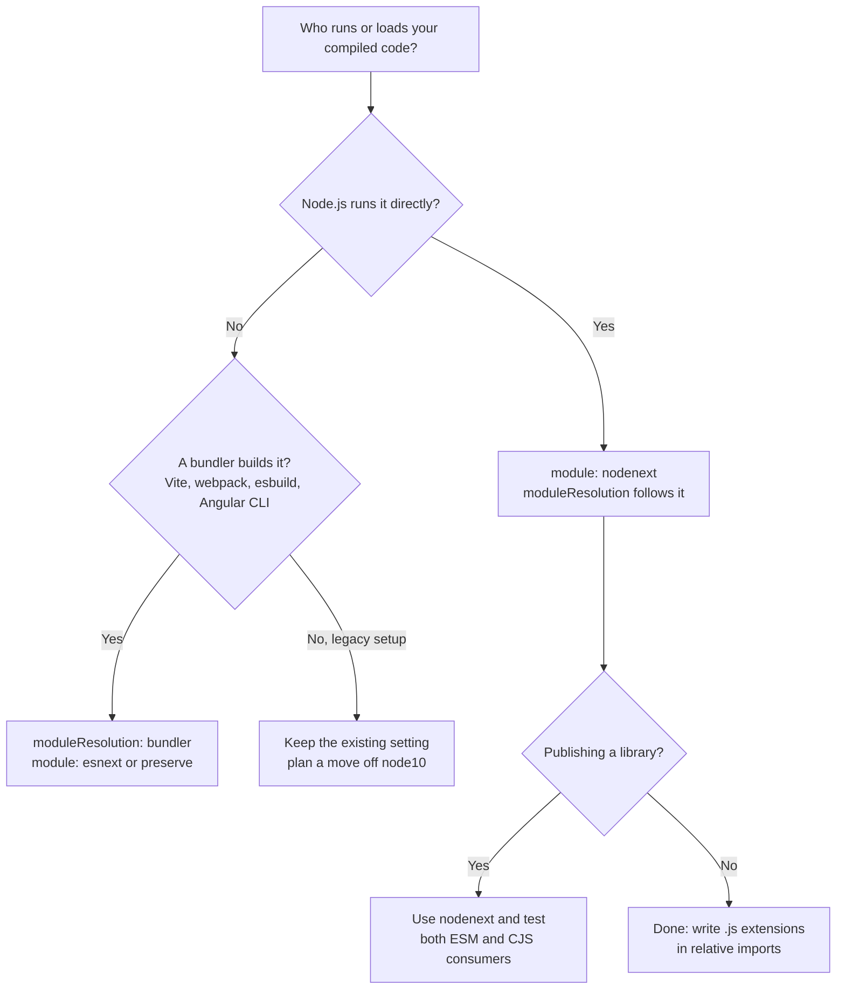
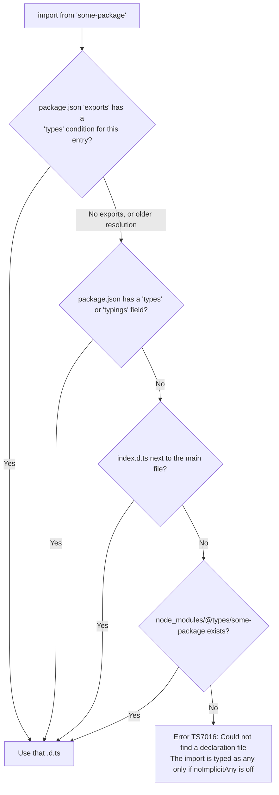
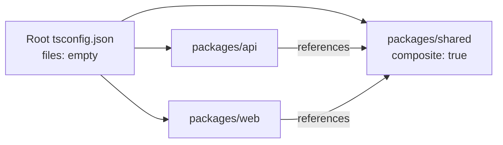

# Modules, Declaration Files and tsconfig

> In this document you will learn how TypeScript works with ES modules and CommonJS, how it finds the types of the packages you import, how to write `.d.ts` files and augment existing types (like `Window` or Express `Request`), and what every important `tsconfig.json` option really does. Interviewers use this topic to see whether you can set up and debug a real project, not just write types.

**Before this:** [Modules, ESM and CommonJS](../02-javascript/14-modules-esm-and-commonjs.md) · [TypeScript basics and types](01-typescript-basics-and-types.md) · **Interview questions:** [jump to the interview section](#interview-questions)

## Table of contents

1. [Modules in TypeScript](#modules-in-typescript)
2. [Import and export syntax](#import-and-export-syntax)
3. [Type-only imports and exports](#type-only-imports-and-exports)
4. [verbatimModuleSyntax and isolatedModules](#verbatimmodulesyntax-and-isolatedmodules)
5. [How TypeScript finds modules: module and moduleResolution](#how-typescript-finds-modules-module-and-moduleresolution)
6. [CommonJS interop and esModuleInterop](#commonjs-interop-and-esmoduleinterop)
7. [Namespaces vs modules](#namespaces-vs-modules)
8. [Declaration files](#declaration-files)
9. [Writing declarations for a JavaScript library](#writing-declarations-for-a-javascript-library)
10. [Module augmentation and global augmentation](#module-augmentation-and-global-augmentation)
11. [The tsconfig.json file](#the-tsconfigjson-file)
12. [Language and environment options](#language-and-environment-options)
13. [The strict family of flags](#the-strict-family-of-flags)
14. [Extra safety flags outside strict](#extra-safety-flags-outside-strict)
15. [Paths and output options](#paths-and-output-options)
16. [Large projects: incremental builds and project references](#large-projects-incremental-builds-and-project-references)
17. [Angular-specific configuration](#angular-specific-configuration)
18. [Recommended configurations](#recommended-configurations)
19. [Changes in TypeScript 6 and 7](#changes-in-typescript-6-and-7)
20. [Common mistakes](#common-mistakes)
21. [Best practices](#best-practices)
22. [How to explain this in an interview](#how-to-explain-this-in-an-interview)
23. [Interview questions](#interview-questions)
24. [Summary](#summary)
25. [References](#references)

---

## Modules in TypeScript

A **module** is a file with its own scope. Variables, functions and classes declared in it are private to that file unless you `export` them. Other files must `import` them.

TypeScript follows the JavaScript rules for modules (see [Modules, ESM and CommonJS](../02-javascript/14-modules-esm-and-commonjs.md) for the runtime details). It adds two things:

1. You can export and import **types** (interfaces, type aliases), not only values.
2. The compiler needs to know **which module system** your code runs in, so it can check imports correctly and emit the right JavaScript.

### Module or script?

TypeScript decides for each file whether it is a **module** or a **script**:

- If the file has a top-level `import` or `export`, it is a **module**. Its declarations are local.
- If it has neither, it is a **script**. Its top-level declarations go into the **global scope**, shared with every other script file in the project.

This causes a classic surprise:

```ts
// file: a.ts  (no import or export — this is a script)
const config = { debug: true };
```

```ts
// file: b.ts  (also a script)
const config = { debug: false }; // ❌ Error: Cannot redeclare block-scoped variable 'config'
```

Both files share one global scope, so the two `config` constants collide. The fix is to make each file a module. If a file has nothing to export, add an empty export:

```ts
// file: b.ts
const config = { debug: false };
export {}; // ✅ now this file is a module with its own scope
```

The `moduleDetection` option (TypeScript 4.7+) controls this. The default `"auto"` uses the rules above, plus Node.js rules (a `.mts` file, or a `.ts` file in a package with `"type": "module"`, is always a module). `"force"` treats every non-declaration file as a module. Many projects set `"moduleDetection": "force"` to avoid accidental globals.

### Why modules matter for types

Each module is a separate namespace for types too. Two files can both define `interface Options` without conflict. You share a type the same way you share a value: `export` it, then `import` it.

---

## Import and export syntax

TypeScript supports all standard ES module syntax.

```ts
// file: src/money.ts
export interface Money {
  amount: number;
  currency: "INR" | "USD" | "EUR";
}

export function formatMoney(value: Money): string {
  return new Intl.NumberFormat("en-IN", { style: "currency", currency: value.currency }).format(value.amount);
}

export const ZERO_INR: Money = { amount: 0, currency: "INR" };

export default class PriceCalculator {
  total(items: Money[]): number {
    return items.reduce((sum, item) => sum + item.amount, 0);
  }
}
```

```ts
// file: src/checkout.ts
import PriceCalculator, { formatMoney, ZERO_INR, type Money } from "./money.js"; // default + named
import * as money from "./money.js";                                           // namespace import

const calc = new PriceCalculator();
const items: Money[] = [{ amount: 499, currency: "INR" }, ZERO_INR];
console.log(formatMoney({ amount: calc.total(items), currency: "INR" })); // ₹499.00
console.log(money.ZERO_INR.amount);                                      // 0
```

Re-exports are common in "barrel" files (`index.ts`) that collect a folder's public API:

```ts
// file: src/index.ts
export { formatMoney, ZERO_INR } from "./money.js";
export type { Money } from "./money.js";
export * from "./tax.js";
export { default as PriceCalculator } from "./money.js";
```

Why `./money.js` and not `./money.ts`? With Node.js-style module settings (`node16`/`nodenext`), you write the path of the **output** file, because that is what Node.js will load at runtime. This is explained in [How TypeScript finds modules](#how-typescript-finds-modules-module-and-moduleresolution).

### Named vs default exports

| | Named exports | Default export |
| --- | --- | --- |
| Name at import site | Fixed (rename with `as`) | Any name the importer chooses |
| Refactoring and search | Easy: same name everywhere | Harder: each file may use a different name |
| Auto-import in editors | Reliable | Less reliable |
| Tree shaking | Works well | Works, but default-exporting a big object hurts it |

Many teams prefer **named exports** for consistency. Angular code uses named exports almost everywhere.

### CommonJS-specific syntax: `export =` and `import = require()`

Old CommonJS libraries often replace `module.exports` with a single function or class. TypeScript describes this with `export =`:

```ts
// A declaration for a CommonJS module that does: module.exports = createSlug;
declare function createSlug(text: string): string;
export = createSlug;
```

To import such a module in a CommonJS TypeScript file without interop help, you use the TypeScript-specific syntax:

```ts
import createSlug = require("create-slug");
```

With `esModuleInterop` enabled, you can usually write the normal `import createSlug from "create-slug"` instead. See [CommonJS interop](#commonjs-interop-and-esmoduleinterop).

---

## Type-only imports and exports

### Import elision

By default, TypeScript **removes** an import from the JavaScript output if you only used it as a type. This is called **import elision**.

```ts
// file: src/app.ts
import { User } from "./types.js";  // used only as a type
import { add } from "./math.js";    // used as a value
import "./polyfills.js";            // side-effect import

const user: User = { id: "1", name: "Asha" };
console.log(add(1, 2), user);
```

Emitted JavaScript (checked with `tsc --module nodenext`):

```js
import { add } from "./math.js";
import "./polyfills.js";
const user = { id: "1", name: "Asha" };
console.log(add(1, 2), user);
```

The `User` import disappeared because interfaces do not exist at runtime. Side-effect imports (`import "./x.js"`) are always kept.

Elision is convenient, but it has problems:

- Tools that compile **one file at a time** (Babel, esbuild, swc, Vite) cannot always tell whether `User` is a type or a value, because they do not read `types.ts`.
- If `types.ts` has side effects (code that runs on import), eliding the import silently skips that code.

### `import type` and `export type`

**Type-only imports** (TypeScript 3.8+) make the intent explicit. They are always removed from the output.

```ts
import type { User, Role } from "./types.js";     // whole import is type-only
import { createUser, type UserPatch } from "./users.js"; // inline type modifier (TS 4.5+)

export type { User };                              // type-only re-export
```

Rules:

- A name imported with `import type` can be used only in type positions. Using it as a value (`new User()`) is an error.
- You **can** use a type-only imported class in a type position (`let u: UserService`), but not as a value.
- `import type` stops the module from being loaded at runtime — useful for breaking runtime import cycles that exist only because of types.

---

## verbatimModuleSyntax and isolatedModules

### isolatedModules

`isolatedModules: true` tells TypeScript: "Warn me about code that a **single-file transpiler** cannot handle." Such tools include Babel, esbuild, swc and Vite's transforms (which use esbuild). The check reports, for example:

- Re-exporting a type without `export type` — a single-file tool cannot know if it is a type and would keep a broken runtime export.
- Using `const enum` values declared in other files (ambient const enums), which need cross-file information to inline.

```ts
// file: src/index.ts  (with "isolatedModules": true)
export { User } from "./types.js";
// ❌ Error TS1205: Re-exporting a type when 'isolatedModules' is enabled requires using 'export type'.

export type { User } from "./types.js"; // ✅
```

Turn it on whenever another tool transpiles your TypeScript (Vite, esbuild, Babel, Jest with babel or swc, Node.js type stripping).

### verbatimModuleSyntax (TypeScript 5.0+)

`verbatimModuleSyntax: true` gives a very simple rule: **what you write is what you get**.

- Imports and exports **without** the `type` modifier are kept in the output, exactly as written.
- Imports and exports **with** `type` are removed completely.
- There is no guessing (no import elision).

```ts
// With "verbatimModuleSyntax": true
import { User } from "./types.js";
// ❌ Error TS1484: 'User' is a type and must be imported using a type-only import
//    when 'verbatimModuleSyntax' is enabled.

import type { User } from "./types.js"; // ✅ removed from output
import { add } from "./math.js";        // ✅ kept in output
```

It replaces two older flags, `importsNotUsedAsValues` and `preserveValueImports`, which were deprecated in TypeScript 5.0. It also covers what `isolatedModules` checks for imports and exports.

**One important consequence:** because ESM syntax is kept "verbatim", you cannot write `import`/`export` in a file that TypeScript will emit as **CommonJS**. You get errors like TS1295 ("ECMAScript imports and exports cannot be written in a CommonJS file under 'verbatimModuleSyntax'"). So `verbatimModuleSyntax` fits projects that output ES modules (modern Node.js ESM, bundlers, Node.js type stripping). For a CommonJS output project, either leave it off or use `import x = require()` syntax.

| Flag | What it does | Use when |
| --- | --- | --- |
| `isolatedModules` | Reports code that single-file transpilers cannot compile safely | Any project where Babel/esbuild/swc/Vite compiles your TS |
| `verbatimModuleSyntax` | Keeps non-type imports exactly, removes `type` imports, no elision | ESM projects; recommended for new code |

---

## How TypeScript finds modules: module and moduleResolution

Two options work together:

- **`module`** — which module system the output JavaScript uses (and, for Node.js modes, which rules apply to each file).
- **`moduleResolution`** — the algorithm the compiler uses to find the file behind an import like `"./user.js"` or `"express"`.

The golden rule: **these settings must describe how your code really runs.** If TypeScript resolves imports differently from Node.js or your bundler, you get code that compiles but fails at runtime — or errors on code that would run fine.

### The main choices

| Setting | Use it for | Key rules |
| --- | --- | --- |
| `"module": "nodenext"` (resolution follows automatically) | Code that Node.js runs directly (backend, CLI, libraries) | Follows Node.js exactly: ESM vs CJS per file, relative imports need extensions in ESM, respects `package.json` `"exports"` |
| `"module": "node16"` / `"node18"` / `"node20"` | Same, but pinned to a specific Node.js behavior | `node18` added in TS 5.8, `node20` in TS 5.9; `nodenext` follows the newest |
| `"moduleResolution": "bundler"` with `"module": "esnext"` (TS 5.0+), or `"module": "preserve"` (TS 5.4+) | Code processed by a bundler: Vite, webpack, esbuild, Angular CLI (newer versions) | Extensionless relative imports allowed, `"exports"` supported, no ESM/CJS file-format rules |
| `"moduleResolution": "node10"` (old name `"node"`) | Legacy projects (for example Angular 16 CLI defaults) | Old Node.js CommonJS algorithm. Ignores `"exports"`. Deprecated in TypeScript 6.0 |
| `"module": "commonjs"` | Older Node.js projects that emit CommonJS | Emits `require`/`module.exports` |



### `nodenext` in detail

With `"module": "nodenext"`, TypeScript decides **per file** whether it is ESM or CommonJS, exactly like Node.js does:

| File | Format |
| --- | --- |
| `.mts` | Always ESM (emits `.mjs`) |
| `.cts` | Always CommonJS (emits `.cjs`) |
| `.ts` in a package with `"type": "module"` | ESM (emits `.js`) |
| `.ts` in a package without `"type"` or with `"type": "commonjs"` | CommonJS (emits `.js`) |

In **ESM files**, relative imports must include the file extension of the **output** file, because Node.js ESM does not guess extensions:

```ts
// file: src/server.ts in a "type": "module" package
import { add } from "./math";
// ❌ Error TS2835: Relative import paths need explicit file extensions in ECMAScript imports
//    when '--moduleResolution' is 'node16' or 'nodenext'. Did you mean './math.js'?

import { add } from "./math.js"; // ✅ TypeScript maps "./math.js" to "./math.ts" while type-checking
```

Writing `.js` for a file that is `.ts` on disk feels strange at first. Remember: TypeScript does not rewrite import paths by default. The path you write is the path Node.js will load from the compiled output folder.

`nodenext` also reads the `"exports"` field of packages, so you can only import the entry points a package really exposes, and it picks the `"types"` condition for each one.

### Running `.ts` files directly in Node.js

Node.js 22.18+ and 23.6+ can run `.ts` files directly by **stripping types** (it became stable in Node.js 24.12 and 25.2). It does not type-check and does not read `tsconfig.json`. It only supports "erasable" syntax: no `enum`, no namespaces with runtime code, no parameter properties, and no decorators. Imports must use the real `.ts` extension, and type-only imports must use `import type`. The Node.js documentation recommends this config (TypeScript 5.8+) so `tsc` checks the same rules:

```json
{
  "compilerOptions": {
    "noEmit": true,
    "target": "esnext",
    "module": "nodenext",
    "rewriteRelativeImportExtensions": true,
    "erasableSyntaxOnly": true,
    "verbatimModuleSyntax": true
  }
}
```

- `rewriteRelativeImportExtensions` (TS 5.7) lets you write `./math.ts` and rewrites it to `./math.js` if you also emit JavaScript.
- `erasableSyntaxOnly` (TS 5.8) reports TypeScript-only syntax that cannot simply be erased.
- `allowImportingTsExtensions` (TS 5.0) allows `.ts` in import paths when you do not emit (`noEmit`), or together with `rewriteRelativeImportExtensions`.

### `bundler` in detail

`"moduleResolution": "bundler"` models tools like Vite and webpack:

- Relative imports **without** extensions are allowed (`import { add } from "./math"`).
- `package.json` `"exports"` and `"imports"` fields are supported.
- There are no per-file ESM/CJS rules, because the bundler handles that.

Use it only when a bundler really processes the code. If you use `bundler` for a Node.js backend, TypeScript accepts extensionless imports that Node.js ESM will reject at runtime.

---

## CommonJS interop and esModuleInterop

ES modules have a `default` export. CommonJS has `module.exports`, which can be any value — often a function. When ESM code imports a CommonJS module, someone must decide what "the default export" means.

```js
// node_modules/express/index.js (CommonJS, simplified)
module.exports = function express() { /* ... */ };
```

```ts
import express from "express"; // what is "default" here?
```

### What `esModuleInterop` does

Without `esModuleInterop`, TypeScript treats `import express from "express"` as reading `module.exports.default`, which does not exist. It reports error **TS1259**: "Module can only be default-imported using the 'esModuleInterop' flag". You would have to write `import * as express from "express"`, which is technically wrong for a function export.

With `"esModuleInterop": true`:

1. Type-checking: you may default-import a CommonJS module. (This part is `allowSyntheticDefaultImports`, which `esModuleInterop` turns on.)
2. Emit: when the output is CommonJS, TypeScript adds small helper functions (`__importDefault`, `__importStar`) that wrap `module.exports` so `default` points to it. This matches how Node.js ESM and bundlers behave.

```js
// Emitted CommonJS for:  import express from "express";  (simplified)
const express_1 = __importDefault(require("express"));
const app = (0, express_1.default)();
```

Today `esModuleInterop` should always be on. `tsc --init` enables it, `module: "preserve"` implies it, and TypeScript 6.0 no longer allows setting it to `false`.

### importHelpers and tslib

Those helpers are copied into **every** output file that needs them. `"importHelpers": true` imports them from the `tslib` package instead, which keeps output smaller. Angular CLI projects enable `importHelpers`.

---

## Namespaces vs modules

A **namespace** is a TypeScript-only way to group code under a name. It is older than ES modules. Earlier TypeScript called it an "internal module".

```ts
namespace Geometry {
  export interface Point { x: number; y: number }

  export function distance(a: Point, b: Point): number {
    return Math.hypot(a.x - b.x, a.y - b.y);
  }
}

console.log(Geometry.distance({ x: 0, y: 0 }, { x: 3, y: 4 })); // 5
```

A namespace with values compiles to an IIFE that builds an object:

```js
var Geometry;
(function (Geometry) {
    function distance(a, b) {
        return Math.hypot(a.x - b.x, a.y - b.y);
    }
    Geometry.distance = distance;
})(Geometry || (Geometry = {}));
```

### Why modules won

| | ES modules | Namespaces |
| --- | --- | --- |
| Standard | JavaScript standard | TypeScript only |
| Dependencies | Explicit `import` | Implicit, through global names and load order |
| Tree shaking | Yes | Poor (one big object) |
| Bundlers, Node.js | Native support | Needs TypeScript to emit code |
| Node.js type stripping, `erasableSyntaxOnly` | Supported | Not supported if they contain values |

**Rule:** use ES modules for all application code.

### Where namespaces still appear

- **Declaration files** for global libraries and for grouping types: `declare namespace Express { interface Request { ... } }`.
- **Declaration merging**: a function or class plus a namespace with the same name, to add static properties in a `.d.ts`.
- **Old codebases.**

Type-only namespaces (containing only interfaces and types) produce no JavaScript, so they are fine in `.d.ts` files.

---

## Declaration files

### What a `.d.ts` file is

A **declaration file** (`.d.ts`) contains only **types** — no runtime code. It describes the shape of JavaScript that exists somewhere else.

```ts
// file: price-utils.d.ts
export declare function applyDiscount(price: number, percent: number): number;
export declare const DEFAULT_CURRENCY: string;
export interface PriceOptions { round?: boolean }
```

The word `declare` means "this exists at runtime, trust me; do not generate code for it".

**Important:** a declaration file is a **promise**, not an implementation. If the `.d.ts` says a function exists and the JavaScript does not have it, TypeScript is happy and your app crashes at runtime.

### Where declaration files come from

1. **Generated by `tsc`.** With `"declaration": true`, the compiler writes a `.d.ts` next to each `.js` file. Libraries written in TypeScript ship these.
2. **Bundled with a JavaScript package.** The package author writes `index.d.ts` by hand and points to it in `package.json`.
3. **DefinitelyTyped (`@types/*`).** A large community repository of declaration files for packages that do not ship their own types. You install them as dev dependencies: `npm install -D @types/express`.
4. **Built into TypeScript.** The `lib.*.d.ts` files describe JavaScript built-ins (`Array`, `Promise`) and browser APIs (`document`, `fetch`). The `lib` option chooses which ones you get.
5. **Written by you**, for untyped packages, global variables or file types like `*.svg`.

### How TypeScript finds the types for `import ... from "some-package"`



### The `types` and `typeRoots` options

`@types` packages that describe **globals** (like `@types/node` adding `process`, or `@types/jest` adding `describe`) are included automatically in TypeScript 5.x: every package in `node_modules/@types` is loaded.

- `"types": ["node"]` limits automatic inclusion to the listed packages. This is useful to keep test globals (`describe`, `it`) out of application code. Angular CLI uses this: `tsconfig.app.json` has `"types": []` and `tsconfig.spec.json` has `"types": ["jasmine"]`.
- `typeRoots` changes the folders searched for global type packages. You rarely need it.
- In **TypeScript 6.0**, the default for `types` became `[]`, so you must list global type packages explicitly (`"types": ["node"]`).

Note that `types` only affects **automatic global inclusion**. `import express from "express"` still finds `@types/express` because you imported it.

### skipLibCheck

`"skipLibCheck": true` skips type-checking **all** `.d.ts` files (yours and those in `node_modules`). Benefits: faster builds, and no errors from conflicting third-party declarations (for example two packages that declare the same global differently). Cost: real mistakes in your own `.d.ts` files are not reported. Most applications enable it. Libraries that publish declaration files should run a check without it at least in CI.

---

## Writing declarations for a JavaScript library

Imagine your company has an old internal JavaScript package with no types:

```js
// node_modules/legacy-pricing/index.js  (CommonJS)
function applyDiscount(price, percent) {
  return Math.round(price * (1 - percent / 100));
}
function formatPrice(amount, options) {
  const currency = (options && options.currency) || "INR";
  return currency + " " + amount.toFixed(2);
}
module.exports = { applyDiscount, formatPrice, VERSION: "2.1.0" };
```

When you import it in strict mode, you get **TS7016: Could not find a declaration file for module 'legacy-pricing'**. You have four options, from quickest to best.

### Option 1: shorthand ambient module (quick escape)

```ts
// file: src/types/legacy-pricing.d.ts
declare module "legacy-pricing";
```

Everything imported from it is `any`. The error disappears, but you get no safety. Use it only as a temporary step.

### Option 2: a real ambient module declaration

```ts
// file: src/types/legacy-pricing.d.ts
declare module "legacy-pricing" {
  export interface FormatOptions {
    currency?: "INR" | "USD" | "EUR";
  }
  export function applyDiscount(price: number, percent: number): number;
  export function formatPrice(amount: number, options?: FormatOptions): string;
  export const VERSION: string;
}
```

```ts
// file: src/cart.ts
import { applyDiscount, formatPrice } from "legacy-pricing";

const price = applyDiscount(1000, 15);               // number
console.log(formatPrice(price, { currency: "INR" })); // INR 850.00
// formatPrice("850");                                // ❌ Error: string is not assignable to number
```

How to write good declarations:

1. Read the JavaScript source, not only the README. Types must describe **real behavior**.
2. Mark parameters optional (`?`) only if the code really handles them missing.
3. Use literal unions for known string values (`"INR" | "USD"`).
4. Return `T | null` or `T | undefined` honestly if the function can return nothing.
5. Make sure the file is included by `tsconfig.json` (`include: ["src"]` covers `src/types`).

### Option 3: a declaration file next to the JavaScript

If you own the package, put `index.d.ts` next to `index.js` and reference it from `package.json`:

```json
{
  "name": "legacy-pricing",
  "main": "index.js",
  "types": "index.d.ts",
  "exports": {
    ".": {
      "types": "./index.d.ts",
      "default": "./index.js"
    }
  }
}
```

Inside the package's own `index.d.ts`, you write top-level `export declare ...` statements without the `declare module "..."` wrapper:

```ts
// file: node_modules/legacy-pricing/index.d.ts
export interface FormatOptions { currency?: "INR" | "USD" | "EUR" }
export declare function applyDiscount(price: number, percent: number): number;
export declare function formatPrice(amount: number, options?: FormatOptions): string;
export declare const VERSION: string;
```

In `"exports"`, the `"types"` condition must come **first**, because conditions are matched in order.

### Option 4: JSDoc types in the JavaScript itself

TypeScript can read JSDoc comments in `.js` files. With `allowJs` + `checkJs` (or `// @ts-check` at the top of a file), and `declaration: true`, `tsc` can even **generate** `.d.ts` files from JavaScript:

```js
// @ts-check

/**
 * @param {number} price
 * @param {number} percent
 * @returns {number}
 */
function applyDiscount(price, percent) {
  return Math.round(price * (1 - percent / 100));
}
```

This is a great migration path. See [TypeScript in real projects](12-typescript-in-real-projects.md#migrating-from-javascript-to-typescript).

### Wildcard module declarations for non-code files

Bundlers let you import images, styles or JSON files. TypeScript needs to know what such an import returns:

```ts
// file: src/types/assets.d.ts
declare module "*.svg" {
  const url: string;
  export default url;
}

declare module "*.module.css" {
  const classes: Record<string, string>;
  export default classes;
}
```

```ts
import logoUrl from "./logo.svg"; // string
```

For JSON files, prefer the built-in `"resolveJsonModule": true`, which gives you the real type of the JSON content.

### Contributing to DefinitelyTyped

If a popular open-source package has no types, check `npm view @types/<name>` first. If none exist, you can contribute declarations to the DefinitelyTyped repository on GitHub, which publishes them as `@types/<name>`.

---

## Module augmentation and global augmentation

Sometimes a type from a library or from the platform is **almost** right, but your app adds something to it. TypeScript lets you **add** members to existing interfaces through **declaration merging**: two `interface` declarations with the same name in the same scope merge into one.

### Global augmentation: extending `Window`

Your app loads an analytics script that adds `window.analytics`. TypeScript does not know about it:

```ts
// file: src/types/window.d.ts
export {}; // make this file a module so `declare global` is allowed

declare global {
  interface Window {
    analytics: {
      track(event: string, props?: Record<string, unknown>): void;
    };
  }

  // A global constant injected by the build tool (for example webpack DefinePlugin)
  var APP_VERSION: string;
}
```

```ts
// anywhere in the app
window.analytics.track("checkout_started", { items: 3 }); // ✅ typed
console.log(globalThis.APP_VERSION);
```

Why `export {}`? `declare global { ... }` is only allowed inside a module. In a script file (no imports or exports), you could write `interface Window { ... }` directly at the top level, because a script's declarations are already global.

Remember: the declaration does not **create** `window.analytics`. If the script fails to load, the code still crashes. For optional globals, type them as optional (`analytics?: ...`) and check before use.

### Module augmentation: extending Express `Request`

An authentication middleware attaches the logged-in user to the request. You want `req.user` to be typed in every route handler.

```ts
// file: src/types/express.d.ts
import "express"; // makes this file a module that refers to Express types

declare global {
  namespace Express {
    interface Request {
      user?: { id: string; roles: string[] };
      requestId: string;
    }
  }
}
```

```ts
// file: src/server.ts
import express, { type Request, type Response, type NextFunction } from "express";

const app = express();

app.use((req: Request, _res: Response, next: NextFunction) => {
  req.requestId = crypto.randomUUID(); // ✅ known property
  next();
});

app.get("/me", (req, res) => {
  if (!req.user) return res.status(401).json({ error: "Not logged in" });
  res.json({ id: req.user.id, requestId: req.requestId }); // ✅ typed
});
```

This works because `@types/express` defines its `Request` interface as extending a global `Express.Request` interface, exactly so applications can merge into it. (Checked against `@types/express` 5.)

Another way is **module augmentation** of the package that really declares the interface:

```ts
// file: src/types/express-augment.d.ts
import "express-serve-static-core";

declare module "express-serve-static-core" {
  interface Request {
    tenantId?: string;
  }
}
```

The rules of module augmentation:

- The file must be a module (it has an `import` or `export`).
- `declare module "x"` inside a module **augments** the existing module `"x"`. (In a script file, it would **declare** a brand-new ambient module instead.)
- You can add new members to existing interfaces and namespaces. You cannot add new top-level exports to the module, and you cannot change the type of an existing member.

### Typing `process.env`

`@types/node` declares `process.env` as `NodeJS.ProcessEnv`, a dictionary of `string | undefined`. You can augment it to document expected variables:

```ts
// file: src/types/env.d.ts
export {};

declare global {
  namespace NodeJS {
    interface ProcessEnv {
      NODE_ENV?: "development" | "production" | "test";
      DATABASE_URL?: string;
    }
  }
}
```

This only improves autocomplete. It does **not** guarantee the variables exist. Validate the environment at startup with a schema; see [Runtime validation and type-safe APIs](11-runtime-validation-and-type-safe-apis.md).

### Declaration merging in a nutshell

| Can merge | Example |
| --- | --- |
| interface + interface | Two `interface User` declarations become one |
| namespace + namespace | Members are combined |
| namespace + function/class/enum | Adds static members in declarations |
| `type` alias | **Cannot** merge — a second `type User` is a duplicate identifier error |

This is one of the main practical differences between `interface` and `type`. See [Interfaces and type aliases](02-interfaces-and-type-aliases.md).

---

## The tsconfig.json file

`tsconfig.json` marks the root of a TypeScript project and tells the compiler **which files** to check and **how**. Running `tsc` with no file arguments uses the `tsconfig.json` in the current folder. `tsc -p path/to/tsconfig.json` uses a specific one.

### The top-level structure

```json
{
  "extends": "./tsconfig.base.json",
  "compilerOptions": {
    "strict": true
  },
  "include": ["src/**/*"],
  "exclude": ["src/**/*.spec.ts"],
  "files": [],
  "references": [{ "path": "../shared" }]
}
```

| Key | Meaning |
| --- | --- |
| `compilerOptions` | How to check and emit |
| `include` | Glob patterns of files to include (default: everything under the folder) |
| `exclude` | Patterns to remove from `include`. It does **not** stop a file from being compiled if another included file imports it |
| `files` | An exact list of files (rarely used in apps) |
| `extends` | Inherit options from another config file or an npm package (for example `@tsconfig/node22`) |
| `references` | Other TypeScript projects this one depends on (project references) |

A common misunderstanding: `exclude: ["node_modules"]` does not mean "never type-check anything from `node_modules`". If your code imports a package, its types are still loaded. `exclude` only changes which files are **root files** of the program.

### `tsc` vs `tsc file.ts`

If you pass file names on the command line (`tsc src/index.ts`), TypeScript 5.x **ignores** `tsconfig.json` and uses default options. This is a common source of "it works in my editor but not in CI" confusion. In TypeScript 6.0 this became an error (TS5112) when a `tsconfig.json` is present. Use `tsc -p tsconfig.json` (or just `tsc`) in scripts.

### A full annotated example (Node.js 22/24 backend, ESM)

```json
{
  "compilerOptions": {
    /* Language and environment */
    "target": "es2023",                 // JS syntax level of the output
    "lib": ["es2023"],                  // built-in APIs you may use (no DOM on a server)
    "types": ["node"],                  // global types to include

    /* Modules */
    "module": "nodenext",               // follow Node.js ESM/CJS rules
    "moduleDetection": "force",         // every file is a module
    "verbatimModuleSyntax": true,       // explicit `import type`
    "resolveJsonModule": true,          // allow importing .json with real types

    /* Type checking */
    "strict": true,
    "noUncheckedIndexedAccess": true,
    "exactOptionalPropertyTypes": true,
    "noImplicitOverride": true,
    "noImplicitReturns": true,
    "noFallthroughCasesInSwitch": true,

    /* Emit */
    "rootDir": "src",
    "outDir": "dist",
    "sourceMap": true,
    "declaration": false,
    "noEmitOnError": true,

    /* Interop and tooling */
    "esModuleInterop": true,
    "forceConsistentCasingInFileNames": true,
    "skipLibCheck": true,
    "isolatedModules": true,
    "incremental": true
  },
  "include": ["src"]
}
```

(JSON in `tsconfig.json` may contain comments and trailing commas; the TypeScript compiler accepts them.)

The following sections explain these options in groups.

---

## Language and environment options

### target

`target` sets the **JavaScript syntax level** of the output. TypeScript **downlevels** newer syntax for older targets: for example, with `"target": "es2017"`, optional chaining `a?.b` is rewritten to an older form.

```ts
declare const user: { address?: { city?: string } } | undefined;

const city = user?.address?.city ?? "Unknown";
```

- `"target": "es2020"` or newer: emitted almost unchanged.
- `"target": "es2017"`: rewritten with temporary variables and `=== null || === void 0` checks.

What `target` does **not** do: it does not add **polyfills**. If you target `es2015` and call `Array.prototype.at()` (ES2022), TypeScript will not add an implementation. Older runtimes will crash. Polyfills come from tools like core-js, not from TypeScript.

Choose the oldest runtime you support: Node.js 22 supports ES2023+ well, and modern browsers support ES2022+. TypeScript 5.x defaults to `ES5` if you do not set it; TypeScript 6.0 changed the default to the latest version and deprecated `es5`.

### lib

`lib` decides which **built-in type declarations** are available: `es2022` gives `Array.prototype.at`, `dom` gives `document` and `fetch`, `webworker` gives worker globals.

- If you do not set `lib`, TypeScript picks a default based on `target` (and includes `dom`).
- A Node.js backend should usually **omit** `dom`, so using `document` or `window` by accident is an error.
- Like `target`, `lib` only describes APIs. Adding `"es2023"` to `lib` does not make `Array.prototype.toSorted` exist in an old runtime.

### useDefineForClassFields

This flag controls how class fields are emitted. With `true` (the default when `target` is ES2022 or newer), fields use the standard JavaScript `[[Define]]` semantics. With `false`, fields are emitted as assignments in the constructor (the old TypeScript behavior). The difference matters for legacy decorators and for fields that redeclare base-class properties. Angular 16 projects set it to `false`. See [Decorators](10-decorators.md).

### jsx

For React and other JSX code: `"jsx": "react-jsx"` uses the modern automatic runtime (no `import React` needed in each file). `"preserve"` leaves JSX for another tool (for example Vite or Next.js) to transform.

---

## The strict family of flags

`"strict": true` turns on a group of type-checking flags. New flags may be added to the group in future versions. You can turn on `strict` and then disable one flag (for example during migration):

```json
{ "compilerOptions": { "strict": true, "strictPropertyInitialization": false } }
```

Here is every flag in the group, with an example of what it catches.

### noImplicitAny

Reports variables and parameters whose type would silently become `any`.

```ts
// ❌ Error TS7006: Parameter 'message' implicitly has an 'any' type.
function log(message) {
  console.log(message);
}

// ✅ Correct
function logTyped(message: string) {
  console.log(message);
}
```

Without it, a missing annotation turns off checking for that value, and mistakes spread silently.

### strictNullChecks

Makes `null` and `undefined` separate types. Without it, they are allowed everywhere, so the compiler cannot warn you about "cannot read property of undefined".

```ts
// ❌ Error TS2322: Type 'null' is not assignable to type 'string'.
let username: string = null;

function findUser(id: number): { name: string } | undefined {
  return id === 1 ? { name: "Asha" } : undefined;
}

const user = findUser(2);
// console.log(user.name);  // ❌ Error: 'user' is possibly 'undefined'
console.log(user?.name);    // ✅ undefined
```

This is the single most valuable flag. The [basics document](01-typescript-basics-and-types.md) covers it in more detail.

### strictFunctionTypes

Checks function **parameter** types correctly (contravariantly) when assigning one function type to another.

```ts
function handleMouse(e: MouseEvent) {
  console.log(e.clientX);
}

// ❌ Error: '(e: MouseEvent) => void' is not assignable to '(e: Event) => void'.
const handler: (e: Event) => void = handleMouse;
```

Why is this an error? `handler` promises it can accept **any** `Event`. If someone calls it with a `KeyboardEvent`, `handleMouse` would read `clientX`, which does not exist. Without the flag, TypeScript allowed this (bivariant checking).

Note: this flag applies to function **type properties** and function types. Parameters of **method** declarations (`method(e: Event): void` in an interface) are still checked bivariantly for compatibility with existing code.

### strictBindCallApply

Type-checks `fn.call`, `fn.apply` and `fn.bind` arguments.

```ts
function sum(a: number, b: number) {
  return a + b;
}

// ❌ Error TS2345: Argument of type 'string' is not assignable to parameter of type 'number'.
sum.call(null, 1, "2");
```

Without it, `call`/`apply`/`bind` accept anything and return `any`.

### strictPropertyInitialization

Requires class properties to be initialized in the declaration or in the constructor. It needs `strictNullChecks`.

```ts
class Cart {
  // ❌ Error TS2564: Property 'total' has no initializer and is not definitely assigned in the constructor.
  total: number;
}

class FixedCart {
  total = 0;                    // ✅ initializer
  items: string[];
  owner?: string;               // ✅ optional
  createdBy!: string;           // ✅ definite assignment assertion: "set by someone else"

  constructor() {
    this.items = [];            // ✅ assigned in constructor
  }
}
```

The `!` assertion is common in Angular for properties set by the framework later (for example `@ViewChild` results or `@Input` values), but each `!` is a promise the compiler cannot check. In Angular 16 you can also mark inputs as required with `@Input({ required: true })`.

### noImplicitThis

Reports `this` expressions whose type would be `any`.

```ts
const counter = {
  count: 0,
  increment: function () {
    return function () {
      // ❌ Error TS2683: 'this' implicitly has type 'any' because it does not have a type annotation.
      return this.count;
    };
  },
};
```

The inner `function` has its own `this`, which is not `counter`. The flag catches this classic bug. Use an arrow function or an explicit `this` parameter.

### useUnknownInCatchVariables (TypeScript 4.4+)

Types the variable in `catch (err)` as `unknown` instead of `any`.

```ts
try {
  JSON.parse("{bad json");
} catch (err) {
  // console.log(err.message);  // ❌ Error TS18046: 'err' is of type 'unknown'.
  if (err instanceof Error) {
    console.log(err.message);   // ✅ narrowed
  }
}
```

JavaScript can `throw` any value (a string, a number, `undefined`), so `unknown` is the honest type. More patterns are in [TypeScript in real projects](12-typescript-in-real-projects.md).

### alwaysStrict

Parses every file in JavaScript strict mode and emits `"use strict"` in non-module output. ES modules are always strict anyway. TypeScript 6.0 deprecated setting it to `false`.

### strictBuiltinIteratorReturn (TypeScript 5.6+)

Gives built-in iterators a precise "done" value type (`undefined`) instead of `any`.

```ts
const it = ["a", "b"][Symbol.iterator]();
// ❌ Error: Type 'string | undefined' is not assignable to type 'string'.
const first: string = it.next().value;
```

When the iterator is finished, `value` is `undefined`. Before this flag, the type was `string | any`, which is just `any`, so the mistake was hidden.

### Summary table

| Flag | Catches | Since |
| --- | --- | --- |
| `noImplicitAny` | Values that silently become `any` | 1.x |
| `strictNullChecks` | Using possibly `null`/`undefined` values | 2.0 |
| `strictFunctionTypes` | Unsafe function parameter assignments | 2.6 |
| `strictBindCallApply` | Wrong arguments to `call`/`apply`/`bind` | 3.2 |
| `strictPropertyInitialization` | Class fields that are never set | 2.7 |
| `noImplicitThis` | `this` of type `any` | 2.0 |
| `useUnknownInCatchVariables` | Unsafe use of caught errors | 4.4 |
| `alwaysStrict` | Non-strict JavaScript | 2.1 |
| `strictBuiltinIteratorReturn` | `any` from finished built-in iterators | 5.6 |

---

## Extra safety flags outside strict

These flags are **not** part of `strict`. You opt in one by one. Each was checked with TypeScript 5.9.

### noUncheckedIndexedAccess (TypeScript 4.1+)

Adds `| undefined` to reads through an index signature or array index, because the key may not exist.

```ts
const scores: Record<string, number> = { asha: 10 };
const list = [1, 2, 3];

// With noUncheckedIndexedAccess:
// const s: number = scores["ravi"]; // ❌ Error: 'number | undefined' is not assignable to 'number'
// const n: number = list[5];        // ❌ Error: same

const s = scores["ravi"] ?? 0; // ✅ handle the missing case
for (const value of list) {
  console.log(value); // ✅ for...of gives number, not number | undefined
}
```

It catches many real bugs (missing dictionary keys, out-of-range indexes). The cost is extra checks in code that already knows the index is valid. Many teams accept that cost for new projects.

### exactOptionalPropertyTypes (TypeScript 4.4+)

Makes `prop?: string` mean "the property may be **missing**" — not "it may be `undefined`".

```ts
interface Profile {
  nickname?: string;
}

// With exactOptionalPropertyTypes:
// const p: Profile = { nickname: undefined };
// ❌ Error TS2375: Type '{ nickname: undefined; }' is not assignable to type 'Profile'
//    with 'exactOptionalPropertyTypes: true'.

const ok1: Profile = {};                  // ✅ missing
const ok2: Profile = { nickname: "Ash" }; // ✅
```

Why it matters: `"nickname" in profile`, `Object.keys`, object spread and JSON all treat "missing" and "present but `undefined`" differently. For example `{ ...defaults, ...{ port: undefined } }` overwrites the default with `undefined`. If you really want to allow `undefined`, write `nickname?: string | undefined`.

### noImplicitOverride (TypeScript 4.3+)

Requires the `override` keyword when a method overrides a base class method. It catches renamed or removed base methods.

```ts
class BaseRepository {
  save() { /* ... */ }
}

class UserRepository extends BaseRepository {
  // ❌ Error TS4114: This member must have an 'override' modifier because it overrides
  //    a member in the base class 'BaseRepository'.
  // save() {}

  override save() { /* ... */ } // ✅
}
```

Angular 16 strict projects enable it.

### noImplicitReturns

Reports functions where some code paths return a value and others do not.

```ts
// ❌ Error TS7030: Not all code paths return a value.
function statusText(code: number) {
  if (code === 200) return "OK";
}
```

### noFallthroughCasesInSwitch

Reports a non-empty `case` that falls into the next one without `break` or `return`.

```ts
function handle(action: "save" | "delete") {
  switch (action) {
    case "save":
      console.log("saving");
      // ❌ Error TS7029: Fallthrough case in switch.
    case "delete":
      console.log("deleting");
      break;
  }
}
```

### noPropertyAccessFromIndexSignature (TypeScript 4.2+)

Forces bracket syntax for properties that come from an index signature, so dot syntax clearly means "a declared property".

```ts
interface Env {
  [key: string]: string | undefined;
}
declare const env: Env;

// const port = env.PORT;   // ❌ Error TS4111: Property 'PORT' comes from an index signature,
//                          //    so it must be accessed with ['PORT'].
const port = env["PORT"];   // ✅ signals "may not exist"
```

Angular 16 strict projects enable it, which is why Angular code often uses `params['id']`.

### noUnusedLocals and noUnusedParameters

Report unused variables and parameters. Many teams prefer a linter rule (ESLint `@typescript-eslint/no-unused-vars`) instead, because lint warnings do not block compilation during development. Prefix intentionally unused parameters with `_` (`_req`).

---

## Paths and output options

### rootDir and outDir

- `outDir` — where the compiled `.js` (and `.d.ts`, `.map`) files go.
- `rootDir` — the folder that maps to `outDir`. The folder structure under `rootDir` is copied into `outDir`.

```text
src/
  server.ts          ->  dist/server.js
  routes/users.ts    ->  dist/routes/users.js
```

If you do not set `rootDir`, TypeScript 5.x computes it as the common folder of all input files. If one file outside `src` sneaks in (for example a `scripts/seed.ts`), the output suddenly becomes `dist/src/server.js`, and your start script breaks. Setting `"rootDir": "src"` makes this an error instead. (TypeScript 6.0 changed the default `rootDir` to the folder containing `tsconfig.json`.)

### paths (and baseUrl)

`paths` creates **import aliases** for the type checker:

```json
{
  "compilerOptions": {
    "paths": {
      "@app/*": ["./src/app/*"],
      "@shared/*": ["./src/shared/*"]
    }
  }
}
```

```ts
import { formatMoney } from "@shared/money"; // instead of "../../../shared/money"
```

**The most important fact about `paths`:** TypeScript does **not** rewrite these imports in the emitted JavaScript. The output still says `"@shared/money"`. Something else must resolve it at runtime:

- In frontend apps, the **bundler** reads the same aliases (Angular CLI, Vite with a plugin or its own `resolve.alias`, webpack with `tsconfig-paths-webpack-plugin`).
- In Node.js, use **subpath imports** in `package.json` (`"imports": { "#shared/*": "./dist/shared/*.js" }`), which both Node.js and TypeScript (`nodenext`/`bundler`) understand, or a loader/bundler that supports paths.

If you add `paths` to a Node.js project and run the compiled output with plain `node`, you get `ERR_MODULE_NOT_FOUND` (or `Cannot find module`) at runtime even though `tsc` was happy.

`baseUrl` sets a folder from which non-relative imports are resolved. Since TypeScript 4.1, `paths` works without it (paths are relative to the `tsconfig.json`). Angular 16 CLI projects still set `"baseUrl": "./"`. **TypeScript 6.0 deprecated `baseUrl`**; the recommended fix is to remove it and write `paths` entries with explicit relative prefixes like `"./src/*"`.

### declaration and declarationMap

- `"declaration": true` emits `.d.ts` files. Needed for libraries and for project references (`composite`).
- `"declarationMap": true` emits `.d.ts.map` files so "Go to definition" in a consumer opens your `.ts` source instead of the `.d.ts`.
- `"emitDeclarationOnly": true` emits only `.d.ts` files — useful when another tool (esbuild, swc) produces the JavaScript.

### sourceMap

`"sourceMap": true` writes `.js.map` files that map positions in the output back to your `.ts` source. Debuggers (Chrome DevTools, VS Code) and error trackers use them to show TypeScript lines in stack traces. In Node.js, run with `node --enable-source-maps dist/server.js` to get TypeScript line numbers in error stack traces.

### noEmit and noEmitOnError

- `"noEmit": true` — only type-check. Common when a bundler or test runner does the transpiling, and for a `typecheck` script in CI.
- `"noEmitOnError": true` — do not write output if there are type errors. Without it, `tsc` **still emits JavaScript even when there are errors** (types never block emit by default). That default surprises many people.

---

## Large projects: incremental builds and project references

### incremental

`"incremental": true` saves information about the last compilation in a `.tsbuildinfo` file. The next run only re-checks what changed. This can make repeated builds much faster. `tsBuildInfoFile` sets where the file is written.

### Project references and composite

A big repository (for example a monorepo with a shared library, an API and a web app) can be split into several TypeScript **projects** that reference each other.

```json
// file: packages/shared/tsconfig.json
{
  "compilerOptions": {
    "composite": true,
    "declaration": true,
    "rootDir": "src",
    "outDir": "dist"
  },
  "include": ["src"]
}
```

```json
// file: packages/api/tsconfig.json
{
  "compilerOptions": { "rootDir": "src", "outDir": "dist" },
  "include": ["src"],
  "references": [{ "path": "../shared" }]
}
```

```json
// file: tsconfig.json  (root "solution" file)
{
  "files": [],
  "references": [{ "path": "packages/shared" }, { "path": "packages/api" }, { "path": "packages/web" }]
}
```

Then build with **build mode**:

```bash
npx tsc -b            # build all referenced projects in dependency order, skipping up-to-date ones
npx tsc -b --watch    # watch mode for the whole graph
npx tsc -b --clean    # delete outputs
```



How it helps:

- Each project is checked separately, and consumers read the referenced project's **`.d.ts` output** instead of re-checking its source. This makes builds faster and memory use lower.
- It enforces boundaries: `api` cannot import from `web` unless it references it.
- `composite: true` is required for referenced projects. It forces `declaration: true` and requires that all source files are matched by `include` or `files`.

### isolatedDeclarations (TypeScript 5.5+)

Requires exported functions and values to have explicit type annotations where the type cannot be read directly from the code. Then other tools can generate `.d.ts` files **without** running the type checker, file by file and in parallel. Useful for big monorepos and library builds; too strict for most applications.

### Measuring type-check speed

```bash
npx tsc --noEmit --extendedDiagnostics   # time spent in each phase, number of types and instantiations
npx tsc --noEmit --generateTrace trace   # a trace you can open in a performance viewer to find slow files and types
npx tsc --listFiles                      # which files are part of the program
npx tsc --showConfig                     # the final config after "extends"
npx tsc --traceResolution                # why an import resolved to a file (or failed)
```

---

## Angular-specific configuration

An Angular 16 workspace generated by the CLI has three TypeScript config files:

| File | Purpose |
| --- | --- |
| `tsconfig.json` | Shared base options for the workspace |
| `tsconfig.app.json` | Extends the base. Includes `src/main.ts`, excludes tests, `"types": []` |
| `tsconfig.spec.json` | Extends the base. Includes `*.spec.ts`, `"types": ["jasmine"]` |

The Angular 16 CLI generates a base `tsconfig.json` like this (strict mode, slightly shortened):

```json
{
  "compileOnSave": false,
  "compilerOptions": {
    "baseUrl": "./",
    "outDir": "./dist/out-tsc",
    "forceConsistentCasingInFileNames": true,
    "strict": true,
    "noImplicitOverride": true,
    "noPropertyAccessFromIndexSignature": true,
    "noImplicitReturns": true,
    "noFallthroughCasesInSwitch": true,
    "sourceMap": true,
    "declaration": false,
    "downlevelIteration": true,
    "experimentalDecorators": true,
    "moduleResolution": "node",
    "importHelpers": true,
    "target": "ES2022",
    "module": "ES2022",
    "useDefineForClassFields": false,
    "lib": ["ES2022", "dom"]
  },
  "angularCompilerOptions": {
    "enableI18nLegacyMessageIdFormat": false,
    "strictInjectionParameters": true,
    "strictInputAccessModifiers": true,
    "strictTemplates": true
  }
}
```

Points to understand:

- **`experimentalDecorators: true`** — Angular's `@Component`, `@Injectable`, `@Input` and constructor parameter decorators like `@Inject()` use the **legacy** decorator signatures. See [Decorators](10-decorators.md).
- **`useDefineForClassFields: false`** — keeps the old field emit that Angular's decorators and inputs expect.
- **`moduleResolution: "node"`** — the legacy algorithm. Angular 18+ CLI generates `"bundler"` instead.
- **TypeScript version:** Angular 16 supports TypeScript **4.9.3 up to (but not including) 5.2** (TypeScript 5.1 needs Angular 16.1 or later; 16.0 stops below 5.1). Newer TypeScript features (like `NoInfer` from 5.4) are not available.

### angularCompilerOptions

These options are read by the Angular compiler (`ngc`), not by `tsc`. They control how Angular checks **templates**, which TypeScript itself cannot see.

| Option | What it does |
| --- | --- |
| `strictTemplates` | Full type-checking of templates: input binding types, `$event` types in outputs, local reference types, generic components, pipe results, `null`/`undefined` in bindings |
| `strictInjectionParameters` | Error (instead of a warning) when a constructor parameter's injection token cannot be determined |
| `strictInputAccessModifiers` | Respect `private`, `protected` and `readonly` when binding to inputs |
| `enableI18nLegacyMessageIdFormat` | Use the legacy format for i18n message IDs (keep `false` for new apps) |

`strictTemplates` turns on a group of sub-flags you can control one by one: `strictInputTypes`, `strictNullInputTypes`, `strictAttributeTypes`, `strictSafeNavigationTypes`, `strictDomLocalRefTypes`, `strictOutputEventTypes`, `strictDomEventTypes`, `strictContextGenerics` and `strictLiteralTypes`.

Example of what `strictTemplates` catches:

```html
<!-- user-card.component expects @Input() user!: User -->
<app-user-card [user]="selectedUserId"></app-user-card>
<!-- ❌ Error with strictTemplates: Type 'number' is not assignable to type 'User'. -->

<input (keyup)="onSearch($event.target.value)" />
<!-- ❌ Error: $event.target is EventTarget | null, which has no 'value'. -->
```

Without `strictTemplates`, Angular checks only top-level expressions loosely (the older "basic" mode, or the older `fullTemplateTypeCheck` mode). Turning it on in an old project can produce many errors at once; you can enable the sub-flags gradually.

> **Newer Angular (17+):** later Angular versions treat strict template checking as the default for new projects, generate `moduleResolution: "bundler"` (v18+), and later move to `"module": "preserve"`. The meaning of the options above is the same.

---

## Recommended configurations

### Node.js backend (Node 22/24, ESM, compiled with tsc)

```json
{
  "compilerOptions": {
    "target": "es2023",
    "lib": ["es2023"],
    "types": ["node"],
    "module": "nodenext",
    "moduleDetection": "force",
    "verbatimModuleSyntax": true,
    "strict": true,
    "noUncheckedIndexedAccess": true,
    "noImplicitOverride": true,
    "rootDir": "src",
    "outDir": "dist",
    "sourceMap": true,
    "noEmitOnError": true,
    "skipLibCheck": true
  },
  "include": ["src"]
}
```

Plus `"type": "module"` in `package.json`, and `.js` extensions in relative imports.

### Frontend app built by Vite or another bundler

```json
{
  "compilerOptions": {
    "target": "es2022",
    "lib": ["es2022", "dom", "dom.iterable"],
    "module": "esnext",
    "moduleResolution": "bundler",
    "jsx": "react-jsx",
    "strict": true,
    "noUncheckedIndexedAccess": true,
    "isolatedModules": true,
    "verbatimModuleSyntax": true,
    "noEmit": true,
    "skipLibCheck": true
  },
  "include": ["src"]
}
```

`noEmit` because the bundler produces the JavaScript; `tsc --noEmit` runs only as a type check in CI.

### Library published to npm

```json
{
  "compilerOptions": {
    "target": "es2022",
    "module": "nodenext",
    "strict": true,
    "declaration": true,
    "declarationMap": true,
    "sourceMap": true,
    "rootDir": "src",
    "outDir": "dist",
    "isolatedModules": true,
    "verbatimModuleSyntax": true
  },
  "include": ["src"]
}
```

Use `nodenext` (not `bundler`) for libraries: code that satisfies Node.js rules also works in bundlers, but not the other way round. Ship `"exports"` with a `"types"` condition, and check the result with a tool such as "Are The Types Wrong?" (`@arethetypeswrong/cli`).

### Angular 16 app

Use the CLI-generated config shown in [Angular-specific configuration](#angular-specific-configuration). Optionally add `noUncheckedIndexedAccess` for new projects. Keep `experimentalDecorators: true` and `useDefineForClassFields: false`.

---

## Changes in TypeScript 6 and 7

This repository's examples target TypeScript 5.x (Angular 16 projects use 4.9–5.1). But the TypeScript world moved on, and an interviewer may ask about it.

- **TypeScript 6.0** (March 2026) is a transition release. It changed several defaults: `strict` is `true`, `module` is `esnext`, `target` is the latest ES version, `types` is `[]`, `rootDir` is the folder of `tsconfig.json`, and `noUncheckedSideEffectImports` is `true`. It **deprecated** `baseUrl`, `moduleResolution: "node"`/`"node10"`, `target: "es5"`, `downlevelIteration`, `alwaysStrict: false`, and setting `esModuleInterop` or `allowSyntheticDefaultImports` to `false`. It removed `moduleResolution: "classic"`, `outFile`, and the AMD/UMD/SystemJS module formats. `"ignoreDeprecations": "6.0"` silences the deprecation errors temporarily.
- **TypeScript 7.0** (July 2026) is the **native port of the compiler written in Go**. It is installed as the normal `typescript` package with a `tsc` command, and full builds are typically around 8–12 times faster. The options deprecated in 6.0 no longer work. It ships **without a programmatic API** (a new API is planned for 7.1). So tools that depend on the compiler API still need TypeScript 6 side by side: typescript-eslint, and the editor support of Angular, Vue, Svelte and similar tools. (Angular can already use the TypeScript 7 `tsc` for project-wide checks; its editor language service still needs TypeScript 6.) The `@typescript/typescript6` compatibility package lets you install 6.0 next to 7.0.

Practical advice: in a new project, avoid deprecated options now (`baseUrl`, `node10` resolution), use `nodenext` or `bundler`, list `types` explicitly, and set `strict`, `module` and `target` explicitly instead of relying on defaults.

---

## Common mistakes

1. **Using `moduleResolution: "bundler"` for code that Node.js runs directly.** Extensionless imports compile but fail at runtime in Node.js ESM.
2. **Expecting `paths` to change the output.** It only affects type-checking; the runtime needs its own alias setup.
3. **Thinking `target` adds polyfills or `lib` adds APIs.** Both only describe; neither installs anything.
4. **Running `tsc file.ts` and wondering why `tsconfig.json` is ignored.** Use `tsc -p`.
5. **Forgetting that `tsc` emits even with type errors.** Set `noEmitOnError` in build scripts.
6. **Writing `declare global` in a file that is not a module.** Add `export {}` or an import.
7. **Treating `.d.ts` files as truth.** A wrong declaration compiles fine and crashes at runtime.
8. **Leaving `rootDir` unset** and getting `dist/src/...` after an extra file is included.
9. **Mixing `import` of types without `type` under `verbatimModuleSyntax`/`isolatedModules`,** or re-exporting types without `export type`.
10. **Using `skipLibCheck` to hide errors in your own declaration files.**
11. **Copying a Node.js `tsconfig.json` into an Angular or Vite app (or the reverse).** Each runtime needs its own module settings.

---

## Best practices

- **Make module settings match the runtime.** `nodenext` for Node.js, `bundler` for bundled apps. Reason: compile-time and runtime resolution must agree.
- **Turn on `strict` from day one, and consider `noUncheckedIndexedAccess`.** Reason: these catch the most common real bugs cheaply.
- **Use `import type` (and `verbatimModuleSyntax` in ESM projects).** Reason: clear intent, no elision surprises, works with every transpiler.
- **Set `rootDir`, `outDir` and `noEmitOnError` explicitly.** Reason: predictable output folders and no broken builds shipped.
- **Use a local, pinned TypeScript version** (`npx tsc`, `npm ci`). Reason: a global compiler can differ between machines.
- **Keep declarations honest and small.** Reason: a `.d.ts` is a promise; wrong promises cause runtime crashes.
- **Prefer interface merging through official extension points** (like `Express.Request`) over patching types in odd ways. Reason: survives library upgrades.
- **Use project references and `incremental` for big repositories.** Reason: faster builds and enforced boundaries.
- **Avoid options deprecated in TypeScript 6.0** in new configs. Reason: TypeScript 7 rejects them.

---

## How to explain this in an interview

### How to explain module resolution in an interview

1. **Define it:** "Module resolution is how the compiler finds the file or the type declarations behind an import string."
2. **Why it exists:** "Node.js ESM, Node.js CommonJS and bundlers all resolve imports differently, and TypeScript must check imports the same way the real runtime will load them."
3. **How it works:** "`module` says which module system the output uses; `moduleResolution` picks the algorithm. `nodenext` follows Node.js rules — per-file ESM or CJS, required file extensions in ESM, and package `exports`. `bundler` follows Vite or webpack — no extensions needed."
4. **Small example:** "In a Node ESM project I import `./user.js` even though the file is `user.ts`, because TypeScript doesn't rewrite paths and Node loads the compiled `.js`."
5. **Where it is useful:** "Setting up a backend, publishing a library, debugging 'works in tsc but fails in Node'."
6. **Trade-offs / gotchas:** "`paths` aliases aren't rewritten in output. Using `bundler` for a Node app hides runtime errors. `node10` is legacy and deprecated in TypeScript 6."

### How to explain declaration files in an interview

1. **Define it:** "A `.d.ts` file contains only types. It describes JavaScript that exists somewhere else."
2. **Why it exists:** "So TypeScript code can safely use JavaScript libraries, browser APIs, or globals."
3. **How it works:** "The compiler finds them through the package's `types` or `exports` fields, then `@types` packages from DefinitelyTyped. I can also write ambient `declare module` blocks, and augment existing interfaces through declaration merging."
4. **Small example:** "To type `req.user` in Express, I add a `.d.ts` with `declare global { namespace Express { interface Request { user?: AuthUser } } }`."
5. **Where it is useful:** "Untyped internal libraries, global scripts like analytics, asset imports like `*.svg`, publishing my own library."
6. **Trade-offs / gotchas:** "A declaration is a promise, not code — if it's wrong, the app compiles and crashes. `skipLibCheck` hides errors in declarations."

---

## Interview questions

### Q1. What is the difference between `module` and `moduleResolution` in tsconfig?

**What the interviewer is checking:** Whether you understand that one controls output and the other controls lookup.

**Short spoken answer (30–60 seconds):**
> `module` controls which module system the emitted JavaScript uses — for example ES modules or CommonJS — and in the Node modes it also decides, per file, whether that file is ESM or CommonJS. `moduleResolution` is the algorithm the compiler uses to find what an import string points to. They must match how the code really runs. For Node.js I use `module: nodenext`, which also sets the matching resolution. For an app built by Vite or webpack, I use `moduleResolution: bundler` with `module: esnext` or `preserve`. If they don't match the runtime, code can compile and still fail when it runs.

**Detailed explanation:**
`nodenext` reads the nearest `package.json` `"type"` and file extensions (`.mts`, `.cts`) to decide the format of each file, requires extensions on relative ESM imports and respects `"exports"`. `bundler` allows extensionless imports and supports `"exports"` without per-file format rules. `node10` (old name `node`) is the legacy CommonJS algorithm without `"exports"` support and is deprecated in TypeScript 6.0.

**Follow-up questions:**
- **Which one would you use for a library?** — `nodenext`. Code that works under Node's strict rules also works in bundlers; the reverse is not true.
- **What does `module: preserve` do?** — Added in TypeScript 5.4: it keeps imports and exports as written and implies `moduleResolution: bundler` and `esModuleInterop`. It is meant for bundlers and runtimes like Bun.
- **How do you debug a resolution problem?** — `tsc --traceResolution` shows every step the compiler took to resolve an import.

**Common mistakes:** Treating them as the same option. Using `bundler` for a Node.js server.

**Where this is used in real projects:** Every project setup and every "cannot find module" bug.

### Q2. Why do you write `import { x } from "./file.js"` when the file is `file.ts`?

**What the interviewer is checking:** Understanding that TypeScript does not rewrite import paths.

**Short spoken answer (30–60 seconds):**
> In an ESM project with `nodenext`, Node.js requires full file extensions, and it runs the compiled output, where the file is `file.js`. TypeScript doesn't rewrite import paths by default — the string I write ends up in the JavaScript as is. So I write the path that will be correct at runtime, `./file.js`, and TypeScript is smart enough to map it back to `file.ts` while type-checking. If I omit the extension, I get error TS2835. With a bundler setup, extensions aren't needed because the bundler resolves them.

**Follow-up questions:**
- **Is there a way to write `.ts` in imports?** — Yes: `allowImportingTsExtensions` with `noEmit` (for Node type stripping or bundlers), or `rewriteRelativeImportExtensions` (TS 5.7) which rewrites `.ts` to `.js` on emit.
- **Does a CommonJS file under `nodenext` need extensions?** — No, CommonJS `require` resolution still allows extensionless relative paths.

**Common mistakes:** Saying "it's a TypeScript bug". Switching to `bundler` just to silence the error in a Node app.

**Where this is used in real projects:** Node.js ESM backends and libraries.

### Q3. What do `import type` and `verbatimModuleSyntax` do? Why do they matter?

**What the interviewer is checking:** Import elision, single-file transpilers, and modern recommended settings.

**Short spoken answer (30–60 seconds):**
> By default TypeScript removes imports that are only used as types — that's import elision. It's convenient, but single-file tools like esbuild, swc or Babel can't always know if an import is a type, and elision can silently drop side effects. `import type` makes it explicit that the import is only for types, so it's always removed. `verbatimModuleSyntax`, added in 5.0, makes the rule strict and simple: imports without `type` are kept exactly as written, imports with `type` are removed. It forces me to mark type imports, which makes the code work the same in every tool. The catch is that it doesn't allow ESM syntax in files that are emitted as CommonJS.

**Code:**

```ts
import type { User } from "./types.js";           // removed from output
import { createUser, type UserPatch } from "./users.js"; // createUser kept, UserPatch removed
```

**Follow-up questions:**
- **What did `verbatimModuleSyntax` replace?** — `importsNotUsedAsValues` and `preserveValueImports`, deprecated in TypeScript 5.0.
- **Can you use a class imported with `import type`?** — Only as a type annotation, not with `new`.
- **How does this relate to `isolatedModules`?** — `isolatedModules` reports code that single-file transpilers cannot handle, such as re-exporting a type without `export type`. `verbatimModuleSyntax` covers the import/export part of those checks.

**Common mistakes:** Not knowing import elision exists. Enabling `verbatimModuleSyntax` in a CommonJS-output project and being confused by the errors.

**Where this is used in real projects:** Vite and esbuild projects, Node.js type stripping, libraries.

### Q4. What does `esModuleInterop` do?

**What the interviewer is checking:** CommonJS/ESM interop understanding.

**Short spoken answer (30–60 seconds):**
> CommonJS modules export one `module.exports` value, while ES modules have named exports and a `default`. When I write `import express from "express"` and Express is CommonJS, someone has to decide what `default` means. With `esModuleInterop` on, TypeScript lets me default-import CommonJS modules, and when it emits CommonJS it adds helpers like `__importDefault` that treat `module.exports` as the default — which is how Node.js ESM and bundlers behave. Without it, a default import of a CommonJS module is error TS1259. It should always be on; TypeScript 6 doesn't even allow turning it off.

**Follow-up questions:**
- **What is `allowSyntheticDefaultImports`?** — The type-checking half of `esModuleInterop`: it allows the default import syntax, without changing emit. `esModuleInterop` enables it.
- **What does `importHelpers` do?** — Imports those helper functions from `tslib` instead of copying them into every file.

**Common mistakes:** Thinking it changes how ES module code works. Using `import * as express` for a function export.

**Where this is used in real projects:** Any TypeScript code importing CommonJS packages such as Express or older npm libraries.

### Q5. What is a `.d.ts` file, and where do types for npm packages come from?

**What the interviewer is checking:** Declaration files basics, `@types`, and resolution order.

**Short spoken answer (30–60 seconds):**
> A `.d.ts` file contains only type declarations, no runtime code. It tells TypeScript what some JavaScript looks like. Packages written in TypeScript ship generated `.d.ts` files and point to them from `package.json`, through `types` or a `types` condition in `exports`. For JavaScript packages without types, the community maintains declarations in DefinitelyTyped, published as `@types/package-name`. If neither exists, I can write my own `declare module "name"` file. The key thing is that a declaration is a promise — if it's wrong, the code compiles and still crashes at runtime.

**Follow-up questions:**
- **What does error TS7016 mean?** — "Could not find a declaration file for module 'x'." With `noImplicitAny` on, untyped imports are an error. Install `@types/x` or write a declaration.
- **What does the `types` compiler option do?** — It limits which `@types` packages are included automatically as globals. It does not affect explicit imports.
- **What does `skipLibCheck` do?** — Skips type-checking all `.d.ts` files. Faster builds, fewer third-party conflicts, but errors in your own declarations go unnoticed.

**Common mistakes:** Thinking `@types` packages contain code. Putting `@types/*` in `dependencies` for an application (they belong in `devDependencies`, except for libraries whose public types depend on them).

**Where this is used in real projects:** Using JavaScript libraries, publishing libraries, typing globals.

### Q6. How do you add a `user` property to Express's `Request` type?

**What the interviewer is checking:** Declaration merging and module/global augmentation in a real scenario.

**Short spoken answer (30–60 seconds):**
> I use declaration merging. `@types/express` builds its `Request` on top of a global `Express.Request` interface exactly so apps can extend it. I create a `.d.ts` file that is a module — it has an import — and inside `declare global { namespace Express { interface Request { user?: AuthUser } } }`. Interfaces with the same name merge, so every handler now sees `req.user`. I make it optional, because the type doesn't guarantee the auth middleware ran. Another option is augmenting the `express-serve-static-core` module directly with `declare module`.

**Code:**

```ts
// file: src/types/express.d.ts
import "express";

declare global {
  namespace Express {
    interface Request {
      user?: { id: string; roles: string[] };
    }
  }
}
```

**Follow-up questions:**
- **Why does the file need an import or export?** — `declare global` is only allowed in modules, and `declare module "x"` inside a module means "augment x" instead of "declare a new module x".
- **Why not cast `(req as any).user`?** — It loses type safety everywhere and spreads `any`.
- **Is there a way without a global augmentation?** — Yes: generic handler types like `Request<Params, ResBody, ReqBody>` or a custom `AuthenticatedRequest` type used only in protected routes.

**Common mistakes:** Making `user` required (then unauthenticated routes look safe when they are not). Forgetting to include the `.d.ts` in `tsconfig.json`.

**Where this is used in real projects:** Auth middleware, request IDs, tenant IDs in multi-tenant APIs.

### Q7. How would you add types to an untyped internal JavaScript library?

**What the interviewer is checking:** Practical approach and honesty about declarations.

**Short spoken answer (30–60 seconds):**
> First I check whether `@types` exists. If not, the fastest unblocker is `declare module "lib";`, which makes everything `any` — only as a temporary step. The real fix is an ambient module declaration in `src/types/lib.d.ts` with `declare module "lib" { ... }`, where I describe the functions I actually use, based on the source code, not the README. If we own the library, the best option is to ship an `index.d.ts` with it, referenced from `types` and the `exports` `types` condition, or to add JSDoc types and let `tsc` generate declarations. Long term, migrating the library to TypeScript is best.

**Follow-up questions:**
- **How do you make sure the declarations stay correct?** — Tests that call the library through the typed API, and type tests with `@ts-expect-error` for invalid calls.
- **Where must the `types` condition appear in `exports`?** — First, because conditions match in order.

**Common mistakes:** Typing everything as `any` and calling it done. Declaring optional parameters the library does not really handle.

**Where this is used in real projects:** Legacy internal packages, small npm packages, scripts loaded from a CDN.

### Q8. What does `strict: true` enable? Which flag gives the most value?

**What the interviewer is checking:** Knowledge of the strict family and practical priorities.

**Short spoken answer (30–60 seconds):**
> `strict` is a group: `noImplicitAny`, `strictNullChecks`, `strictFunctionTypes`, `strictBindCallApply`, `strictPropertyInitialization`, `noImplicitThis`, `useUnknownInCatchVariables`, `alwaysStrict`, and since 5.6 `strictBuiltinIteratorReturn`. The most valuable one is `strictNullChecks`, because "cannot read property of undefined" is one of the most common runtime errors, and this flag makes the compiler track where values may be missing. `noImplicitAny` is second, because without it, missing annotations silently turn off checking. New flags can be added to the group in new TypeScript versions, so upgrading can surface new errors.

**Follow-up questions:**
- **What does `strictPropertyInitialization` do?** — Requires class properties to be assigned in the declaration or constructor. It needs `strictNullChecks`.
- **Why is `catch (e)` `unknown` with strict?** — `useUnknownInCatchVariables`: JavaScript can throw anything, so you must narrow before use.
- **Is `noUncheckedIndexedAccess` part of strict?** — No, it is a separate opt-in, like `exactOptionalPropertyTypes` and `noImplicitOverride`.

**Common mistakes:** Thinking `strict` includes every safety flag.

**Where this is used in real projects:** Every new project, and gradual migrations that enable the flags one at a time.

### Q9. What does `strictFunctionTypes` catch? Give an example.

**What the interviewer is checking:** Variance at a practical level.

**Short spoken answer (30–60 seconds):**
> It checks function parameters contravariantly. If a variable has the type `(e: Event) => void`, I shouldn't be able to assign a function that only accepts `MouseEvent`, because callers may pass any event, like a `KeyboardEvent`, and the function would read properties that don't exist. Without the flag, TypeScript allowed that assignment. One detail: parameters of method-style declarations are still checked bivariantly for compatibility, so the strictness applies to function type syntax.

**Code:**

```ts
function onMouse(e: MouseEvent) { console.log(e.clientX); }
// const h: (e: Event) => void = onMouse; // ❌ Error with strictFunctionTypes
const ok: (e: MouseEvent) => void = onMouse; // ✅
```

**Follow-up questions:**
- **Why are methods excluded?** — Many existing types (like DOM and array types) rely on bivariant method parameters; making them strict would break a lot of code.

**Where this is used in real projects:** Event handler types, callback props, Angular `@Output` handler typings.

### Q10. Explain `noUncheckedIndexedAccess` and `exactOptionalPropertyTypes`. Would you enable them?

**What the interviewer is checking:** Awareness of strictness beyond `strict` and trade-off thinking.

**Short spoken answer (30–60 seconds):**
> `noUncheckedIndexedAccess` adds `undefined` to every read through an index signature or array index, because the key might not exist — `scores["ravi"]` becomes `number | undefined`. `exactOptionalPropertyTypes` makes an optional property mean "may be missing", not "may be set to undefined", so `{ nickname: undefined }` is an error unless you write `| undefined` explicitly. That matters because spread, `in` and `Object.keys` treat those two cases differently. For new projects I enable `noUncheckedIndexedAccess`, because it catches real bugs. `exactOptionalPropertyTypes` is stricter and can be noisy with some libraries, so I decide per project.

**Follow-up questions:**
- **Does `for...of` get `| undefined` with `noUncheckedIndexedAccess`?** — No. Only index reads like `arr[i]` do.
- **Are they part of `strict`?** — No, both are separate opt-ins.

**Common mistakes:** Not knowing these flags exist, or turning them on in a big codebase without a migration plan.

**Where this is used in real projects:** New Node.js and frontend projects; the root config of this repository enables both.

### Q11. Your Node.js app compiles with `tsc`, but at runtime it fails with "Cannot find module '@app/utils'". Why?

**What the interviewer is checking:** Knowing that `paths` is compile-time only.

**Short spoken answer (30–60 seconds):**
> The project uses `paths` aliases in `tsconfig.json`. TypeScript uses them only for type-checking — it doesn't rewrite the import strings in the emitted JavaScript. So the compiled code still says `require("@app/utils")` or `import "@app/utils"`, and Node.js has no idea what that is. Fixes: use Node's subpath imports in `package.json` — like `"#app/*"` — which both Node and TypeScript understand; or use a bundler or a runtime loader that applies the same aliases; or simply use relative imports. In frontend apps this works because the bundler reads the aliases.

**Follow-up questions:**
- **Why do Angular apps not have this problem?** — The Angular CLI's build reads the tsconfig `paths` and resolves them while bundling.
- **What changed about `baseUrl` in TypeScript 6?** — It is deprecated; you write `paths` entries with relative prefixes instead.

**Common mistakes:** Adding more `paths` entries or changing `baseUrl`, which only affects the compiler.

**Where this is used in real projects:** Node.js backends, monorepos.

### Q12. `target` vs `lib`: what is the difference? Does `target: es5` polyfill `Promise`?

**What the interviewer is checking:** Syntax transformation vs API declarations vs polyfills.

**Short spoken answer (30–60 seconds):**
> `target` controls the syntax of the output — TypeScript rewrites newer syntax like optional chaining or classes into older forms. `lib` controls which built-in API types the compiler assumes exist, like `Promise`, `Array.prototype.at` or the DOM. Neither one adds runtime code for missing APIs. So `target: es5` will downlevel syntax, but it won't add a `Promise` implementation — if the runtime doesn't have `Promise`, you need a polyfill like core-js. And if I add a newer `lib` than my runtime supports, TypeScript lets me call APIs that will crash.

**Follow-up questions:**
- **Why remove `dom` from a backend's `lib`?** — So accidental use of `window` or `document` is a compile error.
- **What happened to `es5` in TypeScript 6?** — It was deprecated; ES2015 is the lowest target.

**Common mistakes:** "target adds polyfills."

**Where this is used in real projects:** Supporting older browsers, Node.js version upgrades.

### Q13. Namespaces vs ES modules — when would you still use a namespace?

**Short spoken answer (30–60 seconds):**
> ES modules are the standard and what I use for all application code: explicit imports, tree shaking, and native support in Node and bundlers. Namespaces are an older TypeScript-only feature that groups code under a global name and compiles to an IIFE. I'd still see them in declaration files — for example `declare namespace Express` to merge into a library's types — and in legacy code. Value namespaces also don't work with Node's type stripping or `erasableSyntaxOnly`, which is another reason to avoid them in new code.

**Follow-up questions:**
- **Do type-only namespaces generate JavaScript?** — No. A namespace with only interfaces and types emits nothing.

### Q14. What does `isolatedModules` protect you from?

**Short spoken answer (30–60 seconds):**
> Tools like esbuild, swc, Babel and Vite compile each TypeScript file alone, without the type information of other files. `isolatedModules` makes `tsc` report code that such tools can't compile correctly. One example is re-exporting a type without `export type`: the tool can't know it's a type, so it would emit a broken runtime export. Another is using `const enum` values declared in other files, which need cross-file inlining. I turn it on in every project that uses one of those tools.

**Code:**

```ts
// export { User } from "./types.js";   // ❌ TS1205 with isolatedModules
export type { User } from "./types.js"; // ✅
```

### Q15. How do project references work, and when would you use them?

**What the interviewer is checking:** Scaling TypeScript in monorepos.

**Short spoken answer (30–60 seconds):**
> Project references split a big codebase into smaller TypeScript projects, each with its own `tsconfig.json`. A referenced project sets `composite: true`, which forces declaration output. A consumer lists it in `references`, and then reads its `.d.ts` output instead of re-checking all its source. I build everything with `tsc -b`, which builds projects in dependency order and skips the ones that are up to date. I use them in monorepos — say a shared contracts package used by an API and a web app — to get faster incremental builds and clear boundaries.

**Follow-up questions:**
- **What is the difference between `incremental` and project references?** — `incremental` caches one project's previous build in `.tsbuildinfo`. Project references split the code into multiple projects with dependencies and build them in order; each can also be incremental.
- **What does `composite` require?** — `declaration: true`, and every source file must be matched by `include` or `files`.

**Common mistakes:** Expecting references to work with plain `tsc` instead of `tsc -b`.

**Where this is used in real projects:** Monorepos with shared packages (often together with npm/pnpm workspaces, Nx or Turborepo).

### Q16. What is `strictTemplates` in Angular, and why is it in `angularCompilerOptions` instead of `compilerOptions`?

**What the interviewer is checking:** Angular toolchain knowledge.

**Short spoken answer (30–60 seconds):**
> TypeScript itself never reads Angular templates — they're HTML with Angular syntax. The Angular compiler, `ngc`, generates type-check code for templates, and its options live in `angularCompilerOptions`. `strictTemplates` turns on full template type-checking: input binding types, `$event` types for outputs and DOM events, local reference types, generic components, and null checks in bindings. So passing a number to an input that expects a `User`, or reading `$event.target.value` without a cast, becomes a compile error. Angular 16 CLI enables it in strict projects together with `strictInjectionParameters` and `strictInputAccessModifiers`.

**Follow-up questions:**
- **How do you migrate an old app to strictTemplates?** — Enable it, then temporarily disable noisy sub-flags like `strictNullInputTypes` or `strictDomEventTypes`, and fix errors area by area.
- **Why does Angular need `experimentalDecorators`?** — Its decorators, including constructor parameter decorators like `@Inject()`, use the legacy decorator signatures.

**Common mistakes:** Thinking `strict: true` in `compilerOptions` also checks templates.

**Where this is used in real projects:** All Angular apps.

### Q17. A teammate says "the build passes" but there are 40 type errors. How is that possible?

**Short answer:** By default `tsc` **emits JavaScript even when there are type errors**. Types never block emit unless you set `"noEmitOnError": true`. Also, many bundlers (Vite, esbuild) only strip types and never type-check. The fix: set `noEmitOnError` for `tsc` builds, and add a separate `tsc --noEmit` step to CI (and to `npm run build` if needed) so type errors fail the pipeline.

### Q18. What does `skipLibCheck` do and is it safe?

**Short spoken answer (30–60 seconds):**
> It skips type-checking every `.d.ts` file — both in `node_modules` and my own. It speeds up builds and avoids errors from conflicting third-party declarations, like two packages declaring the same global differently. The risk is that mistakes in my own declaration files go unnoticed, and some incompatibilities between library versions are hidden. Most applications enable it. If I publish a library, I run at least one CI check without it so my shipped `.d.ts` files are verified.

### Q19. What changed in TypeScript 6 and 7 that affects tsconfig?

**What the interviewer is checking:** Up-to-date knowledge (late 2026).

**Short spoken answer (30–60 seconds):**
> TypeScript 6.0 was a transition release. It changed defaults — `strict` on, `module` esnext, `target` latest, `types` empty, `rootDir` the config folder — and deprecated legacy options like `baseUrl`, `moduleResolution node10`, `target es5`, and turning off `esModuleInterop`. TypeScript 7.0 is the native Go port of the compiler, much faster — around 8 to 12 times for full builds — and it no longer accepts the options deprecated in 6.0. It ships without a programmatic API, so tools that need one, like typescript-eslint or Angular's editor language service, still run on TypeScript 6 next to it. So for new configs I avoid the deprecated options and set important options explicitly.

**Follow-up questions:**
- **Does this affect an Angular 16 project?** — Not directly: Angular 16 pins TypeScript below 5.2. It matters when upgrading Angular.

### Q20. How would you set up `tsconfig.json` for a new Node.js 22 API written in TypeScript?

**What the interviewer is checking:** Ability to make and justify concrete choices.

**Short spoken answer (30–60 seconds):**
> I'd use `"type": "module"` in `package.json` and `module: nodenext` so TypeScript follows Node's ESM rules. Target around ES2023, `lib` without DOM, and `types: ["node"]`. `strict` plus `noUncheckedIndexedAccess` and `noImplicitOverride`. `verbatimModuleSyntax` and `moduleDetection: force`. `rootDir: src`, `outDir: dist`, source maps, and `noEmitOnError`. `skipLibCheck` for speed. In CI I run `tsc --noEmit` as a separate step. If we run `.ts` directly with Node's type stripping in development, I'd add `erasableSyntaxOnly` so we don't use enums or parameter properties.

**Follow-up questions:**
- **How would you handle environment variables?** — Validate `process.env` at startup with a schema and export a typed config object.
- **How do you get TypeScript line numbers in stack traces?** — Emit source maps and run Node with `--enable-source-maps`.

**Where this is used in real projects:** New backend services and CLIs.

---

## Summary

- A file with a top-level `import`/`export` is a module; otherwise it is a global script. Add `export {}` or use `moduleDetection: "force"`.
- `import type` and `verbatimModuleSyntax` make type-only imports explicit and work with single-file transpilers. `isolatedModules` reports code those tools cannot compile.
- `module` + `moduleResolution` must match the real runtime: `nodenext` for Node.js (write `.js` extensions in ESM), `bundler` for Vite/webpack/Angular CLI. `node10` is legacy and deprecated in TS 6.
- `esModuleInterop` makes default imports of CommonJS modules work like Node.js and bundlers; keep it on.
- Namespaces are legacy for application code; they remain useful in declaration files.
- `.d.ts` files describe JavaScript that exists elsewhere. They are promises, not code. Types come from the package, `@types`, or your own `declare module`.
- Declaration merging lets you augment `Window`, `Express.Request` or `NodeJS.ProcessEnv`. `declare global` needs a module file.
- `strict` enables nine flags; `strictNullChecks` and `noImplicitAny` give the most value. `noUncheckedIndexedAccess` and `exactOptionalPropertyTypes` are separate opt-ins.
- `paths` are not rewritten in output. `target` does not polyfill. `tsc` emits even with errors unless `noEmitOnError` is set.
- Use `incremental` and project references (`composite`, `tsc -b`) for large repos. Angular adds template checks through `angularCompilerOptions.strictTemplates`.
- TypeScript 6.0 changed defaults and deprecated legacy options; TypeScript 7.0 is the faster native compiler and drops them.

---

## References

- TypeScript Handbook — Modules: https://www.typescriptlang.org/docs/handbook/2/modules.html
- TypeScript Modules Reference (module, moduleResolution, nodenext, bundler): https://www.typescriptlang.org/docs/handbook/modules/reference.html
- TypeScript Modules — Choosing compiler options: https://www.typescriptlang.org/docs/handbook/modules/guides/choosing-compiler-options.html
- TypeScript Handbook — Declaration Files: https://www.typescriptlang.org/docs/handbook/declaration-files/introduction.html
- TypeScript Handbook — Declaration Merging (module and global augmentation): https://www.typescriptlang.org/docs/handbook/declaration-merging.html
- TypeScript Handbook — Namespaces and Modules: https://www.typescriptlang.org/docs/handbook/namespaces-and-modules.html
- TSConfig Reference: https://www.typescriptlang.org/tsconfig/
- TypeScript Handbook — Project References: https://www.typescriptlang.org/docs/handbook/project-references.html
- TypeScript 5.0 release notes (`verbatimModuleSyntax`, `bundler`): https://www.typescriptlang.org/docs/handbook/release-notes/typescript-5-0.html
- Announcing TypeScript 6.0: https://devblogs.microsoft.com/typescript/announcing-typescript-6-0/
- Announcing TypeScript 7.0: https://devblogs.microsoft.com/typescript/announcing-typescript-7-0/
- Node.js — Modules: TypeScript (type stripping): https://nodejs.org/api/typescript.html
- DefinitelyTyped repository: https://github.com/DefinitelyTyped/DefinitelyTyped
- Angular 16 — Template type checking: https://v16.angular.io/guide/template-typecheck
- Angular 16 — Angular compiler options: https://v16.angular.io/guide/angular-compiler-options
- Angular version compatibility (TypeScript ranges): https://angular.dev/reference/versions
