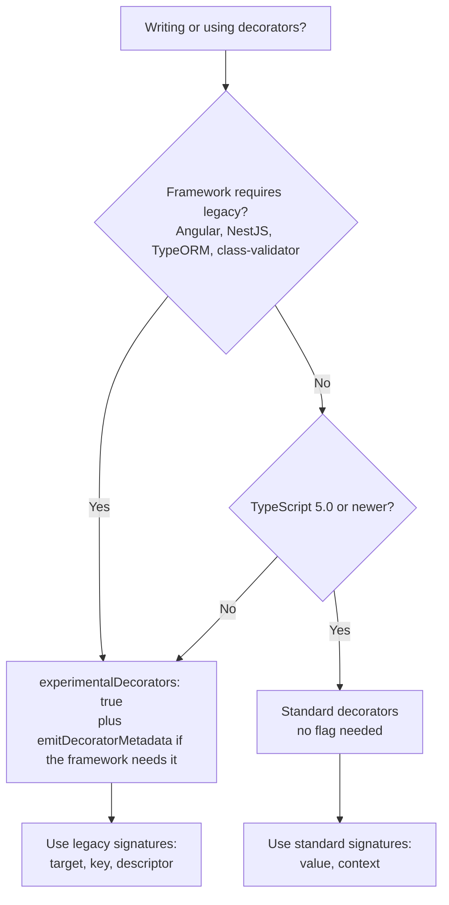
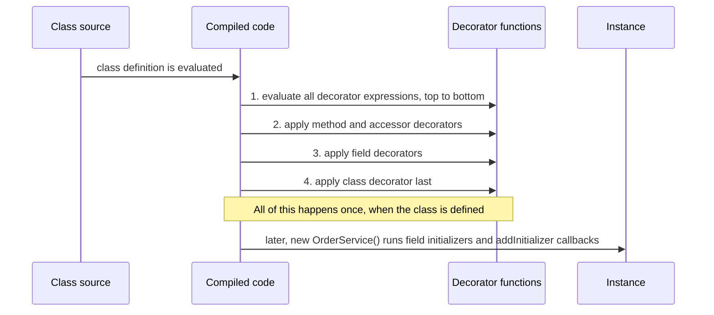
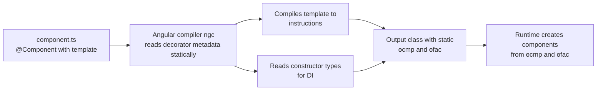

# Decorators

> In this document you will learn what decorators are, how they work inside, and why TypeScript has two different decorator systems: the legacy `experimentalDecorators` system used by Angular 16, NestJS and TypeORM, and the standard TC39 decorators supported since TypeScript 5.0. You will write logging, memoizing, validation and dependency-injection decorators, and see exactly how Angular turns `@Component` into compiled code. Interviewers ask about decorators to check whether you understand the "magic" behind frameworks you use every day.

**Before this:** [Functions and classes](04-functions-and-classes.md) · [Classes in JavaScript](../02-javascript/09-classes.md) · [Closures](../02-javascript/05-closures.md) · **Interview questions:** [jump to the interview section](#interview-questions)

## Table of contents

1. [What a decorator is](#what-a-decorator-is)
2. [Why decorators exist](#why-decorators-exist)
3. [Two decorator systems: legacy and standard](#two-decorator-systems-legacy-and-standard)
4. [Legacy decorators in depth](#legacy-decorators-in-depth)
5. [emitDecoratorMetadata and reflect-metadata](#emitdecoratormetadata-and-reflect-metadata)
6. [Standard decorators in depth](#standard-decorators-in-depth)
7. [Decorator factories](#decorator-factories)
8. [Evaluation and application order](#evaluation-and-application-order)
9. [How Angular uses decorators](#how-angular-uses-decorators)
10. [Decorators in NestJS and TypeORM](#decorators-in-nestjs-and-typeorm)
11. [Decorator syntax vs the Decorator design pattern](#decorator-syntax-vs-the-decorator-design-pattern)
12. [Advantages, disadvantages and alternatives](#advantages-disadvantages-and-alternatives)
13. [Common mistakes](#common-mistakes)
14. [Best practices](#best-practices)
15. [How to explain this in an interview](#how-to-explain-this-in-an-interview)
16. [Interview questions](#interview-questions)
17. [Summary](#summary)
18. [References](#references)

---

## What a decorator is

A **decorator** is a function that you attach to a class, or to a member of a class, with the `@` symbol. The decorator receives the thing it decorates and can **observe** it, **replace** it, or **record information** about it.

```ts
function sealed<T extends abstract new (...args: any[]) => unknown>(target: T, context: ClassDecoratorContext<T>) {
  console.log(`Decorating class ${String(context.name)}`);
  Object.seal(target);
  Object.seal(target.prototype);
}

@sealed
class ReportService {
  generate() {
    return "report";
  }
}

// Output (printed once, when the class is defined, not when you call new):
// Decorating class ReportService
```

Key ideas:

- `@sealed` is just a **function call** that the language makes for you.
- It runs **once**, when the class is **defined** — not every time you create an object or call a method.
- It runs at **runtime**. Unlike types, decorators are real JavaScript code that stays in the output.

### Simple explanation

A decorator is like a **sticker or a stamp** on a class or method. The stamp can mean "log every call to this method", "this class is a web controller for `/users`", or "this field must be an email". Some stamps change the behavior directly. Others are just labels that a framework reads later.

Where the analogy breaks: a sticker does nothing by itself, but a decorator is a function that runs — it can actually replace a method with a new one.

### What decorators can be applied to

| Target | Example | Legacy system | Standard system |
| --- | --- | --- | --- |
| Class | `@Component({...}) class A {}` | Yes | Yes |
| Method | `@Log save() {}` | Yes | Yes |
| Getter / setter | `@Memoize get total() {}` | Yes | Yes |
| Field (property) | `@Input() name = ""` | Yes | Yes |
| Auto-accessor | `@observable accessor count = 0` | No | Yes |
| Constructor or method parameter | `constructor(@Inject(TOKEN) cfg)` | Yes | **No** |

Decorators **cannot** be used on plain functions, variables or object literals. Only on classes and class members.

---

## Why decorators exist

Without decorators, adding the same behavior to many methods means repeating code, or wrapping methods by hand after the class is defined:

```ts
class OrderService {
  placeOrder(id: string) {
    return `placed ${id}`;
  }
}

// Manual wrapping, written after the class — easy to forget, far from the method
const original = OrderService.prototype.placeOrder;
OrderService.prototype.placeOrder = function (this: OrderService, id: string) {
  console.log(`placeOrder(${id})`);
  return original.call(this, id);
};

console.log(new OrderService().placeOrder("A1"));
// placeOrder(A1)
// placed A1
```

Decorators let you say the same thing **declaratively**, right next to the code it affects:

- **Cross-cutting behavior**: logging, timing, caching, retries, authorization checks.
- **Metadata for frameworks**: "this class is a component with this template", "this method handles `GET /users/:id`", "this field maps to a database column".
- **Dependency injection**: "inject this token into this constructor parameter".

This is why frameworks like Angular, NestJS and TypeORM are built around them.

---

## Two decorator systems: legacy and standard

This is the most important thing to understand about decorators in TypeScript today.

1. **Legacy decorators** (also called "experimental decorators"). TypeScript implemented an early version of the decorators proposal in 2015. You enable it with `"experimentalDecorators": true`. Angular (including Angular 16), NestJS, TypeORM, class-validator, MobX (older versions) and InversifyJS are built on it.
2. **Standard decorators** (TC39 decorators). The JavaScript proposal was redesigned and reached Stage 3. TypeScript **5.0** supports this new version by default — when `experimentalDecorators` is **not** set. TypeScript 5.2 added **decorator metadata** for it.

The two systems use the same `@` syntax but have **different function signatures and behavior**. A decorator written for one does not work in the other.

| | Legacy (`experimentalDecorators: true`) | Standard (TS 5.0+, no flag) |
| --- | --- | --- |
| Signature | `(target, propertyKey, descriptor)` — depends on the kind | Always `(value, context)` |
| Class decorator receives | The constructor | The constructor + a context object |
| Method decorator receives | Prototype, name, property descriptor | The method function + context |
| Field decorator | Gets prototype and name only; cannot see or change the value directly | Can return an **initializer** function that transforms the initial value |
| Parameter decorators | Yes | **No** |
| `accessor` keyword (auto-accessors) | No | Yes |
| Metadata | `emitDecoratorMetadata` + `reflect-metadata` (type information) | `context.metadata` + `Symbol.metadata` (TS 5.2+), no automatic type info |
| `emitDecoratorMetadata` | Supported | Not supported |
| Used by | Angular 16, NestJS, TypeORM, class-validator | New libraries, plain TypeScript code |



### Runtime support

Decorators are not yet supported natively by JavaScript engines (Node.js 22/24 and current browsers do not run `@decorator` syntax). TypeScript (or Babel, swc, esbuild) **transforms** them into normal JavaScript function calls. For this reason, Node.js **type stripping** (running `.ts` files directly) does not support decorators.

### Important: do not mix them

In a given project, the `experimentalDecorators` flag decides which system the **whole compilation** uses. If you enable the flag for Angular, every decorator in that project uses the legacy rules. So:

- In an **Angular 16** or **NestJS** project, write legacy decorators.
- In a **plain TypeScript** library or app on TypeScript 5.0+, prefer standard decorators.

---

## Legacy decorators in depth

All examples in this section need this compiler setting:

```json
{ "compilerOptions": { "experimentalDecorators": true } }
```

### Class decorators

A legacy class decorator receives the **constructor function**. If it returns a new constructor, that replaces the class.

```ts
// tsconfig: "experimentalDecorators": true

const registry = new Map<string, Function>();

function Register(target: Function): void {
  registry.set(target.name, target);
}

@Register
class InvoicePlugin {}

@Register
class ExportPlugin {}

console.log([...registry.keys()]); // [ 'InvoicePlugin', 'ExportPlugin' ]
```

A class decorator that **adds behavior** by returning a subclass:

```ts
// tsconfig: "experimentalDecorators": true

function Timestamped<T extends new (...args: any[]) => object>(Base: T) {
  return class extends Base {
    createdAt = new Date("2026-01-01T00:00:00Z");
  };
}

@Timestamped
class AuditEntry {
  constructor(public action: string) {}
}

const entry = new AuditEntry("login");
console.log(entry.action, (entry as AuditEntry & { createdAt: Date }).createdAt.toISOString());
// login 2026-01-01T00:00:00.000Z
```

Notice the cast: TypeScript does **not** change the class type when a decorator returns a subclass. `AuditEntry` still has no `createdAt` in its type. This is a known limitation of decorators. If you need the new members in the type, use a mixin function instead (see [Composition, inheritance and mixins](../04-oop-solid-design-patterns/02-composition-inheritance-and-mixins.md)).

### Method decorators

A legacy method decorator receives three arguments:

1. `target` — the **prototype** of the class (or the constructor, for a static method).
2. `propertyKey` — the method name.
3. `descriptor` — the **property descriptor** (`{ value, writable, enumerable, configurable }`). `descriptor.value` is the original method.

To change the method, replace `descriptor.value`.

```ts
// tsconfig: "experimentalDecorators": true

function Log(target: object, propertyKey: string, descriptor: PropertyDescriptor): void {
  const original = descriptor.value as (...args: unknown[]) => unknown;

  descriptor.value = function (this: unknown, ...args: unknown[]) {
    console.log(`Calling ${propertyKey} with`, args);
    const result = original.apply(this, args);
    console.log(`${propertyKey} returned`, result);
    return result;
  };
}

class Calculator {
  @Log
  add(a: number, b: number): number {
    return a + b;
  }
}

new Calculator().add(2, 3);
// Calling add with [ 2, 3 ]
// add returned 5
```

Step by step:

1. When the class is defined, TypeScript's emitted code calls `Log(Calculator.prototype, "add", descriptorOfAdd)`.
2. `Log` saves the original function and puts a wrapper in `descriptor.value`.
3. The emitted code then defines `add` on the prototype with the changed descriptor.
4. Later, every call to `calc.add(...)` runs the wrapper, which calls the original with the correct `this` (`original.apply(this, args)`).

**Common bug:** using an arrow function for the wrapper. Arrow functions do not have their own `this`, so `this` would not be the instance:

```ts
// tsconfig: "experimentalDecorators": true

function BrokenLog(target: object, key: string, descriptor: PropertyDescriptor): void {
  const original = descriptor.value;
  // ❌ Wrong: arrow function — `this` is NOT the instance
  descriptor.value = (...args: unknown[]) => original.apply(this, args);
}

function FixedLog(target: object, key: string, descriptor: PropertyDescriptor): void {
  const original = descriptor.value;
  // ✅ Correct: regular function — `this` is the instance the method was called on
  descriptor.value = function (this: unknown, ...args: unknown[]) {
    return original.apply(this, args);
  };
}
```

### A realistic method decorator: measure time

```ts
// tsconfig: "experimentalDecorators": true

function Measure(target: object, propertyKey: string, descriptor: PropertyDescriptor): void {
  const original = descriptor.value as (...args: unknown[]) => unknown;

  descriptor.value = async function (this: unknown, ...args: unknown[]) {
    const start = performance.now();
    try {
      return await original.apply(this, args);
    } finally {
      const ms = (performance.now() - start).toFixed(1);
      console.log(`${(target as object).constructor.name}.${propertyKey} took ${ms} ms`);
    }
  };
}

class ReportService {
  @Measure
  async buildMonthlyReport(month: string): Promise<string> {
    await new Promise((resolve) => setTimeout(resolve, 50));
    return `report for ${month}`;
  }
}

new ReportService().buildMonthlyReport("2026-09").then(console.log);
// ReportService.buildMonthlyReport took 5x.x ms
// report for 2026-09
```

The `finally` block logs the time even when the method throws.

### Accessor decorators (getters and setters)

An accessor decorator also receives a descriptor, but with `get` and `set` instead of `value`. A classic example is **memoizing** an expensive getter:

```ts
// tsconfig: "experimentalDecorators": true

function Memoize(_target: object, propertyKey: string, descriptor: PropertyDescriptor): void {
  const getter = descriptor.get;
  if (!getter) throw new Error("@Memoize can only decorate a getter");

  const cache = new WeakMap<object, unknown>(); // one cached value per instance

  descriptor.get = function (this: object) {
    if (!cache.has(this)) {
      console.log(`computing ${propertyKey}`);
      cache.set(this, getter.call(this));
    }
    return cache.get(this);
  };
}

class SalesReport {
  constructor(private rows: number[]) {}

  @Memoize
  get total(): number {
    return this.rows.reduce((sum, value) => sum + value, 0);
  }
}

const report = new SalesReport([100, 250, 50]);
console.log(report.total); // computing total, then 400
console.log(report.total); // 400 (from cache)
```

Why a `WeakMap`? The decorator runs **once per class**, but the cache must be **per instance**. A `WeakMap` keyed by the instance does that and lets instances be garbage-collected. Note that this cache never updates if `rows` changes — only memoize values that do not change.

### Property decorators

A legacy property decorator receives only `target` (the prototype) and `propertyKey`. It does **not** get the value or a descriptor, because instance fields do not exist on the prototype — they are created later, in the constructor.

So property decorators are mostly used to **record metadata** that something else reads later:

```ts
// tsconfig: "experimentalDecorators": true

const requiredFields = new Map<Function, string[]>();

function Required(target: object, propertyKey: string): void {
  const ctor = target.constructor;
  const list = requiredFields.get(ctor) ?? [];
  list.push(propertyKey);
  requiredFields.set(ctor, list);
}

function validate(obj: object): string[] {
  const fields = requiredFields.get(obj.constructor) ?? [];
  return fields
    .filter((field) => {
      const value = (obj as Record<string, unknown>)[field];
      return value === undefined || value === null || value === "";
    })
    .map((field) => `${field} is required`);
}

class CreateUserForm {
  @Required name = "";
  @Required email = "";
  nickname = "";
}

const form = new CreateUserForm();
form.name = "Asha";
console.log(validate(form)); // [ 'email is required' ]
```

This is the basic idea behind libraries like `class-validator`: decorators only **register rules**; a separate `validate()` function applies them.

**Counterexample: do not try to make a property read-only with a property decorator.**

```ts
// tsconfig: "experimentalDecorators": true

// ❌ Wrong: defines a non-writable property on the PROTOTYPE
function ReadOnly(target: object, propertyKey: string): void {
  Object.defineProperty(target, propertyKey, { writable: false });
}
```

The instance field initializer (`brand = "Toyota"`) later either throws (because the inherited property is non-writable and the assignment fails in strict mode) or defines an own property that ignores the prototype — depending on `useDefineForClassFields`. Either way, it does not do what you want. Use TypeScript's `readonly` keyword (compile time) or `Object.freeze` / a private field with a getter (runtime).

### Parameter decorators

A legacy parameter decorator receives `target`, the method name (`undefined` for the constructor), and the **index** of the parameter. It cannot change the parameter. It can only record metadata.

```ts
// tsconfig: "experimentalDecorators": true

const injectTokens = new Map<Function, Map<number, string>>();

function Inject(token: string) {
  return function (target: object, _propertyKey: string | symbol | undefined, parameterIndex: number): void {
    const ctor = target as Function; // for constructor parameters, target is the class itself
    const tokens = injectTokens.get(ctor) ?? new Map<number, string>();
    tokens.set(parameterIndex, token);
    injectTokens.set(ctor, tokens);
  };
}

interface AppConfig {
  apiUrl: string;
}

class ApiClient {
  constructor(@Inject("APP_CONFIG") private config: AppConfig) {}
  url(path: string) {
    return `${this.config.apiUrl}${path}`;
  }
}

console.log(injectTokens.get(ApiClient)); // Map(1) { 0 => 'APP_CONFIG' }
```

This is exactly how Angular's `@Inject(TOKEN)` and NestJS's `@Inject(TOKEN)` tell the DI system what to inject when the parameter type is an interface (interfaces do not exist at runtime).

### What TypeScript emits for legacy decorators

TypeScript turns decorators into calls to a helper named `__decorate`. Simplified output for the `Calculator` example:

```js
class Calculator {
    add(a, b) { return a + b; }
}
__decorate([
    Log
], Calculator.prototype, "add", null);
```

`__decorate` calls each decorator (bottom to top), passing the prototype, the name and the descriptor, and then redefines the property if a decorator returned or changed a descriptor.

---

## emitDecoratorMetadata and reflect-metadata

### The problem

For dependency injection, a framework must know **what to inject** into a constructor:

```ts
class UserRepository { findName(id: number) { return "Asha"; } }
class Logger { info(msg: string) { console.log(msg); } }

class UserService {
  constructor(private repo: UserRepository, private logger: Logger) {}
}
```

At runtime, the types `UserRepository` and `Logger` are gone (type erasure). How can a framework know what the constructor needs?

### The legacy solution

With both `experimentalDecorators` and `emitDecoratorMetadata` enabled, TypeScript **emits type information** for decorated declarations, using the `reflect-metadata` library's API:

| Metadata key | Contains |
| --- | --- |
| `design:paramtypes` | Constructor or method parameter types |
| `design:type` | The type of a property (or `Function` for a method) |
| `design:returntype` | The declared return type of a method |

Only declarations that have **at least one decorator** get this metadata. That is why NestJS and the old Angular JIT needed an `@Injectable()` decorator on services, even when it had no options.

### A tiny DI container built on it

```ts
// tsconfig: "experimentalDecorators": true, "emitDecoratorMetadata": true
import "reflect-metadata"; // npm install reflect-metadata — adds Reflect.getMetadata

type Constructor<T = unknown> = new (...args: any[]) => T;
const providers = new Set<Constructor>();

function Injectable(): ClassDecorator {
  return (target) => {
    providers.add(target as unknown as Constructor);
  };
}

class Container {
  private instances = new Map<Constructor, unknown>();

  resolve<T>(token: Constructor<T>): T {
    const existing = this.instances.get(token);
    if (existing) return existing as T; // singletons

    if (!providers.has(token)) throw new Error(`${token.name} is not @Injectable()`);

    // Read the constructor parameter types that TypeScript emitted
    const paramTypes: Constructor[] = Reflect.getMetadata("design:paramtypes", token) ?? [];
    const deps = paramTypes.map((dep) => this.resolve(dep));

    const instance = new token(...deps);
    this.instances.set(token, instance);
    return instance;
  }
}

@Injectable()
class Logger {
  info(msg: string) { console.log(`[info] ${msg}`); }
}

@Injectable()
class UserRepository {
  findName(id: number) { return id === 1 ? "Asha" : "Unknown"; }
}

@Injectable()
class UserService {
  constructor(private repo: UserRepository, private logger: Logger) {}

  greet(id: number): string {
    const name = this.repo.findName(id);
    this.logger.info(`greeting ${name}`);
    return `Hello, ${name}`;
  }
}

const container = new Container();
console.log(container.resolve(UserService).greet(1));
// [info] greeting Asha
// Hello, Asha

console.log(Reflect.getMetadata("design:paramtypes", UserService).map((t: Function) => t.name));
// [ 'UserRepository', 'Logger' ]
```

What TypeScript emitted for `UserService` (simplified):

```js
UserService = __decorate([
    Injectable(),
    __metadata("design:paramtypes", [UserRepository, Logger])
], UserService);
```

`__metadata` stores the array `[UserRepository, Logger]` — **real class references** — on the class. The container reads them and builds the dependencies recursively. NestJS's injector works on the same principle (with many more features).

### Limitations you must know

1. **Interfaces and type aliases become `Object`.** They have no runtime value, so TypeScript emits `Object`:

   ```ts
   // tsconfig: "experimentalDecorators": true, "emitDecoratorMetadata": true
   import "reflect-metadata";

   interface AppConfig { apiUrl: string }
   function Injectable(): ClassDecorator { return () => {}; }

   @Injectable()
   class ApiClient {
     constructor(private config: AppConfig) {}
   }

   console.log(Reflect.getMetadata("design:paramtypes", ApiClient).map((t: Function) => t.name)); // [ 'Object' ]
   ```

   That is why DI frameworks need **tokens** (`@Inject("APP_CONFIG")` in NestJS, `InjectionToken<AppConfig>` with `@Inject(...)` or `inject(...)` in Angular) for interface-typed dependencies.

2. **Unions, generics and arrays lose detail**: `string | null` becomes `Object`, `User[]` becomes `Array`.
3. **Circular imports** can make a class reference `undefined` at the moment the metadata is evaluated (NestJS solves this with `forwardRef()`).
4. **Tooling support varies.** It needs the type checker's knowledge, so single-file tools struggle: esbuild does not support `emitDecoratorMetadata`; swc has an option for it. This is why NestJS projects compile with `tsc` or swc.
5. **Not available with standard decorators.** TypeScript does not emit `design:*` metadata for TC39 decorators.

---

## Standard decorators in depth

Standard (TC39) decorators are the default in TypeScript 5.0+ when `experimentalDecorators` is **off**. Every standard decorator has the same shape:

```text
decorator(value, context) => replacement | void
```

- `value` — the thing being decorated (the class, the method function, the getter, ...). For fields, it is `undefined`.
- `context` — an object that describes it:

| `context` property | Meaning |
| --- | --- |
| `kind` | `"class"`, `"method"`, `"getter"`, `"setter"`, `"field"` or `"accessor"` |
| `name` | The member name (string or symbol), or the class name |
| `static` | `true` for static members |
| `private` | `true` for `#private` members |
| `access` | An object with `get`/`set`/`has` functions to read or write the member on an instance |
| `addInitializer(fn)` | Register a function to run during class definition (static/class) or instance construction (instance members) |
| `metadata` | A shared object for storing metadata (TypeScript 5.2+) |

TypeScript provides types for each kind: `ClassDecoratorContext`, `ClassMethodDecoratorContext`, `ClassGetterDecoratorContext`, `ClassSetterDecoratorContext`, `ClassFieldDecoratorContext`, `ClassAccessorDecoratorContext`. You use them to make decorators type-safe.

### Method decorator: logging

```ts
function logged<This, Args extends unknown[], Return>(
  target: (this: This, ...args: Args) => Return,
  context: ClassMethodDecoratorContext<This, (this: This, ...args: Args) => Return>
) {
  const methodName = String(context.name);

  // Return a replacement method
  return function (this: This, ...args: Args): Return {
    console.log(`-> ${methodName}(${args.join(", ")})`);
    const result = target.call(this, ...args);
    console.log(`<- ${methodName} returned ${String(result)}`);
    return result;
  };
}

class Cart {
  private items: number[] = [];

  @logged
  add(price: number, qty: number): number {
    this.items.push(price * qty);
    return this.items.reduce((sum, value) => sum + value, 0);
  }
}

new Cart().add(100, 2);
// -> add(100, 2)
// <- add returned 200
```

Compare with the legacy version: no descriptor. You receive the function and simply **return** a new function.

The generic parameters `This`, `Args` and `Return` make the decorator type-safe: it can only decorate methods, and the replacement must have the same signature.

### Method decorator with addInitializer: auto-binding

A common need: pass a method as a callback (`button.addEventListener("click", this.onClick)`) without losing `this`.

```ts
function bound<This, Args extends unknown[], Return>(
  target: (this: This, ...args: Args) => Return,
  context: ClassMethodDecoratorContext<This, (this: This, ...args: Args) => Return>
) {
  const name = context.name;
  if (context.private) throw new Error(`@bound cannot decorate private method ${String(name)}`);

  // Runs for each new instance, at the start of construction
  context.addInitializer(function (this: This) {
    (this as Record<PropertyKey, unknown>)[name] = target.bind(this);
  });
}

class Greeter {
  constructor(private name: string) {}

  @bound
  greet() {
    return `Hello from ${this.name}`;
  }
}

const greet = new Greeter("Asha").greet; // detached from the object
console.log(greet()); // Hello from Asha
```

### Field decorator: transform the initial value

A field decorator receives `undefined` as `value` (the field does not exist yet). It can return an **initializer function**. That function receives the initial value and returns the value the field will actually get.

```ts
function trimmed<This>(_value: undefined, _context: ClassFieldDecoratorContext<This, string>) {
  return function (this: This, initialValue: string): string {
    return initialValue.trim();
  };
}

class Campaign {
  @trimmed title = "   Summer sale   ";
}

console.log(JSON.stringify(new Campaign().title)); // "Summer sale"
```

Note that this only transforms the **initial** value. Later assignments (`campaign.title = "  x "`) are not intercepted. For that, use an auto-accessor.

### Auto-accessors and accessor decorators

Standard decorators added a new class member kind: an **auto-accessor**, declared with the `accessor` keyword.

```ts
class Player {
  accessor volume = 50;
}
```

`accessor volume` creates a private storage slot plus a getter and setter. It behaves like a normal field from the outside, but a decorator can intercept **every** read and write:

```ts
function clamp(min: number, max: number) {
  return function <This>(
    target: ClassAccessorDecoratorTarget<This, number>,
    _context: ClassAccessorDecoratorContext<This, number>
  ): ClassAccessorDecoratorResult<This, number> {
    const limit = (value: number) => Math.min(max, Math.max(min, value));
    return {
      get() { return target.get.call(this); },
      set(value: number) { target.set.call(this, limit(value)); },
      init(value: number) { return limit(value); }, // transforms the initial value
    };
  };
}

class AudioSettings {
  @clamp(0, 100) accessor volume = 150;
}

const settings = new AudioSettings();
console.log(settings.volume); // 100 (initial value was clamped)
settings.volume = -5;
console.log(settings.volume); // 0
```

This is how libraries implement observable or validated properties (for example `@observable accessor` in modern MobX, or reactive properties in Lit).

### Class decorator: register a class

```ts
const plugins = new Map<string, new () => unknown>();

function plugin(name: string) {
  return function <T extends new () => unknown>(target: T, context: ClassDecoratorContext<T>) {
    // Runs after the class is fully defined
    context.addInitializer(() => {
      plugins.set(name, target);
    });
  };
}

@plugin("csv-export")
class CsvExporter {
  run() { return "csv"; }
}

console.log(plugins.has("csv-export")); // true
```

A class decorator can also return a new class (usually a subclass) to replace the original.

### Decorator metadata (TypeScript 5.2+)

Standard decorators can share data through `context.metadata`. All decorators on one class get the **same** metadata object, and it is stored on the class under `Symbol.metadata`. This replaces the role of `reflect-metadata` for metadata that decorators record themselves. (It does **not** give you type information like `design:paramtypes`.)

`Symbol.metadata` is new. Node.js 22 does not define it yet, so you add it once at startup:

```ts
// Polyfill: Node.js 22 does not define Symbol.metadata yet
(Symbol as { metadata?: symbol }).metadata ??= Symbol("Symbol.metadata");

type Rule = { field: string; check: (value: unknown) => boolean; message: string };

function required(_value: undefined, context: ClassFieldDecoratorContext) {
  const rules = (context.metadata.rules ??= []) as Rule[];
  rules.push({
    field: String(context.name),
    check: (v) => v !== undefined && v !== null && v !== "",
    message: `${String(context.name)} is required`,
  });
}

function minLength(min: number) {
  return function (_value: undefined, context: ClassFieldDecoratorContext) {
    const rules = (context.metadata.rules ??= []) as Rule[];
    rules.push({
      field: String(context.name),
      check: (v) => typeof v === "string" && v.length >= min,
      message: `${String(context.name)} must have at least ${min} characters`,
    });
  };
}

function validate(obj: object): string[] {
  const metadata = (obj.constructor as { [Symbol.metadata]?: DecoratorMetadata })[Symbol.metadata];
  const rules = (metadata?.rules ?? []) as Rule[];
  return rules
    .filter((rule) => !rule.check((obj as Record<string, unknown>)[rule.field]))
    .map((rule) => rule.message);
}

class SignupForm {
  @required email = "";
  @required @minLength(8) password = "";
}

const form = new SignupForm();
form.password = "abc";
console.log(validate(form)); // [ 'email is required', 'password must have at least 8 characters' ]

form.email = "asha@example.com";
form.password = "s3cret-pass";
console.log(validate(form)); // []
```

The `lib` setting must include `esnext.decorators` (or `esnext`) for the `DecoratorMetadata` type and `Symbol.metadata`.

---

## Decorator factories

A **decorator factory** is a function that **returns** a decorator. You use it when the decorator needs configuration. The `@` expression is evaluated first (calling the factory), and the returned function is the actual decorator.

```text
@Component({ selector: "app-root" })   <- Component(...) is called first and returns the decorator
class AppComponent {}                  <- then the returned decorator is applied to the class
```

### Legacy factory: retry a failing async method

```ts
// tsconfig: "experimentalDecorators": true

function Retry(attempts: number, delayMs = 0) {
  return function (_target: object, propertyKey: string, descriptor: PropertyDescriptor): void {
    const original = descriptor.value as (...args: unknown[]) => Promise<unknown>;

    descriptor.value = async function (this: unknown, ...args: unknown[]) {
      let lastError: unknown;
      for (let attempt = 1; attempt <= attempts; attempt++) {
        try {
          return await original.apply(this, args);
        } catch (error) {
          lastError = error;
          console.log(`${propertyKey}: attempt ${attempt} failed`);
          if (delayMs > 0) await new Promise((r) => setTimeout(r, delayMs));
        }
      }
      throw lastError;
    };
  };
}

let calls = 0;

class PaymentGateway {
  @Retry(3)
  async charge(amount: number): Promise<string> {
    calls++;
    if (calls < 3) throw new Error("timeout");
    return `charged ${amount}`;
  }
}

new PaymentGateway().charge(499).then(console.log);
// charge: attempt 1 failed
// charge: attempt 2 failed
// charged 499
```

### Standard factory

`clamp(0, 100)` and `minLength(8)` above are standard decorator factories. The pattern is the same: an outer function takes the options and returns the `(value, context)` decorator.

### Decorator vs factory: a common mistake

```ts
// tsconfig: "experimentalDecorators": true

function Retry(attempts: number) {
  return function (_t: object, _k: string, _d: PropertyDescriptor): void { /* ... */ };
}

class Service {
  // @Retry          // ❌ Wrong: Retry would be called as a decorator with (target, key, descriptor)
  @Retry(3)          // ✅ Correct: call the factory, apply the returned decorator
  async load() {}
}
```

Angular's decorators are all factories, which is why you always write the parentheses: `@Injectable()`, `@Input()`, `@Output()` — even with no options.

---

## Evaluation and application order

When several decorators exist, two things happen in order:

1. **Evaluation** — each `@expression` is evaluated (for factories, this calls the factory).
2. **Application** — the resulting decorator functions are called with the target.

### Several decorators on one declaration

For both systems, expressions are **evaluated top to bottom**, and decorators are **applied bottom to top** — like function composition `first(second(target))`.

```ts
// tsconfig: "experimentalDecorators": true

function trace(name: string) {
  console.log(`evaluate ${name}`);
  return function (_target: Function): void {
    console.log(`apply ${name}`);
  };
}

@trace("first")
@trace("second")
class Stacked {}

// evaluate first
// evaluate second
// apply second
// apply first
```

### Order across a whole class (legacy)

Verified with TypeScript 5.9 and `experimentalDecorators`, the legacy order is:

1. **Instance members**, in source order (properties, methods, accessors). For a method, its **parameter** decorators are applied before the method decorator.
2. **Static members**, in source order.
3. **Constructor parameter** decorators.
4. **Class** decorators.

```ts
// tsconfig: "experimentalDecorators": true

function log(name: string) {
  console.log(`evaluate ${name}`);
  return function (..._args: any[]) { console.log(`apply ${name}`); };
}

@log("class")
class OrderService {
  @log("instance property") status = "new";
  @log("static property") static count = 0;
  constructor(@log("constructor param") id: string) {}
  @log("method") place(@log("method param") qty: number) {}
}
```

Output:

```text
evaluate instance property
apply instance property
evaluate method
evaluate method param
apply method param
apply method
evaluate static property
apply static property
evaluate class
evaluate constructor param
apply constructor param
apply class
```

The class decorator is always **last**, so it can see everything the member decorators recorded. This is why a framework's class decorator (like NestJS `@Controller`) can collect information that method decorators (`@Get`) stored earlier.

### Order across a whole class (standard)

With standard decorators (verified with TypeScript 5.9), **all decorator expressions are evaluated first**, in source order (including the class decorator expression). Then decorators are applied: methods and accessors (static ones first), then fields (static ones first), and the **class decorator last**.



In practice you rarely depend on the exact order across members. The rules worth remembering are: **top-to-bottom evaluation, bottom-to-top application on one declaration, and the class decorator runs last.**

---

## How Angular uses decorators

Angular is the most important decorator user for this repository. Angular 16 uses **legacy** decorators, which is why its `tsconfig.json` sets `"experimentalDecorators": true` (see [tsconfig](09-modules-declaration-files-and-tsconfig.md#angular-specific-configuration)).

### The decorators you use daily

```ts
import { Component, EventEmitter, Injectable, Input, Output, HostListener } from "@angular/core";
import { HttpClient } from "@angular/common/http";

export interface Product { id: string; title: string; price: number }

@Injectable({ providedIn: "root" })              // "this class can be injected; one instance app-wide"
export class ProductService {
  constructor(private http: HttpClient) {}       // dependency taken from the constructor type
  getAll() {
    return this.http.get<Product[]>("/api/products");
  }
}

@Component({                                      // "this class is a component with this template"
  selector: "app-product-card",
  template: `
    <h3>{{ product.title }}</h3>
    <button (click)="addToCart.emit(product)">Add</button>
  `,
})
export class ProductCardComponent {
  @Input({ required: true }) product!: Product;   // input from the parent (required: Angular 16+)
  @Output() addToCart = new EventEmitter<Product>();

  @HostListener("window:resize")
  onResize() {
    console.log("resized");
  }
}
```

| Decorator | Kind | Purpose |
| --- | --- | --- |
| `@Component`, `@Directive`, `@Pipe`, `@NgModule`, `@Injectable` | Class | Declare what the class is, plus its metadata |
| `@Input`, `@Output` | Property | Component inputs and outputs |
| `@ViewChild`, `@ViewChildren`, `@ContentChild`, `@ContentChildren` | Property | Query elements or child components |
| `@HostListener`, `@HostBinding` | Method / property | Listen to host events, bind host properties |
| `@Inject`, `@Optional`, `@Self`, `@SkipSelf`, `@Host` | Constructor parameter | Control dependency injection |

### What really happens to `@Component`: Ivy AOT compilation

In Angular 16, the Angular compiler (`ngc`, the Ivy compiler) runs **at build time** (AOT, ahead-of-time). It reads the decorators and their arguments **statically** from the source code, compiles the template, and **replaces** the decorators with **static fields** on the class:

- `ɵcmp` — the component definition (selector, compiled template function, inputs, outputs).
- `ɵfac` — the factory function that creates an instance, including its dependencies.
- `ɵprov` — the provider definition for `@Injectable`.
- `ɵdir`, `ɵpipe`, `ɵmod`, `ɵinj` — for directives, pipes and NgModules.

For example, take this small Angular 16 service:

```ts
import { Injectable } from "@angular/core";
import { HttpClient } from "@angular/common/http";

@Injectable({ providedIn: "root" })
export class IssueApi {
  constructor(private readonly http: HttpClient) {}
}
```

The Angular 16 compiler turns it into this JavaScript (shortened from real `ngc` output):

```js
export class IssueApi {
    constructor(http) { this.http = http; }
    static { this.ɵfac = function IssueApi_Factory(t) { return new (t || IssueApi)(i0.ɵɵinject(i1.HttpClient)); }; }
    static { this.ɵprov = i0.ɵɵdefineInjectable({ token: IssueApi, factory: IssueApi.ɵfac, providedIn: "root" }); }
}
```

There is **no `__decorate` call** and **no `reflect-metadata`** in the output. The `@Injectable` decorator was compiled away. The compiler read the constructor parameter type `HttpClient` from the TypeScript source and generated `ɵɵinject(HttpClient)` directly. (In development builds Angular also emits a `ɵsetClassMetadata` call, guarded by `ngDevMode`, which TestBed uses.)



Consequences you can explain in an interview:

- Angular decorators are **mostly declarative markers** for the compiler. Their runtime implementation barely matters in AOT builds.
- Angular does **not** need `emitDecoratorMetadata`. Angular CLI projects do not enable it.
- Decorator arguments must be **statically analyzable** (literals, references to exported constants). You cannot compute the `template` with a function call at runtime.
- `experimentalDecorators` is still needed so TypeScript accepts Angular's legacy decorator signatures, especially constructor **parameter** decorators like `@Inject()`, which standard decorators do not support.

### The inject() function: DI without parameter decorators

Since Angular 14, you can use the `inject()` function in a field initializer or constructor instead of constructor parameters and parameter decorators:

```ts
import { Component, Injectable, InjectionToken, inject } from "@angular/core";
import { HttpClient } from "@angular/common/http";

export interface AppConfig { apiUrl: string }
export const APP_CONFIG = new InjectionToken<AppConfig>("APP_CONFIG");

@Injectable({ providedIn: "root" })
export class OrdersApi {
  private http = inject(HttpClient);
  private config = inject(APP_CONFIG); // typed as AppConfig — no @Inject needed

  getOrders() {
    return this.http.get<unknown>(`${this.config.apiUrl}/orders`);
  }
}

@Component({ selector: "app-orders", template: "<p>Orders</p>" })
export class OrdersComponent {
  private api = inject(OrdersApi);
}
```

`inject()` is fully type-safe (the token's generic gives the type), works well with inheritance, and does not rely on parameter decorators.

> **Newer Angular (17+):** Angular added function-based APIs that replace several property decorators: `input()` and `input.required()` (17.1), `model()` (17.2), `output()` (17.3), and signal queries `viewChild()`, `viewChildren()`, `contentChild()`, `contentChildren()` (17.2). Class decorators like `@Component` and `@Injectable` remain. These APIs are not available in Angular 16, where you use `@Input`, `@Output` and `@ViewChild`.

---

## Decorators in NestJS and TypeORM

NestJS (a Node.js backend framework) is built on legacy decorators **and** `emitDecoratorMetadata`. A NestJS project's `tsconfig.json` contains:

```json
{
  "compilerOptions": {
    "experimentalDecorators": true,
    "emitDecoratorMetadata": true
  }
}
```

### A NestJS controller, service and DTO

```ts
// tsconfig: "experimentalDecorators": true, "emitDecoratorMetadata": true
import { Body, Controller, Get, Injectable, Param, ParseIntPipe, Post } from "@nestjs/common";
import { IsEmail, IsString, MinLength } from "class-validator";

export class CreateUserDto {
  @IsString()
  @MinLength(2)
  name!: string;

  @IsEmail()
  email!: string;
}

@Injectable()
export class UsersService {
  private users = [{ id: 1, name: "Asha", email: "asha@example.com" }];

  findOne(id: number) {
    return this.users.find((u) => u.id === id);
  }

  create(dto: CreateUserDto) {
    const user = { id: this.users.length + 1, ...dto };
    this.users.push(user);
    return user;
  }
}

@Controller("users")                                   // base route: /users
export class UsersController {
  constructor(private readonly usersService: UsersService) {} // injected using design:paramtypes

  @Get(":id")                                          // GET /users/:id
  findOne(@Param("id", ParseIntPipe) id: number) {     // parameter decorator + pipe converts "1" to 1
    return this.usersService.findOne(id);
  }

  @Post()                                              // POST /users
  create(@Body() dto: CreateUserDto) {                 // body validated against the DTO class rules
    return this.usersService.create(dto);
  }
}
```

How the decorators cooperate:

- `@Get`, `@Post` (method decorators) record route metadata on the method.
- `@Param`, `@Body` (parameter decorators) record which part of the request goes to which argument.
- `@Controller` (class decorator, applied last) records the base path.
- At startup, Nest reads all that metadata to build the router, and reads `design:paramtypes` to inject `UsersService`.
- With the global `ValidationPipe` enabled (`app.useGlobalPipes(new ValidationPipe({ whitelist: true }))`), Nest reads `design:paramtypes` of `create` to learn that the body is a `CreateUserDto` **class**, converts the JSON into an instance, and runs the `class-validator` rules recorded by `@IsString`, `@IsEmail` and `@MinLength`.

This only works because `CreateUserDto` is a **class**. If it were an `interface`, the metadata would be `Object`, and there would be no rules to validate. That is a classic NestJS interview question. Validation is covered in depth in [Runtime validation and type-safe APIs](11-runtime-validation-and-type-safe-apis.md).

### TypeORM entities

```ts
// tsconfig: "experimentalDecorators": true, "emitDecoratorMetadata": true
import { Column, CreateDateColumn, Entity, PrimaryGeneratedColumn } from "typeorm";

@Entity("users")                         // maps the class to the "users" table
export class UserEntity {
  @PrimaryGeneratedColumn()
  id!: number;

  @Column({ length: 120 })
  name!: string;

  @Column({ unique: true })
  email!: string;

  @CreateDateColumn()
  createdAt!: Date;
}
```

TypeORM uses `design:type` metadata to guess column types when you do not set them explicitly (`string` → varchar, `number` → integer, `Date` → timestamp). The `!` assertions are needed because TypeORM fills these properties, not the constructor.

---

## Decorator syntax vs the Decorator design pattern

Do not confuse them:

| | Decorator **syntax** (`@x`) | Decorator **design pattern** |
| --- | --- | --- |
| What | A language feature that calls a function on a class or member at definition time | An object-oriented pattern: wrap an object in another object with the same interface to add behavior |
| When | Once, when the class is defined | At runtime, per object, can be stacked dynamically |
| Example | `@Log` on a method | `new LoggingRepository(new CachingRepository(new SqlRepository()))` |

A logging method decorator **implements a similar idea** (wrap and add behavior), but the design pattern works on instances and does not need any special syntax. See [Structural patterns](../04-oop-solid-design-patterns/07-structural-patterns.md).

---

## Advantages, disadvantages and alternatives

**Advantages**

- **Declarative and close to the code**: `@Get(":id")` next to the handler is easy to read.
- **Removes repetition** of cross-cutting concerns (logging, caching, retry, auth checks).
- **Enables frameworks** to collect metadata (routes, DI, validation, ORM mapping) without config files.

**Disadvantages**

- **Hidden behavior ("magic")**: a reader cannot see what `@Something` does without opening it.
- **Two incompatible systems**, which confuses developers and tools.
- **Types are not updated** when a decorator adds members or changes a signature.
- **Tooling limits**: `emitDecoratorMetadata` is not supported by every compiler; Node.js type stripping does not support decorators at all.
- **Harder testing and debugging**: stack traces include wrapper functions; order of application can matter.

**Alternatives**

| Alternative | Example | When to choose it |
| --- | --- | --- |
| Higher-order function | `const save = withRetry(rawSave, 3)` | Plain functions, no classes; fully typed with `Parameters`/`ReturnType` |
| Explicit wrapper object (Decorator pattern) | `new CachingRepo(new SqlRepo())` | Behavior chosen at runtime, easy to test |
| Explicit registration | `router.get("/users/:id", handler)` | Simple code, no magic, easy to follow |
| Mixins | `class A extends Timestamped(Base)` | Add members that must appear in the type |
| Function-based framework APIs | Angular `inject()`, `input()` | When the framework offers them |

---

## Common mistakes

1. **Mixing the two systems.** Copying a `(target, key, descriptor)` decorator into a project without `experimentalDecorators` gives confusing type errors, and vice versa.
2. **Using an arrow function as the method wrapper.** `this` is lost. Use a regular `function`.
3. **Forgetting the parentheses for factories.** `@Injectable` instead of `@Injectable()`.
4. **Expecting decorators to run on every call or every `new`.** The decorator runs once at class definition; only the *wrapper it installs* runs on each call.
5. **Storing per-instance state in the decorator's closure.** The closure is shared by all instances. Use a `WeakMap` keyed by instance, or store on the instance.
6. **Using property decorators to change values (legacy).** They only receive the prototype and name.
7. **Using interfaces for NestJS DTOs.** The validation metadata needs a class.
8. **Relying on `design:paramtypes` for interface-typed dependencies.** They become `Object`; use injection tokens.
9. **Forgetting `import "reflect-metadata"`** (once, at the entry point) when using `Reflect.getMetadata`.
10. **Expecting the class type to change** when a class decorator returns a subclass with new members.

---

## Best practices

- **Know which system your project uses** (check `experimentalDecorators` in `tsconfig.json`). Reason: signatures differ completely.
- **Prefer standard decorators for new non-framework code on TypeScript 5.0+.** Reason: they follow the JavaScript standard and are type-safe with the context types.
- **Keep decorators small and focused** (one concern each). Reason: easier to understand and combine.
- **Always use regular functions and forward `this` and arguments** in method wrappers. Reason: preserves the method's behavior.
- **Preserve the return value and errors** of the original method (return its result, rethrow errors). Reason: decorators should add behavior, not change it silently.
- **Type your decorators** with generics (`This`, `Args`, `Return`) or the `Class...DecoratorContext` types. Reason: catches misuse at compile time.
- **Use injection tokens for interface dependencies** in DI frameworks. Reason: interfaces do not exist at runtime.
- **Prefer explicit code over clever decorators** when the team is small or the behavior is used once. Reason: less magic, easier onboarding.

---

## How to explain this in an interview

1. **Define it:** "A decorator is a function applied with `@` to a class or class member. It runs once when the class is defined and can replace the member or record metadata."
2. **Why it exists:** "To add cross-cutting behavior and framework metadata declaratively — logging, caching, routes, dependency injection, validation."
3. **How it works:** "TypeScript compiles `@x` into function calls. There are two systems: the legacy `experimentalDecorators` one with `(target, key, descriptor)` signatures and parameter decorators — Angular 16 and NestJS use it — and the standard TC39 decorators from TypeScript 5.0 with a `(value, context)` signature and no parameter decorators."
4. **Small example:** "A `@Log` method decorator saves the original method and replaces it with a wrapper that logs and then calls the original with `apply(this, args)`."
5. **Where it is useful:** "Angular's `@Component` and `@Injectable` — which the Ivy compiler turns into static `ɵcmp` and `ɵfac` fields at build time — and NestJS controllers, which use `emitDecoratorMetadata` to know what to inject."
6. **Trade-offs / gotchas:** "Hidden magic, two incompatible systems, types don't change when a decorator adds members, interfaces become `Object` in metadata, and some build tools don't support decorator metadata."

---

## Interview questions

### Q1. What is a decorator in TypeScript?

**What the interviewer is checking:** Basic definition, timing, and runtime nature.

**Short spoken answer (30–60 seconds):**
> A decorator is a function that I attach with the `@` symbol to a class or a class member — a method, accessor, field, or in the legacy system also a parameter. It runs once, when the class is defined, not on every call. It can replace what it decorates — for example wrap a method to add logging — or it can just record metadata that a framework reads later. Unlike types, decorators are real runtime code. In TypeScript there are two systems: the legacy `experimentalDecorators` one that Angular and NestJS use, and the standard TC39 decorators supported since TypeScript 5.0.

**Detailed explanation:**
TypeScript transforms the `@` syntax into function calls (`__decorate` for legacy, `__esDecorate` helpers for standard). JavaScript engines do not run decorator syntax natively yet; the proposal is at Stage 3.

**Follow-up questions:**
- **Can you decorate a plain function?** — No. Only classes and class members.
- **When exactly does a decorator run?** — During class definition. The wrapper it installs runs on each method call.
- **Do decorators exist after compilation?** — Yes, as function calls in the JavaScript output. Exception: Angular's AOT compiler compiles its own decorators away into static fields.

**Common mistakes:** Saying decorators run on every method call. Saying they are compile-time only like types.

**Where this is used in real projects:** Angular, NestJS, TypeORM, class-validator, MobX, Lit.

### Q2. What is the difference between `experimentalDecorators` and standard decorators?

**What the interviewer is checking:** Up-to-date knowledge and the practical impact.

**Short spoken answer (30–60 seconds):**
> Legacy decorators come from an early version of the proposal that TypeScript implemented years ago, enabled with `experimentalDecorators`. Their signatures depend on the target: a method decorator gets the prototype, the name and the property descriptor. They support parameter decorators, and with `emitDecoratorMetadata` TypeScript emits type information like constructor parameter types. Standard decorators, available by default since TypeScript 5.0, follow the final TC39 design: every decorator gets `(value, context)`, there's an `addInitializer` hook, a new `accessor` keyword, and metadata through `context.metadata` since 5.2 — but no parameter decorators and no `emitDecoratorMetadata`. Angular 16 and NestJS need the legacy system; for new standalone code I'd use standard decorators.

**Follow-up questions:**
- **Can you use both in one project?** — Not in one compilation. The flag switches the whole program.
- **Why can't Angular 16 just switch?** — Its DI uses constructor parameter decorators like `@Inject()`, which don't exist in standard decorators, and its decorator types use legacy signatures.
- **What replaces `reflect-metadata` in standard decorators?** — `context.metadata`, stored on the class under `Symbol.metadata`. It holds what decorators record; it does not contain type information.

**Common mistakes:** Thinking TypeScript 5.0 removed legacy decorators (it did not; the flag still works).

**Where this is used in real projects:** Choosing settings for libraries; understanding framework requirements.

### Q3. Write a method decorator that logs calls and results.

**What the interviewer is checking:** Practical implementation and `this` handling.

**Short spoken answer (30–60 seconds):**
> In the legacy system the decorator gets the prototype, the method name and the descriptor. I save `descriptor.value`, the original function, and replace it with a regular function — not an arrow function, so `this` stays the instance. The wrapper logs the arguments, calls the original with `original.apply(this, args)`, logs the result and returns it. In the standard system it's simpler: I get the method directly and return a replacement function.

**Code:**

```ts
// tsconfig: "experimentalDecorators": true

function LogCalls(_target: object, key: string, descriptor: PropertyDescriptor): void {
  const original = descriptor.value as (...args: unknown[]) => unknown;
  descriptor.value = function (this: unknown, ...args: unknown[]) {
    console.log(`${key}(${JSON.stringify(args)})`);
    const result = original.apply(this, args);
    console.log(`${key} -> ${JSON.stringify(result)}`);
    return result;
  };
}

class PriceService {
  constructor(private taxRate: number) {}

  @LogCalls
  withTax(price: number): number {
    return Math.round(price * (1 + this.taxRate));
  }
}

new PriceService(0.18).withTax(100);
// withTax([100])
// withTax -> 118
```

**Follow-up questions:**
- **How would you handle async methods?** — `await` the original inside an `async` wrapper, or attach `.then`, so you log the resolved value and catch rejections.
- **What happens with an arrow function wrapper?** — `this` refers to the decorator's scope, so `this.taxRate` would be `undefined`.

**Common mistakes:** Not returning the result. Losing `this`. Swallowing errors.

**Where this is used in real projects:** Debug logging, audit trails, performance timing.

### Q4. What is a decorator factory?

**Short spoken answer (30–60 seconds):**
> A decorator factory is a function that returns a decorator. I use it when the decorator needs options, like `@Retry(3)` or `@Component({ selector: ... })`. The expression after the `@` is evaluated first — that calls the factory with the options — and the returned function is applied as the decorator. That's why Angular decorators always have parentheses, even `@Injectable()` with no options: they are all factories.

**Follow-up questions:**
- **What happens if you forget the parentheses on a factory?** — The factory itself is called as the decorator with `(target, key, descriptor)` arguments, which usually breaks silently or throws.

### Q5. In what order are decorators evaluated and applied?

**What the interviewer is checking:** Precise understanding, often with a code snippet.

**Short spoken answer (30–60 seconds):**
> On a single declaration, the decorator expressions are evaluated top to bottom, and the resulting decorators are applied bottom to top — like function composition, the one closest to the declaration wraps first. Across a class, in the legacy system, instance members are decorated first, then static members, then constructor parameters, and the class decorator runs last. Parameter decorators of a method run before that method's decorator. In the standard system all expressions are evaluated first, then member decorators are applied, and again the class decorator is last. The useful takeaway is that a class decorator can rely on what member decorators recorded.

**Code:**

```ts
// tsconfig: "experimentalDecorators": true

function d(name: string) {
  console.log(`evaluate ${name}`);
  return (..._args: any[]) => console.log(`apply ${name}`);
}

class Demo {
  @d("A")
  @d("B")
  run() {}
}
// evaluate A
// evaluate B
// apply B
// apply A
```

(Confirmed by compiling with TypeScript 5.9 and running with Node.js.)

**Follow-up questions:**
- **Why does the class decorator run last?** — So it can see the complete class, including metadata recorded by member decorators — NestJS's `@Controller` relies on this.

### Q6. What do `emitDecoratorMetadata` and `reflect-metadata` do?

**What the interviewer is checking:** How DI frameworks know constructor dependencies.

**Short spoken answer (30–60 seconds):**
> Types are erased at runtime, so a DI framework can't normally know what a constructor needs. With `emitDecoratorMetadata`, TypeScript emits the types of decorated declarations as runtime values: `design:paramtypes` for constructor and method parameters, `design:type` for properties, and `design:returntype` for methods. It writes them through the `reflect-metadata` API, so you import that library once. A container then reads `Reflect.getMetadata("design:paramtypes", MyService)`, gets real class references like `[UserRepository, Logger]`, and creates them recursively. NestJS works this way. The limitation is that interfaces, unions and type aliases become `Object`, so you need tokens for those.

**Follow-up questions:**
- **Why does a class need a decorator to get metadata?** — TypeScript only emits metadata for declarations that have at least one decorator. That's one reason `@Injectable()` exists.
- **Does Angular 16 use `emitDecoratorMetadata`?** — No. The Angular compiler reads constructor types at build time and generates factories with `ɵɵinject(...)` calls.
- **Does it work with esbuild?** — esbuild does not support `emitDecoratorMetadata`; swc has an option for it, and `tsc` supports it.

**Common mistakes:** Thinking metadata includes full generic or interface information.

**Where this is used in real projects:** NestJS, TypeORM, InversifyJS, class-transformer/class-validator.

### Q7. Why must NestJS DTOs be classes and not interfaces?

**What the interviewer is checking:** Connecting type erasure, metadata and validation.

**Short spoken answer (30–60 seconds):**
> Interfaces disappear at compile time — there's nothing left at runtime. NestJS's `ValidationPipe` reads `design:paramtypes` to find out what type a `@Body()` parameter has. If it's a class, it gets a real constructor, transforms the JSON into an instance with class-transformer, and runs the class-validator rules that decorators like `@IsEmail()` stored on that class. If it's an interface, the metadata is just `Object`, so there are no rules and nothing is validated. Also, property decorators like `@IsEmail()` can only be placed on class properties.

**Follow-up questions:**
- **How do you create an update DTO without repeating rules?** — `class UpdateUserDto extends PartialType(CreateUserDto) {}` from `@nestjs/mapped-types` keeps the validation decorators but makes them optional.
- **What does `whitelist: true` do?** — Strips properties that have no validation decorator, so unexpected fields don't reach your service.

**Where this is used in real projects:** Every NestJS API.

### Q8. How does Angular use decorators? Are they executed at runtime?

**What the interviewer is checking:** Understanding of Ivy and AOT, beyond "it's metadata".

**Short spoken answer (30–60 seconds):**
> Angular decorators like `@Component`, `@Injectable` and `@Input` are declarations for the Angular compiler. In Angular 16 with AOT, the Ivy compiler reads them statically at build time, compiles the template, and replaces them with static fields on the class — `ɵcmp` with the compiled template and inputs, `ɵfac` with a factory that injects dependencies, `ɵprov` for injectables. So in the production output there's no `__decorate` call and no reflect-metadata. DI works because the compiler reads the constructor parameter types from the TypeScript code and generates `ɵɵinject(HttpClient)` calls. That's also why decorator arguments must be statically analyzable.

**Follow-up questions:**
- **Then why does Angular need `experimentalDecorators`?** — TypeScript still has to type-check the decorator syntax, and Angular's decorators use legacy signatures, including constructor parameter decorators like `@Inject()`, which standard decorators don't support.
- **What is `inject()`?** — A function (Angular 14+) to get dependencies in field initializers or constructors, without constructor parameters or parameter decorators. It's type-safe through `InjectionToken<T>`.
- **What replaces `@Input` in newer Angular?** — `input()` and `input.required()` signal inputs from Angular 17.1; not available in Angular 16.

**Common mistakes:** Saying Angular uses `reflect-metadata` for DI at runtime (that was true for old JIT-era Angular, not Ivy AOT).

**Where this is used in real projects:** Every Angular app.

### Q9. Write a memoize decorator for a getter. What is the trap?

**Short spoken answer (30–60 seconds):**
> I replace the getter with one that checks a cache first. The trap is where the cache lives: the decorator runs once per class, so a variable in its closure would be shared by all instances — every object would return the first object's value. I use a `WeakMap` keyed by the instance, so each instance has its own cached value and instances can still be garbage-collected. The second trap is staleness: memoizing only makes sense if the value doesn't depend on state that changes.

**Code:**

```ts
// tsconfig: "experimentalDecorators": true

function Memoize(_t: object, _key: string, descriptor: PropertyDescriptor): void {
  const getter = descriptor.get!;
  const cache = new WeakMap<object, unknown>();
  descriptor.get = function (this: object) {
    if (!cache.has(this)) cache.set(this, getter.call(this));
    return cache.get(this);
  };
}

class Invoice {
  constructor(private lines: number[]) {}
  @Memoize get total(): number { return this.lines.reduce((a, b) => a + b, 0); }
}

console.log(new Invoice([1, 2]).total, new Invoice([10, 20]).total); // 3 30
```

**Follow-up questions:**
- **How would you memoize a method with arguments?** — Cache per instance and per argument key (for example a `Map` keyed by `JSON.stringify(args)` inside the per-instance `WeakMap`), and think about cache size limits.

### Q10. Debugging: this decorator breaks `this`. Why?

```ts
// tsconfig: "experimentalDecorators": true

function Track(_t: object, key: string, d: PropertyDescriptor): void {
  const original = d.value;
  d.value = (...args: unknown[]) => {
    console.log(`track ${key}`);
    return original.apply(this, args);
  };
}

class Basket {
  items: string[] = [];
  @Track add(item: string) { this.items.push(item); }
}

new Basket().add("apple"); // TypeError: Cannot read properties of undefined (reading 'items')
```

**What the interviewer is checking:** Arrow function `this` semantics inside decorators.

**Short spoken answer (30–60 seconds):**
> The wrapper is an arrow function, so it doesn't get its own `this`. It uses the `this` of the surrounding decorator function, which is `undefined` in strict mode. So `original.apply(this, args)` calls `add` with `this` undefined, and `this.items` fails. The fix is to use a regular `function` expression for the wrapper, so `this` is whatever object the method was called on: `d.value = function (this: unknown, ...args: unknown[]) { ... return original.apply(this, args); }`.

**Good to know:** with `strict` on, TypeScript already warns about this bug. The `this` inside the arrow function gets error TS2683: "'this' implicitly has type 'any' because it does not have a type annotation." So if you see that error in a decorator, check for an arrow function wrapper.

**Common mistakes:** Suggesting `bind` in the decorator — there is no instance at decoration time to bind to.

### Q11. What are auto-accessors (`accessor` keyword)?

**Short spoken answer (30–60 seconds):**
> `accessor` came with standard decorators in TypeScript 4.9 and 5.0. `accessor count = 0` creates a private storage slot plus a getter and setter, so from outside it looks like a normal field. The point is that an accessor decorator can intercept every read and write by returning `get`, `set` and `init` functions — something a field decorator can't do. That's how you build observable, clamped or validated properties without writing getters and setters by hand.

**Follow-up questions:**
- **Can you use `accessor` with `experimentalDecorators`?** — The keyword itself compiles, but accessor decorators with the `(target, context)` signature are a standard-decorator feature.

### Q12. Implement a simple DI container with decorators. What are the limits?

**What the interviewer is checking:** Deep understanding of how NestJS-style DI works.

**Short spoken answer (30–60 seconds):**
> With `experimentalDecorators` and `emitDecoratorMetadata`, I write an `@Injectable()` class decorator that registers the class. The container's `resolve(Class)` reads `design:paramtypes` with reflect-metadata, resolves each parameter type recursively, creates the instance with `new Class(...deps)`, and caches it as a singleton. The limits: interface-typed parameters become `Object`, so I need tokens and a parameter decorator like `@Inject("TOKEN")`; circular dependencies need special handling; and the build tool must support decorator metadata.

**Detailed explanation:** The full code is in [A tiny DI container built on it](#a-tiny-di-container-built-on-it). Real containers add scopes (singleton, transient, request), factory and value providers, async providers, and cycle detection.

**Follow-up questions:**
- **How do you detect circular dependencies?** — Keep a "currently resolving" set; if you try to resolve a class that is already in it, throw an error that shows the cycle.
- **Where is the DI concept itself explained?** — In [Dependency inversion and injection](../04-oop-solid-design-patterns/05-dependency-inversion-and-injection.md).

### Q13. A teammate added `@ReadOnly` to a property using `Object.defineProperty(target, key, { writable: false })`. Now the app throws when creating objects. Why?

**Short spoken answer (30–60 seconds):**
> A legacy property decorator receives the prototype, not the instance. So the code makes a non-writable property on the prototype. When the constructor runs the field initializer, it tries to assign the value. With assignment semantics, assigning to an inherited non-writable property throws in strict mode. With define semantics, the instance gets its own property and the decorator has no effect. Either way it's wrong. For read-only fields, use TypeScript's `readonly` for compile-time safety, or a private field with a getter, or `Object.freeze` for runtime safety.

### Q14. Can a decorator change the TypeScript type of a class?

**Short answer:** No. If a class decorator returns a subclass with extra members, or a method decorator changes the return type, TypeScript keeps the **original** declared types. Users must cast to see new members. If you need type changes, use a **mixin function** (`class Order extends Timestamped(BaseOrder) {}`) or a higher-order function, which TypeScript can type correctly.

### Q15. When would you NOT use a decorator?

**What the interviewer is checking:** Judgment, not just enthusiasm.

**Short spoken answer (30–60 seconds):**
> When the behavior is used once or twice — a direct function call is clearer. When the team isn't familiar with them, because decorators hide behavior. When I need different behavior per instance at runtime — then the Decorator design pattern or composition fits better. When the code runs through a tool that doesn't support them, like Node's type stripping. And for plain functions, a higher-order function like `withRetry(fn)` is fully typed and needs no class. I use decorators mainly where a framework expects them, or for a few well-documented cross-cutting concerns.

### Q16. What is the difference between the `@` decorator syntax and the Decorator design pattern?

**Short answer:** The syntax is a language feature: a function runs once at class definition and can replace a member or record metadata. The design pattern wraps an **object** in another object with the same interface at runtime (`new CachedRepo(new SqlRepo())`), so behavior can be chosen and stacked per instance. A logging method decorator follows a similar "wrap and add" idea, but they are different tools.

---

## Summary

- A decorator is a function applied with `@` to a class or class member. It runs **once at class definition** and is real runtime code.
- TypeScript has **two systems**: legacy (`experimentalDecorators`, used by Angular 16, NestJS, TypeORM) and standard TC39 decorators (default since TS 5.0). They are not compatible.
- Legacy signatures depend on the target (`target, key, descriptor`); parameter decorators exist. Standard decorators always get `(value, context)`, support `addInitializer` and `accessor`, but have no parameter decorators.
- `emitDecoratorMetadata` + `reflect-metadata` emit `design:paramtypes`, `design:type` and `design:returntype` (legacy only). Interfaces become `Object`, so DI needs tokens.
- Standard decorator metadata (TS 5.2+) uses `context.metadata` and `Symbol.metadata` (polyfill it in Node.js 22).
- Decorator factories return decorators; that is why Angular uses `@Injectable()` with parentheses.
- Order: evaluate top to bottom, apply bottom to top; the class decorator runs last.
- Angular's Ivy AOT compiler turns decorators into static `ɵcmp`, `ɵfac`, `ɵprov` fields; Angular does not need `emitDecoratorMetadata`. `inject()` avoids parameter decorators.
- NestJS DTOs must be classes so `ValidationPipe` can read metadata and class-validator rules.
- Use regular functions in wrappers to keep `this`, keep per-instance state in a `WeakMap`, and prefer explicit code when decorators add little value.

---

## References

- TypeScript Handbook — Decorators (legacy `experimentalDecorators`): https://www.typescriptlang.org/docs/handbook/decorators.html
- TypeScript 5.0 release notes — Decorators: https://www.typescriptlang.org/docs/handbook/release-notes/typescript-5-0.html#decorators
- TypeScript 5.2 release notes — Decorator metadata: https://www.typescriptlang.org/docs/handbook/release-notes/typescript-5-2.html#decorator-metadata
- TC39 Decorators proposal: https://github.com/tc39/proposal-decorators
- TC39 Decorator Metadata proposal: https://github.com/tc39/proposal-decorator-metadata
- TSConfig reference — `experimentalDecorators`, `emitDecoratorMetadata`: https://www.typescriptlang.org/tsconfig/#experimentalDecorators
- reflect-metadata: https://github.com/rbuckton/reflect-metadata
- Angular 16 — Dependency injection: https://v16.angular.io/guide/dependency-injection
- Angular 16 — Ahead-of-time (AOT) compilation: https://v16.angular.io/guide/aot-compiler
- NestJS — Custom decorators and providers: https://docs.nestjs.com/custom-decorators
- NestJS — Validation: https://docs.nestjs.com/techniques/validation
- TypeORM — Entities: https://typeorm.io/docs/entity/entities/
- Node.js — TypeScript type stripping limitations: https://nodejs.org/api/typescript.html
