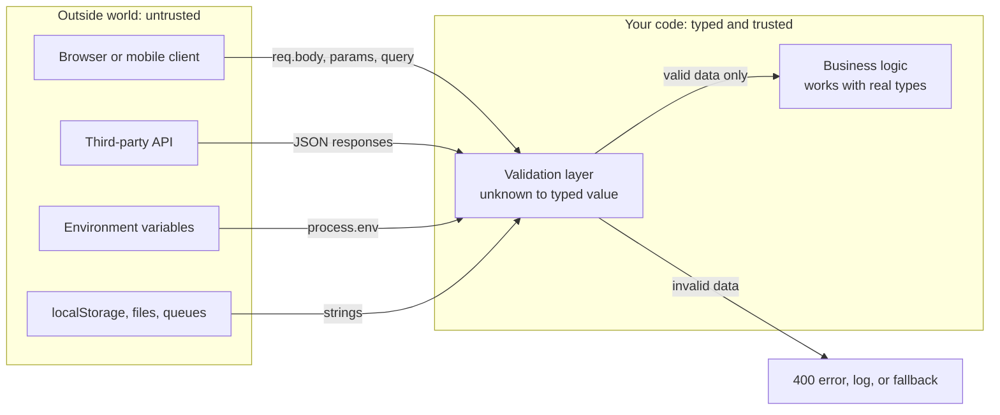
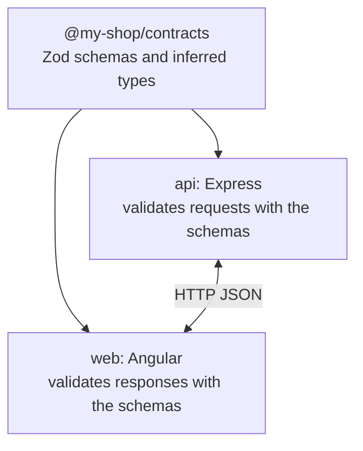
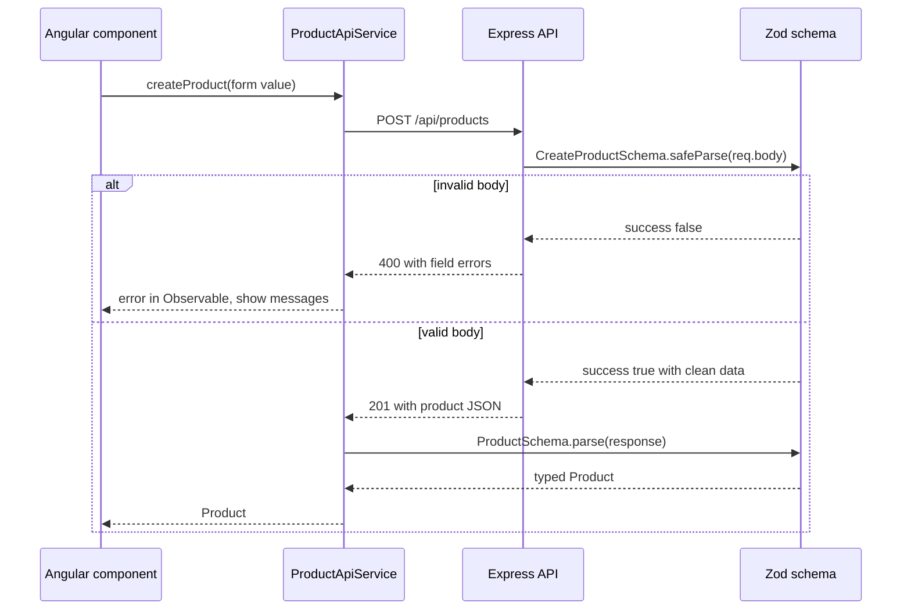

# Runtime Validation and Type-Safe APIs

> In this document you will learn the most important practical lesson of TypeScript: types disappear at runtime, so data that comes from outside your program must be checked by real code. You will validate `unknown` data with type guards and with schema libraries like Zod, validate environment variables, share contracts between an Express backend and an Angular frontend, use branded types and Result types, and see how OpenAPI and tRPC fit in. Interviewers use this topic to separate people who "know the syntax" from people who build safe systems.

**Before this:** [Unions, narrowing and type guards](03-unions-narrowing-and-type-guards.md) · [Generics](05-generics.md) · [Utility types](08-utility-types.md) · **Interview questions:** [jump to the interview section](#interview-questions)

## Table of contents

1. [Types disappear at runtime](#types-disappear-at-runtime)
2. [Trust boundaries: where unknown data enters](#trust-boundaries-where-unknown-data-enters)
3. [Validating unknown data with type guards](#validating-unknown-data-with-type-guards)
4. [Parse, do not validate](#parse-do-not-validate)
5. [Schema libraries and Zod](#schema-libraries-and-zod)
6. [Other validation libraries](#other-validation-libraries)
7. [Validating environment variables](#validating-environment-variables)
8. [Result types for expected errors](#result-types-for-expected-errors)
9. [Branded and nominal types](#branded-and-nominal-types)
10. [Sharing types between frontend and backend](#sharing-types-between-frontend-and-backend)
11. [OpenAPI and generated types](#openapi-and-generated-types)
12. [tRPC in brief](#trpc-in-brief)
13. [End-to-end example: Express and Zod with an Angular client](#end-to-end-example-express-and-zod-with-an-angular-client)
14. [Security and performance notes](#security-and-performance-notes)
15. [Advantages, disadvantages and alternatives](#advantages-disadvantages-and-alternatives)
16. [Common mistakes](#common-mistakes)
17. [Best practices](#best-practices)
18. [How to explain this in an interview](#how-to-explain-this-in-an-interview)
19. [Interview questions](#interview-questions)
20. [Summary](#summary)
21. [References](#references)

---

## Types disappear at runtime

TypeScript checks your code **while compiling**. Then it removes all types and produces plain JavaScript. This is called **type erasure**. At runtime, there is no `User` interface, no `string` annotation, nothing to check against.

So TypeScript can only protect you from mistakes **inside** your own code. It cannot know what the outside world will send.

### Example: the API returns the wrong shape

```ts
interface User {
  id: number;
  name: string;
  email: string;
}

async function getUser(id: number): Promise<User> {
  const response = await fetch(`https://api.example.com/users/${id}`);
  return response.json(); // response.json() returns Promise<any> — any fits into User
}

async function showGreeting() {
  const user = await getUser(1);
  console.log(user.name.toUpperCase()); // compiles fine
}
```

Now imagine the backend team renamed `name` to `fullName`. The server now sends:

```json
{ "id": 1, "fullName": "Asha Rao", "email": "asha@example.com" }
```

What happens?

1. TypeScript compiled the code without errors, because `response.json()` returns `any`, and `any` is assignable to `User`.
2. At runtime, `user.name` is `undefined`.
3. `undefined.toUpperCase()` throws `TypeError: Cannot read properties of undefined (reading 'toUpperCase')`.
4. The crash happens far away from the real cause (the network response), which makes debugging harder.

Let us prove it with code you can run:

```ts
interface User { id: number; name: string }

const json = '{"id":1,"fullName":"Asha Rao"}'; // what the server really sent
const user = JSON.parse(json) as User;          // the "as" is just a promise to the compiler

console.log(user.name); // undefined
try {
  console.log(user.name.toUpperCase());
} catch (error) {
  console.log((error as Error).message); // Cannot read properties of undefined (reading 'toUpperCase')
}
```

### The same problem in Angular

```ts
import { Injectable } from "@angular/core";
import { HttpClient } from "@angular/common/http";

export interface User { id: number; name: string; email: string }

@Injectable({ providedIn: "root" })
export class UserApi {
  constructor(private http: HttpClient) {}

  getUser(id: number) {
    return this.http.get<User>(`/api/users/${id}`); // Observable<User> — but nothing checks it!
  }
}
```

`http.get<User>()` looks safe. It is not. The generic `<User>` is only a **type assertion in disguise**: Angular parses the JSON and gives it to you typed as `User`, without checking a single property.

### Where the compiler cannot help

| Source | Typed as | Really contains |
| --- | --- | --- |
| `JSON.parse(text)` | `any` | Anything |
| `response.json()` (fetch) | `Promise<any>` | Anything the server sent |
| `HttpClient.get<T>()` (Angular) | `Observable<T>` | Anything the server sent |
| `req.body` (Express) | `any` (by default) | Anything the client sent |
| `process.env.X` | `string \| undefined` | A string, if the variable is set |
| `localStorage.getItem(k)` | `string \| null` | Possibly old or edited data |
| `window.postMessage` / Electron IPC messages | `any` | Anything the sender sent |
| Database rows, queue messages, files | Depends on library | Possibly old schema, bad data |

The rule: **anything that crosses a boundary into your program must be checked at runtime.**

---

## Trust boundaries: where unknown data enters

A **trust boundary** is a place where data enters your code from something you do not control. Inside the boundary, you can rely on types. At the boundary, you must check.



The idea:

1. Treat incoming data as `unknown`, not `any`.
2. Check it **once**, at the edge, and turn it into a properly typed value.
3. Everywhere inside, use the typed value without more checks.

Why `unknown` and not `any`? `any` turns off checking, so you can use it wrongly by accident. `unknown` forces you to check before use:

```ts
function handleAny(data: any) {
  console.log(data.user.name); // compiles — may crash at runtime
}

function handleUnknown(data: unknown) {
  // console.log(data.user.name); // ❌ Error: 'data' is of type 'unknown'
  if (typeof data === "object" && data !== null && "user" in data) {
    console.log("has a user property"); // ✅ only after narrowing
  }
}
```

---

## Validating unknown data with type guards

You can validate without any library, using the narrowing tools from [Unions, narrowing and type guards](03-unions-narrowing-and-type-guards.md).

### A type predicate (`value is T`)

```ts
interface Product {
  id: string;
  title: string;
  price: number;
}

function isRecord(value: unknown): value is Record<string, unknown> {
  return typeof value === "object" && value !== null && !Array.isArray(value);
}

function isProduct(value: unknown): value is Product {
  return (
    isRecord(value) &&
    typeof value.id === "string" &&
    typeof value.title === "string" &&
    typeof value.price === "number" &&
    Number.isFinite(value.price) &&
    value.price >= 0
  );
}

const data: unknown = JSON.parse('{"id":"p1","title":"Mouse","price":25}');

if (isProduct(data)) {
  console.log(data.title.toUpperCase()); // MOUSE — data is Product here
} else {
  console.log("invalid product");
}
```

### An assertion function (`asserts value is T`)

An assertion function throws if the value is invalid. After the call, TypeScript treats the value as the checked type.

```ts
interface Product { id: string; title: string; price: number }

function isProduct(value: unknown): value is Product {
  return typeof value === "object" && value !== null &&
    typeof (value as Record<string, unknown>).id === "string" &&
    typeof (value as Record<string, unknown>).title === "string" &&
    typeof (value as Record<string, unknown>).price === "number";
}

function assertProduct(value: unknown): asserts value is Product {
  if (!isProduct(value)) {
    throw new TypeError("Invalid product payload");
  }
}

const payload: unknown = JSON.parse('{"id":"p1","title":"Mouse","price":25}');
assertProduct(payload);
console.log(payload.price * 2); // 50 — payload is Product after the assertion
```

### A parse function: check and build a clean value

A **parse function** takes `unknown` and returns a new, typed value, or throws. It can also **normalize** data (trim strings, reject extra fields). This example is based on the issue-tracker contracts used elsewhere in this repository:

```ts
type IssueStatus = "open" | "closed";
interface Issue { id: string; title: string; status: IssueStatus }

function asObject(value: unknown): Record<string, unknown> {
  if (value === null || typeof value !== "object" || Array.isArray(value)) {
    throw new TypeError("Expected an object");
  }
  return value as Record<string, unknown>;
}

function parseTitle(value: unknown): string {
  if (typeof value !== "string") throw new TypeError("Title must be text");
  const title = value.trim();
  if (title.length === 0 || title.length > 120) {
    throw new TypeError("Title must have 1-120 characters after trimming");
  }
  return title;
}

function parseIssue(value: unknown): Issue {
  const row = asObject(value);
  if (typeof row.id !== "string" || row.id.trim() === "" || row.id.length > 120) {
    throw new TypeError("Invalid issue ID");
  }
  if (row.status !== "open" && row.status !== "closed") {
    throw new TypeError("Invalid issue status");
  }
  // Build a NEW object: unknown extra fields are dropped
  return { id: row.id, title: parseTitle(row.title), status: row.status };
}

function parseIssues(value: unknown): Issue[] {
  if (!Array.isArray(value)) throw new TypeError("Expected an issue list");
  // Array.from visits holes too; .map would silently skip missing entries in sparse arrays
  return Array.from(value, parseIssue);
}

console.log(parseIssues([{ id: "i1", title: "  Fix login  ", status: "open", secret: "x" }]));
// [ { id: 'i1', title: 'Fix login', status: 'open' } ]

try {
  parseIssues([{ id: "i2", title: "Bug", status: "pending" }]);
} catch (error) {
  console.log((error as Error).message); // Invalid issue status
}
```

### The weak spot of hand-written guards

Hand-written guards work, but:

- They are **long** and repetitive for big objects.
- The **type and the check can drift apart**. If someone adds `priority: number` to `Issue` but forgets the guard, the guard still says "valid".
- Error messages are often poor ("invalid product" — but which field?).

Schema libraries solve all three. Hand-written guards are still great for small, stable shapes and for libraries that must have zero dependencies.

---

## Parse, do not validate

"**Parse, don't validate**" is a design idea (named in a well-known 2019 essay by Alexis King). The difference:

- **Validate**: check the data, return `true`/`false`, and keep using the original loosely-typed value. Every later function must trust (or re-check) that the check happened.
- **Parse**: check the data **and** return a **new value with a more precise type**. The type itself is the proof that the check happened.

```ts
// Validate style: returns boolean, the type stays string
function isValidEmail(input: string): boolean {
  return /^[^\s@]+@[^\s@]+\.[^\s@]+$/.test(input);
}

function sendWelcome(email: string) {
  // Did someone validate this? We cannot know from the type.
  console.log(`sending to ${email}`);
}

// Parse style: returns a more precise type, or fails
type Email = string & { readonly __brand: "Email" };

function parseEmail(input: string): Email {
  const value = input.trim().toLowerCase();
  if (!/^[^\s@]+@[^\s@]+\.[^\s@]+$/.test(value)) throw new Error(`Invalid email: ${input}`);
  return value as Email;
}

function sendWelcomeSafe(email: Email) {
  console.log(`sending to ${email}`); // the type proves it was parsed
}

sendWelcomeSafe(parseEmail("  Asha@Example.com ")); // sending to asha@example.com
// sendWelcomeSafe("not checked");                 // ❌ Error: string is not assignable to Email
```

Benefits:

- Checks happen **once**, at the boundary.
- Functions inside declare what they need (`Email`, `Issue`) instead of re-checking.
- Impossible states become impossible to pass around by accident.

The `Email` type above is a **branded type**, explained in [Branded and nominal types](#branded-and-nominal-types).

---

## Schema libraries and Zod

A **schema library** lets you describe the shape of data **once**, as a runtime object. From that one schema you get:

1. A **runtime validator** (checks real data and gives good error messages).
2. A **TypeScript type** derived from the schema (no duplicated interface).

**Zod** is the most widely used one in TypeScript projects. This section uses **Zod 4** (`npm install zod`). Zod 4 requires `strict` mode and is tested with TypeScript 5.5 and newer. (For an Angular 16 project, which uses TypeScript 4.9–5.1, use Zod 3 (`npm install zod@3`) — the basic API shown here, `z.object`, `z.string`, `z.infer`, `parse` and `safeParse`, is the same. A few helpers shown below are Zod 4 only: top-level formats like `z.email()` (Zod 3 writes `z.string().email()`), `z.strictObject` and `z.looseObject` (Zod 3 uses `.strict()` and `.passthrough()`), and `z.flattenError(error)` (Zod 3 uses `error.flatten()`).)

### Your first schema

```ts
import { z } from "zod";

const UserSchema = z.object({
  id: z.number().int().positive(),
  name: z.string().min(2).max(100),
  email: z.email(),
  role: z.enum(["admin", "member"]).default("member"),
  age: z.number().int().min(13).optional(),
});

// Derive the TypeScript type from the schema — no separate interface needed
type User = z.infer<typeof UserSchema>;
// { id: number; name: string; email: string; role: "admin" | "member"; age?: number | undefined }

const user: User = UserSchema.parse({ id: 1, name: "Asha", email: "asha@example.com" });
console.log(user); // { id: 1, name: 'Asha', email: 'asha@example.com', role: 'member' }
```

`z.infer<typeof UserSchema>` is the key trick: the schema is the **single source of truth**. Change the schema and the type changes with it. They cannot drift apart.

### parse vs safeParse

```ts
import { z } from "zod";

const UserSchema = z.object({
  id: z.uuid(),
  name: z.string().min(2),
  email: z.email(),
});

// parse: returns the data or THROWS a ZodError
try {
  UserSchema.parse({ id: "x", name: "A", email: "bad" });
} catch (error) {
  if (error instanceof z.ZodError) {
    console.log(error.issues.map((issue) => `${issue.path.join(".")}: ${issue.message}`));
    // [ 'id: Invalid UUID', 'name: Too small: expected string to have >=2 characters', 'email: Invalid email address' ]
  }
}

// safeParse: never throws, returns a discriminated union
const result = UserSchema.safeParse({ id: "x", name: "A", email: "bad" });
if (result.success) {
  console.log(result.data.name); // typed data
} else {
  console.log(z.flattenError(result.error).fieldErrors);
  // { id: [ 'Invalid UUID' ], name: [ 'Too small: ...' ], email: [ 'Invalid email address' ] }
}
```

| | `parse` | `safeParse` |
| --- | --- | --- |
| Valid input | Returns data | `{ success: true, data }` |
| Invalid input | Throws `ZodError` | `{ success: false, error }` |
| Best for | "This must never fail" (config at startup, internal data) | User input, API requests where you return errors |

Use `parseAsync`/`safeParseAsync` if your schema has async refinements.

Error helpers in Zod 4:

- `error.issues` — the full list: `path`, `code`, `message` for each problem.
- `z.flattenError(error)` — `{ formErrors, fieldErrors }`, handy for forms and 400 responses.
- `z.treeifyError(error)` — a nested structure for nested objects.
- `z.prettifyError(error)` — a human-readable multi-line string for logs.

### Unknown keys: strip, strict, loose

By default `z.object` **strips** unknown keys from the output:

```ts
import { z } from "zod";

const Login = z.object({ email: z.email(), password: z.string().min(8) });

console.log(Login.parse({ email: "a@b.com", password: "s3cret-pass", isAdmin: true }));
// { email: 'a@b.com', password: 's3cret-pass' }   <- isAdmin was removed

const StrictLogin = z.strictObject({ email: z.email(), password: z.string().min(8) });
const r = StrictLogin.safeParse({ email: "a@b.com", password: "s3cret-pass", isAdmin: true });
console.log(r.success); // false — Unrecognized key: "isAdmin"
```

Stripping is a security feature: it stops **mass assignment** attacks, where a client sends extra fields like `isAdmin: true` and your code spreads the body into a database update. Use `z.strictObject` when you want to reject extra fields loudly, and `z.looseObject` when you want to keep them.

### Common building blocks

```ts
import { z } from "zod";

const Address = z.object({
  street: z.string().min(1),
  city: z.string().min(1),
  pin: z.string().regex(/^\d{6}$/, "PIN must be 6 digits"),
});

const OrderSchema = z.object({
  id: z.uuid(),
  status: z.enum(["pending", "paid", "shipped"]),
  items: z
    .array(z.object({ productId: z.string(), qty: z.number().int().positive() }))
    .min(1, "Order needs at least one item"),
  shippingAddress: Address,
  couponCode: z.string().nullable(),           // string | null
  notes: z.string().max(500).optional(),       // string | undefined (may be missing)
  createdAt: z.iso.datetime(),                 // ISO 8601 string
  metadata: z.record(z.string(), z.string()),  // Record<string, string>
});

type Order = z.infer<typeof OrderSchema>;
```

### Refinements: custom rules

```ts
import { z } from "zod";

const SignupSchema = z
  .object({
    email: z.email(),
    password: z.string().min(8),
    confirmPassword: z.string(),
  })
  .refine((data) => data.password === data.confirmPassword, {
    message: "Passwords do not match",
    path: ["confirmPassword"], // attach the error to this field
  });

const r = SignupSchema.safeParse({ email: "a@b.com", password: "s3cret-pass", confirmPassword: "other" });
if (!r.success) console.log(r.error.issues[0]?.path, r.error.issues[0]?.message);
// [ 'confirmPassword' ] Passwords do not match
```

### Transforms and coercion: input type vs output type

A schema can **change** the data while parsing. Then the input type and output type differ:

```ts
import { z } from "zod";

const SearchQuery = z.object({
  q: z.string().trim().min(1),
  page: z.coerce.number().int().min(1).default(1), // "2" -> 2
  tags: z
    .string()
    .optional()
    .transform((value) => (value ? value.split(",") : [])), // "a,b" -> ["a", "b"]
});

type SearchInput = z.input<typeof SearchQuery>;  // { q: string; page?: unknown; tags?: string | undefined }
type SearchOutput = z.output<typeof SearchQuery>; // { q: string; page: number; tags: string[] }

console.log(SearchQuery.parse({ q: "  shoes ", page: "2", tags: "red,sale" }));
// { q: 'shoes', page: 2, tags: [ 'red', 'sale' ] }
```

`z.infer` is the same as `z.output`. `z.coerce.number()` runs `Number(value)` first, which is exactly what you need for query strings and environment variables (they are always strings).

### Discriminated unions

```ts
import { z } from "zod";

const PaymentSchema = z.discriminatedUnion("method", [
  z.object({ method: z.literal("card"), cardLast4: z.string().length(4) }),
  z.object({ method: z.literal("upi"), upiId: z.string().includes("@") }),
  z.object({ method: z.literal("cod") }),
]);

type Payment = z.infer<typeof PaymentSchema>;

function describe(payment: Payment): string {
  switch (payment.method) {
    case "card": return `Card ending ${payment.cardLast4}`;
    case "upi": return `UPI ${payment.upiId}`;
    case "cod": return "Cash on delivery";
  }
}

console.log(describe(PaymentSchema.parse({ method: "upi", upiId: "asha@okbank" }))); // UPI asha@okbank
```

The inferred type is a proper discriminated union, so narrowing with `switch` works.

### Reusing schemas like utility types

Schemas have methods that mirror utility types, so you can build DTOs from one base schema (compare with [Utility types](08-utility-types.md#practical-dto-design-with-utility-types)):

```ts
import { z } from "zod";

const UserSchema = z.object({
  id: z.uuid(),
  name: z.string().min(2),
  email: z.email(),
  role: z.enum(["admin", "member"]),
});

const CreateUserSchema = UserSchema.omit({ id: true });           // like Omit<User, "id">
const UpdateUserSchema = CreateUserSchema.partial();              // like Partial<...>
const UserSummarySchema = UserSchema.pick({ id: true, name: true }); // like Pick<...>

type CreateUserDto = z.infer<typeof CreateUserSchema>;
type UpdateUserDto = z.infer<typeof UpdateUserSchema>;
```

### Real-world Zod pattern: a typed fetch helper

```ts
import { z } from "zod";

async function fetchJson<S extends z.ZodType>(url: string, schema: S): Promise<z.infer<S>> {
  const response = await fetch(url);
  if (!response.ok) throw new Error(`HTTP ${response.status} for ${url}`);
  const data: unknown = await response.json(); // treat as unknown
  return schema.parse(data);                   // check at the boundary
}

const ProductSchema = z.object({ id: z.string(), title: z.string(), price: z.number().nonnegative() });

async function loadProducts() {
  const products = await fetchJson("https://api.example.com/products", z.array(ProductSchema));
  return products; // { id: string; title: string; price: number }[]
}
```

The caller gets a precise type, and the type is **true** because the data was checked.

---

## Other validation libraries

| Library | Style | Notes |
| --- | --- | --- |
| **Zod** | Method chaining (`z.string().min(2)`) | Most popular, rich API, great TypeScript inference |
| **Valibot** | Small functions you combine (`v.pipe(v.string(), v.email())`) | Very small bundle thanks to tree shaking; good for frontends |
| **io-ts** | Functional (`Either` results, from the fp-ts world) | Good fit for teams already using fp-ts |
| **class-validator** | Decorators on classes (`@IsEmail()`) | The standard choice in NestJS; uses legacy decorators |
| **AJV** | JSON Schema | Very fast; good when you already have JSON Schema or OpenAPI |

### Valibot

```ts
import * as v from "valibot";

const LoginSchema = v.object({
  email: v.pipe(v.string(), v.email()),
  password: v.pipe(v.string(), v.minLength(8)),
});

type Login = v.InferOutput<typeof LoginSchema>;

const result = v.safeParse(LoginSchema, { email: "a@b.com", password: "short" });
if (!result.success) {
  console.log(result.issues[0].message);
}
```

### io-ts

```ts
import * as t from "io-ts";
import { isRight } from "fp-ts/Either";

const User = t.type({ id: t.number, name: t.string });
type User = t.TypeOf<typeof User>;

const decoded = User.decode(JSON.parse('{"id":1,"name":"Asha"}'));
if (isRight(decoded)) {
  console.log(decoded.right.name); // Asha
}
```

### class-validator in NestJS

NestJS validates request bodies with **classes** and decorators, together with a global `ValidationPipe`:

```ts
// tsconfig: "experimentalDecorators": true, "emitDecoratorMetadata": true
import { IsEmail, IsIn, IsString, MinLength } from "class-validator";

export class CreateUserDto {
  @IsString()
  @MinLength(2)
  name!: string;

  @IsEmail()
  email!: string;

  @IsIn(["admin", "member"])
  role!: "admin" | "member";
}

// main.ts
// app.useGlobalPipes(new ValidationPipe({ whitelist: true, forbidNonWhitelisted: true, transform: true }));
```

- `whitelist: true` strips properties that have no decorator (like Zod's default strip).
- `forbidNonWhitelisted: true` rejects them with a 400 instead.
- `transform: true` turns the plain JSON into a `CreateUserDto` instance and converts primitive types.

Why classes? The decorators and NestJS's metadata only exist on classes; an `interface` disappears at runtime. See [Decorators](10-decorators.md#decorators-in-nestjs-and-typeorm). NestJS can also use Zod through a custom pipe if a team prefers schemas.

---

## Validating environment variables

Environment variables are a very common source of production bugs: a missing `DATABASE_URL`, a `PORT` of `"abc"`, a typo in `NODE_ENV`. `process.env` gives you only `string | undefined`.

The best practice is to **validate all configuration once at startup** and **fail fast** with a clear message.

```ts
import { z } from "zod";

const EnvSchema = z.object({
  NODE_ENV: z.enum(["development", "production", "test"]).default("development"),
  PORT: z.coerce.number().int().min(1).max(65535).default(3000),
  DATABASE_URL: z.url(),
  JWT_SECRET: z.string().min(32, "JWT_SECRET must be at least 32 characters"),
  CORS_ORIGINS: z
    .string()
    .default("")
    .transform((value) => value.split(",").map((s) => s.trim()).filter(Boolean)),
});

export type Env = z.infer<typeof EnvSchema>;

function loadEnv(source: NodeJS.ProcessEnv): Env {
  const result = EnvSchema.safeParse(source);
  if (!result.success) {
    console.error("Invalid environment configuration:\n" + z.prettifyError(result.error));
    process.exit(1); // fail fast: do not start a half-configured server
  }
  return result.data;
}

export const env = loadEnv(process.env);
// env.PORT is a number, env.CORS_ORIGINS is string[], env.DATABASE_URL is a checked URL string
```

Why this is better than reading `process.env` everywhere:

- One place documents every setting.
- Types are correct (`PORT` is a number, not a string).
- A bad deployment fails **immediately** with a clear message, not hours later inside some request handler.
- Never log the secret values themselves — `prettifyError` prints paths and messages, not the full input.

In an Angular app, configuration usually comes from `environment.ts` files at build time (trusted, typed code) or from a `config.json` loaded at startup (untrusted — validate it like an API response).

---

## Result types for expected errors

Throwing exceptions is fine for **unexpected** failures (bugs, a database that is down). For **expected** failures — invalid input, "user not found", "insufficient balance" — many teams return a **Result** value instead. The type then tells the caller "this can fail, handle it".

```ts
type Result<T, E = string> =
  | { ok: true; value: T }
  | { ok: false; error: E };

const ok = <T>(value: T): Result<T, never> => ({ ok: true, value });
const err = <E>(error: E): Result<never, E> => ({ ok: false, error });

type TransferError = "INSUFFICIENT_FUNDS" | "SAME_ACCOUNT" | "INVALID_AMOUNT";

function transfer(balance: number, amount: number, from: string, to: string): Result<number, TransferError> {
  if (from === to) return err("SAME_ACCOUNT");
  if (!Number.isFinite(amount) || amount <= 0) return err("INVALID_AMOUNT");
  if (amount > balance) return err("INSUFFICIENT_FUNDS");
  return ok(balance - amount);
}

const result = transfer(1000, 1500, "acc-1", "acc-2");
if (result.ok) {
  console.log("new balance", result.value);
} else {
  // result.error is "INSUFFICIENT_FUNDS" | "SAME_ACCOUNT" | "INVALID_AMOUNT"
  console.log("failed:", result.error); // failed: INSUFFICIENT_FUNDS
}
```

Advantages:

- The error cases are **part of the type**. A caller cannot forget that the function can fail.
- With a union of error codes, a `switch` can be exhaustive (see [Unions, narrowing and type guards](03-unions-narrowing-and-type-guards.md)).
- No hidden control flow.

Disadvantages:

- More verbose than `throw` for code that just wants to pass errors up.
- Mixing styles (some functions throw, some return Results) confuses a codebase. Pick a rule: for example, "domain errors are Results, infrastructure errors throw".

Zod's `safeParse` is itself a Result type: `{ success: true, data } | { success: false, error }`. Libraries like `neverthrow` provide a richer Result with `map` and `andThen` helpers.

---

## Branded and nominal types

TypeScript uses **structural typing**: two types with the same shape are interchangeable. Usually that is helpful. But sometimes two values have the same shape and **must not** be mixed:

```ts
function cancelOrder(orderId: string, userId: string) {
  console.log(`user ${userId} cancels order ${orderId}`);
}

const userId = "u-42";
const orderId = "o-17";
cancelOrder(userId, orderId); // compiles — but the arguments are swapped! A real bug.
```

A **branded type** (also called a nominal type or opaque type) adds a fake, compile-time-only property to make two `string`s incompatible:

```ts
declare const brand: unique symbol;
type Brand<T, Name extends string> = T & { readonly [brand]: Name };

type UserId = Brand<string, "UserId">;
type OrderId = Brand<string, "OrderId">;

// The ONLY way to create a branded value: a function that checks and then asserts
function toUserId(value: string): UserId {
  if (!/^u-\d+$/.test(value)) throw new Error(`Invalid user id: ${value}`);
  return value as UserId;
}
function toOrderId(value: string): OrderId {
  if (!/^o-\d+$/.test(value)) throw new Error(`Invalid order id: ${value}`);
  return value as OrderId;
}

function cancelOrder(orderId: OrderId, userId: UserId) {
  console.log(`user ${userId} cancels order ${orderId}`);
}

const userId = toUserId("u-42");
const orderId = toOrderId("o-17");

cancelOrder(orderId, userId);    // ✅ user u-42 cancels order o-17
// cancelOrder(userId, orderId); // ❌ Error: UserId is not assignable to OrderId
// cancelOrder("o-17", userId);  // ❌ Error: plain string is not an OrderId
```

How it works:

- `UserId` is `string & { [brand]: "UserId" }`. No real string has that property, so you cannot assign a plain string to it without an assertion.
- At runtime, a `UserId` is a plain string. The brand costs nothing.
- `unique symbol` makes the brand key impossible to create by accident.

Brands work great with validation: the parse function is the **only** place that creates the brand, so a `UserId` type means "this was checked".

Zod has built-in branding:

```ts
import { z } from "zod";

const UserIdSchema = z.string().regex(/^u-\d+$/).brand<"UserId">();
type UserId = z.infer<typeof UserIdSchema>; // string & z.$brand<"UserId">

const id: UserId = UserIdSchema.parse("u-42"); // branded after validation
```

Other real uses: `Email`, `Cents` vs `Rupees` (money units), `SanitizedHtml` vs raw HTML strings, `AbsolutePath` vs relative paths in Electron or Node.js file code.

---

## Sharing types between frontend and backend

When the backend and the frontend are both TypeScript, you can share the **contract** — the shape of requests and responses — so both sides agree.

### Option 1: a shared package in a monorepo

```text
my-shop/
  package.json            (npm/pnpm workspaces)
  packages/
    contracts/            <- schemas + types, no framework code
      src/user.ts
      package.json        (name: "@my-shop/contracts")
    api/                  <- Express or NestJS, depends on @my-shop/contracts
    web/                  <- Angular, depends on @my-shop/contracts
```



The contracts package contains **only** schemas and types, no Express or Angular code, so both sides can import it:

```ts
// file: packages/contracts/src/user.ts
import { z } from "zod";

export const UserSchema = z.object({
  id: z.uuid(),
  name: z.string().min(2).max(100),
  email: z.email(),
  createdAt: z.iso.datetime(),
});

export const CreateUserSchema = UserSchema.pick({ name: true, email: true });

export type User = z.infer<typeof UserSchema>;
export type CreateUserRequest = z.infer<typeof CreateUserSchema>;
```

Benefits: one definition, a compile error on both sides when the contract changes, and runtime checks with the same rules on both sides.

Cautions:

- **Deployment order still matters.** The frontend and backend may be deployed at different times. Make changes backward compatible (add optional fields first, remove later).
- **Do not share database entities.** Share **API contracts**. The database model may contain secrets (password hashes) and internal fields.
- Version the package or keep everything in one repository with one build.

If only the **types** are shared (no schemas), you still need runtime validation somewhere — at least on the server.

### Option 2: share only types (types-only package)

A package with only `interface`/`type` exports has zero runtime cost. It catches compile-time mismatches, but it does not check real data. It is better than nothing; it is not a replacement for validation on the server.

---

## OpenAPI and generated types

When the backend is not TypeScript, or many different clients use the API, the standard contract format is **OpenAPI** (formerly Swagger): a YAML or JSON document that describes endpoints, parameters and schemas.

Two workflows:

1. **Code-first**: write the backend, generate the OpenAPI document from it (for example NestJS's `@nestjs/swagger` reads decorators and DTO classes).
2. **Design-first (spec-first)**: write the OpenAPI document first, review it with frontend and backend, then generate code for both sides.

Then **generate TypeScript types** from the spec:

```bash
npx openapi-typescript ./openapi.yaml -o ./src/api/schema.d.ts
```

```ts
// The generated file exports `paths` and `components` types
import type { components, paths } from "./api/schema";

type User = components["schemas"]["User"];
type GetUserResponse = paths["/users/{id}"]["get"]["responses"][200]["content"]["application/json"];
```

A small typed client like `openapi-fetch` uses those types, so URLs, parameters and responses are all checked at compile time:

```ts
import createClient from "openapi-fetch";
import type { paths } from "./api/schema";

const client = createClient<paths>({ baseUrl: "https://api.example.com" });

const { data, error } = await client.GET("/users/{id}", { params: { path: { id: "42" } } });
// data is typed from the spec; a wrong path or a missing parameter is a compile error
```

For Angular, the OpenAPI Generator's `typescript-angular` generator creates complete Angular services that use `HttpClient`.

Remember: generated **types** still do not validate the real responses. If you need runtime safety on the client, also generate or write schemas (some tools generate Zod schemas from OpenAPI), or validate on critical paths.

| Approach | Best for |
| --- | --- |
| Shared TypeScript package | Full-stack TypeScript monorepo, one team |
| OpenAPI + generated types | Different languages, public APIs, many clients, separate teams |
| tRPC | Full-stack TypeScript, internal API, client and server deployed together |

---

## tRPC in brief

**tRPC** lets a TypeScript client call server functions with **end-to-end types and no code generation**. You define "procedures" on the server, usually with a Zod schema for the input. The client imports **only the type** of the router.

```ts
// server: router.ts
import { initTRPC } from "@trpc/server";
import { z } from "zod";

const t = initTRPC.create();

export const appRouter = t.router({
  getUser: t.procedure
    .input(z.object({ id: z.string() }))      // validated at runtime on the server
    .query(({ input }) => ({ id: input.id, name: "Asha" })),
});

export type AppRouter = typeof appRouter;     // export the TYPE only
```

```ts
// client
import { createTRPCClient, httpBatchLink } from "@trpc/client";
import type { AppRouter } from "../server/router";

const trpc = createTRPCClient<AppRouter>({
  links: [httpBatchLink({ url: "http://localhost:3000/trpc" })],
});

const user = await trpc.getUser.query({ id: "42" }); // user: { id: string; name: string }
// await trpc.getUser.query({ userId: "42" });        // ❌ compile error
```

Trade-offs:

- ✔ Very fast development, renames are checked across client and server, inputs are validated by the schema.
- ✘ Both sides must be TypeScript and usually live in one repository.
- ✘ Not a public, language-neutral API like REST + OpenAPI.
- ✘ Tightly couples client and server versions.

Use tRPC for internal full-stack TypeScript apps (often React/Next.js). For public APIs, mobile clients or multi-language systems, use REST/GraphQL with a schema.

---

## End-to-end example: Express and Zod with an Angular client

This example puts everything together: a shared schema, an Express 5 API that validates requests, and an Angular 16 service that validates responses.

### Shared contract

```ts
// file: contracts/product.ts
import { z } from "zod";

export const ProductSchema = z.object({
  id: z.string().min(1),
  title: z.string().trim().min(2).max(120),
  price: z.number().nonnegative(),
  currency: z.enum(["INR", "USD"]),
});

export const CreateProductSchema = ProductSchema.omit({ id: true });
export const ProductListSchema = z.array(ProductSchema);

export type Product = z.infer<typeof ProductSchema>;
export type CreateProductRequest = z.infer<typeof CreateProductSchema>;
```

### Express 5 server

```ts
// file: server.ts
import express, { type NextFunction, type Request, type Response } from "express";
import { z } from "zod";

// (In a real project these come from the shared contracts package)
const ProductSchema = z.object({
  id: z.string().min(1),
  title: z.string().trim().min(2).max(120),
  price: z.number().nonnegative(),
  currency: z.enum(["INR", "USD"]),
});
const CreateProductSchema = ProductSchema.omit({ id: true });
type Product = z.infer<typeof ProductSchema>;

const products = new Map<string, Product>();
const app = express();
app.use(express.json({ limit: "100kb" })); // limit the body size

// Reusable middleware: validate req.body with any schema
function validateBody<S extends z.ZodType>(schema: S) {
  return (req: Request, res: Response, next: NextFunction) => {
    const result = schema.safeParse(req.body);
    if (!result.success) {
      res.status(400).json({ error: "ValidationError", details: z.flattenError(result.error).fieldErrors });
      return;
    }
    req.body = result.data; // replace with the parsed, cleaned value
    next();
  };
}

app.get("/api/products", (_req, res) => {
  res.json([...products.values()]);
});

app.post("/api/products", validateBody(CreateProductSchema), (req, res) => {
  const input = req.body as z.infer<typeof CreateProductSchema>; // safe: middleware parsed it
  const product: Product = { id: crypto.randomUUID(), ...input };
  products.set(product.id, product);
  res.status(201).json(product);
});

app.get("/api/products/:id", (req, res) => {
  const product = products.get(req.params.id); // req.params.id is typed as string by Express types
  if (!product) {
    res.status(404).json({ error: "NotFound" });
    return;
  }
  res.json(product);
});

// Central error handler (Express 5 also forwards rejected promises from async handlers here)
app.use((error: unknown, _req: Request, res: Response, _next: NextFunction) => {
  console.error(error);
  res.status(500).json({ error: "InternalError" }); // do not leak internal details
});

app.listen(3000, () => console.log("API on http://localhost:3000"));
```

What a client sees for a bad request:

```text
POST /api/products   { "title": "A", "price": -5, "currency": "EUR" }

400 { "error": "ValidationError",
      "details": { "title": ["Too small: expected string to have >=2 characters"],
                   "price": ["Too small: expected number to be >=0"],
                   "currency": ["Invalid option: expected one of \"INR\"|\"USD\""] } }
```

(Messages checked with Zod 4.3.)

### Angular 16 client service

```ts
// file: product-api.service.ts  (Angular 16; uses Zod 3 there because Angular 16 uses TypeScript <= 5.1)
import { Injectable } from "@angular/core";
import { HttpClient } from "@angular/common/http";
import { Observable, map } from "rxjs";
import { z } from "zod";

const ProductSchema = z.object({
  id: z.string().min(1),
  title: z.string().min(2).max(120),
  price: z.number().nonnegative(),
  currency: z.enum(["INR", "USD"]),
});
const ProductListSchema = z.array(ProductSchema);

export type Product = z.infer<typeof ProductSchema>;
export type CreateProductRequest = Omit<Product, "id">;

@Injectable({ providedIn: "root" })
export class ProductApiService {
  constructor(private http: HttpClient) {}

  getProducts(): Observable<Product[]> {
    return this.http
      .get<unknown>("/api/products")                 // honest: we do not know the shape yet
      .pipe(map((data) => ProductListSchema.parse(data))); // throws inside the stream if invalid
  }

  createProduct(request: CreateProductRequest): Observable<Product> {
    return this.http
      .post<unknown>("/api/products", request)
      .pipe(map((data) => ProductSchema.parse(data)));
  }
}
```

Points to notice:

- `get<unknown>` instead of `get<Product[]>`: the type tells the truth until the data is parsed.
- A parse failure becomes an **error in the Observable**, so components handle it like any other HTTP error (`catchError`, an error state in the UI) instead of crashing somewhere deep in a template.
- The server validates **every** request (security). The client validates responses (robustness against API changes). Server-side validation is required; client-side validation is a useful extra.



---

## Security and performance notes

**Security**

- **Always validate on the server.** Client-side checks improve user experience but can be bypassed by anyone with `curl`.
- **Strip or reject unknown fields** to prevent mass assignment (`isAdmin: true`, `role: "admin"`).
- **Set limits**: body size (`express.json({ limit })`), string lengths (`.max()`), array lengths, number ranges. Unbounded input is a denial-of-service risk.
- **Do not leak internals** in error responses (stack traces, SQL errors). Validation errors may list field names and messages; unexpected errors should return a generic 500.
- **Be careful with `__proto__` and `constructor` keys** when merging untrusted objects into existing ones (prototype pollution). Parsing into a fresh object with a schema (which builds a new object with only known keys) avoids most of this.
- **Validation is not authorization.** A valid `UpdateOrderDto` does not mean this user may update this order.

More attacks and defenses are covered in [Web security: XSS, CSRF, CORS and CSP](../01-cs-and-web-fundamentals/08-browser-storage-and-web-security-basics.md) and the Node.js side in [Validation and error handling](../07-nodejs-backend/08-validation-and-error-handling.md).

**Performance**

- Validation costs CPU. For normal API payloads it is negligible compared with network and database time.
- For very large payloads or hot paths, validate only what you use, use a faster validator (AJV compiles JSON Schema to fast code), or validate once and cache.
- On the frontend, schema libraries add bundle size. Valibot is designed to be small; you can also validate only critical responses.

---

## Advantages, disadvantages and alternatives

**Advantages of runtime validation**

- Bad data is caught **at the boundary** with a clear message, not deep inside the code.
- Types become **true**, not just hoped for.
- With schemas, type and validation come from **one source**.
- Protects against malicious input (mass assignment, oversized input).

**Disadvantages**

- Extra code and a dependency (unless hand-written).
- Some runtime cost and bundle size.
- Schemas must be kept compatible across deployments.

**Alternatives and when to choose them**

| Option | Choose when |
| --- | --- |
| Hand-written type guards / parse functions | Small, stable shapes; zero-dependency libraries |
| Zod / Valibot | Most TypeScript apps; want inferred types from schemas |
| class-validator | NestJS projects (built-in integration) |
| JSON Schema + AJV | You already have JSON Schema/OpenAPI, or need maximum speed |
| Generated clients from OpenAPI | Separate teams or languages, public APIs |
| tRPC | Internal full-stack TypeScript, client and server deployed together |

---

## Common mistakes

1. **Trusting `as`, `JSON.parse` or `HttpClient.get<T>()`.** They assert, they do not check.
2. **Using `any` for incoming data.** Use `unknown` so the compiler forces a check.
3. **Validating only on the client.** The server must validate every request.
4. **Keeping a separate interface next to a schema.** They drift. Use `z.infer<typeof Schema>`.
5. **Spreading the raw `req.body` into a database update.** Use the parsed, stripped result.
6. **Throwing raw validation errors to the client with stack traces.** Return structured 400 errors; log details server-side.
7. **Reading `process.env` all over the code.** Validate once at startup and export a typed `env` object.
8. **Forgetting coercion for strings.** Query parameters and environment variables are always strings; use `z.coerce.number()`.
9. **Sharing database entities as API contracts.** Share request/response schemas only.
10. **Thinking branded types validate anything.** A brand is a promise; only the parse function that creates it does the checking.

---

## Best practices

- **Treat every external input as `unknown`.** Reason: forces explicit checks.
- **Validate once at the boundary, then trust the types inside.** Reason: simple code, no repeated checks.
- **Parse into new, precise types (parse, don't validate).** Reason: the type proves the check happened.
- **Use one schema as the single source of truth and infer the type.** Reason: no drift between runtime and compile time.
- **Validate environment variables at startup and fail fast.** Reason: misconfiguration shows up at deploy time, not in production traffic.
- **Strip or reject unknown fields and set size limits.** Reason: prevents mass assignment and denial-of-service.
- **Return structured, safe error responses.** Reason: good client experience without leaking internals.
- **Use branded types for IDs and units that must not be mixed.** Reason: catches swapped-argument bugs at compile time.
- **Share contracts, not entities, between frontend and backend, and keep changes backward compatible.** Reason: safe independent deployments.

---

## How to explain this in an interview

1. **Define it:** "Runtime validation means checking data with real code when it enters the program, because TypeScript types are erased at compile time."
2. **Why it exists:** "TypeScript only checks my code. API responses, request bodies, environment variables and localStorage can contain anything. `as` or `http.get<User>()` only tell the compiler to trust me."
3. **How it works:** "I treat input as `unknown` and parse it at the boundary — with a type guard or a schema library like Zod. The schema checks the data and gives me a typed result, and I derive the TypeScript type from the schema with `z.infer`, so they never drift."
4. **Small example:** "In Express, a middleware runs `CreateUserSchema.safeParse(req.body)`. If it fails, I return 400 with field errors; if it passes, the handler gets clean, typed data with unknown fields stripped."
5. **Where it is useful:** "Every API boundary, environment config at startup, Angular services that receive JSON, Electron IPC messages, data from storage."
6. **Trade-offs / gotchas:** "It adds a dependency and some CPU cost. Server-side validation is mandatory; client-side is extra. Validation is not authorization. For contracts I share schemas, not database entities, and I keep changes backward compatible."

---

## Interview questions

### Q1. TypeScript is type-safe — why do we still need runtime validation?

**What the interviewer is checking:** Understanding of type erasure and trust boundaries.

**Short spoken answer (30–60 seconds):**
> TypeScript checks types only at compile time and then erases them, so the JavaScript that runs has no types at all. It can verify my own code, but it can't know what comes from outside — an API response, a request body, environment variables, localStorage. Things like `JSON.parse`, `response.json()` and Angular's `http.get<User>()` give me `any` or an asserted type without checking anything. If the server renames a field, the code compiles and then crashes somewhere far away. So at every boundary I treat data as `unknown` and validate it with real code — a type guard or a schema like Zod — and only then use it as a typed value.

**Detailed explanation:**
The compile-time type system and the runtime are separate worlds. Validation is the bridge: it turns `unknown` runtime data into a value whose type is actually true.

**Follow-up questions:**
- **Does `http.get<User>()` validate?** — No. The generic is a type assertion; Angular just casts the parsed JSON.
- **Why `unknown` instead of `any`?** — `unknown` forces narrowing before use; `any` disables checking and spreads silently.
- **Where would you validate in a backend?** — Request body, params, query and headers at the edge (middleware or pipes), plus external API responses and environment variables at startup.

**Common mistakes:** Saying "strict mode makes this unnecessary". Treating `as` as validation.

**Where this is used in real projects:** All APIs, frontends consuming APIs, config loading.

### Q2. What is the difference between a type assertion (`as`) and a type guard?

**Short spoken answer (30–60 seconds):**
> A type assertion like `data as User` tells the compiler "trust me, this is a User". No code runs and nothing is checked — if I'm wrong, I find out at runtime. A type guard is a real runtime check, like `typeof x === "string"` or a function returning `value is User`, and TypeScript narrows the type only inside the branch where the check passed. So guards give real safety, and assertions should be rare and only used when I truly know more than the compiler.

**Code:**

```ts
const raw: unknown = JSON.parse('{"name":42}');

const a = raw as { name: string }; // compiles — a.name is really a number
// a.name.toUpperCase();           // would crash at runtime

function hasStringName(v: unknown): v is { name: string } {
  return typeof v === "object" && v !== null && typeof (v as { name?: unknown }).name === "string";
}
console.log(hasStringName(raw)); // false — the guard catches the problem
```

**Follow-up questions:**
- **Can a type guard be wrong?** — Yes. A `value is T` function is trusted by the compiler; if its logic is incomplete, it lies. That is one reason to prefer schemas that derive the type.

### Q3. How does Zod give you both validation and types?

**What the interviewer is checking:** Schema-first thinking.

**Short spoken answer (30–60 seconds):**
> A Zod schema is a runtime object that describes the data — `z.object({ email: z.email() })`. Calling `parse` or `safeParse` checks real data against it. And because the schema object is fully typed, TypeScript can compute the matching static type with `z.infer<typeof Schema>`. So I write the shape once, and I get a validator and a type that can't drift apart. `parse` throws a `ZodError`; `safeParse` returns a discriminated union with `success`, which I use for user input. By default unknown keys are stripped, which also protects against mass assignment.

**Follow-up questions:**
- **What is the difference between `z.input` and `z.output`?** — With transforms or defaults, the input type (before parsing) and the output type (after) differ. `z.infer` is the output type.
- **How do you return field errors from an API?** — `z.flattenError(result.error).fieldErrors` gives an object of field name to messages.
- **How do you handle query strings?** — `z.coerce.number()` converts the string first.

**Common mistakes:** Writing an interface and a schema separately.

**Where this is used in real projects:** Express/Fastify request validation, env config, form validation, tRPC inputs.

### Q4. What does "parse, don't validate" mean?

**Short spoken answer (30–60 seconds):**
> Validating means checking data and returning true or false, while the value keeps its loose type — so every later function has to trust that someone checked. Parsing means checking and returning a new value with a more precise type, so the type itself proves the check happened. For example, `parseEmail(input: string): Email` returns a branded `Email` type, and `sendWelcome(email: Email)` can only receive parsed values. Checks happen once at the boundary, and the inner code is simpler and safer.

**Follow-up questions:**
- **How does Zod fit this idea?** — `schema.parse(unknown)` returns a new, typed and cleaned value; it is a parser, not a boolean validator.

### Q5. How would you validate environment variables in a Node.js service?

**What the interviewer is checking:** Practical production experience.

**Short spoken answer (30–60 seconds):**
> I define one schema for all config: enums for `NODE_ENV`, `z.coerce.number()` for `PORT`, `z.url()` for `DATABASE_URL`, minimum lengths for secrets, defaults where sensible. At startup I run `safeParse(process.env)`. If it fails, I log a readable error without the secret values and exit with a non-zero code, so the deployment fails immediately instead of failing later in a request. Then I export a typed, frozen `env` object, and the rest of the code imports it instead of touching `process.env`.

**Follow-up questions:**
- **Why fail fast?** — A half-configured server can corrupt data or fail unpredictably; a failed deploy is visible and easy to roll back.
- **How do you test it?** — Call `loadEnv` with fake objects in unit tests, including missing and invalid values.

**Where this is used in real projects:** Every backend, worker and CLI; Electron main process config.

### Q6. What are branded types and why use them?

**What the interviewer is checking:** Understanding structural typing and its limits.

**Short spoken answer (30–60 seconds):**
> TypeScript is structural, so a `userId: string` and an `orderId: string` are interchangeable, and swapping two arguments compiles. A branded type adds a fake compile-time property — `type UserId = string & { readonly [brand]: "UserId" }` — so a plain string or an `OrderId` is no longer assignable. At runtime it's still just a string, so there's no cost. The only way to create one is a function that validates and then asserts, so the type also means "this was checked". I use them for IDs, money units and sanitized strings.

**Follow-up questions:**
- **Do brands survive JSON?** — No. After `JSON.parse`, values are plain strings again; you re-parse at the boundary.
- **Does Zod support them?** — Yes, `.brand<"UserId">()`.

**Common mistakes:** Creating brands with `as` all over the code, which removes the guarantee.

### Q7. How do you share types between an Angular frontend and a Node.js backend?

**What the interviewer is checking:** Architecture and practical trade-offs.

**Short spoken answer (30–60 seconds):**
> If both are TypeScript in one repository, I create a shared contracts package with Zod schemas and inferred types for requests and responses — not database entities. The backend validates requests with those schemas, and the Angular services can validate responses with them too. If the teams or languages are separate, I'd use OpenAPI as the contract and generate TypeScript types or Angular services from it. Either way, I keep changes backward compatible, because the frontend and backend may deploy at different times — add optional fields first, remove old ones later.

**Follow-up questions:**
- **Why not share the database entity type?** — It contains internal and secret fields and changes for storage reasons; the API contract should be stable and minimal.
- **Is sharing types enough?** — No. Types only check compile time. The server must still validate real requests.
- **What about Angular 16 and Zod 4?** — Zod 4 targets TypeScript 5.5+, so an Angular 16 app (TS ≤ 5.1) should use Zod 3, or the contracts package must support both.

**Where this is used in real projects:** Nx or pnpm monorepos, BFF (backend-for-frontend) setups.

### Q8. What is tRPC and when would you choose it over REST with OpenAPI?

**Short spoken answer (30–60 seconds):**
> tRPC lets a TypeScript client call server procedures with end-to-end types and no code generation. The server defines procedures with Zod input schemas, exports only the router's type, and the client uses that type, so a renamed field breaks the client build immediately. I'd choose it for an internal full-stack TypeScript app where client and server live in one repo and deploy together. For a public API, mobile apps, other languages, or separate teams, REST or GraphQL with a schema like OpenAPI is better, because it's language-neutral and versionable.

### Q9. Code review: what is wrong with this endpoint?

```ts
import express from "express";

interface UpdateProfile { name?: string; bio?: string }

const app = express();
app.use(express.json());

declare const db: { users: { update(id: string, data: object): Promise<void> } };

app.patch("/api/users/:id", async (req, res) => {
  const body = req.body as UpdateProfile;
  await db.users.update(req.params.id, { ...body });
  res.sendStatus(204);
});
```

**What the interviewer is checking:** Security thinking at a trust boundary.

**Short spoken answer (30–60 seconds):**
> The `as UpdateProfile` doesn't validate anything, so `req.body` can contain any fields — for example `role: "admin"` or `passwordHash` — and the spread passes them straight to the database update. That's a mass-assignment vulnerability. There's also no check of types or lengths, no authorization check that the logged-in user may update this `id`, and no body size limit. I'd parse the body with a strict schema that allows only `name` and `bio` with length limits, return 400 on failure, check that the caller owns the profile or is an admin, and pass only the parsed data to the update.

**Code (fixed):**

```ts
import express from "express";
import { z } from "zod";

declare const db: { users: { update(id: string, data: object): Promise<void> } };
declare function currentUserId(req: express.Request): string | undefined;

const UpdateProfileSchema = z.strictObject({
  name: z.string().trim().min(2).max(100).optional(),
  bio: z.string().max(500).optional(),
});

const app = express();
app.use(express.json({ limit: "20kb" }));

app.patch("/api/users/:id", async (req, res) => {
  if (currentUserId(req) !== req.params.id) {
    res.sendStatus(403);
    return;
  }
  const result = UpdateProfileSchema.safeParse(req.body);
  if (!result.success) {
    res.status(400).json({ details: z.flattenError(result.error).fieldErrors });
    return;
  }
  await db.users.update(req.params.id, result.data);
  res.sendStatus(204);
});
```

### Q10. Your Angular app crashes in production with "Cannot read properties of undefined" after a backend release. How do you prevent this class of bug?

**Short spoken answer (30–60 seconds):**
> The crash means the response shape changed and the frontend trusted it blindly. Short term, I find the changed field and fix the mapping. Long term: the services should request `unknown` and parse responses with schemas at the boundary, so a contract change becomes a clear error in the Observable that the UI can handle and that monitoring reports with the exact field. I'd also make the contract explicit — a shared schema package or OpenAPI with generated types — add contract tests in CI so the backend can't silently break the frontend, and agree on backward-compatible changes: add new fields, keep old ones until clients migrate.

**Follow-up questions:**
- **Would you validate every response?** — Critical ones for sure. For large, high-traffic payloads I weigh cost; at minimum I validate in development and in contract tests.

### Q11. When would you return a Result type instead of throwing?

**Short spoken answer (30–60 seconds):**
> For expected failures that the caller must handle — invalid input, not found, insufficient funds. A `Result<T, E>` union like `{ ok: true, value } | { ok: false, error }` puts the failure cases into the type, so the caller can't forget them, and with a union of error codes I can switch exhaustively. For unexpected failures — bugs, a database outage — I still throw and let a central error handler deal with it. The key is a consistent rule in the codebase, so people know which style a function uses.

### Q12. Why must the server validate even if the Angular form already validates?

**Short answer:** Client-side validation runs in the user's browser, which the user controls. Anyone can bypass it with DevTools, `curl` or a script and send any JSON. Client validation is for **user experience** (fast feedback); server validation is for **correctness and security**. The server must never trust a client.

### Q13. How do class-validator DTOs in NestJS compare with Zod schemas?

**Short spoken answer (30–60 seconds):**
> Both validate at runtime. class-validator uses classes with decorators like `@IsEmail()`, and NestJS's `ValidationPipe` uses decorator metadata to find the DTO class, transform the JSON into an instance and run the rules — it's the built-in, idiomatic NestJS approach. It needs legacy decorators and classes. Zod is schema-first: plain objects, no decorators, the type is inferred from the schema, and it works the same in the browser, Node, and shared packages. In NestJS I'd follow the team's convention — usually class-validator — and in Express, shared contracts or frontends I prefer Zod.

### Q14. Implement a generic `validateBody` middleware for Express that also types the handler.

**What the interviewer is checking:** Generics + runtime validation.

**Short spoken answer (30–60 seconds):**
> The middleware takes any Zod schema, runs `safeParse` on `req.body`, returns 400 with flattened field errors on failure, and otherwise replaces `req.body` with the parsed data and calls `next`. To get types in the handler, I make a small helper that takes the schema and the handler together, so the handler's `req.body` is typed as `z.infer<S>`.

**Code:**

```ts
import type { NextFunction, Request, RequestHandler, Response } from "express";
import { z } from "zod";

function withBody<S extends z.ZodType>(
  schema: S,
  handler: (body: z.infer<S>, req: Request, res: Response, next: NextFunction) => unknown
): RequestHandler {
  return (req, res, next) => {
    const result = schema.safeParse(req.body);
    if (!result.success) {
      res.status(400).json({ error: "ValidationError", details: z.flattenError(result.error).fieldErrors });
      return;
    }
    return handler(result.data, req, res, next);
  };
}

const CreateTask = z.object({ title: z.string().min(1).max(200), dueDate: z.iso.date().optional() });

export const createTask = withBody(CreateTask, (body, _req, res) => {
  res.status(201).json({ id: "t1", ...body }); // body: { title: string; dueDate?: string | undefined }
});
```

**Follow-up questions:**
- **How would you validate params and query too?** — The same idea with a schema object `{ params, query, body }`, parsing each part; remember that params and query are strings, so use coercion.

---

## Summary

- Types are erased at runtime. TypeScript cannot check data from APIs, requests, environment variables, storage or IPC.
- `as`, `JSON.parse`, `response.json()` and `HttpClient.get<T>()` **assert**, they do not **check**.
- Treat external data as `unknown` and validate it **once, at the trust boundary**.
- Type predicates, assertion functions and parse functions work without libraries; schema libraries remove duplication and improve errors.
- Zod: `parse` throws, `safeParse` returns a Result; `z.infer` derives the type; unknown keys are stripped by default; `z.coerce` handles strings.
- "Parse, don't validate": return new, precise types (often branded) so the type proves the check.
- Validate environment variables at startup and fail fast.
- Result types make expected failures part of the function's type.
- Share **contracts** (schemas), not entities, between frontend and backend; or use OpenAPI with generated types; tRPC fits internal full-stack TypeScript.
- Always validate on the server, strip unknown fields, set size limits, and never leak internal errors. Validation is not authorization.

---

## References

- TypeScript Handbook — Narrowing (type predicates, assertion functions): https://www.typescriptlang.org/docs/handbook/2/narrowing.html
- TypeScript Handbook — Type compatibility (structural typing): https://www.typescriptlang.org/docs/handbook/type-compatibility.html
- Zod documentation: https://zod.dev/
- Zod — Basic usage and error formatting: https://zod.dev/basics and https://zod.dev/error-formatting
- Valibot documentation: https://valibot.dev/
- io-ts: https://github.com/gcanti/io-ts
- NestJS — Validation: https://docs.nestjs.com/techniques/validation
- class-validator: https://github.com/typestack/class-validator
- OpenAPI Specification: https://spec.openapis.org/oas/latest.html
- openapi-typescript and openapi-fetch: https://openapi-ts.dev/
- OpenAPI Generator (typescript-angular): https://openapi-generator.tech/docs/generators/typescript-angular/
- tRPC documentation: https://trpc.io/docs
- Angular 16 — HttpClient: https://v16.angular.io/guide/http
- Express 5 — Error handling: https://expressjs.com/en/guide/error-handling.html
- OWASP — Mass Assignment Cheat Sheet: https://cheatsheetseries.owasp.org/cheatsheets/Mass_Assignment_Cheat_Sheet.html
- OWASP — Input Validation Cheat Sheet: https://cheatsheetseries.owasp.org/cheatsheets/Input_Validation_Cheat_Sheet.html
- Alexis King, "Parse, don't validate" (2019): https://lexi-lambda.github.io/blog/2019/11/05/parse-don-t-validate/
