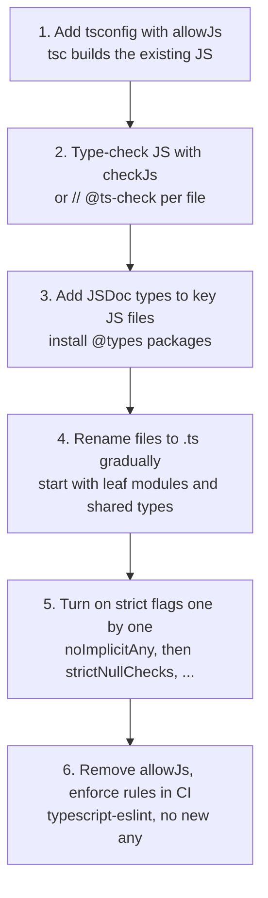

# TypeScript in Real Projects

> In this document you will learn how TypeScript is used day to day in Angular 16, Node.js/Express and React projects: typed reactive forms, typed `HttpClient`, `InjectionToken<T>`, typed Express handlers and middleware, React props and hooks, async code, and safe error handling. You will also learn how to migrate a JavaScript codebase to TypeScript step by step, which anti-patterns to avoid, how typescript-eslint helps, and how to keep type-checking fast. Interviewers use these topics to check whether you have used TypeScript on real teams, not only in tutorials.

**Before this:** [Modules, declaration files and tsconfig](09-modules-declaration-files-and-tsconfig.md) · [Runtime validation and type-safe APIs](11-runtime-validation-and-type-safe-apis.md) · [Generics](05-generics.md) · **Interview questions:** [jump to the interview section](#interview-questions)

## Table of contents

1. [TypeScript with Angular 16](#typescript-with-angular-16)
2. [TypeScript with Node.js and Express](#typescript-with-nodejs-and-express)
3. [TypeScript with React](#typescript-with-react)
4. [Typing asynchronous code](#typing-asynchronous-code)
5. [Error handling: catch variables are unknown](#error-handling-catch-variables-are-unknown)
6. [Migrating from JavaScript to TypeScript](#migrating-from-javascript-to-typescript)
7. [Anti-patterns to avoid](#anti-patterns-to-avoid)
8. [typescript-eslint](#typescript-eslint)
9. [Type-check performance basics](#type-check-performance-basics)
10. [Common mistakes](#common-mistakes)
11. [Best practices](#best-practices)
12. [How to explain this in an interview](#how-to-explain-this-in-an-interview)
13. [Interview questions](#interview-questions)
14. [Summary](#summary)
15. [References](#references)

---

## TypeScript with Angular 16

Angular is written in TypeScript, and every Angular project uses it. Angular 16 supports TypeScript **4.9.3 up to (but not including) 5.2** (TypeScript 5.1 needs Angular 16.1 or later). The CLI creates projects in **strict mode** by default: `strict: true` in `compilerOptions` plus `strictTemplates` in `angularCompilerOptions` (see [Angular-specific configuration](09-modules-declaration-files-and-tsconfig.md#angular-specific-configuration)).

### Strict mode in practice: component properties

With `strictPropertyInitialization`, every class property must be initialized. Angular components often have properties that the framework sets later. Here are the correct patterns:

```ts
import { Component, ElementRef, Input, OnInit, ViewChild } from "@angular/core";

export interface User { id: number; name: string }

@Component({
  selector: "app-user-card",
  template: `<input #nameInput [value]="user.name" /> <span>{{ title }}</span>`,
})
export class UserCardComponent implements OnInit {
  // ✅ Angular 16+: required input — the template compiler reports a missing binding
  @Input({ required: true }) user!: User;

  // ✅ Optional input with a default value
  @Input() title = "User";

  // ✅ Set by Angular after the view is created — use `!` and only read it in ngAfterViewInit or later
  @ViewChild("nameInput") nameInput!: ElementRef<HTMLInputElement>;

  // ✅ Data loaded later — model "not loaded yet" honestly
  details: { email: string } | null = null;

  ngOnInit(): void {
    console.log(this.user.name);
  }
}
```

Guidelines:

- Prefer **real initial values** (`title = "User"`, `items: Item[] = []`, `details: X | null = null`).
- Use the **definite assignment assertion `!`** only when Angular guarantees the value (required inputs, view queries read after the view is ready).
- `@Input({ required: true })` is new in **Angular 16**. With `strictTemplates`, forgetting `[user]="..."` in a parent template becomes a compile error.

> **Newer Angular (17.1+):** signal inputs `user = input.required<User>()` remove the need for `!` on inputs. They are not available in Angular 16.

### Typed reactive forms (Angular 14+)

Since Angular 14, reactive forms are **typed**. `FormControl<string>` knows its value type, and `form.value` is typed from the controls.

```ts
import { Component, inject } from "@angular/core";
import { FormControl, FormGroup, NonNullableFormBuilder, Validators } from "@angular/forms";

interface ProfileForm {
  name: FormControl<string>;
  email: FormControl<string>;
  age: FormControl<number | null>;
  newsletter: FormControl<boolean>;
}

@Component({ selector: "app-profile", template: "" })
export class ProfileComponent {
  private fb = inject(NonNullableFormBuilder);

  // nonNullable: reset() goes back to the initial value instead of null
  form: FormGroup<ProfileForm> = this.fb.group({
    name: this.fb.control("", { validators: [Validators.required, Validators.minLength(2)] }),
    email: this.fb.control("", { validators: [Validators.required, Validators.email] }),
    age: new FormControl<number | null>(null),
    newsletter: this.fb.control(false),
  });

  save(): void {
    // form.value is Partial<...> because DISABLED controls are left out of .value
    const partial = this.form.value; // { name?: string; email?: string; age?: number | null; newsletter?: boolean }

    // getRawValue() includes disabled controls, so every key is present
    const full = this.form.getRawValue(); // { name: string; email: string; age: number | null; newsletter: boolean }
    console.log(partial.name?.toUpperCase(), full.name.toUpperCase());
  }
}
```

Things to understand:

| Concept | Why |
| --- | --- |
| `FormControl<string>` vs `FormControl<string \| null>` | By default a control's type includes `null`, because `control.reset()` sets it to `null`. A **non-nullable** control resets to its initial value, so its type has no `null`. |
| `NonNullableFormBuilder` / `fb.nonNullable` | Creates non-nullable controls without repeating `{ nonNullable: true }`. |
| `form.value` is `Partial<...>` | Disabled controls are excluded from `.value`, so every key may be missing. |
| `form.getRawValue()` | Includes disabled controls; all keys are present. |
| `UntypedFormGroup`, `UntypedFormControl` | Escape hatch for old code (the `ng update` migration to v14 converted existing forms to these). Avoid in new code. |

Typed forms also catch typos: `this.form.controls.emial` is a compile error, and `this.form.patchValue({ age: "30" })` is rejected because `age` is `number | null`.

### Typed HttpClient (and its limit)

```ts
import { Injectable } from "@angular/core";
import { HttpClient, HttpParams } from "@angular/common/http";
import { Observable, map } from "rxjs";

export interface Order { id: string; total: number; status: "pending" | "paid" }
export interface Page<T> { items: T[]; total: number }

@Injectable({ providedIn: "root" })
export class OrderApi {
  constructor(private http: HttpClient) {}

  // Typed for the compiler — NOT checked at runtime
  list(page: number): Observable<Page<Order>> {
    const params = new HttpParams().set("page", page);
    return this.http.get<Page<Order>>("/api/orders", { params });
  }

  // Map the API shape to the shape the UI needs
  totals(page: number): Observable<number[]> {
    return this.list(page).pipe(map((result) => result.items.map((order) => order.total)));
  }
}
```

`http.get<T>()` is convenient, but the generic is only an **assertion**: Angular does not check the JSON. For critical data, request `unknown` and parse it with a schema, as shown in [the end-to-end example](11-runtime-validation-and-type-safe-apis.md#end-to-end-example-express-and-zod-with-an-angular-client).

### InjectionToken<T>: typed DI for non-class values

Configuration objects and interfaces do not exist at runtime, so you cannot inject them by type. An `InjectionToken<T>` is a runtime token that **carries the type**:

```ts
import { Component, Inject, InjectionToken, inject } from "@angular/core";

export interface AppConfig {
  apiUrl: string;
  featureFlags: { newCheckout: boolean };
}

export const APP_CONFIG = new InjectionToken<AppConfig>("APP_CONFIG");

// Provide it, for example in AppModule providers or bootstrapApplication:
export const appConfigProvider = {
  provide: APP_CONFIG,
  useValue: { apiUrl: "https://api.example.com", featureFlags: { newCheckout: true } } satisfies AppConfig,
};

@Component({ selector: "app-checkout", template: "" })
export class CheckoutComponent {
  // Option 1: inject() — the type AppConfig comes from the token automatically
  private config = inject(APP_CONFIG);

  // Option 2: constructor parameter with @Inject — you must write the type yourself
  constructor(@Inject(APP_CONFIG) private configFromCtor: AppConfig) {}

  get useNewCheckout(): boolean {
    return this.config.featureFlags.newCheckout;
  }
}
```

With `@Inject(APP_CONFIG) cfg: AppConfig`, nothing checks that the written type matches the token — you could write the wrong type. With `inject(APP_CONFIG)`, the type is inferred from `InjectionToken<AppConfig>`, so it cannot be wrong. This is one reason many teams prefer `inject()` in Angular 14+. Angular DI itself is covered in [Angular dependency injection](../06-angular-16/05-dependency-injection.md).

### Typing Observables and the async pipe

```ts
import { Component } from "@angular/core";
import { Observable, catchError, map, of, startWith } from "rxjs";

type LoadState<T> =
  | { status: "loading" }
  | { status: "success"; data: T }
  | { status: "error"; message: string };

interface Product { id: string; title: string }

function toLoadState<T>(source: Observable<T>): Observable<LoadState<T>> {
  return source.pipe(
    map((data): LoadState<T> => ({ status: "success", data })),
    startWith<LoadState<T>>({ status: "loading" }),
    catchError(() => of<LoadState<T>>({ status: "error", message: "Could not load data" }))
  );
}

@Component({
  selector: "app-products",
  template: `
    <ng-container *ngIf="state$ | async as state">
      <p *ngIf="state.status === 'loading'">Loading...</p>
      <p *ngIf="state.status === 'error'">{{ state.message }}</p>
      <ul *ngIf="state.status === 'success'">
        <li *ngFor="let p of state.data">{{ p.title }}</li>
      </ul>
    </ng-container>
  `,
})
export class ProductsComponent {
  state$: Observable<LoadState<Product[]>> = toLoadState(of([{ id: "p1", title: "Mouse" }]));
}
```

A discriminated union (`LoadState<T>`) models loading, success and error so that impossible combinations ("loading and error at the same time") cannot exist. With `strictTemplates`, Angular 16 narrows `state` inside `*ngIf="state.status === 'success'"`, so `state.data` is typed. RxJS typing is covered in [RxJS](../06-angular-16/09-rxjs.md).

---

## TypeScript with Node.js and Express

Install the type packages for Node.js and Express (Express 5 ships its types in `@types/express`):

```bash
npm install express
npm install -D typescript @types/node @types/express
```

### Typing request and response

Express's `Request` type has generic parameters:

```text
Request<Params, ResBody, ReqBody, ReqQuery>
Response<ResBody>
```

```ts
import express, { type Request, type Response } from "express";

interface Product { id: string; title: string; price: number }
interface ErrorBody { error: string }

const products = new Map<string, Product>([["p1", { id: "p1", title: "Mouse", price: 25 }]]);
const app = express();
app.use(express.json());

// GET /api/products/:id
app.get("/api/products/:id", (req: Request<{ id: string }>, res: Response<Product | ErrorBody>) => {
  const product = products.get(req.params.id);
  if (!product) {
    res.status(404).json({ error: "Not found" });
    return;
  }
  res.json(product); // checked against Product | ErrorBody
});

// GET /api/products?maxPrice=100
app.get("/api/products", (req: Request<{}, Product[], unknown, { maxPrice?: string }>, res: Response<Product[]>) => {
  const max = req.query.maxPrice === undefined ? Infinity : Number(req.query.maxPrice);
  res.json([...products.values()].filter((p) => p.price <= max));
});
```

Important facts:

- **Route params are typed automatically** from the path string: in `app.get("/users/:id", (req) => ...)`, `req.params.id` is known to be a `string`. Express's types parse the route with template literal types (see [Conditional types and infer](07-conditional-types-and-infer.md#template-literal-types-with-infer)).
- **The generics are not validation.** `Request<{}, {}, CreateUserDto>` only says what you *hope* `req.body` is. Validate it at runtime (Zod middleware or similar — see [Runtime validation](11-runtime-validation-and-type-safe-apis.md)). It is honest to type unvalidated bodies as `unknown`.
- **Query values are strings** (or arrays of strings), never numbers. Convert them explicitly.

### Typing middleware

```ts
import type { NextFunction, Request, RequestHandler, Response } from "express";

// A plain middleware
export function requestLogger(req: Request, res: Response, next: NextFunction): void {
  const start = Date.now();
  res.on("finish", () => console.log(`${req.method} ${req.originalUrl} ${res.statusCode} ${Date.now() - start}ms`));
  next();
}

// A middleware factory, typed with RequestHandler
export function requireRole(role: "admin" | "member"): RequestHandler {
  return (req, res, next) => {
    if (!req.user?.roles.includes(role)) {
      res.status(403).json({ error: "Forbidden" });
      return;
    }
    next();
  };
}

// (req.user comes from a Request augmentation — see the next section)
declare global {
  namespace Express {
    interface Request {
      user?: { id: string; roles: string[] };
    }
  }
}
```

### Augmenting Request

To make `req.user` (set by authentication middleware) known in every handler, you augment the global `Express.Request` interface, as in the `declare global` block above. The full explanation, including module augmentation of `express-serve-static-core`, is in [Module augmentation and global augmentation](09-modules-declaration-files-and-tsconfig.md#module-augmentation-and-global-augmentation).

### Typed configuration

Do not read `process.env` all over the code. Validate it once and export a typed object:

```ts
// file: src/config.ts
import { z } from "zod";

const EnvSchema = z.object({
  NODE_ENV: z.enum(["development", "production", "test"]).default("development"),
  PORT: z.coerce.number().int().default(3000),
  DATABASE_URL: z.url(),
});

export const config = Object.freeze(EnvSchema.parse(process.env));
export type Config = typeof config;
// config.PORT: number, config.NODE_ENV: "development" | "production" | "test"
```

More details: [Validating environment variables](11-runtime-validation-and-type-safe-apis.md#validating-environment-variables).

### Typed errors and the error-handling middleware

```ts
import express, { type NextFunction, type Request, type Response } from "express";

export class HttpError extends Error {
  constructor(
    public readonly status: number,
    message: string,
    public readonly code: string = "HTTP_ERROR",
    options?: { cause?: unknown }
  ) {
    super(message, options);
    this.name = "HttpError";
  }
}

export class NotFoundError extends HttpError {
  constructor(resource: string) {
    super(404, `${resource} not found`, "NOT_FOUND");
    this.name = "NotFoundError";
  }
}

const app = express();

// Express 5: a rejected promise from an async handler is passed to the error middleware automatically
app.get("/api/orders/:id", async (req, res) => {
  const order = await Promise.resolve(req.params.id === "o1" ? { id: "o1" } : null);
  if (!order) throw new NotFoundError("Order");
  res.json(order);
});

// Error-handling middleware: exactly four parameters
app.use((error: unknown, _req: Request, res: Response, _next: NextFunction) => {
  if (error instanceof HttpError) {
    res.status(error.status).json({ error: error.code, message: error.message });
    return;
  }
  console.error(error); // log unknown errors with full details on the server
  res.status(500).json({ error: "INTERNAL_ERROR", message: "Something went wrong" });
});
```

Notes:

- The error parameter is `unknown`: anything can be thrown. Narrow it with `instanceof`.
- `super(message, options)` passes `cause` (ES2022) so the original error is kept for logging.
- In **Express 4**, rejected promises from async handlers were **not** forwarded; you needed `try/catch` + `next(error)` or a wrapper. Express 5 forwards them.

Express itself is covered in [HTTP servers and Express](../07-nodejs-backend/06-http-servers-and-express.md).

### Running TypeScript in Node.js

| Approach | How | Notes |
| --- | --- | --- |
| Compile with `tsc`, run JS | `tsc -p tsconfig.json` then `node dist/server.js` | Most predictable for production |
| Node.js type stripping | `node src/server.ts` (Node 22.18+/23.6+) | No type check; erasable syntax only (no enums, namespaces, parameter properties, decorators); run `tsc --noEmit` separately |
| `tsx` (esbuild-based runner) | `npx tsx watch src/server.ts` | Fast dev loop, supports more syntax; no type check |
| `ts-node` | `npx ts-node src/server.ts` | Older, can type-check while running; slower |

Whichever you choose for running, run **`tsc --noEmit` in CI**, because the fast runners do not type-check.

---

## TypeScript with React

The main React content of this repository is in [React essentials](../05-frontend-engineering/08-react-essentials.md). Here are the TypeScript parts you need (React 18/19 function components).

### Props and children

```tsx
import type { ReactNode } from "react";

type ButtonProps = {
  label: string;
  variant?: "primary" | "secondary";
  disabled?: boolean;
  onClick: () => void;
};

export function Button({ label, variant = "primary", disabled = false, onClick }: ButtonProps) {
  return (
    <button className={`btn btn-${variant}`} disabled={disabled} onClick={onClick}>
      {label}
    </button>
  );
}

type CardProps = { title: string; children: ReactNode }; // ReactNode: anything React can render

export function Card({ title, children }: CardProps) {
  return (
    <section>
      <h2>{title}</h2>
      {children}
    </section>
  );
}
```

Typing the props parameter directly (instead of `React.FC<Props>`) is the common style today. It is explicit, works with generics, and does not add `children` implicitly.

### Events

```tsx
import { useState, type ChangeEvent, type FormEvent } from "react";

export function SearchBox({ onSearch }: { onSearch: (term: string) => void }) {
  const [term, setTerm] = useState("");

  function handleChange(event: ChangeEvent<HTMLInputElement>) {
    setTerm(event.target.value); // target is typed as HTMLInputElement
  }

  function handleSubmit(event: FormEvent<HTMLFormElement>) {
    event.preventDefault();
    onSearch(term.trim());
  }

  return (
    <form onSubmit={handleSubmit}>
      <input value={term} onChange={handleChange} />
      <button type="submit">Search</button>
    </form>
  );
}
```

Tip: if you write the handler inline (`onChange={(e) => setTerm(e.target.value)}`), TypeScript infers the event type from context. You only need explicit event types when the handler is a separate function.

### Hooks

```tsx
import { createContext, useContext, useEffect, useRef, useState } from "react";

interface User { id: number; name: string }

export function Profile({ userId }: { userId: number }) {
  // When the initial value does not show the full type, pass it explicitly
  const [user, setUser] = useState<User | null>(null);
  const [error, setError] = useState<string | null>(null);

  // A DOM ref starts as null
  const inputRef = useRef<HTMLInputElement>(null);

  useEffect(() => {
    let cancelled = false;
    fetch(`/api/users/${userId}`)
      .then((r) => r.json() as Promise<User>) // assertion — validate in real code
      .then((data) => { if (!cancelled) setUser(data); })
      .catch(() => { if (!cancelled) setError("Could not load user"); });
    return () => { cancelled = true; };
  }, [userId]);

  if (error) return <p>{error}</p>;
  if (!user) return <p>Loading...</p>;
  return <input ref={inputRef} defaultValue={user.name} />;
}

// Context with a safe hook
type Theme = "light" | "dark";
const ThemeContext = createContext<{ theme: Theme; toggle: () => void } | undefined>(undefined);

export function useTheme() {
  const value = useContext(ThemeContext);
  if (!value) throw new Error("useTheme must be used inside ThemeProvider");
  return value; // the type no longer includes undefined
}
```

---

## Typing asynchronous code

Async code is covered in depth in [Callbacks and promises](../02-javascript/17-callbacks-and-promises.md) and [Async/await](../02-javascript/18-async-await.md). Here is what TypeScript adds.

### Async functions always return a Promise

```ts
interface User { id: number; name: string }

async function findUser(id: number): Promise<User | undefined> {
  const users: User[] = [{ id: 1, name: "Asha" }];
  return users.find((u) => u.id === id);
}

// ❌ Wrong: an async function cannot have a non-Promise return type
// async function broken(): User { ... } // Error: The return type of an async function must be the global Promise<T> type

async function main() {
  const user = await findUser(1); // User | undefined
  console.log(user?.name);        // Asha
}
main();
```

Writing the return type (`Promise<User | undefined>`) on exported async functions is good practice: it documents the contract, and a wrong `return` inside becomes an error at the function, not at every caller.

### Promise.all keeps tuple types

```ts
async function loadDashboard() {
  const [user, orders, unread] = await Promise.all([
    Promise.resolve({ id: 1, name: "Asha" }),
    Promise.resolve([{ id: "o1", total: 120 }]),
    Promise.resolve(3),
  ]);
  // user: { id: number; name: string }, orders: { id: string; total: number }[], unread: number
  return { user, orders, unread };
}

loadDashboard().then((d) => console.log(d.user.name, d.orders.length, d.unread)); // Asha 1 3
```

### Promise.allSettled and narrowing

```ts
async function fetchPrices(ids: string[]) {
  const results = await Promise.allSettled(
    ids.map(async (id) => {
      if (id === "bad") throw new Error(`No price for ${id}`);
      return { id, price: 100 };
    })
  );

  for (const result of results) {
    if (result.status === "fulfilled") {
      console.log(result.value.price); // value is typed
    } else {
      console.log("failed:", result.reason instanceof Error ? result.reason.message : result.reason);
    }
  }
}

fetchPrices(["p1", "bad"]);
// 100
// failed: No price for bad
```

`PromiseSettledResult<T>` is a discriminated union on `status`. Note that `reason` is typed `any`, so narrow it before use.

### Awaited and derived types

```ts
async function getOrders() {
  return [{ id: "o1", total: 120 }];
}

type Orders = Awaited<ReturnType<typeof getOrders>>; // { id: string; total: number }[]
```

See [Awaited](08-utility-types.md#awaited).

### Floating promises

A **floating promise** is a promise that nobody awaits or handles. If it rejects, the error is lost or crashes the process (`unhandledRejection` — in Node.js 15+ the default is to crash).

```ts
async function saveAudit(event: string): Promise<void> {
  if (event === "") throw new Error("empty event");
}

async function handleRequest() {
  // ❌ Wrong: floating promise — a rejection is not handled
  saveAudit("login");

  // ✅ Correct: await it
  await saveAudit("login");

  // ✅ Correct: intentionally fire-and-forget, but handle errors and mark it with void
  void saveAudit("login").catch((error) => console.error("audit failed", error));
}
```

TypeScript does not report floating promises. The typescript-eslint rule `@typescript-eslint/no-floating-promises` does (see [typescript-eslint](#typescript-eslint)).

### Async callbacks where void is expected

```ts
const ids = ["a", "b"];

// ❌ Wrong: forEach does not wait for async callbacks — "done" is printed before the saves finish
ids.forEach(async (id) => {
  await new Promise((r) => setTimeout(r, 10));
  console.log("saved", id);
});
console.log("done");

// ✅ Correct: use for...of with await, or Promise.all for parallel work
async function saveAll() {
  for (const id of ids) {
    await new Promise((r) => setTimeout(r, 10));
    console.log("saved in order", id);
  }
  await Promise.all(ids.map(async (id) => console.log("saved in parallel", id)));
}
saveAll();
```

TypeScript allows passing an async function where a `void`-returning callback is expected (the "void return" rule — see [Functions and classes](04-functions-and-classes.md)). The `@typescript-eslint/no-misused-promises` rule catches this.

---

## Error handling: catch variables are unknown

With `strict` (specifically `useUnknownInCatchVariables`, TypeScript 4.4+), the variable in `catch (error)` has type **`unknown`**. JavaScript can throw anything — an `Error`, a string, a number, `undefined` — so `unknown` is the honest type.

```ts
try {
  JSON.parse("{ broken");
} catch (error) {
  // console.log(error.message);  // ❌ Error: 'error' is of type 'unknown'
  if (error instanceof SyntaxError) {
    console.log("Bad JSON:", error.message);
  } else if (error instanceof Error) {
    console.log("Other error:", error.message);
  } else {
    console.log("Non-error thrown:", String(error));
  }
}
// Bad JSON: Expected property name or '}' in JSON at position 2 (line 1 column 3)
```

### A reusable helper

```ts
export function getErrorMessage(error: unknown): string {
  if (error instanceof Error) return error.message;
  if (typeof error === "string") return error;
  try {
    return JSON.stringify(error);
  } catch {
    return String(error);
  }
}

try {
  throw "plain string thrown by an old library";
} catch (error) {
  console.log(getErrorMessage(error)); // plain string thrown by an old library
}
```

### Why not `catch (error: any)`?

You may annotate `catch (error: any)` or `catch (error: unknown)` explicitly. `any` turns off checking again and hides bugs. Prefer `unknown` and narrow.

### Typed custom errors

```ts
class ValidationError extends Error {
  constructor(public readonly fieldErrors: Record<string, string[]>) {
    super("Validation failed");
    this.name = "ValidationError";
  }
}

function handle(error: unknown): { status: number; body: unknown } {
  if (error instanceof ValidationError) return { status: 400, body: error.fieldErrors };
  return { status: 500, body: { error: "Internal error" } };
}

console.log(handle(new ValidationError({ email: ["Invalid email"] })));
// { status: 400, body: { email: [ 'Invalid email' ] } }
```

One caveat: `instanceof` can fail across realms (iframes, Node.js `vm` contexts) or when two copies of a library are installed. For errors crossing such boundaries, check a property instead (`error.name === "ValidationError"`, or a `code` field).

Promise rejections: `promise.catch((reason) => ...)` types `reason` as `any`, not `unknown`. Treat it as `unknown` yourself (`(reason: unknown) => ...`).

General error handling is covered in [Error handling](../02-javascript/15-error-handling.md).

---

## Migrating from JavaScript to TypeScript

Big-bang rewrites are risky. TypeScript is designed for **gradual** adoption. Here is a practical plan.



### Step 1: add TypeScript next to the JavaScript

```json
{
  "compilerOptions": {
    "allowJs": true,
    "checkJs": false,
    "outDir": "dist",
    "rootDir": "src",
    "target": "es2022",
    "module": "nodenext",
    "strict": false,
    "noEmitOnError": false
  },
  "include": ["src"]
}
```

`allowJs` lets `.js` and `.ts` files live together and import each other. Nothing breaks yet.

### Step 2: type-check JavaScript

Turn on checking per file with a comment, or everywhere with `checkJs: true`:

```js
// @ts-check
const total = calculateTotal([1, 2, 3]);
total.toFixed(2); // TypeScript now reports errors in this JS file too
```

Use `// @ts-nocheck` at the top of files that are too noisy for now.

### Step 3: JSDoc types — types without renaming files

TypeScript understands JSDoc comments in JavaScript:

```js
// @ts-check

/**
 * @typedef {Object} CartItem
 * @property {string} productId
 * @property {number} price
 * @property {number} qty
 */

/**
 * Calculates the cart total.
 * @param {CartItem[]} items
 * @param {{ discountPercent?: number }} [options]
 * @returns {number}
 */
export function calculateTotal(items, options = {}) {
  const subtotal = items.reduce((sum, item) => sum + item.price * item.qty, 0);
  const discount = options.discountPercent ?? 0;
  return Math.round(subtotal * (1 - discount / 100));
}

/** @type {import("./types").Config} */
const config = { apiUrl: "https://api.example.com" };
```

This gives editor help and type checks immediately. Some teams (and some libraries) stay on JSDoc permanently. With `declaration: true`, `tsc` can even generate `.d.ts` files from these JavaScript files.

### Step 4: rename files gradually

- Start with **leaf modules** (utilities with few imports) and **shared types/models**. Then move up the dependency tree.
- Install `@types/*` packages for dependencies; write small `.d.ts` files for untyped internal modules (see [Writing declarations for a JavaScript library](09-modules-declaration-files-and-tsconfig.md#writing-declarations-for-a-javascript-library)).
- Keep each pull request small: rename + fix types, no behavior changes mixed in.

### Step 5: increase strictness step by step

A common order:

1. `noImplicitAny` — find every untyped parameter.
2. `strictNullChecks` — the biggest and most valuable step; fix "possibly undefined" errors.
3. The rest of `strict` (`strictFunctionTypes`, `strictPropertyInitialization`, `useUnknownInCatchVariables`, ...).
4. Extras like `noUncheckedIndexedAccess`.

For a large codebase, a flag can be too big to fix at once. Options:

- Fix one folder at a time using a separate `tsconfig` for strict folders (project references help).
- Use `// @ts-expect-error` on known errors with a comment and a ticket, then remove them over time.

### `@ts-expect-error` vs `@ts-ignore`

```ts
// @ts-expect-error — legacy API returns a number here; tracked in TICKET-123
const id: string = 42;
```

| | `@ts-ignore` | `@ts-expect-error` |
| --- | --- | --- |
| Suppresses the error on the next line | Yes | Yes |
| If there is **no** error | Silently does nothing | **Reports an error** ("Unused '@ts-expect-error' directive") |
| Use | Rarely | Preferred, so suppressions are removed when the problem is fixed |

### Step 6: lock it in

- Remove `allowJs` when no JavaScript is left.
- Add `tsc --noEmit` and typescript-eslint to CI.
- Add rules that stop new `any` (`@typescript-eslint/no-explicit-any`) and new suppressions without a description (`@typescript-eslint/ban-ts-comment`).

### Migration tips

- **Do not try to type everything perfectly at first.** `unknown` at boundaries and simple interfaces are enough. Refine later.
- **Measure progress**: count files still in JS and the number of `any` and `@ts-expect-error`.
- **Tests matter more than ever**: renaming and retyping should not change behavior.
- **Angular projects** are already TypeScript; their "migration" is usually enabling `strict` and `strictTemplates` on an older app, folder by folder.

---

## Anti-patterns to avoid

### 1. `any` spreading

`any` is contagious: anything you read from an `any` value is also `any`, and checking stops silently.

```ts
// ❌ Wrong
function parseSettings(json: string): any {
  return JSON.parse(json);
}
const settings = parseSettings('{"theme":"dark"}');
const size: number = settings.fontSize.value; // compiles — crashes at runtime
```

```ts
// ✅ Correct: unknown + validation (or a schema)
interface Settings { theme: "light" | "dark" }

function parseSettings(json: string): Settings {
  const data: unknown = JSON.parse(json);
  if (typeof data === "object" && data !== null && "theme" in data &&
      (data.theme === "light" || data.theme === "dark")) {
    return { theme: data.theme };
  }
  throw new Error("Invalid settings");
}
console.log(parseSettings('{"theme":"dark"}').theme); // dark
```

### 2. Unsafe `as` assertions

```ts
interface User { id: number; name: string }

// ❌ Wrong: "trust me" without checking
const user = {} as User;
console.log(user.name.length); // TypeError at runtime

// ❌ Wrong: double assertion to force incompatible types
const n = "42" as unknown as number;
```

Assertions are acceptable when you **truly know more than the compiler** (for example after a check the compiler cannot follow) — keep them small and close to the check. Prefer `satisfies` when you only want to check a value against a type without changing its inferred type:

```ts
type Route = { path: string; title: string };

const routes = {
  home: { path: "/", title: "Home" },
  orders: { path: "/orders", title: "Orders" },
} satisfies Record<string, Route>; // checked, but keeps the exact keys "home" | "orders"

console.log(routes.orders.path); // /orders — routes.unknownKey would be an error
```

### 3. Non-null assertions everywhere

```ts
const button = document.querySelector<HTMLButtonElement>("#save")!; // ❌ crashes later if the element is missing

const saveButton = document.querySelector<HTMLButtonElement>("#save");
if (!saveButton) throw new Error("#save button not found"); // ✅ fail with a clear message
saveButton.disabled = true;
```

### 4. Over-engineered types

```ts
// ❌ Too clever for application code: hard to read, slow, terrible error messages
type DeepKeys<T> = T extends object
  ? { [K in keyof T & string]: K | `${K}.${DeepKeys<T[K]>}` }[keyof T & string]
  : never;

// ✅ Usually enough: a simple union or interface
type SortField = "name" | "createdAt" | "total";
```

Clever types belong in small, tested library code, not in every component. See [Readability and when not to use type-level programming](07-conditional-types-and-infer.md#readability-and-when-not-to-use-type-level-programming).

### 5. Duplicated types that drift

Hand-copying the same shape into several interfaces (entity, DTO, form model, test fixture). Derive them with utility types or from a schema instead (see [Utility types](08-utility-types.md) and [Zod](11-runtime-validation-and-type-safe-apis.md#schema-libraries-and-zod)).

### 6. Using `Function`, `Object` or `{}` as types

```ts
// ❌ Too loose
function run(callback: Function) { return callback(); } // any arguments, returns any
function log(value: Object) { console.log(value); }     // accepts almost anything

// ✅ Precise
function runTyped(callback: () => void) { callback(); }
function logRecord(value: Record<string, unknown>) { console.log(value); }
```

### 7. Interfaces for everything "just in case"

Creating an `IUserService` interface for every class "for testability" when there is only one implementation and the test framework can mock classes. Add an interface when there is a real second implementation or a real boundary (see [Dependency inversion and injection](../04-oop-solid-design-patterns/05-dependency-inversion-and-injection.md)).

### 8. Ignoring compile errors because "the build still works"

`tsc` emits JavaScript even with errors unless `noEmitOnError` is set, and bundlers often do not type-check at all. Make `tsc --noEmit` a required CI step.

---

## typescript-eslint

**typescript-eslint** lets ESLint understand TypeScript. It provides a parser and many rules. Some rules use **type information** ("typed linting") and catch bugs that the compiler does not report.

### Setup (ESLint 9 flat config)

```bash
npm install -D eslint @eslint/js typescript-eslint
```

```js
// eslint.config.mjs
import eslint from "@eslint/js";
import { defineConfig } from "eslint/config";
import tseslint from "typescript-eslint";

export default defineConfig(
  eslint.configs.recommended,
  tseslint.configs.recommendedTypeChecked, // or strictTypeChecked for stricter teams
  {
    languageOptions: {
      parserOptions: {
        projectService: true,               // use the tsconfig that applies to each file
        tsconfigRootDir: import.meta.dirname,
      },
    },
    rules: {
      "@typescript-eslint/no-floating-promises": "error",
      "@typescript-eslint/consistent-type-imports": "error",
      "@typescript-eslint/switch-exhaustiveness-check": "error",
    },
  }
);
```

(`defineConfig` comes from ESLint 9.22+. Older setups use the `tseslint.config(...)` helper the same way.)

Angular 16 projects usually use **angular-eslint** (`ng add @angular-eslint/schematics`), which in that era generates an `.eslintrc.json` (ESLint 8 style) with typescript-eslint rules plus Angular template rules.

### Rules that catch real bugs

| Rule | Catches |
| --- | --- |
| `no-floating-promises` | Promises that are not awaited or handled |
| `no-misused-promises` | Async functions passed where `void` callbacks are expected (`forEach(async ...)`, `if (promise)`) |
| `await-thenable` | `await` on a non-promise value |
| `no-unsafe-assignment`, `no-unsafe-member-access`, `no-unsafe-call`, `no-unsafe-return`, `no-unsafe-argument` | `any` flowing into typed code |
| `no-explicit-any` | Writing `any` |
| `switch-exhaustiveness-check` | `switch` over a union that misses a case |
| `no-unnecessary-condition` | Conditions that are always true/false according to the types (often dead code or wrong types) |
| `prefer-nullish-coalescing`, `prefer-optional-chain` | `||` where `??` is safer, long `&&` chains |
| `consistent-type-imports` | Enforces `import type` for type-only imports |
| `ban-ts-comment` | `@ts-ignore`, or `@ts-expect-error` without a description |
| `no-non-null-assertion` | `!` assertions |
| `restrict-template-expressions` | Objects or `undefined` inside template strings (`${user}` printing `[object Object]`) |

Example of what `no-misused-promises` reports:

```ts
async function isAllowed(userId: string): Promise<boolean> {
  return userId === "admin";
}

async function visibleUsers(userIds: string[]) {
  // ❌ Bug: filter() treats the returned Promise as truthy, so EVERY user is kept
  const wrong = userIds.filter(async (id) => isAllowed(id));

  // ✅ Correct: resolve the checks first, then filter
  const checks = await Promise.all(userIds.map((id) => isAllowed(id)));
  const right = userIds.filter((_id, index) => checks[index]);

  console.log(wrong, right);
}

void visibleUsers(["admin", "guest"]); // [ 'admin', 'guest' ] [ 'admin' ]
```

TypeScript compiles the buggy `filter` without complaint, because an async function is assignable to a callback whose return value is only used as "truthy or not". (TypeScript does report the simplest case, `if (isAllowed(id))`, with error TS2801, but not promises hidden inside callbacks like this.) The lint rule catches these patterns reliably.

Typed linting is slower than normal linting because it runs the type checker. It is worth it for these rules.

---

## Type-check performance basics

In large projects, `tsc` and the editor can become slow. Basic steps:

### Measure first

```bash
npx tsc --noEmit --extendedDiagnostics   # check time, memory, number of types and instantiations
npx tsc --noEmit --generateTrace trace   # detailed trace to find slow files and types
```

More commands are in [Measuring type-check speed](09-modules-declaration-files-and-tsconfig.md#measuring-type-check-speed).

### Configuration

- `skipLibCheck: true` — do not re-check `.d.ts` files of dependencies.
- `incremental: true` — reuse results from the previous build.
- **Project references** + `tsc -b` for monorepos — check each package separately and reuse `.d.ts` output.
- Keep `include` tight: do not include `dist`, generated files or huge fixture folders.
- Limit global types with `"types": [...]`.

### Code patterns

- **Add explicit return types to exported functions**, especially complex ones. The compiler (and `.d.ts` generation) does less inference work, and errors appear in the right place.
- **Prefer `interface ... extends` over big intersections** (`A & B & C`) for object types that are extended a lot. The TypeScript team's performance guidance notes that interfaces are cached by name, while intersections are re-computed.
- **Avoid huge unions** (thousands of members) and **deeply recursive conditional types** in hot paths.
- **Name complex types** instead of repeating long inline types.
- **Avoid barrel files that re-export everything** in very large apps; they make the compiler and bundler load more files than needed.

### Faster compilers

- Transpile with fast tools (esbuild, swc, Vite) and run `tsc --noEmit` only for checking — in parallel in CI.
- **TypeScript 7.0** (July 2026) is the native Go port of the compiler, with full builds typically about 8–12 times faster. It ships without a programmatic API (one is planned for 7.1), so tools that depend on the compiler API (typescript-eslint, and Angular's editor language service) still run on TypeScript 6 next to it. Angular 16 projects stay on TypeScript ≤ 5.1 regardless. See [Changes in TypeScript 6 and 7](09-modules-declaration-files-and-tsconfig.md#changes-in-typescript-6-and-7).

---

## Common mistakes

1. **Trusting `HttpClient.get<T>()`, `res.json()` or `req.body` types.** They are assertions; validate at the boundary.
2. **Using `!` on every Angular property** instead of initial values, `| null`, or required inputs.
3. **Reading `form.value` and expecting all keys.** It is `Partial` because of disabled controls; use `getRawValue()` when you need all fields.
4. **Using `catch (error: any)`.** Keep it `unknown` and narrow.
5. **Leaving floating promises** and `forEach(async ...)` loops.
6. **Typing Express query parameters as numbers.** They are strings until you convert them.
7. **Migrating with a big-bang rewrite** instead of `allowJs` + gradual strictness.
8. **Using `@ts-ignore` instead of `@ts-expect-error` with a reason.**
9. **Relying on the bundler for type safety.** Vite/esbuild do not type-check; run `tsc --noEmit`.
10. **Writing clever generic types in application code** that nobody else can maintain.

---

## Best practices

- **Enable `strict` (and `strictTemplates` in Angular) from the start.** Reason: the biggest safety gain for the lowest cost.
- **Model data honestly**: `T | null` for "not loaded yet", discriminated unions for load states, `unknown` for external data. Reason: impossible states become impossible.
- **Validate at boundaries, trust inside.** Reason: types become true without checks everywhere.
- **Prefer `inject()` and `InjectionToken<T>` in Angular 14+ for non-class dependencies.** Reason: the type comes from the token and cannot be mistyped.
- **Use typed reactive forms with non-nullable controls.** Reason: compile-time checks for form values and control names.
- **Annotate return types of exported and async functions.** Reason: clear contracts, better errors, faster checking.
- **Handle every promise** (await, return, or `void` + `.catch`). Reason: no lost errors or crashes.
- **Use typescript-eslint with typed rules in CI.** Reason: catches bugs the compiler misses.
- **Migrate gradually** with `allowJs`, JSDoc, and one strict flag at a time. Reason: steady progress without stopping feature work.
- **Keep types simple in application code.** Reason: readability and fast builds.

---

## How to explain this in an interview

1. **Define it:** "Using TypeScript well in a real project means strict settings, honest types at boundaries, and tooling that keeps the codebase safe as it grows."
2. **Why it exists:** "Types catch whole classes of bugs before runtime — null access, typos in field names, wrong arguments — and make refactoring safe on large teams."
3. **How it works:** "In Angular I use strict mode, strict templates, typed reactive forms and `InjectionToken<T>` with `inject()`. In Express I type handlers with `Request` generics, augment `Express.Request` for auth data, and validate bodies and env with Zod. Catch variables are `unknown`, so I narrow errors."
4. **Small example:** "`form.getRawValue()` gives a fully typed object from a typed `FormGroup`, while `form.value` is `Partial` because disabled controls are excluded."
5. **Where it is useful:** "Large Angular apps, Node APIs shared by several teams, migrations of old JavaScript code."
6. **Trade-offs / gotchas:** "Types don't validate runtime data, `any` and unsafe `as` spread silently, bundlers don't type-check, and over-clever types slow everyone down. I keep `tsc --noEmit` and typescript-eslint in CI."

---

## Interview questions

### Q1. How do you handle class properties in strict Angular components?

**What the interviewer is checking:** Practical strict-mode experience in Angular.

**Short spoken answer (30–60 seconds):**
> With `strictPropertyInitialization`, each property must be initialized. I prefer real defaults — empty arrays, default strings — and `| null` for data that loads later, so the template has to handle the "not loaded" case. For inputs that must be provided I use `@Input({ required: true })`, new in Angular 16, with a `!`, and strict templates will report a missing binding in the parent. For `@ViewChild` I use `!` and only access it in `ngAfterViewInit` or later. I avoid putting `!` everywhere, because each one is an unchecked promise to the compiler.

**Follow-up questions:**
- **What changes in Angular 17.1+?** — Signal inputs: `user = input.required<User>()`, no `!` needed.
- **Why is `!` risky?** — The compiler stops checking; if the value is missing at runtime you get "cannot read properties of undefined".

**Common mistakes:** Disabling `strictPropertyInitialization` for the whole project.

**Where this is used in real projects:** Every Angular component.

### Q2. What are typed reactive forms? Why is `form.value` a `Partial`?

**What the interviewer is checking:** Angular 14+ forms knowledge.

**Short spoken answer (30–60 seconds):**
> Since Angular 14, `FormControl`, `FormGroup` and `FormArray` are generic, so the form knows the type of each control's value. That catches typos in control names and wrong value types in `setValue` or `patchValue`. By default a control's type includes `null` because `reset()` sets it to `null`; with non-nullable controls — `NonNullableFormBuilder` or `nonNullable: true` — reset goes back to the initial value, so the type has no `null`. `form.value` is `Partial` because disabled controls are excluded from it. When I need every field, I use `getRawValue()`.

**Code:**

```ts
import { FormControl, FormGroup } from "@angular/forms";

const login = new FormGroup({
  email: new FormControl("", { nonNullable: true }),
  remember: new FormControl(false, { nonNullable: true }),
});

const v = login.value;          // { email?: string; remember?: boolean }
const raw = login.getRawValue(); // { email: string; remember: boolean }
// login.patchValue({ remember: "yes" }); // ❌ Error: string is not assignable to boolean
console.log(v.email === raw.email);       // true
```

**Follow-up questions:**
- **What happened to existing forms when upgrading to Angular 14?** — The migration changed them to `UntypedFormGroup`/`UntypedFormControl` so they keep the old `any` behavior; you migrate them to typed forms gradually.

**Where this is used in real projects:** Every form-heavy Angular app.

<a id="q3-is-thishttpgetuser-type-safe"></a>

### Q3. Is `this.http.get<User>()` type-safe?

**Related:** the generics view of this question is [Generics Q4](05-generics.md#q4-does-httpgetuserurl-in-angular-guarantee-that-you-get-users); the full validation pattern is in [Runtime validation: Angular 16 client service](11-runtime-validation-and-type-safe-apis.md#angular-16-client-service).

**Short spoken answer (30–60 seconds):**
> Only at compile time. The generic tells TypeScript what to assume the response is, but Angular doesn't check the JSON — it's effectively a type assertion. If the backend changes the shape, the code compiles and breaks at runtime somewhere in a template. For important data I request `get<unknown>()` and parse the response with a schema in a `map` operator, so a contract change becomes a clear error in the Observable. I also keep the contract shared or generated from OpenAPI so most changes are caught at build time.

<a id="q4-how-does-injectiontokent-work-and-why-prefer-inject-with-it"></a>

### Q4. How does `InjectionToken<T>` work, and why prefer `inject()` with it?

**What the interviewer is checking:** Typed DI for non-class values.

**Short spoken answer (30–60 seconds):**
> Interfaces and plain objects don't exist at runtime, so Angular can't inject them by type. An `InjectionToken<AppConfig>` is a unique runtime object used as the DI key, and its generic carries the type. I provide a value for it with `{ provide: APP_CONFIG, useValue: ... }`. If I inject it with `inject(APP_CONFIG)`, the result is typed as `AppConfig` automatically. With `@Inject(APP_CONFIG) config: AppConfig` in a constructor, I write the type by hand and nothing verifies it matches the token. So `inject()` is safer and shorter.

**Follow-up questions:**
- **Where can `inject()` be called?** — In an injection context: field initializers, constructors, factory functions, and (with `runInInjectionContext`) elsewhere. Not in arbitrary methods called later.
- **How do you make sure the provided value matches?** — `useValue: {...} satisfies AppConfig` checks it against the type.

### Q5. How do you type an Express route handler and the request body?

**What the interviewer is checking:** Express typing plus awareness of validation.

**Short spoken answer (30–60 seconds):**
> Express's `Request` has generics: `Request<Params, ResBody, ReqBody, Query>`, and `Response<ResBody>`. Route params are actually inferred from the path string in the Express types, so `req.params.id` is a string automatically. For the body, the generic is just a claim — nothing checks it — so I treat the body as `unknown` and validate it with a schema middleware, then the handler receives the parsed, typed data. Query values are always strings, so I coerce them. For `req.user` from auth middleware, I augment the global `Express.Request` interface in a `.d.ts` file.

**Follow-up questions:**
- **How are async errors handled?** — In Express 5, a rejected promise from an async handler goes to the error middleware automatically; in Express 4 you need `try/catch` and `next(err)` or a wrapper.
- **How do you type the error middleware?** — Four parameters `(error: unknown, req, res, next)`, then narrow `error` with `instanceof`.

### Q6. Why is the `catch` variable `unknown`, and how do you handle it?

**What the interviewer is checking:** Safe error handling.

**Short spoken answer (30–60 seconds):**
> JavaScript can throw anything — an `Error`, a string, a number, even `undefined` — so the honest type of a caught value is `unknown`. Since TypeScript 4.4, the `useUnknownInCatchVariables` flag, part of `strict`, makes it `unknown`. I narrow before use: `instanceof` for my error classes and `Error`, `typeof` for strings, and a fallback. I usually have a small `getErrorMessage(error: unknown)` helper for logging. I avoid `catch (e: any)` because it switches off the checks again.

**Follow-up questions:**
- **What about `promise.catch(reason => ...)`?** — `reason` is typed `any` in the standard library; annotate it as `unknown` yourself.
- **When can `instanceof` fail?** — Across realms (iframes, `vm`) or with duplicated library copies; then check `name` or a `code` property.

### Q7. What is a floating promise, and how do you prevent it?

**Short spoken answer (30–60 seconds):**
> It's a promise that nobody awaits, returns, or attaches a `.catch` to. If it rejects, the error is lost — or in Node.js 15 and later the process crashes on an unhandled rejection by default. A classic case is calling an async function without `await`, or `array.forEach(async ...)`, which doesn't wait. TypeScript doesn't report it, so I enable typescript-eslint's `no-floating-promises` and `no-misused-promises`. When fire-and-forget is intentional, I write `void doWork().catch(logError)` so it's explicit and handled.

### Q8. Output prediction: what does this print?

```ts
const ids = [1, 2];

ids.forEach(async (id) => {
  await null;
  console.log("processed", id);
});

console.log("done");
```

**Answer:**

```text
done
processed 1
processed 2
```

**Step by step:**
1. `forEach` calls the async callback for `1`. It runs until `await null`, then returns a promise immediately.
2. `forEach` ignores that promise and calls the callback for `2`, which also stops at `await`.
3. `forEach` finishes; `console.log("done")` runs.
4. The microtasks resume: `processed 1`, then `processed 2`.

`forEach` does not wait for async callbacks. Use `for...of` with `await` (sequential) or `await Promise.all(ids.map(...))` (parallel). (Confirmed by running with Node.js.)

### Q9. How would you migrate a large JavaScript codebase to TypeScript?

**What the interviewer is checking:** Planning, risk management, real experience.

**Short spoken answer (30–60 seconds):**
> Gradually. First I add a `tsconfig` with `allowJs`, so TypeScript builds the existing code without changes. Then I turn on checking for JavaScript — per file with `// @ts-check` or with `checkJs` — and add JSDoc types to important modules and install `@types` packages. Next I rename files to `.ts`, starting with leaf utilities and shared models, in small pull requests without behavior changes. Then I raise strictness one flag at a time — `noImplicitAny` first, then `strictNullChecks`, which is the biggest win. Known leftovers get `@ts-expect-error` with a ticket. Finally I put `tsc --noEmit` and typescript-eslint into CI and block new `any`. Tests are the safety net throughout.

**Follow-up questions:**
- **Why `@ts-expect-error` instead of `@ts-ignore`?** — It fails when the error disappears, so stale suppressions get cleaned up.
- **How do you track progress?** — Count of remaining `.js` files, `any` usages, and suppressions over time.
- **Which flag first?** — `noImplicitAny`, then `strictNullChecks`.

### Q10. What are the biggest TypeScript anti-patterns you see in code reviews?

**Short spoken answer (30–60 seconds):**
> First, `any` — it spreads silently, because everything read from an `any` is also `any`. Second, unsafe `as` assertions, especially on API data or `as unknown as X` double casts. Third, non-null `!` assertions everywhere instead of handling the missing case. Fourth, trusting typed HTTP responses without validation. Fifth, duplicated interfaces for the same data that drift apart instead of utility types or schemas. And on the other extreme, over-engineered generic types in application code that nobody can read or debug. I push for `unknown` at boundaries, `satisfies` instead of `as` where possible, derived types, and simple types in app code.

### Q11. `satisfies` vs `as` vs a type annotation — when do you use each?

**Related:** the full explanation with more examples is [TypeScript basics Q14](01-typescript-basics-and-types.md#q14-what-is-the-satisfies-operator-how-is-it-different-from-a-type-annotation-and-from-as). This version focuses on when to use each one in project code.

**Short spoken answer (30–60 seconds):**
> A type annotation, `const x: Config = ...`, checks the value and makes the variable's type exactly `Config`, so I lose the literal details. `satisfies Config`, from TypeScript 4.9, checks the value against `Config` but keeps the precise inferred type — so I keep literal keys and values for autocomplete. `as Config` doesn't check much at all; it tells the compiler to trust me, so it can hide mistakes. I use annotations for function parameters and public APIs, `satisfies` for config objects and lookup tables, and `as` only when I truly know more than the compiler.

**Code:**

```ts
type Theme = { primary: string; spacing: number };

const a: Theme = { primary: "#336", spacing: 8 };            // type: Theme
const b = { primary: "#336", spacing: 8 } satisfies Theme;   // type: { primary: string; spacing: number }, checked
const c = { primary: "#336" } as Theme;                      // compiles even though spacing is missing!
console.log(a.spacing, b.spacing, c.spacing);                // 8 8 undefined
```

### Q12. What does typescript-eslint add on top of the TypeScript compiler?

**Short spoken answer (30–60 seconds):**
> The compiler checks types; typescript-eslint checks patterns, and with typed linting it uses the type checker to find real bugs the compiler allows. Examples: `no-floating-promises` for unhandled promises, `no-misused-promises` for `if (promise)` or async callbacks in `forEach`, the `no-unsafe-*` family that stops `any` from flowing into typed code, `switch-exhaustiveness-check`, and `consistent-type-imports`. I use the `recommendedTypeChecked` config with `projectService` enabled and run it in CI. In Angular projects it comes through angular-eslint, which also lints templates.

### Q13. How do you type React components and hooks?

**Short spoken answer (30–60 seconds):**
> I define a props type and annotate the destructured parameter directly — that's simpler than `React.FC` and works well with generics. Children are `ReactNode`. For events in separate handlers I use types like `ChangeEvent<HTMLInputElement>`; inline handlers infer it. `useState` infers from the initial value, but when it starts as `null` I pass the type: `useState<User | null>(null)`. DOM refs are `useRef<HTMLInputElement>(null)`. For context I create it with `| undefined` and a custom hook that throws if it's used outside the provider, so consumers get a non-undefined type.

### Q14. Your CI build passes but the app has TypeScript errors in the editor. What is going on?

**Short spoken answer (30–60 seconds):**
> Usually the build doesn't type-check at all. Vite, esbuild, swc, Babel and Node's type stripping only remove types. Or `tsc` runs with a different config — for example someone ran `tsc file.ts`, which ignores `tsconfig.json` in TypeScript 5 — or the editor uses a different TypeScript version than the project. And `tsc` emits even with errors unless `noEmitOnError` is set. The fix is an explicit `tsc --noEmit -p tsconfig.json` step in CI using the project's pinned TypeScript, and making the editor use the workspace version.

### Q15. Type-checking in your monorepo takes several minutes. What do you do?

**Short spoken answer (30–60 seconds):**
> I measure first with `--extendedDiagnostics` and `--generateTrace` to see if it's a few expensive types or just too many files. Config fixes: `skipLibCheck`, `incremental`, tight `include` patterns, limited global `types`, and project references with `tsc -b` so each package is checked once and consumers read its `.d.ts`. Code fixes: explicit return types on exported functions, interfaces instead of large intersections, removing deep recursive types and giant unions, and avoiding barrel files that pull in everything. I also split transpiling from type-checking in CI and run them in parallel. Longer term, the TypeScript 7 native compiler is much faster, once our tooling supports it.

### Q16. When is it OK to use `any`?

**Short spoken answer (30–60 seconds):**
> Rarely, and on purpose. Acceptable cases: during a migration as a temporary step with a ticket; in a tiny generic helper where the constraint needs it — like `(...args: any[]) => any` in a function-type constraint, which is how the standard library writes `ReturnType`; and in test code mocking complex objects. For data from outside I use `unknown` instead, which forces a check. I keep `no-explicit-any` as a lint warning or error so every `any` is visible in review.

---

## Summary

- Angular 16 uses TypeScript 4.9–5.1 in strict mode. Prefer real defaults, `| null`, and `@Input({ required: true })` over `!` everywhere.
- Typed reactive forms (Angular 14+): non-nullable controls, `form.value` is `Partial`, `getRawValue()` is complete.
- `HttpClient.get<T>()`, `res.json()` and `req.body` types are assertions — validate external data.
- `InjectionToken<T>` + `inject()` gives typed DI for configs and interfaces.
- Express: `Request<Params, ResBody, ReqBody, Query>`, params inferred from the route string, query values are strings, augment `Express.Request` for auth data, typed error middleware with `unknown`.
- React: typed props objects, `ReactNode` children, event types for separate handlers, `useState<T | null>(null)`.
- Async: async functions return `Promise<T>`, `Promise.all` keeps tuple types, handle every promise, never `forEach(async ...)`.
- Catch variables are `unknown` with `strict`; narrow with `instanceof` and a helper.
- Migrate gradually: `allowJs` → `checkJs`/JSDoc → rename leaf files → strict flags one by one → CI enforcement. Prefer `@ts-expect-error` with a reason.
- Avoid `any` spreading, unsafe `as`, `!` everywhere, duplicated types and over-clever types; use `satisfies`.
- Use typescript-eslint typed rules (`no-floating-promises`, `no-misused-promises`, `no-unsafe-*`) and keep `tsc --noEmit` in CI. Measure before optimizing type-check speed.

---

## References

- TypeScript Handbook: https://www.typescriptlang.org/docs/handbook/intro.html
- TypeScript — Migrating from JavaScript: https://www.typescriptlang.org/docs/handbook/migrating-from-javascript.html
- TypeScript — JSDoc reference: https://www.typescriptlang.org/docs/handbook/jsdoc-supported-types.html
- TypeScript 4.4 release notes (`useUnknownInCatchVariables`): https://www.typescriptlang.org/docs/handbook/release-notes/typescript-4-4.html
- TypeScript 4.9 release notes (`satisfies`): https://www.typescriptlang.org/docs/handbook/release-notes/typescript-4-9.html
- TypeScript performance wiki: https://github.com/microsoft/TypeScript/wiki/Performance
- Angular 16 — Typed forms: https://v16.angular.io/guide/typed-forms
- Angular 16 — HttpClient: https://v16.angular.io/guide/http
- Angular 16 — Dependency injection providers and InjectionToken: https://v16.angular.io/guide/dependency-injection-providers
- Angular version compatibility: https://angular.dev/reference/versions
- Express 5 — Error handling: https://expressjs.com/en/guide/error-handling.html
- DefinitelyTyped `@types/express`: https://www.npmjs.com/package/@types/express
- React — Using TypeScript: https://react.dev/learn/typescript
- typescript-eslint — Getting started and typed linting: https://typescript-eslint.io/getting-started/ and https://typescript-eslint.io/getting-started/typed-linting
- Node.js — Running TypeScript natively: https://nodejs.org/api/typescript.html
- Announcing TypeScript 7.0: https://devblogs.microsoft.com/typescript/announcing-typescript-7-0/
