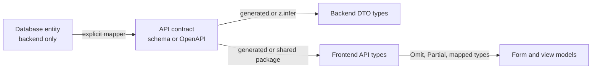

# TypeScript — Mixed Interview Questions

> This file is mixed and cross-topic practice for the whole TypeScript subject. Each topic document already has its own interview questions. Use this file after you have studied the topics, and again right before interviews: the questions here combine several topics, the way real interviews do.

## Table of contents

1. [All topic questions at a glance](#all-topic-questions-at-a-glance)
2. [Mixed and cross-topic questions](#mixed-and-cross-topic-questions)
3. [Rapid revision round](#rapid-revision-round)
4. [Summary](#summary)

## All topic questions at a glance

Every question below has a full answer inside its topic document. Click a question to jump to it.

### [TypeScript Basics and Types](01-typescript-basics-and-types.md)

- [Q1. What is TypeScript, and why would you use it instead of JavaScript?](01-typescript-basics-and-types.md#q1-what-is-typescript-and-why-would-you-use-it-instead-of-javascript)
- [Q2. What is type erasure? Does TypeScript protect you at runtime?](01-typescript-basics-and-types.md#q2-what-is-type-erasure-does-typescript-protect-you-at-runtime)
- [Q3. Does tsc still produce JavaScript if there are type errors?](01-typescript-basics-and-types.md#q3-does-tsc-still-produce-javascript-if-there-are-type-errors)
- [Q4. What is structural typing? How is it different from nominal typing?](01-typescript-basics-and-types.md#q4-what-is-structural-typing-how-is-it-different-from-nominal-typing)
- [Q5. What is the difference between any and unknown?](01-typescript-basics-and-types.md#q5-what-is-the-difference-between-any-and-unknown)
- [Q6. What is the difference between void and never?](01-typescript-basics-and-types.md#q6-what-is-the-difference-between-void-and-never)
- [Q7. What does this code print?](01-typescript-basics-and-types.md#q7-what-does-this-code-print)
- [Q8. Enums or union types: which do you prefer and why?](01-typescript-basics-and-types.md#q8-enums-or-union-types-which-do-you-prefer-and-why)
- [Q9. What is a const enum and why can it cause problems?](01-typescript-basics-and-types.md#q9-what-is-a-const-enum-and-why-can-it-cause-problems)
- [Q10. What is the type of each variable?](01-typescript-basics-and-types.md#q10-what-is-the-type-of-each-variable)
- [Q11. What does as const do? Does it make an object immutable?](01-typescript-basics-and-types.md#q11-what-does-as-const-do-does-it-make-an-object-immutable)
- [Q12. What is a type assertion? How is it different from a type cast in other languages?](01-typescript-basics-and-types.md#q12-what-is-a-type-assertion-how-is-it-different-from-a-type-cast-in-other-languages)
- [Q13. What does the non-null assertion operator do? When is it acceptable?](01-typescript-basics-and-types.md#q13-what-does-the-non-null-assertion-operator-do-when-is-it-acceptable)
- [Q14. What is the satisfies operator? How is it different from a type annotation and from as?](01-typescript-basics-and-types.md#q14-what-is-the-satisfies-operator-how-is-it-different-from-a-type-annotation-and-from-as)
- [Q15. What is the difference between object, Object and {}?](01-typescript-basics-and-types.md#q15-what-is-the-difference-between-object-object-and-)
- [Q16. What is a tuple, and when would you use one instead of an object?](01-typescript-basics-and-types.md#q16-what-is-a-tuple-and-when-would-you-use-one-instead-of-an-object)
- [Q17. Debugging: this code compiles, but crashes in production. Why, and how do you fix it?](01-typescript-basics-and-types.md#q17-debugging-this-code-compiles-but-crashes-in-production-why-and-how-do-you-fix-it)
- [Q18. What does strictNullChecks change?](01-typescript-basics-and-types.md#q18-what-does-strictnullchecks-change)
- [Q19. Should you write type annotations everywhere?](01-typescript-basics-and-types.md#q19-should-you-write-type-annotations-everywhere)
- [Q20. Code review: what problems do you see?](01-typescript-basics-and-types.md#q20-code-review-what-problems-do-you-see)
- [Q21. What is the difference between a type annotation and a type assertion on an object literal?](01-typescript-basics-and-types.md#q21-what-is-the-difference-between-a-type-annotation-and-a-type-assertion-on-an-object-literal)
- [Q22. Scenario: your team wants to start using TypeScript in an existing JavaScript project. What do you do first?](01-typescript-basics-and-types.md#q22-scenario-your-team-wants-to-start-using-typescript-in-an-existing-javascript-project-what-do-you-do-first)

### [Interfaces and Type Aliases](02-interfaces-and-type-aliases.md)

- [Q1. What is the difference between an interface and a type alias?](02-interfaces-and-type-aliases.md#q1-what-is-the-difference-between-an-interface-and-a-type-alias)
- [Q2. What is declaration merging, and where is it useful?](02-interfaces-and-type-aliases.md#q2-what-is-declaration-merging-and-where-is-it-useful)
- [Q3. Will this compile? Explain.](02-interfaces-and-type-aliases.md#q3-will-this-compile-explain)
- [Q4. Will this compile?](02-interfaces-and-type-aliases.md#q4-will-this-compile)
- [Q5. What are index signatures? What problems can they cause?](02-interfaces-and-type-aliases.md#q5-what-are-index-signatures-what-problems-can-they-cause)
- [Q6. Is readonly deep? Does it protect data at runtime?](02-interfaces-and-type-aliases.md#q6-is-readonly-deep-does-it-protect-data-at-runtime)
- [Q7. What is the difference between `prop?: T` and `prop: T | undefined`?](02-interfaces-and-type-aliases.md#q7-what-is-the-difference-between-prop-t-and-prop-t--undefined)
- [Q8. What is the difference between extends and an intersection (&)?](02-interfaces-and-type-aliases.md#q8-what-is-the-difference-between-extends-and-an-intersection-)
- [Q9. How do you describe a function in an interface? What is the difference between a method and a function property?](02-interfaces-and-type-aliases.md#q9-how-do-you-describe-a-function-in-an-interface-what-is-the-difference-between-a-method-and-a-function-property)
- [Q10. What is a construct signature? How do you type a function that takes a class as an argument?](02-interfaces-and-type-aliases.md#q10-what-is-a-construct-signature-how-do-you-type-a-function-that-takes-a-class-as-an-argument)
- [Q11. Does `implements` give types to the class members?](02-interfaces-and-type-aliases.md#q11-does-implements-give-types-to-the-class-members)
- [Q12. Debugging: why does this fail?](02-interfaces-and-type-aliases.md#q12-debugging-why-does-this-fail)
- [Q13. What is a weak type?](02-interfaces-and-type-aliases.md#q13-what-is-a-weak-type)
- [Q14. Code review: how would you improve this model?](02-interfaces-and-type-aliases.md#q14-code-review-how-would-you-improve-this-model)
- [Q15. How do you type a lookup table so that adding a new enum or union member forces you to update it?](02-interfaces-and-type-aliases.md#q15-how-do-you-type-a-lookup-table-so-that-adding-a-new-enum-or-union-member-forces-you-to-update-it)
- [Q16. How do you type a recursive structure like a category tree or a comment thread?](02-interfaces-and-type-aliases.md#q16-how-do-you-type-a-recursive-structure-like-a-category-tree-or-a-comment-thread)
- [Q17. Senior: interfaces or intersections for large types? Does it matter for performance?](02-interfaces-and-type-aliases.md#q17-senior-interfaces-or-intersections-for-large-types-does-it-matter-for-performance)
- [Q18. Scenario: a third-party library's type is missing a property that exists at runtime. What do you do?](02-interfaces-and-type-aliases.md#q18-scenario-a-third-party-librarys-type-is-missing-a-property-that-exists-at-runtime-what-do-you-do)
- [Q19. Can you use `instanceof` with an interface?](02-interfaces-and-type-aliases.md#q19-can-you-use-instanceof-with-an-interface)

### [Unions, Narrowing and Type Guards](03-unions-narrowing-and-type-guards.md)

- [Q1. What is type narrowing in TypeScript?](03-unions-narrowing-and-type-guards.md#q1-what-is-type-narrowing-in-typescript)
- [Q2. What is a discriminated union, and why is it useful?](03-unions-narrowing-and-type-guards.md#q2-what-is-a-discriminated-union-and-why-is-it-useful)
- [Q3. What is exhaustiveness checking and how do you implement it?](03-unions-narrowing-and-type-guards.md#q3-what-is-exhaustiveness-checking-and-how-do-you-implement-it)
- [Q4. What is a user-defined type guard? What is the risk?](03-unions-narrowing-and-type-guards.md#q4-what-is-a-user-defined-type-guard-what-is-the-risk)
- [Q5. What is an assertion function? How is it different from a type predicate?](03-unions-narrowing-and-type-guards.md#q5-what-is-an-assertion-function-how-is-it-different-from-a-type-predicate)
- [Q6. Debugging: what is wrong with this code, and does TypeScript catch it?](03-unions-narrowing-and-type-guards.md#q6-debugging-what-is-wrong-with-this-code-and-does-typescript-catch-it)
- [Q7. Debugging: a user reports that a quantity of 0 is shown as "not set". Find the bug.](03-unions-narrowing-and-type-guards.md#q7-debugging-a-user-reports-that-a-quantity-of-0-is-shown-as-not-set-find-the-bug)
- [Q8. When do you use typeof, instanceof, in, or a discriminant to narrow?](03-unions-narrowing-and-type-guards.md#q8-when-do-you-use-typeof-instanceof-in-or-a-discriminant-to-narrow)
- [Q9. Why does TypeScript lose narrowing inside a callback?](03-unions-narrowing-and-type-guards.md#q9-why-does-typescript-lose-narrowing-inside-a-callback)
- [Q10. Design: how would you model the state of a data table that loads from an API?](03-unions-narrowing-and-type-guards.md#q10-design-how-would-you-model-the-state-of-a-data-table-that-loads-from-an-api)
- [Q11. What is the type of `value` at each marked line?](03-unions-narrowing-and-type-guards.md#q11-what-is-the-type-of-value-at-each-marked-line)
- [Q12. How do you filter `null` and `undefined` out of an array with correct types?](03-unions-narrowing-and-type-guards.md#q12-how-do-you-filter-null-and-undefined-out-of-an-array-with-correct-types)
- [Q13. How do you safely handle data from an API in TypeScript?](03-unions-narrowing-and-type-guards.md#q13-how-do-you-safely-handle-data-from-an-api-in-typescript)
- [Q14. With `type Pet = Cat | Dog`, why can't you access `pet.meow()` directly?](03-unions-narrowing-and-type-guards.md#q14-with-type-pet--cat--dog-why-cant-you-access-petmeow-directly)
- [Q15. How do you type a reducer so that each action has the correct payload?](03-unions-narrowing-and-type-guards.md#q15-how-do-you-type-a-reducer-so-that-each-action-has-the-correct-payload)
- [Q16. Senior: is TypeScript's narrowing always sound? Give an example where it is wrong.](03-unions-narrowing-and-type-guards.md#q16-senior-is-typescripts-narrowing-always-sound-give-an-example-where-it-is-wrong)
- [Q17. What does this JavaScript code print?](03-unions-narrowing-and-type-guards.md#q17-what-does-this-javascript-code-print)
- [Q18. Implement `assertNever` and explain both its compile-time and runtime roles.](03-unions-narrowing-and-type-guards.md#q18-implement-assertnever-and-explain-both-its-compile-time-and-runtime-roles)
- [Q19. Why does this discriminated union not narrow?](03-unions-narrowing-and-type-guards.md#q19-why-does-this-discriminated-union-not-narrow)
- [Q20. Scenario: an Electron renderer sends messages to the main process. How do you type and validate them?](03-unions-narrowing-and-type-guards.md#q20-scenario-an-electron-renderer-sends-messages-to-the-main-process-how-do-you-type-and-validate-them)

### [Functions and Classes in TypeScript](04-functions-and-classes.md)

- [Q1. What is the difference between `private` and `#private`?](04-functions-and-classes.md#q1-what-is-the-difference-between-private-and-private)
- [Q2. What are function overloads? When should you use a union type instead?](04-functions-and-classes.md#q2-what-are-function-overloads-when-should-you-use-a-union-type-instead)
- [Q3. Why can a callback typed `() => void` return a value, but a function declared `(): void` cannot?](04-functions-and-classes.md#q3-why-can-a-callback-typed---void-return-a-value-but-a-function-declared--void-cannot)
- [Q4. What is the `this` parameter in TypeScript?](04-functions-and-classes.md#q4-what-is-the-this-parameter-in-typescript)
- [Q5. Abstract class vs interface: when do you use each?](04-functions-and-classes.md#q5-abstract-class-vs-interface-when-do-you-use-each)
- [Q6. What are parameter properties? Why does Angular code use them so much?](04-functions-and-classes.md#q6-what-are-parameter-properties-why-does-angular-code-use-them-so-much)
- [Q7. What does `override` do, and why turn on `noImplicitOverride`?](04-functions-and-classes.md#q7-what-does-override-do-and-why-turn-on-noimplicitoverride)
- [Q8. What is the difference between `User` and `typeof User` when User is a class?](04-functions-and-classes.md#q8-what-is-the-difference-between-user-and-typeof-user-when-user-is-a-class)
- [Q9. What does this code print?](04-functions-and-classes.md#q9-what-does-this-code-print)
- [Q10. What is the difference between an optional parameter and a default parameter? What does this print?](04-functions-and-classes.md#q10-what-is-the-difference-between-an-optional-parameter-and-a-default-parameter-what-does-this-print)
- [Q11. Can you create an instance of an abstract class at runtime?](04-functions-and-classes.md#q11-can-you-create-an-instance-of-an-abstract-class-at-runtime)
- [Q12. Arrow function property or method: which should you use in a class?](04-functions-and-classes.md#q12-arrow-function-property-or-method-which-should-you-use-in-a-class)
- [Q13. Debugging: why does this crash?](04-functions-and-classes.md#q13-debugging-why-does-this-crash)
- [Q14. Why can't a static property use the class's generic type parameter?](04-functions-and-classes.md#q14-why-cant-a-static-property-use-the-classs-generic-type-parameter)
- [Q15. How do getters and setters work in TypeScript classes?](04-functions-and-classes.md#q15-how-do-getters-and-setters-work-in-typescript-classes)
- [Q16. Code review: what would you change in this class?](04-functions-and-classes.md#q16-code-review-what-would-you-change-in-this-class)
- [Q17. Implement a singleton in TypeScript.](04-functions-and-classes.md#q17-implement-a-singleton-in-typescript)
- [Q18. How do you build a fluent API that still works in subclasses?](04-functions-and-classes.md#q18-how-do-you-build-a-fluent-api-that-still-works-in-subclasses)
- [Q19. Senior: why would redeclaring a property in a subclass make it undefined?](04-functions-and-classes.md#q19-senior-why-would-redeclaring-a-property-in-a-subclass-make-it-undefined)
- [Q20. What are the ways to type a function in TypeScript?](04-functions-and-classes.md#q20-what-are-the-ways-to-type-a-function-in-typescript)
- [Q21. How do you type a function that accepts a variable number of typed arguments?](04-functions-and-classes.md#q21-how-do-you-type-a-function-that-accepts-a-variable-number-of-typed-arguments)

### [Generics](05-generics.md)

- [Q1. What are generics and why do we need them?](05-generics.md#q1-what-are-generics-and-why-do-we-need-them)
- [Q2. What is a generic constraint? Give an example.](05-generics.md#q2-what-is-a-generic-constraint-give-an-example)
- [Q3. Explain this signature: `function getProperty<T, K extends keyof T>(obj: T, key: K): T[K]`.](05-generics.md#q3-explain-this-signature-function-getpropertyt-k-extends-keyof-tobj-t-key-k-tk)
- [Q4. Does `http.get<User[]>(url)` in Angular guarantee that you get users?](05-generics.md#q4-does-httpgetuserurl-in-angular-guarantee-that-you-get-users)
- [Q5. What are default type parameters, and do they provide default values?](05-generics.md#q5-what-are-default-type-parameters-and-do-they-provide-default-values)
- [Q6. Write a generic `groupBy` function.](05-generics.md#q6-write-a-generic-groupby-function)
- [Q7. What does this code print, and what are the types?](05-generics.md#q7-what-does-this-code-print-and-what-are-the-types)
- [Q8. Why is this generic function considered bad practice?](05-generics.md#q8-why-is-this-generic-function-considered-bad-practice)
- [Q9. What is variance? Explain covariance and contravariance with an example.](05-generics.md#q9-what-is-variance-explain-covariance-and-contravariance-with-an-example)
- [Q10. What are `const` type parameters?](05-generics.md#q10-what-are-const-type-parameters)
- [Q11. Debugging: why does this not compile, and how do you fix it?](05-generics.md#q11-debugging-why-does-this-not-compile-and-how-do-you-fix-it)
- [Q12. How do you type a function that wraps another function and keeps its parameter and return types?](05-generics.md#q12-how-do-you-type-a-function-that-wraps-another-function-and-keeps-its-parameter-and-return-types)
- [Q13. Design: create a type-safe in-memory cache with expiry.](05-generics.md#q13-design-create-a-type-safe-in-memory-cache-with-expiry)
- [Q14. Why does `sameType(1, "two")` fail for `function sameType<T>(a: T, b: T)`?](05-generics.md#q14-why-does-sametype1-two-fail-for-function-sametypeta-t-b-t)
- [Q15. When should you not use generics?](05-generics.md#q15-when-should-you-not-use-generics)
- [Q16. What is the difference between a generic interface and an interface with a generic method?](05-generics.md#q16-what-is-the-difference-between-a-generic-interface-and-an-interface-with-a-generic-method)
- [Q17. Scenario: your team's `Repository<T>` forces every entity to support `delete`, but orders must never be deleted. What do you do?](05-generics.md#q17-scenario-your-teams-repositoryt-forces-every-entity-to-support-delete-but-orders-must-never-be-deleted-what-do-you-do)
- [Q18. Can you specify only some type arguments and let TypeScript infer the others?](05-generics.md#q18-can-you-specify-only-some-type-arguments-and-let-typescript-infer-the-others)

### [keyof, typeof, Indexed Access and Mapped Types](06-keyof-typeof-indexed-and-mapped-types.md)

- [Q1. What does keyof do?](06-keyof-typeof-indexed-and-mapped-types.md#q1-what-does-keyof-do)
- [Q2. What is the difference between JavaScript typeof and TypeScript typeof?](06-keyof-typeof-indexed-and-mapped-types.md#q2-what-is-the-difference-between-javascript-typeof-and-typescript-typeof)
- [Q3. How do you get a union type from an array of strings?](06-keyof-typeof-indexed-and-mapped-types.md#q3-how-do-you-get-a-union-type-from-an-array-of-strings)
- [Q4. What is an indexed access type? Give examples with nested objects and arrays.](06-keyof-typeof-indexed-and-mapped-types.md#q4-what-is-an-indexed-access-type-give-examples-with-nested-objects-and-arrays)
- [Q5. What is a mapped type? Implement Partial and Readonly.](06-keyof-typeof-indexed-and-mapped-types.md#q5-what-is-a-mapped-type-implement-partial-and-readonly)
- [Q6. What is key remapping with as in a mapped type?](06-keyof-typeof-indexed-and-mapped-types.md#q6-what-is-key-remapping-with-as-in-a-mapped-type)
- [Q7. What are template literal types? Give a practical example.](06-keyof-typeof-indexed-and-mapped-types.md#q7-what-are-template-literal-types-give-a-practical-example)
- [Q8. Write a function `getConfig` that returns the exact type of each config key.](06-keyof-typeof-indexed-and-mapped-types.md#q8-write-a-function-getconfig-that-returns-the-exact-type-of-each-config-key)
- [Q9. Why does Object.keys return string[] instead of (keyof T)[]?](06-keyof-typeof-indexed-and-mapped-types.md#q9-why-does-objectkeys-return-string-instead-of-keyof-t)
- [Q10. Implement a type-safe event emitter.](06-keyof-typeof-indexed-and-mapped-types.md#q10-implement-a-type-safe-event-emitter)
- [Q11. What is the type of each alias?](06-keyof-typeof-indexed-and-mapped-types.md#q11-what-is-the-type-of-each-alias)
- [Q12. Scenario: your API types are generated from OpenAPI into one huge `paths` type. How do you get the response type for one endpoint?](06-keyof-typeof-indexed-and-mapped-types.md#q12-scenario-your-api-types-are-generated-from-openapi-into-one-huge-paths-type-how-do-you-get-the-response-type-for-one-endpoint)
- [Q13. How do you create a type where every property of T becomes a function returning that property?](06-keyof-typeof-indexed-and-mapped-types.md#q13-how-do-you-create-a-type-where-every-property-of-t-becomes-a-function-returning-that-property)
- [Q14. Code review: what would you change?](06-keyof-typeof-indexed-and-mapped-types.md#q14-code-review-what-would-you-change)
- [Q15. Senior: when do derived types become a problem?](06-keyof-typeof-indexed-and-mapped-types.md#q15-senior-when-do-derived-types-become-a-problem)

### [Conditional Types and infer](07-conditional-types-and-infer.md)

- [Q1. What is a conditional type in TypeScript?](07-conditional-types-and-infer.md#q1-what-is-a-conditional-type-in-typescript)
- [Q2. What is a distributive conditional type? How do you turn distribution off?](07-conditional-types-and-infer.md#q2-what-is-a-distributive-conditional-type-how-do-you-turn-distribution-off)
- [Q3. What does this produce?](07-conditional-types-and-infer.md#q3-what-does-this-produce)
- [Q4. What is the `infer` keyword? Implement `ReturnType` yourself.](07-conditional-types-and-infer.md#q4-what-is-the-infer-keyword-implement-returntype-yourself)
- [Q5. Write a type that unwraps a Promise, including nested promises.](07-conditional-types-and-infer.md#q5-write-a-type-that-unwraps-a-promise-including-nested-promises)
- [Q6. Debugging: why is this result `never`?](07-conditional-types-and-infer.md#q6-debugging-why-is-this-result-never)
- [Q7. Implement `Exclude`, `Extract` and `NonNullable` yourself.](07-conditional-types-and-infer.md#q7-implement-exclude-extract-and-nonnullable-yourself)
- [Q8. Write a type that turns `"/users/:id/posts/:postId"` into `{ id: string; postId: string }`.](07-conditional-types-and-infer.md#q8-write-a-type-that-turns-usersidpostspostid-into--id-string-postid-string-)
- [Q9. What happens when the same `infer` variable appears in two places?](07-conditional-types-and-infer.md#q9-what-happens-when-the-same-infer-variable-appears-in-two-places)
- [Q10. Implement `DeepPartial<T>`. What edge cases must you handle?](07-conditional-types-and-infer.md#q10-implement-deeppartialt-what-edge-cases-must-you-handle)
- [Q11. Why does this function need a type assertion?](07-conditional-types-and-infer.md#q11-why-does-this-function-need-a-type-assertion)
- [Q12. What does `ReturnType` return for an overloaded function?](07-conditional-types-and-infer.md#q12-what-does-returntype-return-for-an-overloaded-function)
- [Q13. What is the difference between `T extends U ? X : Y` and a generic constraint `<T extends U>`?](07-conditional-types-and-infer.md#q13-what-is-the-difference-between-t-extends-u--x--y-and-a-generic-constraint-t-extends-u)
- [Q14. How would you get the type of one element of an array constant, and the keys of a nested object?](07-conditional-types-and-infer.md#q14-how-would-you-get-the-type-of-one-element-of-an-array-constant-and-the-keys-of-a-nested-object)
- [Q15. Your team's type helper is 40 lines of nested conditional types, and compile time got slow. What do you do?](07-conditional-types-and-infer.md#q15-your-teams-type-helper-is-40-lines-of-nested-conditional-types-and-compile-time-got-slow-what-do-you-do)
- [Q16. Code review: what is wrong with this type?](07-conditional-types-and-infer.md#q16-code-review-what-is-wrong-with-this-type)
- [Q17. Where have you used conditional types or infer in a real project?](07-conditional-types-and-infer.md#q17-where-have-you-used-conditional-types-or-infer-in-a-real-project)

### [Utility Types](08-utility-types.md)

- [Q1. What are utility types? Name the ones you use most.](08-utility-types.md#q1-what-are-utility-types-name-the-ones-you-use-most)
- [Q2. Implement `Pick` yourself.](08-utility-types.md#q2-implement-pick-yourself)
- [Q3. Implement `Omit` yourself. Why does the built-in `Omit` not catch typos?](08-utility-types.md#q3-implement-omit-yourself-why-does-the-built-in-omit-not-catch-typos)
- [Q4. What is the difference between `Partial`, `Required` and `Readonly`? Implement them.](08-utility-types.md#q4-what-is-the-difference-between-partial-required-and-readonly-implement-them)
- [Q5. `Record<string, T>` vs an index signature vs `Map`. When do you use each?](08-utility-types.md#q5-recordstring-t-vs-an-index-signature-vs-map-when-do-you-use-each)
- [Q6. Design the TypeScript types for a user API: create, update, and response.](08-utility-types.md#q6-design-the-typescript-types-for-a-user-api-create-update-and-response)
- [Q7. What does this print, and what is the type of `result`?](08-utility-types.md#q7-what-does-this-print-and-what-is-the-type-of-result)
- [Q8. How does `ReturnType` work, and how do you get the result type of an async function?](08-utility-types.md#q8-how-does-returntype-work-and-how-do-you-get-the-result-type-of-an-async-function)
- [Q9. What is `Awaited` and why was it added?](08-utility-types.md#q9-what-is-awaited-and-why-was-it-added)
- [Q10. What is `NoInfer` and when would you use it?](08-utility-types.md#q10-what-is-noinfer-and-when-would-you-use-it)
- [Q11. What is the difference between `typeof MyClass`, `MyClass` and `InstanceType<typeof MyClass>`?](08-utility-types.md#q11-what-is-the-difference-between-typeof-myclass-myclass-and-instancetypetypeof-myclass)
- [Q12. When would you use `ThisType`?](08-utility-types.md#q12-when-would-you-use-thistype)
- [Q13. Code review: what is wrong here?](08-utility-types.md#q13-code-review-what-is-wrong-here)
- [Q14. Implement a `RequireAtLeastOne<T, Keys>` type.](08-utility-types.md#q14-implement-a-requireatleastonet-keys-type)
- [Q15. `Exclude` vs `Omit` vs `Extract` — explain the difference with one example each.](08-utility-types.md#q15-exclude-vs-omit-vs-extract--explain-the-difference-with-one-example-each)
- [Q16. Write a generic `withRetry` wrapper that keeps the parameter and return types of any async function.](08-utility-types.md#q16-write-a-generic-withretry-wrapper-that-keeps-the-parameter-and-return-types-of-any-async-function)
- [Q17. Your team defines every DTO as a separate hand-written interface. Would you change that?](08-utility-types.md#q17-your-team-defines-every-dto-as-a-separate-hand-written-interface-would-you-change-that)

### [Modules, Declaration Files and tsconfig](09-modules-declaration-files-and-tsconfig.md)

- [Q1. What is the difference between `module` and `moduleResolution` in tsconfig?](09-modules-declaration-files-and-tsconfig.md#q1-what-is-the-difference-between-module-and-moduleresolution-in-tsconfig)
- [Q2. Why do you write `import { x } from "./file.js"` when the file is `file.ts`?](09-modules-declaration-files-and-tsconfig.md#q2-why-do-you-write-import--x--from-filejs-when-the-file-is-filets)
- [Q3. What do `import type` and `verbatimModuleSyntax` do? Why do they matter?](09-modules-declaration-files-and-tsconfig.md#q3-what-do-import-type-and-verbatimmodulesyntax-do-why-do-they-matter)
- [Q4. What does `esModuleInterop` do?](09-modules-declaration-files-and-tsconfig.md#q4-what-does-esmoduleinterop-do)
- [Q5. What is a `.d.ts` file, and where do types for npm packages come from?](09-modules-declaration-files-and-tsconfig.md#q5-what-is-a-dts-file-and-where-do-types-for-npm-packages-come-from)
- [Q6. How do you add a `user` property to Express's `Request` type?](09-modules-declaration-files-and-tsconfig.md#q6-how-do-you-add-a-user-property-to-expresss-request-type)
- [Q7. How would you add types to an untyped internal JavaScript library?](09-modules-declaration-files-and-tsconfig.md#q7-how-would-you-add-types-to-an-untyped-internal-javascript-library)
- [Q8. What does `strict: true` enable? Which flag gives the most value?](09-modules-declaration-files-and-tsconfig.md#q8-what-does-strict-true-enable-which-flag-gives-the-most-value)
- [Q9. What does `strictFunctionTypes` catch? Give an example.](09-modules-declaration-files-and-tsconfig.md#q9-what-does-strictfunctiontypes-catch-give-an-example)
- [Q10. Explain `noUncheckedIndexedAccess` and `exactOptionalPropertyTypes`. Would you enable them?](09-modules-declaration-files-and-tsconfig.md#q10-explain-nouncheckedindexedaccess-and-exactoptionalpropertytypes-would-you-enable-them)
- [Q11. Your Node.js app compiles with `tsc`, but at runtime it fails with "Cannot find module '@app/utils'". Why?](09-modules-declaration-files-and-tsconfig.md#q11-your-nodejs-app-compiles-with-tsc-but-at-runtime-it-fails-with-cannot-find-module-apputils-why)
- [Q12. `target` vs `lib`: what is the difference? Does `target: es5` polyfill `Promise`?](09-modules-declaration-files-and-tsconfig.md#q12-target-vs-lib-what-is-the-difference-does-target-es5-polyfill-promise)
- [Q13. Namespaces vs ES modules — when would you still use a namespace?](09-modules-declaration-files-and-tsconfig.md#q13-namespaces-vs-es-modules--when-would-you-still-use-a-namespace)
- [Q14. What does `isolatedModules` protect you from?](09-modules-declaration-files-and-tsconfig.md#q14-what-does-isolatedmodules-protect-you-from)
- [Q15. How do project references work, and when would you use them?](09-modules-declaration-files-and-tsconfig.md#q15-how-do-project-references-work-and-when-would-you-use-them)
- [Q16. What is `strictTemplates` in Angular, and why is it in `angularCompilerOptions` instead of `compilerOptions`?](09-modules-declaration-files-and-tsconfig.md#q16-what-is-stricttemplates-in-angular-and-why-is-it-in-angularcompileroptions-instead-of-compileroptions)
- [Q17. A teammate says "the build passes" but there are 40 type errors. How is that possible?](09-modules-declaration-files-and-tsconfig.md#q17-a-teammate-says-the-build-passes-but-there-are-40-type-errors-how-is-that-possible)
- [Q18. What does `skipLibCheck` do and is it safe?](09-modules-declaration-files-and-tsconfig.md#q18-what-does-skiplibcheck-do-and-is-it-safe)
- [Q19. What changed in TypeScript 6 and 7 that affects tsconfig?](09-modules-declaration-files-and-tsconfig.md#q19-what-changed-in-typescript-6-and-7-that-affects-tsconfig)
- [Q20. How would you set up `tsconfig.json` for a new Node.js 22 API written in TypeScript?](09-modules-declaration-files-and-tsconfig.md#q20-how-would-you-set-up-tsconfigjson-for-a-new-nodejs-22-api-written-in-typescript)

### [Decorators](10-decorators.md)

- [Q1. What is a decorator in TypeScript?](10-decorators.md#q1-what-is-a-decorator-in-typescript)
- [Q2. What is the difference between `experimentalDecorators` and standard decorators?](10-decorators.md#q2-what-is-the-difference-between-experimentaldecorators-and-standard-decorators)
- [Q3. Write a method decorator that logs calls and results.](10-decorators.md#q3-write-a-method-decorator-that-logs-calls-and-results)
- [Q4. What is a decorator factory?](10-decorators.md#q4-what-is-a-decorator-factory)
- [Q5. In what order are decorators evaluated and applied?](10-decorators.md#q5-in-what-order-are-decorators-evaluated-and-applied)
- [Q6. What do `emitDecoratorMetadata` and `reflect-metadata` do?](10-decorators.md#q6-what-do-emitdecoratormetadata-and-reflect-metadata-do)
- [Q7. Why must NestJS DTOs be classes and not interfaces?](10-decorators.md#q7-why-must-nestjs-dtos-be-classes-and-not-interfaces)
- [Q8. How does Angular use decorators? Are they executed at runtime?](10-decorators.md#q8-how-does-angular-use-decorators-are-they-executed-at-runtime)
- [Q9. Write a memoize decorator for a getter. What is the trap?](10-decorators.md#q9-write-a-memoize-decorator-for-a-getter-what-is-the-trap)
- [Q10. Debugging: this decorator breaks `this`. Why?](10-decorators.md#q10-debugging-this-decorator-breaks-this-why)
- [Q11. What are auto-accessors (`accessor` keyword)?](10-decorators.md#q11-what-are-auto-accessors-accessor-keyword)
- [Q12. Implement a simple DI container with decorators. What are the limits?](10-decorators.md#q12-implement-a-simple-di-container-with-decorators-what-are-the-limits)
- [Q13. A teammate added `@ReadOnly` to a property using `Object.defineProperty(target, key, { writable: false })`. Now the app throws when creating objects. Why?](10-decorators.md#q13-a-teammate-added-readonly-to-a-property-using-objectdefinepropertytarget-key--writable-false--now-the-app-throws-when-creating-objects-why)
- [Q14. Can a decorator change the TypeScript type of a class?](10-decorators.md#q14-can-a-decorator-change-the-typescript-type-of-a-class)
- [Q15. When would you NOT use a decorator?](10-decorators.md#q15-when-would-you-not-use-a-decorator)
- [Q16. What is the difference between the `@` decorator syntax and the Decorator design pattern?](10-decorators.md#q16-what-is-the-difference-between-the--decorator-syntax-and-the-decorator-design-pattern)

### [Runtime Validation and Type-Safe APIs](11-runtime-validation-and-type-safe-apis.md)

- [Q1. TypeScript is type-safe — why do we still need runtime validation?](11-runtime-validation-and-type-safe-apis.md#q1-typescript-is-type-safe--why-do-we-still-need-runtime-validation)
- [Q2. What is the difference between a type assertion (`as`) and a type guard?](11-runtime-validation-and-type-safe-apis.md#q2-what-is-the-difference-between-a-type-assertion-as-and-a-type-guard)
- [Q3. How does Zod give you both validation and types?](11-runtime-validation-and-type-safe-apis.md#q3-how-does-zod-give-you-both-validation-and-types)
- [Q4. What does "parse, don't validate" mean?](11-runtime-validation-and-type-safe-apis.md#q4-what-does-parse-dont-validate-mean)
- [Q5. How would you validate environment variables in a Node.js service?](11-runtime-validation-and-type-safe-apis.md#q5-how-would-you-validate-environment-variables-in-a-nodejs-service)
- [Q6. What are branded types and why use them?](11-runtime-validation-and-type-safe-apis.md#q6-what-are-branded-types-and-why-use-them)
- [Q7. How do you share types between an Angular frontend and a Node.js backend?](11-runtime-validation-and-type-safe-apis.md#q7-how-do-you-share-types-between-an-angular-frontend-and-a-nodejs-backend)
- [Q8. What is tRPC and when would you choose it over REST with OpenAPI?](11-runtime-validation-and-type-safe-apis.md#q8-what-is-trpc-and-when-would-you-choose-it-over-rest-with-openapi)
- [Q9. Code review: what is wrong with this endpoint?](11-runtime-validation-and-type-safe-apis.md#q9-code-review-what-is-wrong-with-this-endpoint)
- [Q10. Your Angular app crashes in production with "Cannot read properties of undefined" after a backend release. How do you prevent this class of bug?](11-runtime-validation-and-type-safe-apis.md#q10-your-angular-app-crashes-in-production-with-cannot-read-properties-of-undefined-after-a-backend-release-how-do-you-prevent-this-class-of-bug)
- [Q11. When would you return a Result type instead of throwing?](11-runtime-validation-and-type-safe-apis.md#q11-when-would-you-return-a-result-type-instead-of-throwing)
- [Q12. Why must the server validate even if the Angular form already validates?](11-runtime-validation-and-type-safe-apis.md#q12-why-must-the-server-validate-even-if-the-angular-form-already-validates)
- [Q13. How do class-validator DTOs in NestJS compare with Zod schemas?](11-runtime-validation-and-type-safe-apis.md#q13-how-do-class-validator-dtos-in-nestjs-compare-with-zod-schemas)
- [Q14. Implement a generic `validateBody` middleware for Express that also types the handler.](11-runtime-validation-and-type-safe-apis.md#q14-implement-a-generic-validatebody-middleware-for-express-that-also-types-the-handler)

### [TypeScript in Real Projects](12-typescript-in-real-projects.md)

- [Q1. How do you handle class properties in strict Angular components?](12-typescript-in-real-projects.md#q1-how-do-you-handle-class-properties-in-strict-angular-components)
- [Q2. What are typed reactive forms? Why is `form.value` a `Partial`?](12-typescript-in-real-projects.md#q2-what-are-typed-reactive-forms-why-is-formvalue-a-partial)
- [Q3. Is `this.http.get<User>()` type-safe?](12-typescript-in-real-projects.md#q3-is-thishttpgetuser-type-safe)
- [Q4. How does `InjectionToken<T>` work, and why prefer `inject()` with it?](12-typescript-in-real-projects.md#q4-how-does-injectiontokent-work-and-why-prefer-inject-with-it)
- [Q5. How do you type an Express route handler and the request body?](12-typescript-in-real-projects.md#q5-how-do-you-type-an-express-route-handler-and-the-request-body)
- [Q6. Why is the `catch` variable `unknown`, and how do you handle it?](12-typescript-in-real-projects.md#q6-why-is-the-catch-variable-unknown-and-how-do-you-handle-it)
- [Q7. What is a floating promise, and how do you prevent it?](12-typescript-in-real-projects.md#q7-what-is-a-floating-promise-and-how-do-you-prevent-it)
- [Q8. Output prediction: what does this print?](12-typescript-in-real-projects.md#q8-output-prediction-what-does-this-print)
- [Q9. How would you migrate a large JavaScript codebase to TypeScript?](12-typescript-in-real-projects.md#q9-how-would-you-migrate-a-large-javascript-codebase-to-typescript)
- [Q10. What are the biggest TypeScript anti-patterns you see in code reviews?](12-typescript-in-real-projects.md#q10-what-are-the-biggest-typescript-anti-patterns-you-see-in-code-reviews)
- [Q11. `satisfies` vs `as` vs a type annotation — when do you use each?](12-typescript-in-real-projects.md#q11-satisfies-vs-as-vs-a-type-annotation--when-do-you-use-each)
- [Q12. What does typescript-eslint add on top of the TypeScript compiler?](12-typescript-in-real-projects.md#q12-what-does-typescript-eslint-add-on-top-of-the-typescript-compiler)
- [Q13. How do you type React components and hooks?](12-typescript-in-real-projects.md#q13-how-do-you-type-react-components-and-hooks)
- [Q14. Your CI build passes but the app has TypeScript errors in the editor. What is going on?](12-typescript-in-real-projects.md#q14-your-ci-build-passes-but-the-app-has-typescript-errors-in-the-editor-what-is-going-on)
- [Q15. Type-checking in your monorepo takes several minutes. What do you do?](12-typescript-in-real-projects.md#q15-type-checking-in-your-monorepo-takes-several-minutes-what-do-you-do)
- [Q16. When is it OK to use `any`?](12-typescript-in-real-projects.md#q16-when-is-it-ok-to-use-any)
## Mixed and cross-topic questions

Each question below draws on two or more topic documents. The links under each question show where the ideas are explained in depth. Output-prediction answers were checked by compiling the TypeScript with `tsc` (TypeScript 5.9) and running the JavaScript with Node.js 22.

### Q1. Design a typed API client where the URL decides both the parameters and the response type.

Draws on: [Generics](05-generics.md), [keyof, typeof, indexed and mapped types](06-keyof-typeof-indexed-and-mapped-types.md), [Conditional types and infer](07-conditional-types-and-infer.md#template-literal-types-with-infer), [Runtime validation](11-runtime-validation-and-type-safe-apis.md).

**What the interviewer is checking:** Can you combine generics, `keyof`, indexed access, template literal types and runtime validation into one practical design, and do you know where the types stop protecting you?

**Short spoken answer (30–60 seconds):**
> I start with one interface that maps every route path to its response type, like `"/users/:id": User`. The client function takes a generic `Path extends keyof ApiRoutes`, so only known paths are allowed. The return type is the indexed access type `ApiRoutes[Path]`. For the parameters, I use a template literal type with `infer` that pulls the `:id`-style names out of the path string, so `"/users/:id"` needs `{ id: string }`. But all of this is compile time only. The server can still send anything, so the client also takes a validator for that route and runs it on the JSON. That way the type is backed by a real check.

**Detailed explanation:**
- **One source of truth.** The route map is the only place where a path and its response type are written. Everything else is derived from it, so they cannot drift apart.
- **`Path extends keyof ApiRoutes`** limits the first argument to known paths. A typo like `"/userz"` is a compile error.
- **`ApiRoutes[Path]`** is an indexed access type. TypeScript looks up the response type for the exact path that was passed.
- **`RouteParams<Path>`** is a recursive conditional type. It matches the string against `` `${string}:${infer Param}/${infer Rest}` `` and collects every parameter name.
- **The validator** turns `unknown` JSON into the real type. Without it, the generic is just a hidden `as` (see [Generics Q4](05-generics.md#q4-does-httpgetuserurl-in-angular-guarantee-that-you-get-users)).

**Code:**

```ts
interface User { id: string; name: string }
interface Order { id: string; total: number }

// 1. One route map: path -> response type
interface ApiRoutes {
  "/users": User[];
  "/users/:id": User;
  "/users/:userId/orders/:orderId": Order;
}

// 2. Pull ":param" names out of the path
type RouteParams<Path extends string> =
  Path extends `${string}:${infer Param}/${infer Rest}`
    ? { [K in Param | keyof RouteParams<`/${Rest}`>]: string }
    : Path extends `${string}:${infer Param}`
      ? { [K in Param]: string }
      : {};

type P = RouteParams<"/users/:userId/orders/:orderId">; // { userId: string; orderId: string }

// 3. The path picks the params and the response type
type Validator<T> = (data: unknown) => T;

async function apiGet<Path extends keyof ApiRoutes>(
  path: Path,
  params: RouteParams<Path>,
  validate: Validator<ApiRoutes[Path]>,
): Promise<ApiRoutes[Path]> {
  const url = path.replace(/:(\w+)/g, (_, name: string) =>
    encodeURIComponent((params as Record<string, string>)[name] ?? ""),
  );
  const res = await fetch(url);
  if (!res.ok) throw new Error(`HTTP ${res.status} for ${url}`);
  return validate(await res.json()); // the runtime check at the boundary
}

declare const isUser: Validator<User>;   // for example a Zod schema's parse
declare const isOrder: Validator<Order>;

async function demo() {
  const user = await apiGet("/users/:id", { id: "u1" }, isUser); // user: User
  // apiGet("/users/:id", {}, isUser);            // ❌ Property 'id' is missing
  // apiGet("/users/:id", { id: "u1" }, isOrder); // ❌ wrong validator for this route
  // apiGet("/userz", {}, isUser);                // ❌ not a known route
  return user;
}
```

**Follow-up questions:**
- **Why not just write `apiGet<User>("/users/1")`?** — Because then the caller chooses the type, and nothing connects it to the URL. That is a cast with extra steps. In this design the URL chooses the type.
- **Where would the route map come from in a real project?** — Ideally it is generated from an OpenAPI spec, or it is a shared contract package used by both the backend and the frontend. See [OpenAPI and generated types](11-runtime-validation-and-type-safe-apis.md#openapi-and-generated-types).
- **Does this work in an Angular 16 project?** — Yes. Template literal types and `infer` exist since TypeScript 4.1, and this code needs nothing newer than 5.0. In Angular you would return an `Observable` from `HttpClient.get<unknown>()` and run the validator in a `map` operator.
- **What is the cost?** — Recursive types can slow the editor if routes are very long or very many. For a few hundred routes this is fine. Keep the helper small and named.

**Common mistakes:** Making the response type a free generic (`apiGet<T>`), skipping runtime validation because "the type is already there", and writing long unreadable type helpers with no tests.

**Where this is used in real projects:** Typed API layers in Angular and React apps, tRPC-style clients, typed route builders, and SDKs generated from OpenAPI.

### Q2. Output prediction: a base class constructor calls an overridden method.

Draws on: [Functions and classes](04-functions-and-classes.md#class-pitfalls), [useDefineForClassFields](09-modules-declaration-files-and-tsconfig.md#usedefineforclassfields), [JavaScript classes](../02-javascript/09-classes.md).

```ts
class BaseList {
  constructor() {
    this.init();
  }
  init(): void {}
}

class CartList extends BaseList {
  items: string[] = [];
  init(): void {
    this.items.push("welcome-coupon");
  }
}

try {
  const cart = new CartList();
  console.log(cart.items);
} catch (e) {
  console.log((e as Error).message);
}
```

**Answer:**

```text
Cannot read properties of undefined (reading 'push')
```

**Step by step:**
1. `new CartList()` runs the `CartList` constructor. Because it is a subclass, it first calls `super()`.
2. The `BaseList` constructor calls `this.init()`. `this` is the new `CartList` object, so the **overridden** `CartList.init` runs.
3. Class fields of the subclass (`items = []`) are set only **after** `super()` returns. So at this moment `this.items` is `undefined`.
4. `undefined.push(...)` throws a `TypeError`, and the `catch` prints its message.

**What the interviewer is checking:** Do you know the real JavaScript order of class initialization, and do you know that TypeScript does not catch this?

**Short spoken answer (30–60 seconds):**
> It throws. The base constructor calls `init`, which is overridden, so the subclass method runs before the subclass fields are initialized. Fields of a subclass are assigned only after `super()` returns, so `items` is still undefined. TypeScript does not report this, because it does not track initialization order across constructors. The fix is to never call overridable methods from a constructor. I would use an explicit `init()` call after construction, or pass data into the constructor, or initialize in the base class.

**Follow-up questions:**
- **Does `useDefineForClassFields` or the `target` change the result?** — Not here. With `[[Define]]` semantics (ES2022 target) and with the older assignment semantics, the subclass fields are still set after `super()` returns. I checked both: the same error.
- **Is this TypeScript-specific?** — No. It is JavaScript class semantics. TypeScript only adds the types.
- **How does Angular avoid this?** — Angular calls lifecycle hooks like `ngOnInit` after the object is fully constructed, so the hooks can safely use fields.

**Common mistakes:** Saying it prints `[ 'welcome-coupon' ]`; thinking `strictPropertyInitialization` protects you here (it only checks that a field gets a value in its own class).

**Where this is used in real projects:** Base classes for components, repositories or "template method" style classes. This bug appears when someone adds a hook call in a base constructor.

### Q3. Output prediction: `Readonly` vs `Object.freeze` at runtime.

Draws on: [TypeScript basics](01-typescript-basics-and-types.md#as-const-does-not-freeze-anything-at-runtime), [Interfaces and type aliases](02-interfaces-and-type-aliases.md#optional-and-readonly-properties), [Utility types](08-utility-types.md#partial-required-and-readonly).

```ts
// file: config.ts (an ES module, so strict mode is on)
const config: Readonly<{ retries: number }> = { retries: 3 };
(config as { retries: number }).retries = 5;
console.log(config.retries);

const frozen = Object.freeze({ retries: 3 });
try {
  (frozen as { retries: number }).retries = 5;
} catch (e) {
  console.log((e as Error).message);
}
console.log(frozen.retries);
```

**Answer:**

```text
5
Cannot assign to read only property 'retries' of object '#<Object>'
3
```

**Step by step:**
1. `Readonly<...>` exists only in the type system. After the assertion removes it, the assignment is normal JavaScript, so `config.retries` becomes `5`.
2. `Object.freeze` is a real runtime operation. In strict mode (every ES module is strict), writing to a frozen property throws a `TypeError`.
3. The frozen object keeps `3`.

**What the interviewer is checking:** The difference between compile-time immutability (`readonly`, `Readonly<T>`, `as const`) and runtime immutability (`Object.freeze`).

**Short spoken answer (30–60 seconds):**
> `readonly` and `Readonly` are compile-time only. They are erased, so any `as` assertion or any JavaScript caller can still change the value. `Object.freeze` is a runtime feature: in strict mode a write throws, and in sloppy mode it is silently ignored. Both are shallow. So I use `readonly` types everywhere to catch mistakes in my own code, and I add `Object.freeze` only where I need runtime protection, for example a shared config object.

**Follow-up questions:**
- **What would happen in a non-module script without strict mode?** — The write to the frozen object is silently ignored: no error, and the value stays `3`.
- **What type does `Object.freeze({ retries: 3 })` have?** — `Readonly<{ retries: number }>`. So TypeScript also reports a direct write, without the assertion.
- **Are both deep?** — No. Nested objects stay mutable. You need a recursive `DeepReadonly` type and a recursive freeze for deep protection.

**Common mistakes:** Saying `readonly` makes data immutable; forgetting that freeze is shallow; forgetting that sloppy mode hides the error.

**Where this is used in real projects:** NgRx and Redux state (readonly types, plus runtime checks in development), config objects, constants shared between modules.

### Q4. Find the bug: the `createdAt` date is not a `Date`.

Draws on: [TypeScript basics: type erasure](01-typescript-basics-and-types.md#compile-time-vs-runtime-and-type-erasure), [Generics: common mistakes](05-generics.md#common-mistakes-with-generics), [Runtime validation](11-runtime-validation-and-type-safe-apis.md#parse-do-not-validate).

```ts
interface User { id: number; name: string; createdAt: Date }

function parseJson<T>(text: string): T {
  return JSON.parse(text) as T;
}

const user = parseJson<User>('{"id":1,"name":"Asha","createdAt":"2026-01-15T10:00:00.000Z"}');
console.log(typeof user.createdAt);
try {
  console.log(user.createdAt.getFullYear());
} catch (e) {
  console.log((e as Error).message);
}
```

**Answer:**

```text
string
user.createdAt.getFullYear is not a function
```

**What the interviewer is checking:** Do you see that a generic used only in the return type is a hidden cast, and that JSON has no `Date` type?

**Short spoken answer (30–60 seconds):**
> The code compiles, but the type is a lie. `JSON.parse` returns `any`, and `parseJson<T>` just casts it to whatever the caller asks for. JSON has no dates, so `createdAt` is really a string, and calling a `Date` method crashes. The generic `T` appears only in the return type, which is a warning sign: no argument proves that the data is a `T`. The fix is to return `unknown` and parse the data with a schema that also converts the string, for example `z.coerce.date()` or `z.iso.datetime()` plus a transform in Zod. Then the type comes from a real check.

**Detailed explanation:**
- `JSON.parse` turns ISO date strings into strings, never into `Date` objects.
- The function signature promises `T`, but nothing in the body checks it. This is the "generic return type that is really a cast" mistake.
- A better design separates the **wire type** (what JSON really contains: `createdAt: string`) from the **domain type** (what the app uses: `createdAt: Date`) and converts between them in one place.

**Code (fixed):**

```ts
import { z } from "zod";

const UserSchema = z.object({
  id: z.number().int(),
  name: z.string(),
  createdAt: z.coerce.date(), // string from JSON -> Date
});
type User = z.infer<typeof UserSchema>; // createdAt: Date

function parseUser(text: string): User {
  return UserSchema.parse(JSON.parse(text)); // throws a clear error if the shape is wrong
}
```

**Follow-up questions:**
- **Is `HttpClient.get<User>()` in Angular the same problem?** — Yes. It also parses JSON and casts. Dates arrive as strings.
- **Why is `z.coerce.date()` not perfect?** — It accepts anything `new Date()` accepts, including numbers. For strict APIs, validate the ISO format first, then transform.
- **Should the domain type even have `Date`?** — Often yes, but some teams keep ISO strings everywhere and format them only in the UI. Either way, the type must match the real data.

**Common mistakes:** Adding a `Date` field to an interface and assuming JSON will produce it; writing generic `parseJson<T>`, `getItem<T>` or `fetchJson<T>` helpers without validation.

**Where this is used in real projects:** Every API client, `localStorage` helpers, message queues, Electron IPC payloads.

### Q5. Output prediction: narrowing, a callback and a later reassignment.

Draws on: [Unions and narrowing: narrowing pitfalls](03-unions-narrowing-and-type-guards.md#narrowing-pitfalls), [Closures](../02-javascript/05-closures.md), [Event loop](../02-javascript/16-event-loop.md).

```ts
function showLength(input: string | null) {
  if (input !== null) {
    setTimeout(() => {
      try {
        console.log(input.length);
      } catch (e) {
        console.log((e as Error).message);
      }
    }, 0);
  }
  input = null;
}
showLength("hello");
```

**Answer:** TypeScript reports `'input' is possibly 'null'.` on `input.length`. If you run the emitted JavaScript anyway, it prints:

```text
Cannot read properties of null (reading 'length')
```

**Step by step:**
1. `input` is `"hello"`, so the `if` body schedules a timer callback. The callback is a closure over the **variable** `input`, not over its current value.
2. `input = null` runs right away, before the timer fires.
3. Later the event loop runs the callback. It reads `input`, which is now `null`, and `.length` throws.
4. This is exactly why TypeScript drops the narrowing: since TypeScript 5.4 it keeps narrowing inside callbacks only when the variable is **not assigned after** the callback is created. Here it is, so the compiler warns.

**What the interviewer is checking:** Do you understand *why* TypeScript loses narrowing in callbacks, using closures and the event loop, instead of seeing it as a compiler annoyance?

**Short spoken answer (30–60 seconds):**
> TypeScript says `input` is possibly null inside the callback, and it is right. The callback runs later, on the event loop. A closure captures the variable, not the value, so the reassignment to `null` happens first, and the callback crashes. TypeScript 5.4 keeps narrowing in closures only if the variable is never reassigned after the closure is created. The clean fix is to copy the narrowed value into a `const` before creating the callback.

**Follow-up questions:**
- **How do you fix it?** — `const text = input;` inside the `if`, and use `text` in the callback. A `const` can never change, so the narrowing is safe.
- **What happens in TypeScript 5.1 (Angular 16)?** — The error appears even without the reassignment, because older versions drop narrowing for every `let` variable and parameter inside callbacks. The `const` copy works in every version.
- **Does the same happen with object properties?** — Yes, and more often: TypeScript cannot know whether other code changes `order.items` before the callback runs.

**Common mistakes:** Adding `!` to silence the error, which hides a real bug; thinking TypeScript is "too strict" here.

**Where this is used in real projects:** `subscribe` callbacks in Angular, `setTimeout` and event listeners, `forEach` and `map` callbacks after an `if` check.

### Q6. Output prediction: defaults, spread and an optional property set to `undefined`.

Draws on: [Interfaces: optional vs undefined](02-interfaces-and-type-aliases.md#optional-and-readonly-properties), [Utility types: Partial](08-utility-types.md#partial-required-and-readonly), [exactOptionalPropertyTypes](09-modules-declaration-files-and-tsconfig.md#extra-safety-flags-outside-strict).

```ts
interface RequestOptions { timeoutMs: number; retries: number }
const defaults: RequestOptions = { timeoutMs: 5000, retries: 2 };

function withDefaults(overrides: Partial<RequestOptions>): RequestOptions {
  return { ...defaults, ...overrides };
}

const fromForm: Partial<RequestOptions> = { timeoutMs: undefined, retries: 4 };
const options = withDefaults(fromForm);
console.log(options.timeoutMs, options.retries);
console.log(options.timeoutMs.toFixed(0));
```

**Answer:** It compiles with `strict: true`, and then:

```text
undefined 4
TypeError: Cannot read properties of undefined (reading 'toFixed')
```

**Step by step:**
1. `fromForm` has the key `timeoutMs` with the value `undefined`. `Partial` allows that by default.
2. Object spread copies **every own key**, including keys whose value is `undefined`. So `timeoutMs: undefined` overwrites `5000`.
3. The return type says `timeoutMs: number`, and TypeScript accepts the spread. The type is now wrong.
4. `undefined.toFixed(0)` throws.

**What the interviewer is checking:** Knowing that "missing key" and "key with value `undefined`" are different at runtime, and knowing the compiler flag that models it.

**Short spoken answer (30–60 seconds):**
> It prints `undefined 4` and then crashes. Spread copies a key even when its value is `undefined`, so the override wipes out the default. By default TypeScript treats `timeoutMs?: number` as "missing or undefined", so it does not complain. With `exactOptionalPropertyTypes` turned on, writing `timeoutMs: undefined` into a `Partial` is an error, unless the type says `| undefined` explicitly. In the code, I would also remove `undefined` values before merging, or merge field by field with `??`.

**Follow-up questions:**
- **How do you merge safely?** — Filter the overrides first: `Object.fromEntries(Object.entries(o).filter(([, v]) => v !== undefined))`, or write `timeoutMs: overrides.timeoutMs ?? defaults.timeoutMs`.
- **Is `exactOptionalPropertyTypes` part of `strict`?** — No. You turn it on separately. It can be noisy in existing code because many libraries write `undefined` into optional fields.
- **Where do such `undefined` values come from?** — Mapping code that copies optional fields one by one (`timeoutMs: form.timeout` when the field is empty), query parameters, and JSON from other services. In Angular, `form.value` is also a `Partial`, because disabled controls are left out.

**Common mistakes:** Assuming spread skips `undefined`; assuming `Partial` plus a return type guarantees a complete object.

**Where this is used in real projects:** Option objects for HTTP clients, component configuration, merging user settings with defaults, PATCH payloads.

### Q7. Find the bug: `err instanceof ValidationError` is `false`.

Draws on: [Functions and classes](04-functions-and-classes.md), [tsconfig: target](09-modules-declaration-files-and-tsconfig.md#target), [Typed custom errors](12-typescript-in-real-projects.md#typed-custom-errors), [JavaScript error handling](../02-javascript/15-error-handling.md).

```ts
class ValidationError extends Error {
  constructor(public field: string) {
    super(`Invalid field: ${field}`);
    this.name = "ValidationError";
  }
  describe(): string {
    return `${this.name} on ${this.field}`;
  }
}

const err = new ValidationError("email");
console.log(err instanceof ValidationError);
console.log(err instanceof Error);
console.log(typeof err.describe);
```

**Answer:** It depends on `target`.

```text
// target: "es5" (old projects)
false
true
undefined

// target: "es2015" or newer
true
true
function
```

**What the interviewer is checking:** Knowledge of how `target` changes emitted code, and of a classic bug with subclassing built-ins like `Error`.

**Short spoken answer (30–60 seconds):**
> With an ES5 target, TypeScript compiles classes to functions, and `super(...)` becomes `Error.call(this, ...)`. But `Error` ignores the `this` it is given and returns a new object. So the instance is a plain `Error`, without the subclass prototype: `instanceof ValidationError` is false and the subclass methods are missing. With a native `class` (ES2015 or newer target), this works correctly. The fix is to target ES2015 or newer, which every modern project does. In old ES5 code, the workaround was `Object.setPrototypeOf(this, new.target.prototype)` in the constructor.

**Follow-up questions:**
- **Can you still target ES5?** — TypeScript 6.0 deprecated `target: "es5"`, and TypeScript 7.0 removed it. See [Changes in TypeScript 6 and 7](09-modules-declaration-files-and-tsconfig.md#changes-in-typescript-6-and-7).
- **What other reasons make `instanceof` fail?** — Two copies of the same library in `node_modules` (two different classes), or objects from another realm (an iframe, a Node `vm` context). For errors that cross boundaries, check a `code` or `name` field instead.
- **Why set `this.name`?** — So logs and stack traces show `ValidationError` instead of `Error`.

**Common mistakes:** Blaming the `catch` block; not knowing that `target` changes runtime behavior, not only syntax.

**Where this is used in real projects:** Custom error classes in Express error middleware, Angular `ErrorHandler`, and NestJS exception filters.

### Q8. Scenario: after moving a NestJS app from `tsc` to a faster build, dependency injection injects `undefined`.

Draws on: [Decorators: emitDecoratorMetadata](10-decorators.md#emitdecoratormetadata-and-reflect-metadata), [Type-only imports](09-modules-declaration-files-and-tsconfig.md#type-only-imports-and-exports), [isolatedModules](09-modules-declaration-files-and-tsconfig.md#verbatimmodulesyntax-and-isolatedmodules).

**What the interviewer is checking:** Do you understand that NestJS DI depends on type information that only some compilers emit, and how type-only imports affect it?

**Short spoken answer (30–60 seconds):**
> NestJS reads constructor parameter types at runtime from `design:paramtypes` metadata. Only compilers that support `emitDecoratorMetadata` write that metadata. `tsc` and swc do. esbuild does not, and Node's type stripping does not support decorators at all. So after the switch, Nest has no list of dependencies and injects `undefined` or fails to resolve. The second trap is `import type`: if a service is imported only as a type, there is no runtime value, so the metadata records `Function` instead of the class. The fix is to use a compiler that emits metadata, like swc with decorator metadata enabled, keep real value imports for injected classes, or use explicit `@Inject(Token)`.

**Detailed explanation:**
- With `emitDecoratorMetadata`, `tsc` adds `__metadata("design:paramtypes", [UsersService])` to a decorated class. This needs the class as a **runtime value**.
- I compiled two versions of the same controller with TypeScript 5.9. With `import { UsersService }`, the metadata is `[UsersService]`. With `import type { UsersService }`, it is `[Function]`. Nest cannot find a provider for `Function`.
- Tools like esbuild compile one file at a time and do not emit this metadata. This is why NestJS projects that use Vitest often add an swc plugin.

**Code:**

```ts
// ❌ Wrong: type-only import of an injected class
import type { UsersService } from "./users.service.js";

@Controller("users")
export class UsersController {
  constructor(private readonly users: UsersService) {} // metadata: [Function]
}

// ✅ Correct: a value import, so the class exists at runtime
import { UsersService } from "./users.service.js";
```

**Follow-up questions:**
- **Why does Angular not have this problem?** — The Angular compiler reads constructor types at build time and generates factory code with `ɵɵinject(UsersService)`. It does not need `emitDecoratorMetadata`. See [How Angular uses decorators](10-decorators.md#how-angular-uses-decorators).
- **Can an ESLint rule cause this?** — Yes. `consistent-type-imports` may change an import to `import type` if the class is used only in a type position. typescript-eslint has an option for decorator metadata; configure it in NestJS projects.
- **Would standard (TC39) decorators help?** — No. They do not support parameter decorators or `emitDecoratorMetadata`, which is why NestJS stays on legacy decorators.

**Common mistakes:** Debugging the module providers for hours without checking the build tool; assuming all TypeScript compilers produce the same output.

**Where this is used in real projects:** NestJS and TypeORM projects moving to Vite, Vitest, esbuild or swc.

### Q9. Design: how do you define a service contract in Angular so you can swap implementations?

Draws on: [Interfaces and type aliases](02-interfaces-and-type-aliases.md#classes-implementing-interfaces), [Abstract classes](04-functions-and-classes.md#abstract-classes), [InjectionToken](12-typescript-in-real-projects.md#injectiontoken-typed-di-for-non-class-values), [Angular DI](../06-angular-16/05-dependency-injection.md).

**What the interviewer is checking:** Do you know that interfaces are erased and cannot be DI tokens, and can you pick between an abstract class and an `InjectionToken`?

**Short spoken answer (30–60 seconds):**
> An interface is the natural way to describe a contract, but it is erased at runtime, so Angular cannot use it as a DI token. I have two good options. One is an abstract class: it is a real runtime value, so it can be the token, and it also serves as the type. Components inject `PaymentGateway`, and the module provides `{ provide: PaymentGateway, useClass: StripeGateway }`. The other is an interface plus an `InjectionToken<PaymentGateway>`. That keeps the contract a pure type. With `inject(PAYMENT_GATEWAY)` the type comes from the token. I use the abstract class when I want shared code or simple syntax, and the token for config objects and non-class values.

**Code:**

```ts
// Option A: abstract class as contract and token
export abstract class PaymentGateway {
  abstract charge(amountInCents: number): Promise<string>;
}

@Injectable()
export class StripeGateway extends PaymentGateway {
  async charge(amountInCents: number): Promise<string> {
    return `txn_${amountInCents}`;
  }
}
// providers: [{ provide: PaymentGateway, useClass: StripeGateway }]
// constructor(private readonly gateway: PaymentGateway) {}

// Option B: interface + InjectionToken
export interface Clock { now(): Date }
export const CLOCK = new InjectionToken<Clock>("CLOCK");
// providers: [{ provide: CLOCK, useValue: { now: () => new Date() } }]
// private readonly clock = inject(CLOCK); // typed as Clock
```

**Follow-up questions:**
- **Can a class `implements` an abstract class?** — Yes. `implements` uses only the shape, so the class must write every member itself and inherits nothing.
- **What does the abstract class cost?** — It exists in the bundle (a small empty class), and implementations usually use `extends`, which uses up the single inheritance slot.
- **How does this help testing?** — In TestBed you provide a fake: `{ provide: PaymentGateway, useValue: fakeGateway }`. The component code does not change.

**Common mistakes:** Trying `provide: PaymentGatewayInterface` (an error: an interface is not a value); using string tokens, which are untyped and can collide.

**Where this is used in real projects:** Payment providers, storage adapters (local vs server), logging back ends, feature flags, clock and config injection for tests.

### Q10. Security: why does this "public" user still leak the password hash?

Draws on: [Excess property checks](02-interfaces-and-type-aliases.md#excess-property-checks), [Pick and Omit](08-utility-types.md#pick-and-omit), [Runtime validation](11-runtime-validation-and-type-safe-apis.md#unknown-keys-strip-strict-loose), [Web security](../10-testing-security-production/05-web-security-xss-csrf-cors-csp.md).

```ts
interface User { id: string; email: string; passwordHash: string }
type PublicUser = Omit<User, "passwordHash">;

function toPublicUser(user: User): PublicUser {
  return user; // compiles: User has every property PublicUser needs
}

const dbUser: User = { id: "u1", email: "asha@example.com", passwordHash: "$argon2id$..." };
console.log(JSON.stringify(toPublicUser(dbUser)));
```

**Answer:**

```text
{"id":"u1","email":"asha@example.com","passwordHash":"$argon2id$..."}
```

**What the interviewer is checking:** That types describe the *minimum* shape, not the exact shape, and that utility types never remove data at runtime.

**Short spoken answer (30–60 seconds):**
> TypeScript types are structural and open. A `User` has everything a `PublicUser` needs, so it is assignable, and extra properties are allowed. The excess property check only runs on fresh object literals, not on variables. And `Omit` is a compile-time type; it does not delete anything from the real object. So `res.json(toPublicUser(user))` sends the hash to the client. The fix is to build a new object with only the allowed fields, or to parse the output with a schema that strips unknown keys.

**Code (fixed):**

```ts
function toPublicUser(user: User): PublicUser {
  return { id: user.id, email: user.email }; // a fresh literal: extra keys would now be errors
}
```

**Follow-up questions:**
- **Why didn't the excess property check help?** — It only applies when you assign an object literal directly. Returning an existing variable skips it.
- **How do you make this safer for a whole API?** — Define response schemas (Zod, or class-transformer with `@Exclude` in NestJS) and serialize every response through them. Also select only the needed columns in the database query.
- **Is this related to mass assignment?** — It is the mirror image. Mass assignment is extra fields coming **in**; this is extra fields going **out**. See [Runtime validation Q9](11-runtime-validation-and-type-safe-apis.md#q9-code-review-what-is-wrong-with-this-endpoint).

**Common mistakes:** Believing `Omit` or `Pick` removes properties; returning ORM entities directly from controllers.

**Where this is used in real projects:** Express and NestJS controllers, GraphQL resolvers, any mapper between database entities and API DTOs.

### Q11. Scenario: product adds a new order status `refunded`. Where does the compiler help, and where does it not?

Draws on: [Discriminated unions and exhaustiveness](03-unions-narrowing-and-type-guards.md#exhaustiveness-checking-with-never), [Deriving unions from arrays](06-keyof-typeof-indexed-and-mapped-types.md#combining-keyof-typeof-and-indexed-access), [Record](08-utility-types.md#record), [Zod](11-runtime-validation-and-type-safe-apis.md#schema-libraries-and-zod).

**What the interviewer is checking:** Can you design types so that one change propagates everywhere, and do you know which places still need runtime checks or tests?

**Short spoken answer (30–60 seconds):**
> I want to change one line and let the compiler show me every place to update. So the statuses live in one `as const` array, or one Zod enum, and the union type is derived from it. Lookup tables are typed `Record<OrderStatus, string>`, so a missing label is an error. Every `switch` ends with an `assertNever` default, so a missing case is an error. That covers my own code. The compiler cannot help with things outside the program: old clients and other services that do not know the new value, data already in the database, and templates or SQL that use strings. So the runtime schema rejects or handles unknown values, and I add tests for the API contract.

**Code:**

```ts
const ORDER_STATUSES = ["pending", "paid", "shipped", "refunded"] as const; // add here only
type OrderStatus = (typeof ORDER_STATUSES)[number];

const statusLabel: Record<OrderStatus, string> = {
  pending: "Waiting for payment",
  paid: "Paid",
  shipped: "On the way",
  refunded: "Refunded", // ❌ before this line was added: Property 'refunded' is missing
};

function assertNever(value: never): never {
  throw new Error(`Unhandled value: ${String(value)}`);
}

function canCancel(status: OrderStatus): boolean {
  switch (status) {
    case "pending": return true;
    case "paid": return true;
    case "shipped": return false;
    case "refunded": return false;
    default: return assertNever(status); // ❌ if a case is missing: not assignable to 'never'
  }
}
```

**Follow-up questions:**
- **Why not a TypeScript `enum`?** — It works too, but a string union from an `as const` array also gives you the runtime list for dropdowns and validation, and it works with Node's type stripping.
- **What about an old mobile app that does not know `refunded`?** — The API contract needs a versioning or fallback rule, for example "unknown statuses are shown as Other". This is a design decision, not a type problem.
- **Does an `if/else` chain get the same protection?** — Only if the function has an explicit return type and you end with a check against `never`.

**Common mistakes:** Duplicating the list of statuses in several files; using `default: return false`, which silently accepts new members.

**Where this is used in real projects:** Order and payment states, NgRx action types, feature flags, permission roles.

### Q12. Senior: you publish a shared types package used by an Angular 16 app and a Node.js 24 API. What constraints do you follow?

Draws on: [Declaration files](09-modules-declaration-files-and-tsconfig.md#declaration-files), [NoInfer](08-utility-types.md#noinfer), [Sharing types](11-runtime-validation-and-type-safe-apis.md#sharing-types-between-frontend-and-backend), [Angular-specific configuration](09-modules-declaration-files-and-tsconfig.md#angular-specific-configuration).

**What the interviewer is checking:** Awareness that consumers compile your `.d.ts` files with *their* TypeScript version, and that "shared" code must fit the oldest consumer.

**Short spoken answer (30–60 seconds):**
> The oldest consumer sets the rules. Angular 16 supports TypeScript 4.9.3 up to 5.1, so the published `.d.ts` files must not use anything newer, like `NoInfer` from 5.4. I would build the package with a TypeScript version in that range, or test the output with it in CI. If it also ships runtime schemas, the library version must fit too: Zod 4 is tested with TypeScript 5.5 and newer, so for the Angular 16 app I would stay on Zod 3 or ship only plain types. I publish compiled JavaScript plus declarations, with an `exports` map, and I keep the package free of Node-only or DOM-only imports so both sides can use it.

**Detailed explanation:**
- **Type syntax.** Declaration files are compiled by the consumer. A `.d.ts` that uses a newer feature breaks the build of an older consumer, even if your own build passed.
- **Version testing.** Run `tsc --noEmit` against the package with the oldest TypeScript your consumers use (Angular 16 allows 4.9.3; Angular 16.1 and later allow up to 5.1) and with the newest one. `typesVersions` in `package.json` can serve different declaration files to different TypeScript versions if you really need newer features.
- **Runtime dependencies.** Anything you import at runtime (Zod, date libraries) becomes a dependency of both apps. Peer dependencies with a version range are usually better than bundling.
- **Environment.** Avoid `Buffer`, `process`, `window` and similar in shared code. Keep `lib` and `types` minimal in the package's `tsconfig`.

**Follow-up questions:**
- **What about TypeScript 6 and 7 users?** — They can read declarations made for older versions. The risk is only in the other direction. But avoid tsconfig options that 6.0 deprecated, because 7.0 rejects them.
- **Types only, or schemas too?** — Types-only packages are the lightest and have no runtime cost, but the frontend then cannot validate. Shared schemas give both sides the same validation, at the cost of a runtime dependency.
- **How do you stop breaking changes?** — Treat the package as a public API: semantic versioning, a changelog, and a type-level test file that compiles representative usage in CI.

**Common mistakes:** Testing only with the newest TypeScript; adding a runtime library to a "types" package without noticing; using `paths` aliases instead of a real package, which works in one app and breaks in another.

**Where this is used in real projects:** Monorepos with an Angular frontend and an Express or NestJS backend, internal SDK packages, design-system packages.

### Q13. Scenario: you upgrade a Node.js service from TypeScript 5.9 to 6.0 and get hundreds of errors. How do you triage them?

Draws on: [Changes in TypeScript 6 and 7](09-modules-declaration-files-and-tsconfig.md#changes-in-typescript-6-and-7), [The strict family of flags](09-modules-declaration-files-and-tsconfig.md#the-strict-family-of-flags), [TypeScript in real projects](12-typescript-in-real-projects.md).

**What the interviewer is checking:** Up-to-date knowledge of TypeScript 6.0 defaults and deprecations, and a calm, step-by-step upgrade method.

**Short spoken answer (30–60 seconds):**
> First I group the errors by cause, because most come from a few changed defaults. TypeScript 6.0 changed defaults: `strict` is on, `types` is an empty list, `module` is `esnext`, `target` is the latest ES version, and `rootDir` is the folder of the tsconfig. So "Cannot find name process" or "describe" means I must list `"types": ["node", "jest"]`. A flood of null errors means the project never set `strict` and relied on the old default. Then come the deprecations: `baseUrl`, `moduleResolution: "node"`, `target: "es5"` and turning off `esModuleInterop`. I fix the config first, set the important options explicitly, and use `"ignoreDeprecations": "6.0"` only as a short bridge, because TypeScript 7.0 removes those options.

**Detailed explanation:**

| Symptom after the upgrade | Cause in 6.0 | Fix |
| --- | --- | --- |
| `Cannot find name 'process'` / `'describe'` | `types` defaults to `[]` | List the global type packages: `"types": ["node", "jest"]` |
| Many new null and `any` errors | `strict` defaults to `true` | Set `"strict": false` for now if the project never used it, then turn checks on step by step |
| Output lands in `dist/src/...` or moves | `rootDir` default changed | Set `"rootDir": "src"` explicitly |
| Deprecation errors for `baseUrl` or `moduleResolution: "node"` | Deprecated options | Write `paths` with `./` prefixes; move to `nodenext` or `bundler` |
| Errors on side-effect imports like `import "./styles.css"` | `noUncheckedSideEffectImports` is now `true` | Add a declaration for the file type, or fix the path |
| `tsc src/index.ts` fails with TS5112 | Passing files while a `tsconfig.json` exists is now an error | Use `tsc -p tsconfig.json` |

**Follow-up questions:**
- **Should I jump straight to TypeScript 7?** — First get clean on 6.0 with no deprecation warnings. 7.0 is the same language with a much faster Go compiler, but it ships without a programmatic API, so tools like typescript-eslint still need TypeScript 6 next to it.
- **Does this affect an Angular 16 app?** — Not directly. Angular 16 pins TypeScript below 5.2. It matters when you upgrade Angular itself.
- **How do you keep the team unblocked?** — Upgrade in a branch, fix configuration errors first, then fix code errors per folder, and run CI on both versions for a short time if needed.

**Common mistakes:** Silencing everything with `ignoreDeprecations` and forgetting it; relying on defaults instead of writing important options explicitly.

**Where this is used in real projects:** Any long-lived Node.js or library codebase in 2026.

### Q14. Code review: improve this generic repository method.

Draws on: [Generics: constraints with keyof](05-generics.md#constraints-with-keyof), [Indexed access types](06-keyof-typeof-indexed-and-mapped-types.md#indexed-access-types), [Type coercion and equality](../02-javascript/02-type-coercion-and-equality.md).

```ts
interface Customer { id: number; email: string; tier: "free" | "pro" }

class Repository<T> {
  constructor(private items: T[]) {}

  findBy(field: string, value: any): T[] {
    return this.items.filter((item: any) => item[field] == value);
  }
}

const customers = new Repository<Customer>([
  { id: 1, email: "asha@example.com", tier: "pro" },
  { id: 2, email: "ravi@example.com", tier: "free" },
]);

console.log(customers.findBy("emial", "asha@example.com").length);
console.log(customers.findBy("id", "1").length);
console.log(customers.findBy("tier", "gold").length);
```

**Answer (output):**

```text
0
1
0
```

**What the interviewer is checking:** Using `keyof` and indexed access to connect two parameters, and spotting `any` and `==`.

**Short spoken answer (30–60 seconds):**
> All three calls compile, but they are bugs. The typo `"emial"` silently returns nothing. `"1"` matches the number `1` only because of loose equality. And `"gold"` is not a valid tier, but nothing stops it. The problem is `field: string` and `value: any`: the two parameters are not connected. I would write `findBy<K extends keyof T>(field: K, value: T[K])`. Now the field must be a real key, and the value must have that key's type. I also use `===` and remove the `any` from the callback.

**Code (fixed):**

```ts
class Repository<T> {
  constructor(private readonly items: readonly T[]) {}

  findBy<K extends keyof T>(field: K, value: T[K]): T[] {
    return this.items.filter((item) => item[field] === value);
  }
}

customers.findBy("email", "asha@example.com"); // ✅
customers.findBy("emial", "asha@example.com"); // ❌ not assignable to 'keyof Customer'
customers.findBy("id", "1");                   // ❌ 'string' is not assignable to 'number'
customers.findBy("tier", "gold");              // ❌ not assignable to '"free" | "pro"'
```

**Follow-up questions:**
- **What does `T[K]` become for `"tier"`?** — `"free" | "pro"`. Autocomplete shows the valid values.
- **How would you support several fields at once?** — Accept `Partial<T>` as a filter object and compare each given key.
- **Why `readonly T[]`?** — The repository does not change the array it receives, so it promises that in its type.

**Common mistakes:** Fixing only the `==`; using `keyof T` for `field` but leaving `value: unknown`, which still allows wrong values.

**Where this is used in real projects:** In-memory stores, table filters and sorters, NgRx entity selectors, test data builders.

### Q15. Implement a typed `pick` function. What does it print?

Draws on: [Generics](05-generics.md), [keyof](06-keyof-typeof-indexed-and-mapped-types.md#the-keyof-operator), [Pick](08-utility-types.md#pick-and-omit).

```ts
function pick<T extends object, K extends keyof T>(obj: T, ...keys: K[]): Pick<T, K> {
  const result = {} as Pick<T, K>;
  for (const key of keys) {
    if (key in obj) {
      result[key] = obj[key];
    }
  }
  return result;
}

const user = { id: 1, name: "Asha", email: "asha@example.com", passwordHash: "x9!" };
const publicUser = pick(user, "id", "name");
console.log(publicUser);
console.log(Object.keys(publicUser).length);
```

**Answer:**

```text
{ id: 1, name: 'Asha' }
2
```

The type of `publicUser` is `Pick<{ id: number; name: string; email: string; passwordHash: string }, "id" | "name">`, which shows as `{ id: number; name: string }`.

**What the interviewer is checking:** Combining a runtime implementation with an exact return type, and knowing where an assertion is unavoidable.

**Short spoken answer (30–60 seconds):**
> The type parameters are `T` for the object and `K extends keyof T` for the keys, collected with a rest parameter. TypeScript infers `K` as the union of the keys I pass, so the return type `Pick<T, K>` contains exactly those properties. Inside, I start with an empty object, so I need one assertion, `{} as Pick<T, K>`. That is acceptable because it is local and the loop fills every key. Unlike the `Omit` trap, this really builds a new object, so secret fields cannot leak.

**Follow-up questions:**
- **Why is `{} as Pick<T, K>` needed?** — An empty object does not have the keys yet. TypeScript cannot follow that the loop adds them. Keep such assertions small and inside tested helpers.
- **What does `pick(user, "phone")` do?** — Compile error: `"phone"` is not a key of the object.
- **How would you write `omit`?** — Return type `Omit<T, K>`, copy all keys, and skip the given ones. Remember that `Omit` does not check that the keys exist; a stricter version uses `K extends keyof T`.

**Common mistakes:** Returning `Partial<T>` (loses precision); typing keys as `string[]`.

**Where this is used in real projects:** DTO mapping, logging only safe fields, building API responses.

### Q16. Design: a typed settings store. Overloads, conditional types, or `keyof` generics?

Draws on: [Function overloads](04-functions-and-classes.md#function-overloads), [Generics: constraints with keyof](05-generics.md#constraints-with-keyof), [Conditional types with generics](07-conditional-types-and-infer.md#conditional-types-with-generics).

**What the interviewer is checking:** Choosing the simplest tool that gives a precise return type.

**Short spoken answer (30–60 seconds):**
> When the return type depends on which key you pass, the simplest correct tool is a generic with `K extends keyof Settings` and the return type `Settings[K]`. One signature covers every key, and adding a setting needs no new code. Overloads are good for a few different call shapes, but they grow with every key and the implementation is not checked against them. Conditional types are the most powerful, but inside the function body TypeScript cannot narrow them, so you end up with assertions. So I use indexed access for lookups, overloads for different argument shapes, and conditional types mainly in library-level types.

**Code:**

```ts
interface Settings {
  theme: "light" | "dark";
  pageSize: number;
  betaFeatures: boolean;
}

const store: Settings = { theme: "light", pageSize: 20, betaFeatures: false };

function getSetting<K extends keyof Settings>(key: K): Settings[K] {
  return store[key];
}

function setSetting<K extends keyof Settings>(key: K, value: Settings[K]): void {
  store[key] = value;
}

const size = getSetting("pageSize"); // number
setSetting("theme", "dark");         // ✅
// setSetting("theme", "blue");      // ❌ not assignable to '"light" | "dark"'
```

**Follow-up questions:**
- **When would you still choose overloads?** — When the call shapes differ, for example `on(event: "click", handler: MouseHandler)` and `on(event: "key", handler: KeyHandler)` from an old API, or when the parameter count changes.
- **Is there a soundness hole in `setSetting`?** — If `K` is the union `"theme" | "pageSize"`, `Settings[K]` is `"light" | "dark" | number`, so a caller with a union key can pass a mismatched value. This is rare in practice; some libraries guard against it with stricter helper types.
- **How would you persist this to `localStorage`?** — Serialize on write and parse with a schema on read, because stored data is untrusted.

**Common mistakes:** Returning `any` or a union of all value types; writing one overload per key.

**Where this is used in real projects:** User preferences, feature flags, typed config services in Angular, typed environment access in Node.

### Q17. Compare: how do Angular and NestJS each turn `constructor(private readonly x: X)` into dependency injection?

Draws on: [Parameter properties](04-functions-and-classes.md#readonly-and-parameter-properties), [Decorators](10-decorators.md#how-angular-uses-decorators), [Decorators in NestJS and TypeORM](10-decorators.md#decorators-in-nestjs-and-typeorm).

**What the interviewer is checking:** Understanding what TypeScript emits for parameter properties, and the two different ways frameworks recover constructor types.

**Short spoken answer (30–60 seconds):**
> The TypeScript part is the same: a parameter property like `private readonly http: HttpClient` declares a field and assigns the argument to it. The type annotation is erased. So each framework needs another way to know which class to inject. Angular solves it at build time: its compiler reads the constructor types from the source code and generates a factory that calls `inject(HttpClient)`. NestJS solves it at runtime: `tsc` with `emitDecoratorMetadata` stores the parameter types as `design:paramtypes` metadata, and Nest reads it with `reflect-metadata`. That is why Angular does not need `emitDecoratorMetadata`, and NestJS does.

**Follow-up questions:**
- **What does the parameter property compile to?** — A field declaration (with ES2022 define semantics) and `this.http = http;` inside the constructor.
- **What breaks with an interface as the parameter type?** — In NestJS the metadata becomes `Object`, so you need `@Inject(TOKEN)`. In Angular you need an `InjectionToken` too. Interfaces do not exist at runtime in either case.
- **What does `inject()` change?** — With `inject(HttpClient)` in a field initializer (Angular 14+), the dependency is a runtime value in the code, so no compiler magic is needed to find it.

**Common mistakes:** Saying Angular uses `reflect-metadata`; saying the TypeScript type survives at runtime.

**Where this is used in real projects:** Every Angular service and component, every NestJS controller and provider.

### Q18. Architecture: in a full-stack app, which types should be derived from which?

Draws on: [Practical DTO design](08-utility-types.md#practical-dto-design-with-utility-types), [Sharing types between frontend and backend](11-runtime-validation-and-type-safe-apis.md#sharing-types-between-frontend-and-backend), [Anti-patterns](12-typescript-in-real-projects.md#anti-patterns-to-avoid).

**What the interviewer is checking:** Judgment about one source of truth vs independent contracts.

**Short spoken answer (30–60 seconds):**
> I think in layers: the database entity, the API contract, and the UI model. Inside one layer, I derive types: create and update DTOs come from the contract with `Omit` and `Partial`, and form models come from the DTOs. Between layers, I am careful. The API contract should not be derived directly from the database entity, because then a column rename silently changes the public API, and secret fields can leak. So the contract is its own source of truth, ideally a schema or an OpenAPI spec that generates both validation and types. The backend maps entities to the contract, and the frontend consumes generated types.

**Diagram:**



**Follow-up questions:**
- **When is deriving across layers fine?** — In a small internal tool where the database shape *is* the API, and a change everywhere at once is what you want.
- **How do you keep frontend and backend in sync?** — Generate types from the contract in CI, and fail the build when the generated files change without a commit. Add contract tests.
- **Where does runtime validation go?** — At each trust boundary: requests on the server, responses on the client (at least for critical data), and environment variables at startup.

**Common mistakes:** Hand-copying the same interface into four places; deriving everything from the ORM entity "to avoid duplication".

**Where this is used in real projects:** Angular + Node monorepos, microservices with shared contracts, public APIs.

### Q19. Output prediction: a numeric enum and a value from the URL.

Draws on: [Enums and their alternatives](01-typescript-basics-and-types.md#enums-and-their-alternatives), [Type assertions](01-typescript-basics-and-types.md#type-assertions-and-the-non-null-operator), [Runtime validation](11-runtime-validation-and-type-safe-apis.md).

```ts
enum Status { Active = 1, Blocked = 2 }

const fromQuery = new URLSearchParams("status=1").get("status");
const status = fromQuery as unknown as Status;
console.log(status === Status.Active);
console.log(Number(fromQuery) === Status.Active);
console.log(Object.values(Status));
```

**Answer:**

```text
false
true
[ 'Active', 'Blocked', 1, 2 ]
```

**Step by step:**
1. `URLSearchParams.get` returns the **string** `"1"`. The double assertion tells TypeScript it is a `Status`, but the value is still a string.
2. `"1" === 1` is `false`. The type said `Status`, the runtime value disagrees.
3. `Number("1") === 1` is `true`. A real conversion fixes it.
4. A numeric enum compiles to an object with **reverse mappings**: `{ "1": "Active", "2": "Blocked", Active: 1, Blocked: 2 }`. Integer-like keys come first in property order, so `Object.values` returns the names first, then the numbers.

**What the interviewer is checking:** That assertions do not convert values, and that numeric enums have surprising runtime objects.

**Short spoken answer (30–60 seconds):**
> The first comparison is false because query parameters are strings, and `as` changes only the type, not the value. Converting with `Number` makes it true. The last line shows the reverse mapping of numeric enums: the object contains both names and numbers, so building a dropdown from `Object.values` gives four entries instead of two. For values from outside the program, I parse and validate them, for example with `z.coerce.number()` plus a check against the allowed values. And for new code I often prefer a string union from an `as const` array, which has no reverse mapping.

**Follow-up questions:**
- **Do string enums have reverse mappings?** — No. Only numeric members get them.
- **How do you get only the numeric values?** — `Object.values(Status).filter((v) => typeof v === "number")`. This is one more reason many teams prefer unions.
- **What is wrong with `as unknown as`?** — It skips even the overlap check. It is a strong code smell outside tests.

**Common mistakes:** Expecting `as Status` to parse the string; building select options from a numeric enum without filtering.

**Where this is used in real projects:** Angular route and query parameters, Express `req.query`, form values (always strings in plain HTML inputs).

### Q20. Find the bug: an Angular service returns class instances that have no methods.

Draws on: [Classes](04-functions-and-classes.md), [Type erasure](01-typescript-basics-and-types.md#compile-time-vs-runtime-and-type-erasure), [Runtime validation: types disappear at runtime](11-runtime-validation-and-type-safe-apis.md#types-disappear-at-runtime).

```ts
class Order {
  constructor(public id: string, public lines: { price: number; qty: number }[]) {}
  total(): number {
    return this.lines.reduce((sum, l) => sum + l.price * l.qty, 0);
  }
}

// Same effect as http.get<Order>("/api/orders/o-1") in Angular
const json = '{"id":"o-1","lines":[{"price":10,"qty":2}]}';
const order = JSON.parse(json) as Order;
console.log(order.id);
console.log(order instanceof Order);
try {
  console.log(order.total());
} catch (e) {
  console.log((e as Error).message);
}
```

**Answer:**

```text
o-1
false
order.total is not a function
```

**What the interviewer is checking:** That a class type describes the shape including methods, but JSON creates plain objects, and generics like `get<Order>` never call constructors.

**Short spoken answer (30–60 seconds):**
> JSON parsing creates plain objects with data only. The type says `Order`, so TypeScript allows `order.total()`, but there is no prototype with that method, so it crashes. `HttpClient.get<Order>()` is the same: it never calls `new Order()`. I have two good options. Keep API data as plain interfaces and put logic in functions, like `orderTotal(order)`. Or map the parsed and validated data into real instances: `new Order(dto.id, dto.lines)`. I prefer plain data for state that is stored, cached or sent over the network, because it also serializes cleanly.

**Follow-up questions:**
- **Why does TypeScript allow the assertion?** — Structurally, the parsed object is `any`, and `any` can be asserted to anything. Even with `unknown` you would need an explicit `as`.
- **Does NgRx care?** — Yes. NgRx expects serializable plain objects in the store. Class instances with methods break that rule and make time-travel debugging harder.
- **What about libraries like class-transformer?** — `plainToInstance(Order, data)` creates real instances. NestJS uses it with class-validator. In Angular apps it is less common.

**Common mistakes:** Modeling API responses as classes with methods; using `instanceof` checks on parsed JSON.

**Where this is used in real projects:** Angular services, NgRx state, data cached in `localStorage`, Electron IPC messages.

### Q21. How do you test that your types are correct, not only your code?

Draws on: [How to test your own utility types](08-utility-types.md#how-to-test-your-own-utility-types), [Conditional types](07-conditional-types-and-infer.md), [Unit testing with Jest and Vitest](../10-testing-security-production/02-unit-testing-jest-and-vitest.md).

**What the interviewer is checking:** Knowing that complex types are code too, and the practical tools to test them.

**Short spoken answer (30–60 seconds):**
> Complex types like a route-parameter parser or a `DeepPartial` can be wrong in ways that unit tests never see, because tests only run the JavaScript. So I write type tests. The simplest tool is a file that `tsc` checks in CI: positive cases are normal assignments, and negative cases use `// @ts-expect-error`, which fails the build if the error disappears. For clearer assertions, Vitest has `expectTypeOf`, and libraries like expect-type and tsd do the same. I keep these tests next to the helper, and I run them with the oldest TypeScript version my consumers use.

**Code:**

```ts
type Equal<A, B> =
  (<T>() => T extends A ? 1 : 2) extends (<T>() => T extends B ? 1 : 2) ? true : false;
type Expect<T extends true> = T;

type RouteParams<P extends string> =
  P extends `${string}:${infer Param}/${infer Rest}`
    ? { [K in Param | keyof RouteParams<`/${Rest}`>]: string }
    : P extends `${string}:${infer Param}`
      ? { [K in Param]: string }
      : {};

// Positive tests: the build fails if a result changes
type T1 = Expect<Equal<RouteParams<"/users/:id">, { id: string }>>;
type T2 = Expect<Equal<RouteParams<"/a/:x/b/:y">, { x: string; y: string }>>;

// Negative test: the build fails if this line stops being an error
// @ts-expect-error — 'id' is required
const missing: RouteParams<"/users/:id"> = {};
```

**Follow-up questions:**
- **Why `@ts-expect-error` and not `@ts-ignore`?** — `@ts-expect-error` itself becomes an error when the line no longer has an error, so the test cannot silently pass.
- **Why the strange `Equal` type?** — A simple `A extends B` check is not exact: `any` and unions can pass it by accident. This version compares the types very strictly.
- **Do type tests slow down CI?** — Only a little. They run as part of `tsc --noEmit`, which you run anyway.

**Common mistakes:** Testing only the runtime behavior of a typed helper; using `@ts-ignore` in type tests.

**Where this is used in real projects:** Shared utility type libraries, typed API clients, design-system component props, any type that more than one team depends on.

## Rapid revision round

Short questions for the last hour before an interview. Each answer ends with a link to the document that explains it.

### R1. Does TypeScript make your program run faster?

No. Types are erased, so the JavaScript runs at the same speed. TypeScript only finds bugs earlier and improves editor tooling. ([TypeScript basics](01-typescript-basics-and-types.md#compile-time-vs-runtime-and-type-erasure))

### R2. Name four TypeScript features that produce runtime code.

Enums, namespaces with values, constructor parameter properties, and decorators. Everything else is erased. ([TypeScript basics](01-typescript-basics-and-types.md#not-everything-is-erased))

### R3. Which tools only remove types and never type-check?

esbuild, swc, Babel, Vite's transform and Node.js type stripping. Run `tsc --noEmit` separately in CI. ([TypeScript basics](01-typescript-basics-and-types.md#other-tools-that-compile-typescript))

### R4. Since which Node.js versions can you run a `.ts` file directly without a flag?

Node.js 23.6 and 22.18 enable type stripping by default; it became stable in 24.12 and 25.2. It supports only erasable syntax and does not read `tsconfig.json`. ([Modules and tsconfig](09-modules-declaration-files-and-tsconfig.md#running-ts-files-directly-in-nodejs))

### R5. What does `erasableSyntaxOnly` do?

It is a TypeScript 5.8 flag that reports syntax that cannot simply be erased, like enums and parameter properties. Use it when Node type stripping runs your code. ([Modules and tsconfig](09-modules-declaration-files-and-tsconfig.md#running-ts-files-directly-in-nodejs))

### R6. `unknown` or `any` for a value you have not checked yet?

`unknown`. It forces you to narrow before use, while `any` turns off checking and spreads to other values. ([TypeScript basics](01-typescript-basics-and-types.md#the-special-types-any-unknown-never-and-void))

### R7. What type does a function that always throws return?

`never`. A function that returns nothing useful returns `void`. ([TypeScript basics](01-typescript-basics-and-types.md#void-vs-never-vs-undefined))

### R8. Why does `let x = "a"` have type `string` but `const x = "a"` has type `"a"`?

A `let` can be reassigned, so TypeScript widens the literal. A `const` cannot change, so it keeps the literal type. ([TypeScript basics](01-typescript-basics-and-types.md#literal-types-widening-and-as-const))

### R9. What does `as const` do to an array?

It makes it a readonly tuple of literal types, for example `readonly ["a", "b"]`. It does not freeze anything at runtime. ([TypeScript basics](01-typescript-basics-and-types.md#as-const))

### R10. Is `satisfies` available in Angular 16?

Yes. `satisfies` arrived in TypeScript 4.9, and Angular 16 supports TypeScript 4.9.3 up to 5.1. ([TypeScript basics](01-typescript-basics-and-types.md#the-satisfies-operator))

### R11. When does the excess property check run?

Only when you assign a fresh object literal to a typed target. Passing a variable skips it. ([Interfaces and type aliases](02-interfaces-and-type-aliases.md#excess-property-checks))

### R12. Can two `type` aliases with the same name merge?

No, that is a "Duplicate identifier" error. Only interfaces (and namespaces, and interfaces with classes) merge. ([Interfaces and type aliases](02-interfaces-and-type-aliases.md#declaration-merging))

### R13. What is the danger of `Record<string, User>`?

Every key looks present, so `users["unknown"]` has type `User` even though it is `undefined` at runtime. `noUncheckedIndexedAccess` adds `| undefined`. ([Interfaces and type aliases](02-interfaces-and-type-aliases.md#the-big-danger-missing-keys))

### R14. Why are method parameters checked more loosely than function-property parameters?

Methods are checked bivariantly for historical compatibility (for example with DOM event handlers). Function properties are checked contravariantly under `strictFunctionTypes`. ([Interfaces and type aliases](02-interfaces-and-type-aliases.md#the-method-exception-bivariance))

### R15. What makes a union "discriminated"?

Every member has a common property with a different literal type, like `status: "loading" | "success"`. Checking that property narrows to one member. ([Unions and narrowing](03-unions-narrowing-and-type-guards.md#discriminated-unions))

### R16. Why does `if (count)` hide bugs with numbers?

`0` is falsy, so a real zero is treated like "missing". Compare with `!== undefined` or `!= null` instead. ([Unions and narrowing](03-unions-narrowing-and-type-guards.md#the-falsy-zero-and-empty-string-trap))

### R17. Why does `arr.filter(Boolean)` not remove `undefined` from the type?

`Boolean` is not declared as a type predicate. Use `(x): x is T => x != null`, or TypeScript 5.5+, which infers the predicate from `x => x != null`. ([Unions and narrowing](03-unions-narrowing-and-type-guards.md#guards-with-filter))

### R18. Does TypeScript check that a type predicate function is correct?

No. It trusts `value is T` completely, so a wrong guard creates wrong types. Test guards, or use a schema library. ([Unions and narrowing](03-unions-narrowing-and-type-guards.md#type-predicates-can-lie))

### R19. Why must an arrow-function assertion function have an explicit type annotation?

TypeScript needs to know the assertion signature before the call, so every name in the call target must have a declared type. Use a function declaration or an annotated `const`. ([Unions and narrowing](03-unions-narrowing-and-type-guards.md#the-explicit-annotation-rule))

### R20. Can a function declared `(): void` return a value?

No, that is an error. But a callback whose *type* is `() => void` may return a value; the caller just ignores it. ([Functions and classes](04-functions-and-classes.md#the-void-callback-rule))

### R21. Is the implementation signature of an overloaded function visible to callers?

No. Callers see only the overload signatures. The implementation must be compatible with all of them. ([Functions and classes](04-functions-and-classes.md#function-overloads))

### R22. Is `private` enforced at runtime?

No. It is a compile-time check; bracket access and plain JavaScript can still read it. `#private` fields are enforced by the JavaScript engine. ([Functions and classes](04-functions-and-classes.md#javascript-private-fields-with-hash))

### R23. What does `noImplicitOverride` require?

Every method or property that overrides a base class member must use the `override` keyword. It catches renamed base methods. ([Functions and classes](04-functions-and-classes.md#inheritance-override-and-noimplicitoverride))

### R24. Can you write `new T()` inside a generic function?

No. `T` is erased. Pass the constructor instead: `create<T>(ctor: new () => T)`. ([Generics](05-generics.md#common-mistakes-with-generics))

### R25. What is a "type parameter used only once" smell?

A generic that appears in only one place adds nothing. For example `<T extends string>(x: T): void` should just take `string`. ([Generics](05-generics.md#common-mistakes-with-generics))

### R26. What do `const` type parameters do, and which version added them?

TypeScript 5.0. `<const T>` makes TypeScript infer literal arguments as if the caller wrote `as const`. They work in Angular 16. ([Generics](05-generics.md#const-type-parameters))

### R27. What is `keyof` of `{ [key: string]: number }`?

`string | number`, because JavaScript converts number keys to strings, so number keys are allowed too. ([keyof, typeof, indexed and mapped types](06-keyof-typeof-indexed-and-mapped-types.md#keyof-with-special-types))

### R28. How do you get the element type of an array type?

With an indexed access type: `Products[number]`. For a constant, `(typeof list)[number]`. ([keyof, typeof, indexed and mapped types](06-keyof-typeof-indexed-and-mapped-types.md#tnumber-element-types-of-arrays-and-tuples))

### R29. What does `as` do inside a mapped type?

It remaps keys. `` [K in keyof T as `get${Capitalize<string & K>}`] `` renames them, and mapping a key to `never` removes it. ([keyof, typeof, indexed and mapped types](06-keyof-typeof-indexed-and-mapped-types.md#key-remapping-with-as))

### R30. What is `` `${"sm" | "lg"}-${"red" | "blue"}` ``?

A union of all four combinations: `"sm-red" | "sm-blue" | "lg-red" | "lg-blue"`. Unions multiply, so large ones get slow. ([keyof, typeof, indexed and mapped types](06-keyof-typeof-indexed-and-mapped-types.md#unions-multiply))

### R31. When does a conditional type distribute over a union?

When the checked type is a naked type parameter, like `T extends U ? X : Y`. Wrap both sides in brackets, `[T] extends [U]`, to stop it. ([Conditional types and infer](07-conditional-types-and-infer.md#distributive-conditional-types))

### R32. Why is `ToArray<boolean>` equal to `false[] | true[]` and not `boolean[]`?

With `type ToArray<T> = T extends unknown ? T[] : never`, the conditional distributes. `boolean` is the union `true | false`, so it runs twice and joins the results. ([Conditional types and infer](07-conditional-types-and-infer.md#surprise-1-boolean-is-a-union))

### R33. Where can you use `infer`?

Only in the `extends` clause of a conditional type. It declares a type variable that TypeScript fills from the match. ([Conditional types and infer](07-conditional-types-and-infer.md#the-infer-keyword))

### R34. Does `Omit<User, "pasword">` (typo) give an error?

No. The built-in `Omit` accepts any key. Use `Pick`, or a stricter `StrictOmit<T, K extends keyof T>`. ([Utility types](08-utility-types.md#gotcha-1-omit-does-not-check-the-keys))

### R35. What happens when you `Omit` from a union type?

The union collapses to the common properties. Use a distributive `DistributiveOmit` to keep each member. ([Utility types](08-utility-types.md#gotcha-2-omit-on-a-union-collapses-it))

### R36. What is `ReturnType` of an `async` function?

`Promise<...>`. Wrap it in `Awaited<ReturnType<typeof fn>>` to get the resolved value. ([Utility types](08-utility-types.md#awaited))

### R37. Can you use `NoInfer` in an Angular 16 project?

No. `NoInfer` needs TypeScript 5.4, and Angular 16 supports at most 5.1. ([Utility types](08-utility-types.md#noinfer))

### R38. What is the difference between `module` and `moduleResolution`?

`module` decides the output module format and per-file rules. `moduleResolution` decides how an import path is found. Use `nodenext` for Node.js and `bundler` for bundlers. ([Modules and tsconfig](09-modules-declaration-files-and-tsconfig.md#how-typescript-finds-modules-module-and-moduleresolution))

### R39. Does `paths` change the emitted import paths?

No. `paths` only tells the type checker where to look. Node.js or the bundler must resolve the alias too. ([Modules and tsconfig](09-modules-declaration-files-and-tsconfig.md#paths-and-baseurl))

### R40. What did TypeScript 6.0 change about `strict` and `types`?

Both defaults changed: `strict` is now `true`, and `types` is `[]`, so global packages like `@types/node` must be listed. ([Modules and tsconfig](09-modules-declaration-files-and-tsconfig.md#changes-in-typescript-6-and-7))

### R41. What is TypeScript 7.0?

The native port of the compiler, written in Go, released in July 2026. It is roughly 8 to 12 times faster on full builds, removes the options deprecated in 6.0, and ships without a programmatic API. ([Modules and tsconfig](09-modules-declaration-files-and-tsconfig.md#changes-in-typescript-6-and-7))

### R42. Which decorator system does Angular 16 use?

The legacy one: `experimentalDecorators: true`. Standard decorators (TypeScript 5.0+) have different signatures and no parameter decorators. ([Decorators](10-decorators.md#two-decorator-systems-legacy-and-standard))

### R43. In what order do several decorators on one method apply?

Decorator expressions are evaluated top to bottom, then applied bottom to top, like function composition. ([Decorators](10-decorators.md#several-decorators-on-one-declaration))

### R44. Does Angular need `emitDecoratorMetadata`?

No. The Angular compiler reads constructor types at build time and generates factories. NestJS and TypeORM need it. ([Decorators](10-decorators.md#what-really-happens-to-component-ivy-aot-compilation))

### R45. Where must you validate data at runtime?

At every trust boundary: HTTP requests and responses, `JSON.parse`, `localStorage`, environment variables, IPC and messages from queues. ([Runtime validation](11-runtime-validation-and-type-safe-apis.md#trust-boundaries-where-unknown-data-enters))

### R46. What do Zod 4 and Zod 3 need from your TypeScript setup?

Zod 4 requires `strict` mode and is tested with TypeScript 5.5 and newer. For an Angular 16 app (TypeScript 5.1 or older), use Zod 3. ([Runtime validation](11-runtime-validation-and-type-safe-apis.md#schema-libraries-and-zod))

### R47. What does `z.object` do with unknown keys by default?

It strips them from the output. `z.strictObject` rejects them, and `z.looseObject` keeps them. ([Runtime validation](11-runtime-validation-and-type-safe-apis.md#unknown-keys-strip-strict-loose))

### R48. What is a branded type?

A primitive plus a fake marker property, like `string & { __brand: "UserId" }`. It stops you from passing an `OrderId` where a `UserId` is expected, with zero runtime cost. ([Runtime validation](11-runtime-validation-and-type-safe-apis.md#branded-and-nominal-types))

### R49. Why is `form.value` a `Partial` in Angular typed forms?

Disabled controls are left out of `value`. Use `getRawValue()` for the complete object. ([TypeScript in real projects](12-typescript-in-real-projects.md#typed-reactive-forms-angular-14))

### R50. What type is the `catch` variable under `strict`?

`unknown` (`useUnknownInCatchVariables`). Narrow it with `instanceof Error` before reading `.message`. ([TypeScript in real projects](12-typescript-in-real-projects.md#error-handling-catch-variables-are-unknown))

### R51. What is the difference between `@ts-ignore` and `@ts-expect-error`?

Both hide the error on the next line. `@ts-expect-error` itself becomes an error when there is no error left, so it cannot go stale silently. ([TypeScript in real projects](12-typescript-in-real-projects.md#ts-expect-error-vs-ts-ignore))

### R52. Which typescript-eslint rule catches forgotten `await`?

`@typescript-eslint/no-floating-promises`. It needs typed linting. ([TypeScript in real projects](12-typescript-in-real-projects.md#rules-that-catch-real-bugs))

## Summary

- **Compile time vs runtime is the theme behind most questions.** Types, `readonly`, `Omit`, generics and assertions all disappear. When a question involves real data, ask yourself: "What does the JavaScript actually do here?"
- **Every trust boundary needs a runtime check.** HTTP, `JSON.parse`, query parameters, storage, environment variables and IPC give you `unknown` data. Parse it with a guard or a schema, and let the type come from that check.
- **Assertions and `any` move risk; they do not remove it.** `as`, `!`, `as unknown as` and free return-type generics like `get<T>()` are hidden casts. Name them as such in code reviews.
- **Derive types from one source of truth.** `as const` arrays, `keyof typeof`, indexed access and utility types keep code in sync. Between layers (database, API, UI), prefer explicit contracts and mappers.
- **Let the compiler find missing cases.** Discriminated unions, `Record<Union, T>` and `assertNever` turn "we forgot a case" into a compile error.
- **Know the version facts.** Angular 16 uses TypeScript 4.9.3 to 5.1 and legacy decorators. Newer features (`NoInfer` 5.4, inferred type predicates 5.5, Zod 4) need a label. TypeScript 6.0 changed defaults and deprecated old options; TypeScript 7.0 is the faster Go compiler that removes them.
- **Tooling changes behavior.** `target`, `useDefineForClassFields`, `emitDecoratorMetadata`, `import type` and the choice of compiler (tsc, swc, esbuild, Node type stripping) change the emitted JavaScript, sometimes in ways that break code at runtime.
- **Answer in a fixed shape.** Define it, say why it exists, show a tiny example, name where you used it, and end with one trade-off or trap. Interviewers listen for the trap.
