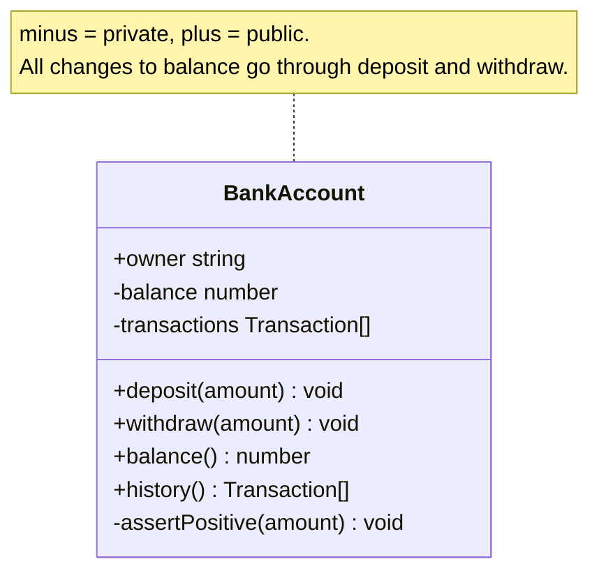
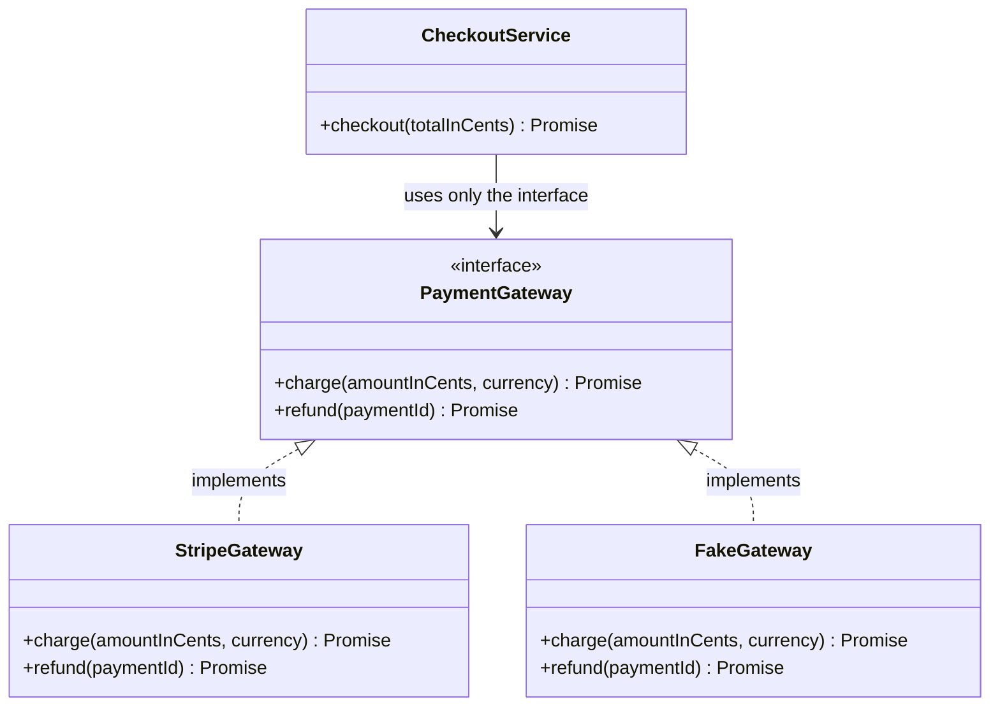
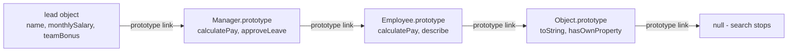
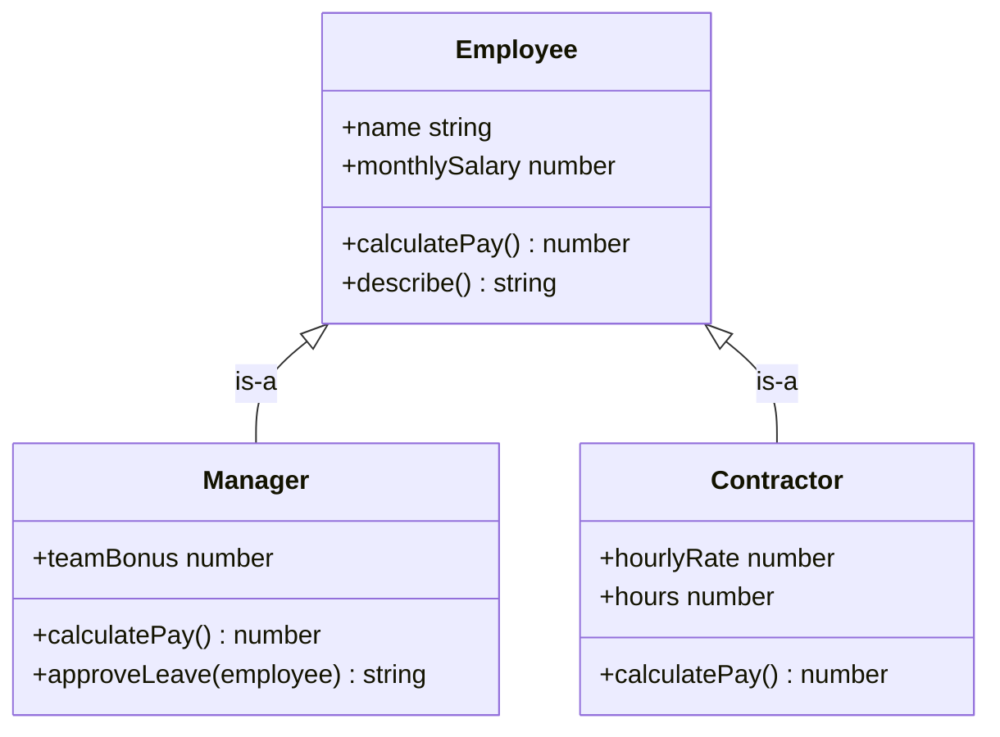
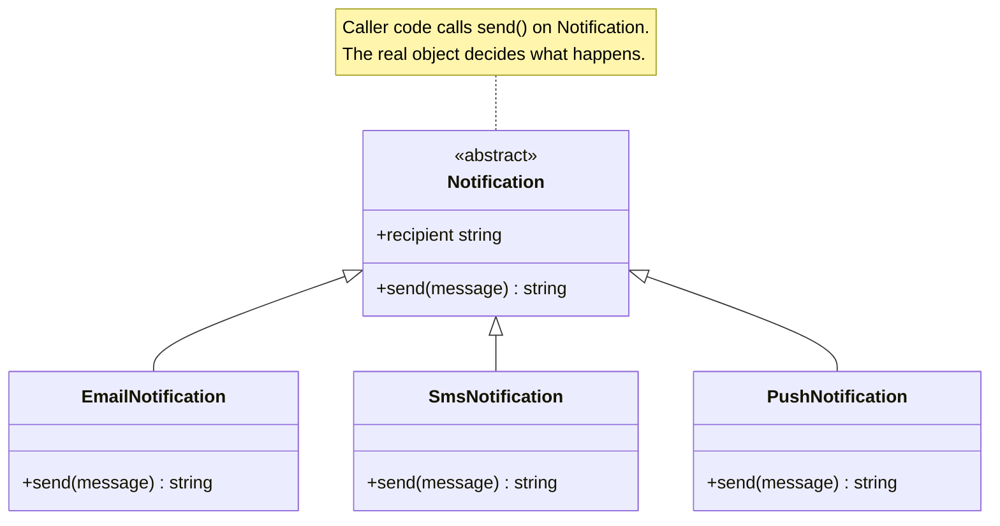
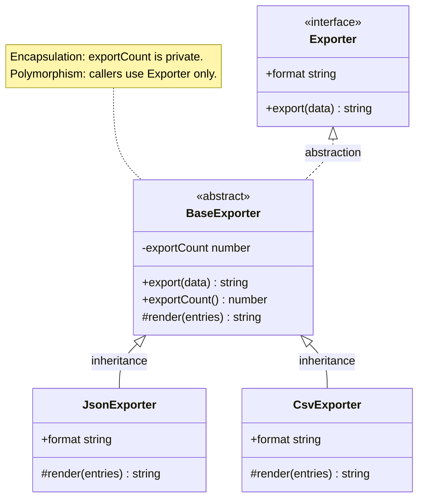

# OOP: The Four Pillars

> In this document you will learn what object-oriented programming (OOP) is and the four ideas it is built on: encapsulation, abstraction, inheritance and polymorphism. Almost every interview for a JavaScript, TypeScript or Angular role asks about these ideas, and they are the base for SOLID and design patterns.

**Before this:** [Classes in JavaScript](../02-javascript/09-classes.md) · [Prototypes and inheritance](../02-javascript/08-prototypes-and-inheritance.md) · **Interview questions:** [jump to questions](#interview-questions)

## Table of contents

1. [What OOP is](#what-oop-is)
2. [Objects and classes](#objects-and-classes)
3. [Encapsulation](#encapsulation)
4. [Abstraction](#abstraction)
5. [Inheritance](#inheritance)
6. [Polymorphism](#polymorphism)
7. [How the four pillars work together](#how-the-four-pillars-work-together)
8. [OOP in JavaScript vs Java and C#](#oop-in-javascript-vs-java-and-c)
9. [When OOP fits and when functional style fits](#when-oop-fits-and-when-functional-style-fits)
10. [OOP in real projects](#oop-in-real-projects)
11. [Common mistakes](#common-mistakes)
12. [Best practices](#best-practices)
13. [How to explain OOP in an interview](#how-to-explain-oop-in-an-interview)
14. [Interview questions](#interview-questions)
15. [Summary](#summary)
16. [References](#references)

---

## What OOP is

**Object-oriented programming (OOP)** is a way to organize code around **objects**. An object keeps some data and the functions that work on that data together in one place.

- The data is called the object's **state** (for example, the items in a cart).
- The functions are called **methods** (for example, `addItem()` or `getTotal()`).

### Why OOP exists

Imagine a program where data lives in global variables and any function can change it. This is called **procedural** style with shared state.

```js
// Procedural style: data and functions are separate
let cartItems = [];
let cartTotal = 0;

function addItem(item) {
  cartItems.push(item);
  cartTotal += item.price;
}

function applyCoupon(percent) {
  cartTotal = cartTotal - (cartTotal * percent) / 100;
}

addItem({ name: "Keyboard", price: 100 });
applyCoupon(10);

// Somewhere else in a big codebase, someone writes:
cartTotal = -50; // Nothing stops this. The total is now wrong.

console.log(cartTotal); // -50
```

In a small file this is fine. In a big app with 200 files, you cannot know which function changed `cartTotal`. Bugs become hard to find.

OOP groups the data with the rules that protect it:

```js
class Cart {
  #items = []; // private: only code inside the class can touch it

  addItem(item) {
    if (item.price < 0) throw new Error("Price cannot be negative");
    this.#items.push(item);
  }

  get total() {
    return this.#items.reduce((sum, item) => sum + item.price, 0);
  }
}

const cart = new Cart();
cart.addItem({ name: "Keyboard", price: 100 });
console.log(cart.total); // 100
// cart.#items = [];     // SyntaxError: outside code cannot reach #items
```

Now there is only one place that changes the cart: the `Cart` class. If the total is wrong, you know where to look.

### Analogy

Think of a coffee machine. You press buttons: "espresso", "latte". You do not open the machine and heat the water yourself. The machine keeps its water, boiler and beans inside, and it gives you a few safe buttons. An object is the same: private state inside, a few public methods outside.

### The four pillars at a glance

| Pillar | Plain meaning | Main JavaScript / TypeScript tools |
| --- | --- | --- |
| **Encapsulation** | Keep data and the code that changes it together. Hide the inside so nobody breaks the rules. | `#private` fields, closures, TS `private`, getters and setters |
| **Abstraction** | Show only what the user needs. Hide how it works. | Small public methods, TS `interface`, `abstract class` |
| **Inheritance** | A class reuses and extends another class ("is-a"). | `extends`, `super`, method overriding |
| **Polymorphism** | One call, many behaviors. The same method call does different things for different objects. | Overriding, duck typing, TS generics, TS overloads |

JavaScript is a **multi-paradigm** language. You can write OOP code, functional code or procedural code, and most real projects mix them. This document focuses on OOP, and [section 9](#when-oop-fits-and-when-functional-style-fits) explains when to choose another style.

---

## Objects and classes

### What an object is

An **object** is a thing in your program that has three parts:

1. **State** — the data it holds right now (`balance: 500`).
2. **Behavior** — what it can do (`deposit()`, `withdraw()`).
3. **Identity** — it is a unique thing in memory. Two objects with the same data are still two different objects.

```js
const userA = { name: "Asha" };
const userB = { name: "Asha" };

console.log(userA === userB); // false -> same data, different identity
console.log(userA === userA); // true
```

### What a class is

A **class** is a blueprint (a template) for creating objects. Each object created from a class is called an **instance**.

```js
class User {
  constructor(name, email) {
    this.name = name;   // state
    this.email = email; // state
  }

  greet() {             // behavior
    return `Hi, I am ${this.name}`;
  }
}

const asha = new User("Asha", "asha@example.com");
const ravi = new User("Ravi", "ravi@example.com");

console.log(asha.greet()); // Hi, I am Asha
console.log(ravi.greet()); // Hi, I am Ravi
console.log(asha instanceof User); // true
```

| | Class | Object (instance) |
| --- | --- | --- |
| What it is | A blueprint | A real thing built from the blueprint |
| How many | One `User` class | Many `User` objects |
| Analogy | The house plan | Each house built from the plan |

### You do not need a class to make an object in JavaScript

In Java or C#, every object comes from a class. In JavaScript, objects are more basic than classes. You can create the same kind of object in several ways:

```js
// 1. Object literal
const user1 = {
  name: "Asha",
  greet() { return `Hi, I am ${this.name}`; },
};

// 2. Factory function (a function that returns a new object)
function createUser(name) {
  return {
    name,
    greet() { return `Hi, I am ${this.name}`; },
  };
}
const user2 = createUser("Ravi");

// 3. Object.create with a shared prototype
const userMethods = {
  greet() { return `Hi, I am ${this.name}`; },
};
const user3 = Object.create(userMethods);
user3.name = "Meera";

console.log(user1.greet()); // Hi, I am Asha
console.log(user2.greet()); // Hi, I am Ravi
console.log(user3.greet()); // Hi, I am Meera
```

All three are objects with state and behavior. The `class` keyword (added in ES2015) is a cleaner way to write the third style: it creates a constructor function and puts methods on a shared prototype object.

> The details of class syntax (fields, static members, getters, private methods, static blocks) are in [Classes in JavaScript](../02-javascript/09-classes.md). How prototypes work under the hood is in [Prototypes and inheritance](../02-javascript/08-prototypes-and-inheritance.md). This document focuses on the *design ideas*.

---

## Encapsulation

### What it is

**Encapsulation** means two things:

1. **Bundling:** keep the data and the methods that work on that data together in one object.
2. **Hiding:** do not let outside code touch the data directly. Outside code must go through the object's public methods.

### Why it exists: protecting invariants

An **invariant** is a rule that must always be true for an object. Examples:

- A bank account balance is never negative.
- A cart total always equals the sum of its item prices.
- An order that is "shipped" always has a tracking number.

If any code can change the data directly, nobody can guarantee these rules. Encapsulation puts one guard in front of the data. All changes go through the guard, and the guard checks the rules.

### Analogy

A bank teller. You cannot walk into the vault and take money. You ask the teller. The teller checks your balance first. The vault is the private state. The teller is the public method.

### The problem without encapsulation

```js
// ❌ Wrong: the balance is open to everyone
const account = {
  owner: "Asha",
  balance: 100,
  withdraw(amount) {
    if (amount > this.balance) throw new Error("Insufficient funds");
    this.balance -= amount;
  },
};

account.withdraw(30);  // goes through the check
account.balance = -5000; // skips the check completely
console.log(account.balance); // -5000 -> invariant broken
```

The `withdraw` method has a good check. But it does not matter, because outside code can skip the method and write to `balance` directly.

### Way 1: `#private` fields (real privacy at runtime)

**Private class fields** start with `#`. They arrived in **ES2022**. Only code written inside the class body can read or write them. This is enforced by the JavaScript engine, not just by a convention.

```js
class BankAccount {
  #balance = 0;           // private field
  #transactions = [];     // private field

  constructor(owner, openingDeposit = 0) {
    this.owner = owner;   // public field
    if (openingDeposit > 0) this.deposit(openingDeposit);
  }

  deposit(amount) {
    this.#assertPositive(amount);
    this.#balance += amount;
    this.#transactions.push({ type: "deposit", amount });
  }

  withdraw(amount) {
    this.#assertPositive(amount);
    if (amount > this.#balance) {
      throw new Error("Insufficient funds");
    }
    this.#balance -= amount;
    this.#transactions.push({ type: "withdraw", amount });
  }

  // Read-only access: a getter with no setter
  get balance() {
    return this.#balance;
  }

  // Return a copy, so callers cannot change our internal array
  get history() {
    return this.#transactions.map((t) => ({ ...t }));
  }

  // Private method (also ES2022)
  #assertPositive(amount) {
    if (typeof amount !== "number" || !Number.isFinite(amount) || amount <= 0) {
      throw new Error("Amount must be a positive number");
    }
  }
}

const account = new BankAccount("Asha", 100);
account.deposit(50);
account.withdraw(30);
console.log(account.balance); // 120

try {
  account.withdraw(1000);
} catch (error) {
  console.log(error.message); // Insufficient funds
}

try {
  account.balance = 1_000_000; // there is no setter
} catch (error) {
  console.log(error.message); // Cannot set property balance of #<BankAccount> which has only a getter
}

const history = account.history;
history.push({ type: "deposit", amount: 999 }); // changes only the copy
console.log(account.history.length); // 3

console.log(Object.keys(account));     // [ 'owner' ]
console.log(JSON.stringify(account));  // {"owner":"Asha"}
```

**Step-by-step walkthrough:**

1. `new BankAccount("Asha", 100)` creates the object. `#balance` starts at `0`, `#transactions` at `[]`.
2. The constructor sets `owner` and calls `deposit(100)`. The private method `#assertPositive` checks the amount. `#balance` becomes `100`.
3. `deposit(50)` makes it `150`. `withdraw(30)` makes it `120`.
4. `withdraw(1000)` fails the check. The balance stays `120`. This is the invariant being protected.
5. `account.balance = 1_000_000` throws a `TypeError` because `balance` has only a getter. (Module code and class code run in strict mode. In old non-strict scripts, the assignment is silently ignored.)
6. `history` returns new copies of the objects. Pushing into the copy does not change the account.
7. Private fields are not normal properties. `Object.keys` and `JSON.stringify` do not see them.

If you write `account.#balance` outside the class, the code does not even start. The engine throws a `SyntaxError` when it parses the file.



### Way 2: closures (the older, still useful way)

A **closure** is a function that remembers the variables from the place where it was created. A factory function can keep variables inside its scope and return only the methods. (Closures are explained in depth in [Closures](../02-javascript/05-closures.md).)

```js
function createBankAccount(owner) {
  let balance = 0; // only the functions below can see this

  return {
    owner,
    deposit(amount) {
      if (amount <= 0) throw new Error("Amount must be positive");
      balance += amount;
    },
    getBalance() {
      return balance;
    },
  };
}

const wallet = createBankAccount("Ravi");
wallet.deposit(40);
console.log(wallet.getBalance()); // 40
console.log(wallet.balance);      // undefined -> there is no such property
```

Trade-off: each object gets its own copies of `deposit` and `getBalance`. With a class, all instances share one copy of each method on the prototype. For a few objects this does not matter. For 100,000 objects, the class uses less memory.

### Way 3: TypeScript `private` and `protected` (compile-time only)

TypeScript has the keywords `public`, `private` and `protected`. They are checked **only by the compiler**. After compiling, they disappear. At runtime the field is a normal, public property.

```ts
class PaymentService {
  private apiKey = "sk_test_123";

  charge(amount: number): string {
    return `Charged ${amount} using key ending ${this.apiKey.slice(-3)}`;
  }
}

const service = new PaymentService();
console.log(service.charge(50)); // Charged 50 using key ending 123

// service.apiKey;  // Compile error: Property 'apiKey' is private
console.log((service as any).apiKey);  // sk_test_123 -> visible at runtime
console.log(JSON.stringify(service));  // {"apiKey":"sk_test_123"}
```

So TypeScript `private` protects you from *mistakes* by your team. It does not protect data from code that ignores the types. If you need real runtime privacy in TypeScript, use `#private` fields. TypeScript supports them fully.

| | TS `private` | JS `#private` |
| --- | --- | --- |
| Checked when | Compile time only | Runtime (by the engine) |
| Visible in `JSON.stringify`, `Object.keys` | Yes | No |
| Can be accessed with `as any` or `obj["field"]` | Yes | No |
| Works with `protected` (subclass access) | Yes, TS has `protected` | No `#protected` exists |
| Works through a `Proxy` | Yes | No, a Proxy wrapper throws `TypeError` |

### Way 4: the underscore convention (not real privacy)

Many older codebases write `this._speed`. The underscore only *says* "please do not touch". The property is fully public.

```js
class Car {
  constructor() {
    this._speed = 0; // "private" by convention only
  }
}
const car = new Car();
car._speed = 999; // works, nothing stops it
console.log(car._speed); // 999
```

### Choosing a privacy tool

| Tool | Real privacy | Shared methods on prototype | Subclass can read it | Good for |
| --- | --- | --- | --- | --- |
| `#private` | Yes | Yes | No | Modern classes that protect invariants |
| Closure | Yes | No (per object) | Not applicable | Factory functions, small modules |
| TS `private` / `protected` | No (compile time) | Yes | `protected`: yes | Angular/NestJS classes, team discipline |
| `_name` convention | No | Yes | Yes | Legacy code only |
| `WeakMap` keyed by `this` | Yes | Yes | If the subclass can see the WeakMap | Old code before ES2022 |

### Getters and setters

A **getter** is a method that runs when you *read* a property. A **setter** is a method that runs when you *assign* a property. They let you keep a simple property syntax while running code behind it.

Use them for:

- **Validation** before saving a value.
- **Computed values** that depend on other state.
- **Read-only views** (getter without a setter).

```js
class UserProfile {
  #email = "";

  constructor(firstName, lastName, email) {
    this.firstName = firstName;
    this.lastName = lastName;
    this.email = email; // goes through the setter below
  }

  // Computed value
  get fullName() {
    return `${this.firstName} ${this.lastName}`;
  }

  get email() {
    return this.#email;
  }

  // Validation + normalization
  set email(value) {
    const cleaned = String(value).trim().toLowerCase();
    if (!cleaned.includes("@")) {
      throw new Error(`Invalid email: ${value}`);
    }
    this.#email = cleaned;
  }
}

const profile = new UserProfile("Asha", "Rao", "  Asha.Rao@Example.COM ");
console.log(profile.fullName); // Asha Rao
console.log(profile.email);    // asha.rao@example.com

try {
  profile.email = "not-an-email";
} catch (error) {
  console.log(error.message); // Invalid email: not-an-email
}
console.log(profile.email);    // asha.rao@example.com (unchanged)
```

**Warning:** a getter and setter for *every* field gives you no real encapsulation. If `setBalance(value)` lets anyone set any value, it is the same as a public field with extra typing. Good encapsulation exposes *behavior* (`deposit`, `withdraw`), not raw data.

### Real-world usage

**Angular service with private state.** This is one of the most common encapsulation patterns in Angular. The service keeps a private `BehaviorSubject` and exposes only a read-only `Observable` plus methods that change the state with rules.

```ts
import { Injectable } from '@angular/core';
import { BehaviorSubject, Observable, map } from 'rxjs';

export interface CartItem { id: string; name: string; price: number; qty: number; }

@Injectable({ providedIn: 'root' })
export class CartService {
  // Private: components cannot call next() on it
  private readonly itemsSubject = new BehaviorSubject<CartItem[]>([]);

  // Public: read-only stream
  readonly items$: Observable<CartItem[]> = this.itemsSubject.asObservable();
  readonly total$ = this.items$.pipe(
    map(items => items.reduce((sum, i) => sum + i.price * i.qty, 0))
  );

  addItem(item: CartItem): void {
    if (item.qty <= 0) throw new Error('Quantity must be positive');
    const items = this.itemsSubject.value;
    const existing = items.find(i => i.id === item.id);
    const next = existing
      ? items.map(i => (i.id === item.id ? { ...i, qty: i.qty + item.qty } : i))
      : [...items, item];
    this.itemsSubject.next(next);
  }

  removeItem(id: string): void {
    this.itemsSubject.next(this.itemsSubject.value.filter(i => i.id !== id));
  }
}
```

Any component can read `items$` and `total$`. Only `CartService` decides how items change. If the cart is wrong, you look in one file.

**Node.js.** A database connection pool class hides its array of open connections. Callers only call `pool.query(sql)`. They never pick a connection themselves, so the pool can enforce limits and recycle broken connections.

### Common mistakes with encapsulation

- **Returning the internal object.** `get items() { return this.#items; }` gives callers the real array. They can `push` into it and skip all your rules. Return a copy, a read-only view, or an immutable structure.
- **Thinking TypeScript `private` is secure.** It is erased at runtime. Do not use it to hide secrets.
- **Getters and setters for everything.** This is public data with extra steps. Expose meaningful actions instead.
- **Putting secrets in frontend objects.** No privacy feature hides data from the user of a browser app. The user can read any memory in their own browser with DevTools. Secrets belong on the server.

---

## Abstraction

### What it is

**Abstraction** means showing only the important things and hiding the details. You give the user a simple way to say *what* they want. You hide *how* it is done.

### Why it exists

Software is complicated. If every developer had to know every detail of every part, nobody could build anything big. Abstraction lets you use a part without understanding its inside.

- You call `fetch(url)` without knowing about TCP sockets, TLS handshakes or HTTP parsing.
- You call `array.sort()` without knowing which sorting algorithm the engine uses.
- You call `emailService.send(...)` without knowing whether it uses SMTP, SendGrid or Amazon SES.

### Analogy

A car's steering wheel, pedals and gear stick are the abstraction. The engine, fuel injection and transmission are hidden. You can drive any car with the same skills, even if the engine is completely different (petrol, diesel, electric).

### Encapsulation vs abstraction

People often mix these up. They are related but different.

| | Abstraction | Encapsulation |
| --- | --- | --- |
| Question it answers | *What* should the outside world see? | *How* do I hide and protect the rest? |
| Focus | Design of the public interface | Mechanism of hiding and guarding state |
| Example | `PaymentGateway` has one method: `charge(amount)` | `#apiKey` and `#retryCount` are private fields |
| Level | Design level | Implementation level |

A short way to remember: **abstraction decides what to show; encapsulation hides the rest and protects it.**

### A simple abstraction in plain JavaScript

```js
class EmailService {
  // The abstraction: one simple public method
  async send(to, subject, body) {
    const message = this.#buildMessage(to, subject, body);
    await this.#connect();
    await this.#transmit(message);
    return { delivered: true, to };
  }

  // The hidden details
  #buildMessage(to, subject, body) {
    return `To: ${to}\nSubject: ${subject}\n\n${body}`;
  }
  async #connect() { /* open SMTP connection, authenticate, retry on failure */ }
  async #transmit(message) { /* send bytes, wait for server reply */ }
}

const emailService = new EmailService();
const result = await emailService.send("asha@example.com", "Welcome", "Hello!");
console.log(result); // { delivered: true, to: 'asha@example.com' }
```

The caller writes one line. All the hard work is hidden.

### Abstract classes

An **abstract class** is a class that you cannot create objects from directly. It exists only to be extended. It can have:

- **Abstract methods** — method names without code. Every subclass must write the code.
- **Normal methods** — shared code that all subclasses get.

TypeScript has an `abstract` keyword:

```ts
abstract class ReportExporter {
  // Shared code for every exporter
  export(rows: Array<Record<string, unknown>>): string {
    if (rows.length === 0) return this.emptyResult();
    return this.header() + this.body(rows);
  }

  // Each subclass must provide these
  protected abstract header(): string;
  protected abstract body(rows: Array<Record<string, unknown>>): string;

  // Subclasses may override this, but do not have to
  protected emptyResult(): string {
    return "No data";
  }
}

class CsvExporter extends ReportExporter {
  protected header(): string {
    return "name,amount\n";
  }
  protected body(rows: Array<Record<string, unknown>>): string {
    return rows.map(r => `${r.name},${r.amount}`).join("\n");
  }
}

class MarkdownExporter extends ReportExporter {
  protected header(): string {
    return "| name | amount |\n| --- | --- |\n";
  }
  protected body(rows: Array<Record<string, unknown>>): string {
    return rows.map(r => `| ${r.name} | ${r.amount} |`).join("\n");
  }
}

const rows = [{ name: "Asha", amount: 120 }, { name: "Ravi", amount: 80 }];
console.log(new CsvExporter().export(rows));
// name,amount
// Asha,120
// Ravi,80
console.log(new MarkdownExporter().export([])); // No data

// new ReportExporter(); // Compile error: Cannot create an instance of an abstract class.
```

Plain JavaScript has no `abstract` keyword. You can get similar safety at runtime with `new.target` (which tells you which class was called with `new`) and a method that throws:

```js
class ReportExporter {
  constructor() {
    if (new.target === ReportExporter) {
      throw new Error("ReportExporter is abstract. Extend it instead.");
    }
  }
  export(rows) {
    return this.header() + this.body(rows);
  }
  header() {
    throw new Error(`${this.constructor.name} must implement header()`);
  }
  body() {
    throw new Error(`${this.constructor.name} must implement body()`);
  }
}

class CsvExporter extends ReportExporter {
  header() { return "name,amount\n"; }
  body(rows) { return rows.map((r) => `${r.name},${r.amount}`).join("\n"); }
}

class BrokenExporter extends ReportExporter {
  header() { return "x\n"; } // forgot body()
}

try {
  new ReportExporter();
} catch (error) {
  console.log(error.message); // ReportExporter is abstract. Extend it instead.
}

console.log(new CsvExporter().export([{ name: "Asha", amount: 120 }]));
// name,amount
// Asha,120

try {
  new BrokenExporter().export([]);
} catch (error) {
  console.log(error.message); // BrokenExporter must implement body()
}
```

The JavaScript version only fails when the code runs. The TypeScript version fails when you compile, which is earlier and safer.

### Interfaces (TypeScript)

An **interface** is a pure contract. It lists method and property names with their types, but it has **no code at all**. A class can promise to follow an interface with `implements`.

```ts
interface PaymentGateway {
  charge(amountInCents: number, currency: string): Promise<{ id: string; status: "paid" | "failed" }>;
  refund(paymentId: string): Promise<void>;
}

class StripeGateway implements PaymentGateway {
  async charge(amountInCents: number, currency: string) {
    // real code would call the Stripe SDK here
    return { id: `stripe_${amountInCents}_${currency}`, status: "paid" as const };
  }
  async refund(paymentId: string) {
    console.log(`Stripe refund for ${paymentId}`);
  }
}

class FakeGateway implements PaymentGateway {
  async charge(amountInCents: number) {
    return { id: `fake_${amountInCents}`, status: "paid" as const };
  }
  async refund() {}
}

// This function knows only the interface, not the concrete class.
async function checkout(gateway: PaymentGateway, totalInCents: number) {
  const result = await gateway.charge(totalInCents, "USD");
  return result.status === "paid" ? `Order paid (${result.id})` : "Payment failed";
}

console.log(await checkout(new StripeGateway(), 4999)); // Order paid (stripe_4999_USD)
console.log(await checkout(new FakeGateway(), 4999));   // Order paid (fake_4999)
```

Very important: **TypeScript interfaces disappear when the code is compiled.** They do not exist at runtime. So you cannot write `if (x instanceof PaymentGateway)`. This matters in Angular (see [section 10](#oop-in-real-projects)).

TypeScript also uses **structural typing**: an object matches an interface if it has the right shape. It does not need to say `implements`.

```ts
interface Logger {
  log(message: string): void;
}

const consoleLogger = {
  log(message: string) { console.log(`[app] ${message}`); },
};

function start(logger: Logger) {
  logger.log("started");
}

start(consoleLogger); // [app] started  (no 'implements' needed, the shape matches)
```

### Abstract class vs interface

| | Interface (TS) | Abstract class |
| --- | --- | --- |
| Contains code | No | Yes, can share code |
| Exists at runtime | No, erased | Yes, it is a real class (function) |
| A class can use many | Yes, `implements A, B, C` | No, only one `extends` |
| Constructor and fields | No | Yes |
| Can be used with `instanceof` | No | Yes |
| Can be an Angular DI token | No (use `InjectionToken`) | Yes |
| Use when | You only need a contract, especially across many unrelated classes | Subclasses share real code or state, and you need a runtime type |



### Real-world usage

- **Angular `HttpClient`** hides `XMLHttpRequest` or `fetch`, headers, JSON parsing and interceptors behind `http.get<User[]>('/api/users')`.
- **Angular `ControlValueAccessor`** is an interface. Any custom input component that implements its four methods works with Angular forms.
- **A repository class** in Node.js (`userRepository.findById(id)`) hides whether the data comes from PostgreSQL, MongoDB or an in-memory map.
- **Electron preload scripts** expose a small API like `window.api.saveFile(content)` to the web page and hide the IPC calls and file system access behind it.

### Common mistakes with abstraction

- **Leaky abstraction.** A **leaky abstraction** is one where hidden details still leak out to the caller. Example: `userRepository.find()` returns a MongoDB cursor object. Now every caller depends on MongoDB, and the abstraction did not really hide anything. Return plain data or your own types.
- **Abstracting too early.** Creating an interface with one implementation "just in case" adds files and indirection with no benefit. Wait until there is a real second implementation or a real need (testing is a real need).
- **Too many layers.** If you must open six files to understand one button click, the abstraction costs more than it saves.

---

## Inheritance

### What it is

**Inheritance** lets one class (the **child**, **subclass** or **derived class**) get the fields and methods of another class (the **parent**, **superclass** or **base class**). The child can add new things and can change (override) inherited methods.

Inheritance models an **"is-a"** relationship:

- A `Manager` **is an** `Employee`. (true)
- A `SavingsAccount` **is a** `BankAccount`. (true)
- A `Car` **is an** `Engine`. (false: a car **has an** engine. That is composition, not inheritance.)

### Why it exists

1. **Reuse:** shared code is written once in the parent.
2. **Subtyping:** any code that works with `Employee` also works with `Manager`. This is the basis of polymorphism.

### Analogy

A child inherits features from parents (eye colour, surname) and also has their own features. Where the analogy breaks: in code, the child gets *everything* public and protected from the parent, including things it does not want. Real children do not inherit all their parents' habits.

### Basic example: `extends`, `super` and overriding

```js
class Employee {
  constructor(name, monthlySalary) {
    this.name = name;
    this.monthlySalary = monthlySalary;
  }

  calculatePay() {
    return this.monthlySalary;
  }

  describe() {
    return `${this.name} earns ${this.calculatePay()} this month`;
  }
}

class Manager extends Employee {
  constructor(name, monthlySalary, teamBonus) {
    super(name, monthlySalary); // must call the parent constructor first
    this.teamBonus = teamBonus;
  }

  // Override: replace the parent's method, but reuse it with super
  calculatePay() {
    return super.calculatePay() + this.teamBonus;
  }

  // New method only managers have
  approveLeave(employee) {
    return `${this.name} approved leave for ${employee.name}`;
  }
}

const dev = new Employee("Ravi", 5000);
const lead = new Manager("Asha", 7000, 1500);

console.log(dev.describe());  // Ravi earns 5000 this month
console.log(lead.describe()); // Asha earns 8500 this month
console.log(lead.approveLeave(dev)); // Asha approved leave for Ravi
console.log(lead instanceof Manager);  // true
console.log(lead instanceof Employee); // true
```

**Step-by-step walkthrough for `lead.describe()`:**

1. JavaScript looks for `describe` on the `lead` object itself. Not found.
2. It looks on `Manager.prototype`. Not found.
3. It looks on `Employee.prototype`. Found. It runs `describe` with `this = lead`.
4. Inside, `this.calculatePay()` starts the search again **from `lead`**, not from `Employee`. It finds `calculatePay` on `Manager.prototype` first.
5. `Manager`'s `calculatePay` calls `super.calculatePay()`, which runs `Employee`'s version: `7000`. It adds `1500`. Result: `8500`.

Step 4 is the key idea: the method that runs depends on the **actual object**, not on the class where the calling code is written. This is called **dynamic dispatch**, and it is what makes polymorphism work.

### How it works inside: the prototype chain

JavaScript classes are built on **prototypes**. Every object has a hidden link to another object called its **prototype**. When you read a property that the object does not have, JavaScript follows this link, then the next link, and so on. This series of links is the **prototype chain**.

```js
console.log(Object.getPrototypeOf(lead) === Manager.prototype);                // true
console.log(Object.getPrototypeOf(Manager.prototype) === Employee.prototype);  // true
console.log(Object.getPrototypeOf(Employee.prototype) === Object.prototype);   // true
console.log(Object.getPrototypeOf(Manager) === Employee); // true (static members are inherited too)
```



The full story of prototypes is in [Prototypes and inheritance](../02-javascript/08-prototypes-and-inheritance.md).

### Rules for `super`

- In a child constructor, you **must** call `super(...)` before you use `this`. Otherwise you get `ReferenceError: Must call super constructor in derived class before accessing 'this'`.
- If the child has no constructor, JavaScript adds one that passes all arguments to `super`.
- In any method, `super.method()` calls the parent's version of that method.

### TypeScript extras: `protected` and `override`

- `protected` members can be used inside the class and its subclasses, but not from outside.
- The `override` keyword (TypeScript 4.3+) says "this method replaces a parent method". With the compiler option `noImplicitOverride`, TypeScript forces you to write it. This catches bugs when a parent method is renamed.

```ts
class Notifier {
  protected sentCount = 0;

  send(message: string): string {
    this.sentCount++;
    return `Generic: ${message}`;
  }
}

class SmsNotifier extends Notifier {
  override send(message: string): string {
    const text = message.length > 160 ? message.slice(0, 157) + "..." : message;
    this.sentCount++;              // allowed: protected
    return `SMS: ${text}`;
  }

  // override sendd(message: string) {}
  // Compile error: This member cannot have an 'override' modifier
  // because it is not declared in the base class 'Notifier'.
}

const sms = new SmsNotifier();
console.log(sms.send("Your order has shipped")); // SMS: Your order has shipped
// sms.sentCount; // Compile error: Property 'sentCount' is protected
```

### Types of inheritance

| Type | Meaning | Supported in JavaScript |
| --- | --- | --- |
| Single | `B extends A` | Yes |
| Multilevel | `C extends B extends A` | Yes |
| Hierarchical | `B extends A` and `C extends A` | Yes |
| Multiple | `C extends A, B` | No. One prototype chain only. Use mixins or composition, see [Composition, inheritance and mixins](./02-composition-inheritance-and-mixins.md). |



### Gotcha: calling an overridable method from the parent constructor

The parent constructor runs **before** the child's class fields are set up. If the parent constructor calls a method that the child overrides, the child's method runs too early.

```js
class Widget {
  constructor() {
    this.render(); // calls the CHILD's render, before the child is ready
  }
  render() {
    console.log("base render");
  }
}

class ChartWidget extends Widget {
  options = { color: "blue" }; // set AFTER super() returns

  render() {
    console.log("chart render, options =", this.options);
  }
}

new ChartWidget(); // chart render, options = undefined
```

Order of events:

1. `new ChartWidget()` calls the parent constructor through the automatic `super()`.
2. The parent constructor calls `this.render()`. Dynamic dispatch picks `ChartWidget`'s `render`.
3. `this.options` does not exist yet, so it prints `undefined`.
4. Only after `super()` returns does JavaScript run the child's field initializers. Now `options` is set, but too late.

Fix: do not call overridable methods in constructors. Use a separate `init()` step, or (in Angular) use `ngOnInit`.

### Real-world usage

- **Custom errors:** `class ValidationError extends Error`. This is one of the best uses of inheritance.
- **Node.js:** `class OrderEvents extends EventEmitter`, `class CsvParser extends Transform` (streams).
- **Web components:** `class UserCard extends HTMLElement`.
- **Angular:** a shared abstract base class for similar components or services (use carefully; composition with services is often better).

The problems of inheritance (fragile base class, deep hierarchies, the gorilla–banana problem) and when to prefer composition are covered in [Composition, inheritance and mixins](./02-composition-inheritance-and-mixins.md).

---

## Polymorphism

### What it is

**Polymorphism** means "many forms". In code, it means **one interface, many implementations**: the same method call does different things depending on the object that receives it.

```js
shapes.forEach((shape) => console.log(shape.area()));
// The same line runs Circle's area(), Square's area(), Triangle's area()...
```

### Why it exists

Without polymorphism, code must check the type of every object with `if` or `switch`. Each time you add a new type, you must find and edit every `switch` in the codebase. With polymorphism, you add a new class and the calling code does not change. (This is the Open/Closed Principle, see [SOLID principles](./03-solid-principles.md).)

### Analogy

A wall power socket. You plug in a lamp, a phone charger or a kettle. The socket does the same thing for all of them: it gives power. Each device decides what to do with it. The socket does not need to know what kind of device you plugged in.

### Kind 1: subtype polymorphism (overriding, decided at runtime)

**Subtype polymorphism** happens when subclasses override a parent method, and calling code uses the parent type. JavaScript decides which method to run **at runtime**, by looking at the actual object.

```js
class Notification {
  constructor(recipient) {
    this.recipient = recipient;
  }
  send(message) {
    throw new Error("send() must be implemented");
  }
}

class EmailNotification extends Notification {
  send(message) {
    return `Email to ${this.recipient}: ${message}`;
  }
}

class SmsNotification extends Notification {
  send(message) {
    return `SMS to ${this.recipient}: ${message.slice(0, 20)}`;
  }
}

class PushNotification extends Notification {
  send(message) {
    return `Push to device ${this.recipient}: ${message}`;
  }
}

const channels = [
  new EmailNotification("asha@example.com"),
  new SmsNotification("+91-98000-00000"),
  new PushNotification("device-42"),
];

// This loop does not know or care about the concrete types.
for (const channel of channels) {
  console.log(channel.send("Your order #1001 has shipped"));
}
// Email to asha@example.com: Your order #1001 has shipped
// SMS to +91-98000-00000: Your order #1001 has
// Push to device device-42: Your order #1001 has shipped
```



### Replacing a type switch with polymorphism

```js
// ❌ Wrong: every new channel means editing this function (and others like it)
function sendNotification(channel, message) {
  switch (channel.type) {
    case "email":
      return `Email to ${channel.recipient}: ${message}`;
    case "sms":
      return `SMS to ${channel.recipient}: ${message.slice(0, 20)}`;
    case "push":
      return `Push to device ${channel.recipient}: ${message}`;
    default:
      throw new Error(`Unknown channel ${channel.type}`);
  }
}

// ✅ Correct: each channel knows how to send itself
function sendNotificationPolymorphic(channel, message) {
  return channel.send(message);
}
```

To add WhatsApp, you write a new `WhatsAppNotification` class. You do not touch `sendNotificationPolymorphic`.

A `switch` is not always bad. If the list of cases is small, stable and in one place, a `switch` can be simpler than a class hierarchy. Choose polymorphism when the same type checks appear in many places or when new types are added often.

### Kind 2: ad-hoc polymorphism (overloading)

**Method overloading** means having several methods with the same name but different parameter lists. Java and C# pick the right one at compile time.

**JavaScript does not have method overloading.** If you write two methods with the same name, the last one wins:

```js
class Calculator {
  add(a, b) { return a + b; }
  add(a, b, c) { return a + b + c; } // replaces the first add
}

console.log(new Calculator().add(1, 2)); // NaN -> runs the second add: 1 + 2 + undefined
```

In JavaScript, you simulate overloading by checking the arguments inside one function:

```js
function formatPrice(value, currency = "USD") {
  if (typeof value === "string") value = Number(value);
  if (Array.isArray(value)) return value.map((v) => formatPrice(v, currency));
  return new Intl.NumberFormat("en-US", { style: "currency", currency }).format(value);
}

console.log(formatPrice(12.5));           // $12.50
console.log(formatPrice("99"));           // $99.00
console.log(formatPrice([1, 2], "EUR"));  // [ '€1.00', '€2.00' ]
```

**TypeScript overloads** let you describe several call signatures for one function. There is still only **one implementation** at runtime. The overloads only help the compiler and your editor.

```ts
function parseDate(timestamp: number): Date;
function parseDate(isoString: string): Date;
function parseDate(year: number, month: number, day: number): Date;
function parseDate(a: number | string, month?: number, day?: number): Date {
  if (typeof a === "string") return new Date(a);
  if (month !== undefined && day !== undefined) return new Date(Date.UTC(a, month - 1, day));
  return new Date(a);
}

console.log(parseDate("2025-01-15T00:00:00Z").toISOString()); // 2025-01-15T00:00:00.000Z
console.log(parseDate(2025, 1, 15).toISOString());             // 2025-01-15T00:00:00.000Z
console.log(parseDate(0).toISOString());                       // 1970-01-01T00:00:00.000Z
// parseDate(2025, 1); // Compile error: No overload expects 2 arguments
```

### Kind 3: parametric polymorphism (generics)

**Parametric polymorphism** means writing code once that works with *any* type, while keeping type safety. In TypeScript, this is done with **generics**. (Generics are covered in depth in [Generics](../03-typescript/05-generics.md).)

```ts
class InMemoryRepository<T extends { id: string }> {
  private items = new Map<string, T>();

  save(item: T): void {
    this.items.set(item.id, item);
  }

  findById(id: string): T | undefined {
    return this.items.get(id);
  }

  findAll(): T[] {
    return [...this.items.values()];
  }
}

interface Product { id: string; name: string; price: number; }
interface Customer { id: string; email: string; }

const products = new InMemoryRepository<Product>();
products.save({ id: "p1", name: "Mouse", price: 25 });

const customers = new InMemoryRepository<Customer>();
customers.save({ id: "c1", email: "asha@example.com" });

console.log(products.findById("p1")?.name);  // Mouse
console.log(customers.findAll().length);     // 1
// products.save({ id: "c2", email: "x" });  // Compile error: not a Product
```

One class, many types. The same code serves products, customers, orders and anything else with an `id`.

### Kind 4: duck typing (structural polymorphism)

**Duck typing** comes from the saying "if it walks like a duck and quacks like a duck, it is a duck". JavaScript does not check what class an object comes from. It only checks whether the object has the method you call, at the moment you call it.

```js
// No shared parent class, no interface keyword
const consoleLogger = { log: (msg) => console.log(`[console] ${msg}`) };
const memoryLogger = {
  lines: [],
  log(msg) { this.lines.push(msg); },
};

function processOrder(order, logger) {
  logger.log(`Processing order ${order.id}`);
  return { ...order, status: "processed" };
}

processOrder({ id: 1 }, consoleLogger); // [console] Processing order 1
processOrder({ id: 2 }, memoryLogger);
console.log(memoryLogger.lines); // [ 'Processing order 2' ]
```

JavaScript itself is built on duck typing:

- Any object with a `[Symbol.iterator]()` method works with `for...of` and spread. It does not need to be an array.
- Any object with a `then()` method (a **thenable**) works with `await`.
- Any object with `toString()` works in string concatenation.

```js
const countdown = {
  from: 3,
  *[Symbol.iterator]() {
    for (let i = this.from; i > 0; i--) yield i;
  },
};
console.log([...countdown]); // [ 3, 2, 1 ]

const thenable = { then(resolve) { resolve("done"); } };
console.log(await thenable); // done
```

TypeScript's **structural typing** is duck typing checked at compile time: if the shape matches the interface, the object is accepted (you saw this with `Logger` above).

### Summary of the kinds of polymorphism

| Kind | How | When decided | JavaScript | TypeScript |
| --- | --- | --- | --- | --- |
| Subtype | Override a parent method | Runtime | Yes | Yes |
| Ad-hoc (overloading) | Same name, different parameters | Compile time | No (simulate with argument checks) | Overload signatures, one implementation |
| Parametric | Generics | Compile time | Not needed (no static types) | Yes |
| Duck / structural | Same method names, no shared parent | Runtime (JS), compile time (TS) | Yes | Yes, structural typing |

### Real-world usage

- **Angular `HTTP_INTERCEPTORS`:** many interceptor classes, each implements `intercept(req, next)`. Angular calls them in a chain without knowing what each one does.
- **Express middleware:** any function with the shape `(req, res, next)` can be plugged in.
- **Node.js streams:** any `Readable` can be piped to any `Writable`. A file, an HTTP response and a gzip stream all share the same interface.
- **Payment, storage, notification "providers":** code calls `provider.send()` or `storage.save()`, and the configured implementation does the real work.

---

## How the four pillars work together

In real code you rarely use one pillar alone. Here is one small system that uses all four.

```ts
// ABSTRACTION: callers only know about this contract
interface Exporter {
  readonly format: string;
  export(data: Record<string, number>): string;
}

// INHERITANCE: shared logic lives in one base class
abstract class BaseExporter implements Exporter {
  abstract readonly format: string;
  // ENCAPSULATION: the counter is private and only changes through export()
  #exportCount = 0;

  export(data: Record<string, number>): string {
    this.#exportCount++;
    return this.render(Object.entries(data));
  }

  get exportCount(): number {
    return this.#exportCount;
  }

  protected abstract render(entries: Array<[string, number]>): string;
}

class JsonExporter extends BaseExporter {
  readonly format = "json";
  protected render(entries: Array<[string, number]>): string {
    return JSON.stringify(Object.fromEntries(entries));
  }
}

class CsvExporter extends BaseExporter {
  readonly format = "csv";
  protected render(entries: Array<[string, number]>): string {
    return entries.map(([key, value]) => `${key},${value}`).join("\n");
  }
}

// POLYMORPHISM: one loop, many behaviors
const exporters: Exporter[] = [new JsonExporter(), new CsvExporter()];
const sales = { january: 120, february: 95 };

for (const exporter of exporters) {
  console.log(`--- ${exporter.format} ---`);
  console.log(exporter.export(sales));
}
// --- json ---
// {"january":120,"february":95}
// --- csv ---
// january,120
// february,95
```



| Pillar | Where it appears |
| --- | --- |
| Abstraction | `Exporter` interface: callers see only `format` and `export()` |
| Encapsulation | `#exportCount` can only change inside `export()` |
| Inheritance | `JsonExporter` and `CsvExporter` reuse `export()` from `BaseExporter` |
| Polymorphism | The `for` loop calls `export()` and each class renders differently |

---

## OOP in JavaScript vs Java and C#

If you learned OOP from Java or C#, JavaScript will feel familiar on the surface and very different underneath.

### 1. JavaScript is prototype-based

In Java and C#, classes are the core idea. Objects are created from classes, and the class of an object never changes.

In JavaScript, **objects and prototypes** are the core idea. A `class` is mostly a nicer way to write a constructor function plus a prototype object.

```js
class User {}
console.log(typeof User); // function
```

Because of this, JavaScript objects are very flexible:

```js
class Animal {
  constructor(name) { this.name = name; }
}
const rex = new Animal("Rex");

// You can add a method to ALL animals at runtime ("monkey patching")
Animal.prototype.sleep = function () {
  return `${this.name} sleeps`;
};
console.log(rex.sleep()); // Rex sleeps  (rex was created before sleep existed)
```

This flexibility is powerful but risky. Changing built-in prototypes (like `Array.prototype`) in application code is a bad practice, because it can clash with libraries and future JavaScript features.

### 2. TypeScript types and interfaces vanish at runtime

TypeScript adds a type system on top of JavaScript. When you compile, all types, interfaces, `private`, `protected`, `abstract` and `implements` are removed. The output is plain JavaScript.

Consequences:

- You cannot use `instanceof` with an interface.
- You cannot ask "does this object implement `PaymentGateway`?" at runtime. You check the shape yourself (a **type guard**) or use a tag property (a **discriminated union**). See [Unions, narrowing and type guards](../03-typescript/03-unions-narrowing-and-type-guards.md).
- Data from an API is not checked by TypeScript at runtime. You need runtime validation. See [Runtime validation and type-safe APIs](../03-typescript/11-runtime-validation-and-type-safe-apis.md).

```ts
interface Cancellable {
  cancel(): void;
}

// A type guard: checks the shape at runtime
function isCancellable(value: unknown): value is Cancellable {
  return typeof value === "object" && value !== null &&
    typeof (value as { cancel?: unknown }).cancel === "function";
}

const job: unknown = { cancel() { console.log("job cancelled"); } };
// if (job instanceof Cancellable) {}  // Compile error: 'Cancellable' only refers to a type
if (isCancellable(job)) job.cancel(); // job cancelled
```

### 3. `this` is dynamic

In Java, a method always knows its object. In JavaScript, the value of `this` depends on **how the function is called**, not where it is defined. If you take a method out of its object, it loses `this`.

```js
class Dog {
  constructor(name) { this.name = name; }
  speak() { return `${this.name} barks`; }
}
const dog = new Dog("Rex");

const speak = dog.speak; // method taken out of the object
try {
  speak();
} catch (error) {
  console.log(error.message); // Cannot read properties of undefined (reading 'name')
}

const boundSpeak = dog.speak.bind(dog);
console.log(boundSpeak()); // Rex barks
```

This often happens with callbacks: `button.addEventListener("click", this.handleClick)` or `setTimeout(this.refresh, 1000)`. Fix it with `.bind(this)`, an arrow function wrapper, or an arrow-function class field. Full details are in [this, call, apply and bind](../02-javascript/06-this-call-apply-bind.md).

### 4. Functions are first-class values

In JavaScript, a function is a value. You can store it in a variable, pass it to another function, and return it. Many patterns that need a class in Java (Strategy, Command, Observer listeners) are just functions in JavaScript.

```js
// In Java you might write a DiscountStrategy interface and three classes.
// In JavaScript, a function is often enough:
const discounts = {
  none: (total) => total,
  tenPercent: (total) => total * 0.9,
  flat20: (total) => Math.max(0, total - 20),
};

function checkout(total, discount) {
  return discount(total);
}

console.log(checkout(100, discounts.tenPercent)); // 90
console.log(checkout(100, discounts.flat20));     // 80
```

### Comparison table

| Topic | Java / C# | JavaScript | TypeScript |
| --- | --- | --- | --- |
| Model | Class-based | Prototype-based (`class` is syntax on top) | Same as JS at runtime |
| Interfaces | Real, exist at runtime | None | Compile-time only, erased |
| Private members | Enforced by compiler and runtime | `#private` enforced at runtime | `private` compile-time; `#private` runtime |
| Method overloading | Yes | No (last definition wins) | Overload signatures, one implementation |
| Multiple inheritance | Interfaces only, no multiple classes | One prototype chain; mixins | Same as JS; mixin typing patterns |
| Abstract classes | Yes | Simulate with `new.target` and throws | `abstract` keyword |
| `this` in methods | Always the object | Depends on how the function is called | Same as JS |
| Change objects at runtime | Limited (reflection) | Easy (add or remove properties and methods) | Allowed, but types push back |
| Typing style | Nominal (by declared name) | Dynamic (duck typing) | Structural (by shape) |

**Nominal typing** means two types are compatible only if they have the same declared name or one explicitly extends the other. **Structural typing** means two types are compatible if they have the same shape. TypeScript is structural.

---

## When OOP fits and when functional style fits

You do not have to choose one style for a whole project. Good JavaScript code mixes them. The question is which style fits each part.

### OOP fits well when

- **Something has identity and a lifecycle.** A WebSocket connection, a game character, a shopping cart, an Electron window. It is created, it changes over time, and it is destroyed.
- **State has rules that must always hold.** A bank account, an order that moves through states. Encapsulation protects the rules.
- **The framework is built on classes.** Angular components, services, guards and pipes are classes. NestJS controllers and providers are classes.
- **Many implementations share one contract.** Payment gateways, storage providers, loggers.

### Functional style fits well when

- **You transform data.** Input in, output out: filtering products, mapping API responses, calculating totals.
- **You want easy testing.** **Pure functions** (same input always gives the same output, no side effects) are the easiest code to test.
- **State is managed outside the function.** Redux and NgRx reducers, React components with hooks, RxJS pipelines.

### The same logic in both styles

```js
// OOP style: state and behavior together
class PriceCalculator {
  #taxRate;
  constructor(taxRate) {
    this.#taxRate = taxRate;
  }
  total(items) {
    const subtotal = items.reduce((sum, item) => sum + item.price * item.qty, 0);
    return Math.round(subtotal * (1 + this.#taxRate) * 100) / 100;
  }
}

// Functional style: pure functions, data passed in
const subtotal = (items) => items.reduce((sum, item) => sum + item.price * item.qty, 0);
const withTax = (amount, taxRate) => Math.round(amount * (1 + taxRate) * 100) / 100;
const total = (items, taxRate) => withTax(subtotal(items), taxRate);

const items = [{ price: 10, qty: 2 }, { price: 5, qty: 1 }];
console.log(new PriceCalculator(0.18).total(items)); // 29.5
console.log(total(items, 0.18));                     // 29.5
```

Both are fine. The functional version is easier to test piece by piece and to reuse. The OOP version is easier to pass around as one object that "knows" its tax rate (for example, to inject it into an Angular component).

| Question | Lean towards OOP | Lean towards functional |
| --- | --- | --- |
| Does it hold changing state over time? | Yes | No |
| Are there rules (invariants) on that state? | Yes | Rarely |
| Is it mostly data in, data out? | No | Yes |
| Does the framework expect classes? | Angular, NestJS | React hooks, Redux reducers |
| Will there be many interchangeable implementations? | Classes or objects behind an interface | Functions passed as arguments also work |

A common, healthy mix in an Angular or Node.js app: **classes for services and components** (state, lifecycle, DI) and **pure functions for business calculations** (easy to test, easy to reuse).

---

## OOP in real projects

### Angular

- **Components are classes.** The class holds the view state and event handlers. The template reads its public members.
- **Services are classes with encapsulated state.** You saw `CartService` above: a private `BehaviorSubject` and a public read-only `items$`.
- **Dependency injection uses classes as tokens.** Because TypeScript interfaces are erased, Angular **cannot inject an interface**. You use an `InjectionToken` or an **abstract class** as the token. An abstract class exists at runtime, so it works.

```ts
import { Injectable } from '@angular/core';

// Abstract class works as both a contract and a DI token
export abstract class Logger {
  abstract log(message: string): void;
}

@Injectable()
export class ConsoleLogger extends Logger {
  log(message: string): void {
    console.log(`[app] ${message}`);
  }
}

// In a module or component:
// providers: [{ provide: Logger, useClass: ConsoleLogger }]

@Injectable({ providedIn: 'root' })
export class OrderService {
  constructor(private logger: Logger) {} // asks for the abstraction

  placeOrder(id: string): void {
    this.logger.log(`Order ${id} placed`);
  }
}
```

More on this in [Dependency inversion and injection](./05-dependency-inversion-and-injection.md) and [Angular dependency injection](../06-angular-16/05-dependency-injection.md).

### Node.js

- **Service and repository classes:** `OrderService` uses `OrderRepository`. Each hides its details.
- **Custom error classes** for clear error handling:

```js
class AppError extends Error {
  constructor(message, statusCode, options) {
    super(message, options); // options can include { cause } (ES2022)
    this.name = this.constructor.name;
    this.statusCode = statusCode;
  }
}

class NotFoundError extends AppError {
  constructor(resource, id) {
    super(`${resource} with id ${id} not found`, 404);
    this.resource = resource;
  }
}

try {
  throw new NotFoundError("Order", 42);
} catch (error) {
  console.log(error instanceof NotFoundError); // true
  console.log(error instanceof AppError);      // true
  console.log(error.name, error.statusCode);   // NotFoundError 404
  console.log(error.message);                  // Order with id 42 not found
}
```

An Express error handler can now check `error instanceof AppError` and send `error.statusCode`. This is polymorphism and inheritance working together. Error handling is covered in [Error handling](../02-javascript/15-error-handling.md) and [Validation and error handling in Node.js](../07-nodejs-backend/08-validation-and-error-handling.md).

- **Extending core classes:** `EventEmitter` for event-driven objects, `Readable` or `Transform` for streams.

### Electron

In the Electron main process, a `WindowManager` class often owns all `BrowserWindow` objects. It keeps the list of windows private and exposes methods like `openSettings()` and `focusMain()`. The rest of the app never creates windows directly, so window rules (only one settings window, restore size and position, secure `webPreferences`) live in one place. See [App and window lifecycle](../08-electron-desktop/02-app-and-window-lifecycle.md).

---

## Common mistakes

1. **Using inheritance for code reuse only.** If the "is-a" test fails, use composition. `class UserService extends HttpHelper` is a smell: a user service *uses* HTTP, it is not an HTTP helper.
2. **Deep class hierarchies.** Five levels of `extends` are very hard to understand and change.
3. **Anemic objects.** An **anemic object** has only data and getters/setters, while all the logic lives in other "manager" classes. Then the object cannot protect its rules.
4. **Leaking internal state.** Returning internal arrays or objects lets callers bypass your methods.
5. **Trusting TypeScript `private` for security.** It is erased at runtime.
6. **Checking types with `instanceof` everywhere.** If you write `if (x instanceof A) ... else if (x instanceof B)`, you probably want polymorphism instead.
7. **Losing `this`.** Passing `obj.method` as a callback without binding.
8. **Calling overridable methods in a constructor.** The subclass is not ready yet.
9. **Making everything a class.** A pure calculation does not need a class with one method. A function is simpler.

---

## Best practices

- **Expose behavior, not data.** Prefer `account.withdraw(50)` over `account.balance -= 50`. Reason: the object can check its rules.
- **Use `#private` for state that has rules.** Reason: the engine enforces it, and it does not leak into `JSON.stringify`.
- **Validate in one place.** Put checks in the constructor and in the methods that change state. Reason: the object can never be in an invalid state.
- **Return copies or read-only views of internal collections.** Reason: callers cannot bypass your methods.
- **Prefer interfaces for contracts and abstract classes for shared code.** Reason: interfaces are flexible and free at runtime; abstract classes give shared code and a runtime token.
- **Use inheritance only for real "is-a" relationships, and keep hierarchies shallow** (one or two levels). Reason: deep hierarchies are fragile.
- **Use `override` and `noImplicitOverride` in TypeScript.** Reason: renames in the base class do not silently break subclasses.
- **Program to an interface, not an implementation.** Reason: you can swap the implementation (a fake in tests, a new provider in production) without changing callers.
- **Mix styles.** Use classes where state and lifecycle matter. Use pure functions for calculations.

---

## How to explain OOP in an interview

1. **Define it:** "OOP is a way to organize code around objects. Each object keeps its data and the methods that work on that data together."
2. **Why it exists:** "In big codebases, shared data that anyone can change causes bugs that are hard to trace. OOP puts the data behind methods, so the rules live in one place."
3. **How it works:** "It rests on four ideas. Encapsulation hides the state and protects its rules. Abstraction shows only a simple interface. Inheritance lets a class reuse and extend another class. Polymorphism lets one call behave differently depending on the object."
4. **Small example:** "A `BankAccount` with a private `#balance`. You can only change it through `deposit` and `withdraw`, and `withdraw` refuses to go below zero. If `SavingsAccount` and `CheckingAccount` both extend it, a function can call `account.withdraw()` on any of them."
5. **Where it is useful:** "In Angular, components and services are classes. A service keeps a private `BehaviorSubject` and exposes a read-only observable. In Node, I use service and repository classes and custom error classes."
6. **Trade-offs / gotchas:** "JavaScript OOP is prototype-based, and TypeScript `private` and interfaces disappear at runtime. I keep inheritance shallow and prefer composition when there is no real is-a relationship. For pure data transformations I use plain functions."

---

## Interview questions

### Q1. What is object-oriented programming, and what are its four pillars?

**What the interviewer is checking:** Can you define OOP in plain words and give each pillar a correct, concrete meaning (not just a list of words)?

**Short spoken answer (30–60 seconds):**
> OOP is a way to structure code around objects. An object holds some state and the methods that work on that state. The idea is to keep data and its rules together, so the rules can't be skipped. It has four pillars. Encapsulation means hiding the internal state and only allowing changes through methods, for example a private balance that only `deposit` and `withdraw` can change. Abstraction means exposing a simple interface and hiding the complex details, like `fetch(url)` hiding all the networking. Inheritance means a class can extend another class and reuse its code, like `Manager extends Employee`. And polymorphism means the same method call can behave differently depending on the object, like calling `send()` on email, SMS and push notifications. In JavaScript all of this sits on top of prototypes, so it's a bit different from Java.

**Detailed explanation:**
- OOP is a **paradigm**, a style of organizing code. JavaScript supports it, but also supports functional and procedural styles.
- Each pillar answers a different question: encapsulation (who may change the data?), abstraction (what does the outside see?), inheritance (how do I reuse a parent's code?), polymorphism (how does one call work for many types?).
- Some people count only three pillars (encapsulation, inheritance, polymorphism) and treat abstraction as part of encapsulation. Mentioning this shows depth.

**Follow-up questions:**
- **Which pillar is the most important?** — Many engineers say encapsulation, because protecting invariants is what makes objects trustworthy. Inheritance is the one most often misused.
- **Can you do OOP without classes in JavaScript?** — Yes. Object literals, factory functions with closures and `Object.create` all create objects with state and behavior. Classes are syntax over prototypes.
- **Is JavaScript an OOP language?** — It is multi-paradigm. It has objects and prototypes at its core and supports OOP fully, but it also has first-class functions that make functional programming natural.

**Common mistakes:** Listing the four words without examples. Saying encapsulation and abstraction are the same thing. Saying JavaScript has "real classes like Java".

**Where this is used in real projects:** Angular components and services, NestJS providers, Node.js service and repository layers, custom error hierarchies.

### Q2. What is the difference between encapsulation and abstraction?

**What the interviewer is checking:** Whether you understand that these are related but separate ideas: one is about the *design of the interface*, the other about *hiding and protecting state*.

**Short spoken answer (30–60 seconds):**
> Abstraction is about *what* you show. You design a simple interface that hides the complexity, for example a `PaymentGateway` with one `charge(amount)` method. The caller doesn't need to know if it's Stripe or PayPal. Encapsulation is about *how* you hide and protect the rest. You keep the internal state private, like the API key or a retry counter, and only allow changes through methods that check the rules. So abstraction is a design decision about the interface, and encapsulation is the mechanism that keeps the inside safe. They work together: a good abstraction is usually implemented with encapsulation.

**Detailed explanation:**

| | Abstraction | Encapsulation |
| --- | --- | --- |
| Focus | The outside view | The inside protection |
| Tools | Interfaces, abstract classes, small public APIs | `#private`, closures, TS `private`, getters without setters |
| Example | `emailService.send(to, subject, body)` | `#smtpConnection`, `#retryCount` are private |
| Goal | Reduce what callers must know | Stop callers from breaking invariants |

You can have encapsulation without much abstraction: a class with private fields but a very detailed, low-level public API. You can also have an abstraction with poor encapsulation: an interface whose implementation keeps its state in public fields that anyone can change.

**Follow-up questions:**
- **Give a real example of both in one class.** — An Angular `CartService` exposes `addItem()` and `total$` (abstraction: simple interface) and keeps `itemsSubject` private (encapsulation: nobody can call `next()` on it from outside).
- **What is a leaky abstraction?** — An abstraction where hidden details still reach the caller. For example, a repository method that returns a database-specific cursor or throws database-specific errors. Callers become coupled to the database anyway.

**Common mistakes:** Saying "abstraction is hiding data" (that is encapsulation). Saying they are the same thing.

**Where this is used in real projects:** SDK wrappers, repository layers, Electron preload APIs that expose a few safe functions to the renderer.

### Q3. How can you make a property private in JavaScript? Compare the options.

**What the interviewer is checking:** Knowledge of modern JS (`#private`, ES2022), the older closure pattern, and the difference between convention, compile-time privacy and runtime privacy.

**Short spoken answer (30–60 seconds):**
> The modern way is a private class field with a hash, like `#balance`. It came in ES2022 and the engine enforces it. Code outside the class body can't even reference it; it's a syntax error. It also doesn't show up in `Object.keys` or `JSON.stringify`. Before that, people used closures: a factory function keeps a local variable, and only the returned methods can see it. That's real privacy too, but each object gets its own copy of the methods. In TypeScript there's the `private` keyword, but that's only checked by the compiler; at runtime it's a normal property. And the underscore prefix is just a convention, not privacy at all.

**Detailed explanation:**

```js
class Account {
  #balance = 0;              // runtime-private
  static hasAccountBrand(obj) {
    return #balance in obj;  // "ergonomic brand check" (ES2022)
  }
}
console.log(Account.hasAccountBrand(new Account()));  // true
console.log(Account.hasAccountBrand({ balance: 0 })); // false
```

Extra facts that show depth:
- `#x in obj` (ES2022) checks whether an object really was created by the class. It is more reliable than `instanceof`, which can be fooled by changing prototypes.
- Subclasses **cannot** read the parent's `#private` fields. JavaScript has no `protected`. Use TS `protected` (compile time) or expose a method.
- Private fields do not work through a `Proxy`. Calling a method that reads `this.#x` on a proxy throws `TypeError`, because the proxy is a different object from the original.

**Follow-up questions:**
- **Can a subclass access `#field` from its parent?** — No. Private names are only visible inside the class body that declares them. The subclass can call a public method of the parent that reads the field.
- **Are private methods possible?** — Yes: `#validate() {}` (ES2022), and private static members like `static #instances`.
- **Which would you use in an Angular project?** — TypeScript `private` is common in Angular because it is readable and works with DI parameter properties (`constructor(private http: HttpClient)`). For state with important rules, or internals of a library, `#private` is stronger.

**Common mistakes:** Thinking `_name` is private. Thinking TypeScript `private` hides data at runtime. Not knowing that subclasses cannot read `#private` fields.

**Where this is used in real projects:** Libraries that must hide internals from users, domain objects with strong invariants, Node.js SDK clients that hold credentials.

### Q4. Is TypeScript's `private` really private? What does this print?

```ts
class TokenStore {
  private token = "abc123";
  #refreshToken = "xyz789";
}

const store = new TokenStore();
console.log(JSON.stringify(store));
console.log(Object.keys(store));
console.log((store as any).token);
```

**What the interviewer is checking:** Understanding that TypeScript types and modifiers are erased at compile time, and that `#private` is different.

**Answer (output):**

```text
{"token":"abc123"}
[ 'token' ]
abc123
```

**Short spoken answer (30–60 seconds):**
> No. TypeScript's `private` is a compile-time check only. It stops my teammates from using the field in TypeScript code, but after compiling it's just a normal property. So `JSON.stringify` and `Object.keys` show it, and anyone can read it with `as any` or from plain JavaScript. The `#refreshToken` field is different: it's a real JavaScript private field, enforced by the engine, so it doesn't appear anywhere. If I need runtime privacy, I use `#`.

**Step-by-step explanation:**
1. The compiler removes the word `private`. The output JavaScript has `this.token = "abc123"`, a normal own property.
2. `#refreshToken` stays a private field in the output JavaScript (with target ES2022 or later). Private fields are not properties, so `JSON.stringify` and `Object.keys` ignore them.
3. `(store as any).token` turns off the type checker, so the read is allowed and returns `"abc123"`.

**Follow-up questions:**
- **Then why use TS `private` at all?** — It is readable, supports `protected`, works with constructor parameter properties, and catches most mistakes during development. For many app classes (Angular services), that is enough.
- **Should you ever put secrets in frontend classes?** — No. Anything in the browser can be read by the user with DevTools, no matter which privacy feature you use.

**Common mistakes:** Saying TypeScript `private` makes data secure. Forgetting that `JSON.stringify` will include "private" fields when you log an object or send it to an API.

**Where this is used in real projects:** Logging objects or sending them over IPC or HTTP: TS `private` fields are included in the serialized output.

### Q5. What is polymorphism? What kinds exist, and which ones does JavaScript support?

**What the interviewer is checking:** Whether you know more than "overriding", and can map each kind to JavaScript and TypeScript correctly.

**Short spoken answer (30–60 seconds):**
> Polymorphism means one interface, many implementations: the same method call does different things depending on the object. The main kind in JavaScript is subtype polymorphism: subclasses override a method, and at runtime JavaScript runs the version from the actual object. For example, a loop calls `notification.send()` and it sends email, SMS or push. JavaScript also uses duck typing a lot: any object with the right method works, without a shared parent class. In TypeScript we also get parametric polymorphism through generics, like `Repository<T>`, and overload signatures. Real method overloading like in Java doesn't exist in JavaScript; if you define two methods with the same name, the last one wins.

**Detailed explanation:**
- **Subtype (runtime):** dynamic dispatch through the prototype chain.
- **Ad-hoc (overloading):** JavaScript: no; simulate with argument checks. TypeScript: overload signatures, but one implementation.
- **Parametric:** TypeScript generics. One implementation, many types, full type safety.
- **Duck typing / structural:** JavaScript checks for methods at call time. TypeScript checks shapes at compile time.

**Follow-up questions:**
- **Why is polymorphism useful?** — It removes type `switch` statements and lets you add new types without changing calling code (Open/Closed Principle).
- **Is a `switch` on type always bad?** — No. If the cases are few, stable and in one place, a `switch` (or a TypeScript discriminated union with an exhaustive check) is simpler and clearer than a class hierarchy.
- **Give an example of duck typing in the JavaScript language itself.** — `for...of` works with any object that has `[Symbol.iterator]`. `await` works with any object that has a `then` method.

**Common mistakes:** Saying JavaScript supports overloading. Only knowing the overriding kind. Confusing polymorphism with inheritance (inheritance is one way to get polymorphism, not the same thing).

**Where this is used in real projects:** Angular interceptors, Express middleware, Node.js streams, payment and notification providers, plugin systems.

### Q6. Does JavaScript support method overloading? What does this print?

```js
class Calculator {
  add(a, b) {
    return a + b;
  }
  add(a, b, c) {
    return a + b + c;
  }
}
console.log(new Calculator().add(1, 2));
```

**Answer (output):** `NaN`

**Explanation:**
1. Two methods with the same name define the same property on `Calculator.prototype`.
2. The second definition replaces the first. Only `add(a, b, c)` exists.
3. `add(1, 2)` runs with `c = undefined`. `1 + 2 + undefined` is `3 + undefined`, which is `NaN`.

**Follow-up questions:**
- **How do you simulate overloading?** — One function that checks `arguments.length` or `typeof`, or uses default parameters and an options object. In TypeScript, add overload signatures above one implementation so callers get correct types.
- **Is an options object better than many positional overloads?** — Often yes. `createUser({ name, email, role })` is clearer than several overloads with 2, 3 or 4 positional parameters.

**Common mistakes:** Expecting the first `add` to run for two arguments, as in Java.

### Q7. What does this print, and why?

```js
class Widget {
  constructor() {
    this.render();
  }
  render() {
    console.log("base render");
  }
}

class ChartWidget extends Widget {
  options = { color: "blue" };
  render() {
    console.log("chart render, options =", this.options);
  }
}

new ChartWidget();
```

**What the interviewer is checking:** Understanding of construction order with inheritance and class fields, and dynamic dispatch inside constructors.

**Answer (output):** `chart render, options = undefined`

**Short spoken answer (30–60 seconds):**
> It prints "chart render" with `options` undefined. The parent constructor runs first and calls `this.render()`. Because of dynamic dispatch, that calls the child's `render`, since `this` is a `ChartWidget`. But the child's class fields are only initialized after `super()` returns, so `options` doesn't exist yet. The lesson is: don't call overridable methods from a constructor. Use a separate init step, or in Angular, `ngOnInit`.

**Step-by-step explanation:**
1. `ChartWidget` has no constructor, so JavaScript uses `constructor(...args) { super(...args); }`.
2. `super()` runs `Widget`'s constructor. `this` is already the new `ChartWidget` object.
3. `this.render()` looks up `render` starting from the object: `ChartWidget.prototype.render` is found first.
4. It prints `options = undefined` because the field initializers have not run yet.
5. `super()` returns. Now `options = { color: "blue" }` is set.

**Follow-up questions:**
- **How would you fix it?** — Remove the call from the constructor. Call `widget.render()` after construction, or add an explicit `init()` method. The same problem exists in TypeScript with field initializers and parameter properties.
- **Does Java have the same problem?** — Yes. Calling overridable methods from constructors is a known anti-pattern in Java and C# as well.

**Common mistakes:** Answering "base render" (forgetting dynamic dispatch) or "options = { color: 'blue' }" (forgetting field initialization order).

**Where this is used in real projects:** Base component or base service classes that call a "setup" hook in the constructor. Angular avoids this with lifecycle hooks such as `ngOnInit`.

### Q8. What does this print?

```js
class Animal {
  constructor(name) { this.name = name; }
  speak() { return `${this.name} makes a sound`; }
}
class Dog extends Animal {
  speak() { return `${super.speak()} - woof`; }
}

const dog = new Dog("Rex");
const speak = dog.speak;

console.log(dog.speak());
try {
  console.log(speak());
} catch (error) {
  console.log(error.constructor.name + ": " + error.message);
}
console.log(dog.speak.bind(dog)());
```

**Answer (output):**

```text
Rex makes a sound - woof
TypeError: Cannot read properties of undefined (reading 'name')
Rex makes a sound - woof
```

**Explanation:**
1. `dog.speak()` is called on `dog`, so `this = dog`. `super.speak()` calls `Animal`'s `speak` with the same `this`. Result: `Rex makes a sound - woof`.
2. `speak()` is called without an object. Class code is always strict mode, so `this` is `undefined`. `super.speak()` still finds `Animal.prototype.speak` (because `super` is fixed to the class where the method was written), but it runs with `this = undefined`. Reading `this.name` throws a `TypeError`.
3. `bind(dog)` creates a function with `this` fixed to `dog`, so it works.

**Follow-up questions:**
- **Why does `super` still work when `this` is lost?** — `super` is resolved from the method's **home object** (the prototype where the method was defined), not from `this`. Only the `this` value is lost.
- **How do Angular templates avoid this problem?** — Angular calls component methods on the component instance (`(click)="save()"`), so `this` is correct. The problem appears when you pass `this.save` as a callback to something like `setTimeout` or a third-party library.

**Common mistakes:** Expecting `this` to be the global object in class code (it is `undefined`, because class bodies are strict).

### Q9. Abstract class vs interface in TypeScript: when do you use each?

**What the interviewer is checking:** Understanding of runtime vs compile-time existence, code sharing, and single vs multiple inheritance.

**Short spoken answer (30–60 seconds):**
> An interface is just a contract: method and property types, no code, and it disappears after compilation. A class can implement many interfaces. An abstract class is a real class that can't be instantiated. It can have shared code, fields and a constructor, plus abstract methods that subclasses must implement. A class can only extend one. I use an interface when I just need a shape, for example for DTOs or for a `PaymentGateway` contract with several unrelated implementations. I use an abstract class when subclasses share real logic, or when I need a runtime token, for example as an Angular DI token, because interfaces don't exist at runtime.

**Detailed explanation:** See the table in [Abstract class vs interface](#abstract-class-vs-interface). A common combination: an interface for the contract, an abstract base class that implements it and holds shared code, and concrete classes that extend the base. Callers depend only on the interface.

**Follow-up questions:**
- **Can an abstract class have a constructor?** — Yes. Subclasses call it with `super(...)`. You just cannot call `new AbstractClass()` directly.
- **Can an interface extend a class?** — Yes, in TypeScript an interface can extend a class type. It inherits the member types, including private and protected ones, so then only that class or its subclasses can implement the interface. This is rare in practice.
- **What about `type` aliases vs interfaces?** — Both describe shapes. Interfaces can be merged and extended with `extends`; type aliases can also describe unions and other complex types. See [Interfaces and type aliases](../03-typescript/02-interfaces-and-type-aliases.md).

**Common mistakes:** Saying interfaces exist at runtime. Writing an abstract class with only abstract methods and no shared code (an interface is simpler, unless you need a runtime token).

**Where this is used in real projects:** Angular DI with `abstract class Logger` as a token. NestJS uses abstract classes or string/symbol tokens for the same reason.

### Q10. Why can't you inject a TypeScript interface in Angular? What do you do instead?

**What the interviewer is checking:** Connecting "interfaces vanish at runtime" to a real framework consequence.

**Short spoken answer (30–60 seconds):**
> Angular's injector works at runtime. It needs a real value as a key to look up a provider. TypeScript interfaces are erased during compilation, so there's nothing left at runtime to use as a key. Instead I use an `InjectionToken`, which is a real object, or an abstract class, which is a real function at runtime and can also carry the contract. For example `providers: [{ provide: Logger, useClass: ConsoleLogger }]` where `Logger` is an abstract class, and components just ask for `Logger`.

**Code:**

```ts
import { InjectionToken, inject } from '@angular/core';

export interface AppConfig {
  apiUrl: string;
  retryCount: number;
}

export const APP_CONFIG = new InjectionToken<AppConfig>('APP_CONFIG');

// providers: [{ provide: APP_CONFIG, useValue: { apiUrl: '/api', retryCount: 3 } }]

export class ApiService {
  private config = inject(APP_CONFIG); // typed as AppConfig
}
```

**Follow-up questions:**
- **Abstract class or `InjectionToken`: which is better?** — An abstract class when there is a behavior contract with methods (it gives both the type and the token in one). An `InjectionToken` for configuration objects, primitive values, functions, or when you want to keep the contract as a pure interface.
- **Does the same apply to NestJS?** — Yes. NestJS uses string or symbol tokens with `@Inject('TOKEN')`, or abstract classes, for the same reason.

**Common mistakes:** Writing `constructor(private logger: ILogger)` with an interface and expecting Angular to find the right provider.

**Where this is used in real projects:** Configuration (`API_URL`), swapping implementations per environment, providing fakes in unit tests.

### Q11. Is JavaScript class-based or prototype-based? What does `class` really create?

**What the interviewer is checking:** Understanding of what is under the `class` syntax.

**Short spoken answer (30–60 seconds):**
> JavaScript is prototype-based. Objects inherit directly from other objects through the prototype chain. The `class` keyword, added in ES2015, is mostly syntax on top of that. A class creates a constructor function, puts the methods on its `prototype` object, and `extends` links the prototypes together. That's why `typeof MyClass` is `"function"`. Classes do add some real differences over old constructor functions: you must call them with `new`, the body is always strict mode, methods are non-enumerable, and they support private fields and `super`.

**Detailed explanation:**

```js
class Employee {
  constructor(name) { this.name = name; }
  work() { return `${this.name} works`; }
}
console.log(typeof Employee);                                // function
console.log(Object.getOwnPropertyNames(Employee.prototype)); // [ 'constructor', 'work' ]
console.log(Object.keys(Employee.prototype));                // [] -> methods are non-enumerable
try {
  Employee("Asha");
} catch (error) {
  console.log(error.message); // Class constructor Employee cannot be invoked without 'new'
}
```

**Follow-up questions:**
- **Where do methods live: on the object or on the prototype?** — Normal methods live on the prototype and are shared by all instances. Arrow-function class fields (`handle = () => {}`) are created again on every instance.
- **What does `extends` set up?** — Two links: the prototype of `Child.prototype` becomes `Parent.prototype` (instance methods), and the prototype of `Child` itself becomes `Parent` (static methods).

**Common mistakes:** Saying classes are "just" syntax sugar with no differences at all. Saying JavaScript has classes "like Java".

### Q12. Find the bug: the team should never have more than 3 members.

```js
class Team {
  #members = ["Asha"];

  get members() {
    return this.#members;
  }

  addMember(name) {
    if (this.#members.length >= 3) throw new Error("Team is full");
    this.#members.push(name);
  }
}

const team = new Team();
team.members.push("Ravi", "Meera", "John");
console.log(team.members.length);
```

**What the interviewer is checking:** Whether you understand that a private field protects the *field*, not the *object* it points to.

**Answer:** It prints `4`. The rule is broken.

**Explanation:** The getter returns the real internal array. `#members` stops outside code from *reassigning* the field, but the caller gets a reference to the same array and can call `push` on it directly. This skips `addMember` and its check.

**Fix:**

```js
class Team {
  #members = ["Asha"];

  get members() {
    return [...this.#members]; // ✅ return a copy
    // or: return Object.freeze([...this.#members]);
  }

  addMember(name) {
    if (this.#members.length >= 3) throw new Error("Team is full");
    this.#members.push(name);
  }
}

const team = new Team();
team.members.push("Ravi", "Meera", "John"); // changes only a copy
console.log(team.members.length); // 1
```

**Follow-up questions:**
- **Copying costs memory. Alternatives?** — Return a read-only type (in TypeScript, `readonly string[]` blocks `push` at compile time but not at runtime), freeze the array, or store immutable data and replace the whole array on every change.
- **How does this show up in Angular?** — A service exposes `BehaviorSubject.value` as an array, a component mutates the array, and other subscribers are never notified because no new value was emitted. Treat state as immutable and always emit a new array.

**Common mistakes:** Thinking `#private` makes the data immutable.

**Where this is used in real projects:** State services, domain objects, caches.

### Q13. Code review: how would you improve this?

```js
function calculateShipping(order) {
  if (order.shippingType === "standard") {
    return order.weightKg * 1.5;
  } else if (order.shippingType === "express") {
    return order.weightKg * 3 + 10;
  } else if (order.shippingType === "international") {
    return order.weightKg * 5 + 25;
  }
  throw new Error("Unknown shipping type");
}
// The same if/else on shippingType also appears in estimateDeliveryDays() and getCarrierName().
```

**What the interviewer is checking:** Recognizing repeated type checks and replacing them with polymorphism, without over-engineering.

**Short spoken answer (30–60 seconds):**
> The problem isn't one `if/else`, it's that the same type check is repeated in three functions. Adding a new shipping type means editing all three, and it's easy to miss one. I'd make each shipping type an object with the same interface: `cost(weight)`, `deliveryDays()`, `carrier()`. Then the calling code looks up the right object and calls the method. Adding a new type means adding one new object. If there were only one small function and the list never changed, I'd probably leave the `if/else` as it is.

**Code:**

```js
const shippingMethods = {
  standard: {
    cost: (kg) => kg * 1.5,
    deliveryDays: () => 5,
    carrier: () => "LocalPost",
  },
  express: {
    cost: (kg) => kg * 3 + 10,
    deliveryDays: () => 1,
    carrier: () => "FastShip",
  },
  international: {
    cost: (kg) => kg * 5 + 25,
    deliveryDays: () => 10,
    carrier: () => "GlobalAir",
  },
};

function getShippingMethod(type) {
  const method = shippingMethods[type];
  if (!method) throw new Error(`Unknown shipping type: ${type}`);
  return method;
}

const order = { shippingType: "express", weightKg: 2 };
const method = getShippingMethod(order.shippingType);
console.log(method.cost(order.weightKg)); // 16
console.log(method.deliveryDays());       // 1
console.log(method.carrier());            // FastShip
```

**Follow-up questions:**
- **Why objects and not classes?** — In JavaScript, plain objects or functions are enough when there is no state. Classes are fine too, especially in TypeScript with an interface, or in Angular where implementations are provided through DI.
- **Which principle is this?** — The Open/Closed Principle and the Strategy pattern. See [SOLID principles](./03-solid-principles.md) and [Behavioral patterns](./08-behavioral-patterns.md).

**Common mistakes:** Creating a big class hierarchy for a two-case conditional that never changes.

### Q14. Write a class `Temperature` that stores Celsius, exposes Fahrenheit as a computed property, and never allows a value below absolute zero (-273.15 °C).

**What the interviewer is checking:** Practical encapsulation: private state, validation in one place, getters and setters.

**Code:**

```js
class Temperature {
  static ABSOLUTE_ZERO_C = -273.15;
  #celsius;

  constructor(celsius) {
    this.celsius = celsius; // reuse the setter's validation
  }

  get celsius() {
    return this.#celsius;
  }

  set celsius(value) {
    if (typeof value !== "number" || Number.isNaN(value)) {
      throw new TypeError("Temperature must be a number");
    }
    if (value < Temperature.ABSOLUTE_ZERO_C) {
      throw new RangeError("Temperature cannot be below absolute zero");
    }
    this.#celsius = value;
  }

  get fahrenheit() {
    return (this.#celsius * 9) / 5 + 32;
  }

  set fahrenheit(value) {
    this.celsius = ((value - 32) * 5) / 9; // one validation path
  }
}

const temp = new Temperature(25);
console.log(temp.fahrenheit); // 77
temp.fahrenheit = 212;
console.log(temp.celsius);    // 100

try {
  temp.celsius = -300;
} catch (error) {
  console.log(`${error.name}: ${error.message}`); // RangeError: Temperature cannot be below absolute zero
}
console.log(temp.celsius);    // 100 (unchanged)
```

**Why this design is good:**
- There is one source of truth: `#celsius`. Fahrenheit is computed, so the two values can never disagree.
- All writes go through the `celsius` setter, even from the constructor and the `fahrenheit` setter. The rule lives in one place.
- `TypeError` and `RangeError` are built-in error types that describe the problem precisely.

**Follow-up questions:**
- **Why not store both values?** — Two copies of the same fact can get out of sync. Store one, compute the other.
- **Would you make it immutable instead?** — For value objects like money or temperature, immutability is often better: a method like `withCelsius(value)` returns a new `Temperature`. Then objects can be shared safely.

### Q15. What is duck typing, and how does TypeScript's structural typing relate to it?

**What the interviewer is checking:** How JavaScript and TypeScript decide that an object "fits".

**Short spoken answer (30–60 seconds):**
> Duck typing means we care about what an object can do, not which class it comes from. If it has the method I call, it works. JavaScript is built on this: `for...of` works with any object that has `Symbol.iterator`, and `await` works with any object that has a `then` method. TypeScript keeps the same idea but checks it at compile time. It's called structural typing: an object is compatible with an interface if it has the right shape, even if it never says `implements`. That's different from Java, which is nominal: a class must declare that it implements an interface.

**Code:**

```ts
interface Closable {
  close(): void;
}

class FileHandle {
  close() { console.log("file closed"); }
}

const socket = { close: () => console.log("socket closed"), port: 8080 };

function shutdown(resources: Closable[]) {
  resources.forEach(r => r.close());
}

shutdown([new FileHandle(), socket]);
// file closed
// socket closed
// FileHandle never wrote 'implements Closable' - its shape is enough.
```

**Follow-up questions:**
- **Any downside of structural typing?** — Two types with the same shape but different meaning are interchangeable, for example `UserId` and `OrderId` if both are plain `string`. Teams use **branded types** (`string & { __brand: 'UserId' }`) to stop them being mixed.
- **Why does TypeScript sometimes complain about extra properties?** — **Excess property checks** apply only when you pass an object literal directly. It is a feature to catch typos, not a general rule of structural typing.

**Common mistakes:** Thinking a TypeScript class must write `implements` to be accepted where an interface is expected.

### Q16. When would you not use OOP? How do you decide between classes and functions?

**What the interviewer is checking:** Senior judgment, not loyalty to one paradigm.

**Short spoken answer (30–60 seconds):**
> I choose based on the problem. If something has identity, a lifecycle and state with rules, like a connection, a cart or a game entity, a class with encapsulated state fits well. If I'm just transforming data, like mapping an API response or calculating a price, pure functions are simpler and easier to test. The framework matters too: Angular and NestJS are class-based, so services and components are classes, but I still keep the business calculations in pure functions they call. In React I mostly use functions and hooks. What I avoid is classes with one method and no state; that's just a function with extra ceremony.

**Detailed explanation:** See [When OOP fits and when functional style fits](#when-oop-fits-and-when-functional-style-fits).

**Follow-up questions:**
- **What is a sign that a class should be a function?** — It has no changing state and only one public method, for example `new PriceFormatter().format(x)`.
- **What is a sign that functions should become a class?** — Several functions pass the same group of variables around, and those variables must stay consistent with each other. That group is an object waiting to be created.

**Common mistakes:** Saying "OOP is outdated" or "functional is always better". Both are tools.

### Q17. How does JavaScript decide which method to run when you call `obj.method()`?

**What the interviewer is checking:** The internal working of dynamic dispatch through the prototype chain.

**Short spoken answer (30–60 seconds):**
> When I call `obj.method()`, the engine first looks for `method` as an own property of `obj`. If it's not there, it follows the prototype link to the next object, usually the class's `prototype`, then the parent class's prototype, and so on until `Object.prototype` and then `null`. The first match wins. Then it calls that function with `this` set to `obj`. Because the search always starts from the actual object, a subclass method hides the parent's method. That's dynamic dispatch, and it's what makes overriding and polymorphism work.

**Detailed explanation:**
- Own properties win over prototype properties. If you assign `obj.method = ...` directly on the instance, it **shadows** (hides) the class method for that object only.
- Engines like V8 make this lookup fast with **hidden classes** (also called shapes) and **inline caches**, which remember where a property was found last time for objects with the same shape.

**Follow-up questions:**
- **What happens with arrow-function class fields?** — They are own properties of each instance, so they are found before any prototype method. If a parent defines `handle = () => {}` as a field, a child's `handle()` *method* on the prototype is hidden by the parent's instance field. This surprises many people.
- **What does `super.method()` do differently?** — It starts the search from the parent of the method's home object instead of from `this`.

### Q18. Are getters and setters always good encapsulation?

**Short answer:** No. Getters and setters are useful when they **add rules**: validation, normalization, computed values, or read-only access. A getter and setter that only read and write a field with no checks are the same as a public field. Good encapsulation exposes **actions** (`account.withdraw(50)`) instead of raw data (`account.setBalance(...)`). Also avoid setters with surprising side effects (like sending an HTTP request), because `user.name = "x"` looks like a simple assignment to the reader.

### Q19. Scenario: in an Angular app, a `UserState` object with public fields is changed directly by ten components. The UI sometimes shows stale data. How do you refactor it?

**What the interviewer is checking:** Applying encapsulation to a real frontend state problem.

**Short spoken answer (30–60 seconds):**
> The root cause is that ten places mutate shared state directly, so nobody is in control, and change detection or other subscribers don't know when the data changes. I'd move the state into a service with a private `BehaviorSubject`, expose a read-only `user$` observable, and add methods like `updateEmail()` that validate and emit a new immutable object. Components subscribe with the `async` pipe and call methods instead of writing fields. Now all changes go through one place, every change notifies subscribers, and I can log or test state changes easily. For bigger apps I might use NgRx or a signal-based store, but the principle is the same.

**Follow-up questions:**
- **Why emit a new object instead of mutating?** — With `OnPush` change detection and with `distinctUntilChanged`, Angular and RxJS compare references. A mutated object keeps the same reference, so the change can be missed.
- **How do you migrate safely?** — Introduce the service, make the old fields read-only (`readonly` or getters), fix the compile errors one component at a time, and add tests for the service methods.

**Where this is used in real projects:** Every Angular app with shared state. See [State management and NgRx](../06-angular-16/11-state-management-and-ngrx.md).

### Q20. What is the "is-a" vs "has-a" test?

**Short answer:** Use inheritance only when "B **is an** A" is true in every situation where A is used (a `Manager` is an `Employee`). Use composition when "B **has an** A" (a `Car` has an `Engine`, an `OrderService` has an `OrderRepository`). If you inherit just to reuse a few methods, you also get all the parent's other methods and all its future changes. That is why the common advice is to favor composition. Details and refactors are in [Composition, inheritance and mixins](./02-composition-inheritance-and-mixins.md).

---

## Summary

- OOP organizes code around objects that keep **state and behavior together**, so the rules for the data live in one place.
- **Encapsulation** hides state and allows changes only through methods that protect **invariants**. Use `#private` (ES2022) for real runtime privacy; TS `private` is compile-time only; `_name` is just a convention.
- Return **copies or read-only views** of internal collections, or callers can bypass your rules.
- **Abstraction** decides what the outside world sees. TypeScript **interfaces** are pure contracts that vanish at runtime; **abstract classes** share code and exist at runtime.
- **Inheritance** models "is-a" and is built on the **prototype chain**. Keep hierarchies shallow, call `super()` first, and do not call overridable methods in constructors.
- **Polymorphism** means one call, many behaviors: subtype (overriding, decided at runtime), parametric (TS generics), duck typing (JS) and structural typing (TS). JavaScript has **no method overloading**.
- JavaScript OOP differs from Java/C#: prototype-based, dynamic `this`, first-class functions, and TypeScript types are erased.
- In Angular you cannot inject an interface; use an **abstract class** or an **`InjectionToken`**.
- Use classes for things with identity, lifecycle and rules; use pure functions for data transformations. Most real code mixes both.

---

## References

- MDN — Classes: https://developer.mozilla.org/en-US/docs/Web/JavaScript/Reference/Classes
- MDN — Private properties: https://developer.mozilla.org/en-US/docs/Web/JavaScript/Reference/Classes/Private_properties
- MDN — Inheritance and the prototype chain: https://developer.mozilla.org/en-US/docs/Web/JavaScript/Inheritance_and_the_prototype_chain
- MDN — `new.target`: https://developer.mozilla.org/en-US/docs/Web/JavaScript/Reference/Operators/new.target
- MDN — `super`: https://developer.mozilla.org/en-US/docs/Web/JavaScript/Reference/Operators/super
- ECMAScript Language Specification (class definitions, private names): https://tc39.es/ecma262/
- TypeScript Handbook — Classes (`private`, `protected`, `abstract`, `override`): https://www.typescriptlang.org/docs/handbook/2/classes.html
- TypeScript Handbook — Object types: https://www.typescriptlang.org/docs/handbook/2/objects.html
- TypeScript Handbook — More on functions (overloads): https://www.typescriptlang.org/docs/handbook/2/functions.html
- TypeScript Handbook — Type compatibility (structural typing): https://www.typescriptlang.org/docs/handbook/type-compatibility.html
- Angular 16 — Dependency injection providers and `InjectionToken`: https://v16.angular.io/guide/dependency-injection-providers
