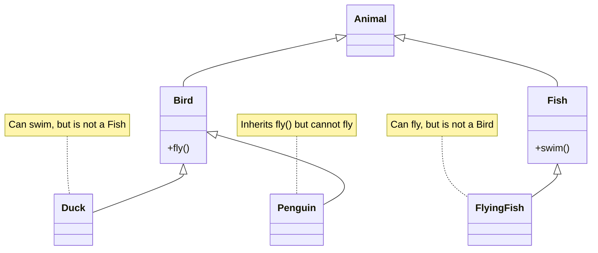
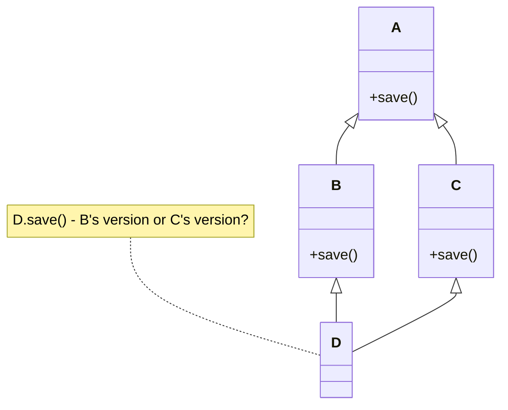
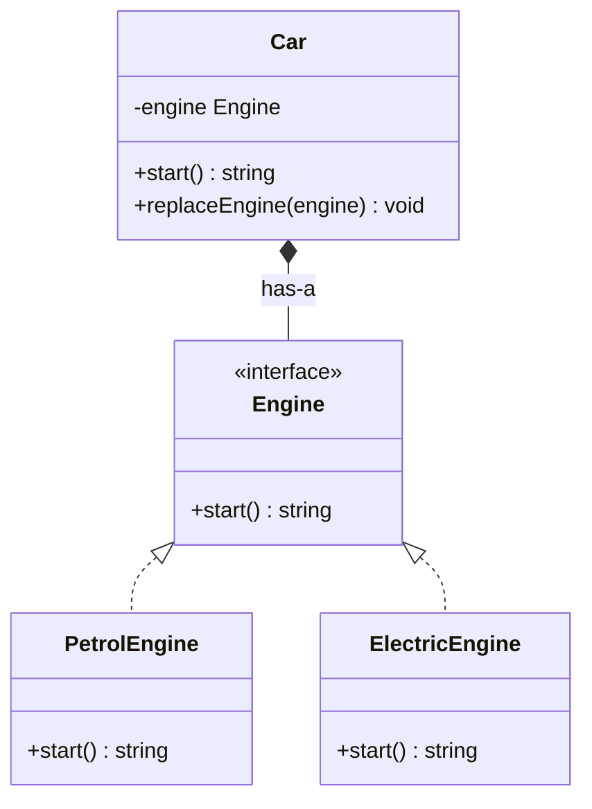
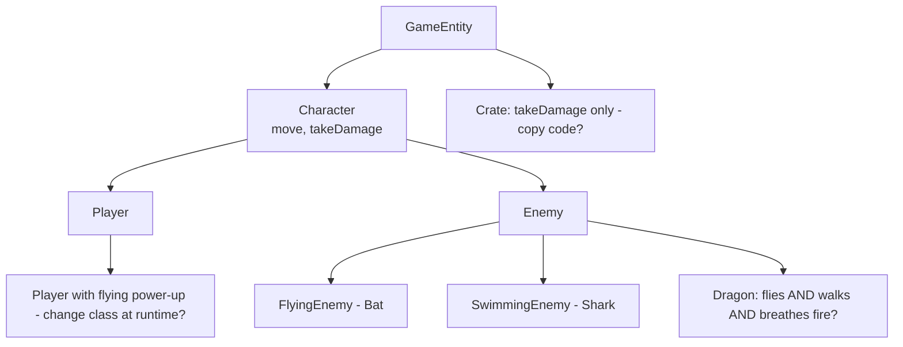
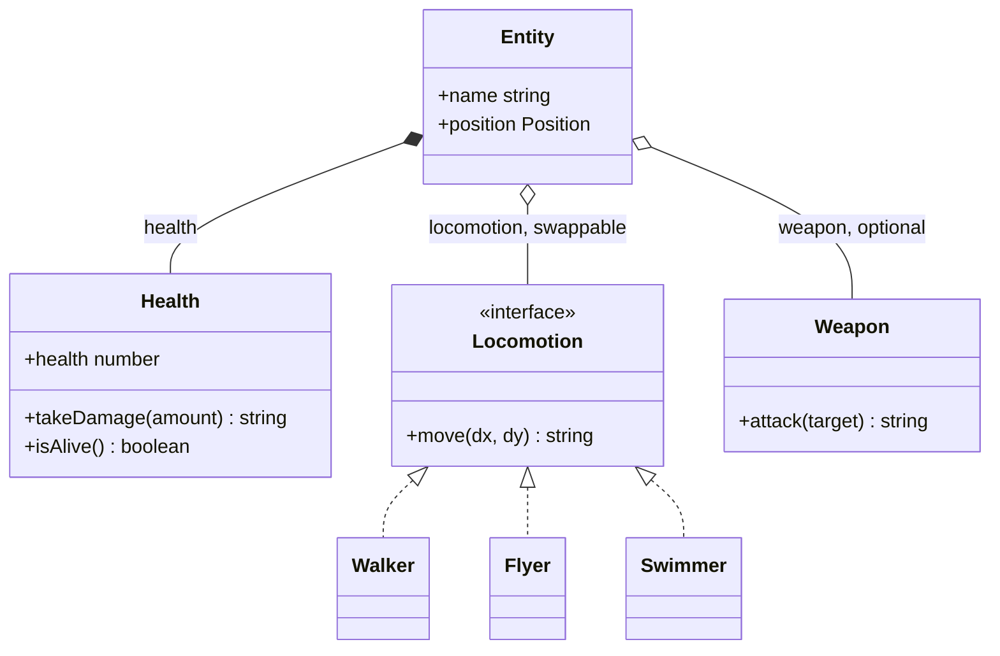
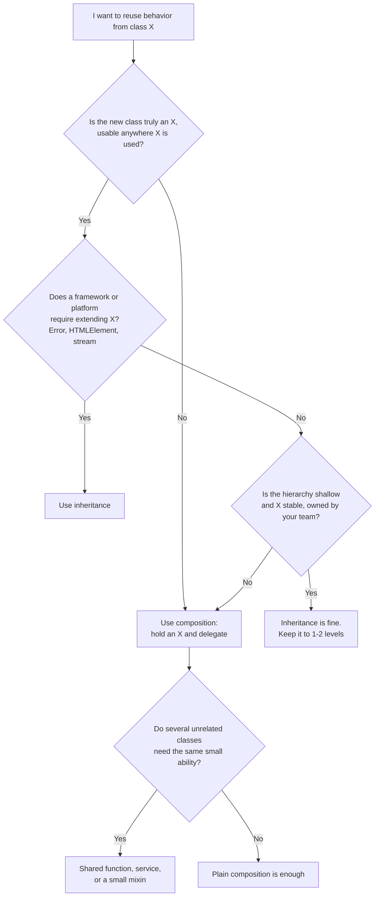

# Composition, Inheritance and Mixins

> In this document you will learn why inheritance often causes problems, how composition solves them, and how JavaScript shares behavior with mixins and delegation. "Composition over inheritance" is a classic interview topic, and the refactors here show you how to explain it with real code.

**Before this:** [OOP: the four pillars](./01-oop-four-pillars.md) · [Prototypes and inheritance](../02-javascript/08-prototypes-and-inheritance.md) · **Interview questions:** [jump to questions](#interview-questions)

## Table of contents

1. [Inheritance and composition in one minute](#inheritance-and-composition-in-one-minute)
2. [Problems with inheritance](#problems-with-inheritance)
3. [Composition](#composition)
4. [Favor composition over inheritance: a full refactor](#favor-composition-over-inheritance-a-full-refactor)
5. [Delegation](#delegation)
6. [Mixins](#mixins)
7. [Composing with TypeScript interfaces](#composing-with-typescript-interfaces)
8. [When inheritance is the right choice](#when-inheritance-is-the-right-choice)
9. [Common mistakes](#common-mistakes)
10. [Best practices](#best-practices)
11. [How to explain composition over inheritance in an interview](#how-to-explain-composition-over-inheritance-in-an-interview)
12. [Interview questions](#interview-questions)
13. [Summary](#summary)
14. [References](#references)

---

## Inheritance and composition in one minute

There are two main ways for one class to reuse another class's code.

| | Inheritance | Composition |
| --- | --- | --- |
| Relationship | **is-a**: a `Manager` is an `Employee` | **has-a**: a `Car` has an `Engine` |
| How | `class B extends A` | B keeps an A object in a field and calls it |
| When it is decided | When you write the code (fixed) | Can be decided or changed at runtime |
| What B gets | Everything public and protected from A, forever | Only what B chooses to use |
| Coupling | Strong: B depends on A's internals and future changes | Weaker: B depends only on A's public interface |

```js
// Inheritance: OrderService IS-A HttpClient (strange, but common in real code)
class HttpClient {
  get(url) { return `GET ${url}`; }
}
class OrderServiceInherits extends HttpClient {
  loadOrders() { return this.get("/api/orders"); }
}

// Composition: OrderService HAS-A HttpClient
class OrderService {
  constructor(http) {
    this.http = http; // the part
  }
  loadOrders() {
    return this.http.get("/api/orders"); // uses only the public method
  }
}

console.log(new OrderServiceInherits().loadOrders());       // GET /api/orders
console.log(new OrderService(new HttpClient()).loadOrders()); // GET /api/orders
```

Both print the same thing. The difference shows up later:

- `OrderServiceInherits` now also has every method of `HttpClient` (`get`, and later `post`, `delete`, `setHeaders`...). Callers can call `orderService.delete("/api/users/1")`. That makes no sense for an order service.
- `OrderService` can receive a different HTTP client (a fake one in tests, a retrying one in production) without changing its code.

The famous rule from the 1994 *Design Patterns* book by the "Gang of Four" is: **favor object composition over class inheritance.** "Favor" does not mean "never use inheritance". It means: start with composition, and use inheritance only when there is a real reason.

---

## Problems with inheritance

Inheritance looks simple in small examples. In big, long-lived codebases, it causes four well-known problems.

### 1. The fragile base class problem

**What it is:** a change inside a parent class breaks a child class, even though the parent's public methods did not change. The base class is "fragile" because you cannot safely change it without checking every subclass.

**Why it happens:** a subclass often depends on *how* the parent works inside (which method calls which), not just on *what* it does. This hidden dependency is called **implementation inheritance**.

**Example:** we want a cart that counts how many items were ever added.

```js
class Cart {
  constructor() {
    this.items = [];
  }
  addItem(item) {
    this.items.push(item);
  }
  addItems(list) {
    list.forEach((item) => this.addItem(item)); // calls addItem internally
  }
}

class CountingCart extends Cart {
  addedCount = 0;

  addItem(item) {
    this.addedCount++;
    super.addItem(item);
  }

  addItems(list) {
    this.addedCount += list.length;
    super.addItems(list);
  }
}

const cart = new CountingCart();
cart.addItems(["keyboard", "mouse"]);
console.log(cart.items.length); // 2
console.log(cart.addedCount);   // 4  <- wrong! should be 2
```

**Step-by-step walkthrough:**

1. `cart.addItems([...])` runs `CountingCart.addItems`. It adds `2` to `addedCount`.
2. It calls `super.addItems(list)`, which runs `Cart.addItems`.
3. `Cart.addItems` calls `this.addItem(item)` for each item. `this` is the `CountingCart`, so dynamic dispatch runs `CountingCart.addItem`.
4. That adds `1` for each item again. Total: `2 + 2 = 4`.

The child author did not know that `Cart.addItems` calls `addItem` internally. Now imagine the opposite: the child author learns this and removes the counting from `addItems`. It works. A year later, the parent author optimizes `addItems` to push the whole list directly (`this.items.push(...list)`). The parent's public behavior is the same, but now the child counts `0` for bulk adds. **The parent's change broke the child, and no test in the parent can see it.**

**Composition version (not fragile):**

```js
class Cart {
  constructor() { this.items = []; }
  addItem(item) { this.items.push(item); }
  addItems(list) { this.items.push(...list); } // free to change its inside
}

class CountingCart {
  #cart = new Cart();   // has-a Cart
  #addedCount = 0;

  addItem(item) {
    this.#addedCount++;
    this.#cart.addItem(item);
  }
  addItems(list) {
    this.#addedCount += list.length;
    this.#cart.addItems(list);
  }
  get items() { return [...this.#cart.items]; }
  get addedCount() { return this.#addedCount; }
}

const counting = new CountingCart();
counting.addItems(["keyboard", "mouse"]);
counting.addItem("monitor");
console.log(counting.items.length, counting.addedCount); // 3 3
```

`CountingCart` now only uses the public methods of `Cart`. `Cart` can change how `addItems` works inside, and `CountingCart` still counts correctly.

The same trap exists with built-in classes. The `Set` constructor calls `this.add()` for each starting value. See [Q3](#q3-what-does-this-print-subclassing-set) for a surprising output puzzle about it.

### 2. The gorilla–banana problem

Joe Armstrong, the creator of Erlang, described a famous complaint about OOP reuse: you want a banana, but you get the gorilla holding the banana, and the whole jungle too.

**What it means:** when you inherit from a class to reuse *one* method, you also get *all* its other methods, its fields, its constructor requirements and its dependencies. And its parent's. And its parent's parent's.

```js
class Jungle {
  constructor() { this.trees = Array.from({ length: 1000 }, (_, i) => `tree-${i}`); }
}
class Gorilla extends Jungle {
  constructor() { super(); this.mood = "angry"; }
  roar() { return "ROAR"; }
  peelBanana() { return "peeled banana"; }
}

// I only want peelBanana()...
class Breakfast extends Gorilla {
  serve() { return this.peelBanana(); }
}

const breakfast = new Breakfast();
console.log(breakfast.serve());          // peeled banana
console.log(breakfast.trees.length);     // 1000  <- the whole jungle came too
console.log(typeof breakfast.roar);      // function <- and the gorilla
```

**Composition version:** take only the banana.

```js
const peelBanana = () => "peeled banana";

class Breakfast {
  serve() { return peelBanana(); }
}
console.log(new Breakfast().serve()); // peeled banana
```

In real code, the "jungle" is a base class like `BaseComponent` or `BaseService` that requires five injected services, sets up subscriptions and timers, and has twenty helper methods. A new component extends it to get one helper and inherits all of that weight.

### 3. Deep and rigid hierarchies

A **class hierarchy** is a tree of classes connected by `extends`. Hierarchies force you to classify things in **one** way. The real world rarely fits one tree.



Problems you see:

- `Penguin` inherits `fly()` and must override it to throw or do nothing. This breaks the Liskov Substitution Principle (see [SOLID principles](./03-solid-principles.md)).
- `Duck` can swim, but swimming lives in `Fish`. Do you copy `swim()` into `Duck`?
- `FlyingFish` can fly, but flying lives in `Bird`.

Every new combination needs a new class, and the number of classes grows fast. If you have 3 movement types and 3 attack types, a hierarchy that covers every mix needs up to 9 leaf classes. With composition you need 3 + 3 = 6 small parts that can be combined freely. This growth is often called **class explosion**.

Deep hierarchies (four or five levels) are also hard to read. To understand what `AdminUserProfilePageComponent.save()` does, you must read five files and track which `super` call goes where.

### 4. The diamond problem

**What it is:** in languages with multiple inheritance (like C++), class D can extend both B and C, and both extend A. If B and C both override a method from A, which version does D get?



**Does JavaScript have it?** JavaScript has only one prototype chain per object, so `class D extends B, C` is not allowed. The classic diamond cannot happen with `extends`.

But a *similar* problem appears with **mixins**: when two mixins have a method with the same name, one silently replaces the other. With `Object.assign`, the last mixin wins. With class-expression mixins, the outermost mixin wins. You will see both in the [Mixins](#mixins) section.

### 5. Other inheritance smells

- **Refused bequest:** a child inherits methods it does not want and overrides them to throw `"Not supported"`. This means the "is-a" relationship is false.
- **Protected state shared up and down:** child classes read and write the parent's protected fields directly. Now parent and child are tightly coupled, and nobody owns the invariants.
- **Inheritance for code reuse only:** `class UserService extends BaseHttpService` just to reuse `get()` and `post()`. A user service is not an HTTP service; it *uses* one.

---

## Composition

### What it is

**Composition** means building an object out of other objects. The outer object **has** the inner objects (in fields) and asks them to do parts of the work.

### Why it exists

- You reuse code without inheriting everything.
- You can combine small parts in many ways.
- You can swap a part at runtime or in tests.
- Each part can be understood and tested on its own.

### Analogy

LEGO bricks. You do not "inherit" a castle from a house. You build a castle from the same small bricks you used for the house, arranged differently. You can take one brick out and put another in.

### Simple example: a car with a swappable engine

```js
class PetrolEngine {
  start() { return "Vroom (petrol)"; }
}

class ElectricEngine {
  start() { return "Hmmm (electric)"; }
}

class Car {
  #engine;
  constructor(engine) {
    this.#engine = engine; // has-a engine
  }
  start() {
    return `Car starting: ${this.#engine.start()}`; // delegate to the part
  }
  replaceEngine(engine) {
    this.#engine = engine; // change behavior at runtime
  }
}

const car = new Car(new PetrolEngine());
console.log(car.start()); // Car starting: Vroom (petrol)

car.replaceEngine(new ElectricEngine());
console.log(car.start()); // Car starting: Hmmm (electric)
```

With inheritance (`PetrolCar extends Car`, `ElectricCar extends Car`), a car could never change its engine. With composition, it is one method call.



### Composition vs aggregation (UML words)

In UML class diagrams, "has-a" comes in two strengths. You may hear these words in interviews.

| | Composition (strong) | Aggregation (weak) |
| --- | --- | --- |
| Meaning | The part belongs to the whole. It is created and destroyed with it. | The part is used by the whole, but lives on its own. |
| Example | An `Order` and its `OrderLine` items | A `Team` and its `Player` objects (players exist without the team) |
| UML arrow | Filled diamond (`*--` in Mermaid) | Empty diamond (`o--` in Mermaid) |

In everyday JavaScript conversation, people say "composition" for both. That is fine. The design idea, "build from parts instead of inheriting", is what matters.

### Real-world composition

- **Angular:** a component does not extend `HttpClient` or `Router`. It *receives* services through dependency injection and uses them. That is composition. A `ProductPageComponent` has a `ProductService`, a `CartService` and an `ActivatedRoute`.
- **Node.js:** an `OrderService` has an `OrderRepository`, a `PaymentGateway` and a `Mailer`, all passed into its constructor.
- **React:** components are composed by nesting (`<Layout><Sidebar /><Content /></Layout>`). Hooks compose behavior (`useAuth()`, `useCart()`), which replaced older mixin-based sharing.
- **Electron:** the main process has a `WindowManager`, an `UpdateService` and a `TrayController`. None of them extends `app`; they are composed together at startup.

---

## Favor composition over inheritance: a full refactor

Let us take a realistic example: entities in a small game. This is the kind of design problem you may be asked to discuss in a design or machine-coding round.

### Step 1: the inheritance design that starts well

```js
class GameEntity {
  constructor(name, x = 0, y = 0) {
    this.name = name;
    this.x = x;
    this.y = y;
  }
}

class Character extends GameEntity {
  constructor(name, health) {
    super(name);
    this.health = health;
  }
  move(dx, dy) {
    this.x += dx;
    this.y += dy;
    return `${this.name} walks to (${this.x}, ${this.y})`;
  }
  takeDamage(amount) {
    this.health = Math.max(0, this.health - amount);
    return `${this.name} has ${this.health} HP`;
  }
}

class Player extends Character {
  attack(target) {
    return `${this.name} hits ${target.name}. ${target.takeDamage(10)}`;
  }
}

class Enemy extends Character {
  attack(target) {
    return `${this.name} bites ${target.name}. ${target.takeDamage(5)}`;
  }
}

const hero = new Player("Hero", 100);
const goblin = new Enemy("Goblin", 30);
console.log(hero.move(2, 3));        // Hero walks to (2, 3)
console.log(hero.attack(goblin));    // Hero hits Goblin. Goblin has 20 HP
```

So far, so good.

### Step 2: new requirements break the tree

The game designer asks for more:

1. A **Bat** enemy that *flies* instead of walking.
2. A **Shark** enemy that *swims*.
3. A **Dragon** boss that walks, flies *and* breathes fire.
4. A **Wooden crate** that can take damage and break, but cannot move or attack.
5. A power-up that lets the player fly for 10 seconds.

Try to fit these into the tree:

- Where does `fly()` go? If it goes into `Character`, then goblins and crates can fly. If you create `FlyingEnemy extends Enemy`, then the Dragon needs to be both `FlyingEnemy` and `WalkingEnemy`, which is impossible with single inheritance.
- The crate needs `takeDamage` but not `move` or `attack`. It does not fit under `Character`. Do you copy `takeDamage` into a new `Breakable` class? Now you have duplicated code.
- The player flying for 10 seconds means the player's *class* would need to change at runtime. Classes cannot change at runtime.



This is the moment to switch to composition.

### Step 3: identify the behaviors, not the "kinds"

Instead of asking "what *is* it?", ask "what can it *do*?":

| Entity | Has health | Walks | Flies | Swims | Attacks |
| --- | --- | --- | --- | --- | --- |
| Hero | Yes | Yes | (power-up) | | Yes |
| Goblin | Yes | Yes | | | Yes |
| Bat | Yes | | Yes | | Yes |
| Shark | Yes | | | Yes | Yes |
| Dragon | Yes | Yes | Yes | | Yes (fire) |
| Crate | Yes | | | | |

Each column becomes one small, independent **behavior**.

### Step 4: build small behaviors and compose them

```js
// --- Small behaviors (each one does one thing) ---
const withHealth = (entity, maxHealth) => ({
  health: maxHealth,
  takeDamage(amount) {
    this.health = Math.max(0, this.health - amount);
    return this.health === 0
      ? `${entity.name} is destroyed`
      : `${entity.name} has ${this.health} HP`;
  },
  get isAlive() {
    return this.health > 0;
  },
});

const movement = (entity, verb) => ({
  move(dx, dy) {
    entity.position.x += dx;
    entity.position.y += dy;
    return `${entity.name} ${verb} to (${entity.position.x}, ${entity.position.y})`;
  },
});

const walker = (entity) => movement(entity, "walks");
const flyer = (entity) => movement(entity, "flies");
const swimmer = (entity) => movement(entity, "swims");

const attacker = (entity, verb, damage) => ({
  attack(target) {
    return `${entity.name} ${verb} ${target.name}. ${target.health.takeDamage(damage)}`;
  },
});

// --- An entity is a name, a position and a set of parts ---
function createEntity(name, parts) {
  const entity = { name, position: { x: 0, y: 0 } };
  for (const [key, makePart] of Object.entries(parts)) {
    entity[key] = makePart(entity);
  }
  return entity;
}

// --- Compose entities from parts ---
const hero = createEntity("Hero", {
  health: (e) => withHealth(e, 100),
  locomotion: walker,
  weapon: (e) => attacker(e, "hits", 10),
});

const bat = createEntity("Bat", {
  health: (e) => withHealth(e, 15),
  locomotion: flyer,
  weapon: (e) => attacker(e, "bites", 3),
});

const dragon = createEntity("Dragon", {
  health: (e) => withHealth(e, 500),
  locomotion: flyer,
  weapon: (e) => attacker(e, "breathes fire on", 50),
});

const crate = createEntity("Crate", {
  health: (e) => withHealth(e, 10),
});

console.log(hero.locomotion.move(1, 0));  // Hero walks to (1, 0)
console.log(bat.locomotion.move(0, 5));   // Bat flies to (0, 5)
console.log(hero.weapon.attack(bat));     // Hero hits Bat. Bat has 5 HP
console.log(hero.weapon.attack(crate));   // Hero hits Crate. Crate is destroyed
console.log(dragon.weapon.attack(hero));  // Dragon breathes fire on Hero. Hero has 50 HP
console.log("move" in crate);             // false -> a crate cannot move, by design

// --- Requirement 5: power-up changes behavior at runtime ---
hero.locomotion = flyer(hero);
console.log(hero.locomotion.move(0, 10)); // Hero flies to (1, 10)
```

**Step-by-step walkthrough of `hero.weapon.attack(bat)`:**

1. `hero.weapon` is the object made by `attacker(hero, "hits", 10)`. Its `attack` method closes over `entity = hero`, `verb = "hits"` and `damage = 10`.
2. `attack(bat)` calls `bat.health.takeDamage(10)`.
3. `bat.health` is the object made by `withHealth(bat, 15)`. Its `health` goes from `15` to `5`, and it returns `"Bat has 5 HP"`.
4. `attack` builds the final string: `Hero hits Bat. Bat has 5 HP`.

### Step 5: compare the two designs

| Requirement | Inheritance design | Composition design |
| --- | --- | --- |
| Bat flies | New subclass, maybe a new branch | `locomotion: flyer` |
| Dragon walks and flies and breathes fire | Impossible with single inheritance; needs duplication | Pick parts; could even hold two locomotion parts |
| Crate only takes damage | Does not fit the tree; copy code | `health` part only |
| Player flies for 10 seconds | Cannot change class at runtime | Replace `hero.locomotion`, then put it back |
| Test damage rules alone | Must create a full character | Test `withHealth` alone |
| Add "poisoned" status | Touch the base class (fragile) | Add a new `status` part |



This idea, entities made of components, is the basis of the **Entity Component System (ECS)** architecture used by many game engines. The same idea in business code is "a service made of collaborators".

### The same refactor with classes and TypeScript

Composition does not mean "no classes". Here is the same idea with classes and interfaces, the way you might write it in an Angular or NestJS codebase.

```ts
interface Locomotion {
  move(position: { x: number; y: number }, dx: number, dy: number): string;
}

class Walking implements Locomotion {
  move(p: { x: number; y: number }, dx: number, dy: number) {
    p.x += dx; p.y += dy;
    return `walks to (${p.x}, ${p.y})`;
  }
}

class Flying implements Locomotion {
  move(p: { x: number; y: number }, dx: number, dy: number) {
    p.x += dx; p.y += dy;
    return `flies to (${p.x}, ${p.y})`;
  }
}

class Health {
  #current: number;
  constructor(private readonly max: number) {
    this.#current = max;
  }
  takeDamage(amount: number): number {
    this.#current = Math.max(0, this.#current - amount);
    return this.#current;
  }
  get current(): number { return this.#current; }
}

class Character {
  readonly position = { x: 0, y: 0 };

  constructor(
    readonly name: string,
    readonly health: Health,
    private locomotion: Locomotion,
  ) {}

  move(dx: number, dy: number): string {
    return `${this.name} ${this.locomotion.move(this.position, dx, dy)}`;
  }

  setLocomotion(locomotion: Locomotion): void {
    this.locomotion = locomotion;
  }
}

const hero = new Character("Hero", new Health(100), new Walking());
console.log(hero.move(1, 1)); // Hero walks to (1, 1)
hero.setLocomotion(new Flying());
console.log(hero.move(0, 5)); // Hero flies to (1, 6)
console.log(hero.health.takeDamage(30)); // 70
```

Swapping the `Locomotion` object at runtime is the **Strategy pattern**. See [Behavioral patterns](./08-behavioral-patterns.md).

---

## Delegation

### What it is

**Delegation** means an object hands a task to another object instead of doing it itself. "I don't do this myself; I ask my helper to do it."

Composition is about *structure* (an object has parts). Delegation is about *behavior* (the object forwards calls to its parts). In practice they go together: you compose objects, and then you delegate work to them.

### Explicit delegation (forwarding)

The outer object has a method that simply calls the same (or a similar) method on the inner object, often adding something before or after.

```js
class UserRepository {
  #users = new Map([[1, { id: 1, name: "Asha" }]]);
  async findById(id) {
    console.log(`  DB query for user ${id}`);
    return this.#users.get(id) ?? null;
  }
}

// Same interface as UserRepository, but adds caching.
class CachedUserRepository {
  #inner;
  #cache = new Map();

  constructor(inner) {
    this.#inner = inner; // the object we delegate to
  }

  async findById(id) {
    if (this.#cache.has(id)) return this.#cache.get(id);
    const user = await this.#inner.findById(id); // delegate
    this.#cache.set(id, user);
    return user;
  }
}

const users = new CachedUserRepository(new UserRepository());
console.log(await users.findById(1));
console.log(await users.findById(1)); // no DB query the second time
// Output:
//   DB query for user 1
// { id: 1, name: 'Asha' }
// { id: 1, name: 'Asha' }
```

`CachedUserRepository` did not extend `UserRepository`. It wraps it. This is also called the **Decorator pattern** (see [Structural patterns](./07-structural-patterns.md)). You can wrap any object that has `findById`: a real database repository, an HTTP-based one, or a fake one in tests.

### Prototype delegation (JavaScript's built-in delegation)

JavaScript's prototype chain *is* a delegation mechanism. When an object does not have a property, it delegates the lookup to its prototype.

```js
const defaultSettings = {
  theme: "light",
  language: "en",
  describe() {
    return `${this.theme} theme, ${this.language}`;
  },
};

const userSettings = Object.create(defaultSettings); // delegate to defaults
userSettings.theme = "dark"; // own property shadows the default

console.log(userSettings.describe()); // dark theme, en
console.log(Object.keys(userSettings)); // [ 'theme' ] -> only the override is stored
```

`userSettings` stores only what is different. Everything else is delegated to `defaultSettings`. Some people call this style **OLOO** ("objects linked to other objects"). It is the core mechanism under `class` and `extends`; see [Prototypes and inheritance](../02-javascript/08-prototypes-and-inheritance.md).

### Delegating many methods at once

If you wrap an object with many methods, writing a forwarding method for each one is boring. Two options:

- Delegate only what callers need. This is often *better*, because it keeps your public interface small (Interface Segregation, see [SOLID principles](./03-solid-principles.md)).
- Use a `Proxy` to forward everything automatically. This is powerful but makes the code harder to follow and to type. Use it for generic tools (logging, tracing), not for normal business classes. Proxies are covered in [Structural patterns](./07-structural-patterns.md).

---

## Mixins

### What it is

A **mixin** is a reusable piece of behavior that you "mix into" a class or object, without that class inheriting from it. It is a way to share methods across classes that are not related by inheritance.

### Why it exists

JavaScript has single inheritance: one prototype chain. Sometimes unrelated classes need the same ability:

- `User`, `Order` and `Invoice` all need `toJSON()` and `fromJSON()` (serializable).
- `Modal`, `Toast` and `Dropdown` all need `on()` and `emit()` (event emitting).
- `Duck` and `Plane` both need `fly()`, but a duck is not a plane.

Mixins let you write that behavior once and add it to many classes.

### Analogy

Toppings on ice cream. The ice cream (your class) is the base. You "mix in" chocolate chips or nuts (behaviors). The same chips can go into any flavour.

There are three common ways to write mixins in JavaScript.

### Way 1: object mixins with `Object.assign`

Copy the methods of a plain object onto a class prototype.

```js
const serializable = {
  toJSONString() {
    return JSON.stringify(this);
  },
};

const timestamped = {
  touch() {
    this.updatedAt = new Date(0).toISOString(); // fixed date for a stable example
    return this;
  },
};

class Order {
  constructor(id, total) {
    this.id = id;
    this.total = total;
  }
}

Object.assign(Order.prototype, serializable, timestamped);

const order = new Order(101, 49.99);
console.log(order.touch().toJSONString());
// {"id":101,"total":49.99,"updatedAt":"1970-01-01T00:00:00.000Z"}
```

This is simple and works for plain methods. It has two traps.

**Trap 1: name collisions are silent. The last mixin wins.**

```js
const canFly = { move() { return "flying"; } };
const canSwim = { move() { return "swimming"; } };

class Duck {}
Object.assign(Duck.prototype, canFly, canSwim);

console.log(new Duck().move()); // swimming -> canFly.move was silently replaced
```

This is JavaScript's version of the diamond problem. Nothing warns you.

**Trap 2: `Object.assign` copies getter *values*, not getters.**

`Object.assign` reads each property from the source (which runs the getter right then, with `this` set to the mixin object) and writes the *result* as a plain value.

```js
const withFullName = {
  get fullName() {
    return `${this.firstName} ${this.lastName}`;
  },
};

class Person {
  constructor(firstName, lastName) {
    this.firstName = firstName;
    this.lastName = lastName;
  }
}

// ❌ Wrong: the getter runs once, on the mixin object itself
Object.assign(Person.prototype, withFullName);
console.log(new Person("Asha", "Rao").fullName); // undefined undefined
```

```js
const withFullName = {
  get fullName() {
    return `${this.firstName} ${this.lastName}`;
  },
};

class Person {
  constructor(firstName, lastName) {
    this.firstName = firstName;
    this.lastName = lastName;
  }
}

// ✅ Correct: copy the property descriptors (getters stay getters)
Object.defineProperties(Person.prototype, Object.getOwnPropertyDescriptors(withFullName));
console.log(new Person("Asha", "Rao").fullName); // Asha Rao
```

### Way 2: functional mixins

A **functional mixin** is a function that takes an object and adds behavior to it (or returns new behavior to combine). Because it is a function, it can keep **private state in a closure**.

```js
// Each mixin is a function that returns a set of methods for the given state.
const canFly = (state) => ({
  fly() {
    return `${state.name} flies`;
  },
});

const canSwim = (state) => ({
  swim() {
    return `${state.name} swims`;
  },
});

const canQuack = (state) => ({
  quack() {
    return `${state.name} says quack`;
  },
});

function createDuck(name) {
  const state = { name };
  return Object.assign(state, canFly(state), canSwim(state), canQuack(state));
}

function createPenguin(name) {
  const state = { name };
  return Object.assign(state, canSwim(state)); // no fly(), by design
}

const donald = createDuck("Donald");
const pingu = createPenguin("Pingu");

console.log(donald.fly());   // Donald flies
console.log(donald.quack()); // Donald says quack
console.log(pingu.swim());   // Pingu swims
console.log(typeof pingu.fly); // undefined -> no fake "cannot fly" method
```

Compare this with the inheritance tree in [Deep and rigid hierarchies](#3-deep-and-rigid-hierarchies). The penguin simply does not get `fly`. There is nothing to override and nothing to break.

A functional mixin with private state:

```js
const withEventEmitter = (target) => {
  const listeners = new Map(); // private to this object

  target.on = (event, handler) => {
    if (!listeners.has(event)) listeners.set(event, []);
    listeners.get(event).push(handler);
    return () => {
      // return an "unsubscribe" function
      listeners.set(event, listeners.get(event).filter((h) => h !== handler));
    };
  };

  target.emit = (event, payload) => {
    (listeners.get(event) ?? []).forEach((handler) => handler(payload));
  };

  return target;
};

const cart = withEventEmitter({ items: [] });
const unsubscribe = cart.on("itemAdded", (item) => console.log(`Added: ${item}`));

cart.emit("itemAdded", "Keyboard"); // Added: Keyboard
unsubscribe();
cart.emit("itemAdded", "Mouse");    // (nothing printed)
console.log(Object.keys(cart));     // [ 'items', 'on', 'emit' ] -> no 'listeners' visible
```

Trade-off: every object gets its own copies of the functions (more memory than shared prototype methods). For a few hundred objects this does not matter. For hundreds of thousands, prefer prototype-based approaches.

### Way 3: class-expression mixins (subclass factories)

A **class-expression mixin** is a function that takes a base class and returns a new class that extends it.

```js
const Serializable = (Base) => class extends Base { /* new methods go here */ };
```

Because each mixin creates a real subclass, you can stack them, and `super` works through the whole chain.

```js
const Serializable = (Base) =>
  class Serializable extends Base {
    serialize() {
      return JSON.stringify(this);
    }
  };

const Validatable = (Base) =>
  class Validatable extends Base {
    validate() {
      const errors = this.rules()
        .filter(([, check]) => !check(this))
        .map(([message]) => message);
      return { valid: errors.length === 0, errors };
    }
    rules() {
      return []; // classes override this
    }
  };

class Entity {
  constructor(id) {
    this.id = id;
  }
}

class User extends Serializable(Validatable(Entity)) {
  constructor(id, email) {
    super(id);
    this.email = email;
  }
  rules() {
    return [["email must contain @", (u) => u.email.includes("@")]];
  }
}

const good = new User(1, "asha@example.com");
const bad = new User(2, "not-an-email");

console.log(good.serialize());     // {"id":1,"email":"asha@example.com"}
console.log(good.validate());      // { valid: true, errors: [] }
console.log(bad.validate());       // { valid: false, errors: [ 'email must contain @' ] }
console.log(good instanceof Entity); // true
```

The prototype chain of `good` is: `User.prototype` → `Serializable` class → `Validatable` class → `Entity.prototype` → `Object.prototype`.


**Order matters.** The mixin written on the *outside* is closer to the object, so its methods win. With `super`, each layer can call the next one:

```js
const Loud = (Base) => class extends Base {
  speak() { return "LOUD " + super.speak(); }
};
const Polite = (Base) => class extends Base {
  speak() { return "please, " + super.speak(); }
};

class Animal {
  speak() { return "hello"; }
}

class A1 extends Loud(Polite(Animal)) {}
class A2 extends Polite(Loud(Animal)) {}

console.log(new A1().speak()); // LOUD please, hello
console.log(new A2().speak()); // please, LOUD hello
```

### Typing class mixins in TypeScript

TypeScript supports this pattern with a "constructor type". A mixin function must accept a class whose constructor takes `...args: any[]`.

```ts
type Constructor<T = {}> = new (...args: any[]) => T;

// A mixin that works with any class
function Timestamped<TBase extends Constructor>(Base: TBase) {
  return class extends Base {
    createdAt = new Date(0);
    touch() {
      this.createdAt = new Date(86_400_000); // fixed for a stable example
    }
  };
}

// A mixin that REQUIRES the base class to have an 'id'
function Auditable<TBase extends Constructor<{ id: number }>>(Base: TBase) {
  return class extends Base {
    auditLog: string[] = [];
    audit(action: string) {
      this.auditLog.push(`#${this.id}: ${action}`); // 'id' is known to exist
    }
  };
}

class Product {
  constructor(public id: number, public name: string) {}
}

class TrackedProduct extends Auditable(Timestamped(Product)) {}

const keyboard = new TrackedProduct(7, "Keyboard");
keyboard.touch();
keyboard.audit("price changed");
console.log(keyboard.name, keyboard.createdAt.toISOString()); // Keyboard 1970-01-02T00:00:00.000Z
console.log(keyboard.auditLog); // [ '#7: price changed' ]

class Note {
  constructor(public text: string) {}
}
// Auditable(Note); // Compile error: Note has no 'id' property
```

The TypeScript handbook also describes a second style, where you declare an interface that merges with the class and copy methods at runtime with a helper (`applyMixins`). The constructor-function style above is easier to type correctly and is the one to prefer.

### Comparing the three mixin styles

| | Object mixin (`Object.assign`) | Functional mixin | Class-expression mixin |
| --- | --- | --- | --- |
| Shape | Plain object of methods | Function returning or adding methods | Function `(Base) => class extends Base` |
| Private state | No | Yes (closure) | Yes (`#private` fields) |
| Shared methods (memory) | Yes (on prototype) | No (per object) | Yes (on prototypes) |
| `super` support | No | No | Yes |
| Getters work | Only with `defineProperties` | Yes | Yes |
| Name collisions | Last one wins, silently | Last one wins, silently | Outermost wins; can call `super` |
| TypeScript typing | Awkward | Good (return types) | Good with `Constructor<T>` |
| `instanceof` the mixin | No | No | No (each call makes a new class) |

### Problems with mixins

Mixins are better than deep hierarchies, but they have their own problems:

1. **Implicit dependencies.** A mixin often assumes the target has certain fields (`this.name`, `this.id`). If the target does not, you get `undefined` at runtime. TypeScript constraints (`Constructor<{ id: number }>`) help.
2. **Name clashes.** Two mixins define `init()` or `move()`, and one silently wins.
3. **"Where did this method come from?"** With five mixins, finding the source of a method is hard.
4. **Hidden coupling between mixins.** Mixin B calls a method that only mixin A provides.

The industry learned this the hard way:

- **React** supported mixins in its old `createClass` API. The React team later wrote about mixins causing name clashes, implicit dependencies and snowballing complexity, and moved to higher-order components and then **hooks**, which are plain function composition.
- **Vue 2** had a `mixins` option. **Vue 3** recommends **composables** (functions that return reactive state) instead, for the same reasons.

So in modern frontend code, "share behavior" usually means **composition of functions or services**, not mixins.

### When mixins are still a good fit

- **Small, independent, well-named abilities** with no state or with clearly owned state (`Serializable`, `Comparable`, `EventEmitting`).
- **Libraries and frameworks** that need to add abilities to user classes. For example, the Lit web components library documents class mixins for sharing behavior between custom elements.
- **When the target must stay a single class** (for example, a framework requires `class MyElement extends HTMLElement`), but you want to share behavior across several such classes.

---

## Composing with TypeScript interfaces

TypeScript gives you tools to describe composed objects cleanly, without inheritance of code.

### A class can implement many small interfaces

```ts
interface Identifiable {
  readonly id: string;
}

interface Serializable {
  serialize(): string;
}

interface Comparable<T> {
  compareTo(other: T): number;
}

class Invoice implements Identifiable, Serializable, Comparable<Invoice> {
  constructor(readonly id: string, readonly amount: number) {}

  serialize(): string {
    return JSON.stringify({ id: this.id, amount: this.amount });
  }

  compareTo(other: Invoice): number {
    return this.amount - other.amount;
  }
}

const invoices = [new Invoice("inv-2", 300), new Invoice("inv-1", 120)];
invoices.sort((a, b) => a.compareTo(b));
console.log(invoices.map(i => i.id)); // [ 'inv-1', 'inv-2' ]

// Functions ask only for the ability they need
function saveAll(items: Serializable[]): string[] {
  return items.map(item => item.serialize());
}
console.log(saveAll(invoices)); // [ '{"id":"inv-1","amount":120}', '{"id":"inv-2","amount":300}' ]
```

A class can `implements` any number of interfaces, because interfaces carry no code. This gives you "multiple inheritance of *types*" without the diamond problem of "multiple inheritance of *code*".

### Interfaces can extend several interfaces

```ts
interface Timestamps {
  createdAt: Date;
  updatedAt: Date;
}

interface SoftDeletable {
  deletedAt: Date | null;
}

interface Customer extends Timestamps, SoftDeletable {
  id: string;
  email: string;
}

const customer: Customer = {
  id: "c1",
  email: "asha@example.com",
  createdAt: new Date(0),
  updatedAt: new Date(0),
  deletedAt: null,
};
console.log(Object.keys(customer).length); // 5
```

### Intersection types describe composed objects

An **intersection type** `A & B` means "has everything from A and everything from B". It is the natural type for objects built with functional mixins.

```ts
interface Flyer { fly(): string; }
interface Swimmer { swim(): string; }

const canFly = (name: string): Flyer => ({ fly: () => `${name} flies` });
const canSwim = (name: string): Swimmer => ({ swim: () => `${name} swims` });

function createDuck(name: string): { name: string } & Flyer & Swimmer {
  return { name, ...canFly(name), ...canSwim(name) };
}

const duck = createDuck("Donald");
console.log(duck.fly(), "/", duck.swim()); // Donald flies / Donald swims
```

### Depend on interfaces, inject implementations

The most important composition tool in TypeScript apps is simple: a class receives its collaborators through the constructor, typed as interfaces. This is **dependency injection**, covered in depth in [Dependency inversion and injection](./05-dependency-inversion-and-injection.md).

```ts
interface Clock { now(): Date; }
interface Mailer { send(to: string, text: string): Promise<void>; }

class ReminderService {
  constructor(private clock: Clock, private mailer: Mailer) {}

  async remindIfDue(email: string, dueDate: Date): Promise<boolean> {
    if (this.clock.now() < dueDate) return false;
    await this.mailer.send(email, "Your invoice is due");
    return true;
  }
}

// In a test, compose with fakes:
const sent: string[] = [];
const service = new ReminderService(
  { now: () => new Date("2025-02-01") },
  { send: async (to) => { sent.push(to); } },
);

console.log(await service.remindIfDue("asha@example.com", new Date("2025-01-31"))); // true
console.log(sent); // [ 'asha@example.com' ]
```

No inheritance at all, yet the class is reusable, testable and flexible.

---

## When inheritance is the right choice

"Favor composition" does not mean "inheritance is evil". Inheritance is the right tool in some clear cases.

### 1. A true, stable "is-a" relationship with a shallow tree

If every child truly *is* the parent in every situation (it can be used anywhere the parent is used, without surprises), and the tree is one or two levels deep, inheritance is clear and simple.

### 2. `Error` subclasses

Custom errors are one of the best uses of inheritance. They must be real `Error` objects (stack traces, `instanceof Error`, tools that expect errors), and callers want to catch them by kind.

```js
class AppError extends Error {
  constructor(message, options = {}) {
    super(message, { cause: options.cause }); // 'cause' is ES2022
    this.name = new.target.name; // 'ValidationError', 'PaymentError', ...
    this.statusCode = options.statusCode ?? 500;
  }
}

class ValidationError extends AppError {
  constructor(field, message) {
    super(`${field}: ${message}`, { statusCode: 400 });
    this.field = field;
  }
}

class PaymentError extends AppError {
  constructor(message, cause) {
    super(message, { statusCode: 402, cause });
  }
}

function handle(error) {
  if (error instanceof ValidationError) return `400 -> fix field '${error.field}'`;
  if (error instanceof AppError) return `${error.statusCode} -> ${error.message}`;
  return "500 -> unexpected error";
}

console.log(handle(new ValidationError("email", "is required"))); // 400 -> fix field 'email'
const declined = new PaymentError("Card declined", new Error("gateway timeout"));
console.log(handle(declined));             // 402 -> Card declined
console.log(declined.cause.message);       // gateway timeout
console.log(declined instanceof Error);    // true
console.log(declined.name);                // PaymentError
console.log(handle(new TypeError("x")));   // 500 -> unexpected error
```

### 3. Framework base classes

Some platforms are designed around inheritance. You extend their base class to plug into them.

**Node.js streams and events:**

```js
const { Transform, Readable } = require("node:stream");

// A Transform stream that turns text to upper case.
class UpperCaseTransform extends Transform {
  _transform(chunk, encoding, callback) {
    callback(null, chunk.toString().toUpperCase());
  }
}

const output = [];
Readable.from(["hello ", "streams"])
  .pipe(new UpperCaseTransform())
  .on("data", (chunk) => output.push(chunk.toString()))
  .on("end", () => console.log(output.join(""))); // HELLO STREAMS
```

The stream base class controls the flow (buffering, back-pressure, events). You fill in one method, `_transform`. This is the **Template Method pattern**: the parent defines the algorithm, the child fills in a step.

**Web components (browser code):**

```js
// Browser only: custom elements must extend HTMLElement.
class UserBadge extends HTMLElement {
  connectedCallback() {
    this.textContent = `User: ${this.getAttribute("name") ?? "guest"}`;
  }
}
customElements.define("user-badge", UserBadge);
// <user-badge name="Asha"></user-badge>  renders  User: Asha
```

**Angular** classes do not extend framework base classes (Angular uses decorators and DI instead), but the TypeScript `abstract class` + `extends` pattern is useful for a shared contract with some shared code, for example an abstract `Logger` used as a DI token (see [OOP: the four pillars](./01-oop-four-pillars.md#oop-in-real-projects)).

### 4. Template Method: the parent owns the algorithm

When a base class defines a fixed sequence of steps and subclasses only change some steps, inheritance expresses that well. Example: a base `ReportExporter` with `export()` that calls `header()`, `body()`, `footer()`. (Composition can do this too, by passing step functions in. Choose what reads better in your codebase.)

### A decision guide



| Choose inheritance when | Choose composition when |
| --- | --- |
| "is-a" is true everywhere | It is really "has-a" or "uses-a" |
| A framework requires it (`Error`, `HTMLElement`, streams) | You want to swap behavior at runtime |
| The base class is stable and owned by your team | The base class is third-party or changes often |
| The tree is 1–2 levels | You need many combinations of abilities |
| The base class controls the algorithm (Template Method) | You want to test parts alone with fakes |

---

## Common mistakes

1. **Inheriting to reuse a helper method.** `class ProductService extends BaseHttpService`. Inject an HTTP client instead.
2. **A "base component" with everything in it.** A `BaseComponent` with subscriptions, form helpers, loading flags, permission checks and logging. Every component inherits all of it. Use services, small utility functions, or (in Angular) directives and composition.
3. **Overriding to throw "not supported".** This is a sign that the child is not really a kind of the parent (refused bequest, LSP violation).
4. **Copying getters with `Object.assign`.** Getters become fixed values. Use `Object.defineProperties` with `Object.getOwnPropertyDescriptors`.
5. **Ignoring mixin name clashes.** Two mixins with the same method name: one silently wins.
6. **Composition with too many tiny parts.** If an entity is built from 15 one-line parts, the code is hard to follow. Group related behavior into meaningful parts.
7. **Exposing the parts directly when you should not.** If callers reach into `order.payment.gateway.client.retry()`, you have tight coupling again (see Law of Demeter in [Coupling, cohesion and design principles](./04-coupling-cohesion-and-design-principles.md)).

---

## Best practices

- **Start with composition.** Reason: it keeps classes loosely coupled and easy to change. Move to inheritance only when there is a clear "is-a" relationship or a framework requires it.
- **Keep inheritance shallow (1–2 levels).** Reason: each level adds hidden behavior that readers must track.
- **Depend on the public interface of parts, not on their internals.** Reason: the part can change freely inside.
- **Inject parts through the constructor.** Reason: you can pass fakes in tests and different implementations in production.
- **Name behaviors by what they do** (`withHealth`, `flyer`, `Serializable`). Reason: the composition reads like a list of abilities.
- **Prefer functions and services over mixins in app code.** Reason: they have explicit inputs and outputs; mixins have implicit dependencies.
- **If you use mixins, keep each one small and independent, and type its requirements in TypeScript.** Reason: it avoids hidden coupling and runtime `undefined`.
- **Use inheritance for `Error` subclasses** and set `name`, and pass `cause` when wrapping errors. Reason: callers can use `instanceof` and logs show the full chain.

---

## How to explain composition over inheritance in an interview

1. **Define it:** "Inheritance is an is-a relationship: a class extends another and gets all its behavior. Composition is a has-a relationship: a class holds other objects and delegates work to them. 'Favor composition' means start with composition and use inheritance only when it truly fits."
2. **Why it exists:** "Inheritance couples the child to the parent's internals. Changes in the parent can break children (the fragile base class problem). You also inherit everything, not just what you need, and single-inheritance trees can't model combinations of abilities."
3. **How it works:** "With composition, I split behavior into small parts, like health, movement and attack, and build each object from the parts it needs. The object calls its parts through their public interfaces."
4. **Small example:** "In a game, a dragon walks, flies and attacks, a crate only takes damage. With inheritance that doesn't fit one tree. With composition, the dragon gets a flying movement part and an attack part, the crate gets only a health part. A power-up can even swap the movement part at runtime."
5. **Where it is useful:** "Angular services are composition: a component gets `HttpClient`, `Router` and its own services injected, instead of extending a base class. In Node, an `OrderService` is composed from a repository, a payment gateway and a mailer, which makes it easy to test with fakes."
6. **Trade-offs / gotchas:** "Composition can mean more small objects and some forwarding code. Inheritance is still right for real is-a cases like `Error` subclasses, Node streams or `HTMLElement`. Mixins are a middle ground, but they have name clashes and hidden dependencies, which is why React moved to hooks and Vue 3 to composables."

---

## Interview questions

### Q1. What does "favor composition over inheritance" mean?

**What the interviewer is checking:** Whether you understand the *reasons* behind the rule (coupling, flexibility), not just the slogan, and whether you know when inheritance is still fine.

**Short spoken answer (30–60 seconds):**
> It means that when I want to reuse behavior, my first choice is to build objects out of other objects, rather than extending a class. With inheritance, the child is tied to the parent's internals and gets everything the parent has, forever. Changes in the parent can break the child, and a single inheritance tree can't model combinations, like something that both flies and swims. With composition, a class holds small parts, like a payment gateway or a movement behavior, and delegates to them through their public interface. I can swap parts at runtime or use fakes in tests. "Favor" doesn't mean "never": for real is-a cases like `Error` subclasses or framework base classes, inheritance is the right tool.

**Detailed explanation:**
- The phrase comes from the *Design Patterns* book (Gamma, Helm, Johnson, Vlissides, 1994).
- Inheritance is **white-box reuse**: the child can see and depend on the parent's inside. Composition is **black-box reuse**: the outer object only sees the part's public interface.
- Inheritance is fixed when you write the code. Composition can change at runtime.

**Follow-up questions:**
- **Does composition have downsides?** — More objects and some forwarding code. The structure is spread over several small classes, so you need good names. For a simple, stable is-a relationship, inheritance can be shorter and clearer.
- **How is this related to dependency injection?** — DI is the usual way to *supply* the parts. The class declares what it needs in the constructor; someone else creates and passes the parts. See [Dependency inversion and injection](./05-dependency-inversion-and-injection.md).
- **Which design patterns are based on composition?** — Strategy, Decorator, Composite, Adapter, Proxy, Bridge and most others in the Gang of Four book.

**Common mistakes:** Saying "inheritance is bad, never use it". Not being able to name one concrete problem with inheritance.

**Where this is used in real projects:** Angular components and services receive collaborators through DI. Node service layers are composed from repositories and clients. React components use hooks instead of inheritance.

### Q2. What is the fragile base class problem? Give an example.

**What the interviewer is checking:** A concrete understanding of how inheritance couples a child to the parent's *implementation*.

**Short spoken answer (30–60 seconds):**
> It's when a change inside a parent class breaks its subclasses, even though the parent's public behavior looks the same. It happens because subclasses often depend on how the parent works internally, like which method calls which. A classic example: a `Cart` has `addItem` and `addItems`, and `addItems` calls `addItem` in a loop. A `CountingCart` overrides both to count items, so bulk adds get counted twice. And if the parent author later changes `addItems` to stop calling `addItem`, the child's behavior changes again. The parent author can't see this from their own tests. Composition avoids it, because the wrapper only uses the public methods.

**Code:** see the `Cart` and `CountingCart` example in [The fragile base class problem](#1-the-fragile-base-class-problem).

**Follow-up questions:**
- **How do you protect a base class if you must allow inheritance?** — Document which methods call which (the "self-use" contract), keep overridable methods few and clearly marked (TypeScript `protected abstract` hooks), avoid calling overridable methods from other public methods, and mark the rest as not meant for overriding. Or design for composition instead.
- **Does `final` exist in JavaScript or TypeScript?** — No `final` keyword for classes or methods. You can freeze prototypes or check `new.target` at runtime, but in practice teams rely on conventions and code review.

**Common mistakes:** Describing it only as "changing the parent breaks the child" without explaining *why* (self-use and dynamic dispatch).

**Where this is used in real projects:** Shared base components and base services in large Angular apps, and subclassing third-party library classes that change between versions.

### Q3. What does this print? (Subclassing `Set`)

```js
class CountingSet extends Set {
  addCount = 0;

  add(value) {
    this.addCount++;
    return super.add(value);
  }
}

const tags = new CountingSet(["js", "ts", "css"]);
console.log(tags.size, tags.addCount);
tags.add("html");
console.log(tags.size, tags.addCount);
```

**What the interviewer is checking:** Construction order (fields are set after `super()`), and how built-in base classes call overridable methods (a real fragile base class case).

**Answer (output):**

```text
3 0
4 1
```

**Short spoken answer (30–60 seconds):**
> It prints `3 0`, then `4 1`. The `Set` constructor, when you give it starting values, calls `this.add` for each value. Because `this` is a `CountingSet`, it calls my overridden `add`, which does `this.addCount++`. But at that moment the class field `addCount` doesn't exist yet, because fields are initialized only after `super()` returns. So it increments `undefined` to `NaN` three times. Then the field initializer runs and sets `addCount` to `0`, wiping out the count. After that, normal `add` calls work. It's a nice example of the fragile base class problem: my subclass depends on how `Set`'s constructor works internally.

**Step-by-step explanation:**
1. `new CountingSet([...])` runs the implicit constructor, which calls `super(iterable)`.
2. The `Set` constructor looks up `this.add` and calls it for `"js"`, `"ts"` and `"css"`. That is `CountingSet.prototype.add`.
3. Each call does `this.addCount++`. `addCount` is not defined yet, so `undefined++` gives `NaN`. The values *are* added to the set.
4. `super()` returns. Now the field initializer runs: `this.addCount = 0`.
5. First log: size `3`, count `0`.
6. `tags.add("html")` runs normally: count `1`, size `4`.

**Follow-up questions:**
- **How would you fix it?** — Do not rely on a field initializer for state used during the parent constructor. Or, better, use composition: a class that holds a `Set` and counts in its own `add` method.
- **Does the same happen with `Map`?** — Yes. The `Map` constructor calls `this.set` for each entry.

**Common mistakes:** Answering `3 3` (forgetting field order) or thinking the `Set` constructor adds items without calling `add`.

### Q4. What is the gorilla–banana problem?

**Short answer:** It is a description of a cost of inheritance-based reuse, made famous by Joe Armstrong (creator of Erlang): you want a banana, but you get the gorilla holding it, plus the whole jungle. In code: you extend a class to reuse one method, and you also inherit all its other methods, fields, constructor parameters and dependencies, including those of its own parents. Example: a component extends a `BaseComponent` to get one helper, and now it must inject five services the base class needs and carries timers and subscriptions it never uses. The fix is to take only what you need: import a function, or inject a small service.

### Q5. What is the diamond problem? Does JavaScript have it?

**What the interviewer is checking:** Knowledge of multiple inheritance issues and how JavaScript's single prototype chain and mixins behave.

**Short spoken answer (30–60 seconds):**
> The diamond problem comes from multiple inheritance. If class D extends both B and C, and both override a method from A, which version does D get? Languages like C++ need special rules for this. JavaScript doesn't allow multiple inheritance, because each object has one prototype chain, so the classic diamond can't happen with `extends`. But a similar problem appears with mixins: if two mixins have a method with the same name, one silently replaces the other. With `Object.assign`, the last one wins. With class mixins, the outermost one wins, though it can call `super` to reach the other one.

**Code:**

```js
const canFly = { move() { return "flying"; } };
const canSwim = { move() { return "swimming"; } };

class Duck {}
Object.assign(Duck.prototype, canFly, canSwim);
console.log(new Duck().move()); // swimming
```

**Follow-up questions:**
- **How do Java and C# avoid it?** — A class can extend only one class but implement many interfaces. Interfaces historically had no code, so there was nothing to conflict. (Java 8 default methods reintroduced a small version of the problem, and Java requires the class to resolve conflicts explicitly.)
- **How would you avoid clashes with mixins?** — Keep mixins small, give methods specific names (`serializeToJson`, not `run`), detect clashes in a helper that throws if a property already exists, or use composition with named parts (`duck.flying.move()`, `duck.swimming.move()`).

**Common mistakes:** Saying JavaScript "has multiple inheritance through prototypes". It has one chain per object.

### Q6. What is a mixin, and what are the ways to write one in JavaScript?

**What the interviewer is checking:** Practical knowledge of mixin styles and their trade-offs.

**Short spoken answer (30–60 seconds):**
> A mixin is a reusable piece of behavior that you add to a class or object without inheriting from it. It's useful when unrelated classes need the same ability, like serialization or event emitting. There are three common styles. Object mixins: a plain object of methods copied onto a prototype with `Object.assign`. Functional mixins: a function that takes an object and adds methods, which can also keep private state in a closure. And class-expression mixins: a function that takes a base class and returns `class extends Base`, so you can stack them and use `super`. The risks are name clashes, hidden dependencies on fields like `this.id`, and it gets hard to see where a method came from.

**Code:**

```js
// 1. Object mixin
const greet = { hello() { return `Hi, ${this.name}`; } };

// 2. Functional mixin
const withCounter = (obj) => {
  let count = 0; // private
  obj.increment = () => ++count;
  return obj;
};

// 3. Class-expression mixin
const Comparable = (Base) => class extends Base {
  compareTo(other) { return this.value - other.value; }
};

class User { constructor(name) { this.name = name; } }
Object.assign(User.prototype, greet);
console.log(new User("Asha").hello()); // Hi, Asha

const clicks = withCounter({});
clicks.increment();
console.log(clicks.increment());       // 2

class Score extends Comparable(Object) {
  constructor(value) { super(); this.value = value; }
}
console.log(new Score(10).compareTo(new Score(4))); // 6
```

**Follow-up questions:**
- **Can you use `instanceof` with a mixin?** — Not directly. Each call to a class-expression mixin creates a new class. You can add a `static [Symbol.hasInstance]` check or a brand symbol if you really need it, but usually you should check for the ability (duck typing) instead.
- **Mixin vs composition: what is the difference?** — A mixin copies behavior *into* the object, so it becomes part of the object's own interface. Composition keeps the behavior in a separate object that the main object *holds and calls*. Composition is more explicit and avoids name clashes.

**Common mistakes:** Not knowing the getter trap with `Object.assign`. Thinking mixins have no downsides.

**Where this is used in real projects:** Libraries like Lit (class mixins for custom elements), older React (`createClass` mixins) and Vue 2 (`mixins` option). Modern React and Vue moved to hooks and composables.

### Q7. What does this print? (Mixin with a getter)

```js
const withFullName = {
  get fullName() {
    return `${this.firstName} ${this.lastName}`;
  },
};

class Person {
  constructor(firstName, lastName) {
    this.firstName = firstName;
    this.lastName = lastName;
  }
}

Object.assign(Person.prototype, withFullName);
const person = new Person("Asha", "Rao");
console.log(person.fullName);
```

**Answer (output):** `undefined undefined`

**Explanation:**
1. `Object.assign` *reads* `withFullName.fullName`. Reading runs the getter immediately, with `this = withFullName`.
2. `withFullName` has no `firstName` or `lastName`, so the getter returns `"undefined undefined"`.
3. `Object.assign` *writes* that string as a normal data property on `Person.prototype`.
4. `person.fullName` finds that fixed string on the prototype.

**Fix:** `Object.defineProperties(Person.prototype, Object.getOwnPropertyDescriptors(withFullName));` copies the getter itself, so it runs later with `this = person`.

**Common mistakes:** Expecting `Asha Rao`. Most people assume `Object.assign` copies properties "as they are".

### Q8. What does this print? (Order of class mixins)

```js
const Loud = (Base) => class extends Base {
  speak() { return "LOUD " + super.speak(); }
};
const Polite = (Base) => class extends Base {
  speak() { return "please, " + super.speak(); }
};

class Animal {
  speak() { return "hello"; }
}

class A1 extends Loud(Polite(Animal)) {}
class A2 extends Polite(Loud(Animal)) {}

console.log(new A1().speak());
console.log(new A2().speak());
```

**Answer (output):**

```text
LOUD please, hello
please, LOUD hello
```

**Explanation:**
1. `Loud(Polite(Animal))` builds a chain: `A1` → Loud class → Polite class → `Animal`.
2. `new A1().speak()` finds `speak` first on the Loud class. It returns `"LOUD " + super.speak()`.
3. `super.speak()` goes to the Polite class: `"please, " + super.speak()`.
4. That `super.speak()` goes to `Animal`: `"hello"`.
5. Result: `LOUD please, hello`. For `A2`, the chain is reversed, so the result is `please, LOUD hello`.

**Follow-up questions:**
- **What does this teach about mixins?** — Order is part of the behavior. Reordering mixins can change results, so the order must be deliberate and documented.

### Q9. Composition vs aggregation vs delegation: what is the difference?

**What the interviewer is checking:** Precise vocabulary, without making it more complicated than it is.

**Short spoken answer (30–60 seconds):**
> All three are about one object using another. Composition and aggregation describe the *structure*: the object has another object as a part. In strict UML terms, composition means the part's life depends on the whole, like order lines inside an order, while aggregation means the part lives on its own, like players in a team. In everyday JavaScript talk, people usually say "composition" for both. Delegation describes the *behavior*: the outer object forwards a call to its part, like a `CachedUserRepository` calling `inner.findById` when the cache misses. JavaScript's prototype chain is also a form of delegation: missing properties are looked up on the prototype.

**Follow-up questions:**
- **Is a Decorator composition or delegation?** — Both. It holds the wrapped object (composition) and forwards calls to it with extra behavior (delegation).
- **In Angular, is a service injected into a component composition or aggregation?** — Aggregation in strict UML terms, because a `providedIn: 'root'` service lives on its own and is shared. But people simply call it composition.

**Common mistakes:** Treating the UML distinction as the main point. Interviewers usually care that you understand "has-a and forwards calls" versus "is-a".

### Q10. Scenario: you have `Notification` subclasses for every channel and format: `EmailHtmlNotification`, `EmailTextNotification`, `SmsTextNotification`, `PushTextNotification`... Product now wants Slack, and a Markdown format. How do you redesign this?

**What the interviewer is checking:** Recognizing class explosion and splitting independent dimensions with composition.

**Short spoken answer (30–60 seconds):**
> The hierarchy mixes two independent things in one tree: the channel (email, SMS, push, Slack) and the format (HTML, text, Markdown). Every new value in one dimension multiplies the number of classes. I'd split them into two small interfaces: a `Formatter` with `format(message)` and a `Channel` with `send(to, body)`. A `Notifier` holds one of each and calls `channel.send(to, formatter.format(message))`. Adding Slack is one new channel class, and Markdown is one new formatter, and any channel can use any formatter. This is basically the Bridge pattern, which is composition along two dimensions.

**Code:**

```ts
interface Formatter { format(message: { title: string; body: string }): string; }
interface Channel { send(to: string, content: string): string; }

const textFormatter: Formatter = { format: m => `${m.title}: ${m.body}` };
const markdownFormatter: Formatter = { format: m => `**${m.title}**\n${m.body}` };

const smsChannel: Channel = { send: (to, c) => `SMS to ${to}: ${c}` };
const slackChannel: Channel = { send: (to, c) => `Slack #${to}: ${c}` };

class Notifier {
  constructor(private channel: Channel, private formatter: Formatter) {}
  notify(to: string, message: { title: string; body: string }): string {
    return this.channel.send(to, this.formatter.format(message));
  }
}

const message = { title: "Deploy", body: "v2.3 is live" };
console.log(new Notifier(smsChannel, textFormatter).notify("+91-98000-00000", message));
// SMS to +91-98000-00000: Deploy: v2.3 is live
console.log(new Notifier(slackChannel, markdownFormatter).notify("releases", message));
// Slack #releases: **Deploy**
// v2.3 is live
```

| Design | Classes for 4 channels × 3 formats |
| --- | --- |
| One subclass per combination | 12 |
| Composition (channel + formatter) | 4 + 3 = 7, and any mix works |

**Follow-up questions:**
- **How would you choose the channel and formatter at runtime?** — A small factory or a DI configuration maps user preferences to the right objects. See [Creational patterns](./06-creational-patterns.md).
- **How do you migrate without a big-bang rewrite?** — Introduce the interfaces and `Notifier`, re-implement one combination at a time behind them, keep the old classes as thin adapters until callers are moved, then delete them.

**Common mistakes:** Adding `SlackHtmlNotification`, `SlackTextNotification`, `SlackMarkdownNotification`...

**Where this is used in real projects:** Notification services, export features (format × destination), logging (formatter × transport, as in Winston or Pino).

### Q11. When is inheritance the right choice?

**What the interviewer is checking:** Balanced judgment.

**Short spoken answer (30–60 seconds):**
> I use inheritance when there's a true is-a relationship that holds everywhere, the hierarchy stays shallow, and the base class is stable. The clearest cases are platform base classes: custom errors extend `Error` so they get stack traces and `instanceof` works; web components extend `HTMLElement`; Node streams extend `Readable` or `Transform`, where the base class owns the algorithm and I fill in one method. That last one is the Template Method pattern. I also use an abstract base class in TypeScript when several implementations share real code and I want a runtime token, like an abstract `Logger` in Angular DI. Outside of those cases, I start with composition.

**Follow-up questions:**
- **Why must custom errors extend `Error` instead of composing one?** — Tools, frameworks and `catch` blocks expect real `Error` objects: stack traces, `instanceof Error`, `error.cause` chains and good logging all depend on it.
- **What should you set in a custom error?** — `this.name` (so logs show `ValidationError`, not `Error`), extra fields like `statusCode` or `field`, and pass `{ cause }` to `super` when wrapping a lower-level error.

**Common mistakes:** Giving no example, or giving `Dog extends Animal` only.

### Q12. How do you type a class mixin in TypeScript?

**What the interviewer is checking:** Practical TypeScript knowledge.

**Short answer:** Define a constructor type, make the mixin generic over it, and return a class that extends the base. The base constructor must accept `...args: any[]` for TypeScript to accept the mixin pattern. You can constrain what the base must have.

```ts
type Constructor<T = {}> = new (...args: any[]) => T;

function SoftDeletable<TBase extends Constructor<{ id: string }>>(Base: TBase) {
  return class extends Base {
    deletedAt: Date | null = null;
    softDelete() {
      this.deletedAt = new Date(0);
      return `${this.id} deleted`;
    }
  };
}

class Customer {
  constructor(public id: string, public email: string) {}
}

const DeletableCustomer = SoftDeletable(Customer);
const customer = new DeletableCustomer("c1", "asha@example.com");
console.log(customer.softDelete(), customer.email); // c1 deleted asha@example.com
```

### Q13. Why did React and Vue move away from mixins?

**What the interviewer is checking:** Awareness of real-world lessons and the trade-offs of each sharing technique.

**Short spoken answer (30–60 seconds):**
> Mixins caused problems at scale. They have implicit dependencies: a mixin expects certain state or methods on the component, but nothing in the code says so. They clash: two mixins can define the same method or state key and one silently wins. And they snowball: mixins start depending on other mixins, and it gets very hard to see where a value comes from. React moved first to higher-order components and then to hooks, and Vue 3 introduced composables. Hooks and composables are plain functions: inputs and outputs are explicit, you can rename what they return, and you can compose them freely. That's composition instead of mixing behavior into one object.

**Follow-up questions:**
- **What is the Angular equivalent?** — Services injected through DI, plus directives for reusable template behavior. In Angular 15+ there are also host directives (`hostDirectives`) to compose directive behavior onto a component.
- **Are mixins always bad?** — No. Small, independent abilities in libraries can be fine. The problems appear when they hold state and depend on each other.

### Q14. Code review: what is wrong with this design?

```ts
class BaseHttpService {
  protected baseUrl = "https://api.example.com";
  protected async get<T>(path: string): Promise<T> {
    const res = await fetch(this.baseUrl + path);
    return res.json() as Promise<T>;
  }
  protected async delete(path: string): Promise<void> {
    await fetch(this.baseUrl + path, { method: "DELETE" });
  }
}

class ProductService extends BaseHttpService {
  getProducts() { return this.get<{ id: string }[]>("/products"); }
}

class ReportService extends BaseHttpService {
  getSalesReport() { return this.get<{ total: number }>("/reports/sales"); }
}
```

**What the interviewer is checking:** Spotting inheritance used for reuse, and proposing composition with clear benefits.

**Short spoken answer (30–60 seconds):**
> A product service isn't an HTTP service, it uses one, so this is inheritance just for code reuse. Every service now inherits `delete`, even report services that should never delete anything. All services are tied to one base URL and to `fetch`, so testing means mocking global `fetch`. If someone changes `BaseHttpService`, for example adds auth headers or retries, every subclass changes behavior at once. I'd make an `HttpClient` class with `get`, `post`, `delete` and inject it into each service. Then I can give `ReportService` a client for another base URL, pass a fake client in tests, and add retries or auth in one wrapper. In Angular, I'd just inject Angular's `HttpClient` and use interceptors for cross-cutting concerns.

**Refactor:**

```ts
interface HttpClient {
  get<T>(path: string): Promise<T>;
}

class FetchHttpClient implements HttpClient {
  constructor(private baseUrl: string) {}
  async get<T>(path: string): Promise<T> {
    const res = await fetch(this.baseUrl + path);
    if (!res.ok) throw new Error(`HTTP ${res.status} for ${path}`);
    return res.json() as Promise<T>;
  }
}

class ProductService {
  constructor(private http: HttpClient) {}
  getProducts() { return this.http.get<{ id: string }[]>("/products"); }
}

// Test with a fake - no network, no global mocks
const fakeHttp: HttpClient = {
  get: async <T>() => [{ id: "p1" }] as T,
};
console.log(await new ProductService(fakeHttp).getProducts()); // [ { id: 'p1' } ]
```

**Common mistakes:** Only commenting on style. The real issues are coupling, unwanted inherited methods and testability.

### Q15. Write a `withRetry` wrapper that adds retries to any object with an async `send(message)` method, without changing that object's class.

**What the interviewer is checking:** Composition and delegation in practice.

```js
function withRetry(sender, { retries = 2, onRetry = () => {} } = {}) {
  return {
    async send(message) {
      let lastError;
      for (let attempt = 0; attempt <= retries; attempt++) {
        try {
          return await sender.send(message); // delegate
        } catch (error) {
          lastError = error;
          if (attempt < retries) onRetry(attempt + 1, error);
        }
      }
      throw lastError;
    },
  };
}

// A flaky sender that fails twice, then works
let calls = 0;
const flakySmsSender = {
  async send(message) {
    calls++;
    if (calls < 3) throw new Error(`network error #${calls}`);
    return `sent: ${message}`;
  },
};

const reliableSender = withRetry(flakySmsSender, {
  retries: 3,
  onRetry: (n, e) => console.log(`retry ${n} after: ${e.message}`),
});

console.log(await reliableSender.send("OTP 4821"));
// retry 1 after: network error #1
// retry 2 after: network error #2
// sent: OTP 4821
```

**Explanation:** `withRetry` does not extend anything. It wraps any object with the same `send` interface (the Decorator pattern) and forwards calls to it. The same wrapper works for an SMS sender, an email sender or an HTTP client.

**Follow-up questions:**
- **What would you add for production?** — Exponential backoff with jitter between attempts, retrying only errors that are safe to retry (timeouts, 503), and making sure the operation is idempotent so a retry cannot charge a card twice. See [Production Node.js](../07-nodejs-backend/14-production-nodejs.md).

### Q16. How does composition make testing easier?

**Short answer:** With composition, a class receives its collaborators (repository, HTTP client, clock, mailer) from outside. In a test, you pass simple fakes that return fixed data and record calls. You test the class's own logic without a database, network or real time. With inheritance, the behavior you want to replace is *inside* the class through its parent, so you must mock modules, patch prototypes or call real services. See the `ReminderService` example in [Depend on interfaces, inject implementations](#depend-on-interfaces-inject-implementations).

---

## Summary

- **Inheritance** is "is-a" and couples the child to the parent's internals. **Composition** is "has-a": hold parts and delegate to their public interfaces.
- "**Favor composition over inheritance**" (Gang of Four, 1994) means start with composition; use inheritance only for real, stable is-a cases.
- Inheritance problems: **fragile base class** (parent changes break children), **gorilla–banana** (you inherit everything), **rigid hierarchies and class explosion**, and the **diamond problem** (JavaScript avoids it with one prototype chain, but mixins can clash).
- Composition lets you combine small behaviors freely, **swap them at runtime**, and **test parts alone** with fakes.
- **Delegation** forwards work to another object. The prototype chain is JavaScript's built-in delegation.
- **Mixins** come in three styles: object (`Object.assign`), functional (closures), class-expression (`(Base) => class extends Base`). Watch for name clashes, hidden dependencies, and the getter trap with `Object.assign`.
- React moved from mixins to hooks and Vue 3 to composables: explicit function composition scales better.
- TypeScript composes types with **multiple `implements`**, **interfaces that extend several interfaces**, and **intersection types**.
- Inheritance is right for **`Error` subclasses**, **framework base classes** (`HTMLElement`, Node streams) and shallow **Template Method** designs.

---

## References

- MDN — Inheritance and the prototype chain: https://developer.mozilla.org/en-US/docs/Web/JavaScript/Inheritance_and_the_prototype_chain
- MDN — `Object.assign()` (copies values; getters are invoked): https://developer.mozilla.org/en-US/docs/Web/JavaScript/Reference/Global_Objects/Object/assign
- MDN — `Object.getOwnPropertyDescriptors()`: https://developer.mozilla.org/en-US/docs/Web/JavaScript/Reference/Global_Objects/Object/getOwnPropertyDescriptors
- MDN — `extends` (including mix-ins): https://developer.mozilla.org/en-US/docs/Web/JavaScript/Reference/Classes/extends
- MDN — `Error` `cause` option: https://developer.mozilla.org/en-US/docs/Web/JavaScript/Reference/Global_Objects/Error/cause
- TypeScript Handbook — Mixins: https://www.typescriptlang.org/docs/handbook/mixins.html
- TypeScript Handbook — Object types (extending, intersections): https://www.typescriptlang.org/docs/handbook/2/objects.html
- Node.js — Stream API (implementing Transform streams): https://nodejs.org/api/stream.html
- MDN — Using custom elements: https://developer.mozilla.org/en-US/docs/Web/API/Web_components/Using_custom_elements
- React blog — Mixins Considered Harmful (2016): https://legacy.reactjs.org/blog/2016/07/13/mixins-considered-harmful.html
- Vue.js — Composables (comparison with mixins): https://vuejs.org/guide/reusability/composables.html
- Lit — Mixins: https://lit.dev/docs/composition/mixins/
- Gamma, Helm, Johnson, Vlissides — *Design Patterns: Elements of Reusable Object-Oriented Software* (Addison-Wesley, 1994)
