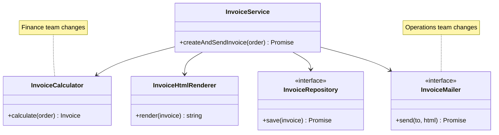
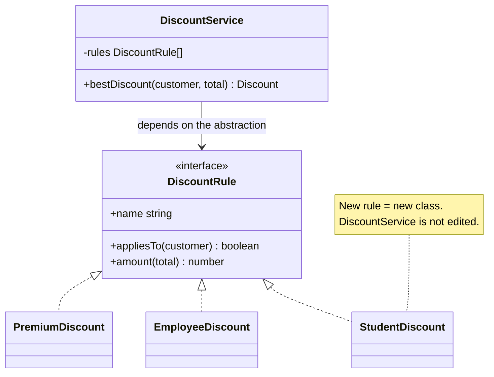
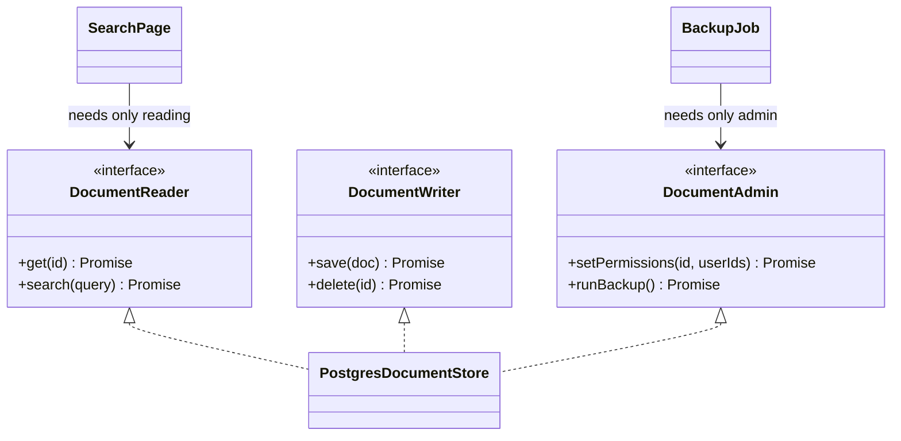
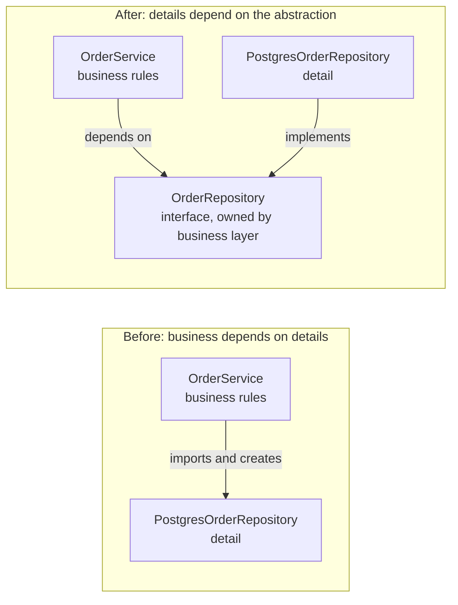
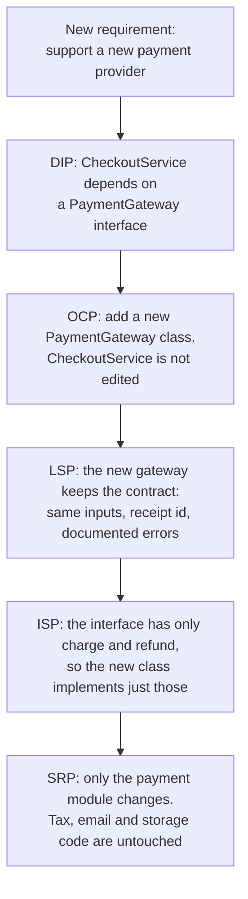

# SOLID Principles

> In this document you will learn the five SOLID principles with "bad code → better code" examples in TypeScript, real Angular and Node.js cases, and the risk of applying each one too much. SOLID is one of the most common design topics in interviews, and interviewers want examples and trade-offs, not five memorized slogans.

**Before this:** [OOP: the four pillars](./01-oop-four-pillars.md) · [Composition, inheritance and mixins](./02-composition-inheritance-and-mixins.md) · **Interview questions:** [jump to questions](#interview-questions)

## Table of contents

1. [What SOLID is](#what-solid-is)
2. [S: Single Responsibility Principle](#s-single-responsibility-principle)
3. [O: Open/Closed Principle](#o-openclosed-principle)
4. [L: Liskov Substitution Principle](#l-liskov-substitution-principle)
5. [I: Interface Segregation Principle](#i-interface-segregation-principle)
6. [D: Dependency Inversion Principle](#d-dependency-inversion-principle)
7. [How the five principles work together](#how-the-five-principles-work-together)
8. [When SOLID goes too far](#when-solid-goes-too-far)
9. [Common mistakes](#common-mistakes)
10. [Best practices](#best-practices)
11. [How to explain SOLID in an interview](#how-to-explain-solid-in-an-interview)
12. [Interview questions](#interview-questions)
13. [Summary](#summary)
14. [References](#references)

---

## What SOLID is

**SOLID** is a set of five design principles for object-oriented code. Robert C. Martin ("Uncle Bob") collected them around the year 2000, and Michael Feathers later arranged the first letters into the word SOLID.

| Letter | Principle | One-line meaning |
| --- | --- | --- |
| **S** | Single Responsibility | A class should have only one reason to change. |
| **O** | Open/Closed | You should be able to add new behavior without editing existing, working code. |
| **L** | Liskov Substitution | A subclass must work anywhere its parent is expected, without surprises. |
| **I** | Interface Segregation | Do not force code to depend on methods it does not use. |
| **D** | Dependency Inversion | Business logic should depend on abstractions, not on concrete details like databases or HTTP libraries. |

### Why SOLID exists

All five principles try to solve the same problem: **code that is hard to change**. In a badly designed codebase:

- A small change in one place breaks something far away (**fragile**).
- Every change forces edits in many files (**rigid**).
- You cannot reuse a part without dragging in everything around it (**immobile**).
- You cannot test a class without a real database or network.

SOLID gives you questions to ask when you design or review code. It is not a law. Each principle has a cost, and good engineers know when *not* to apply it (see [When SOLID goes too far](#when-solid-goes-too-far)).

### Does SOLID apply to JavaScript?

Yes, even though it was born in the world of Java and C++. In JavaScript and TypeScript:

- "Class" often means "module", "function" or "service". SRP applies to all of them.
- "Interface" can be a TypeScript `interface`, a function signature, or just an agreed object shape (duck typing).
- "Inheritance" for LSP also covers any object that claims to follow a contract, such as a fake repository in a test or a custom Angular `ControlValueAccessor`.

---

## S: Single Responsibility Principle

### What it is

> A class (or module, or function) should have **one, and only one, reason to change**.

Robert C. Martin later made this clearer: a module should be responsible to **one actor**. An **actor** is a person or group who asks for changes: the finance team, the marketing team, the operations team, the security team.

### What it does *not* mean

SRP does **not** mean "a class should do only one tiny thing" or "a class should have only one method". A `UserRepository` with `findById`, `findByEmail`, `save` and `delete` follows SRP: all four change for the same reason (how users are stored).

The question is: **who would ask me to change this code, and why?** If two different people could ask for changes for two unrelated reasons, the code has two responsibilities.

### Analogy

A restaurant has a chef, a waiter and a cashier. If one person did all three jobs, then a new menu, a new seating plan and a new payment machine would all disturb the same person. Splitting the jobs means a menu change only affects the chef.

### Bad code

```ts
interface OrderLine { name: string; price: number; qty: number; }
interface Order { id: string; customerEmail: string; lines: OrderLine[]; country: "IN" | "US"; }

class InvoiceService {
  createAndSendInvoice(order: Order): string {
    // 1. Business rules: totals and tax (finance team changes this)
    const subtotal = order.lines.reduce((sum, l) => sum + l.price * l.qty, 0);
    const taxRate = order.country === "IN" ? 0.18 : 0.07;
    const total = Math.round(subtotal * (1 + taxRate) * 100) / 100;

    // 2. Presentation: invoice layout (design/marketing team changes this)
    const html = `<h1>Invoice ${order.id}</h1><p>Total: ${total.toFixed(2)}</p>`;

    // 3. Persistence: where invoices are saved (platform team changes this)
    console.log(`INSERT INTO invoices (id, total) VALUES ('${order.id}', ${total})`);

    // 4. Delivery: how invoices are sent (operations team changes this)
    console.log(`SMTP send to ${order.customerEmail}`);

    return html;
  }
}
```

This method has at least four reasons to change:

| Change request | Who asks | Part that changes |
| --- | --- | --- |
| "Tax in India is now calculated per item" | Finance | Totals |
| "Add our new logo and a QR code" | Marketing | HTML |
| "Move invoices from MySQL to PostgreSQL" | Platform team | Persistence |
| "Use SendGrid instead of SMTP" | Operations | Delivery |

Every change touches the same method. A tax change could accidentally break email sending. And to test the tax rule, you must run code that writes to a database and sends email. (It also builds SQL with string concatenation, which allows SQL injection, but that is a different problem.)

### Better code

```ts
interface OrderLine { name: string; price: number; qty: number; }
interface Order { id: string; customerEmail: string; lines: OrderLine[]; country: "IN" | "US"; }
interface Invoice { orderId: string; total: number; }

// 1. Business rules only (pure, easy to test)
class InvoiceCalculator {
  private static readonly TAX_RATES = { IN: 0.18, US: 0.07 } as const;

  calculate(order: Order): Invoice {
    const subtotal = order.lines.reduce((sum, l) => sum + l.price * l.qty, 0);
    const rate = InvoiceCalculator.TAX_RATES[order.country];
    return { orderId: order.id, total: Math.round(subtotal * (1 + rate) * 100) / 100 };
  }
}

// 2. Presentation only
class InvoiceHtmlRenderer {
  render(invoice: Invoice): string {
    return `<h1>Invoice ${invoice.orderId}</h1><p>Total: ${invoice.total.toFixed(2)}</p>`;
  }
}

// 3. Persistence only (interface, so storage can change)
interface InvoiceRepository {
  save(invoice: Invoice): Promise<void>;
}

// 4. Delivery only
interface InvoiceMailer {
  send(to: string, html: string): Promise<void>;
}

// The coordinator: it decides the ORDER of steps, but no step's details.
class InvoiceService {
  constructor(
    private calculator: InvoiceCalculator,
    private renderer: InvoiceHtmlRenderer,
    private repository: InvoiceRepository,
    private mailer: InvoiceMailer,
  ) {}

  async createAndSendInvoice(order: Order): Promise<Invoice> {
    const invoice = this.calculator.calculate(order);
    await this.repository.save(invoice);
    await this.mailer.send(order.customerEmail, this.renderer.render(invoice));
    return invoice;
  }
}

// Usage with simple in-memory parts
const saved: Invoice[] = [];
const service = new InvoiceService(
  new InvoiceCalculator(),
  new InvoiceHtmlRenderer(),
  { save: async (inv) => { saved.push(inv); } },
  { send: async (to, html) => console.log(`mail to ${to}: ${html}`) },
);

const invoice = await service.createAndSendInvoice({
  id: "A-17",
  customerEmail: "asha@example.com",
  country: "IN",
  lines: [{ name: "Keyboard", price: 50, qty: 2 }],
});
// mail to asha@example.com: <h1>Invoice A-17</h1><p>Total: 118.00</p>
console.log(invoice, saved.length); // { orderId: 'A-17', total: 118 } 1
```

Now each change request touches one class. You can test `InvoiceCalculator` with plain objects in milliseconds.

Note that `InvoiceService` still exists and still "does several things" in a sense. That is fine. Its single responsibility is **coordinating the workflow**. It changes only if the *steps* of the workflow change.



### Real-world example: Angular component

A common SRP violation in Angular is the "do everything" component:

```ts
// ❌ Wrong: HTTP, caching, formatting and view logic all in one component
// @Component({ selector: 'app-product-list', templateUrl: './product-list.component.html' })
export class ProductListComponent {
  products: { name: string; priceCents: number }[] = [];

  async ngOnInit() {
    const cached = localStorage.getItem('products');                // caching
    const data = cached ? JSON.parse(cached)
      : await fetch('/api/products').then(r => r.json());           // HTTP
    localStorage.setItem('products', JSON.stringify(data));
    this.products = data;
  }

  formatPrice(cents: number) {                                       // formatting
    return '$' + (cents / 100).toFixed(2);
  }
}
```

Split by reason to change:

- **Data access and caching** → a `ProductService` that uses `HttpClient` (and maybe a cache).
- **Formatting** → Angular's built-in `currency` pipe, or a custom pipe.
- **The component** → only connects data to the template and handles user events.

```ts
// ✅ Correct (Angular 16)
import { Component, Injectable, inject } from '@angular/core';
import { HttpClient } from '@angular/common/http';
import { shareReplay } from 'rxjs';

interface Product { name: string; priceCents: number; }

// product.service.ts
@Injectable({ providedIn: 'root' })
export class ProductService {
  private http = inject(HttpClient);
  readonly products$ = this.http.get<Product[]>('/api/products').pipe(shareReplay(1));
}

// product-list.component.ts
@Component({
  selector: 'app-product-list',
  template: `
    <li *ngFor="let p of products$ | async">
      {{ p.name }} - {{ p.priceCents / 100 | currency:'USD' }}
    </li>
  `,
})
export class ProductListComponent {
  readonly products$ = inject(ProductService).products$;
}
```

### Real-world example: Node.js / Express

```js
// ❌ Wrong: validation, business rules, database and email inside the route handler
app.post("/users", async (req, res) => {
  if (!req.body.email?.includes("@")) return res.status(400).send("Bad email");
  const exists = await db.query("SELECT 1 FROM users WHERE email = $1", [req.body.email]);
  if (exists.rows.length) return res.status(409).send("Email taken");
  await db.query("INSERT INTO users (email) VALUES ($1)", [req.body.email]);
  await mailer.send(req.body.email, "Welcome!");
  res.status(201).send("Created");
});
```

The common layered split in Node.js backends:

| Layer | Responsibility | Changes when |
| --- | --- | --- |
| Route / controller | HTTP: read the request, return status codes | The API contract changes |
| Validation (schema) | Check input shape | Input rules change |
| Service | Business rules ("email must be unique") | Business rules change |
| Repository | Database queries | Storage changes |
| Mailer / notifier | Sending messages | The email provider changes |

See [HTTP servers and Express](../07-nodejs-backend/06-http-servers-and-express.md) and [Validation and error handling](../07-nodejs-backend/08-validation-and-error-handling.md) for full examples.

### How to explain SRP in an interview

> "SRP says a class should have one reason to change, or more precisely, it should answer to one actor, like finance or operations. It's not about having one method. For example, an invoice service that calculates tax, renders HTML, saves to the database and sends email has four reasons to change. I'd split it into a calculator, a renderer, a repository and a mailer, with a small service that coordinates them. Then a tax change can't break email, and I can unit test the tax logic without a database. The risk is going too far and creating dozens of tiny classes that are hard to follow."

### Risk of over-applying SRP

- **Class explosion / "ravioli code":** hundreds of tiny classes with one method each. To understand one feature, you jump through ten files.
- **Splitting things that always change together.** If `validateOrder` and `calculateOrderTotal` always change at the same time, for the same people, splitting them adds cost and no benefit.
- **Rule of thumb:** split when you see real, different reasons to change (different people, different change frequency, or a part you want to test alone). Do not split "just in case".

---

## O: Open/Closed Principle

### What it is

> Software entities should be **open for extension** but **closed for modification**.

In plain words: **you should be able to add new behavior by adding new code, not by editing existing, tested code.**

Bertrand Meyer first described the principle in 1988, and his version used inheritance. Robert C. Martin's popular version uses abstractions and polymorphism: code depends on an interface, and new behavior comes as new implementations of that interface.

### Why it exists

Every time you edit working code, you risk breaking it. If adding a new payment method means editing a long `switch` in the checkout code, then every new method puts the old ones at risk, and every team that adds a method edits the same file (merge conflicts).

### Analogy

A power strip. You can plug in a new device (extension) without opening the strip and rewiring it (modification). The socket shape is the "interface".

### Bad code

```ts
type CustomerType = "regular" | "premium" | "employee";

class DiscountService {
  getDiscount(customerType: CustomerType, total: number): number {
    switch (customerType) {
      case "regular":
        return 0;
      case "premium":
        return total * 0.1;
      case "employee":
        return total * 0.3;
    }
  }
}
```

Marketing now wants a "Black Friday 20%" discount, then "students 15%", then "first order free shipping". Each one means editing `DiscountService`, re-testing every existing case, and deploying the class again.

### Better code: depend on an abstraction, add new implementations

```ts
interface Customer { type: string; isStudent: boolean; orderCount: number; }

interface DiscountRule {
  readonly name: string;
  appliesTo(customer: Customer): boolean;
  amount(total: number): number;
}

class PremiumDiscount implements DiscountRule {
  readonly name = "premium";
  appliesTo(c: Customer) { return c.type === "premium"; }
  amount(total: number) { return total * 0.1; }
}

class EmployeeDiscount implements DiscountRule {
  readonly name = "employee";
  appliesTo(c: Customer) { return c.type === "employee"; }
  amount(total: number) { return total * 0.3; }
}

// Closed for modification: this class does not change when rules are added.
class DiscountService {
  constructor(private readonly rules: DiscountRule[]) {}

  bestDiscount(customer: Customer, total: number): { name: string; amount: number } {
    return this.rules
      .filter(rule => rule.appliesTo(customer))
      .map(rule => ({ name: rule.name, amount: rule.amount(total) }))
      .reduce((best, d) => (d.amount > best.amount ? d : best), { name: "none", amount: 0 });
  }
}

// Open for extension: a new rule is a new class, plus one line where rules are listed.
class StudentDiscount implements DiscountRule {
  readonly name = "student";
  appliesTo(c: Customer) { return c.isStudent; }
  amount(total: number) { return total * 0.15; }
}

const discounts = new DiscountService([
  new PremiumDiscount(),
  new EmployeeDiscount(),
  new StudentDiscount(),
]);

console.log(discounts.bestDiscount({ type: "regular", isStudent: true, orderCount: 3 }, 200));
// { name: 'student', amount: 30 }
console.log(discounts.bestDiscount({ type: "premium", isStudent: true, orderCount: 9 }, 200));
// { name: 'student', amount: 30 }  (15% beats 10%)
console.log(discounts.bestDiscount({ type: "regular", isStudent: false, orderCount: 1 }, 200));
// { name: 'none', amount: 0 }
```

The list of rules is created in one place (the **composition root**, usually the app's startup code or the DI configuration). Adding a rule changes that list, but it does not change `DiscountService` or any existing rule.

Each `DiscountRule` here is a **strategy**. The Strategy pattern (with function-based versions, comparators and Angular's `*Strategy` providers) is covered in [Behavioral patterns: Strategy](./08-behavioral-patterns.md#strategy).



In plain JavaScript, a rule can just be an object or a function. You do not need classes to follow OCP:

```js
const rules = [
  { name: "premium", appliesTo: (c) => c.type === "premium", amount: (t) => t * 0.1 },
  { name: "student", appliesTo: (c) => c.isStudent, amount: (t) => t * 0.15 },
];
```

### Real-world examples

- **Angular `HTTP_INTERCEPTORS`:** you add auth headers, logging or retry logic by *registering a new interceptor*. You never edit `HttpClient`. Angular collects all interceptors with a **multi-provider**.

```ts
// Angular 16: class-based interceptor registered as a multi-provider
import { Injectable, inject } from '@angular/core';
import { HttpEvent, HttpHandler, HttpInterceptor, HttpRequest } from '@angular/common/http';
import { Observable } from 'rxjs';
import { AuthService } from './auth.service'; // your own service with a 'token' property

@Injectable()
export class AuthInterceptor implements HttpInterceptor {
  private auth = inject(AuthService);
  intercept(req: HttpRequest<unknown>, next: HttpHandler): Observable<HttpEvent<unknown>> {
    const token = this.auth.token;
    return next.handle(token ? req.clone({ setHeaders: { Authorization: `Bearer ${token}` } }) : req);
  }
}

// In AppModule providers:
// { provide: HTTP_INTERCEPTORS, useClass: AuthInterceptor, multi: true }
```

> **Newer Angular (15+):** functional interceptors (`HttpInterceptorFn`) registered with `provideHttpClient(withInterceptors([...]))` are also available, and they are the recommended style in newer versions. The OCP idea is the same.

- **Express middleware:** `app.use(helmet())`, `app.use(rateLimiter)`. Each new cross-cutting feature is a new middleware function, not an edit to Express.
- **Passport.js strategies:** add Google login by registering a new strategy, without changing your login route logic.
- **Plugin systems:** ESLint rules, Webpack/Vite plugins, Babel plugins. The core is closed; plugins extend it.

### How to explain OCP in an interview

> "OCP means I should be able to add new behavior by adding code, not by editing code that already works. The usual way is to depend on an abstraction. For example, instead of a discount service with a `switch` on customer type, I define a `DiscountRule` interface, and the service just loops over the rules it's given. A new discount is a new class registered at startup; the service and the existing rules don't change. Angular interceptors are a good real example: you add behavior to every HTTP call by registering an interceptor, not by editing `HttpClient`. The trap is building extension points for changes that never come."

### Risk of over-applying OCP

- **Speculative generality:** building a plugin system for a `switch` with two cases that has not changed in two years. That is more code, more indirection and no benefit.
- **You cannot be closed against every change.** Choose the axes of change you actually see (new payment providers every quarter: yes; tax calculation completely rewritten: probably not).
- A practical approach: **write the simple version first.** When the second or third variation appears, refactor to an abstraction. By then you know what really varies.

---

## L: Liskov Substitution Principle

### What it is

> If S is a subtype of T, then objects of type T may be replaced with objects of type S **without breaking the correctness of the program**.

Barbara Liskov introduced the idea in a 1987 keynote ("Data Abstraction and Hierarchy"), and later formalized it with Jeannette Wing in 1994.

In plain words: **a subclass (or any implementation of an interface) must keep the promises of its parent.** Code written for the parent must keep working, with no special cases and no surprises, when it gets the child.

### Why it exists

Polymorphism only works if every implementation behaves as callers expect. If one subclass behaves differently, callers start writing `if (x instanceof Special) {...}`, and the benefit of polymorphism is lost. LSP is about **behavior**, not just method names and types.

### Analogy

A rental company promises "a car with automatic transmission". If they give you any brand of automatic car, you can drive it. If they give you a manual car with the same shape, it "looks like a car", but you cannot drive it the way you expected. The manual car is not a valid substitute for the promise.

### The rules of a valid substitute

A **contract** is the full set of promises a type makes: what inputs it accepts, what it returns, what errors it throws, and what stays true. A subtype must follow these rules:

| Rule | Plain meaning | Example of breaking it |
| --- | --- | --- |
| **Preconditions cannot be stronger** | The child must accept at least everything the parent accepts. | Parent accepts any amount > 0; child throws for amounts > 500. |
| **Postconditions cannot be weaker** | The child must promise at least what the parent promises. | Parent `save()` always returns the saved entity with an `id`; child sometimes returns `undefined`. |
| **Invariants must be kept** | Rules that are always true for the parent stay true for the child. | Parent: balance never negative. Child "overdraft account" allows negative. |
| **No new unexpected errors** | The child should not throw kinds of errors callers do not expect. | Parent `read()` never throws for a valid id; child throws `NotSupportedError`. |
| **History rule** | The child must not allow state changes the parent forbids. | Parent is immutable; child adds a setter. |

### Example 1: Rectangle and Square (the classic)

In maths, a square *is a* rectangle. So it seems natural to write `class Square extends Rectangle`.

```ts
class Rectangle {
  constructor(protected _width: number, protected _height: number) {}
  get width() { return this._width; }
  set width(value: number) { this._width = value; }
  get height() { return this._height; }
  set height(value: number) { this._height = value; }
  area(): number { return this._width * this._height; }
}

class Square extends Rectangle {
  constructor(side: number) {
    super(side, side);
  }
  // A square must keep width === height, so each setter changes both.
  override get width() { return this._width; }
  override set width(value: number) { this._width = value; this._height = value; }
  override get height() { return this._height; }
  override set height(value: number) { this._width = value; this._height = value; }
}

// Code written for Rectangle. It relies on: "setting width does not change height".
function resizeTo5x4(shape: Rectangle): number {
  shape.width = 5;
  shape.height = 4;
  return shape.area();
}

console.log(resizeTo5x4(new Rectangle(1, 1))); // 20
console.log(resizeTo5x4(new Square(1)));       // 16  <- surprise!
```

**Step-by-step for the square:**

1. `shape.width = 5` → the square sets width **and** height to 5.
2. `shape.height = 4` → the square sets width **and** height to 4.
3. `area()` returns `4 * 4 = 16`, not the `20` that the caller expected.

TypeScript compiled this without any error. The *types* match. The *behavior* does not. The `Rectangle` contract had a hidden promise: "width and height can change independently". `Square` cannot keep that promise, so it is not a valid substitute, even though a square is a rectangle in maths.

**Fixes:**

- Do not make `Square` extend a *mutable* `Rectangle`. Make both implement a common `Shape` interface with `area()`.
- Or make shapes **immutable**. An immutable square *can* safely be a rectangle, because nobody can set the width alone.

```ts
interface Shape {
  area(): number;
}

class Rect implements Shape {
  constructor(readonly width: number, readonly height: number) {}
  area() { return this.width * this.height; }
  withSize(width: number, height: number): Rect { return new Rect(width, height); }
}

class Sq implements Shape {
  constructor(readonly side: number) {}
  area() { return this.side ** 2; }
}

const shapes: Shape[] = [new Rect(5, 4), new Sq(4)];
console.log(shapes.map(s => s.area())); // [ 20, 16 ] -> no false promises
```

### Example 2: read-only collections

```ts
class TodoList {
  protected items: string[] = [];
  add(item: string): void { this.items.push(item); }
  all(): readonly string[] { return [...this.items]; }
}

// ❌ Wrong: a read-only list that "is a" TodoList
class ReadOnlyTodoList extends TodoList {
  constructor(items: string[]) {
    super();
    this.items = [...items];
  }
  override add(_item: string): void {
    throw new Error("This list is read-only"); // breaks the parent's promise
  }
}

function addDefaults(list: TodoList) {
  list.add("Check email"); // valid for any TodoList... or is it?
}

try {
  addDefaults(new ReadOnlyTodoList(["Pay rent"]));
} catch (error) {
  console.log((error as Error).message); // This list is read-only
}
```

`TodoList` promises that `add` works. The child throws instead. Any caller that uses `TodoList` must now worry about this special case.

**Fix: reverse the hierarchy.** The *read-only* contract is the smaller one. A mutable list can do everything a read-only list can, plus more. So the mutable type should extend the read-only type, not the other way around.

```ts
interface ReadableTodoList {
  all(): readonly string[];
}

interface WritableTodoList extends ReadableTodoList {
  add(item: string): void;
}

class TodoList implements WritableTodoList {
  private items: string[] = [];
  add(item: string) { this.items.push(item); }
  all() { return [...this.items]; }
}

function printAll(list: ReadableTodoList) {
  console.log(list.all().join(", "));
}

const todos = new TodoList();
todos.add("Pay rent");
printAll(todos); // Pay rent  (a writable list is a valid readable list)
```

TypeScript's own arrays follow this idea: a `string[]` can be used where a `readonly string[]` is expected, but not the other way around.

```ts
const names: string[] = ["Asha", "Ravi"];
const view: readonly string[] = names; // ✅ OK: mutable is a valid read-only substitute
// const back: string[] = view;        // ❌ Compile error: 'readonly string[]' cannot be assigned to 'string[]'
console.log(view.length); // 2
```

### Example 3: preconditions and postconditions

```ts
interface PaymentProcessor {
  /** Charges any amount greater than 0. Resolves with a receipt id. */
  charge(amountCents: number): Promise<string>;
}

class CardProcessor implements PaymentProcessor {
  async charge(amountCents: number) {
    if (amountCents <= 0) throw new RangeError("Amount must be positive");
    return `card_${amountCents}`;
  }
}

// ❌ Stronger precondition: rejects amounts the contract allows
class GiftCardProcessor implements PaymentProcessor {
  async charge(amountCents: number) {
    if (amountCents > 50_000) throw new Error("Gift cards cannot pay more than 500.00");
    return `gift_${amountCents}`;
  }
}

// ❌ Weaker postcondition: sometimes resolves without a real receipt
class LazyProcessor implements PaymentProcessor {
  async charge(amountCents: number) {
    return amountCents > 1000 ? `lazy_${amountCents}` : ""; // empty string is not a receipt
  }
}
```

TypeScript accepts all three classes, because the *types* are the same. Only the documented contract (the comment) and tests can catch these violations.

How to fix them depends on the real requirement:

- If gift cards really have a limit, the contract itself must say so. For example, add `maxAmountCents(): number` to the interface, or a `canCharge(amount): boolean` method that callers check first. Then the limit is part of the promise, not a surprise.
- `LazyProcessor` must always return a real receipt id, or throw a documented error.

### LSP is about more than classes

LSP applies to **anything that claims to follow a contract**:

- A **fake or mock in a test** must behave like the real thing for the behavior you test. If the real `UserRepository.findById` returns `null` for a missing user, but your fake throws, your tests are testing a different contract. They can pass while production fails.
- An **Angular `ControlValueAccessor`** must call the `onChange` function it receives when the value changes, and must handle `writeValue(null)` (Angular calls it with `null` when a form is reset). A custom input that ignores these breaks the forms API contract.
- A **Node.js `Writable` stream subclass** must call the `callback` in `_write`, or the stream stalls forever.

### TypeScript does not enforce LSP

TypeScript checks **types**, not **behavior**. Two more details:

1. **Method parameters are checked loosely (bivariantly).** When a method is declared with method syntax (`save(item: T): void`), TypeScript allows an implementation to *narrow* the parameter type, even with `strict` mode. That narrowing is exactly a "stronger precondition".

```ts
interface Animal { name: string; }
interface Dog extends Animal { bark(): string; }

interface AnimalHandler {
  handle(animal: Animal): void; // method syntax
}

// Compiles, even under --strict, but breaks LSP: it only accepts Dogs.
class DogHandler implements AnimalHandler {
  handle(dog: Dog) {
    console.log(dog.bark());
  }
}

const handler: AnimalHandler = new DogHandler();
try {
  handler.handle({ name: "Tom the cat" });
} catch (error) {
  console.log((error as Error).message); // dog.bark is not a function
}
```

If you declare the member with **property syntax** (`handle: (animal: Animal) => void`), the `strictFunctionTypes` check applies, and TypeScript reports the error. This difference is documented in the TypeScript handbook and release notes for `strictFunctionTypes`.

2. **Thrown errors are not part of TypeScript types.** A subclass can throw new kinds of errors and TypeScript will not notice.

So you protect LSP with **clear contracts** (doc comments, small interfaces) and **shared contract tests**: one test suite that runs against every implementation (real repository, in-memory repository, cached repository).

```ts
interface KeyValueStore {
  get(key: string): Promise<string | null>;
  set(key: string, value: string): Promise<void>;
}

// One contract test, run against every implementation
async function storeContractTest(name: string, store: KeyValueStore) {
  const missing = await store.get("missing");
  await store.set("a", "1");
  const found = await store.get("a");
  const ok = missing === null && found === "1";
  console.log(`${name}: ${ok ? "passes" : "FAILS"} the contract`);
}

class MapStore implements KeyValueStore {
  private data = new Map<string, string>();
  async get(key: string) { return this.data.get(key) ?? null; }
  async set(key: string, value: string) { this.data.set(key, value); }
}

class BrokenStore implements KeyValueStore {
  private data: Record<string, string> = {};
  async get(key: string) { return this.data[key] as string; } // returns undefined, not null
  async set(key: string, value: string) { this.data[key] = value; }
}

await storeContractTest("MapStore", new MapStore());       // MapStore: passes the contract
await storeContractTest("BrokenStore", new BrokenStore()); // BrokenStore: FAILS the contract
```

### Signs of an LSP violation

- A subclass method throws `"Not supported"` or `"Not implemented"`.
- A subclass method does nothing (empty override) where the parent did real work.
- Callers check `instanceof` to treat one subclass differently.
- Comments like "do not call `save()` on archived orders".
- A fake in tests that behaves differently from the real implementation.

### The Bird and Penguin example

```js
// ❌ Wrong: Bird promises fly(), Penguin cannot keep the promise
class Bird {
  fly() { return "flying high"; }
}
class Penguin extends Bird {
  fly() { throw new Error("Penguins cannot fly"); }
}

function migrate(birds) {
  return birds.map((bird) => bird.fly());
}

try {
  migrate([new Bird(), new Penguin()]);
} catch (error) {
  console.log(error.message); // Penguins cannot fly
}
```

Returning a string like `"I cannot fly"` instead of throwing does not fix it either. The contract of `fly()` is "this bird flies", and a penguin does not.

```js
// ✅ Correct: only birds that can fly promise to fly
class Bird {
  constructor(name) { this.name = name; }
  eat() { return `${this.name} eats`; }
}
class FlyingBird extends Bird {
  fly() { return `${this.name} flies`; }
}
class Sparrow extends FlyingBird {}
class Penguin extends Bird {
  swim() { return `${this.name} swims`; }
}

function migrate(flyingBirds) {
  return flyingBirds.map((bird) => bird.fly());
}

console.log(migrate([new Sparrow("Sparrow")])); // [ 'Sparrow flies' ]
console.log(new Penguin("Pingu").swim());        // Pingu swims
// migrate([new Penguin("Pingu")]) would be a design error that TypeScript can catch
// if migrate is typed as (birds: FlyingBird[]) => string[].
```

Even better, as shown in [Composition, inheritance and mixins](./02-composition-inheritance-and-mixins.md), model flying and swimming as abilities that you compose, instead of a tree.

### How to explain LSP in an interview

> "LSP says any implementation must be usable wherever its parent type is expected, without the caller noticing a difference in behavior. It's about keeping promises, not just matching method names. The child can't demand more from inputs, can't give weaker results, and can't break the parent's rules. The classic example is a `Square` extending a mutable `Rectangle`: setting the width also changes the height, so code that resizes rectangles gets the wrong area. A more practical example is a read-only list that extends a list and throws in `add`. The fix is usually to change the hierarchy, so the read-only contract is the parent, or to use composition. TypeScript won't catch these, so I rely on clear contracts and shared contract tests."

### Risk of over-applying LSP

LSP itself is rarely "over-applied", but teams sometimes:

- **Refuse any hierarchy** because "it might break LSP". A shallow, honest hierarchy is fine.
- **Write huge contracts** that try to describe every detail. Keep contracts focused on what callers really rely on.

---

## I: Interface Segregation Principle

### What it is

> **Clients should not be forced to depend on methods they do not use.**

A **client** here is any code that uses an interface. In plain words: **prefer several small, focused interfaces over one big "fat" interface.**

### Why it exists

When a fat interface changes, every class that implements it and every client that uses it is affected, even if they do not care about the changed method. Implementers are forced to write empty or throwing methods. Tests must fake methods that are never called.

### Analogy

A TV remote with 60 buttons, when you only ever use power, volume and channel. If the TV company changes the "teletext" button, you still get a new remote. A simple remote with three buttons is easier to use and to replace.

### Bad code

```ts
interface Document { id: string; title: string; content: string; }

// A fat interface: every client depends on all of it
interface DocumentStore {
  get(id: string): Promise<Document | null>;
  search(query: string): Promise<Document[]>;
  save(doc: Document): Promise<void>;
  delete(id: string): Promise<void>;
  setPermissions(id: string, userIds: string[]): Promise<void>;
  exportToPdf(id: string): Promise<Uint8Array>;
  runBackup(): Promise<void>;
}

// A read-only cache that wants to "be" a DocumentStore must fake half of it.
class CachedReadOnlyStore implements DocumentStore {
  constructor(private source: DocumentStore) {}
  get(id: string) { return this.source.get(id); }
  search(query: string) { return this.source.search(query); }
  async save(): Promise<void> { throw new Error("read-only"); }          // forced
  async delete(): Promise<void> { throw new Error("read-only"); }        // forced
  async setPermissions(): Promise<void> { throw new Error("read-only"); }// forced
  async exportToPdf(): Promise<Uint8Array> { throw new Error("n/a"); }   // forced
  async runBackup(): Promise<void> { throw new Error("n/a"); }           // forced
}
```

Notice that the forced methods throw, which also breaks LSP. ISP and LSP violations often appear together.

### Better code: role interfaces

Split the interface by **what each client needs** (a **role interface**).

```ts
interface Document { id: string; title: string; content: string; }

interface DocumentReader {
  get(id: string): Promise<Document | null>;
  search(query: string): Promise<Document[]>;
}

interface DocumentWriter {
  save(doc: Document): Promise<void>;
  delete(id: string): Promise<void>;
}

interface DocumentAdmin {
  setPermissions(id: string, userIds: string[]): Promise<void>;
  runBackup(): Promise<void>;
}

// The full store can implement all of them.
class PostgresDocumentStore implements DocumentReader, DocumentWriter, DocumentAdmin {
  private docs = new Map<string, Document>();
  async get(id: string) { return this.docs.get(id) ?? null; }
  async search(q: string) { return [...this.docs.values()].filter(d => d.title.includes(q)); }
  async save(doc: Document) { this.docs.set(doc.id, doc); }
  async delete(id: string) { this.docs.delete(id); }
  async setPermissions() { /* ... */ }
  async runBackup() { /* ... */ }
}

// A client that only reads asks only for DocumentReader.
class SearchPage {
  constructor(private reader: DocumentReader) {}
  async titlesFor(query: string): Promise<string[]> {
    return (await this.reader.search(query)).map(d => d.title);
  }
}

// Tests fake only what is used: two methods, not seven.
const fakeReader: DocumentReader = {
  get: async () => null,
  search: async () => [{ id: "1", title: "SOLID notes", content: "" }],
};
console.log(await new SearchPage(fakeReader).titlesFor("SOLID")); // [ 'SOLID notes' ]

const store = new PostgresDocumentStore();
await store.save({ id: "2", title: "DI guide", content: "" });
console.log(await new SearchPage(store).titlesFor("DI")); // [ 'DI guide' ]
```



### TypeScript helpers for ISP

You do not always need to write new interfaces by hand. `Pick` creates a narrow type from a wide one:

```ts
interface UserService {
  getUser(id: string): Promise<{ id: string; name: string }>;
  updateUser(id: string, name: string): Promise<void>;
  deleteUser(id: string): Promise<void>;
  resetPassword(id: string): Promise<void>;
}

// This function only needs getUser
type UserGetter = Pick<UserService, "getUser">;

async function greeting(users: UserGetter, id: string): Promise<string> {
  const user = await users.getUser(id);
  return `Hello, ${user.name}`;
}

console.log(await greeting({ getUser: async (id) => ({ id, name: "Asha" }) }, "u1")); // Hello, Asha
```

Utility types like `Pick` and `Omit` are covered in [Utility types](../03-typescript/08-utility-types.md).

### Real-world examples

- **Angular lifecycle hooks** are a textbook ISP design. Angular did not create one big `Component` interface with `ngOnInit`, `ngOnChanges`, `ngOnDestroy`, `ngAfterViewInit` and so on. Each hook is its own tiny interface (`OnInit`, `OnDestroy`, `OnChanges`...). A component implements only the hooks it uses.

```ts
import { Component, OnDestroy, OnInit } from '@angular/core';

@Component({ selector: 'app-clock', template: '{{ now | date:"mediumTime" }}' })
export class ClockComponent implements OnInit, OnDestroy {
  now = new Date();
  private timerId?: ReturnType<typeof setInterval>;

  ngOnInit(): void {
    this.timerId = setInterval(() => (this.now = new Date()), 1000);
  }

  ngOnDestroy(): void {
    clearInterval(this.timerId);
  }
}
```

- **Angular `ControlValueAccessor`** keeps `setDisabledState` optional, so simple custom inputs do not have to implement it.
- **Node.js:** a function that only reads configuration should accept `{ get(key: string): string | undefined }`, not the whole configuration library object, or the whole Redis client.
- **Electron preload scripts:** expose a small, specific API to the renderer (`saveFile`, `openFile`) instead of all of `ipcRenderer`. This is ISP *and* a security rule. See [IPC and preload scripts](../08-electron-desktop/03-ipc-and-preload-scripts.md).

### How to explain ISP in an interview

> "ISP says clients shouldn't depend on methods they don't use. So instead of one big interface, I create small role interfaces based on what each client needs. For example, a search page only needs `get` and `search`, so it depends on a `DocumentReader` interface, not on a store that also has delete, permissions and backup. That way, changes to admin methods don't affect the search page, and in tests I fake two methods instead of seven. Angular's lifecycle hooks are a nice example: `OnInit`, `OnDestroy` and so on are separate interfaces. The risk is splitting too far, so every method becomes its own interface."

### Risk of over-applying ISP

- **Interface per method:** `Gettable`, `Searchable`, `Savable`, `Deletable`... Now a class `implements` eight interfaces and nobody can find anything.
- Split based on **real clients**, not on every method. If every client uses all five methods, one interface of five methods is perfect.

---

## D: Dependency Inversion Principle

### What it is

Robert C. Martin's definition has two parts:

> 1. **High-level modules should not depend on low-level modules. Both should depend on abstractions.**
> 2. **Abstractions should not depend on details. Details should depend on abstractions.**

- A **high-level module** contains the important business rules: "place an order", "approve a loan".
- A **low-level module** contains technical details: "write to PostgreSQL", "call the Stripe API", "send through SMTP".
- An **abstraction** is an interface (or abstract class) that describes *what* is needed, without saying *how*.

### Why "inversion"?

In a naive design, dependencies follow the call direction: `OrderService` imports and creates `PostgresOrderRepository`. The important business code depends on a technical detail.

With DIP, the business layer **defines the interface it needs** (`OrderRepository`), and the database code **implements** it. Now the database code depends on the business code's interface. The source-code dependency arrow is **inverted**, while the call at runtime still goes from service to database.



### Bad code → better code

```ts
// ❌ Wrong: business logic creates its own concrete dependencies
class PostgresOrderRepository {
  async save(order: { id: string; total: number }) {
    console.log(`INSERT order ${order.id} into Postgres`);
  }
}

class OrderServiceBad {
  private repository = new PostgresOrderRepository(); // hard-wired detail

  async placeOrder(id: string, total: number) {
    if (total <= 0) throw new Error("Order total must be positive");
    await this.repository.save({ id, total });
  }
}
// To unit test OrderServiceBad, you need a real Postgres database.
```

```ts
// ✅ Correct: business logic owns the abstraction; details are injected
interface Order { id: string; total: number; }

interface OrderRepository {          // defined next to the business logic
  save(order: Order): Promise<void>;
}

class OrderService {
  constructor(private readonly repository: OrderRepository) {}

  async placeOrder(id: string, total: number): Promise<Order> {
    if (total <= 0) throw new Error("Order total must be positive");
    const order = { id, total };
    await this.repository.save(order);
    return order;
  }
}

// Details implement the abstraction
class PostgresOrderRepository implements OrderRepository {
  async save(order: Order) { console.log(`INSERT order ${order.id} into Postgres`); }
}

class InMemoryOrderRepository implements OrderRepository {
  readonly orders: Order[] = [];
  async save(order: Order) { this.orders.push(order); }
}

// Production wiring (composition root)
const service = new OrderService(new PostgresOrderRepository());
await service.placeOrder("o-1", 99); // INSERT order o-1 into Postgres

// Test wiring
const memory = new InMemoryOrderRepository();
await new OrderService(memory).placeOrder("o-2", 10);
console.log(memory.orders); // [ { id: 'o-2', total: 10 } ]
```

### DIP is not the same as DI

- **Dependency Inversion (DIP)** is a *design principle* about the **direction of dependencies** between layers.
- **Dependency Injection (DI)** is a *technique*: an object receives its dependencies from outside instead of creating them.

DI is the most common way to achieve DIP, but you can inject a concrete class (DI without DIP), and you can follow DIP with other tools (factories, plugin registration). This difference, plus Inversion of Control, DI containers, lifetimes and Angular/NestJS specifics, is explained in depth in [Dependency inversion and injection](./05-dependency-inversion-and-injection.md).

### Real-world examples

- **Angular:** a component depends on an abstract `Logger` or an `InjectionToken<AppConfig>`, and the module decides which implementation to provide.
- **Node.js clean/hexagonal architecture:** the domain layer defines **ports** (interfaces such as `PaymentGateway`, `OrderRepository`), and infrastructure **adapters** implement them (Stripe adapter, Postgres adapter).
- **Electron:** business logic depends on a `FileStorage` interface; the main process provides a real `fs`-based implementation, and tests provide an in-memory one.

### How to explain DIP in an interview

> "DIP says important business code shouldn't depend on technical details like a specific database or HTTP library. Both should depend on an abstraction, and the abstraction belongs to the business side. So `OrderService` depends on an `OrderRepository` interface, and `PostgresOrderRepository` implements it. The source dependency is inverted: the database code now points to the business layer's interface. The usual way to wire it is dependency injection, but DIP and DI are not the same thing: DI is the technique, DIP is the direction of dependencies. The benefit is testability and the ability to swap infrastructure; the cost is extra interfaces, so I only add them at real boundaries."

### Risk of over-applying DIP

- **An interface for every class**, including simple utilities and value objects. `IStringFormatter` with one implementation forever adds files and indirection.
- Good boundaries for abstractions: **I/O and external systems** (database, HTTP, file system, clock, random numbers, email, payment), and places where you *really* have several implementations.

---

## How the five principles work together

The principles support each other. Here is how one change request flows through a well-designed checkout feature.



| Principle | Main smell it fixes | Related patterns and tools |
| --- | --- | --- |
| SRP | God class, "this file changes in every PR" | Extract class, service layer, pipes |
| OCP | Growing `switch` / `if` chains on type | Strategy, plugins, multi-providers, middleware |
| LSP | `instanceof` checks, "not supported" overrides | Composition, smaller contracts, contract tests |
| ISP | Fakes with many unused methods, fat interfaces | Role interfaces, `Pick`, small preload APIs |
| DIP | Business code that imports database or HTTP code | Dependency injection, ports and adapters |

---

## When SOLID goes too far

SOLID principles are **tools for managing change**. If something does not change and is easy to understand, it may not need them. Over-applied SOLID creates its own problems:

- **Too many layers:** a simple CRUD screen with a controller, a service, a domain service, a repository interface, a repository, a mapper, a DTO and a factory. Each layer adds code to read and maintain.
- **Interfaces with one implementation forever.** Exception: an interface at an I/O boundary is still useful for testing.
- **Abstractions built before the second use case exists.** You guess the axis of change and often guess wrong (see "the wrong abstraction" in [Coupling, cohesion and design principles](./04-coupling-cohesion-and-design-principles.md)).
- **Following rules instead of solving problems.** "We must split this because SRP says so" without naming the two reasons to change.

A balanced approach:

1. Write the simplest code that works and is clearly named.
2. When a real change hurts (a `switch` grows, a class changes for unrelated reasons, a test needs a database), apply the principle that removes that pain.
3. In code review, use the principles as **questions**, not as rules: "What are the reasons this class changes?", "What happens when we add a fifth provider?"

---

## Common mistakes

1. **"SRP means one method per class."** It means one reason to change.
2. **"OCP means never edit existing code."** You still fix bugs and refactor. OCP is about *adding features* without risky edits.
3. **Thinking LSP is satisfied because TypeScript compiles.** LSP is about behavior; types cannot check it fully.
4. **Fat "service" interfaces in Angular or NestJS** that every test must fake completely.
5. **Confusing DIP with DI.** Injecting a concrete class is DI, but the dependency direction did not change.
6. **Applying all five everywhere.** This creates over-engineered code that is hard to read.
7. **Using inheritance to "follow OCP".** Extension through inheritance brings back the fragile base class problem. Composition and interfaces are usually better.

---

## Best practices

- **Name the reasons to change** before splitting a class. Reason: it keeps splits meaningful.
- **Introduce abstractions at boundaries** (database, HTTP, file system, clock, email, payment). Reason: these are where tests and swaps happen.
- **Let the business layer own its interfaces.** Reason: this is what makes the dependency direction correct (DIP).
- **Document contracts** (inputs, outputs, errors) in doc comments, and **write shared contract tests** for every implementation. Reason: TypeScript cannot check behavior.
- **Use property syntax for function members** when you want strict parameter checking (`handle: (a: Animal) => void`). Reason: method syntax is checked bivariantly.
- **Design interfaces from the client's point of view.** Reason: clients then depend only on what they use (ISP).
- **Prefer composition and registration (lists of strategies, multi-providers, middleware) for extension.** Reason: it follows OCP without inheritance trees.
- **Refactor towards SOLID when change hurts, not before.** Reason: you avoid guessing future requirements.

---

## How to explain SOLID in an interview

1. **Define it:** "SOLID is five object-oriented design principles: Single Responsibility, Open/Closed, Liskov Substitution, Interface Segregation and Dependency Inversion."
2. **Why it exists:** "They all aim to make code easier to change: a change should touch one place, not break unrelated features, and code should be testable in isolation."
3. **How it works:** "SRP splits code by reason to change. OCP adds behavior through new implementations instead of edits. LSP makes sure every implementation keeps the contract. ISP keeps interfaces small and client-focused. DIP makes business code depend on abstractions, with details injected."
4. **Small example:** "In a checkout service, I inject a `PaymentGateway` interface (DIP). A new provider is a new class (OCP) that must return a receipt and throw documented errors like the others (LSP). The interface only has `charge` and `refund` (ISP). And tax and email live in other classes, so only payment code changes (SRP)."
5. **Where it is useful:** "Angular interceptors and lifecycle hooks follow OCP and ISP. Node backends use controller, service and repository layers (SRP) with injected repositories (DIP)."
6. **Trade-offs / gotchas:** "Over-applied SOLID leads to too many tiny classes and interfaces with one implementation. I apply the principles where change actually hurts, mainly at boundaries like the database, HTTP and external services."

---

## Interview questions

### Q1. What is SOLID? Explain each principle in one or two sentences.

**What the interviewer is checking:** Can you state all five correctly, in your own words, with a tiny example for each, without mixing them up?

**Short spoken answer (30–60 seconds):**
> SOLID is five design principles that help keep object-oriented code easy to change. S is Single Responsibility: a class should have one reason to change, so tax rules and email sending don't live in the same class. O is Open/Closed: I should add behavior by adding code, like a new discount rule class, instead of editing a growing `switch`. L is Liskov Substitution: any subclass or implementation must work wherever the parent is expected, keeping the same promises. I is Interface Segregation: clients shouldn't depend on methods they don't use, so I prefer small role interfaces. D is Dependency Inversion: business logic depends on abstractions like a repository interface, and the database code implements that interface. Together they make code easier to test and extend, but I apply them where change actually hurts, not everywhere.

**Detailed explanation:** See the table in [What SOLID is](#what-solid-is) and each principle's section.

**Follow-up questions:**
- **Which principle do you find most useful day to day?** — Many engineers say SRP and DIP: splitting by reason to change keeps files focused, and depending on interfaces at I/O boundaries makes unit testing easy. There is no single right answer; give your reason.
- **Who came up with SOLID?** — Robert C. Martin collected the principles (OCP comes from Bertrand Meyer, LSP from Barbara Liskov), and Michael Feathers coined the acronym.
- **Do the principles apply to functional code?** — The ideas do. SRP applies to functions and modules. OCP appears as passing functions (strategies) or registering plugins. DIP appears as passing dependencies as parameters.

**Common mistakes:** Reciting slogans without examples. Defining SRP as "one method per class". Mixing up DIP and DI.

**Where this is used in real projects:** Code reviews, refactoring discussions, designing service layers in Angular, NestJS and Express apps.

### Q2. What does the Single Responsibility Principle really mean? Is it "a class should do one thing"?

**What the interviewer is checking:** Whether you know the precise meaning (reasons to change / actors) and can avoid the over-simplified version.

**Short spoken answer (30–60 seconds):**
> Not exactly. "Do one thing" is too vague and leads to tiny classes. The better definition is: a module should have one reason to change, or, as Robert Martin later put it, it should be responsible to one actor. An actor is a group of people who request changes, like finance, marketing or operations. A `UserRepository` with `find`, `save` and `delete` follows SRP, because all of those change for one reason: how users are stored. But an invoice class that calculates tax and also builds the email HTML has two actors, finance and marketing, so a change for one can break the other. I look for those different reasons and split along them.

**Detailed explanation:**
- A good test: list the people or teams who could ask you to change this code. Two unrelated answers suggest two responsibilities.
- Another test: does this file appear in pull requests for unrelated features? If yes, it probably mixes responsibilities.
- A coordinator class (like `InvoiceService` in the example above) has one responsibility: the workflow order.

**Follow-up questions:**
- **How do you decide the right size of a class?** — By cohesion: everything inside should change together for the same reason. Size in lines is only a hint. See [Coupling, cohesion and design principles](./04-coupling-cohesion-and-design-principles.md).
- **Does SRP apply to functions?** — Yes. A function that validates input, calls the database and formats a response has several reasons to change. Split it into smaller functions with clear names.

**Common mistakes:** "Only one method per class." "A class should be under 100 lines." Splitting code that always changes together.

**Where this is used in real projects:** Moving HTTP calls out of Angular components into services, moving formatting into pipes, splitting Express route handlers into controller, service and repository.

### Q3. Code review: which SOLID principles does this Express handler break, and how would you refactor it?

```js
app.post("/orders", async (req, res) => {
  const { items, coupon, paymentType } = req.body;
  if (!Array.isArray(items) || items.length === 0) return res.status(400).json({ error: "No items" });

  let total = items.reduce((sum, i) => sum + i.price * i.qty, 0);
  if (coupon === "WELCOME10") total *= 0.9;
  else if (coupon === "FLAT50") total -= 50;

  let receipt;
  if (paymentType === "card") receipt = await stripe.charges.create({ amount: total * 100 });
  else if (paymentType === "paypal") receipt = await paypal.pay(total);

  await db.query("INSERT INTO orders (total, receipt) VALUES ($1, $2)", [total, receipt.id]);
  await mailer.send(req.user.email, `Order confirmed: ${total}`);
  res.status(201).json({ total });
});
```

**What the interviewer is checking:** Applying principles to realistic backend code and proposing a pragmatic refactor.

**Short spoken answer (30–60 seconds):**
> This handler breaks SRP: it does HTTP parsing, validation, pricing, coupon rules, payment, database writes and email in one place, so many different changes touch it. It breaks OCP twice: every new coupon and every new payment type means editing `if/else` chains. And it breaks DIP: the business flow depends directly on Stripe, PayPal, the SQL client and the mailer, so I can't test pricing without them. I'd split it into a thin controller, a validation schema, an `OrderService` for the workflow, a `PricingService` with coupon rules as strategies, a `PaymentGateway` interface with Stripe and PayPal adapters, an `OrderRepository` and a `Notifier`, all injected. There's also a money bug: using floating point and `total * 100` can produce fractional cents, so I'd keep amounts in integer cents.

**Code (refactored core):**

```ts
interface Item { price: number; qty: number; } // price in cents
interface CouponRule { code: string; apply(totalCents: number): number; }
interface PaymentGateway { charge(amountCents: number): Promise<{ id: string }>; }
interface OrderRepository { save(order: { totalCents: number; receiptId: string }): Promise<void>; }
interface Notifier { orderConfirmed(email: string, totalCents: number): Promise<void>; }

class PricingService {
  constructor(private coupons: CouponRule[]) {}
  total(items: Item[], couponCode?: string): number {
    const subtotal = items.reduce((sum, i) => sum + i.price * i.qty, 0);
    const rule = this.coupons.find(c => c.code === couponCode);
    return Math.max(0, Math.round(rule ? rule.apply(subtotal) : subtotal));
  }
}

class OrderService {
  constructor(
    private pricing: PricingService,
    private gateways: Record<string, PaymentGateway>,
    private orders: OrderRepository,
    private notifier: Notifier,
  ) {}

  async placeOrder(email: string, items: Item[], paymentType: string, coupon?: string) {
    const gateway = this.gateways[paymentType];
    if (!gateway) throw new Error(`Unsupported payment type: ${paymentType}`);
    const totalCents = this.pricing.total(items, coupon);
    const receipt = await gateway.charge(totalCents);
    await this.orders.save({ totalCents, receiptId: receipt.id });
    await this.notifier.orderConfirmed(email, totalCents);
    return { totalCents };
  }
}

// Wiring with fakes (in production: Stripe/PayPal adapters, Postgres repository, email notifier)
const service = new OrderService(
  new PricingService([
    { code: "WELCOME10", apply: t => t * 0.9 },
    { code: "FLAT50", apply: t => t - 5000 },
  ]),
  { card: { charge: async (a) => ({ id: `card_${a}` }) } },
  { save: async () => {} },
  { orderConfirmed: async () => {} },
);

console.log(await service.placeOrder("asha@example.com", [{ price: 2500, qty: 2 }], "card", "WELCOME10"));
// { totalCents: 4500 }
```

The Express handler then only validates `req.body` (with a schema), calls `orderService.placeOrder(...)`, and maps errors to status codes.

**Follow-up questions:**
- **Isn't this too many classes for one endpoint?** — For a tiny prototype, maybe. But this endpoint handles money, has several kinds of change (coupons, providers) and must be tested well. That justifies the split. For a simple "get profile" endpoint, I would not do all of this.
- **What about the transaction between payment and database?** — If the database write fails after charging, you need a compensation (refund) or an outbox/saga pattern. That is a reliability concern; see [Background jobs and queues](../07-nodejs-backend/13-background-jobs-and-queues.md).

**Common mistakes:** Only saying "split it up" without naming the reasons to change. Missing the floating-point money issue.

### Q4. Explain the Open/Closed Principle. Does it mean you should never modify existing code?

**What the interviewer is checking:** Understanding the purpose (safe extension) and the limits (you can't be closed to everything).

**Short spoken answer (30–60 seconds):**
> OCP says modules should be open for extension but closed for modification. In practice: when a new variation comes, like a new payment provider or discount, I want to add a new class or function and register it, without editing the code that already works and is tested. I usually do that by depending on an interface and passing in a list of implementations, like strategies or plugins. It doesn't mean never touching old code; I still fix bugs and refactor. And you can't be closed against every possible change, so I pick the axes that actually change often. Angular interceptors and Express middleware are real examples: you extend the HTTP pipeline without editing the framework.

**Detailed explanation:** See [O: Open/Closed Principle](#o-openclosed-principle).

**Follow-up questions:**
- **How does OCP relate to the Strategy pattern?** — Strategy is one of the most common ways to achieve OCP: the variable behavior is behind an interface, and new strategies are new classes. See [Behavioral patterns](./08-behavioral-patterns.md).
- **What is a cheap way to follow OCP in JavaScript?** — A lookup object or `Map` from keys to functions (`const handlers = { pdf: exportPdf, csv: exportCsv }`). New formats are new entries.
- **When would you not apply OCP?** — When the conditional is small, stable and in one place. Abstracting it just adds indirection.

**Common mistakes:** "OCP means use inheritance to extend classes." Meyer's original version used inheritance, but today the usual approach is interfaces and composition.

### Q5. What does this print? What principle does it show?

```ts
class Rectangle {
  constructor(protected _width: number, protected _height: number) {}
  get width() { return this._width; }
  set width(value: number) { this._width = value; }
  get height() { return this._height; }
  set height(value: number) { this._height = value; }
  area(): number { return this._width * this._height; }
}

class Square extends Rectangle {
  constructor(side: number) { super(side, side); }
  override get width() { return this._width; }
  override set width(value: number) { this._width = value; this._height = value; }
  override get height() { return this._height; }
  override set height(value: number) { this._width = value; this._height = value; }
}

function resizeTo5x4(shape: Rectangle): number {
  shape.width = 5;
  shape.height = 4;
  return shape.area();
}

console.log(resizeTo5x4(new Rectangle(1, 1)));
console.log(resizeTo5x4(new Square(1)));
```

**Answer (output):**

```text
20
16
```

**What the interviewer is checking:** The Liskov Substitution Principle and the idea that "is-a in the real world" is not the same as "is a valid subtype in code".

**Short spoken answer (30–60 seconds):**
> It prints 20 and then 16. For the square, setting width to 5 also sets height to 5, then setting height to 4 also sets width to 4, so the area is 16. The function was written for rectangles and relies on width and height being independent. Square can't keep that promise, so it violates Liskov Substitution, even though TypeScript compiles it and a square is a rectangle in maths. The fix is to not inherit from a mutable rectangle: both can implement a `Shape` interface with `area()`, or the shapes can be immutable.

**Step-by-step explanation:**
1. `resizeTo5x4(new Rectangle(1, 1))`: width becomes 5, height becomes 4, area is `20`.
2. `resizeTo5x4(new Square(1))`: `width = 5` runs `Square`'s setter, so both sides become 5.
3. `height = 4` runs `Square`'s setter, so both sides become 4.
4. `area()` returns `4 * 4 = 16`.

**Follow-up questions:**
- **Why can an immutable square be a rectangle?** — The broken promise was "you can change width without changing height". If nothing can be changed after creation, that promise does not exist, and a square satisfies every remaining promise of a rectangle (it has a width, a height and an area).
- **How would you detect this kind of problem early?** — Write contract tests for the base type (for example "after setting width and height, area equals width times height") and run them against every subclass.

**Common mistakes:** Answering 20 twice. Saying "it's fine because a square is a rectangle".

### Q6. What exactly must a subtype preserve to satisfy LSP?

**What the interviewer is checking:** Depth beyond the Rectangle/Square example: preconditions, postconditions, invariants, exceptions.

**Short spoken answer (30–60 seconds):**
> A subtype must keep the parent's contract. Concretely: it can't strengthen preconditions, meaning it must accept at least the inputs the parent accepts. It can't weaken postconditions, meaning it must deliver at least what the parent promises. It must keep the parent's invariants, the rules that are always true. And it shouldn't throw new kinds of errors that callers don't expect. For example, if a `PaymentProcessor` contract says "charges any positive amount and returns a receipt", a gift card processor that rejects amounts over 500 strengthens the precondition, and one that sometimes returns an empty receipt weakens the postcondition. Both break callers, even though the types match.

**Detailed explanation:** See the rules table in [The rules of a valid substitute](#the-rules-of-a-valid-substitute).

A useful way to remember: a subtype may be **more generous** (accept more, promise more) but never **more demanding** (accept less, promise less). In type theory this matches **contravariant parameters** and **covariant return types**.

**Follow-up questions:**
- **If gift cards really have a limit, what should you do?** — Put the limit into the contract: for example a `maxAmountCents()` method or a `canCharge(amount)` check that every processor implements. Then callers know about it, and no processor surprises them.
- **Can a subtype return a more specific type?** — Yes. Returning a subtype of the parent's return type (covariant return) is allowed and safe. TypeScript allows it.

**Common mistakes:** Only talking about method signatures. LSP is about behavior.

### Q7. Does TypeScript enforce the Liskov Substitution Principle?

**What the interviewer is checking:** Understanding of what a type checker can and cannot prove, and the method bivariance detail.

**Short spoken answer (30–60 seconds):**
> Only partly. TypeScript checks that the shapes and types are compatible, so it catches things like a missing method or a wrong return type. But it can't check behavior: thrown errors aren't part of the types, and it doesn't know about promises like "width and height are independent". There's also a specific hole: methods declared with method syntax have bivariant parameters, so an implementation can narrow a parameter type, for example accept only `Dog` where the interface says `Animal`, and it still compiles under strict mode. If I declare the member as a function-typed property instead, `strictFunctionTypes` catches it. So I use clear contracts and shared contract tests to protect LSP.

**Code:** see the `AnimalHandler` / `DogHandler` example in [TypeScript does not enforce LSP](#typescript-does-not-enforce-lsp).

**Follow-up questions:**
- **Why does TypeScript keep method parameters bivariant?** — Mostly for compatibility with existing patterns, such as arrays: `Array<Dog>` should be usable as `Array<Animal>` for reading, and its methods (like `push`) use method syntax. Making methods strictly contravariant would reject a lot of common code.
- **What is a contract test?** — One shared test suite that describes the expected behavior of an interface and runs against every implementation (real, in-memory, cached). If a new implementation fails it, it is not a valid substitute.

**Common mistakes:** "If it compiles, LSP is satisfied."

### Q8. Design question: should `ReadOnlyList` extend `List`, or should `List` extend `ReadOnlyList`?

**What the interviewer is checking:** Applying LSP to choose the direction of a hierarchy.

**Short spoken answer (30–60 seconds):**
> `List` should extend `ReadOnlyList`, or more precisely, the mutable interface should extend the read-only interface. A read-only list promises less: you can read items. A mutable list can do everything a read-only list can, plus add and remove, so it's a valid substitute anywhere a read-only list is expected. If `ReadOnlyList` extended `List`, it would inherit `add` and have to throw, which breaks every caller that uses a `List`. TypeScript's arrays work this way: a `string[]` can be passed where a `readonly string[]` is expected, but not the reverse.

**Follow-up questions:**
- **Does a `readonly string[]` type make the array immutable at runtime?** — No. It only blocks mutating methods at compile time. The same array can still be changed through another reference typed as `string[]`. For runtime protection, use `Object.freeze` or copies.
- **Where does this matter in Angular?** — Exposing state from a service as `readonly Item[]` (or as an observable of immutable arrays) tells components they must not mutate it, while the service keeps a writable version internally.

### Q9. Find the problem and fix it.

```js
class Bird {
  fly() { return "flying high"; }
}
class Penguin extends Bird {
  fly() { return "I cannot fly"; }
}

function startMigration(birds) {
  return birds.map((bird) => bird.fly()); // expects every bird to fly away
}
```

**What the interviewer is checking:** Recognizing a disguised LSP violation (no exception, but a broken promise).

**Short spoken answer (30–60 seconds):**
> `Bird` promises that `fly()` makes the bird fly, and the migration code relies on that. `Penguin` overrides `fly` to return a message saying it can't fly. It doesn't throw, but it still breaks the contract: the migration would include a penguin that never left. That's a Liskov violation. The fix is to stop promising flight for all birds: have a `Bird` base without `fly`, and a separate `FlyingBird` type or a `canFly` ability that only some birds have. Then `startMigration` accepts only flying birds, and a penguin simply isn't one.

**Fix:** see [The Bird and Penguin example](#the-bird-and-penguin-example).

**Common mistakes:** "Make Penguin throw an error" (still a violation) or "check `instanceof Penguin` in `startMigration`" (the violation leaks into every caller).

### Q10. Explain the Interface Segregation Principle with a real example.

**What the interviewer is checking:** Whether you can connect ISP to concrete benefits (fewer forced methods, easier tests, smaller blast radius of changes).

**Short spoken answer (30–60 seconds):**
> ISP says clients shouldn't be forced to depend on methods they don't use. So I design interfaces from the client's point of view. For example, if a document store has read, search, save, delete, permissions and backup methods, a search page only needs read and search. I'd give it a `DocumentReader` interface. Then changes to admin methods don't affect the search page, a read-only cache can implement just the reader interface without throwing "not supported" methods, and tests fake two methods instead of seven. Angular's lifecycle hooks are a good example: `OnInit`, `OnDestroy` and the others are separate interfaces, so a component implements only what it uses.

**Follow-up questions:**
- **How does ISP relate to LSP?** — A fat interface often forces implementers to write methods that throw "not supported", which breaks LSP. Splitting the interface removes the reason for those fake methods.
- **How does ISP apply to Electron?** — The preload script should expose a small, specific API (`saveDocument`, `openDocument`) instead of the full `ipcRenderer`. That is ISP and also a key security practice. See [Electron security](../08-electron-desktop/04-electron-security.md).
- **How can TypeScript help?** — `Pick<BigInterface, "a" | "b">` creates a narrow type for a function parameter without writing a new interface.

**Common mistakes:** Creating one interface per method. Thinking ISP is only about interfaces with the `interface` keyword (it also applies to function parameters and module APIs).

### Q11. What is the difference between Dependency Inversion and Dependency Injection?

**What the interviewer is checking:** A clear distinction between a principle and a technique.

**Short spoken answer (30–60 seconds):**
> Dependency Inversion is a design principle about the direction of dependencies: business code shouldn't depend on technical details; both should depend on an abstraction that the business side owns. Dependency Injection is a technique: an object gets its dependencies passed in from outside instead of creating them. DI is the usual way to achieve DIP, but they're not the same. If I inject a concrete `PostgresOrderRepository` class, that's DI without inversion: my service still depends on Postgres code. If my service depends on an `OrderRepository` interface it owns, and Postgres implements it, that's inversion, and DI is how the implementation arrives.

**Detailed explanation:** Full treatment, including Inversion of Control and DI containers, is in [Dependency inversion and injection](./05-dependency-inversion-and-injection.md#interview-questions).

### Q12. Scenario: Angular lets you add many HTTP interceptors. Which SOLID principles does this design follow?

**What the interviewer is checking:** Recognizing principles in framework design.

**Short spoken answer (30–60 seconds):**
> Mainly Open/Closed: you extend what happens to every HTTP request, like adding auth headers, logging or retries, by registering a new interceptor, without modifying `HttpClient` or existing interceptors. It also follows Single Responsibility, because each interceptor does one cross-cutting job, and it relies on a small interface, `intercept(req, next)`, which is Interface Segregation. Each interceptor must call `next.handle()` and return an observable, so they must all keep the same contract, which is Liskov. And components depend on `HttpClient`, an abstraction provided by DI. Structurally it's the Chain of Responsibility pattern.

**Follow-up questions:**
- **How are multiple interceptors registered in Angular 16?** — With `{ provide: HTTP_INTERCEPTORS, useClass: AuthInterceptor, multi: true }` in providers (class-based), or with `provideHttpClient(withInterceptors([authInterceptorFn]))` for functional interceptors (available since Angular 15). See [HttpClient and interceptors](../06-angular-16/08-httpclient-and-interceptors.md).
- **Does order matter?** — Yes. Requests pass through interceptors in the order they are provided, and responses come back in reverse order.

### Q13. Scenario: your company adds a new payment provider every few months, and each time the checkout code breaks somewhere. How do you redesign it?

**What the interviewer is checking:** Applying OCP, DIP and LSP to a realistic business problem with trade-offs.

**Short spoken answer (30–60 seconds):**
> The checkout code is probably full of `if (provider === ...)` branches and calls provider SDKs directly. I'd define a `PaymentGateway` interface owned by the checkout domain, with methods like `charge`, `refund` and maybe `supportsCurrency`. Each provider gets an adapter class that implements it and hides the SDK. The checkout service receives a registry of gateways by name, through DI. Adding a provider becomes: write one adapter, register it, done. To stop the breakages, I'd write one shared contract test suite that every adapter must pass, covering amounts, currency, idempotency keys and error mapping. That protects Liskov substitution, which is usually the real cause of "it breaks somewhere".

**Code sketch:**

```ts
interface ChargeResult { receiptId: string; }
interface PaymentGateway {
  readonly name: string;
  supportsCurrency(currency: string): boolean;
  charge(amountCents: number, currency: string, idempotencyKey: string): Promise<ChargeResult>;
}

class GatewayRegistry {
  private gateways = new Map<string, PaymentGateway>();
  register(gateway: PaymentGateway): this {
    this.gateways.set(gateway.name, gateway);
    return this;
  }
  get(name: string): PaymentGateway {
    const gateway = this.gateways.get(name);
    if (!gateway) throw new Error(`Unknown payment provider: ${name}`);
    return gateway;
  }
}

const registry = new GatewayRegistry()
  .register({
    name: "stripe",
    supportsCurrency: c => ["USD", "EUR", "INR"].includes(c),
    charge: async (amount, currency, key) => ({ receiptId: `st_${key}` }),
  })
  .register({
    name: "upi",
    supportsCurrency: c => c === "INR",
    charge: async (amount, currency, key) => ({ receiptId: `upi_${key}` }),
  });

const gateway = registry.get("upi");
console.log(gateway.supportsCurrency("INR"));                       // true
console.log(await gateway.charge(49900, "INR", "order-17"));        // { receiptId: 'upi_order-17' }
```

**Follow-up questions:**
- **Where does the provider SDK error handling go?** — Inside each adapter. The adapter maps SDK-specific errors to your own error types (`PaymentDeclinedError`, `PaymentUnavailableError`), so the checkout code never sees provider-specific errors. That is also the Adapter pattern; see [Structural patterns](./07-structural-patterns.md).
- **Why an idempotency key?** — So a retried request does not charge the customer twice.

### Q14. Can following SOLID make code worse? Give an example.

**What the interviewer is checking:** Senior judgment and awareness of over-engineering.

**Short spoken answer (30–60 seconds):**
> Yes. SOLID is a tool for managing change, and if it's applied where there's no change pressure, it adds cost without benefit. A common example is a simple CRUD feature with a controller, a service, a repository interface, a repository, a mapper and a factory, each with one implementation and a few lines. Reading one feature means opening eight files. Another is creating a plugin system for a `switch` with two cases that never changes. My approach is to write the simple version first, and refactor toward a principle when I feel the pain it solves, like a `switch` that keeps growing or a class that changes for unrelated reasons. At I/O boundaries I introduce interfaces early, because they pay off in testing.

**Follow-up questions:**
- **How do you push back in a code review on over-engineering?** — Ask what concrete change the abstraction prepares for, and whether there is a second implementation today. If not, suggest inlining it and adding the abstraction when needed.
- **What principles balance SOLID?** — KISS and YAGNI. See [Coupling, cohesion and design principles](./04-coupling-cohesion-and-design-principles.md).

### Q15. How does SOLID help with unit testing?

**Short answer:** SRP keeps units small and focused, so each test covers one behavior. DIP and dependency injection let you pass fakes for the database, HTTP, clock and email, so tests run fast and do not depend on external systems. ISP makes those fakes small (you fake only the methods the unit uses). LSP keeps fakes honest: a fake must follow the same contract as the real implementation, or your tests prove the wrong thing. OCP lets you test each strategy or rule in isolation.

### Q16. Do SOLID principles apply to React function components or to functional code?

**What the interviewer is checking:** Whether you understand the ideas behind the principles, not just the class-based form.

**Short spoken answer (30–60 seconds):**
> The ideas apply, even without classes. SRP: a component that fetches data, manages a form and renders a complex table should be split into custom hooks and smaller components. OCP: components accept render props, children or configuration, so you can extend them without editing them, and a lookup map of renderers replaces a growing `switch`. LSP: components that claim to be "an input" should accept the same core props and behave the same way. ISP: don't pass a huge object as a prop when the component needs two fields. DIP: components depend on hooks or context that provide data, and tests or stories can provide a fake implementation. In functional code, dependency injection is often just passing functions as parameters.

**Follow-up questions:**
- **What is the functional version of DIP?** — Higher-order functions and parameters: `createOrderService({ saveOrder, chargeCard })` returns functions that use the injected dependencies. Tests pass fakes.

### Q17. Practical: this Angular component has too many responsibilities. Refactor it.

```ts
@Component({ selector: 'app-user-profile', templateUrl: './user-profile.component.html' })
export class UserProfileComponent implements OnInit {
  user?: { id: string; name: string; email: string; createdAt: string };
  error = '';

  constructor(private http: HttpClient) {}

  ngOnInit() {
    this.http.get<any>('/api/me').subscribe({
      next: u => {
        this.user = { ...u, name: u.firstName + ' ' + u.lastName };   // mapping
        localStorage.setItem('lastUser', JSON.stringify(this.user));  // caching
      },
      error: () => (this.error = 'Could not load profile'),
    });
  }

  memberSince(): string {                                            // formatting
    const days = Math.floor((Date.now() - Date.parse(this.user!.createdAt)) / 86_400_000);
    return days < 30 ? 'New member' : `Member for ${Math.floor(days / 30)} months`;
  }
}
```

**What the interviewer is checking:** Practical SRP and DIP in Angular 16.

**Short spoken answer (30–60 seconds):**
> The component maps the API response, caches it in `localStorage`, formats "member since" text, and handles the view. Those change for different reasons. I'd move the HTTP call and the mapping into a `UserService` that returns a typed `Observable<User>`, move caching behind a small `UserCache` service so it can change from `localStorage` to something else, and move the "member since" logic into a pure function wrapped in a pipe, with the current date injectable so it's testable. The component then just exposes `user$` to the template with the `async` pipe and shows errors.

**Code:**

```ts
import { Component, Injectable, Pipe, PipeTransform, inject } from '@angular/core';
import { HttpClient } from '@angular/common/http';
import { EMPTY, Observable, catchError, map, tap } from 'rxjs';

// user.model.ts
export interface User { id: string; name: string; email: string; createdAt: string; }
interface UserDto { id: string; firstName: string; lastName: string; email: string; createdAt: string; }

// member-since.ts - pure, easy to test
export function memberSince(createdAt: string, now: number): string {
  const days = Math.floor((now - Date.parse(createdAt)) / 86_400_000);
  return days < 30 ? 'New member' : `Member for ${Math.floor(days / 30)} months`;
}

// member-since.pipe.ts
@Pipe({ name: 'memberSince' })
export class MemberSincePipe implements PipeTransform {
  transform(createdAt: string): string {
    return memberSince(createdAt, Date.now());
  }
}

// user-cache.service.ts
@Injectable({ providedIn: 'root' })
export class UserCache {
  save(user: User): void { localStorage.setItem('lastUser', JSON.stringify(user)); }
}

// user.service.ts
@Injectable({ providedIn: 'root' })
export class UserService {
  private http = inject(HttpClient);
  private cache = inject(UserCache);

  me(): Observable<User> {
    return this.http.get<UserDto>('/api/me').pipe(
      map(dto => ({ id: dto.id, name: `${dto.firstName} ${dto.lastName}`, email: dto.email, createdAt: dto.createdAt })),
      tap(user => this.cache.save(user)),
    );
  }
}

// user-profile.component.ts
@Component({
  selector: 'app-user-profile',
  template: `
    <ng-container *ngIf="user$ | async as user; else loading">
      <h2>{{ user.name }}</h2>
      <p>{{ user.createdAt | memberSince }}</p>
    </ng-container>
    <ng-template #loading><p>{{ error || 'Loading...' }}</p></ng-template>
  `,
})
export class UserProfileComponent {
  error = '';
  readonly user$ = inject(UserService).me().pipe(
    catchError(() => {
      this.error = 'Could not load profile';
      return EMPTY;
    }),
  );
}
```

> **Newer Angular (17+):** the template could use the built-in `@if` control flow instead of `*ngIf`, and state could be held in signals. The responsibilities split the same way.

**Follow-up questions:**
- **Why is `memberSince` a separate function and not only inside the pipe?** — The function is pure and takes `now` as a parameter, so tests can pass a fixed date. The pipe is a thin Angular wrapper around it.
- **Should the pipe be `pure`?** — Pipes are pure by default, so this one only recalculates when `createdAt` changes. That is fine for "months" granularity; for a live "seconds ago" display you would need a different approach.

**Common mistakes:** Moving everything into one giant service (moving the problem instead of solving it).

### Q18. A teammate's test uses a fake repository that throws when an item is missing, but the real repository returns `null`. All tests pass. What is the problem?

**What the interviewer is checking:** Whether you understand that LSP applies to test doubles, which exposes shallow understanding of "contracts".

**Short spoken answer (30–60 seconds):**
> The fake doesn't follow the same contract as the real repository, so it's not a valid substitute, which is a Liskov problem. The service code was tested against behavior that never happens in production. In production, `findById` returns `null`, and if the service doesn't handle `null`, it'll crash with something like "cannot read properties of null", even though all tests are green. I'd fix the fake to return `null`, add a test for the missing case, and ideally write a shared contract test that both the real repository and the fake must pass, so they can't drift apart again.

**Where this is used in real projects:** In-memory repositories for unit tests, mock HTTP services in Angular tests, fake gateways for payment providers.

---

## Summary

- **SOLID** is five principles that make code easier to change and test: SRP, OCP, LSP, ISP, DIP.
- **SRP:** one reason to change, meaning one actor (team) that asks for changes. Not "one method".
- **OCP:** add behavior by adding code (strategies, plugins, interceptors, middleware), not by editing a growing `switch`.
- **LSP:** every implementation must keep the parent's promises: no stronger preconditions, no weaker postconditions, keep invariants, no surprise errors. Rectangle/Square and read-only lists are the classic examples.
- TypeScript **does not enforce LSP**: it checks types, not behavior, and method parameters are bivariant. Use contracts and shared contract tests.
- **ISP:** small role interfaces designed for each client. Angular lifecycle hooks are a real example.
- **DIP:** business code owns abstractions; details implement them. DI is the technique that usually wires it, but **DIP is not DI**.
- The principles support each other: DIP enables OCP, LSP keeps OCP safe, ISP keeps contracts small, SRP limits the blast radius.
- **Over-applied SOLID** creates layers and interfaces with no benefit. Apply principles where change actually hurts, especially at I/O boundaries.

---

## References

- Robert C. Martin — "The Single Responsibility Principle" (2014): https://blog.cleancoder.com/uncle-bob/2014/05/08/SingleReponsibilityPrinciple.html
- Robert C. Martin — "The Open Closed Principle" (2014): https://blog.cleancoder.com/uncle-bob/2014/05/12/TheOpenClosedPrinciple.html
- Robert C. Martin — *Agile Software Development, Principles, Patterns, and Practices* (Prentice Hall, 2002)
- Bertrand Meyer — *Object-Oriented Software Construction* (Prentice Hall, 1988)
- Barbara Liskov and Jeannette Wing — "A Behavioral Notion of Subtyping", ACM TOPLAS, 1994: https://dl.acm.org/doi/10.1145/197320.197383
- TypeScript Handbook — Type compatibility (function parameter bivariance): https://www.typescriptlang.org/docs/handbook/type-compatibility.html
- TypeScript 2.6 release notes — `strictFunctionTypes` (method vs function property checking): https://www.typescriptlang.org/docs/handbook/release-notes/typescript-2-6.html
- TypeScript Handbook — Utility types (`Pick`, `Omit`): https://www.typescriptlang.org/docs/handbook/utility-types.html
- Angular 16 — Lifecycle hooks: https://v16.angular.io/guide/lifecycle-hooks
- Angular 16 — HTTP interceptors: https://v16.angular.io/guide/http-intercept-requests-and-responses
- Express — Using middleware: https://expressjs.com/en/guide/using-middleware.html
