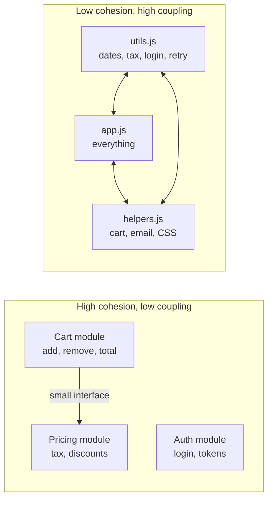
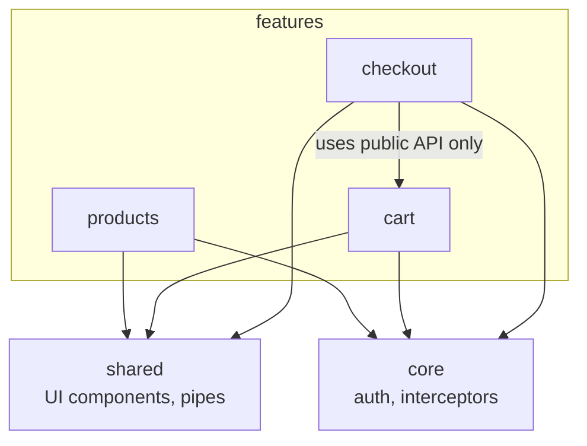
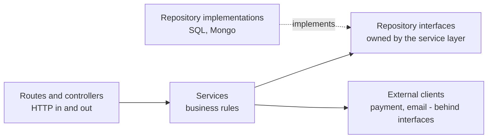

# Coupling, Cohesion and Design Principles

> In this document you will learn the two most important measures of good design, coupling and cohesion, plus the everyday principles engineers use in code reviews (DRY, KISS, YAGNI, Law of Demeter, separation of concerns, tell-don't-ask, least astonishment) and the common code smells with their refactors. Interviewers use these ideas to check whether you can judge code quality and explain your design choices.

**Before this:** [SOLID principles](./03-solid-principles.md) · [Composition, inheritance and mixins](./02-composition-inheritance-and-mixins.md) · **Interview questions:** [jump to questions](#interview-questions)

## Table of contents

1. [Why these ideas matter](#why-these-ideas-matter)
2. [Coupling](#coupling)
3. [Cohesion](#cohesion)
4. [High cohesion and low coupling in real modules](#high-cohesion-and-low-coupling-in-real-modules)
5. [Design principles](#design-principles)
6. [When principles conflict](#when-principles-conflict)
7. [Code smells and refactors](#code-smells-and-refactors)
8. [Common mistakes](#common-mistakes)
9. [Best practices](#best-practices)
10. [How to explain coupling and cohesion in an interview](#how-to-explain-coupling-and-cohesion-in-an-interview)
11. [Interview questions](#interview-questions)
12. [Summary](#summary)
13. [References](#references)

---

## Why these ideas matter

Most of the cost of software is not writing it the first time. It is **changing** it later: new features, bug fixes, new libraries, new team members. Good design makes change cheap. Bad design makes every change slow and risky.

Two simple questions tell you a lot about any piece of code:

1. **Coupling:** if I change this part, how many *other* parts must change too?
2. **Cohesion:** do the things inside this part *belong together*?

The goal you will hear in every design discussion is: **high cohesion, low coupling.**



The design principles later in this document (DRY, KISS, Law of Demeter...) are practical rules that help you reach that goal.

---

## Coupling

### What it is

**Coupling** is how much one module depends on another. A **module** here means any unit of code: a function, a class, a file, an Angular feature, a Node service.

- **Tight coupling:** module A knows a lot about module B (its internals, its concrete class, its data layout). When B changes, A breaks.
- **Loose coupling:** module A knows only a small, stable part of B (a short interface or a few data fields). B can change inside without affecting A.

### Why it matters

- **Change cost:** with tight coupling, one change spreads to many files.
- **Testing:** you cannot test A without a real B (a real database, a real HTTP server).
- **Reuse:** you cannot take A to another project without dragging B along.
- **Teamwork:** two teams cannot work in parallel if their code is tangled.

### Analogy

A lamp with a plug is loosely coupled to the wall: you can move it to any socket, or plug in a different lamp. A lamp **wired directly** into the wall is tightly coupled: to replace it, you need an electrician.

### Tight vs loose: an example

```js
// ❌ Tight coupling: OrderService knows the concrete database class,
// creates it itself, and reaches into its internal structure.
class MySqlDatabase {
  constructor() {
    this.connection = { tables: { orders: [] } }; // internal detail
  }
}

class OrderServiceTight {
  constructor() {
    this.db = new MySqlDatabase(); // hard-wired concrete class
  }
  placeOrder(order) {
    this.db.connection.tables.orders.push(order); // depends on internal layout
    return this.db.connection.tables.orders.length;
  }
}

console.log(new OrderServiceTight().placeOrder({ id: 1 })); // 1
```

If `MySqlDatabase` renames `connection`, changes its table layout, or is replaced by PostgreSQL, `OrderServiceTight` breaks. To test it, you need `MySqlDatabase`.

```js
// ✅ Loose coupling: OrderService knows only a tiny interface: save(order)
class OrderService {
  constructor(orderStore) {
    this.orderStore = orderStore; // any object with save(order) works
  }
  placeOrder(order) {
    if (!order.id) throw new Error("Order needs an id");
    return this.orderStore.save(order);
  }
}

const inMemoryStore = {
  orders: [],
  save(order) {
    this.orders.push(order);
    return this.orders.length;
  },
};

console.log(new OrderService(inMemoryStore).placeOrder({ id: 1 })); // 1
```

Now `OrderService` depends only on "something with `save(order)`". Any storage works.

### Kinds of coupling (from worst to best)

These names come from **structured design** (Larry Constantine and Edward Yourdon, 1970s). They are still useful words in reviews.

| Kind | What it means | JavaScript example |
| --- | --- | --- |
| **Content coupling** (worst) | A reaches into B's internals and changes them | `cart._items.length = 0` from outside the cart |
| **Common (global) coupling** | Modules share global mutable state | Several files read and write `window.currentUser` |
| **External coupling** | Modules share an external format, protocol or device | Two services both parse the same CSV layout by hand |
| **Control coupling** | A passes a flag that tells B *what to do* | `render(user, true, false)` where flags switch B's behavior |
| **Stamp coupling** | A passes a whole object when B needs only part of it | `sendWelcome(user)` when it only needs `user.email` |
| **Data coupling** | A passes only the simple data B needs | `sendWelcome(email)` |
| **Message coupling** (best) | Modules talk only through messages or events, with no direct calls | An `orderPlaced` event; listeners react |

Let us see the most common ones in code.

**Content coupling:**

```js
// ❌ Wrong: outside code changes the cart's internal array directly
const cart = { _items: [{ sku: "A1", qty: 2 }] };
cart._items.length = 0; // bypasses any rules the cart has

// ✅ Correct: ask the cart to do it
class Cart {
  #items = [{ sku: "A1", qty: 2 }];
  clear() { this.#items = []; }
  get count() { return this.#items.length; }
}
const safeCart = new Cart();
safeCart.clear();
console.log(safeCart.count); // 0
```

**Common (global) coupling:**

```js
// ❌ Wrong: any file can change this, and order of execution matters
globalThis.currentUser = { name: "Asha", role: "admin" };

function canDeleteOrders() {
  return globalThis.currentUser?.role === "admin"; // hidden dependency
}
console.log(canDeleteOrders()); // true

// ✅ Correct: pass what the function needs
function canDelete(user) {
  return user.role === "admin";
}
console.log(canDelete({ name: "Ravi", role: "viewer" })); // false
```

Global state is not only `window.something`. A module-level `let` variable that many functions change, or a shared mutable singleton service, is also common coupling.

**Control coupling:**

```js
// ❌ Wrong: the caller controls the inside of the function with flags
function formatUser(user, short, uppercase) {
  let text = short ? user.firstName : `${user.firstName} ${user.lastName}`;
  if (uppercase) text = text.toUpperCase();
  return text;
}
console.log(formatUser({ firstName: "Asha", lastName: "Rao" }, false, true)); // ASHA RAO
// What do 'false, true' mean? The reader must open the function.

// ✅ Correct: separate, well-named functions (or an options object)
const shortName = (user) => user.firstName;
const fullName = (user) => `${user.firstName} ${user.lastName}`;
console.log(fullName({ firstName: "Asha", lastName: "Rao" }).toUpperCase()); // ASHA RAO
```

**Stamp coupling vs data coupling:**

```js
// Stamp coupling: needs only email, but receives the whole user.
// Any change to the user object's shape can affect this function,
// and tests must build a full user.
function sendWelcomeStamp(user) {
  return `Welcome email sent to ${user.contact.email}`;
}

// Data coupling: receives exactly what it needs.
function sendWelcome(email) {
  return `Welcome email sent to ${email}`;
}

const user = { id: 1, name: "Asha", contact: { email: "asha@example.com" } };
console.log(sendWelcomeStamp(user));        // Welcome email sent to asha@example.com
console.log(sendWelcome(user.contact.email)); // Welcome email sent to asha@example.com
```

Stamp coupling is not always bad. If a function needs five fields of a user, passing the user object is clearer than five parameters. The rule of thumb: pass the smallest thing that keeps the code clear.

**Message coupling:**

```js
const { EventEmitter } = require("node:events");

const events = new EventEmitter();

// The order module does not know who listens.
function placeOrder(order) {
  // ...save order...
  events.emit("orderPlaced", { orderId: order.id, email: order.email });
}

// Other modules subscribe independently.
events.on("orderPlaced", (e) => console.log(`Email: confirmation to ${e.email}`));
events.on("orderPlaced", (e) => console.log(`Analytics: order ${e.orderId} recorded`));

placeOrder({ id: 42, email: "asha@example.com" });
// Email: confirmation to asha@example.com
// Analytics: order 42 recorded
```

This is the Observer pattern. How `EventEmitter` really behaves (listeners run synchronously, a throwing listener stops the rest, the special `'error'` event) is explained in [Behavioral patterns: Observer](./08-behavioral-patterns.md#observer-in-nodejs-eventemitter).

### Other forms of coupling you meet every day

- **Temporal coupling:** things must happen in a certain order, but the code does not enforce it. Example: you must call `client.init()` before `client.send()`, or it crashes. Fix: do the setup in the constructor or a factory, so an object is never in the "not ready" state.

```js
// ❌ Temporal coupling: works only if init() was called first
class ReportClient {
  init(apiKey) { this.apiKey = apiKey; }
  send(report) {
    return `Sending ${report} with key ${this.apiKey.slice(0, 3)}...`; // crashes if init() was skipped
  }
}

try {
  new ReportClient().send("sales.pdf");
} catch (error) {
  console.log(error.message); // Cannot read properties of undefined (reading 'slice')
}

// ✅ No temporal coupling: you cannot get a client without a key
class SafeReportClient {
  #apiKey;
  constructor(apiKey) {
    if (!apiKey) throw new Error("apiKey is required");
    this.#apiKey = apiKey;
  }
  send(report) {
    return `Sending ${report} with key ${this.#apiKey.slice(0, 3)}...`;
  }
}
console.log(new SafeReportClient("abc123").send("sales.pdf")); // Sending sales.pdf with key abc...
```

- **Coupling to a library or framework:** business logic that calls `axios`, `moment` or `localStorage` directly everywhere. Switching libraries means editing every file. Fix: wrap the library behind your own small module (an **adapter**).
- **Coupling through shared database tables:** two services read and write the same table. Neither can change the schema alone. This is a common problem in microservices.
- **Deployment coupling:** two parts must always be deployed together, because an API change in one breaks the other. Fix: version APIs and keep backward compatibility.

### How to reduce coupling

| Technique | How it reduces coupling | Where to read more |
| --- | --- | --- |
| Depend on interfaces, not concrete classes | Callers know only the contract | [SOLID: DIP](./03-solid-principles.md#d-dependency-inversion-principle) |
| Dependency injection | Callers do not create their dependencies | [Dependency inversion and injection](./05-dependency-inversion-and-injection.md) |
| Encapsulation (`#private`, small public API) | Nobody can depend on internals | [OOP: the four pillars](./01-oop-four-pillars.md#encapsulation) |
| Pass data, not big objects | Fewer fields to depend on | Data coupling, above |
| Events or messages | Sender does not know the receivers | [Behavioral patterns](./08-behavioral-patterns.md) |
| Facade or adapter over libraries | One place knows the library | [Structural patterns](./07-structural-patterns.md) |
| Module boundaries (public `index.ts`) | Other modules use only the public API | [Real modules section](#high-cohesion-and-low-coupling-in-real-modules) |

### Loose coupling is not zero coupling

Modules that work together must know *something* about each other. The goal is **the right amount** of coupling, on **stable** things.

Over-decoupling has its own costs:

- If everything talks through events, nobody can see the flow. "Who handles `orderPlaced`?" becomes a search across the whole codebase, and debugging gets hard.
- If everything is behind an interface, simple code becomes a maze of indirection.

Use direct calls for a clear, local flow. Use events when the sender truly should not know or care who reacts (analytics, notifications, plugins).

---

## Cohesion

### What it is

**Cohesion** is how strongly the things inside one module belong together. A module has **high cohesion** when all its parts work toward one clear purpose and change for the same reasons.

### Why it matters

- High cohesion makes code easy to **find** ("where is the tax code? In `tax/`").
- It makes code easy to **understand**: one file, one topic.
- It keeps changes **local**: a change to one feature touches one module.
- Cohesion and coupling are linked: when related code is spread across many modules (low cohesion), those modules must call each other a lot (high coupling).

### Analogy

A toolbox with drawers: one for screwdrivers, one for wrenches, one for tape. That is high cohesion. A "junk drawer" with batteries, keys, receipts and a spoon is low cohesion: you never know what is inside, and you always search.

### Kinds of cohesion (from worst to best)

Also from structured design. You do not need to memorize all of them, but the worst and the best are worth knowing.

| Kind | Parts are together because... | Example |
| --- | --- | --- |
| **Coincidental** (worst) | No real reason | `utils.js` with `formatDate`, `calculateTax`, `retryFetch`, `isAdmin` |
| **Logical** | They are the same *category* of thing, but do unrelated jobs | `validators.js` with validators for every feature in the app |
| **Temporal** | They run at the same *time* | `onAppStart()` that loads config, clears cache, starts analytics, checks updates |
| **Procedural** | They run in a certain *order* | Steps of a wizard in one big function |
| **Communicational** | They work on the same *data* | Functions that all read and update the same order record |
| **Sequential** | The output of one is the input of the next | parse → validate → transform pipeline |
| **Functional** (best) | They all contribute to *one well-defined task* | `PasswordHasher` with `hash()` and `verify()` |

### Low cohesion example and refactor

```js
// ❌ Low (coincidental) cohesion: helpers.js
export function formatDate(date) { /* ... */ }
export function calculateTax(amount, country) { /* ... */ }
export function isValidEmail(email) { /* ... */ }
export function retryFetch(url, times) { /* ... */ }
export function getCartTotal(items) { /* ... */ }
```

Problems:

- Every feature imports from `helpers.js`, so it becomes a hub that everything depends on.
- A change for the tax team and a change for the networking code touch the same file.
- Nobody knows what belongs there, so it grows forever.

```text
✅ High cohesion: group by purpose (feature or domain)

src/
  pricing/
    tax.js            calculateTax, TAX_RATES
    discounts.js
  cart/
    cart.js           getCartTotal, addItem, removeItem
  shared/
    http/retry-fetch.js
    validation/email.js
    formatting/date.js
```

Note that a small `shared/` folder is fine, as long as each file inside it has one clear purpose and does not know about any feature.

### A cohesive class

```ts
// ✅ Functional cohesion: everything here is about one task, money amounts
class Money {
  private constructor(readonly cents: number, readonly currency: "USD" | "EUR" | "INR") {}

  static of(amount: number, currency: "USD" | "EUR" | "INR"): Money {
    return new Money(Math.round(amount * 100), currency);
  }

  add(other: Money): Money {
    this.assertSameCurrency(other);
    return new Money(this.cents + other.cents, this.currency);
  }

  multiply(factor: number): Money {
    return new Money(Math.round(this.cents * factor), this.currency);
  }

  format(): string {
    return new Intl.NumberFormat("en-US", { style: "currency", currency: this.currency })
      .format(this.cents / 100);
  }

  private assertSameCurrency(other: Money): void {
    if (other.currency !== this.currency) {
      throw new Error(`Cannot mix ${this.currency} and ${other.currency}`);
    }
  }
}

const price = Money.of(19.99, "USD");
const total = price.multiply(3).add(Money.of(5, "USD"));
console.log(total.format()); // $64.97

try {
  total.add(Money.of(1, "EUR"));
} catch (error) {
  console.log((error as Error).message); // Cannot mix USD and EUR
}
```

Every method uses the same data (`cents`, `currency`) and serves the same purpose. That is a sign of high cohesion.

**A quick cohesion check for classes:** if you could split the fields into two groups, and some methods use only group A while others use only group B, the class probably has two responsibilities hiding inside it.

---

## High cohesion and low coupling in real modules

### Angular: feature-based structure

A common, healthy Angular 16 structure groups code **by feature** (high cohesion) and lets features talk to each other only through a small public API or shared services (low coupling).

```text
src/app/
  core/                      singletons used app-wide (auth, http interceptors, error handler)
    auth/auth.service.ts
    interceptors/auth.interceptor.ts
  shared/                    reusable, feature-agnostic UI and helpers
    ui/button/button.component.ts
    pipes/currency-short.pipe.ts
  features/
    products/                everything about products lives here
      product-list.component.ts
      product-detail.component.ts
      product.service.ts
      products.routes.ts     lazy-loaded routes
      index.ts               public API: what other features may import
    cart/
      cart.component.ts
      cart.service.ts
      cart.routes.ts
      index.ts
    checkout/
      ...
```

Rules that keep coupling low:

- **Features do not import each other's internals.** If `checkout` needs the cart total, it uses `CartService` from `cart/index.ts`, not a private helper file inside `cart/`.
- **`shared/` never imports from `features/`.** Shared code must not know about any feature.
- **Lazy-load features** with `loadChildren` (NgModule) or `loadComponent` (standalone). This also enforces boundaries, because a lazy feature cannot be accidentally imported everywhere.
- **Container and presentational components:** a **container** component talks to services and holds state; a **presentational** component only receives `@Input()` values and emits `@Output()` events. Presentational components are loosely coupled to the rest of the app and easy to reuse.



In Angular 16 you can build these features with NgModules or with standalone components (stable since v15). Both work with the same structure. Tools like Nx can enforce these boundaries with lint rules. Details are in [Enterprise architecture](../06-angular-16/13-enterprise-architecture.md).

### Node.js: layers and features

A typical Node.js backend separates **layers** (each with one concern) and points dependencies in one direction:



- Controllers know HTTP, but no SQL.
- Services know business rules, but no HTTP (`req`, `res`) and no SQL.
- Repositories know SQL, but no business rules.

**Package by layer vs package by feature:**

```text
Package by layer                    Package by feature
src/                                src/
  controllers/                        orders/
    orders.controller.js                orders.controller.js
    users.controller.js                 orders.service.js
  services/                             orders.repository.js
    orders.service.js                 users/
    users.service.js                    users.controller.js
  repositories/                         users.service.js
    orders.repository.js                users.repository.js
    users.repository.js
```

| | Package by layer | Package by feature |
| --- | --- | --- |
| Cohesion | Low at folder level: one feature is spread over 3 folders | High: one feature in one folder |
| Change to one feature | Touches 3 folders | Touches 1 folder |
| Good for | Small apps, learning | Medium and large apps, teams per feature |

Many teams combine them: features at the top level, layers inside each feature. More in [HTTP servers and Express](../07-nodejs-backend/06-http-servers-and-express.md).

### Electron

The main process and the renderer process are separate (high cohesion inside each), and they talk through a **narrow IPC contract** exposed by the preload script (low coupling). The renderer does not know how files are saved; it calls `window.api.saveDocument(content)`. See [IPC and preload scripts](../08-electron-desktop/03-ipc-and-preload-scripts.md).

---

## Design principles

These short principles appear constantly in code reviews and interviews. Each is simple to state. The skill is knowing **when it applies** and **when it does not**.

### DRY: Don't Repeat Yourself

**What it is:** from *The Pragmatic Programmer* (Andy Hunt and Dave Thomas, 1999): "Every piece of knowledge must have a single, unambiguous, authoritative representation within a system."

The key word is **knowledge**, not **text**. DRY is about not duplicating *decisions and rules*. It is not about removing every pair of lines that look similar.

```js
// ❌ Wrong: the same business rule (18% GST) lives in three places
function cartTotal(items) {
  return items.reduce((s, i) => s + i.price, 0) * 1.18;
}
function invoiceTotal(lines) {
  return lines.reduce((s, l) => s + l.amount, 0) * 1.18;
}
function showTaxNote() {
  return "Prices include 18% GST";
}
// When the rate changes to 12%, someone will forget one of them.
```

```js
// ✅ Correct: one authoritative place for the rule
const GST_RATE = 0.18;
const withGst = (amount) => amount * (1 + GST_RATE);

function cartTotal(items) {
  return withGst(items.reduce((s, i) => s + i.price, 0));
}
function invoiceTotal(lines) {
  return withGst(lines.reduce((s, l) => s + l.amount, 0));
}
function showTaxNote() {
  return `Prices include ${GST_RATE * 100}% GST`;
}

console.log(cartTotal([{ price: 100 }])); // 118
console.log(showTaxNote());               // Prices include 18% GST
```

**Coincidental duplication is not a DRY violation.** Two pieces of code can look the same today but represent *different* knowledge that will change for different reasons.

```js
// These look identical, but they are different rules owned by different teams.
const isValidUsername = (s) => s.length >= 3 && s.length <= 20; // product team rule
const isValidCouponCode = (s) => s.length >= 3 && s.length <= 20; // marketing rule

// If you merge them into one "isValidShortString", then when marketing
// changes coupon codes to 6-12 characters, you either break usernames
// or start adding flags. Keep them separate.
```

### The wrong abstraction

When you merge code that only *looks* similar, you create a **wrong abstraction**. Then each new caller needs a slightly different behavior, so people add parameters and `if` statements to the shared function, until it is a tangle that everyone depends on.

```js
// It started as a simple shared helper...
function formatName(user, options = {}) {
  let name = `${user.firstName} ${user.lastName}`;
  if (options.forInvoice) name = name.toUpperCase();
  if (options.lastNameFirst) name = `${user.lastName}, ${user.firstName}`;
  if (options.forEmail && !options.lastNameFirst) name = user.firstName;
  if (options.withTitle && user.title) name = `${user.title} ${name}`;
  if (options.maxLength) name = name.slice(0, options.maxLength);
  return name;
}

console.log(formatName({ firstName: "Asha", lastName: "Rao", title: "Dr." },
  { forInvoice: true, withTitle: true })); // Dr. ASHA RAO
// Every caller passes a different mix of flags. Changing one flag risks all callers.
```

Sandi Metz, a well-known Ruby author and teacher, made this lesson popular: duplication is far cheaper than the wrong abstraction. Her suggested fix is to **inline** the shared function back into each caller, delete the parts each caller does not need, and then look again for the *real* shared knowledge.

```js
// ✅ After inlining: each caller is simple and honest
const invoiceName = (u) => `${u.title ? u.title + " " : ""}${u.firstName} ${u.lastName}`.toUpperCase();
const emailGreetingName = (u) => u.firstName;
const directoryName = (u) => `${u.lastName}, ${u.firstName}`;

const user = { firstName: "Asha", lastName: "Rao", title: "Dr." };
console.log(invoiceName(user));       // DR. ASHA RAO
console.log(emailGreetingName(user)); // Asha
console.log(directoryName(user));     // Rao, Asha
```

**The rule of three:** a common rule of thumb is to wait until you see the same logic **three times** before you extract an abstraction. By the third time, you know what really varies.

### KISS: Keep It Simple

**What it is:** prefer the simplest solution that solves the problem. Simple code is easier to read, test, debug and change.

"Simple" does not mean "short" or "clever". A clear `for` loop is often simpler than a dense chain of `reduce` calls.

```js
// ❌ Clever but hard to read
const groupByStatus = (orders) =>
  orders.reduce((a, o) => ({ ...a, [o.status]: [...(a[o.status] || []), o.id] }), {});

// ✅ Simple and clear (and also faster: no object copy on every step)
function groupByStatusSimple(orders) {
  const groups = {};
  for (const order of orders) {
    groups[order.status] ??= [];
    groups[order.status].push(order.id);
  }
  return groups;
}

const orders = [
  { id: 1, status: "paid" },
  { id: 2, status: "pending" },
  { id: 3, status: "paid" },
];
console.log(groupByStatus(orders));       // { paid: [ 1, 3 ], pending: [ 2 ] }
console.log(groupByStatusSimple(orders)); // { paid: [ 1, 3 ], pending: [ 2 ] }
// ES2024 also has a built-in: Object.groupBy(orders, (o) => o.status)
```

KISS also applies to architecture: do not add a message queue, a microservice, or a state management library until the simple version clearly is not enough.

### YAGNI: You Aren't Gonna Need It

**What it is:** a principle from Extreme Programming (XP). **Do not build features or flexibility until you actually need them.**

Why: guessed future needs are often wrong. The code you write "for later" must still be read, tested and maintained now, and it often gets in the way of the change that really comes.

```ts
// ❌ YAGNI violation: the app only supports INR today, and no one asked for more
interface CurrencyConverter { convert(amount: number, from: string, to: string): Promise<number>; }
interface ExchangeRateProvider { getRate(from: string, to: string): Promise<number>; }
class MultiCurrencyPriceService {
  constructor(private converter: CurrencyConverter, private rates: ExchangeRateProvider) {}
  // ...200 lines that are never used with anything except INR
}

// ✅ Build what is needed now, in a way that is easy to change later
function formatPriceInr(amount: number): string {
  return new Intl.NumberFormat("en-IN", { style: "currency", currency: "INR" }).format(amount);
}
console.log(formatPriceInr(1499)); // ₹1,499.00
```

**KISS vs YAGNI:** KISS is about *how* you build something (simply). YAGNI is about *whether* you build it at all (not yet). They work together.

YAGNI does **not** mean "ignore quality". Tests, clear names, security and good structure are needed *now*. YAGNI is about speculative *features* and *flexibility*.

### Law of Demeter (principle of least knowledge)

**What it is:** a method should only talk to its **immediate friends**:

- its own object (`this`),
- objects passed in as parameters,
- objects it creates,
- its own fields.

It should **not** reach through one object to get another object and then call methods on *that* one. A common short form: **"use only one dot"** (it is a guideline, not a literal rule).

```js
// ❌ Violation: a "train wreck" of calls through other objects
function shippingLabel(order) {
  return order.getCustomer().getAddress().getCity().toUpperCase();
}
// shippingLabel now depends on Order, Customer, Address and City.
// If Customer stops having an Address (e.g. multiple addresses), this breaks.
```

```js
// ✅ Better: ask the nearest object for what you need
class Address {
  constructor(city) { this.city = city; }
}
class Customer {
  #address;
  constructor(address) { this.#address = address; }
  get shippingCity() { return this.#address.city; }
}
class Order {
  #customer;
  constructor(customer) { this.#customer = customer; }
  get shippingCity() { return this.#customer.shippingCity; }
}

function shippingLabel(order) {
  return order.shippingCity.toUpperCase(); // talks only to its parameter
}

console.log(shippingLabel(new Order(new Customer(new Address("Pune"))))); // PUNE
```

Another good fix is to pass the data the function needs: `shippingLabel(city)`.

**What is *not* a violation:**

- **Fluent APIs** that return the same kind of object: `items.filter(...).map(...).slice(0, 5)`, `query.where(...).orderBy(...)`, RxJS `pipe(...)`.
- **Plain data structures** (DTOs, JSON from an API): `response.data.user.name` reads data, it does not call behavior across objects. Still, deep reads in many places mean many places break when the shape changes.

The purpose of the law is to reduce coupling: a function should not depend on the *structure* of objects far away from it.

### Separation of concerns

**What it is:** split a program into parts where each part handles **one concern** (one area of responsibility). The term was coined by Edsger Dijkstra in 1974.

Classic examples:

- On the web: **HTML** for structure, **CSS** for presentation, **JavaScript** for behavior.
- In apps: **presentation** (UI), **business logic** (rules), **data access** (storage, APIs).
- In Angular: components for the view, services for logic and data, pipes for formatting, guards for route access, interceptors for HTTP concerns.

```ts
// ❌ Mixed concerns: UI text, business rule and data access in one function
async function renderDiscountBanner(userId: string, fetchUser: (id: string) => Promise<{ orders: number }>) {
  const user = await fetchUser(userId);                 // data access
  const eligible = user.orders >= 5;                    // business rule
  return eligible ? "<b>You get 10% off!</b>" : "";     // presentation
}

// ✅ Separated: each piece can change and be tested alone
const isLoyalCustomer = (orderCount: number) => orderCount >= 5;  // business rule
const discountBannerHtml = (eligible: boolean) =>                 // presentation
  eligible ? "<b>You get 10% off!</b>" : "";

async function discountBanner(userId: string, fetchUser: (id: string) => Promise<{ orders: number }>) {
  const user = await fetchUser(userId);                            // data access (coordinator)
  return discountBannerHtml(isLoyalCustomer(user.orders));
}

console.log(await discountBanner("u1", async () => ({ orders: 7 }))); // <b>You get 10% off!</b>
```

SRP (from SOLID) is separation of concerns applied to a single class or module.

### Tell, don't ask

**What it is:** instead of **asking** an object for its data and then making decisions for it, **tell** the object what you want, and let it decide using its own data.

```js
// ❌ Ask: the caller pulls data out and applies the object's rules itself
function withdrawAsk(account, amount) {
  if (account.balance >= amount && !account.frozen) {
    account.balance -= amount;
    return true;
  }
  return false;
}
// The rule "no withdrawals from frozen accounts" now lives outside the account,
// and it is probably copied into other places too.
```

```js
// ✅ Tell: the account protects its own rules
class Account {
  #balance;
  #frozen = false;
  constructor(balance) { this.#balance = balance; }

  freeze() { this.#frozen = true; }

  withdraw(amount) {
    if (this.#frozen) throw new Error("Account is frozen");
    if (amount > this.#balance) throw new Error("Insufficient funds");
    this.#balance -= amount;
    return this.#balance;
  }
}

const account = new Account(100);
console.log(account.withdraw(30)); // 70
account.freeze();
try {
  account.withdraw(10);
} catch (error) {
  console.log(error.message); // Account is frozen
}
```

Tell-don't-ask keeps behavior next to the data it uses (high cohesion) and hides the data (low coupling). It is closely related to encapsulation and to the **feature envy** code smell below.

It is a guideline, not a law. Reading data for **display** (a template showing `account.balance`) is normal. The smell is when outside code reads data to make decisions that belong to the object.

### Principle of least astonishment

**What it is:** code (a function, an API, a UI) should behave the way most readers **expect** it to, based on its name and on common conventions. Surprises cause bugs.

```js
// ❌ Astonishing: a "get" function that also creates and saves
const users = new Map();
function getUser(id) {
  if (!users.has(id)) users.set(id, { id, name: "New user" }); // side effect!
  return users.get(id);
}
getUser(7);
console.log(users.size); // 1  <- just "getting" a user created one

// ✅ Names say what happens
function findUser(id) { return users.get(id) ?? null; }
function getOrCreateUser(id) {
  if (!users.has(id)) users.set(id, { id, name: "New user" });
  return users.get(id);
}
```

JavaScript itself has a famous astonishing API: `Array.prototype.sort` **changes the original array** and, by default, compares values **as strings**.

```js
const prices = [10, 1, 5, 100];
const sorted = prices.sort();
console.log(sorted);            // [ 1, 10, 100, 5 ]  <- string order
console.log(prices === sorted); // true  <- the original array was changed

const nums = [10, 1, 5, 100];
console.log(nums.toSorted((a, b) => a - b), nums); // [ 1, 5, 10, 100 ] [ 10, 1, 5, 100 ]
// toSorted (ES2023) returns a new array and leaves the original alone.
```

Ways to follow the principle in your own code:

- **Names match behavior:** `get`/`find` do not change state; `is`/`has` return booleans; `save` writes; `create` makes something new.
- **Be consistent:** if `getUser` returns `null` when not found, `getOrder` should too (not throw).
- **Avoid hidden side effects** in getters, setters and "pure-looking" functions.
- **Follow platform conventions:** Angular's `ngOnInit` for setup, Node's `(error, result)` callback order, `async` functions always return promises.

---

## When principles conflict

Principles are not laws. They often pull in different directions. Good engineers can explain the trade-off.

| Conflict | Example | How to decide |
| --- | --- | --- |
| **DRY vs low coupling** | Two microservices share a "common" library with business rules. Now they must be deployed together. | Across service or team boundaries, some duplication is often better than coupling. Share only stable, generic code (logging, HTTP helpers). |
| **DRY vs KISS** | A generic "form builder" removes duplication across 3 forms, but is very hard to understand. | If the abstraction is harder to understand than the duplication, keep the duplication (rule of three). |
| **OCP vs YAGNI** | Should you build a plugin system for exporters now? | Only if new exporters are actually expected. Otherwise build one exporter simply and refactor when the second one arrives. |
| **Law of Demeter vs simplicity** | Adding forwarding methods (`order.customerCity`, `order.customerZip`...) for every nested field. | For behavior, follow Demeter. For plain data (DTOs), reading nested fields is fine. |
| **Separation of concerns vs locality** | Splitting one small feature across many layers and files. | For small features, fewer files can be clearer. Split when a concern grows or changes independently. |

---

## Code smells and refactors

A **code smell** is a sign in the code that *might* point to a deeper design problem. The term was made popular by Kent Beck and Martin Fowler in the book *Refactoring* (1999, second edition 2018, with JavaScript examples). A smell is a hint, not a proof. **Refactoring** means changing the structure of code without changing what it does. Always have tests before you refactor.

### 1. Long method

**Smell:** a function that is long and does many steps, often with comments like `// step 1`, `// step 2`.

**Why it hurts:** hard to understand, hard to test, hard to reuse parts.

**Refactor:** **Extract Function.** Each step becomes a well-named function. The original function reads like a short story.

```js
// ❌ Before: one long function with several concerns
function processSignup(form) {
  // validate
  if (!form.email || !form.email.includes("@")) throw new Error("Invalid email");
  if (!form.password || form.password.length < 8) throw new Error("Password too short");
  // normalize
  const email = form.email.trim().toLowerCase();
  const name = form.name ? form.name.trim() : email.split("@")[0];
  // build the record
  const user = { email, name, createdAt: new Date(0).toISOString(), role: "member" };
  // welcome message
  const message = `Welcome, ${name}! Your account ${email} is ready.`;
  return { user, message };
}
```

```js
// ✅ After: small functions with clear names
function validateSignup({ email, password }) {
  if (!email || !email.includes("@")) throw new Error("Invalid email");
  if (!password || password.length < 8) throw new Error("Password too short");
}

function normalizeSignup({ email, name }) {
  const cleanEmail = email.trim().toLowerCase();
  return { email: cleanEmail, name: name?.trim() || cleanEmail.split("@")[0] };
}

function buildUser({ email, name }) {
  return { email, name, createdAt: new Date(0).toISOString(), role: "member" };
}

const welcomeMessage = (user) => `Welcome, ${user.name}! Your account ${user.email} is ready.`;

function processSignup(form) {
  validateSignup(form);
  const user = buildUser(normalizeSignup(form));
  return { user, message: welcomeMessage(user) };
}

console.log(processSignup({ email: " Asha@Example.com ", password: "s3cret-pass" }).message);
// Welcome, asha! Your account asha@example.com is ready.
```

### 2. God class

**Smell:** one class that knows and does too much: `AppService`, `Utils`, `Manager`, `DashboardComponent` with 2,000 lines, 30 injected services and 80 methods.

**Why it hurts:** every change touches it, many developers edit it at once (merge conflicts), it is impossible to test properly, and it couples everything to everything.

**Refactor:** **Extract Class** by responsibility (see SRP in [SOLID principles](./03-solid-principles.md#s-single-responsibility-principle)). Look for groups of fields and methods that are used together; each group becomes its own class. Keep a small coordinator if needed.

```ts
// ❌ Before: a god service (shortened)
class AppService {
  login(email: string, password: string) { /* ... */ }
  logout() { /* ... */ }
  getProducts() { /* ... */ }
  addToCart(productId: string) { /* ... */ }
  checkout() { /* ... */ }
  trackEvent(name: string) { /* ... */ }
  formatPrice(cents: number) { /* ... */ }
  // ...and 60 more methods
}

// ✅ After: cohesive services, each with one reason to change
class AuthService { login(email: string, password: string) { /* ... */ } logout() { /* ... */ } }
class ProductService { getProducts() { /* ... */ } }
class CartService { addToCart(productId: string) { /* ... */ } checkout() { /* ... */ } }
class AnalyticsService { trackEvent(name: string) { /* ... */ } }
const formatPrice = (cents: number) => `$${(cents / 100).toFixed(2)}`; // a pure function is enough
console.log(formatPrice(1999)); // $19.99
```

### 3. Feature envy

**Smell:** a method that uses another object's data much more than its own. It "envies" the other class.

**Refactor:** **Move Function** to the class whose data it uses. (This is tell-don't-ask in action.)

```js
// ❌ Before: InvoicePrinter does Order's math using Order's data
class InvoicePrinter {
  print(order) {
    const subtotal = order.lines.reduce((s, l) => s + l.price * l.qty, 0);
    const discount = order.customer.isVip ? subtotal * 0.1 : 0;
    return `Total: ${subtotal - discount}`;
  }
}
```

```js
// ✅ After: the calculation lives with the data it uses
class Order {
  constructor(lines, customer) {
    this.lines = lines;
    this.customer = customer;
  }
  get subtotal() {
    return this.lines.reduce((s, l) => s + l.price * l.qty, 0);
  }
  get total() {
    const discount = this.customer.isVip ? this.subtotal * 0.1 : 0;
    return this.subtotal - discount;
  }
}

class InvoicePrinter {
  print(order) {
    return `Total: ${order.total}`; // only printing, its real job
  }
}

const order = new Order([{ price: 50, qty: 2 }], { isVip: true });
console.log(new InvoicePrinter().print(order)); // Total: 90
```

### 4. Shotgun surgery

**Smell:** one logical change forces you to make many small edits across many files. Like a shotgun blast: one shot, many holes.

**Example:** adding a new user role means editing the login check, the menu, three route guards, two API handlers and the admin page, because the role logic is scattered.

**Refactor:** **Move related code together.** Put the knowledge in one place (one module, one class, one configuration object), so the next change touches one file.

```js
// ✅ After: all permission knowledge in one place
const PERMISSIONS = {
  admin: ["orders:read", "orders:delete", "users:manage"],
  manager: ["orders:read", "orders:delete"],
  viewer: ["orders:read"],
  // adding "support" = one new line here
};

function can(user, permission) {
  return PERMISSIONS[user.role]?.includes(permission) ?? false;
}

console.log(can({ role: "manager" }, "orders:delete")); // true
console.log(can({ role: "viewer" }, "orders:delete"));  // false
// Menus, guards and API handlers all call can(user, "...") instead of checking roles themselves.
```

**Divergent change** is the opposite smell: one *module* changes for many *different* reasons (the module is edited for tax changes, for email changes and for database changes). Shotgun surgery means one change touches many modules; divergent change means one module is touched by many kinds of change. Divergent change is an SRP problem; shotgun surgery is a cohesion problem.

### 5. Primitive obsession

**Smell:** using basic types (`string`, `number`, `boolean`) for domain ideas that have rules: email addresses, money, user IDs, dates, phone numbers, percentages.

**Why it hurts:** validation is copied everywhere (or forgotten), and values get mixed up. Is `amount` in rupees or paise? Is this `string` a user ID or an order ID?

**Refactor:** introduce a **value object** (a small class or type that holds the value and its rules), or in TypeScript a **branded type**.

```ts
// ❌ Before: easy to swap arguments by mistake, and no validation
function transferBad(fromUserId: string, toUserId: string, amount: number) {
  return `${amount} from ${fromUserId} to ${toUserId}`;
}
const orderId = "ord_99";
transferBad(orderId, "usr_2", 500); // compiles, but an order id is not a user id!

// ✅ After: branded types + a validated constructor function
type UserId = string & { readonly __brand: "UserId" };
type Paise = number & { readonly __brand: "Paise" };

function userId(value: string): UserId {
  if (!value.startsWith("usr_")) throw new Error(`Not a user id: ${value}`);
  return value as UserId;
}

function paise(value: number): Paise {
  if (!Number.isInteger(value) || value <= 0) throw new Error(`Invalid amount: ${value}`);
  return value as Paise;
}

function transfer(from: UserId, to: UserId, amount: Paise): string {
  return `${amount} paise from ${from} to ${to}`;
}

console.log(transfer(userId("usr_1"), userId("usr_2"), paise(50_000)));
// 50000 paise from usr_1 to usr_2
// transfer(orderId, userId("usr_2"), paise(500)); // Compile error: string is not UserId
```

The `Money` class in the [Cohesion](#a-cohesive-class) section is another value object example.

### 6. Long parameter list

**Smell:** a function with many parameters, especially several of the same type: `createUser(name, email, phone, role, isActive, sendEmail, locale)`.

**Why it hurts:** callers mix up the order, booleans are unreadable at the call site, and adding a parameter changes every caller.

**Refactor:** **Introduce Parameter Object** (an options object). In JavaScript, destructuring with defaults makes this clean. For complex objects, a builder can help (see [Creational patterns](./06-creational-patterns.md)).

```js
// ❌ Before: what do 'true, false' mean?
function createUserBad(name, email, phone, role, isActive, sendWelcome, locale) {
  return { name, email, phone, role, isActive, sendWelcome, locale };
}
createUserBad("Asha", "asha@example.com", null, "admin", true, false, "en-IN");

// ✅ After: one options object, named fields, defaults in one place
function createUser({ name, email, phone = null, role = "member", isActive = true, sendWelcome = true, locale = "en-US" }) {
  if (!name || !email) throw new Error("name and email are required");
  return { name, email, phone, role, isActive, sendWelcome, locale };
}

const admin = createUser({ name: "Asha", email: "asha@example.com", role: "admin", sendWelcome: false, locale: "en-IN" });
console.log(admin.role, admin.sendWelcome, admin.isActive); // admin false true
```

A related smell is **data clumps**: the same group of values always travels together (`street, city, zip`; `startDate, endDate`). Make them one object (`Address`, `DateRange`).

### Other smells worth knowing

| Smell | What it looks like | Usual refactor |
| --- | --- | --- |
| Duplicated code | Same logic (knowledge) in several places | Extract function or module |
| Message chains | `a.getB().getC().getD()` | Hide the chain behind a method (Law of Demeter) |
| Middle man | A class whose methods only forward to another class | Remove it and call the real class |
| Speculative generality | Hooks, parameters and abstract classes "for the future" | Inline and delete (YAGNI) |
| Switch statements on type | The same `switch (type)` in many places | Polymorphism or a lookup map (OCP) |
| Magic numbers | `if (status === 3)`, `price * 1.18` | Named constants or enums |
| Comments that explain confusing code | `// this adds tax and also resets the cart` | Rename and extract so the code explains itself |
| Dead code | Unused functions, flags and branches | Delete it (version control remembers) |
| Temporary field | A field that is set only in some situations | Extract a class or pass it as a parameter |

### How to refactor safely

1. **Make sure tests cover the behavior** you are about to change. If there are none, write a few "characterization tests" that capture what the code does now.
2. **Take small steps:** one refactoring at a time (rename, then extract, then move). Run tests after each step.
3. **Do not mix refactoring and new features** in one commit. Reviewers can then check that behavior did not change.
4. **Use your editor's automatic refactorings** (rename symbol, extract function, move to file). They are safer than manual edits.

---

## Common mistakes

1. **Treating DRY as "no similar lines".** Merging coincidentally similar code creates the wrong abstraction.
2. **A giant `utils` or `helpers` file.** Coincidental cohesion that everyone depends on.
3. **Shared global state** (module-level variables, mutable singletons) used as a shortcut to pass data around.
4. **Boolean flag parameters** that change what a function does (control coupling).
5. **Over-decoupling** with events everywhere, so nobody can follow the flow.
6. **"Train wreck" chains** through domain objects (`order.getCustomer().getAddress()...`).
7. **Building for imagined requirements** (YAGNI violations) while ignoring real quality needs.
8. **Refactoring without tests**, or mixing big refactors with feature changes.
9. **Applying principles as rules** without being able to say what problem they solve in *this* code.

---

## Best practices

- **Group code by feature or domain**, not by technical type only. Reason: high cohesion keeps changes local.
- **Expose a small public API per module** (an `index.ts`, a facade service). Reason: other modules cannot couple to internals.
- **Pass the data a function needs**, not the whole world. Reason: data coupling is the easiest to change and test.
- **Keep business rules in one authoritative place** (constants, policy objects, value objects). Reason: DRY applied to knowledge.
- **Wait for the third repetition** before extracting a shared abstraction. Reason: you will know what truly varies.
- **Tell objects what to do** instead of pulling their data out to make decisions. Reason: behavior stays with data.
- **Name functions so they cannot surprise**: `find` does not create, `get` does not save. Reason: least astonishment prevents bugs.
- **Use value objects or branded types** for domain values with rules. Reason: validation in one place, and no mixed-up IDs.
- **Enforce boundaries with tooling** where possible (lint rules for import boundaries, `import/no-cycle`, Nx module boundaries, dependency graphs). Reason: architecture rules that are not checked slowly erode.

---

## How to explain coupling and cohesion in an interview

1. **Define it:** "Coupling is how much one module depends on others. Cohesion is how well the things inside one module belong together. We aim for high cohesion and low coupling."
2. **Why it exists:** "Both are about the cost of change. With low coupling, a change in one module doesn't ripple into others. With high cohesion, a change to one feature stays inside one module."
3. **How it works:** "I reduce coupling by depending on small interfaces, injecting dependencies, passing only the data a function needs, hiding internals, and using events when the sender shouldn't know the receivers. I raise cohesion by grouping code by feature or purpose instead of dumping it into utils files."
4. **Small example:** "An `OrderService` that creates a MySQL client and reaches into its internals is tightly coupled. If it only depends on an `orderStore.save(order)` interface, I can swap the database or use an in-memory store in tests. And instead of a `helpers.js` with tax, dates and HTTP retry, I'd have a `pricing` module, a `dates` module and an `http` module."
5. **Where it is useful:** "In Angular I structure apps by feature folders with a public API, keep `shared` free of feature code, and use container and presentational components. In Node I separate controllers, services and repositories."
6. **Trade-offs / gotchas:** "Zero coupling isn't the goal; modules have to work together. Too much decoupling, like events everywhere or interfaces for everything, makes code hard to follow. And DRY can increase coupling: sharing code between two services means they now change together."

---

## Interview questions

### Q1. What are coupling and cohesion, and why do we want "high cohesion, low coupling"?

**What the interviewer is checking:** Clear definitions, the link to the cost of change, and a concrete example.

**Short spoken answer (30–60 seconds):**
> Coupling is how much one module depends on other modules. Cohesion is how strongly the things inside one module belong together. We want low coupling so that a change in one module doesn't ripple into others, and high cohesion so that a change to one feature stays inside one module. For example, a `helpers.js` file with tax rules, date formatting and HTTP retries has low cohesion, and since every feature imports it, it also creates high coupling. If I split it into a pricing module, a dates module and an HTTP module, each one is focused, and features only depend on what they actually use. The two ideas are connected: when related code is scattered, the scattered pieces have to call each other a lot.

**Detailed explanation:** See [Coupling](#coupling) and [Cohesion](#cohesion).

**Follow-up questions:**
- **How do you notice high coupling in a codebase?** — Small changes require edits in many files, tests need many real dependencies, circular imports appear, and one module is imported by almost everything.
- **How do you notice low cohesion?** — Generic names (`utils`, `manager`, `common`), files that appear in pull requests for unrelated features, classes whose fields split into groups used by different methods.
- **Which matters more?** — They go together. In practice, improving cohesion (moving related code together) usually reduces coupling automatically.

**Common mistakes:** Mixing up the two words. Saying "coupling should be zero".

**Where this is used in real projects:** Folder structure decisions, module boundaries in Angular and Nx workspaces, service boundaries in backends and microservices.

### Q2. What kinds of coupling exist? Which are the worst?

**What the interviewer is checking:** Vocabulary and the ability to recognize each kind in real code.

**Short spoken answer (30–60 seconds):**
> From worst to best: content coupling, where one module changes another's internals directly, like writing to a private array from outside. Common or global coupling, where modules share mutable global state. External coupling, where they share an external format or protocol. Control coupling, where you pass flags that tell another function what to do. Stamp coupling, where you pass a whole object when only one field is needed. Data coupling, where you pass only the simple data needed. And message coupling, where modules only exchange events. In everyday code, the ones I watch for most are global state, boolean flags, and reaching into internals. I also watch for temporal coupling, where methods must be called in a certain order that the code doesn't enforce.

**Follow-up questions:**
- **Is stamp coupling always bad?** — No. If a function needs several fields of an object, passing the object is clearer than many parameters. Pass the smallest thing that keeps the code readable.
- **How do you fix temporal coupling?** — Make invalid states impossible: do the setup in a constructor or a factory, so you can't get an object that is "not initialized yet".

**Common mistakes:** Not being able to give a code example for any of them.

### Q3. Is loose coupling always good? Can you decouple too much?

**What the interviewer is checking:** Senior judgment about trade-offs.

**Short spoken answer (30–60 seconds):**
> Loose coupling is good, but zero coupling isn't possible or useful; modules have to work together. Too much decoupling has costs. If everything communicates through events, nobody can see the flow, and debugging means searching for every listener of an event. If every class hides behind an interface with one implementation, you get indirection without benefit. I use direct calls for clear, local flows and add interfaces at real boundaries like the database, external APIs and the clock. I use events when the sender really shouldn't know who reacts, like analytics or notifications after an order is placed.

**Follow-up questions:**
- **How does this apply to microservices?** — Splitting into services reduces code coupling but adds network coupling, data consistency problems and operational cost. Services that must always change and deploy together are a "distributed monolith": high coupling with extra problems.

### Q4. What does DRY really mean? When is duplication acceptable?

**What the interviewer is checking:** The difference between duplicated knowledge and coincidental similarity.

**Short spoken answer (30–60 seconds):**
> DRY comes from *The Pragmatic Programmer*, and it's about knowledge: every business rule or decision should have one authoritative place. For example, a tax rate shouldn't be hard-coded in the cart, the invoice and the help text, because someone will forget one when it changes. But DRY isn't about removing every pair of similar lines. Two validations that look identical today, like username length and coupon code length, belong to different teams and will change for different reasons. If I merge them, I create a wrong abstraction that grows flags. So I remove duplicated knowledge right away, and for similar-looking code I usually wait until I see it three times and understand what really varies.

**Follow-up questions:**
- **Is duplication between microservices OK?** — Often yes. Sharing a library of business logic couples their release cycles. Teams usually share only stable, generic code (logging, HTTP clients, types for public contracts).
- **How do tests relate to DRY?** — Some repetition in tests is fine and often clearer. Each test should be readable on its own; heavy helper abstractions in tests can hide what is being tested.

**Common mistakes:** "DRY means never copy-paste." Extracting a shared function after seeing similar code twice without asking whether it is the same knowledge.

### Q5. What is "the wrong abstraction"? How do you get out of one?

**What the interviewer is checking:** Real-world refactoring experience.

**Short spoken answer (30–60 seconds):**
> It's what happens when code that only looked similar gets merged into one shared function or class. Each new caller needs slightly different behavior, so people add parameters and `if` branches, until the shared code is a tangle of flags and every caller is afraid to touch it. Sandi Metz made the point that duplication is much cheaper than the wrong abstraction. The way out is to inline the shared code back into each caller, remove the branches each caller doesn't need, and then look again. Usually each caller becomes short and obvious, and if there's real shared knowledge, it's now easy to see and extract correctly.

**Code:** see the `formatName` example in [The wrong abstraction](#the-wrong-abstraction).

**Follow-up questions:**
- **How do you spot it early?** — A shared function with boolean or "mode" parameters, branches that only one caller uses, and pull requests where changing it for one feature breaks another.

### Q6. What is the difference between KISS and YAGNI?

**Short answer:** **KISS** is about *how* you build: choose the simplest design and code that solve the problem (a clear loop over a clever one-liner, a function before a framework). **YAGNI** is about *whether* you build: do not add features, options or extension points until there is a real need. You can violate one without the other: a simple implementation of a feature nobody needs breaks YAGNI but not KISS; an over-complicated implementation of a needed feature breaks KISS but not YAGNI. Neither principle is an excuse to skip tests, security or clear structure.

### Q7. Code review: what principle does this break, and how would you fix it?

```js
function canShipToday(order) {
  return order.getWarehouse().getInventory().getStock(order.getProductId()) > 0
    && order.getCustomer().getAddress().getCountry().isDomestic();
}
```

**What the interviewer is checking:** The Law of Demeter and why it matters (coupling to distant structure).

**Short spoken answer (30–60 seconds):**
> This breaks the Law of Demeter. The function talks to the order's warehouse's inventory, and to the customer's address's country. So it depends on the structure of five or six classes it shouldn't know about. If the inventory model changes, for example stock is split by location, or a customer can have several addresses, this function breaks. I'd ask the nearest objects for what I need: the warehouse can answer `hasStock(productId)`, and the order can expose `isDomesticShipment`. Then `canShipToday` only talks to the order, or gets the two facts passed in.

**Code:**

```js
class Order {
  constructor(productId, warehouse, shippingCountry) {
    this.productId = productId;
    this.warehouse = warehouse;
    this.shippingCountry = shippingCountry;
  }
  get inStock() {
    return this.warehouse.hasStock(this.productId);
  }
  get isDomesticShipment() {
    return this.shippingCountry === "IN";
  }
}

function canShipToday(order) {
  return order.inStock && order.isDomesticShipment;
}

const warehouse = { stock: new Map([["p1", 3]]), hasStock(id) { return (this.stock.get(id) ?? 0) > 0; } };
console.log(canShipToday(new Order("p1", warehouse, "IN"))); // true
console.log(canShipToday(new Order("p2", warehouse, "IN"))); // false
```

**Follow-up questions:**
- **Is `items.filter(...).map(...)` a Demeter violation?** — No. Each call returns the same kind of object (an array), so you are not walking through other objects' structure. Fluent APIs and builders are fine.
- **What about reading `response.data.user.name` from an API?** — Reading plain data is not the main target of the law, but if many places read the same deep path, map the response once into your own model.

**Common mistakes:** Counting dots mechanically instead of explaining the coupling problem.

### Q8. Refactor this using "tell, don't ask".

```js
function applyLateFee(invoice, today) {
  if (!invoice.paid && today > invoice.dueDate && !invoice.lateFeeApplied) {
    invoice.total += invoice.total * 0.05;
    invoice.lateFeeApplied = true;
  }
}
```

**What the interviewer is checking:** Moving behavior next to the data and protecting invariants.

**Short spoken answer (30–60 seconds):**
> The function asks the invoice for four pieces of data and then makes a decision that belongs to the invoice. The rules, "only unpaid, only overdue, only once", live outside the invoice, so other code can change `total` directly or apply the fee twice. I'd move the behavior into the invoice: `invoice.applyLateFeeIfOverdue(today)`. The invoice keeps its fields private and enforces the rules itself.

**Code:**

```js
class Invoice {
  #total;
  #dueDate;
  #paid = false;
  #lateFeeApplied = false;

  constructor(total, dueDate) {
    this.#total = total;
    this.#dueDate = dueDate;
  }

  markPaid() { this.#paid = true; }

  applyLateFeeIfOverdue(today) {
    if (this.#paid || this.#lateFeeApplied || today <= this.#dueDate) return false;
    this.#total = Math.round(this.#total * 1.05 * 100) / 100;
    this.#lateFeeApplied = true;
    return true;
  }

  get total() { return this.#total; }
}

const invoice = new Invoice(200, new Date("2025-01-31"));
console.log(invoice.applyLateFeeIfOverdue(new Date("2025-02-05"))); // true
console.log(invoice.applyLateFeeIfOverdue(new Date("2025-02-06"))); // false (only once)
console.log(invoice.total); // 210
```

**Follow-up questions:**
- **Which code smell does the original show?** — Feature envy: `applyLateFee` uses the invoice's data more than its own.
- **Isn't reading `invoice.total` "asking"?** — Reading for display or reporting is fine. The smell is reading data to make decisions the object should make.

### Q9. What does this print? Which design principle does this API break?

```js
const prices = [10, 1, 5, 100];
const sorted = prices.sort();
console.log(sorted);
console.log(prices === sorted);
```

**Answer (output):**

```text
[ 1, 10, 100, 5 ]
true
```

**Explanation:**
1. Without a compare function, `sort` converts values to strings and compares them as text. `"1" < "10" < "100" < "5"`, so the order is `[1, 10, 100, 5]`.
2. `sort` sorts **in place** and returns the same array. So `sorted` and `prices` are the same object, and the original order is lost.

This breaks the **principle of least astonishment**: many people expect numeric sorting and a new array. The fix: `prices.toSorted((a, b) => a - b)` (ES2023) returns a new, numerically sorted array, or use `[...prices].sort((a, b) => a - b)`.

**Follow-up questions:**
- **How do you apply this principle in your own APIs?** — Make names match behavior (`find` does not create, `get` does not save), be consistent (return `null` for "not found" everywhere or throw everywhere), and avoid hidden side effects in getters and setters.

### Q10. Find the code smells in this function.

```js
function handle(u, t, f1, f2, f3) {
  // 1 = admin, 2 = editor, 3 = viewer
  if (t === 1) {
    if (f1) sendEmail(u.profile.contact.email, "Admin report");
    if (f2) db.query("DELETE FROM sessions WHERE user_id = " + u.id);
  } else if (t === 2) {
    if (f3) sendEmail(u.profile.contact.email, "Editor digest");
  }
  globalThis.lastHandledUser = u;
}
```

**What the interviewer is checking:** Recognizing several smells quickly and naming fixes, including a security issue.

**Short spoken answer (30–60 seconds):**
> There are several smells. The names `handle`, `u`, `t` and `f1` to `f3` say nothing. Role numbers are magic numbers explained by a comment. The boolean flags are control coupling and a long parameter list. The function reaches deep into `u.profile.contact.email`, which is a message chain. The role `if/else` is probably repeated elsewhere, a shotgun surgery risk. It writes to a global, which is common coupling and a hidden side effect. And the SQL is built with string concatenation, which is a SQL injection risk. I'd use named role constants or a role-to-actions map, pass an options object or split into separate well-named functions, pass the email directly, use a parameterized query in a repository, and remove the global.

**Follow-up questions:**
- **Which would you fix first?** — The SQL injection, because it is a security bug, not just a smell. Then I would add tests and refactor the rest in small steps.

### Q11. What is primitive obsession, and how do you fix it in TypeScript?

**What the interviewer is checking:** Practical use of value objects and branded types.

**Short spoken answer (30–60 seconds):**
> Primitive obsession means using plain strings and numbers for domain concepts that have rules, like emails, money, or IDs. The problems are copied validation and mixed-up values: a function takes two string IDs and you pass an order ID where a user ID was expected, or you pass rupees where paise were expected. In TypeScript I fix it with value objects, small classes like `Money` or `Email` that validate in their constructor, or with branded types, like `type UserId = string & { __brand: 'UserId' }`, created only through a validating function. Then the compiler stops you from mixing them up, and the validation lives in one place.

**Code:** see the `UserId` and `Paise` example in [Primitive obsession](#5-primitive-obsession).

**Follow-up questions:**
- **Do branded types exist at runtime?** — No. The brand is a compile-time trick; at runtime it is a plain string or number. The runtime safety comes from the validating function that creates it.
- **Value object or branded type?** — A value object when the concept has behavior (money arithmetic, formatting). A branded type when you only need to prevent mix-ups (IDs).

### Q12. What is the difference between shotgun surgery and divergent change?

**Short answer:** **Shotgun surgery:** one kind of change forces small edits in *many* modules (adding a user role touches guards, menus, API handlers). The fix is to move the related knowledge into one place. **Divergent change:** *one* module is edited for many *different* kinds of change (a service that changes for tax rules, email templates and database migrations). The fix is to split the module by responsibility (SRP). One is "a change spread over many places", the other is "a place hit by many changes".

### Q13. How would you structure a large Angular 16 application for high cohesion and low coupling?

**What the interviewer is checking:** Architecture thinking in the main framework of the role.

**Short spoken answer (30–60 seconds):**
> I'd organize by feature: each feature folder, like products, cart and checkout, contains its components, services and routes, and is lazy-loaded. Each feature exposes a small public API, so other features only import what's meant to be shared. Next to the features I'd have a `core` area for app-wide singletons like auth and interceptors, and a `shared` area for generic UI components and pipes that never import from features. Inside features I use container components that talk to services and presentational components that only use inputs and outputs. In a big repo I'd enforce the import rules with lint rules, for example Nx module boundaries, so the structure doesn't erode over time.

**Follow-up questions:**
- **NgModules or standalone components in Angular 16?** — Both work. Standalone components are stable since v15 and make dependencies explicit per component; many Angular 16 codebases still use NgModules. The feature structure is the same. See [Enterprise architecture](../06-angular-16/13-enterprise-architecture.md).
- **How do two features share state?** — Through a service in a shared or data-access layer (or a store like NgRx), not by importing each other's components or internal services.

### Q14. Package by layer or package by feature for a Node.js backend?

**What the interviewer is checking:** Trade-offs in backend structure.

**Short spoken answer (30–60 seconds):**
> Package by layer means folders like `controllers`, `services` and `repositories`. It's easy to understand at first, but one feature is spread across three folders, so cohesion at the folder level is low, and a change to orders touches all three. Package by feature means an `orders` folder with its controller, service and repository together. Changes stay in one place, and it's easier to give a team ownership of a feature or later split it into its own service. For small apps either works. For medium and large apps I prefer features at the top level, with the layers inside each feature, and a rule that dependencies go controller to service to repository, never backwards.

### Q15. What is temporal coupling? Find and fix it.

```js
const exporter = new CsvExporter();
exporter.setColumns(["id", "total"]);
exporter.setDelimiter(";");
exporter.open("orders.csv");
exporter.write(rows); // crashes if open() or setColumns() was forgotten
```

**What the interviewer is checking:** Recognizing order dependencies that the code does not enforce.

**Short answer:** Temporal coupling means calls must happen in a specific order, but nothing in the API forces that order. Forgetting `open()` or `setColumns()` leads to a runtime crash or wrong output. Fix it by making the object valid from the start: pass required configuration to the constructor or a factory (`new CsvExporter({ columns, delimiter })`), and combine steps that must happen together (`exporter.writeFile("orders.csv", rows)`). Another option is a builder whose final `build()` validates everything. Objects that cannot exist in an invalid state cannot be used in the wrong order.

### Q16. Scenario: adding one field to the order model forces changes in 12 files. What do you do?

**What the interviewer is checking:** Diagnosing coupling and planning a pragmatic refactor.

**Short spoken answer (30–60 seconds):**
> That's shotgun surgery, which means the knowledge about orders is scattered and many places depend on the order's exact shape. First I'd look at why each file changed. Often it's things like mapping the API response in several components, building the same order object in several places, or validating fields in several layers. I'd centralize that: one mapping function from the API DTO to an `Order` model, one factory or validation schema, and components that receive only the fields they display. I'd also check for stamp coupling, where functions receive the whole order but use one field. I'd do this step by step with tests, and next time the change should touch two or three files.

**Follow-up questions:**
- **How do you prevent it coming back?** — Code review attention to where models are mapped and validated, a single source of truth for types (for example generated from an OpenAPI schema), and lint rules for module boundaries.

### Q17. How can you measure or visualize coupling in a JavaScript codebase?

**Short answer:** Look at the import graph. Tools like `madge` draw module dependency graphs and find circular imports; `eslint-plugin-import` has an `import/no-cycle` rule; Nx shows a project graph (`nx graph`) and enforces boundaries with its module boundary lint rule. Useful signals: modules imported by almost everything (fragile hubs), modules that import almost everything (likely god modules), cycles, and features importing other features' internal files. Version control history also helps: files that always change together in commits are coupled, even if they do not import each other.

---

## Summary

- **Coupling** is how much modules depend on each other; **cohesion** is how well a module's contents belong together. Aim for **high cohesion, low coupling** to keep changes cheap and local.
- Kinds of coupling from worst to best: content, common (global), external, control, stamp, data, message. Also watch for **temporal coupling** and coupling to libraries.
- Kinds of cohesion from worst to best: coincidental (`utils.js`) up to functional (one well-defined task).
- Structure Angular apps **by feature** with public APIs, a feature-free `shared`, and container/presentational components. Structure Node backends with **controller → service → repository** layers, ideally packaged by feature.
- **DRY** is about duplicated *knowledge*, not similar text. Duplication is cheaper than **the wrong abstraction**; use the rule of three.
- **KISS** = build it simply. **YAGNI** = do not build it until it is needed.
- **Law of Demeter**: talk only to immediate friends; avoid train-wreck chains through domain objects.
- **Separation of concerns**, **tell-don't-ask** and **least astonishment** keep behavior where it belongs and code predictable.
- Code smells and fixes: long method → extract function; god class → extract class; feature envy → move function; shotgun surgery → gather knowledge in one place; primitive obsession → value objects or branded types; long parameter list → options object.
- Principles conflict; explain the trade-off for the code in front of you. Refactor in small steps with tests.

---

## References

- Andrew Hunt and David Thomas — *The Pragmatic Programmer* (Addison-Wesley, 1999; 20th anniversary edition 2019) — DRY
- Martin Fowler — *Refactoring: Improving the Design of Existing Code*, 2nd edition (Addison-Wesley, 2018) — code smells catalog with JavaScript examples: https://refactoring.com/catalog/
- Sandi Metz — "The Wrong Abstraction" (2016): https://sandimetz.com/blog/2016/1/20/the-wrong-abstraction
- Martin Fowler — "Yagni": https://martinfowler.com/bliki/Yagni.html
- Martin Fowler — "TellDontAsk": https://martinfowler.com/bliki/TellDontAsk.html
- Edward Yourdon and Larry Constantine — *Structured Design* (Prentice Hall, 1979) — coupling and cohesion levels
- Karl Lieberherr, Ian Holland, Arthur Riel — "Object-Oriented Programming: An Objective Sense of Style" (OOPSLA 1988) — Law of Demeter
- Edsger W. Dijkstra — "On the role of scientific thought" (EWD447, 1974) — separation of concerns: https://www.cs.utexas.edu/~EWD/transcriptions/EWD04xx/EWD447.html
- MDN — `Array.prototype.sort()`: https://developer.mozilla.org/en-US/docs/Web/JavaScript/Reference/Global_Objects/Array/sort
- MDN — `Array.prototype.toSorted()`: https://developer.mozilla.org/en-US/docs/Web/JavaScript/Reference/Global_Objects/Array/toSorted
- MDN — `Object.groupBy()`: https://developer.mozilla.org/en-US/docs/Web/JavaScript/Reference/Global_Objects/Object/groupBy
- Angular 16 — Lazy-loading feature modules: https://v16.angular.io/guide/lazy-loading-ngmodules
- Nx — Enforce module boundaries: https://nx.dev/features/enforce-module-boundaries
