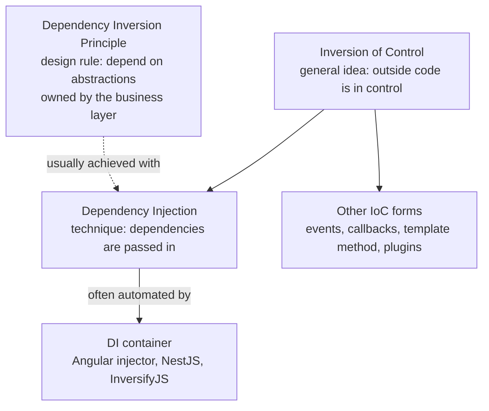
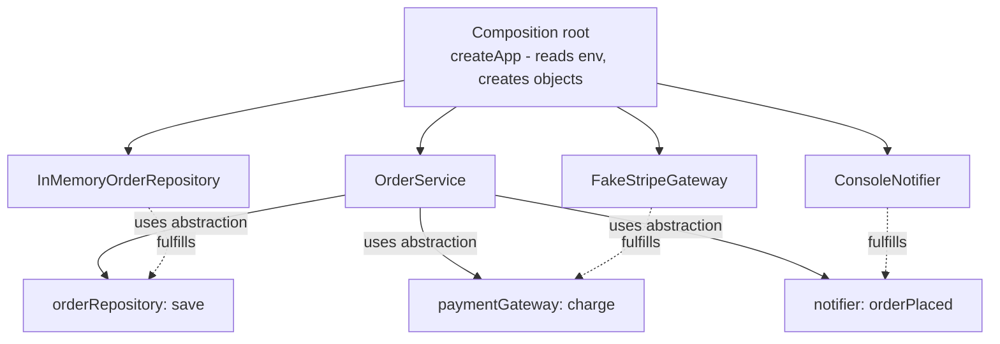
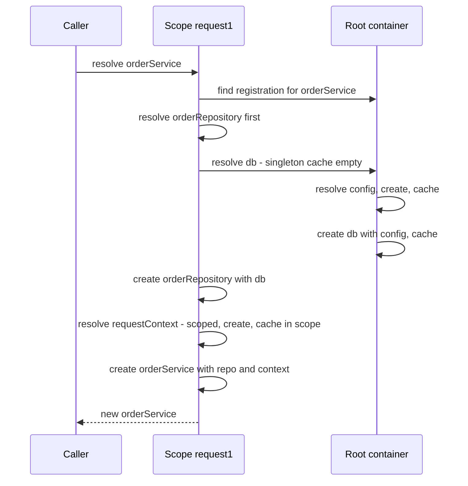
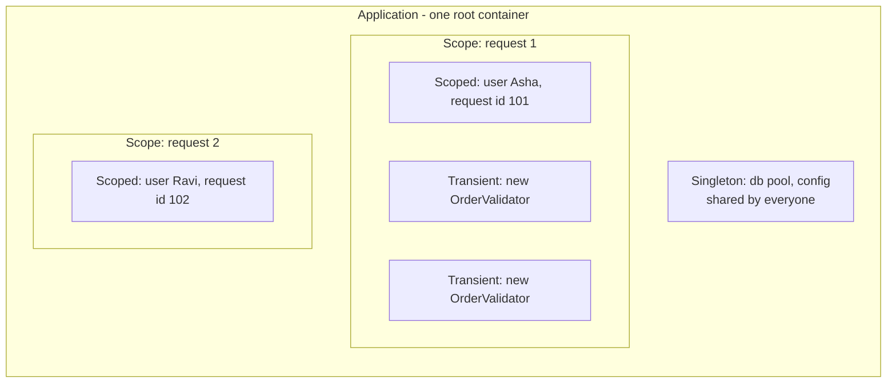
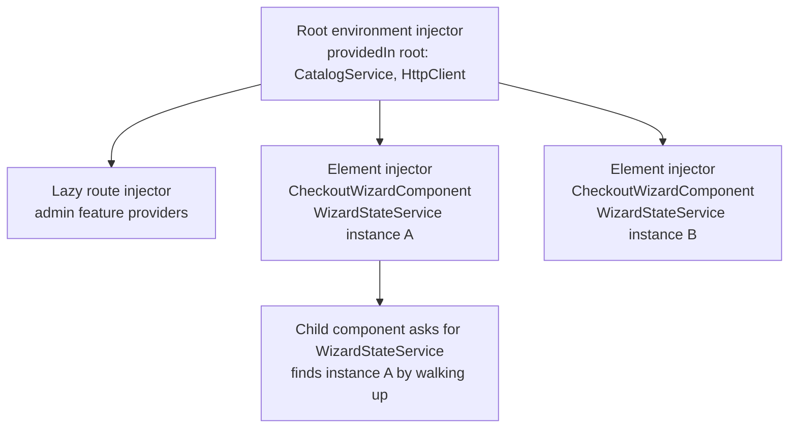
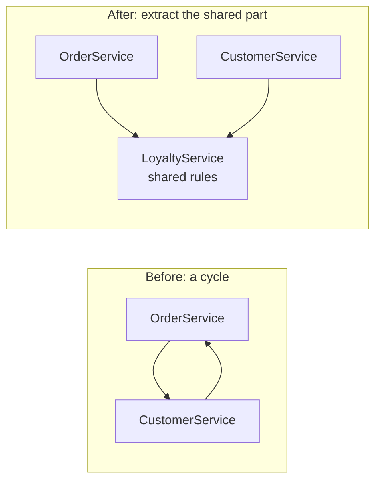

# Dependency Inversion and Dependency Injection

> In this document you will learn the difference between Dependency Inversion (a principle), Dependency Injection (a technique) and Inversion of Control (a general idea), how to inject dependencies by hand, how DI containers really work inside (you will build one), what singleton, scoped and transient lifetimes mean, and how Angular, NestJS, InversifyJS and tsyringe do it. DI is a core interview topic for Angular, NestJS and backend roles, and many candidates mix up the three terms.

**Before this:** [SOLID principles](./03-solid-principles.md) · [Composition, inheritance and mixins](./02-composition-inheritance-and-mixins.md) · **Interview questions:** [jump to questions](#interview-questions)

## Table of contents

1. [The problem: code that creates its own dependencies](#the-problem-code-that-creates-its-own-dependencies)
2. [DIP vs DI vs IoC](#dip-vs-di-vs-ioc)
3. [Ways to inject a dependency](#ways-to-inject-a-dependency)
4. [Manual DI and the composition root](#manual-di-and-the-composition-root)
5. [DI containers: how they work inside](#di-containers-how-they-work-inside)
6. [Lifetimes: singleton, scoped and transient](#lifetimes-singleton-scoped-and-transient)
7. [DI for testability](#di-for-testability)
8. [DI in Angular](#di-in-angular)
9. [DI in NestJS](#di-in-nestjs)
10. [InversifyJS, tsyringe and Awilix](#inversifyjs-tsyringe-and-awilix)
11. [Service locator: the anti-pattern that looks like DI](#service-locator-the-anti-pattern-that-looks-like-di)
12. [DI without classes: functions and closures](#di-without-classes-functions-and-closures)
13. [Pitfalls](#pitfalls)
14. [Common mistakes](#common-mistakes)
15. [Best practices](#best-practices)
16. [How to explain this in an interview](#how-to-explain-this-in-an-interview)
17. [Interview questions](#interview-questions)
18. [Summary](#summary)
19. [References](#references)

---

## The problem: code that creates its own dependencies

A **dependency** is any object or function that your code needs to do its job. An `OrderService` needs a database, a payment client and a mailer. Those are its dependencies.

The simplest way to get a dependency is to create it yourself with `new`:

```js
class PostgresClient {
  query(sql) {
    console.log(`[postgres] ${sql}`);
    return [];
  }
}

class SmtpMailer {
  send(to, text) {
    console.log(`[smtp] to ${to}: ${text}`);
  }
}

class OrderService {
  constructor() {
    this.db = new PostgresClient();  // creates its own dependency
    this.mailer = new SmtpMailer();  // creates its own dependency
  }

  placeOrder(order) {
    this.db.query(`INSERT INTO orders VALUES (${order.id})`);
    this.mailer.send(order.email, `Order ${order.id} confirmed`);
  }
}

new OrderService().placeOrder({ id: 1, email: "asha@example.com" });
// [postgres] INSERT INTO orders VALUES (1)
// [smtp] to asha@example.com: Order 1 confirmed
```

This works. The problems appear later:

1. **You cannot test it alone.** Every unit test of `OrderService` talks to a real database and sends real email (or you must patch modules in clever ways).
2. **You cannot swap implementations.** Moving from SMTP to SendGrid means editing `OrderService`, even though the business rules did not change.
3. **Configuration is hidden.** Where does `PostgresClient` get its connection string? Probably from a global `process.env`, read deep inside.
4. **Sharing is hard.** If ten services each call `new PostgresClient()`, you get ten connection pools.
5. **The dependency graph is invisible.** You cannot see what `OrderService` needs without reading all its code.

**Dependency injection** fixes all five with one simple change: **do not create your dependencies; receive them.**

```js
class OrderService {
  constructor(db, mailer) { // receives its dependencies
    this.db = db;
    this.mailer = mailer;
  }

  placeOrder(order) {
    this.db.query(`INSERT INTO orders VALUES (${order.id})`);
    this.mailer.send(order.email, `Order ${order.id} confirmed`);
  }
}

// Production: real implementations
// new OrderService(new PostgresClient(), new SmtpMailer());

// Test: simple fakes that record calls
const sent = [];
const fakeDb = { query: () => [] };
const fakeMailer = { send: (to, text) => sent.push({ to, text }) };

new OrderService(fakeDb, fakeMailer).placeOrder({ id: 7, email: "ravi@example.com" });
console.log(sent); // [ { to: 'ravi@example.com', text: 'Order 7 confirmed' } ]
```

That is the whole core idea. Everything else in this document (containers, tokens, lifetimes, Angular's injector) is tooling around it.

### Analogy

A chef who must grow their own vegetables, raise chickens and build their own oven before cooking is "creating their own dependencies". A restaurant chef **receives** ingredients and equipment from suppliers and focuses on cooking. If a supplier changes, the recipe does not. In a cooking test, you can give the chef practice ingredients.

---

## DIP vs DI vs IoC

These three terms are related, and people mix them up all the time. Getting them right is a strong signal in interviews.

| Term | What kind of thing | One-line meaning |
| --- | --- | --- |
| **Inversion of Control (IoC)** | A general idea | A framework or outside code controls *when* your code runs or *what* it gets; your code does not control everything itself. |
| **Dependency Inversion Principle (DIP)** | A design principle (the "D" in SOLID) | High-level business code and low-level details both depend on abstractions; the source-code dependency points toward the business layer. |
| **Dependency Injection (DI)** | A technique (a pattern) | An object receives its dependencies from outside instead of creating them. |

### Inversion of Control (IoC)

**IoC** means that the *control flow* is inverted: instead of your code calling a library whenever it wants, a framework calls *your* code. This is sometimes called the **Hollywood principle**: "Don't call us, we'll call you."

You see IoC everywhere:

```js
// Your code is in control: you decide when things happen
const data = readConfig();
const result = process(data);
save(result);

// Inversion of control: the framework decides when your code runs
// - The browser calls your listener when the user clicks
//   button.addEventListener("click", handleClick);
// - Express calls your handler when a request arrives
//   app.get("/orders", listOrders);
// - Angular calls ngOnInit when the component is ready
// - A test runner calls your test functions
```

```js
// A tiny runnable example of IoC: the "framework" controls the loop,
// your code only provides the steps.
function runPipeline(steps, input) {
  return steps.reduce((value, step) => step(value), input);
}

const trim = (s) => s.trim();
const lower = (s) => s.toLowerCase();
console.log(runPipeline([trim, lower], "  Hello World  ")); // hello world
```

**Dependency injection is one specific kind of IoC**: the control over *creating and choosing dependencies* is moved out of the class, to the caller or to a container. Events, callbacks, template methods and plugin systems are other kinds of IoC.

### Dependency Inversion Principle (DIP)

**DIP** is about the **direction of source-code dependencies** (which file imports which). Recap from [SOLID principles](./03-solid-principles.md#d-dependency-inversion-principle):

1. High-level modules (business rules) should not depend on low-level modules (database, HTTP, file system). Both should depend on abstractions.
2. Abstractions should not depend on details. Details depend on abstractions.

The important detail: **the abstraction belongs to the high-level layer.** `OrderService` defines "I need something that can `save(order)`". The Postgres code implements that. Now the Postgres file imports the business layer's interface, not the other way round.

### Dependency Injection (DI)

**DI** is the mechanics: *how* the dependency arrives. Constructor parameters, setters, method parameters, or a container that builds the object graph.

### How they relate



You can have each without the others:

```ts
// 1. DI WITHOUT DIP: we inject, but we inject a concrete detail.
class PostgresOrderRepository {
  save(order: { id: string }) { console.log(`postgres save ${order.id}`); }
}
class OrderServiceA {
  constructor(private repo: PostgresOrderRepository) {} // still depends on Postgres code
  place(id: string) { this.repo.save({ id }); }
}

// 2. DIP WITHOUT a constructor parameter: the service depends on an abstraction,
//    and a factory function picks the implementation.
interface OrderRepository { save(order: { id: string }): void; }
function createOrderRepository(): OrderRepository {
  return new PostgresOrderRepository(); // only this function knows the detail
}
class OrderServiceB {
  private repo: OrderRepository = createOrderRepository();
  place(id: string) { this.repo.save({ id }); }
}

// 3. DIP + DI (the usual goal): depends on the abstraction AND receives it.
class OrderServiceC {
  constructor(private repo: OrderRepository) {}
  place(id: string) { this.repo.save({ id }); }
}

new OrderServiceA(new PostgresOrderRepository()).place("a1"); // postgres save a1
new OrderServiceB().place("b1");                              // postgres save b1
new OrderServiceC({ save: o => console.log(`memory save ${o.id}`) }).place("c1"); // memory save c1
```

Option 2 still hides the choice inside the service's module, so you cannot pass a fake without changing code. Option 3 gives you both a clean dependency direction and easy testing.

---

## Ways to inject a dependency

### 1. Constructor injection (the default choice)

Dependencies are passed as constructor parameters.

```ts
interface Clock { now(): Date; }
interface Logger { info(message: string): void; }

class SessionService {
  constructor(
    private readonly clock: Clock,
    private readonly logger: Logger,
  ) {}

  isExpired(expiresAt: Date): boolean {
    const expired = this.clock.now() >= expiresAt;
    if (expired) this.logger.info(`Session expired at ${expiresAt.toISOString()}`);
    return expired;
  }
}

const service = new SessionService(
  { now: () => new Date("2025-03-01T10:00:00Z") },
  { info: m => console.log(m) },
);
console.log(service.isExpired(new Date("2025-03-01T09:00:00Z")));
// Session expired at 2025-03-01T09:00:00.000Z
// true
```

**Why it is the default:**

- The object is **complete and valid** right after construction. It is never in a "missing dependency" state.
- Dependencies are **visible** in one place: the constructor signature is a list of what the class needs.
- Fields can be `readonly`: the dependency cannot be replaced later by accident.
- A constructor with 8 parameters is an honest warning that the class does too much (SRP).

### 2. Setter (property) injection

Dependencies are assigned after construction, through a setter or a public property.

```js
class ReportGenerator {
  logger = { info: () => {} }; // a safe default ("null object") so it never crashes

  setLogger(logger) {
    this.logger = logger;
  }

  generate(name) {
    this.logger.info(`Generating ${name}`);
    return `${name}.pdf`;
  }
}

const generator = new ReportGenerator();
console.log(generator.generate("q1-sales")); // q1-sales.pdf  (no log, default logger)
generator.setLogger({ info: (m) => console.log(`[log] ${m}`) });
console.log(generator.generate("q2-sales"));
// [log] Generating q2-sales
// q2-sales.pdf
```

**Use it for:** optional dependencies that have a sensible default (logging, metrics), or when a framework creates the object and you cannot control the constructor.

**Risks:** the object can be used before the dependency is set (temporal coupling), and the dependency can change later, which makes behavior harder to predict.

### 3. Method (parameter) injection

The dependency is passed to the method that needs it, on each call.

```js
class InvoiceFormatter {
  // The locale-specific formatter changes per call (per user), so it is a parameter.
  format(amount, numberFormat) {
    return `Total: ${numberFormat.format(amount)}`;
  }
}

const formatter = new InvoiceFormatter();
console.log(formatter.format(1234.5, new Intl.NumberFormat("en-US", { style: "currency", currency: "USD" })));
// Total: $1,234.50
console.log(formatter.format(1234.5, new Intl.NumberFormat("de-DE", { style: "currency", currency: "EUR" })));
// Total: 1.234,50 €
```

**Use it for:** dependencies that change from call to call (the current user, the request context, a transaction, a locale), or when only one method needs it.

### 4. Interface injection

In classic Java literature, **interface injection** means the dependency is supplied through a method defined by an interface that the class implements, for example `interface LoggerAware { setLogger(logger: Logger): void }`. The injector sees that a class implements `LoggerAware` and calls `setLogger`.

```ts
interface Logger { info(message: string): void; }

interface LoggerAware {
  setLogger(logger: Logger): void;
}

class PaymentJob implements LoggerAware {
  private logger: Logger = { info: () => {} };
  setLogger(logger: Logger) { this.logger = logger; }
  run() { this.logger.info("payment job ran"); }
}

// A tiny "injector" that knows the LoggerAware contract.
function injectLogger(target: object, logger: Logger) {
  if (typeof (target as Partial<LoggerAware>).setLogger === "function") {
    (target as LoggerAware).setLogger(logger);
  }
}

const job = new PaymentJob();
injectLogger(job, { info: m => console.log(`[job] ${m}`) });
job.run(); // [job] payment job ran
```

It is rare in modern JavaScript and TypeScript. Since TypeScript interfaces do not exist at runtime, the injector must check the shape itself (as above). You will mostly hear about it as one of the "three types of DI" in interviews: constructor, setter and interface injection.

### Comparison

| Style | Dependency visible? | Object always valid? | Can change later? | Best for |
| --- | --- | --- | --- | --- |
| Constructor | Yes, in the signature | Yes | No (with `readonly`) | Required dependencies (most cases) |
| Setter / property | Less obvious | Only if there is a default | Yes | Optional dependencies with defaults |
| Method / parameter | Yes, per call | Yes | Per call | Per-call context: user, request, transaction |
| Interface | Through the interface | Only after injection | Yes | Rare; framework-driven "aware" callbacks |

**Field injection** (frameworks setting decorated fields, like `@Autowired` in Spring) is a variant of property injection. Angular's `inject()` function used in field initializers looks similar, but it runs *during* construction, inside Angular's injection context, so the object is still complete when the constructor finishes (see [DI in Angular](#di-in-angular)).

---

## Manual DI and the composition root

You do not need a library to use DI. **Manual DI** (sometimes called "pure DI" or "poor man's DI") means you create the objects yourself and pass them in.

### The composition root

The **composition root** is the **one place** in the application where objects are created and wired together. Usually it is the entry point: `main.ts`, `server.js`, `app.module.ts`, Electron's `main.js`.

Rules:

- Only the composition root knows the concrete classes (`PostgresOrderRepository`, `StripeGateway`).
- Everything else receives abstractions through constructors.
- Configuration (environment variables, secrets) is read here and passed down as plain values.

```js
// ---------- Business layer (knows only abstractions) ----------
class OrderService {
  constructor({ orderRepository, paymentGateway, notifier }) {
    this.orderRepository = orderRepository;
    this.paymentGateway = paymentGateway;
    this.notifier = notifier;
  }

  async placeOrder(order) {
    const receipt = await this.paymentGateway.charge(order.totalCents);
    await this.orderRepository.save({ ...order, receiptId: receipt.id });
    await this.notifier.orderPlaced(order.email, order.id);
    return receipt.id;
  }
}

// ---------- Infrastructure layer (details) ----------
class InMemoryOrderRepository {
  orders = [];
  async save(order) { this.orders.push(order); }
}

class FakeStripeGateway {
  constructor(apiKey) { this.apiKey = apiKey; }
  async charge(amountCents) { return { id: `ch_${amountCents}` }; }
}

class ConsoleNotifier {
  async orderPlaced(email, orderId) { console.log(`notify ${email}: order ${orderId} placed`); }
}

// ---------- Composition root (the only place that knows everything) ----------
function createApp(env) {
  const orderRepository = new InMemoryOrderRepository();
  const paymentGateway = new FakeStripeGateway(env.STRIPE_KEY);
  const notifier = new ConsoleNotifier();

  const orderService = new OrderService({ orderRepository, paymentGateway, notifier });
  return { orderService, orderRepository };
}

const app = createApp({ STRIPE_KEY: "sk_test_example" });
const receiptId = await app.orderService.placeOrder({ id: "o-1", email: "asha@example.com", totalCents: 4999 });
console.log(receiptId, app.orderRepository.orders.length);
// notify asha@example.com: order o-1 placed
// ch_4999 1
```

Passing an object (`{ orderRepository, paymentGateway, notifier }`) instead of positional parameters is a common JavaScript style. It makes the call site readable and the order of parameters irrelevant.



### When manual DI is enough

- Small and medium Node.js services, CLIs, Electron main processes, libraries.
- Anywhere the object graph fits in one readable function.

Advantages: no library, no decorators, no magic. If something is wired wrong, the compiler or a simple stack trace tells you. Disadvantages: in a large app, the composition root becomes long, and you manage lifetimes (shared vs per-request objects) by hand.

When the wiring code gets too big, a **DI container** can automate it.

---

## DI containers: how they work inside

A **DI container** (also called an **IoC container** or, in Angular, an **injector**) is an object that knows how to create every dependency in your app, and creates them on request, including their dependencies, recursively.

It has three jobs:

1. **Registration:** "When someone asks for X, here is how to create it, and here is what it needs."
2. **Resolution:** "Someone asked for X. Create X's dependencies first (recursively), then create X."
3. **Lifetime management:** "Should I create a new X every time, or reuse one?"

### Tokens and the registry

A **token** is the key used to look up a dependency. Because TypeScript interfaces do not exist at runtime, tokens must be real values:

| Token type | Example | Used by |
| --- | --- | --- |
| A class | `OrderService` | Angular, NestJS, InversifyJS, tsyringe |
| A string | `"OrderRepository"` | NestJS, tsyringe, Awilix (by name) |
| A symbol | `Symbol.for("OrderRepository")` | InversifyJS (common style), NestJS |
| A token object | `new InjectionToken<AppConfig>("APP_CONFIG")` | Angular |

The **registry** is a map from token to a **provider** (a recipe): a class to instantiate, a factory function, or a ready-made value.

### Build a mini container

The best way to understand containers is to build one. This one supports tokens, dependencies, recursive resolution, three lifetimes, scopes and circular dependency detection, in about 50 lines.

```js
class Container {
  #registrations = new Map(); // token -> { factory, deps, lifetime }
  #singletons = new Map();    // cache for singletons (only used on the root container)
  #scoped = new Map();        // cache for scoped instances (one per scope)
  #parent;

  constructor(parent = null) {
    this.#parent = parent;
  }

  register(token, { factory, deps = [], lifetime = "transient" }) {
    this.#registrations.set(token, { factory, deps, lifetime });
    return this; // allow chaining
  }

  createScope() {
    return new Container(this); // a child container, e.g. one per HTTP request
  }

  #findRegistration(token) {
    return this.#registrations.get(token) ?? this.#parent?.#findRegistration(token);
  }

  #root() {
    return this.#parent ? this.#parent.#root() : this;
  }

  resolve(token, path = []) {
    // 1. Detect cycles: A -> B -> A
    if (path.includes(token)) {
      throw new Error(`Circular dependency: ${[...path, token].map(String).join(" -> ")}`);
    }

    // 2. Find the recipe
    const registration = this.#findRegistration(token);
    if (!registration) throw new Error(`No provider for ${String(token)}`);

    // 3. Reuse a cached instance if the lifetime allows it
    const cache =
      registration.lifetime === "singleton" ? this.#root().#singletons
      : registration.lifetime === "scoped" ? this.#scoped
      : null; // transient: never cached
    if (cache?.has(token)) return cache.get(token);

    // 4. Resolve dependencies first (recursion), then create the instance
    const args = registration.deps.map((dep) => this.resolve(dep, [...path, token]));
    const instance = registration.factory(...args);

    cache?.set(token, instance);
    return instance;
  }
}

// ----- Registration (the composition root) -----
let dbConnections = 0;

const container = new Container()
  .register("config", {
    factory: () => ({ dbUrl: "postgres://localhost/shop" }),
    lifetime: "singleton",
  })
  .register("db", {
    factory: (config) => ({ id: ++dbConnections, url: config.dbUrl }),
    deps: ["config"],
    lifetime: "singleton",
  })
  .register("requestContext", {
    factory: () => ({ requestId: `req-${Math.floor(Math.random() * 1000)}` }),
    lifetime: "scoped",
  })
  .register("orderRepository", {
    factory: (db) => ({ db, save: (o) => `saved ${o.id} via connection ${db.id}` }),
    deps: ["db"],
  })
  .register("orderService", {
    factory: (repo, ctx) => ({
      repo,
      ctx,
      place: (id) => `${ctx.requestId}: ${repo.save({ id })}`,
    }),
    deps: ["orderRepository", "requestContext"],
  });

// ----- Resolution: two "HTTP requests", each with its own scope -----
const request1 = container.createScope();
const request2 = container.createScope();

const a = request1.resolve("orderService");
const b = request1.resolve("orderService");
const c = request2.resolve("orderService");

console.log(a === b);           // false -> orderService is transient
console.log(a.ctx === b.ctx);   // true  -> same scope, same requestContext
console.log(a.ctx === c.ctx);   // false -> different scope, different requestContext
console.log(a.repo.db === c.repo.db); // true -> db is a singleton
console.log(dbConnections);     // 1     -> created once
console.log(a.place("o-1").includes("saved o-1 via connection 1")); // true

// ----- Errors a container reports -----
container
  .register("A", { factory: (b) => ({ b }), deps: ["B"] })
  .register("B", { factory: (a) => ({ a }), deps: ["A"] });

try {
  container.resolve("A");
} catch (error) {
  console.log(error.message); // Circular dependency: A -> B -> A
}

try {
  container.resolve("mailer");
} catch (error) {
  console.log(error.message); // No provider for mailer
}
```

### Step-by-step: what happens in `request1.resolve("orderService")`

1. `path` is empty, so no cycle. The scope has no own registration for `orderService`, so it finds the one on the parent (root) container.
2. Lifetime is `transient`, so there is no cache. The container must create a new instance.
3. Its `deps` are `["orderRepository", "requestContext"]`. The container resolves each one first, passing `path = ["orderService"]`.
4. `orderRepository` (transient) needs `db`. The container resolves `db` with `path = ["orderService", "orderRepository"]`.
5. `db` is a `singleton`. The root singleton cache is empty, so the container resolves `config` (singleton, no deps), creates it and caches it. Then it creates `db` with `config` and caches it on the root. `dbConnections` becomes `1`.
6. Back in step 4: `orderRepository` is created with `db`. Not cached (transient).
7. `requestContext` is `scoped`. The cache of `request1` is empty, so it is created and stored in `request1`'s scoped cache.
8. Finally `orderService` is created with `(orderRepository, requestContext)` and returned.
9. The second `request1.resolve("orderService")` creates a new service and a new repository, but reuses `db` (root cache) and `requestContext` (scope cache).



### How real containers find dependencies

In the mini container, you list `deps` by hand. Real containers find them in different ways:

| Mechanism | How it works | Who uses it |
| --- | --- | --- |
| Explicit list | You write the tokens: `deps: [A, B]`, `inject: [A, B]` | Angular `useFactory` + `deps`, NestJS `useFactory` + `inject` |
| Compiler-generated metadata | The framework's compiler writes a factory that calls `inject()` for each constructor parameter | Angular (the Angular compiler generates factories for `@Injectable` classes) |
| Decorator metadata (`reflect-metadata`) | With `emitDecoratorMetadata`, TypeScript emits the constructor parameter types; the container reads them at runtime | NestJS, InversifyJS, tsyringe |
| Parameter names | The container reads constructor or function parameter names (or a destructured object) | Awilix (`PROXY` or `CLASSIC` injection modes) |

Important: decorator metadata only works for **classes**. If a parameter is typed as an **interface**, the emitted type is just `Object`, so the container cannot know what to inject. That is why these libraries need an explicit token (`@Inject("OrderRepository")`, `@inject(TYPES.OrderRepository)`) for interface-typed dependencies.

---

## Lifetimes: singleton, scoped and transient

A **lifetime** (also called a **scope**) decides how long a created instance lives and who shares it.

| Lifetime | One instance per... | Good for | Danger |
| --- | --- | --- | --- |
| **Singleton** | Container (usually the whole app) | Stateless services, config, connection pools, caches, HTTP clients | Holding per-user or per-request data; shared mutable state |
| **Scoped** | Scope (usually one HTTP request, or one component subtree in Angular) | Request context (current user, request id), a database transaction or unit of work | Using it outside a scope; being captured by a singleton |
| **Transient** | Every resolution | Lightweight, stateful helpers that must not be shared | Expensive objects created over and over; surprising extra instances |



### The captive dependency problem

A **captive dependency** happens when a longer-lived object holds a shorter-lived one. The classic case: a **singleton depends on a scoped** service. The singleton is created once, during the first request, and keeps that first request's scoped object **forever**.

```js
// Uses the Container class from the previous section (shortened version here)
class Container {
  #regs = new Map(); #singletons = new Map(); #scoped = new Map(); #parent;
  constructor(parent = null) { this.#parent = parent; }
  register(token, reg) { this.#regs.set(token, { deps: [], lifetime: "transient", ...reg }); return this; }
  createScope() { return new Container(this); }
  #find(t) { return this.#regs.get(t) ?? this.#parent?.#find(t); }
  #root() { return this.#parent ? this.#parent.#root() : this; }
  resolve(token) {
    const r = this.#find(token);
    const cache = r.lifetime === "singleton" ? this.#root().#singletons : r.lifetime === "scoped" ? this.#scoped : null;
    if (cache?.has(token)) return cache.get(token);
    const instance = r.factory(...r.deps.map((d) => this.resolve(d)));
    cache?.set(token, instance);
    return instance;
  }
}

let requestCounter = 0;
const container = new Container()
  .register("currentUser", { factory: () => ({ name: ++requestCounter === 1 ? "Asha" : "Ravi" }), lifetime: "scoped" })
  // ❌ Wrong: a singleton that depends on a scoped service
  .register("auditLogger", {
    factory: (user) => ({ log: (action) => `${user.name} did ${action}` }),
    deps: ["currentUser"],
    lifetime: "singleton",
  });

const requestFromAsha = container.createScope();
const requestFromRavi = container.createScope();

console.log(requestFromAsha.resolve("auditLogger").log("delete order")); // Asha did delete order
console.log(requestFromRavi.resolve("currentUser").name);                // Ravi
console.log(requestFromRavi.resolve("auditLogger").log("refund"));       // Asha did refund  <- wrong user!
```

In a real app, this logs the wrong user, leaks one user's data into another user's request, or uses a closed database transaction. It is a **security bug**, not just a design smell.

**Fixes:**

- Make the consumer at least as short-lived as its dependency (make `auditLogger` scoped).
- Or pass the short-lived value as a **method parameter**: `auditLogger.log(user, action)`.
- Or inject a **factory/provider** and ask for the current value each time.
- Use container features that detect it. For example, NestJS automatically makes a provider request-scoped if it depends on a request-scoped provider (the scope "bubbles up" the chain). Some other containers (such as Awilix with its strict option, or .NET's built-in container with scope validation) can throw an error instead.

### Lifetime rules of thumb

- **Default to singleton for stateless services.** Most services (repositories that use a shared pool, HTTP clients, mappers) hold no per-request state.
- **Never store per-user or per-request data in a singleton field.** Pass it as a parameter or use a scoped service.
- **Use transient for cheap objects that hold their own temporary state** (a builder, a validator collecting errors).
- **In Node.js, remember a singleton is shared by all concurrent requests**, because one process handles many requests at once. A field like `this.currentUser = req.user` in a singleton is a race condition.

---

## DI for testability

The biggest everyday benefit of DI is easy, fast, reliable unit tests. You replace slow or unpredictable dependencies (database, network, time, randomness) with simple **test doubles**.

| Test double | What it does | Example |
| --- | --- | --- |
| **Dummy** | Passed but never used | `{}` for a logger the test does not care about |
| **Stub** | Returns fixed answers | `findById: async () => ({ id: 1, name: "Asha" })` |
| **Fake** | A working, simpler implementation | An in-memory repository using a `Map` |
| **Spy** | Records how it was called | A mailer that pushes each call into an array |
| **Mock** | A spy with built-in expectations | `jest.fn()` with `expect(mock).toHaveBeenCalledWith(...)` |

### Example: swap a real repository for a fake

```ts
interface User { id: string; email: string; active: boolean; }

interface UserRepository {
  findByEmail(email: string): Promise<User | null>;
  save(user: User): Promise<void>;
}

interface Mailer {
  send(to: string, subject: string): Promise<void>;
}

interface IdGenerator {
  next(): string;
}

class RegistrationService {
  constructor(
    private users: UserRepository,
    private mailer: Mailer,
    private ids: IdGenerator,
  ) {}

  async register(email: string): Promise<User> {
    const normalized = email.trim().toLowerCase();
    if (await this.users.findByEmail(normalized)) {
      throw new Error("Email already registered");
    }
    const user: User = { id: this.ids.next(), email: normalized, active: false };
    await this.users.save(user);
    await this.mailer.send(normalized, "Please confirm your email");
    return user;
  }
}

// ---- Test doubles ----
class InMemoryUserRepository implements UserRepository {        // fake
  private users = new Map<string, User>();
  async findByEmail(email: string) { return this.users.get(email) ?? null; }
  async save(user: User) { this.users.set(user.email, user); }
}

class SpyMailer implements Mailer {                             // spy
  readonly sent: Array<{ to: string; subject: string }> = [];
  async send(to: string, subject: string) { this.sent.push({ to, subject }); }
}

const fixedIds: IdGenerator = { next: () => "user-1" };         // stub

// ---- "Tests" (in a real project these would be Jest/Vitest test cases) ----
const repo = new InMemoryUserRepository();
const mailer = new SpyMailer();
const service = new RegistrationService(repo, mailer, fixedIds);

const user = await service.register("  Asha@Example.com ");
console.log(user);        // { id: 'user-1', email: 'asha@example.com', active: false }
console.log(mailer.sent); // [ { to: 'asha@example.com', subject: 'Please confirm your email' } ]

try {
  await service.register("asha@example.com");
} catch (error) {
  console.log((error as Error).message); // Email already registered
}
console.log(mailer.sent.length); // 1 -> no second email was sent
```

No database, no SMTP server, no random IDs, no module mocking. The test is fast and deterministic. Remember from [SOLID: LSP](./03-solid-principles.md#lsp-is-about-more-than-classes) that a fake must follow the same contract as the real implementation (here: `findByEmail` returns `null` when not found).

### Testing with Angular's injector

In Angular tests you override providers in `TestBed`, so the component or service under test receives fakes:

```ts
// Angular 16 + Jasmine/Jest style
TestBed.configureTestingModule({
  providers: [
    UserProfileService,
    { provide: UserApi, useValue: { getUser: () => of({ id: '1', name: 'Asha' }) } },
  ],
});
const service = TestBed.inject(UserProfileService);
```

Details are in [Angular testing](../06-angular-16/14-testing.md). General testing concepts are in [Angular testing](../06-angular-16/14-testing.md).

---

## DI in Angular

Angular has DI built into the framework. This section is an overview; the full details (resolution rules, `providedIn` options, `@Self`/`@SkipSelf`/`@Host`/`@Optional`, `multi` providers, environment vs element injectors) are in [Angular dependency injection](../06-angular-16/05-dependency-injection.md).

### The basic pieces (Angular 16)

```ts
import { Injectable, InjectionToken, inject } from '@angular/core';
import { HttpClient } from '@angular/common/http';
import { Observable } from 'rxjs';

// 1. A token for a non-class value (interfaces do not exist at runtime)
export interface AppConfig { apiUrl: string; }
export const APP_CONFIG = new InjectionToken<AppConfig>('APP_CONFIG');

// 2. An abstract class works as both contract and token
export abstract class ProductApi {
  abstract list(): Observable<{ id: string; name: string }[]>;
}

// 3. A concrete implementation, injected with dependencies
@Injectable()
export class HttpProductApi extends ProductApi {
  private http = inject(HttpClient);          // inject() function (Angular 14+)
  private config = inject(APP_CONFIG);

  list() {
    return this.http.get<{ id: string; name: string }[]>(`${this.config.apiUrl}/products`);
  }
}

// 4. A service registered in the root injector (an app-wide singleton, tree-shakable)
@Injectable({ providedIn: 'root' })
export class CatalogService {
  readonly products$: Observable<{ id: string; name: string }[]>;

  constructor(private api: ProductApi) {      // constructor injection, by token ProductApi
    this.products$ = this.api.list();         // use 'api' in the constructor body, not in a field initializer
  }
}

// 5. Providers (in AppModule, bootstrapApplication, a route, or a component):
// providers: [
//   { provide: APP_CONFIG, useValue: { apiUrl: 'https://api.example.com' } },
//   { provide: ProductApi, useClass: HttpProductApi },
// ]
```

### Provider recipes

| Recipe | Meaning | Example |
| --- | --- | --- |
| `useClass` | Create an instance of this class | `{ provide: ProductApi, useClass: HttpProductApi }` |
| `useValue` | Use this ready-made value | `{ provide: APP_CONFIG, useValue: { apiUrl: '/api' } }` |
| `useFactory` | Call this function to create it (`deps` lists its inputs, or it can call `inject()`) | `{ provide: Logger, useFactory: () => isDevMode() ? new ConsoleLogger() : new RemoteLogger() }` |
| `useExisting` | An alias to another token | `{ provide: OldLogger, useExisting: Logger }` |
| `multi: true` | Collect many providers under one token into an array | `HTTP_INTERCEPTORS`, `APP_INITIALIZER` |

### Hierarchical injectors (the key Angular idea)

Angular does not have one container. It has a **tree of injectors**:

- The **root environment injector** (`providedIn: 'root'`, providers in `AppModule` or `bootstrapApplication`): app-wide singletons.
- **Lazy-loaded route injectors**: providers for a lazy feature get their own child injector.
- **Element injectors**: `providers` in a `@Component` or `@Directive` create a new instance for that component and its children.

When a class asks for a token, Angular starts at the nearest element injector and walks **up** the tree until it finds a provider. This gives Angular a natural form of **scoped lifetime**: a service provided in a component lives and dies with that component.

```ts
import { Component, Injectable } from '@angular/core';

@Injectable()
export class WizardStateService {
  step = 1;
}

@Component({
  selector: 'app-checkout-wizard',
  template: `<p>Step {{ state.step }}</p>`,
  providers: [WizardStateService], // a NEW instance for each wizard component
})
export class CheckoutWizardComponent {
  constructor(public state: WizardStateService) {}
}
// Two <app-checkout-wizard> elements on the page each get their own WizardStateService.
// The service is destroyed when its component is destroyed.
```



### Angular-specific facts worth knowing for interviews

- `@Injectable({ providedIn: 'root' })` makes a service a **tree-shakable** singleton: if nothing injects it, the bundler can remove it.
- The `inject()` function works only in an **injection context**: constructors, field initializers, factory functions and a few framework callbacks. Angular 16 added `runInInjectionContext()` to run a function in such a context, and `DestroyRef` that you can inject to register cleanup.
- Angular's compiler generates the factory code for `@Injectable` classes. That is why Angular does **not** need `reflect-metadata` at runtime.
- **Newer Angular (17+):** `inject()` is the style used in most new code and docs, functional guards/interceptors/resolvers are the default style, and standalone APIs (`provideHttpClient`, `provideRouter`) replaced most module-based providers. The DI concepts are unchanged.

---

## DI in NestJS

**NestJS** is a Node.js framework whose architecture is strongly inspired by Angular. It has a built-in IoC container.

```ts
import { Inject, Injectable, Module, Scope, Controller, Get } from '@nestjs/common';

export interface OrderRepository {
  findAll(): Promise<{ id: string }[]>;
}
export const ORDER_REPOSITORY = Symbol('ORDER_REPOSITORY'); // token for an interface

@Injectable()
export class InMemoryOrderRepository implements OrderRepository {
  async findAll() { return [{ id: 'o-1' }]; }
}

@Injectable() // default scope: singleton
export class OrderService {
  constructor(@Inject(ORDER_REPOSITORY) private readonly orders: OrderRepository) {}
  list() { return this.orders.findAll(); }
}

@Injectable({ scope: Scope.REQUEST }) // a new instance per HTTP request
export class RequestContext {
  readonly startedAt = Date.now();
}

@Controller('orders')
export class OrderController {
  constructor(private readonly orderService: OrderService) {} // resolved by class token
  @Get()
  list() { return this.orderService.list(); }
}

@Module({
  controllers: [OrderController],
  providers: [
    OrderService,
    RequestContext,
    { provide: ORDER_REPOSITORY, useClass: InMemoryOrderRepository },
  ],
  exports: [OrderService],
})
export class OrdersModule {}
```

Key facts:

- **Modules** group providers. A provider is visible to other modules only if it is **exported** (encapsulation at module level).
- **Scopes:** `Scope.DEFAULT` (singleton, shared across the app), `Scope.REQUEST` (one per incoming request), `Scope.TRANSIENT` (a new instance for each consumer that injects it). Request scope **bubbles up**: a controller that depends on a request-scoped provider also becomes request-scoped. This avoids captive dependencies but costs performance, so Nest's docs recommend the default singleton scope in most cases.
- **Custom providers:** `useClass`, `useValue`, `useFactory` (with an `inject: [...]` list) and `useExisting`, very similar to Angular.
- **Interfaces need tokens:** `@Inject(ORDER_REPOSITORY)` with a string or symbol, because the interface is erased at compile time.
- NestJS uses TypeScript's `emitDecoratorMetadata` to read constructor parameter **classes**; that is how `OrderService` is found without `@Inject`.
- **Circular dependencies** between providers can be resolved with `forwardRef(() => OtherService)`, but the docs advise avoiding them where possible.

---

## InversifyJS, tsyringe and Awilix

If you use plain Node.js, Express, Electron or a frontend without built-in DI, you can add a container library. Three popular ones:

### InversifyJS

A full-featured container, commonly used with symbol tokens. It uses legacy TypeScript decorators: you must install `reflect-metadata` and enable `experimentalDecorators` and `emitDecoratorMetadata` in `tsconfig.json`.

```ts
import 'reflect-metadata';
import { Container, inject, injectable } from 'inversify';

const TYPES = {
  Mailer: Symbol.for('Mailer'),
  SignupService: Symbol.for('SignupService'),
};

interface Mailer { send(to: string, text: string): void; }

@injectable()
class ConsoleMailer implements Mailer {
  send(to: string, text: string) { console.log(`mail to ${to}: ${text}`); }
}

@injectable()
class SignupService {
  constructor(@inject(TYPES.Mailer) private mailer: Mailer) {}
  signup(email: string) { this.mailer.send(email, 'Welcome!'); }
}

const container = new Container();
container.bind<Mailer>(TYPES.Mailer).to(ConsoleMailer).inSingletonScope();
container.bind<SignupService>(TYPES.SignupService).to(SignupService); // transient by default

container.get<SignupService>(TYPES.SignupService).signup('asha@example.com');
// mail to asha@example.com: Welcome!
```

InversifyJS scopes: `inTransientScope()` (the default), `inSingletonScope()` and `inRequestScope()`. Note that Inversify's "request scope" means **one instance per `container.get()` call** (per resolution graph), not per HTTP request. For per-HTTP-request lifetimes you create a child container per request. API details change between major versions, so check the docs for the version you use.

### tsyringe

A lightweight container from Microsoft. It also needs `reflect-metadata` and the two decorator compiler options.

```ts
import 'reflect-metadata';
import { container, inject, injectable, singleton } from 'tsyringe';

interface Clock { now(): Date; }

@singleton()
class SystemClock implements Clock {
  now() { return new Date(); }
}

@injectable()
class GreetingService {
  constructor(@inject('Clock') private clock: Clock) {}
  greet(name: string) {
    return this.clock.now().getHours() < 12 ? `Good morning, ${name}` : `Hello, ${name}`;
  }
}

container.register('Clock', { useClass: SystemClock }); // string token for the interface
const greeting = container.resolve(GreetingService);    // class token, resolved automatically
console.log(greeting.greet('Asha'));
```

tsyringe resolves classes automatically from their constructor parameter types, supports `@singleton()`, and lifecycles such as `Lifecycle.Transient` (default), `Lifecycle.Singleton`, `Lifecycle.ResolutionScoped` and `Lifecycle.ContainerScoped` with child containers.

### Awilix

A popular container for Node.js that does **not** need decorators or `reflect-metadata`. It resolves dependencies by **name**, and it is common with Express and Koa because it supports per-request scopes well.

```js
const { createContainer, asClass, asValue, asFunction } = require("awilix");

class OrderService {
  // By default (PROXY mode), Awilix passes one object; you destructure what you need.
  constructor({ orderRepository, logger }) {
    this.orderRepository = orderRepository;
    this.logger = logger;
  }
}

const container = createContainer();
container.register({
  config: asValue({ dbUrl: process.env.DB_URL }),
  logger: asFunction(() => console).singleton(),
  orderRepository: asClass(PostgresOrderRepository).singleton(),
  orderService: asClass(OrderService).scoped(),
});

// Per HTTP request (e.g. in an Express middleware):
// req.scope = container.createScope();
// req.scope.register({ currentUser: asValue(req.user) });
// const orderService = req.scope.resolve("orderService");
```

### Choosing

| Situation | Suggestion |
| --- | --- |
| Angular app | Use Angular's built-in DI |
| NestJS app | Use Nest's built-in container |
| Small/medium Node service, Electron main process, CLI | Manual DI in a composition root is often enough |
| Larger Express/Koa app with per-request scopes | Awilix (no decorators) or InversifyJS |
| You like decorator-based class resolution | tsyringe or InversifyJS |

---

## Service locator: the anti-pattern that looks like DI

A **service locator** is a global registry that code **asks** for its dependencies at runtime: `ServiceLocator.get("Mailer")`. It uses a container, so it *looks* like DI, but the dependency flow is reversed again: the class *pulls* its dependencies instead of *receiving* them.

```js
// ❌ Service locator: dependencies are hidden inside the methods
const ServiceLocator = {
  services: new Map(),
  register(name, service) { this.services.set(name, service); },
  get(name) {
    const service = this.services.get(name);
    if (!service) throw new Error(`Service not found: ${name}`);
    return service;
  },
};

class CheckoutService {
  checkout(cart) {
    const payments = ServiceLocator.get("payments"); // hidden dependency
    const mailer = ServiceLocator.get("mailer");     // hidden dependency
    const receipt = payments.charge(cart.total);
    mailer.send(cart.email, `Paid: ${receipt}`);
    return receipt;
  }
}

ServiceLocator.register("payments", { charge: (total) => `rcpt_${total}` });
// Forgot to register "mailer"...

try {
  new CheckoutService().checkout({ total: 50, email: "asha@example.com" });
} catch (error) {
  console.log(error.message); // Service not found: mailer
}
// The constructor said nothing. The error appears only when this method runs,
// maybe in production, maybe on a rare code path.
```

```js
// ✅ Dependency injection: the constructor lists everything
class CheckoutService {
  constructor(payments, mailer) {
    this.payments = payments;
    this.mailer = mailer;
  }
  checkout(cart) {
    const receipt = this.payments.charge(cart.total);
    this.mailer.send(cart.email, `Paid: ${receipt}`);
    return receipt;
  }
}

const sent = [];
const checkout = new CheckoutService(
  { charge: (total) => `rcpt_${total}` },
  { send: (to, text) => sent.push(`${to}: ${text}`) },
);
console.log(checkout.checkout({ total: 50, email: "asha@example.com" })); // rcpt_50
console.log(sent); // [ 'asha@example.com: Paid: rcpt_50' ]
```

| | Service locator | Dependency injection |
| --- | --- | --- |
| Who gets the dependency | The class pulls it from a registry | Someone pushes it in |
| Dependencies visible in the API | No, hidden in method bodies | Yes, in the constructor |
| Missing dependency found | When that line runs | At construction (or container startup) |
| Test setup | Must configure the global registry; tests can affect each other | Pass fakes directly |
| Coupling | Every class depends on the locator | Classes depend only on their real dependencies |

### Gray areas

- **Calling `container.get()` / `injector.get()` inside business classes** is service location, even with a real DI framework. Keep container access in the composition root and in framework glue code.
- Angular's `inject()` function looks like a locator call, but it is not one in the problematic sense: it runs only during construction in an injection context, it is resolved by the same injector rules as constructor parameters, and the dependencies are still declared up front in field initializers.
- Some framework code legitimately needs dynamic lookup (for example, resolving a handler by message type in a plugin system). Keep it in one small, well-tested place.

---

## DI without classes: functions and closures

DI is not tied to classes or containers. In functional JavaScript, you inject dependencies as **function parameters**, often with a factory that returns functions.

```js
// A factory receives dependencies once and returns functions that use them.
function createOrderHandlers({ orderRepository, now }) {
  return {
    async createOrder(items) {
      const order = { id: `o-${orderRepository.size() + 1}`, items, createdAt: now().toISOString() };
      await orderRepository.save(order);
      return order;
    },
  };
}

// Fake dependencies for a test
const store = [];
const handlers = createOrderHandlers({
  orderRepository: { size: () => store.length, save: async (o) => store.push(o) },
  now: () => new Date("2025-05-01T00:00:00Z"),
});

console.log(await handlers.createOrder(["keyboard"]));
// { id: 'o-1', items: [ 'keyboard' ], createdAt: '2025-05-01T00:00:00.000Z' }
```

Other forms you already know:

- **React Context** is a form of DI: a provider component supplies a value (a theme, an API client, the current user), and descendants read it with `useContext`. Tests and stories wrap components in a provider with fake values.
- **Express middleware** can attach request-scoped dependencies: `req.services = createServices(req.user)`.
- **Higher-order functions:** `withRetry(fetchFn)` receives the function it wraps.

---

## Pitfalls

### 1. Over-abstraction

Not every class needs an interface and a token. `IDateFormatter`, `IStringUtils` and `IPriceCalculator` with exactly one implementation forever add files, indirection and "go to definition leads to an interface" frustration.

Inject abstractions at **boundaries**: database, HTTP, file system, message queues, email, payment, the clock, random numbers, and anything with several real implementations. Pure functions and value objects can just be imported and called.

### 2. Circular dependencies

`OrderService` needs `CustomerService`, and `CustomerService` needs `OrderService`. With constructor injection, neither can be created first. Containers report errors like "Circular dependency: A -> B -> A" (you saw this in the mini container), and Angular reports a circular DI error (`NG0200`).

A circular dependency is almost always a **design problem**: two classes are doing parts of each other's job. Fixes, from best to worst:

1. **Extract the shared part** into a third service that both depend on.
2. **Use events** so one side does not need to know the other (`orderPlaced` → customer stats listener).
3. **Pass the value as a method parameter** instead of injecting the whole service.
4. **Lazy resolution** (`forwardRef` in Angular/NestJS, injecting a factory or the injector). This hides the problem rather than fixing it; use it as a last resort.



Note: JavaScript **module import cycles** (`a.js` imports `b.js`, which imports `a.js`) are a related but different problem: they can give you `undefined` values at load time. The fix is the same kind of restructuring. See [Modules: ESM and CommonJS](../02-javascript/14-modules-esm-and-commonjs.md).

### 3. Captive dependencies

A singleton holding a scoped or transient object. See [The captive dependency problem](#the-captive-dependency-problem).

### 4. Constructor over-injection

A constructor with 8–10 dependencies is a sign the class has too many responsibilities. DI did not cause the problem; it made it visible. Split the class (SRP), or group dependencies that always travel together into a facade service.

### 5. Runtime "magic" errors

With containers, wiring errors move from compile time to runtime: a missing registration, a wrong token, or a forgotten `@Injectable()` only shows up when the object is resolved. Mitigations:

- Resolve the main object graph at **startup** (fail fast), not lazily on the first request.
- Write a smoke test that boots the container.
- Prefer typed tokens (`InjectionToken<AppConfig>`, symbols kept in one file) over scattered string literals.

### 6. Decorator and metadata requirements

NestJS, InversifyJS and tsyringe depend on TypeScript's **legacy** (experimental) decorators and on `emitDecoratorMetadata`. Some build tools that strip types without full type information (for example esbuild or SWC in some configurations, or Node's built-in type stripping) do not emit decorator metadata, so constructor types cannot be read. Check your build setup, or use explicit tokens. TypeScript 5.0's **standard** decorators (TC39) do not support parameter decorators or `emitDecoratorMetadata`. See [Decorators](../03-typescript/10-decorators.md).

### 7. Container lock-in

If every class is full of container-specific decorators and calls, switching containers or reusing code without the container becomes hard. Keep business classes as plain as possible: constructor parameters typed with interfaces, and container configuration in the composition root.

---

## Common mistakes

1. **Saying DI and DIP are the same thing.** DI is the technique; DIP is the direction of dependencies.
2. **Calling `new` on infrastructure inside business classes** "just this once" (`new HttpClient()`, `new Date()` used for business decisions).
3. **Using the container as a service locator** inside business code.
4. **Storing per-request data in a singleton** (`this.currentUser = req.user`). In Node.js, this mixes up concurrent users.
5. **Singletons that depend on scoped services** (captive dependency).
6. **Trying to inject a TypeScript interface** without a token in Angular, NestJS or a decorator-based container.
7. **Interfaces for everything**, including pure helpers with one implementation.
8. **Fixing circular dependencies with `forwardRef`** instead of fixing the design.
9. **Fakes that do not match the real contract**, so tests pass while production fails.
10. **Reading `process.env` deep inside classes** instead of passing configuration from the composition root.

---

## Best practices

- **Prefer constructor injection** for required dependencies. Reason: objects are always complete, and dependencies are visible.
- **Wire everything in one composition root.** Reason: one place knows the concrete classes and the configuration.
- **Let business code own its abstractions** (interfaces live next to the services that use them). Reason: that is what makes the dependency inverted (DIP).
- **Inject at boundaries, import pure code directly.** Reason: you get testability without over-abstraction.
- **Inject time and randomness** (`Clock`, `IdGenerator`). Reason: tests become deterministic.
- **Choose lifetimes deliberately:** singleton for stateless services, scoped for per-request context, transient for cheap stateful helpers. Reason: avoids leaks and captive dependencies.
- **Pass per-call context as method parameters** when in doubt. Reason: it cannot be captured by long-lived objects.
- **Fail fast:** build or validate the object graph at startup. Reason: wiring errors appear immediately, not in production traffic.
- **Use typed tokens** (`InjectionToken<T>`, exported symbols). Reason: typos and type mismatches are caught at compile time.
- **Treat a long constructor as a design signal.** Reason: it usually means the class should be split.

---

## How to explain this in an interview

1. **Define it:** "Dependency injection means a class receives the objects it needs, like a repository or a mailer, from outside instead of creating them with `new`. Dependency inversion is the design principle behind it: business code depends on abstractions it owns, and the details implement them. Inversion of control is the broader idea that the framework or caller controls creation and flow, and DI is one form of it."
2. **Why it exists:** "If a class creates its own database client, I can't test it without a database, I can't swap implementations, and its real dependencies are hidden. DI makes dependencies explicit and replaceable."
3. **How it works:** "The simplest version is constructor injection, wired by hand in a composition root at app startup. In bigger apps a DI container does the wiring: you register providers under tokens, and when you ask for a class it resolves its dependencies recursively and manages lifetimes: singleton, scoped per request, or transient."
4. **Small example:** "An `OrderService` takes an `OrderRepository` interface. In production the composition root passes a Postgres implementation; in unit tests I pass an in-memory fake and a spy mailer, so the tests run in milliseconds."
5. **Where it is useful:** "Angular has hierarchical injectors: `providedIn: 'root'` gives an app-wide singleton, and providers on a component give each component its own instance. Since interfaces don't exist at runtime, I use `InjectionToken` or an abstract class as the token. NestJS has the same model on the backend, with request-scoped providers."
6. **Trade-offs / gotchas:** "Too many interfaces is over-engineering, so I only abstract at boundaries. Containers move wiring errors to runtime, so I resolve the graph at startup. I watch out for circular dependencies, which usually mean a missing third service, and captive dependencies, where a singleton holds request-scoped data. And I avoid the service locator pattern, where classes pull dependencies from a global registry."

---

## Interview questions

### Q1. What is dependency injection, and why would you use it?

**What the interviewer is checking:** A clear definition plus concrete benefits, not just "it's a pattern Angular uses".

**Short spoken answer (30–60 seconds):**
> Dependency injection means a class gets the things it depends on, like a repository, an HTTP client or a logger, passed in from outside, usually through the constructor, instead of creating them itself with `new`. The main reasons are testability and flexibility. If `OrderService` creates its own Postgres client, every test needs a database. If it receives an `OrderRepository`, tests can pass an in-memory fake, and production can pass Postgres. It also makes dependencies visible, because the constructor lists them, and it lets one place, the composition root or a container, control configuration and sharing, like using one connection pool for the whole app. The cost is some extra wiring and, with containers, errors that show up at runtime instead of compile time.

**Detailed explanation:** See [The problem: code that creates its own dependencies](#the-problem-code-that-creates-its-own-dependencies).

**Follow-up questions:**
- **Do you need a framework for DI?** — No. Passing objects into constructors by hand is DI. Containers only automate the wiring for large graphs.
- **What is the downside of DI?** — More indirection (you must look at the composition root to see which implementation is used), and with containers, runtime wiring errors and sometimes decorator/build-tool requirements.
- **Is passing a callback function to another function DI?** — Yes, in the broad sense: the function receives a dependency instead of hard-coding it.

**Common mistakes:** Defining DI as "using `@Injectable`" or "using a container".

**Where this is used in real projects:** Angular services and components, NestJS providers, Node service layers, Electron main-process services, any unit-tested codebase.

### Q2. What is the difference between Dependency Inversion, Dependency Injection and Inversion of Control?

**What the interviewer is checking:** Precise distinction between a principle, a technique and a general idea.

**Short spoken answer (30–60 seconds):**
> Inversion of Control is the broad idea: instead of my code controlling everything, a framework or caller is in control and calls my code, like Express calling my route handler or Angular calling `ngOnInit`. Dependency Injection is one specific form of IoC: control over creating and choosing dependencies moves out of the class, and the class just receives them. The Dependency Inversion Principle, the D in SOLID, is about the direction of source-code dependencies: business logic shouldn't depend on details like a database library; both should depend on an abstraction that the business layer owns. DI is the usual way to achieve DIP, but they're independent: if I inject a concrete `PostgresRepository` class, that's DI without inversion.

**Code:** see the three variants (DI without DIP, DIP without DI, both) in [How they relate](#how-they-relate).

**Follow-up questions:**
- **Give an IoC example that is not DI.** — DOM event listeners, Express middleware, the Template Method pattern, test runners calling your test functions.
- **What does "the abstraction is owned by the business layer" mean in practice?** — The `OrderRepository` interface lives in the orders/domain module, next to `OrderService`. The Postgres module imports that interface to implement it. So the infrastructure depends on the domain, not the other way round.

**Common mistakes:** Using the three terms as synonyms. Saying "DIP means using a DI container".

### Q3. What are the types of dependency injection? Which do you prefer and why?

**What the interviewer is checking:** Knowledge of constructor, setter/property, method and interface injection, with reasons.

**Short spoken answer (30–60 seconds):**
> The classic three are constructor injection, setter injection and interface injection, and method or parameter injection is a fourth common one. Constructor injection passes required dependencies when the object is created, so the object is always complete and the dependencies are visible in one place. Setter or property injection assigns them later, which is useful for optional dependencies with a default, but the object can be used before it's set. Method injection passes the dependency to each call, which is good for per-call context like the current user or a transaction. Interface injection means the class implements an interface like `LoggerAware` and the injector calls its setter; it's rare in JavaScript. I default to constructor injection, and use method injection for per-request values.

**Follow-up questions:**
- **Is Angular's `inject()` property injection?** — It looks similar, but it runs during construction inside Angular's injection context, so the instance is complete when construction ends. It behaves like constructor injection with a different syntax, and it also works in functions like guards and factories.
- **When would you choose setter injection?** — Optional collaborators (logging, metrics) with a safe default, or when a framework creates the object and you cannot control its constructor.

### Q4. What is a composition root?

**What the interviewer is checking:** Understanding of where wiring belongs.

**Short spoken answer (30–60 seconds):**
> The composition root is the single place, usually near the app's entry point, where all the objects are created and connected. Only that place knows the concrete classes, like `PostgresOrderRepository` or `StripeGateway`, and reads configuration like environment variables. Everything else just receives abstractions through constructors. In a Node service it's often a `createApp(config)` function in `server.js`; in Angular, the module or `bootstrapApplication` providers play this role; in Electron it's the main process startup. Keeping wiring in one place means swapping an implementation or building a test version of the app is a change in one file.

**Follow-up questions:**
- **Can there be more than one?** — Each executable has one, but an app can have several entry points (an API server, a worker, a CLI), each with its own composition root that reuses the same classes with different wiring.
- **Where do tests fit?** — A test is a small composition root: it wires the class under test with fakes.

### Q5. How does a DI container resolve dependencies? Explain the internals.

**What the interviewer is checking:** Real understanding of containers: tokens, registry, recursion, caching by lifetime, cycle detection.

**Short spoken answer (30–60 seconds):**
> A container has a registry that maps tokens to providers. A token is a runtime key, like a class, a string, a symbol or an `InjectionToken`. A provider is a recipe: a class to instantiate, a factory or a value, plus the list of dependencies. When I ask for a token, the container looks up the provider, checks the lifetime cache, so a singleton or a scoped instance is reused if it already exists, then resolves each dependency recursively the same way, creates the instance with those arguments, and caches it if the lifetime says so. While resolving, it keeps track of the current path, so if it sees the same token again, it reports a circular dependency. Containers find the dependency list either explicitly, from compiler-generated factories like Angular, or from decorator metadata like NestJS.

**Code:** see [Build a mini container](#build-a-mini-container).

**Follow-up questions:**
- **Why can't a decorator-based container resolve an interface-typed parameter?** — `emitDecoratorMetadata` writes the runtime type of each constructor parameter. For an interface, there is no runtime value, so it emits `Object`. The container needs an explicit token (`@Inject(TOKEN)`).
- **What is the difference between a container and a factory?** — A factory knows how to build one kind of object. A container is a general registry that builds any registered object graph and manages lifetimes.

**Common mistakes:** Describing a container as "magic that creates objects" without mentioning tokens, recursion and caching.

### Q6. Explain singleton, scoped and transient lifetimes. Give an example of each.

**What the interviewer is checking:** Practical understanding of lifetimes and where each fits.

**Short spoken answer (30–60 seconds):**
> Singleton means one instance for the whole container, shared by everyone, which suits stateless services, configuration, HTTP clients and database pools. Scoped means one instance per scope, usually per HTTP request on the backend, which suits request context like the current user, or a database transaction. In Angular, providing a service in a component gives a kind of scope too: one instance per component instance. Transient means a new instance every time it's resolved, for cheap objects that hold their own temporary state, like a validator collecting errors. The main rule is that a longer-lived object must not hold a shorter-lived one.

**Follow-up questions:**
- **What does "scoped" mean in InversifyJS?** — Inversify's `inRequestScope()` means one instance per `container.get()` call (one resolution graph), not per HTTP request. For per-HTTP-request instances you typically create a child container per request.
- **What is NestJS's transient scope?** — Each consumer that injects a transient provider gets its own dedicated instance.

### Q7. What is a captive dependency, and why is it dangerous?

**What the interviewer is checking:** Senior-level awareness of lifetime bugs, including their security impact.

**Short spoken answer (30–60 seconds):**
> A captive dependency is when a longer-lived object holds a shorter-lived one, typically a singleton that depends on a request-scoped service. The singleton is created once, during the first request, and keeps that request's object forever. So every later request sees the first user's context. That can log the wrong user, apply the wrong permissions or leak data between users, so it's a security bug. I fix it by making the consumer scoped too, by passing the per-request value as a method argument, or by injecting a factory and getting the current value on each call. NestJS avoids it by making request scope bubble up to consumers.

**Code:** see [The captive dependency problem](#the-captive-dependency-problem).

**Follow-up questions:**
- **How does the same bug look without any container?** — Storing per-request data in a module-level variable or a field of a shared service in Node.js: concurrent requests overwrite each other's data.

### Q8. How does DI improve testability? Show an example.

**What the interviewer is checking:** Practical testing with fakes, stubs and spies.

**Short spoken answer (30–60 seconds):**
> With DI, the class under test receives its collaborators, so in a test I can pass test doubles: a stub that returns fixed data, a fake like an in-memory repository, or a spy that records calls. For example, a `RegistrationService` gets a user repository, a mailer and an ID generator. In the test I pass an in-memory repository, a spy mailer and a fixed ID generator. Then I can check that registering a new email saves the user and sends one email, and that registering the same email again throws and doesn't send a second email, all without a database or SMTP server, and deterministically. Without DI I'd need to mock modules or hit real services.

**Code:** see [Example: swap a real repository for a fake](#example-swap-a-real-repository-for-a-fake).

**Follow-up questions:**
- **Mock or fake: which do you prefer?** — Fakes (working in-memory implementations) for repositories, because tests read naturally and do not break when internals change. Spies or mocks for checking that an outgoing call happened (email sent, event published).
- **What is the risk of fakes?** — They can drift from the real behavior. Shared contract tests that run against both the fake and the real implementation prevent that.

### Q9. What is the service locator pattern, and why is it considered an anti-pattern?

**What the interviewer is checking:** The difference between pulling and receiving dependencies.

**Short spoken answer (30–60 seconds):**
> A service locator is a global registry that classes call to fetch their dependencies, like `ServiceLocator.get('mailer')` inside a method. It uses a registry, so it looks like DI, but the class pulls its dependencies instead of receiving them. That hides the dependencies: the constructor says nothing, so you only find out a service is missing when that line runs, maybe in production. Tests have to configure a global registry, which can leak between tests. And every class now depends on the locator itself. With DI, the constructor lists everything, missing dependencies fail at construction or startup, and tests just pass fakes. Calling `injector.get()` inside business code is the same anti-pattern, even inside a DI framework.

**Follow-up questions:**
- **Is Angular's `inject()` a service locator?** — Not in the harmful sense. It can only be called during construction (or in other injection contexts), it follows the same injector rules as constructor parameters, and dependencies are declared up front in field initializers. Calling `Injector.get()` later from arbitrary methods would be service location.
- **Is a service locator ever acceptable?** — In framework or plugin glue code that must resolve something dynamically by key (like a handler per message type), kept in one small place.

### Q10. How does DI work in Angular? What is special about it?

**What the interviewer is checking:** An accurate overview of Angular's model (hierarchical injectors, tokens, providers).

**Short spoken answer (30–60 seconds):**
> Angular has DI built in. Classes marked `@Injectable` can ask for dependencies in their constructor or with the `inject()` function. Angular's compiler generates the factory code, so no reflection library is needed at runtime. What's special is that injectors form a hierarchy. There's the root environment injector, where `providedIn: 'root'` services live as tree-shakable app-wide singletons. Lazy-loaded routes get child injectors. And components and directives can have their own providers, which creates a new instance per component that is destroyed with it. When something asks for a token, Angular starts at the nearest injector and walks up until it finds a provider. Since interfaces don't exist at runtime, I use an `InjectionToken` or an abstract class as the token, and provider recipes like `useClass`, `useValue`, `useFactory` and `useExisting`.

**Follow-up questions:**
- **How would you give each instance of a component its own service instance?** — Add the service to that component's `providers` array.
- **What are `@Optional`, `@Self`, `@SkipSelf` and `@Host`?** — Resolution modifiers that change where Angular searches or allow a missing provider. Full details in [Angular dependency injection](../06-angular-16/05-dependency-injection.md).
- **What changed in newer Angular versions?** — The concepts are the same. Newer versions favor `inject()` and standalone provider functions (`provideHttpClient`, `provideRouter`) over NgModule-based configuration. Angular 16 already supports both, and added `runInInjectionContext` and `DestroyRef`.

### Q11. What does `providedIn: 'root'` do, and how is it different from listing a service in a module's `providers`?

**Short answer:** `@Injectable({ providedIn: 'root' })` registers the service in the root environment injector, making it an app-wide singleton, and makes it **tree-shakable**: if no code injects it, the bundler can remove it. Listing the service in an eagerly loaded NgModule's `providers` also puts it in the root injector, but it is always included in the bundle. Listing it in a **lazy-loaded** module's or route's providers creates a separate instance for that lazy feature. Listing it in a **component's** `providers` creates one instance per component instance. Choosing where you provide a service is how you choose its lifetime and sharing in Angular.

### Q12. Why can't you inject an interface in Angular or NestJS, and what are the alternatives?

**Short answer:** DI containers work at runtime and need a real value as the lookup key, but TypeScript interfaces are erased during compilation (decorator metadata just records `Object` for an interface-typed parameter). Use a token object instead: an `InjectionToken<T>` in Angular, a string or symbol with `@Inject(TOKEN)` in NestJS, or an abstract class, which exists at runtime and also describes the contract. The full spoken answer, an `InjectionToken` code example and follow-ups (abstract class or token?) are in [OOP: the four pillars, Q10](./01-oop-four-pillars.md#q10-why-cant-you-inject-a-typescript-interface-in-angular-what-do-you-do-instead).

### Q13. How do you handle circular dependencies?

**What the interviewer is checking:** Treating cycles as a design problem rather than reaching for `forwardRef` first.

**Short spoken answer (30–60 seconds):**
> First I treat it as a design smell: two services that need each other are usually sharing a responsibility. The best fix is to extract that shared logic into a third service that both depend on. Another option is to use events, so one side publishes something like `orderPlaced` and the other listens, without a direct reference. Sometimes one side only needs a value, so I pass it as a method parameter instead of injecting the whole service. Frameworks offer lazy references like `forwardRef` in Angular and NestJS, but that hides the cycle rather than removing it, so I use it only as a last resort, for example during a migration.

**Follow-up questions:**
- **What error does Angular show?** — A circular dependency error in DI (error code `NG0200`), listing the chain of tokens.
- **Are module import cycles the same thing?** — Related but different: ES module cycles can leave an imported binding uninitialized at load time. The fix is similar restructuring, and tools like `madge` or `import/no-cycle` can detect them.

### Q14. Output prediction: what does this print?

```js
class Container {
  #regs = new Map();
  #cache = new Map();
  register(token, factory, singleton = false) {
    this.#regs.set(token, { factory, singleton });
  }
  resolve(token) {
    const { factory, singleton } = this.#regs.get(token);
    if (singleton && this.#cache.has(token)) return this.#cache.get(token);
    const instance = factory(this);
    if (singleton) this.#cache.set(token, instance);
    return instance;
  }
}

let created = 0;
const c = new Container();
c.register("logger", () => ({ id: ++created }), true);
c.register("service", (c) => ({ logger: c.resolve("logger"), id: ++created }));

const s1 = c.resolve("service");
const s2 = c.resolve("service");
console.log(s1 === s2, s1.logger === s2.logger, created);
```

**Answer (output):** `false true 3`

**Explanation:**
1. `c.resolve("service")` (first time): `service` is transient, so the factory runs. Inside, it resolves `logger`.
2. `logger` is a singleton and not cached yet: its factory runs, `created` becomes `1`, and the logger is cached.
3. The service object is created with `id: ++created`, so `created` becomes `2`.
4. `c.resolve("service")` (second time): a new service is created. `logger` comes from the cache (no increment). The service gets `id` 3, so `created` is `3`.
5. `s1 === s2` is `false` (transient), `s1.logger === s2.logger` is `true` (singleton).

**Follow-up questions:**
- **What design smell is in this container?** — The factory receives the whole container (`c.resolve(...)` inside factories). That is convenient but is service location inside factories: dependencies are hidden in factory bodies. Declaring `deps` explicitly makes the graph inspectable and cycle detection easy.

### Q15. Scenario: an Express app stores the logged-in user in a field of a shared service. Users report seeing other users' data. What is wrong, and how do you fix it?

**What the interviewer is checking:** Understanding Node.js concurrency with singletons, and request scoping.

**Short spoken answer (30–60 seconds):**
> In Node.js, one process handles many requests at the same time, and a shared service is effectively a singleton. If middleware does `userContext.currentUser = req.user`, a second request can overwrite that field while the first request is still waiting on the database. Then the first request continues with the second user's identity. It's a race condition and a data leak. The fix is to stop storing per-request data in shared objects: pass the user explicitly as a parameter, attach request-scoped objects to `req`, use a container with request scopes like Awilix's `createScope()` per request or NestJS request-scoped providers, or use Node's `AsyncLocalStorage` to carry request context through async calls.

**Code:**

```js
import { AsyncLocalStorage } from "node:async_hooks";

const requestContext = new AsyncLocalStorage();

// A singleton service can safely read per-request data from AsyncLocalStorage
const auditService = {
  log(action) {
    const user = requestContext.getStore()?.user ?? "anonymous";
    return `${user}: ${action}`;
  },
};

async function handleRequest(user, action, delayMs) {
  return requestContext.run({ user }, async () => {
    await new Promise((resolve) => setTimeout(resolve, delayMs)); // simulate DB wait
    return auditService.log(action);
  });
}

const results = await Promise.all([
  handleRequest("asha", "view invoice", 20),
  handleRequest("ravi", "delete order", 5),
]);
console.log(results); // [ 'asha: view invoice', 'ravi: delete order' ]
```

**Follow-up questions:**
- **Is `AsyncLocalStorage` DI?** — It is a context-propagation tool, closer to an ambient context. It is useful for cross-cutting data like request IDs and logging, but for business dependencies, explicit parameters or scoped injection are clearer.

**Where this is used in real projects:** Request IDs in logs, multi-tenant apps (current tenant), audit logging.

### Q16. When would you choose manual DI over a DI container?

**What the interviewer is checking:** Pragmatism.

**Short spoken answer (30–60 seconds):**
> For small and medium Node services, CLIs, libraries and the Electron main process, I often use manual DI: a `createApp` function that creates everything and passes it into constructors. It needs no library or decorators, it's easy to read, and wiring mistakes show up as normal compile or runtime errors with clear stack traces. I'd add a container when the object graph gets large, when I need per-request scopes in many places, or when the framework already provides one, like Angular or NestJS. A container automates wiring and lifetimes, but adds some magic and runtime errors, so it has to earn its place.

### Q17. Compare NestJS, InversifyJS, tsyringe and Awilix in one sentence each.

**Short answer:**
- **NestJS:** a full framework with an Angular-like module system and built-in container; providers have default (singleton), request and transient scopes, and interfaces need string or symbol tokens with `@Inject`.
- **InversifyJS:** a standalone, feature-rich container using legacy decorators and `reflect-metadata`, usually with symbol tokens; scopes are transient (default), singleton and "request" (per `container.get()` call).
- **tsyringe:** a lightweight decorator-based container from Microsoft that resolves classes from constructor metadata, with `@injectable()`, `@singleton()` and lifecycles including container-scoped.
- **Awilix:** a Node.js container without decorators that resolves by name, with singleton, scoped and transient lifetimes and easy per-request scopes for Express or Koa.

### Q18. Code review: what is wrong with this Angular service?

```ts
@Injectable({ providedIn: 'root' })
export class ReportService {
  private http = new HttpClient(new HttpXhrBackend({ build: () => new XMLHttpRequest() }));
  private apiUrl = 'https://prod.example.com/api';

  monthly() {
    return this.http.get('/reports/monthly'.replace(/^/, this.apiUrl));
  }
}
```

**What the interviewer is checking:** Recognizing bypassed DI in a real framework.

**Short spoken answer (30–60 seconds):**
> It creates its own `HttpClient` instead of injecting it. That bypasses Angular's HTTP setup, so interceptors, like auth headers, error handling and logging, don't run for these requests, and in tests `HttpClientTestingModule` can't intercept them. The API URL is also hard-coded to production, so you can't point it to staging or a mock server. I'd inject `HttpClient` with `inject(HttpClient)` or the constructor, and inject the base URL with an `InjectionToken` provided per environment. Then interceptors work, tests can use the HTTP testing utilities, and configuration lives in one place.

**Follow-up questions:**
- **Where should the environment-specific URL come from?** — A provider for an `API_URL` token, set from the environment file or loaded at startup with an `APP_INITIALIZER`.

### Q19. What problems can decorators and `reflect-metadata` cause in DI setups?

**What the interviewer is checking:** Awareness of tooling constraints.

**Short answer:** NestJS, InversifyJS and tsyringe rely on TypeScript's legacy `experimentalDecorators` and `emitDecoratorMetadata`. Problems: (1) interface-typed parameters emit `Object`, so you need explicit tokens; (2) build tools that strip types without full type information may not emit the metadata, so constructor types are missing at runtime; (3) TypeScript 5's standard (TC39) decorators do not support parameter decorators or metadata emission in the same way, so these libraries keep requiring the legacy mode; (4) import order matters: `reflect-metadata` must be imported once before any decorated class is used; (5) circular imports between decorated files can produce `undefined` types at decoration time. Angular avoids most of this because its compiler generates factories ahead of time.

### Q20. Is it over-engineering to create an interface for every service just for DI?

**What the interviewer is checking:** Balanced, senior judgment.

**Short spoken answer (30–60 seconds):**
> Usually yes. An interface with exactly one implementation that will never change adds a file and an extra jump when reading code, without real benefit. I add abstractions at boundaries: anything that does I/O, like the database, HTTP, file system, email or payments, and things like the clock and random IDs, because those are what I replace in tests and what might really change. For internal services in Angular or NestJS I often inject the concrete class directly; I can still replace it in tests with a provider override. Pure functions I just import. So DI everywhere is fine, but interfaces only where they pay for themselves.

---

## Summary

- **DI** = receive dependencies instead of creating them. It makes code testable, configurable and its dependencies visible.
- **IoC** is the general idea (outside code is in control); **DI** is one form of it; **DIP** is the design rule that business code depends on abstractions it owns. DI without DIP is possible.
- Injection styles: **constructor** (default, always-valid objects), **setter/property** (optional dependencies), **method** (per-call context), **interface** (rare).
- Wire everything in one **composition root**. Manual DI is often enough for small and medium apps.
- A **DI container** maps **tokens** to **providers**, resolves dependencies **recursively**, caches by **lifetime**, and detects **cycles**.
- Lifetimes: **singleton** (shared), **scoped** (per request or per component), **transient** (new each time). Avoid **captive dependencies** (singletons holding scoped data), which can leak data between users.
- **Angular**: hierarchical injectors, `providedIn: 'root'` (tree-shakable singleton), component providers for per-component instances, `InjectionToken` or abstract classes because interfaces are erased.
- **NestJS**: modules, `@Inject(TOKEN)` for interfaces, default/request/transient scopes with request scope bubbling up. **InversifyJS/tsyringe** need `reflect-metadata` and legacy decorators; **Awilix** resolves by name without decorators.
- **Service locator** (pulling from a global registry) hides dependencies and is an anti-pattern; keep container access in the composition root.
- Pitfalls: over-abstraction, circular dependencies (extract a third service), constructor over-injection (split the class), runtime wiring errors (fail fast at startup).

---

## References

- Martin Fowler — "Inversion of Control Containers and the Dependency Injection pattern" (2004): https://martinfowler.com/articles/injection.html
- Martin Fowler — "InversionOfControl": https://martinfowler.com/bliki/InversionOfControl.html
- Robert C. Martin — "The Dependency Inversion Principle" (C++ Report, 1996) and *Agile Software Development, Principles, Patterns, and Practices* (2002)
- Mark Seemann and Steven van Deursen — *Dependency Injection Principles, Practices, and Patterns* (Manning, 2019) — composition root, captive dependency, service locator
- Mark Seemann — "Service Locator is an Anti-Pattern": https://blog.ploeh.dk/2010/02/03/ServiceLocatorisanAnti-Pattern/
- Angular 16 — Dependency injection in Angular: https://v16.angular.io/guide/dependency-injection-overview
- Angular 16 — Hierarchical injectors: https://v16.angular.io/guide/hierarchical-dependency-injection
- Angular 16 — Configuring dependency providers: https://v16.angular.io/guide/dependency-injection-providers
- Angular — `runInInjectionContext` API: https://v16.angular.io/api/core/runInInjectionContext
- NestJS — Providers: https://docs.nestjs.com/providers
- NestJS — Custom providers: https://docs.nestjs.com/fundamentals/custom-providers
- NestJS — Injection scopes: https://docs.nestjs.com/fundamentals/injection-scopes
- NestJS — Circular dependency: https://docs.nestjs.com/fundamentals/circular-dependency
- InversifyJS documentation: https://inversify.io/
- tsyringe (GitHub README): https://github.com/microsoft/tsyringe
- Awilix (GitHub README): https://github.com/jeffijoe/awilix
- Node.js — `AsyncLocalStorage`: https://nodejs.org/api/async_context.html
- TypeScript Handbook — Decorators (legacy `experimentalDecorators`, metadata): https://www.typescriptlang.org/docs/handbook/decorators.html
