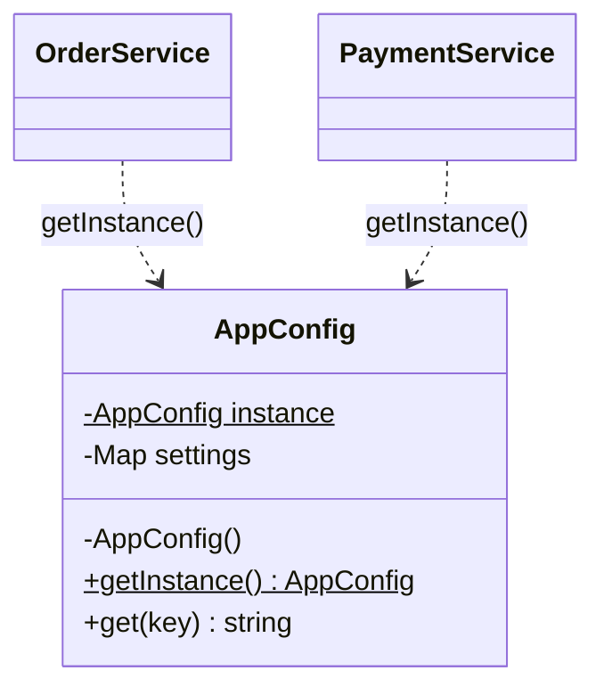
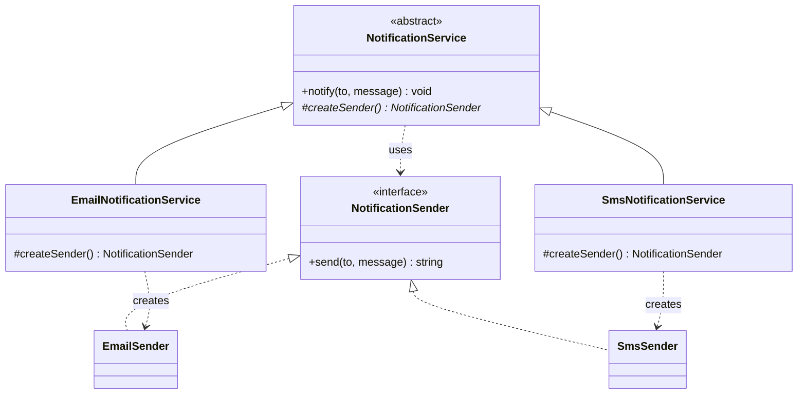
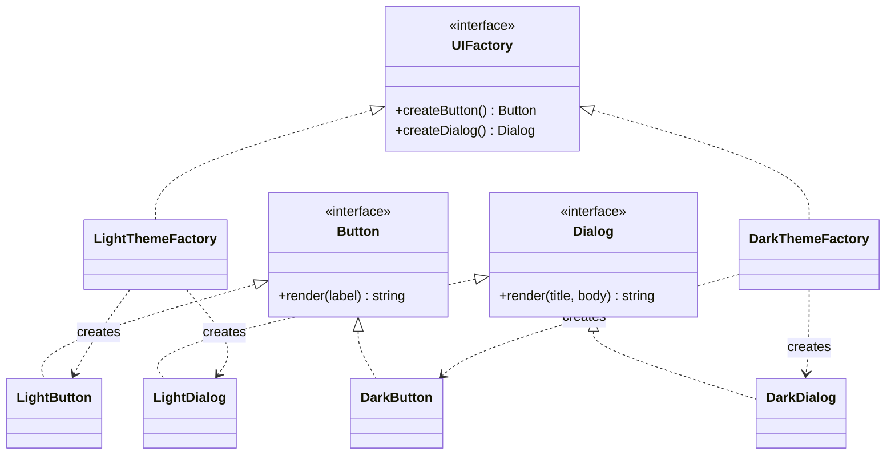
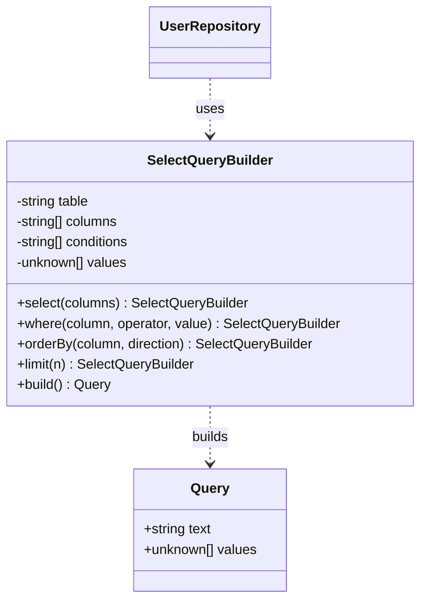
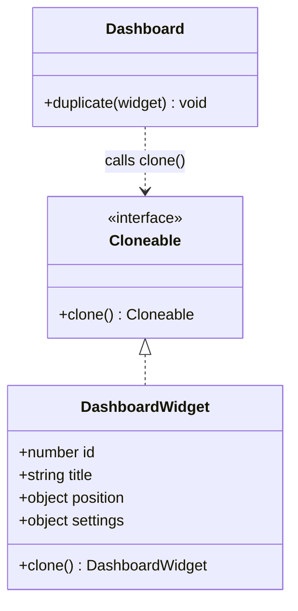
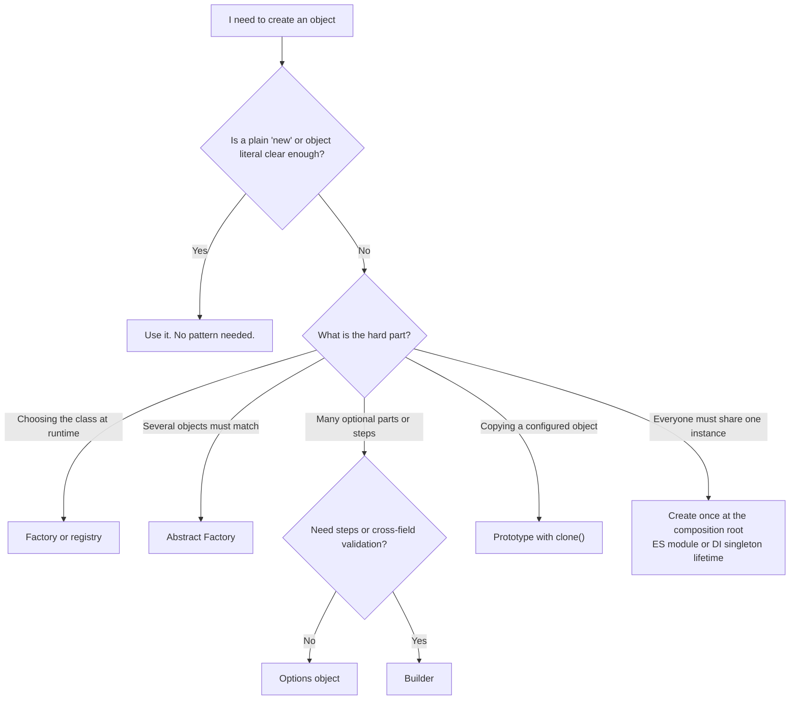

# Creational Patterns

> In this document you will learn the five classic creational patterns (Singleton, Factory Method, Abstract Factory, Builder and Prototype) and the simpler JavaScript versions of each. Interviewers use these patterns to check whether you can control *how objects are created* without making your code rigid, global or hard to test.

**Before this:** [Classes](../02-javascript/09-classes.md) · [Prototypes and inheritance](../02-javascript/08-prototypes-and-inheritance.md) · [SOLID principles](03-solid-principles.md) · [Dependency inversion and injection](05-dependency-inversion-and-injection.md) · **Interview questions:** [jump to questions](#interview-questions)

## Table of contents

1. [What design patterns are](#what-design-patterns-are)
2. [What creational patterns solve](#what-creational-patterns-solve)
3. [Singleton](#singleton)
4. [Simple Factory and Factory Method](#simple-factory-and-factory-method)
5. [Abstract Factory](#abstract-factory)
6. [Builder](#builder)
7. [Prototype](#prototype)
8. [Object pool and lazy initialization](#object-pool-and-lazy-initialization)
9. [Choosing a creational pattern](#choosing-a-creational-pattern)
10. [How to explain creational patterns in an interview](#how-to-explain-creational-patterns-in-an-interview)
11. [Interview questions](#interview-questions)
12. [Summary](#summary)
13. [References](#references)

---

## What design patterns are

A **design pattern** is a named, proven solution to a problem that keeps coming back in software design. It is not a library and not copy-paste code. It is a *description* of a solution that you adapt to your own code.

Most pattern names come from the book *Design Patterns: Elements of Reusable Object-Oriented Software* (1994). It was written by Erich Gamma, Richard Helm, Ralph Johnson and John Vlissides. People call them the **Gang of Four (GoF)**. The book describes 23 patterns in three groups:

| Group | Question it answers | Patterns in this repository |
| --- | --- | --- |
| **Creational** | How do we create objects? | Singleton, Factory Method, Abstract Factory, Builder, Prototype (this document) |
| **Structural** | How do we put objects together? | Adapter, Facade, Decorator, Proxy, Composite, Bridge, Flyweight ([structural patterns](07-structural-patterns.md)) |
| **Behavioral** | How do objects talk and share work? | Strategy, Observer, Command, State, Iterator, Template Method, Chain of Responsibility, Mediator, Memento, Visitor ([behavioral patterns](08-behavioral-patterns.md)) |

**Why patterns are useful:**

- **Shared vocabulary.** "Let's put an adapter in front of the payment SDK" says a lot in one sentence. Your whole team understands the plan.
- **Known trade-offs.** Each pattern comes with known costs. You do not need to discover them again.
- **Easier code reviews and interviews.** When you name the pattern, people can check your design faster.

**Analogy:** a pattern is like a recipe type, for example "stir-fry". The idea (hot pan, small pieces, cook fast) is always the same. The ingredients change every time. You never copy one exact stir-fry. You apply the idea.

**Patterns in JavaScript are often smaller.** The GoF book used C++ and Smalltalk. In those languages, almost everything needs a class. In JavaScript, functions are values and you can create objects without classes. So many patterns shrink:

- A Singleton can be just an ES module that exports one object.
- A Factory can be just a function that returns an object.
- A Strategy can be just a function you pass in.

Keep this in mind. In an interview, showing the *simple JavaScript version* and explaining *when the class version is worth it* is a strong answer.

**One warning:** a pattern is a tool for a real problem. Do not add patterns because they look professional. Unneeded patterns make code harder to read. We cover this "pattern-itis" in [patterns in real JavaScript apps](09-patterns-in-real-javascript-apps.md).

---

## What creational patterns solve

Look at this service:

```js
class OrderService {
  placeOrder(order) {
    const gateway = new StripeGateway('sk_live_key'); // ❌ creates its own dependency
    const logger = new FileLogger('/var/log/orders.log'); // ❌ and another one
    logger.write(`Charging ${order.total}`);
    return gateway.charge(order.total);
  }
}
```

The class does two jobs. It *uses* a gateway and a logger, and it also *decides which exact classes to create* and how to configure them. This causes problems:

- To switch from Stripe to PayPal, you must edit `OrderService`.
- In a unit test you cannot replace the real gateway with a fake one. The test would try to charge a real card.
- The configuration (keys, file paths) is spread across many classes.

**Creational patterns separate creating an object from using it.** The code that uses an object should not need to know how it was built.

| Pattern | The creation question it answers |
| --- | --- |
| Singleton | "How do I make sure everyone shares *one* instance?" |
| Factory / Factory Method | "How do I choose *which class* to create at runtime, in one place?" |
| Abstract Factory | "How do I create a *family* of objects that must match each other?" |
| Builder | "How do I create a *complex* object step by step, with validation?" |
| Prototype | "How do I create a new object by *copying* an existing one?" |

The most important technique that works together with all of them is **dependency injection**: an object receives the things it needs from outside instead of creating them. It is covered in depth in [dependency inversion and injection](05-dependency-inversion-and-injection.md). You will see it many times below.

---

## Singleton

### The problem

Some things should exist only once in an application:

- the app configuration
- a logger that writes to one place
- a database **connection pool** (a set of open database connections that requests share)
- an in-memory cache

If different parts of the app create their own copies, you get bugs. Two caches get out of sync. Two pools open twice as many database connections as the server allows.

### The idea in simple words

The **Singleton pattern** makes sure a class has only one instance, and gives the whole app one way to get that instance.

**Analogy:** an office has one shared calendar for booking meeting rooms. If each team kept its own copy, two teams could book the same room at the same time. Everyone must look at the *same* calendar.

**Where the analogy breaks:** the office calendar is clearly visible to everyone. A singleton in code is often hidden: a class quietly reaches out and uses it. That hidden use is the main problem with singletons, as you will see below.

### Class diagram



The `$` marks a static member. The constructor is private, so the only way to get the object is the static `getInstance()` method.

### Singleton with an ES module (the JavaScript way)

In JavaScript, the simplest singleton is a module that exports one object.

```js
// logger.js
class Logger {
  #lines = [];

  log(message) {
    const line = `[${new Date().toISOString()}] ${message}`;
    this.#lines.push(line);
    console.log(line);
  }

  count() {
    return this.#lines.length;
  }
}

export const logger = new Logger(); // runs once, when the module is first loaded
```

```js
// orderService.js
import { logger } from './logger.js';

export function placeOrder(orderId) {
  logger.log(`Order ${orderId} placed`);
}
```

```js
// main.js
import { logger } from './logger.js';
import { placeOrder } from './orderService.js';

placeOrder(101);
logger.log('App started');
console.log(logger.count()); // 2 — both files used the same logger object
```

**Step by step:**

1. `main.js` imports `logger.js`. The module runs for the first time. `new Logger()` creates one object.
2. `main.js` imports `orderService.js`. That file also imports `logger.js`.
3. The module system sees that `logger.js` was already loaded. It does **not** run it again. It gives back the same exported object.
4. Both files now hold a reference to the same `Logger`. So `count()` is `2`.

Both ES modules and CommonJS (`require`) cache a module after the first load. That cache is what makes this a singleton. Details are in [modules: ESM and CommonJS](../02-javascript/14-modules-esm-and-commonjs.md).

### Singleton with a class and a static instance

The classic version uses a static field and a static method. TypeScript can make the constructor `private`, so nobody can call `new` from outside:

```ts
class AppConfig {
  private static instance: AppConfig | undefined;
  private readonly settings = new Map<string, string>();

  private constructor() {
    console.log('Loading config...');
    this.settings.set('apiUrl', 'https://api.example.com');
  }

  static getInstance(): AppConfig {
    if (!AppConfig.instance) {
      AppConfig.instance = new AppConfig(); // created only on the first call
    }
    return AppConfig.instance;
  }

  get(key: string): string | undefined {
    return this.settings.get(key);
  }
}

const first = AppConfig.getInstance(); // Loading config...
const second = AppConfig.getInstance(); // (nothing printed: already created)
console.log(first === second); // true
console.log(first.get('apiUrl')); // https://api.example.com
// new AppConfig(); // ❌ compile error: Constructor of class 'AppConfig' is private
```

Remember: TypeScript `private` is checked **only at compile time**. The JavaScript that runs has no private constructor. Plain JavaScript cannot make a constructor private. You can only protect the stored instance with a `#private` static field and document that callers must use `getInstance()`.

You will also see this older trick in JavaScript code:

```js
class Settings {
  constructor() {
    if (Settings.instance) {
      return Settings.instance; // return the existing object instead of a new one
    }
    this.theme = 'light';
    Settings.instance = this;
  }
}

const s1 = new Settings();
s1.theme = 'dark';
const s2 = new Settings();
console.log(s2.theme); // dark
console.log(s1 === s2); // true
```

It works because when a constructor returns an object, `new` gives you that object instead of the new `this`. But it is confusing:

- `new` normally means "a new object". Here it does not.
- `Settings.instance` is a public property. Any code can overwrite it.
- Constructor arguments on later calls are silently ignored (see [Q5](#q5-what-does-this-singleton-code-print)).

Prefer the ES module version in JavaScript, and `getInstance()` with a private constructor in TypeScript.

### Lazy and eager creation

- **Eager** creation makes the instance as soon as the module loads (the `logger.js` example). Simple and predictable.
- **Lazy** creation makes it on the first `getInstance()` call (the `AppConfig` example). Useful when creating it is expensive and it might not be needed.

JavaScript runs your code on one thread, so there is no race where two threads create two instances at the same time (a real problem in Java or C#). But there is an async version of this race. If creation is async, two callers can start it at the same time. The fix is to cache the **promise**, not the result:

```js
let connectionPromise = null;

function connectToDatabase() {
  console.log('Opening connection...');
  return new Promise((resolve) => setTimeout(() => resolve({ connected: true }), 10));
}

function getConnection() {
  if (!connectionPromise) {
    connectionPromise = connectToDatabase(); // store the promise immediately
  }
  return connectionPromise;
}

const [a, b] = await Promise.all([getConnection(), getConnection()]);
console.log(a === b); // true — "Opening connection..." was printed only once
```

If you stored the result only after `await`, both callers would see "no instance yet" and both would open a connection.

### When "one instance" is not really one

A singleton is only "one per something". Know the limits:

| Situation | What happens |
| --- | --- |
| Two copies of a package in `node_modules` (for example two versions) | Each copy is a different file, so each has its own instance. |
| CommonJS on Windows or macOS: `require('./Logger')` and `require('./logger')` | Node caches by resolved file name, so different spellings load the file twice and give two objects. |
| The same package loaded as ESM in one place and CommonJS in another (the "dual package hazard") | Two module instances, so two singletons. |
| Jest or Vitest test files | Each test file gets its own module registry, so each file gets a fresh instance. |
| Worker threads, child processes, `cluster` workers | Each has its own memory and its own instance. |
| Each browser tab | Each tab runs its own copy of your app. |
| Electron | The main process and every renderer process each have their own instance. |

So a singleton is a way to share an object *inside one running JavaScript program*. It does not share state across processes, tabs or servers. For that you need a database, Redis, IPC or similar.

### Singleton in Angular: providedIn root

Angular apps rarely write `getInstance()`. Instead, the dependency injection system controls how many instances exist:

```ts
import { Injectable } from '@angular/core';

@Injectable({ providedIn: 'root' })
export class CartService {
  private readonly items: string[] = [];

  add(item: string): void {
    this.items.push(item);
  }

  count(): number {
    return this.items.length;
  }
}
```

`providedIn: 'root'` registers the service in the **root injector**. Angular creates it the first time someone asks for it, and then gives the same instance to every component and service in that application. It is a singleton *per application*, managed by the framework.

You can still get more than one instance:

- If a component lists `CartService` in its own `providers` array, that component and its children get a **new** instance.
- If a lazy-loaded NgModule lists it in its `providers`, the lazy module's child injector creates its own instance.
- In unit tests, `TestBed` creates a new injector for each test, so every test gets a fresh service.

That last point is the big win: Angular gives you a shared instance in the app *and* a fresh instance in each test. A hand-written `getInstance()` gives you neither control. How the injector tree decides "one instance per injector" is explained in [Hierarchical injectors](05-dependency-inversion-and-injection.md#hierarchical-injectors-the-key-angular-idea); Angular DI details are in [Angular dependency injection](../06-angular-16/05-dependency-injection.md).

### Problems with singletons

The Singleton pattern is often called an **anti-pattern** (a common solution that causes more problems than it solves). The problems come from using it as a *global variable*.

**1. Hidden dependencies.** A class that calls `AppConfig.getInstance()` inside a method depends on `AppConfig`, but its constructor does not show it. You only find out by reading every line.

**2. State leaks between tests.** The instance lives for the whole test run. One test changes it, and the next test sees the change:

```js
const cartStore = (() => {
  const items = [];
  return {
    add(item) { items.push(item); },
    count() { return items.length; },
  };
})();

// "Test 1"
cartStore.add({ id: 1 });
console.log('test 1 count:', cartStore.count()); // test 1 count: 1

// "Test 2" expects a fresh, empty cart
console.log('test 2 count:', cartStore.count()); // test 2 count: 1  ❌ leaked from test 1
```

Now your tests pass or fail depending on the order they run in.

**3. Hard to replace.** You cannot easily give one part of the app a fake or a different configuration.

**4. Shared by every user on a server.** In a Node.js server, one process handles many users at once. A singleton is shared by **all** requests. If you store per-request data (the current user) in it, users can see each other's data. See [Q7](#q7-find-the-bug-a-singleton-in-a-nodejs-server) for a full example.

**5. Two jobs in one class.** The class does its real work *and* controls its own lifetime. That breaks the Single Responsibility Principle.

### A better way: one instance, passed in

You usually want *one instance*, but you do not want *global access*. So create the instance once, at the start of the app, and pass it to whoever needs it. The place where you create and connect all objects is called the **composition root**.

```js
class Logger {
  log(message) { console.log(`[log] ${message}`); }
}

class OrderService {
  constructor(logger) { // the dependency is visible in the constructor
    this.logger = logger;
  }
  placeOrder(id) { this.logger.log(`Order ${id} placed`); }
}

class PaymentService {
  constructor(logger) {
    this.logger = logger;
  }
  charge(amount) { this.logger.log(`Charged ${amount}`); }
}

// Composition root (for example main.js): create once, pass everywhere
const logger = new Logger();
const orders = new OrderService(logger);
const payments = new PaymentService(logger);

orders.placeOrder(7); // [log] Order 7 placed
payments.charge(50); // [log] Charged 50

// In a test, pass a fake instead:
const fakeLogger = { messages: [], log(m) { this.messages.push(m); } };
new OrderService(fakeLogger).placeOrder(1);
console.log(fakeLogger.messages); // [ 'Order 1 placed' ]
```

There is still only one real `Logger`. But no class reaches out to grab it, and tests can pass a fake. DI containers call this a **singleton lifetime** — "the container creates one and reuses it" — which is very different from the Singleton *pattern*. The composition root and the three lifetimes (singleton, scoped, transient) are explained in depth in [Manual DI and the composition root](05-dependency-inversion-and-injection.md#manual-di-and-the-composition-root) and [Lifetimes](05-dependency-inversion-and-injection.md#lifetimes-singleton-scoped-and-transient).

### Real-world usage

- **ES module singletons** everywhere: a configured `axios` instance in `api.js`, a Redux store in `store.js`, a database pool in `db.js`.
- **Node.js:** `pg.Pool` or a Prisma client is usually created once per process and shared. One *pool* object, many *connections* inside it.
- **Angular:** every `providedIn: 'root'` service.
- **Electron:** `app.requestSingleInstanceLock()` makes sure only one copy of the *whole desktop app* runs. A second launch sends a `second-instance` event to the first one. This is a singleton at the process level.

### When NOT to use it

- When the object holds **per-user or per-request** data.
- When you might need **two different configurations** later (two databases, two tenants, two API clients).
- When the only reason is "easy access from anywhere". That is a global variable with a nicer name.
- When you already have a DI system (Angular, NestJS). Let the container manage the lifetime.

### Common mistakes

- **One shared database connection instead of a pool.** A single connection handles one query at a time. A server needs a pool.
- **Storing mutable global state** that many modules change. Bugs become hard to trace because anyone can change anything.
- **Calling `getInstance()` deep inside business logic.** Pass the instance in instead.
- **Thinking a singleton is shared across servers or tabs.** It is per process (or per tab, per test file).

---

## Simple Factory and Factory Method

### The problem

Imagine code like this spread across many files:

```js
let sender;
if (user.preferredChannel === 'email') {
  sender = new EmailSender(smtpConfig);
} else if (user.preferredChannel === 'sms') {
  sender = new SmsSender(twilioConfig);
} else {
  sender = new PushSender(firebaseConfig);
}
```

Every place that needs a sender repeats this decision. When you add WhatsApp, you must find and change every copy. You will miss one.

### The idea in simple words

A **factory** is a function or method whose job is to create objects. The caller says *what it needs* ("a sender for email"). The factory decides *which class to create and how to configure it*. The decision lives in one place.

**Analogy:** at a car rental desk you say "I need a 7-seat car". You do not walk into the garage and build one. The desk picks a car that matches and gives you the keys.

There are three related ideas. People often mix them up:

| Name | What it is |
| --- | --- |
| **Factory function** | Any function that returns a new object, without `new`. Very common in JavaScript. |
| **Simple Factory** | One function (or static method) that picks a class based on input. Not one of the 23 GoF patterns, but used everywhere. |
| **Factory Method** (GoF) | A base class calls an abstract "create" method. Subclasses override it to decide which object to create. |

### Factory functions in JavaScript

```js
function createUser(name, role = 'viewer') {
  let loginCount = 0; // private: only the closure can see it

  return {
    name,
    role,
    login() {
      loginCount += 1;
      return `${name} logged in ${loginCount} time(s)`;
    },
  };
}

const ana = createUser('Ana', 'admin');
console.log(ana.login()); // Ana logged in 1 time(s)
console.log(ana.login()); // Ana logged in 2 time(s)
console.log(ana.loginCount); // undefined — the counter is really private
```

Why people like factory functions:

- No `new` keyword to forget, and no `this` binding problems.
- Real privacy through [closures](../02-javascript/05-closures.md).
- They can return different shapes, cached objects or even a promise.

The cost: each object gets its own copy of the methods (`login` is created per user). Classes share methods on the prototype, which uses less memory when you create many thousands of objects. For most app code, the difference does not matter.

### Simple Factory

```js
class EmailSender {
  send(to, message) { return `Email to ${to}: ${message}`; }
}
class SmsSender {
  send(to, message) { return `SMS to ${to}: ${message}`; }
}
class PushSender {
  send(to, message) { return `Push to ${to}: ${message}`; }
}

function createNotificationSender(channel) {
  switch (channel) {
    case 'email': return new EmailSender();
    case 'sms': return new SmsSender();
    case 'push': return new PushSender();
    default: throw new Error(`Unknown channel: ${channel}`);
  }
}

const sender = createNotificationSender('sms');
console.log(sender.send('+15550100', 'Your order has shipped'));
// SMS to +15550100: Your order has shipped
```

The caller only knows that it gets "something with a `send()` method". This is programming to an interface, not to a concrete class.

### Making the factory open for extension

The `switch` has one weakness: to add a new type, you must edit the factory. That breaks the Open/Closed Principle (see [SOLID](03-solid-principles.md)). A **registry** fixes it. New types register themselves, and the factory code never changes.

```ts
interface PaymentResult {
  ok: boolean;
  transactionId: string;
}

interface PaymentProcessor {
  charge(amountInCents: number, currency: string): Promise<PaymentResult>;
}

class CardProcessor implements PaymentProcessor {
  async charge(amountInCents: number, currency: string): Promise<PaymentResult> {
    console.log(`Charging card: ${amountInCents} ${currency}`);
    return { ok: true, transactionId: 'card_123' };
  }
}

class PayPalProcessor implements PaymentProcessor {
  async charge(amountInCents: number, currency: string): Promise<PaymentResult> {
    console.log(`Redirecting to PayPal: ${amountInCents} ${currency}`);
    return { ok: true, transactionId: 'pp_456' };
  }
}

type ProcessorFactory = () => PaymentProcessor;
const processorRegistry = new Map<string, ProcessorFactory>();

function registerProcessor(method: string, factory: ProcessorFactory): void {
  processorRegistry.set(method, factory);
}

function createPaymentProcessor(method: string): PaymentProcessor {
  const factory = processorRegistry.get(method);
  if (!factory) {
    throw new Error(`Unsupported payment method: ${method}`);
  }
  return factory();
}

registerProcessor('card', () => new CardProcessor());
registerProcessor('paypal', () => new PayPalProcessor());

async function checkout(method: string, amountInCents: number): Promise<void> {
  const processor = createPaymentProcessor(method);
  const result = await processor.charge(amountInCents, 'USD');
  console.log(result.ok ? `Paid, id ${result.transactionId}` : 'Payment failed');
}

checkout('paypal', 4999);
// Redirecting to PayPal: 4999 USD
// Paid, id pp_456
```

Notice three details:

- The registry stores **factory functions** (`() => new CardProcessor()`), not instances. Each call can get a fresh object, and nothing is created until it is needed.
- Money is stored in **cents** (integers). Floating-point numbers cannot store values like `0.1` exactly, so never do money math in fractional dollars.
- To add UPI or Apple Pay, a new module calls `registerProcessor('upi', ...)`. `createPaymentProcessor` does not change.

### Factory Method (the GoF pattern)

In the GoF **Factory Method**, a base class contains an algorithm. One step of that algorithm is "create the object I need". The base class leaves that step abstract. Each subclass overrides it.



```ts
interface NotificationSender {
  send(to: string, message: string): string;
}

class EmailSender implements NotificationSender {
  send(to: string, message: string): string {
    return `Email to ${to}: ${message}`;
  }
}

class SmsSender implements NotificationSender {
  send(to: string, message: string): string {
    return `SMS to ${to}: ${message}`;
  }
}

abstract class NotificationService {
  // The factory method. Subclasses decide which sender to create.
  protected abstract createSender(): NotificationSender;

  // The shared algorithm. It does not know the concrete sender class.
  notify(to: string, message: string): void {
    const text = message.trim();
    if (text.length === 0) {
      throw new Error('Message is empty');
    }
    const sender = this.createSender();
    console.log(sender.send(to, text));
  }
}

class EmailNotificationService extends NotificationService {
  protected createSender(): NotificationSender {
    return new EmailSender();
  }
}

class SmsNotificationService extends NotificationService {
  protected createSender(): NotificationSender {
    return new SmsSender();
  }
}

const services: NotificationService[] = [
  new EmailNotificationService(),
  new SmsNotificationService(),
];

for (const service of services) {
  service.notify('ana', '  Your invoice is ready  ');
}
// Email to ana: Your invoice is ready
// SMS to ana: Your invoice is ready
```

**Simple Factory vs Factory Method:** a simple factory is *one function that decides*. A factory method is *a hook in a base class* that subclasses fill in. The factory method is a special case of the Template Method pattern (see [behavioral patterns](08-behavioral-patterns.md#template-method)).

**The JavaScript-friendly version:** instead of a subclass per sender, pass a factory function in. This is composition instead of inheritance, and it needs fewer classes:

```js
class NotificationService {
  constructor(createSender) {
    this.createSender = createSender;
  }
  notify(to, message) {
    const sender = this.createSender();
    console.log(sender.send(to, message.trim()));
  }
}

const smsService = new NotificationService(() => ({
  send: (to, message) => `SMS to ${to}: ${message}`,
}));
smsService.notify('ana', ' Your code is 4821 '); // SMS to ana: Your code is 4821
```

### Real-world usage

Factories are all over the platform you already use:

- **DOM:** `document.createElement('button')` returns the right element class (`HTMLButtonElement`).
- **React:** `React.createElement(type, props)` (JSX compiles to calls like this).
- **Node.js:** `http.createServer()`, `crypto.createHash('sha256')`, `fs.createReadStream(path)`, `zlib.createGzip()`.
- **Static factory methods** in the language: `Array.from()`, `Promise.resolve()`, `Object.create()`, `Object.fromEntries()`.
- **Angular `useFactory` providers** choose an implementation at runtime:

```ts
import { InjectionToken, NgModule } from '@angular/core';
import { AppConfig } from './app-config';
import { CardProcessor, PaymentProcessor, SandboxProcessor } from './payment-processors';

export const PAYMENT_PROCESSOR = new InjectionToken<PaymentProcessor>('PAYMENT_PROCESSOR');

@NgModule({
  providers: [
    {
      provide: PAYMENT_PROCESSOR,
      useFactory: (config: AppConfig) =>
        config.useSandbox ? new SandboxProcessor() : new CardProcessor(),
      deps: [AppConfig],
    },
  ],
})
export class CheckoutModule {}
```

### Advantages and disadvantages

| Advantages | Disadvantages |
| --- | --- |
| Creation logic lives in one place | One more layer to read |
| Callers depend on an interface, not a class | A `switch` factory must be edited for each new type (use a registry) |
| Easy to return fakes in tests or sandbox versions | Factory Method needs a subclass per product, which can mean many small classes |
| Can hide caching, pooling or configuration | Overused, it hides simple `new` calls behind needless indirection |

### When NOT to use it

- There is only one class and no realistic plan for more. `new EmailSender()` is perfectly clear.
- The "factory" only forwards its arguments to one constructor. That adds nothing.

### Common mistakes

- **Products with different shapes.** If `EmailSender` has `send()` and `SmsSender` has `deliver()`, the caller still needs `if` checks. All products must share one interface.
- **A giant `switch` that every team edits.** Use a registry map.
- **Returning `undefined` for unknown types.** Throw a clear error instead, so the bug shows up at the right place.
- **Calling every function that returns an object an "abstract factory".** That name means something specific (next section).

---

## Abstract Factory

### The problem

Sometimes you create several *related* objects that must match. Mixing them gives a broken result:

- A light-theme button inside a dark-theme dialog.
- A web storage object together with a desktop notification object.
- A MySQL connection with a PostgreSQL query object.

You want to choose the *family* once, and then be sure every object comes from that same family.

### The idea in simple words

An **Abstract Factory** is an interface with several create methods, one per product: `createButton()`, `createDialog()`, and so on. Each concrete factory creates one whole family. The client code receives one factory and uses only the interfaces. It never knows which family it got.

**Analogy:** a restaurant offers set menus. You choose "Italian menu" once, and the starter, main course and dessert all come from the Italian kitchen. You cannot accidentally get sushi as a starter with an Italian dessert.

### Class diagram



### Example: UI theme families

```ts
interface Button {
  render(label: string): string;
}

interface Dialog {
  render(title: string, body: string): string;
}

interface UIFactory {
  createButton(): Button;
  createDialog(): Dialog;
}

class LightButton implements Button {
  render(label: string): string {
    return `[ ${label} ] (white background, dark text)`;
  }
}

class LightDialog implements Dialog {
  render(title: string, body: string): string {
    return `Light dialog | ${title} | ${body}`;
  }
}

class DarkButton implements Button {
  render(label: string): string {
    return `[ ${label} ] (dark background, light text)`;
  }
}

class DarkDialog implements Dialog {
  render(title: string, body: string): string {
    return `Dark dialog | ${title} | ${body}`;
  }
}

class LightThemeFactory implements UIFactory {
  createButton(): Button { return new LightButton(); }
  createDialog(): Dialog { return new LightDialog(); }
}

class DarkThemeFactory implements UIFactory {
  createButton(): Button { return new DarkButton(); }
  createDialog(): Dialog { return new DarkDialog(); }
}

// Client code: works with ANY theme, and can never mix themes
function renderDeleteConfirmation(ui: UIFactory): void {
  const dialog = ui.createDialog();
  const button = ui.createButton();
  console.log(dialog.render('Delete file?', 'This cannot be undone.'));
  console.log(button.render('Delete'));
}

const userPrefersDark = true;
renderDeleteConfirmation(userPrefersDark ? new DarkThemeFactory() : new LightThemeFactory());
// Dark dialog | Delete file? | This cannot be undone.
// [ Delete ] (dark background, light text)
```

The theme is chosen in exactly **one** place (the last line). `renderDeleteConfirmation` has no `if (dark)` checks at all.

### Realistic example: one app for web and desktop

Many teams ship the same frontend as a website and as an Electron desktop app. Storage and notifications work differently on each platform. An abstract factory gives each platform a matching set of services:

```ts
interface KeyValueStorage {
  get(key: string): Promise<string | null>;
  set(key: string, value: string): Promise<void>;
}

interface Notifier {
  show(title: string, body: string): void;
}

interface PlatformFactory {
  createStorage(): KeyValueStorage;
  createNotifier(): Notifier;
}

// --- Web family: browser APIs ---
class WebPlatform implements PlatformFactory {
  createStorage(): KeyValueStorage {
    return {
      async get(key) { return localStorage.getItem(key); },
      async set(key, value) { localStorage.setItem(key, value); },
    };
  }
  createNotifier(): Notifier {
    return { show: (title, body) => { new Notification(title, { body }); } };
  }
}

// --- Desktop family: talks to the narrow API that the Electron preload script exposes ---
interface DesktopApi {
  readSetting(key: string): Promise<string | null>;
  writeSetting(key: string, value: string): Promise<void>;
  showNotification(title: string, body: string): void;
}

class DesktopPlatform implements PlatformFactory {
  constructor(private readonly api: DesktopApi) {}

  createStorage(): KeyValueStorage {
    return {
      get: (key) => this.api.readSetting(key),
      set: (key, value) => this.api.writeSetting(key, value),
    };
  }
  createNotifier(): Notifier {
    return { show: (title, body) => this.api.showNotification(title, body) };
  }
}

function choosePlatform(desktopApi: DesktopApi | undefined): PlatformFactory {
  return desktopApi ? new DesktopPlatform(desktopApi) : new WebPlatform();
}

// --- Business code: does not know which platform it runs on ---
class SettingsService {
  private readonly storage: KeyValueStorage;
  private readonly notifier: Notifier;

  constructor(platform: PlatformFactory) {
    this.storage = platform.createStorage();
    this.notifier = platform.createNotifier();
  }

  async changeTheme(theme: 'light' | 'dark'): Promise<void> {
    await this.storage.set('theme', theme);
    this.notifier.show('Settings saved', `Theme is now ${theme}`);
  }
}

// In the real renderer: const platform = choosePlatform(window.desktopApi);
// Here we use a fake desktop API so the example runs in Node.js:
const saved = new Map<string, string>();
const fakeDesktopApi: DesktopApi = {
  async readSetting(key) { return saved.get(key) ?? null; },
  async writeSetting(key, value) { saved.set(key, value); },
  showNotification(title, body) { console.log(`[desktop notification] ${title}: ${body}`); },
};

const settings = new SettingsService(choosePlatform(fakeDesktopApi));
settings.changeTheme('dark').then(() => console.log('stored theme =', saved.get('theme')));
// [desktop notification] Settings saved: Theme is now dark
// stored theme = dark
```

Three families exist here: web, desktop, and the fake one used in tests. `SettingsService` works with all of them. In Electron, `window.desktopApi` would be exposed by the preload script with `contextBridge.exposeInMainWorld` (see [IPC and preload scripts](../08-electron-desktop/03-ipc-and-preload-scripts.md)).

### Abstract Factory vs Factory Method

| | Factory Method | Abstract Factory |
| --- | --- | --- |
| Creates | **One** product | A **family** of related products |
| How it varies | Subclass overrides a method (inheritance) | You pass in a different factory object (composition) |
| Typical shape | `createSender()` inside a base class | An object with `createButton()`, `createDialog()`, ... |
| Main goal | Let subclasses choose the class | Guarantee that products match each other |

Inside, an abstract factory is often a group of factory methods.

### Real-world usage

- **Angular rendering:** components do not touch the DOM directly through the platform. Angular asks a `RendererFactory2` for a `Renderer2`. The browser platform and the server (SSR) platform provide different implementations, so the same component code runs in both.
- **Database libraries** with several drivers: each driver supplies a matching connection, query and transaction implementation.
- **Cross-platform apps** (web vs Electron vs mobile shells), as in the example above.
- **Test setups** that swap the whole family of real services for fakes.

### Advantages and disadvantages

| Advantages | Disadvantages |
| --- | --- |
| Products from one family always match | Adding a new **product type** (for example `createTooltip()`) means changing the interface and *every* factory |
| The family is chosen in one place | Many interfaces and classes for a small problem |
| Easy to swap the whole family (for tests, platforms, themes) | Overkill when there is only one family |

### When NOT to use it

- You have only one family. Use plain classes.
- Your "family" is really one product. Use a simple factory.
- The differences are just values (colors, sizes). Use a config object or CSS variables, not classes. A theme that only changes colors does not need an abstract factory.

### Common mistakes

- **Adding `if (theme === 'dark')` inside client code anyway.** That defeats the whole point.
- **Letting one factory return products from another family**, for example `DarkThemeFactory.createButton()` returning a `LightButton` "for now".
- **Building it too early.** Start with one family. Extract the abstract factory when the second family really arrives.

---

## Builder

### The problem

Some objects have many parts, and most of them are optional. A constructor with many parameters becomes impossible to read:

```js
// ❌ What do `true`, `3` and `null` mean here?
const request = new HttpRequest('GET', '/orders', null, { Accept: 'application/json' }, 5000, 3, true);
```

This is called a **telescoping constructor**: every new option adds one more parameter at the end. Callers must remember the order, and passing `null` for "I don't care" is easy to get wrong.

Other related problems:

- Some combinations are invalid (a `GET` request with a body). Where do you check that?
- The object should be **immutable** (cannot change) once it is created, but you want to set its parts one at a time.

### First, the JavaScript alternative: an options object

Before you reach for a Builder, remember that JavaScript has a simple fix for long parameter lists: pass **one object** with named properties, and use default values.

```js
function createRequest({ url, method = 'GET', headers = {}, timeoutMs = 5000, retries = 0 }) {
  if (!url) throw new Error('url is required');
  return Object.freeze({ url, method, headers: { ...headers }, timeoutMs, retries });
}

const request = createRequest({ url: '/orders', retries: 3 });
console.log(request); // { url: '/orders', method: 'GET', headers: {}, timeoutMs: 5000, retries: 3 }
```

Every value has a name, the order does not matter, and defaults are in one place. **For most JavaScript code, this is enough.** Use a Builder only when the options object is not.

### The idea in simple words

The **Builder pattern** creates a complex object step by step. A separate builder object collects the parts through small, readable method calls. At the end, a `build()` method checks that everything is valid and returns the finished object.

Builders usually have a **fluent API**: each method returns the builder itself (`return this`), so you can chain calls.

**Analogy:** ordering at a sandwich counter. You say "wheat bread", then "chicken", then "no onions", then "toast it". Each step is simple. Only at the end do you get the finished sandwich. The person at the counter can also refuse a strange combination before making it.

### Class diagram



### Example 1: a safe SQL query builder

This builder creates SQL text with **placeholders** (`$1`, `$2`) and a separate list of values. The database driver sends the values separately from the SQL text, so user input can never change the query structure. That is how you prevent **SQL injection** (an attack where user input is executed as SQL).

```js
class SelectQueryBuilder {
  static #allowedOperators = new Set(['=', '!=', '>', '>=', '<', '<=', 'LIKE']);
  static #identifierPattern = /^[a-z_][a-z0-9_]*$/i;

  #table;
  #columns = ['*'];
  #conditions = [];
  #values = [];
  #order = null;
  #limit = null;

  constructor(table) {
    this.#table = SelectQueryBuilder.#checkIdentifier(table);
  }

  // Table and column names cannot be placeholders, so we allow only safe names
  static #checkIdentifier(name) {
    if (!SelectQueryBuilder.#identifierPattern.test(name)) {
      throw new Error(`Invalid identifier: ${name}`);
    }
    return name;
  }

  select(...columns) {
    this.#columns = columns.map((c) => SelectQueryBuilder.#checkIdentifier(c));
    return this;
  }

  where(column, operator, value) {
    if (!SelectQueryBuilder.#allowedOperators.has(operator)) {
      throw new Error(`Invalid operator: ${operator}`);
    }
    this.#values.push(value); // the value never goes into the SQL text
    const placeholder = `$${this.#values.length}`;
    this.#conditions.push(`${SelectQueryBuilder.#checkIdentifier(column)} ${operator} ${placeholder}`);
    return this;
  }

  orderBy(column, direction = 'ASC') {
    if (direction !== 'ASC' && direction !== 'DESC') {
      throw new Error(`Invalid direction: ${direction}`);
    }
    this.#order = `${SelectQueryBuilder.#checkIdentifier(column)} ${direction}`;
    return this;
  }

  limit(n) {
    if (!Number.isInteger(n) || n <= 0) throw new Error('limit must be a positive integer');
    this.#limit = n;
    return this;
  }

  build() {
    let text = `SELECT ${this.#columns.join(', ')} FROM ${this.#table}`;
    if (this.#conditions.length > 0) text += ` WHERE ${this.#conditions.join(' AND ')}`;
    if (this.#order) text += ` ORDER BY ${this.#order}`;
    if (this.#limit) text += ` LIMIT ${this.#limit}`;
    return { text, values: [...this.#values] }; // return copies, never internal state
  }
}

const query = new SelectQueryBuilder('users')
  .select('id', 'name', 'email')
  .where('status', '=', 'active')
  .where('age', '>=', 18)
  .orderBy('name')
  .limit(20)
  .build();

console.log(query.text);
// SELECT id, name, email FROM users WHERE status = $1 AND age >= $2 ORDER BY name ASC LIMIT 20
console.log(query.values); // [ 'active', 18 ]

const evilInput = "x' OR '1'='1";
const safe = new SelectQueryBuilder('users').where('email', '=', evilInput).build();
console.log(safe.text); // SELECT * FROM users WHERE email = $1
console.log(safe.values); // [ "x' OR '1'='1" ] — just data, not SQL
```

**Step by step for the first query:**

1. `new SelectQueryBuilder('users')` checks the table name and stores it.
2. `.select(...)` replaces the default `*` with three checked column names. It returns `this`, so the chain continues.
3. The first `.where(...)` pushes `'active'` into `values` (length becomes 1) and stores the text `status = $1`.
4. The second `.where(...)` pushes `18` (length 2) and stores `age >= $2`.
5. `.orderBy('name')` stores `name ASC`. `.limit(20)` checks and stores `20`.
6. `.build()` joins the parts in the correct SQL order and returns `{ text, values }`.

The `{ text, values }` shape is what Node database drivers such as `pg` (node-postgres) accept: `await pool.query(query)`.

### Example 2: an HTTP request builder with validation

```ts
type HttpMethod = 'GET' | 'POST' | 'PUT' | 'PATCH' | 'DELETE';

interface HttpRequestSpec {
  readonly method: HttpMethod;
  readonly url: string;
  readonly headers: Readonly<Record<string, string>>;
  readonly body?: string;
  readonly timeoutMs: number;
  readonly retries: number;
}

class HttpRequestBuilder {
  private method: HttpMethod = 'GET';
  private path = '/';
  private readonly query = new URLSearchParams();
  private readonly headers: Record<string, string> = {};
  private body: unknown = undefined;
  private timeoutMs = 10_000;
  private retries = 0;

  constructor(private readonly baseUrl: string) {}

  get(path: string): this {
    this.method = 'GET';
    this.path = path;
    return this;
  }

  post(path: string, body: unknown): this {
    this.method = 'POST';
    this.path = path;
    this.body = body;
    return this;
  }

  param(name: string, value: string | number): this {
    this.query.set(name, String(value));
    return this;
  }

  header(name: string, value: string): this {
    this.headers[name.toLowerCase()] = value;
    return this;
  }

  bearerToken(token: string): this {
    return this.header('Authorization', `Bearer ${token}`);
  }

  timeout(ms: number): this {
    this.timeoutMs = ms;
    return this;
  }

  retry(times: number): this {
    this.retries = times;
    return this;
  }

  build(): HttpRequestSpec {
    // Rules that involve several fields are checked once, here
    if (this.method === 'GET' && this.body !== undefined) {
      throw new Error('GET requests cannot have a body');
    }
    if (this.timeoutMs <= 0) {
      throw new Error('Timeout must be positive');
    }
    const url = new URL(this.path, this.baseUrl);
    url.search = this.query.toString();

    const headers = { ...this.headers };
    let body: string | undefined;
    if (this.body !== undefined) {
      body = JSON.stringify(this.body);
      headers['content-type'] = 'application/json';
    }

    return Object.freeze({
      method: this.method,
      url: url.toString(),
      headers: Object.freeze(headers),
      body,
      timeoutMs: this.timeoutMs,
      retries: this.retries,
    });
  }
}

const listPaidOrders = new HttpRequestBuilder('https://api.shop.example')
  .get('/orders')
  .param('status', 'paid')
  .param('page', 2)
  .bearerToken('test-token')
  .timeout(3000)
  .retry(2)
  .build();

console.log(listPaidOrders.method, listPaidOrders.url);
// GET https://api.shop.example/orders?status=paid&page=2
console.log(listPaidOrders.headers); // { authorization: 'Bearer test-token' }

const createOrder = new HttpRequestBuilder('https://api.shop.example')
  .post('/orders', { productId: 42, quantity: 1 })
  .build();
console.log(createOrder.body); // {"productId":42,"quantity":1}
console.log(createOrder.headers); // { 'content-type': 'application/json' }
```

The result is a frozen object that is safe to pass around and retry. An HTTP client can then send it with `fetch(spec.url, { method: spec.method, headers: spec.headers, body: spec.body, signal: AbortSignal.timeout(spec.timeoutMs) })`.

### Example 3: test data builders

Builders are excellent in tests. A **test data builder** gives you a valid default object, and each test changes only what matters for that test:

```js
class UserBuilder {
  #user = { id: 1, name: 'Test User', email: 'test@example.com', role: 'viewer', active: true };

  withName(name) { this.#user.name = name; return this; }
  withRole(role) { this.#user.role = role; return this; }
  inactive() { this.#user.active = false; return this; }
  build() { return { ...this.#user }; }
}

const aUser = () => new UserBuilder();

const admin = aUser().withRole('admin').build();
const blocked = aUser().withName('Sam').inactive().build();

console.log(admin.role, admin.active); // admin true
console.log(blocked.name, blocked.active); // Sam false
```

When the `User` shape gets a new required field, you update one default in the builder instead of fifty tests.

### Immutable builders

The builders above change their own state and return `this`. An **immutable builder** instead returns a *new* builder from each step and never changes the old one. Angular's `HttpParams` and `HttpHeaders` work this way:

```ts
import { HttpParams } from '@angular/common/http';

let params = new HttpParams().set('page', 1).set('size', 20);

params.set('sort', 'name'); // ❌ the result is thrown away; params is unchanged
params = params.set('sort', 'name'); // ✅ keep the new object

console.log(params.toString()); // page=1&size=20&sort=name
```

Immutable builders are safer to share (nobody can change your half-built object), but forgetting to use the return value is a common bug.

### The Director (brief)

The GoF version also has a **Director**: an object that knows a common *sequence* of builder steps. For example, a `ReportDirector` might call `addHeader()`, `addSummaryTable()` and `addFooter()` on any report builder (PDF or HTML). In JavaScript, a plain function usually plays this role:

```js
function buildTopOrdersQuery(builder, month) {
  return builder.select('id', 'total').where('month', '=', month).orderBy('total', 'DESC').limit(10).build();
}
```

### Real-world usage

- **Query builders:** Knex (`knex('users').where('age', '>', 18).select('id')`) and the query APIs of ORMs.
- **Validation schemas:** Zod (`z.string().min(3).email()`) and Yup are fluent builders for validators.
- **Angular:** `HttpParams` and `HttpHeaders` (immutable). `FormBuilder` (`fb.group({...})`) is named "builder" but is really a set of helper factory methods for form controls.
- **Testing:** test data builders, and fluent assertion APIs.
- **Web platform:** `URL` and `URLSearchParams` let you set parts one by one before you read the final string.

### Builder vs options object

| Use an options object when... | Use a Builder when... |
| --- | --- |
| All values are known at once | Values arrive in steps (from UI choices, from several functions) |
| Defaults and simple checks are enough | You need validation across several fields in `build()` |
| The object is small or medium | The thing being built is a structure (SQL, request, document, test fixture) |
| You want the simplest code | You want a readable, domain-specific chain of calls |

### Advantages and disadvantages

| Advantages | Disadvantages |
| --- | --- |
| Very readable call sites | More code: one extra class per product |
| Validation of the whole object in one place | Easy to forget required steps unless `build()` checks them |
| Can produce immutable results | Mutable builders can leak internal state (see below) |
| Same steps can build different representations | Overkill for objects with a few fields |

### When NOT to use it

- The object has two or three fields. A constructor or options object is clearer.
- There are no rules between fields and no steps. A builder adds nothing.

### Common mistakes

**`build()` returns the builder's internal object.** Later calls on the builder then change objects you already built:

```js
// ❌ Wrong
class PizzaBuilder {
  constructor() { this.pizza = { size: 'medium', toppings: [] }; }
  size(size) { this.pizza.size = size; return this; }
  topping(name) { this.pizza.toppings.push(name); return this; }
  build() { return this.pizza; } // hands out the internal object
}

const builder = new PizzaBuilder().size('large').topping('cheese');
const first = builder.build();
const second = builder.topping('olives').build();
console.log(first.toppings); // [ 'cheese', 'olives' ]  ❌ the first pizza changed
console.log(first === second); // true
```

```js
// ✅ Correct: build() returns a fresh copy
class PizzaBuilder {
  #pizza = { size: 'medium', toppings: [] };
  size(size) { this.#pizza.size = size; return this; }
  topping(name) { this.#pizza.toppings.push(name); return this; }
  build() {
    return Object.freeze({ ...this.#pizza, toppings: [...this.#pizza.toppings] });
  }
}

const builder = new PizzaBuilder().size('large').topping('cheese');
const first = builder.build();
const second = builder.topping('olives').build();
console.log(first.toppings); // [ 'cheese' ]
console.log(second.toppings); // [ 'cheese', 'olives' ]
```

Other mistakes:

- **No validation in `build()`.** Then the builder is just a slower options object.
- **Required values hidden as optional steps.** Put truly required values in the builder's constructor (`new HttpRequestBuilder(baseUrl)`), so you cannot forget them.
- **Building SQL by string concatenation of values** instead of placeholders.

---

## Prototype

### The problem

Sometimes you already have an object that is set up exactly the way you want. You need another one that is almost the same:

- "Duplicate this dashboard widget."
- "Spawn another goblin with the standard goblin stats."
- "Create a new invoice from this template."

Building it again from scratch may be slow or complicated, or the code may not even know the object's exact class. It is easier to **copy** the existing object and change a few fields.

### The idea in simple words

The **Prototype pattern** creates new objects by cloning an existing object (the *prototype*). The object itself knows how to copy itself, usually through a `clone()` method.

**Analogy:** you fill in a long form once, photocopy it, and then change only the name on each copy.

### Class diagram



### JavaScript prototypes vs the Prototype pattern

The names are similar, but these are two different ideas. Do not mix them up in an interview.

- **JavaScript prototypes** are about **sharing** (delegation). An object has a hidden link to another object. When a property is missing, JavaScript looks it up on the linked object. Nothing is copied. See [prototypes and inheritance](../02-javascript/08-prototypes-and-inheritance.md).
- **The Prototype pattern** is about **copying**. The new object gets its own copy of the data.

`Object.create(proto)` creates an object *linked* to `proto`. It is not a clone:

```js
const carTemplate = { model: 'Audi A6', wheels: 4 };
const myCar = Object.create(carTemplate);

console.log(myCar.model); // Audi A6 — found through the prototype link
console.log(Object.keys(myCar)); // [] — myCar has no own properties

carTemplate.model = 'BMW M3';
console.log(myCar.model); // BMW M3 — it changed, because nothing was copied
```

### Cloning in JavaScript

You have three main tools. Each one copies a different amount. Full details are in [objects and copying](../02-javascript/07-objects-and-copying.md).

```js
const original = {
  title: 'Q3 report',
  createdAt: new Date('2025-07-01T00:00:00Z'),
  tags: ['finance'],
};

// 1. Spread: shallow copy. Nested objects and arrays are SHARED.
const shallow = { ...original };
shallow.tags.push('draft');
console.log(original.tags); // [ 'finance', 'draft' ]  ❌ the original changed too

// 2. structuredClone: deep copy. Nested data is copied. Dates, Maps, Sets survive.
const deep = structuredClone(original);
deep.tags.push('final');
console.log(original.tags); // [ 'finance', 'draft' ]  ✅ unchanged
console.log(deep.createdAt instanceof Date); // true
```

`structuredClone()` is a web platform API (available in modern browsers and in Node.js 17+), not part of the ECMAScript language. It has limits that matter for this pattern:

```js
class Point {
  constructor(x) { this.x = x; }
  getX() { return this.x; }
}

const copy = structuredClone(new Point(1));
console.log(copy); // { x: 1 }
console.log(copy instanceof Point); // false — the class is lost, you get a plain object
console.log(typeof copy.getX); // undefined

try {
  structuredClone({ onClick() {} });
} catch (error) {
  console.log(error.name); // DataCloneError — functions cannot be cloned
}
```

So for **class instances**, the third tool is the right one:

```js
// 3. A clone() method: the object decides how to copy itself
class Point {
  constructor(x, y) { this.x = x; this.y = y; }
  clone() { return new Point(this.x, this.y); }
}

const p1 = new Point(1, 2);
const p2 = p1.clone();
p2.x = 10;
console.log(p1.x, p2.x); // 1 10
console.log(p2 instanceof Point); // true
```

### Realistic example: duplicating a dashboard widget

```js
class DashboardWidget {
  static #nextId = 1;

  constructor({ type, title, position, settings }) {
    this.id = DashboardWidget.#nextId++;
    this.type = type;
    this.title = title;
    this.position = position;
    this.settings = settings;
  }

  clone() {
    return new DashboardWidget({
      type: this.type,
      title: `${this.title} (copy)`,
      position: { x: this.position.x + 1, y: this.position.y + 1 }, // place it next to the original
      settings: structuredClone(this.settings), // plain data: a deep copy is safe
    });
  }
}

const sales = new DashboardWidget({
  type: 'chart',
  title: 'Sales',
  position: { x: 0, y: 0 },
  settings: { metric: 'revenue', filters: ['EU'] },
});

const copy = sales.clone();
copy.settings.filters.push('US');

console.log(sales.id, copy.id); // 1 2
console.log(copy.title); // Sales (copy)
console.log(sales.settings.filters); // [ 'EU' ]
console.log(copy.settings.filters); // [ 'EU', 'US' ]
```

Notice what the `clone()` method decides:

- The copy gets a **new id**. Copying the id would create two widgets with the same identity.
- The title and position change on purpose.
- The settings are deep-copied, so editing the copy never affects the original.

Only the object itself knows these rules. That is why the Prototype pattern puts `clone()` on the object.

### A prototype registry

Games and editors often keep a set of ready-made prototypes and copy from them:

```js
const enemyPrototypes = {
  goblin: { kind: 'goblin', health: 30, attack: 5, loot: ['coin'] },
  orc: { kind: 'orc', health: 80, attack: 12, loot: ['coin', 'axe'] },
};

function spawnEnemy(kind, position) {
  const prototype = enemyPrototypes[kind];
  if (!prototype) throw new Error(`Unknown enemy: ${kind}`);
  return { ...structuredClone(prototype), position };
}

const g1 = spawnEnemy('goblin', { x: 1, y: 1 });
const g2 = spawnEnemy('goblin', { x: 5, y: 2 });
g1.loot.push('ring');
console.log(g1.loot, g2.loot); // [ 'coin', 'ring' ] [ 'coin' ]
console.log(enemyPrototypes.goblin.loot); // [ 'coin' ]
```

### Real-world usage

- **"Duplicate" features** in editors and admin tools: duplicate a page, a form, a product, a dashboard.
- **Templates:** create a new document, email or invoice from a saved template.
- **Game development:** spawn many units from a few configured prototypes.
- **JavaScript itself** is a prototype-based language, but remember that its prototypes *share* behavior through delegation; they do not copy.

### Advantages and disadvantages

| Advantages | Disadvantages |
| --- | --- |
| Create objects without knowing their exact class | Deep vs shallow copy is easy to get wrong |
| Reuse an expensive or complex setup | Objects with references to live resources (sockets, DOM nodes, subscriptions) are hard to clone correctly |
| Each object controls its own copy rules (`clone()`) | Every class with new fields must update `clone()` |

### When NOT to use it

- Creating the object is cheap and simple. Just call the constructor.
- The object holds resources that must not be copied (an open file, a database connection, an event subscription).

### Common mistakes

- **Using `Object.create(obj)` as a clone.** It links; it does not copy.
- **Using spread for nested data.** Nested arrays and objects stay shared.
- **Using `structuredClone` on class instances** and then calling methods on the result.
- **Copying identity fields** such as `id` or `createdAt` when the copy should be a new thing.
- **`JSON.parse(JSON.stringify(obj))` as a deep clone.** It turns `Date` objects into strings and drops `undefined`, functions, `Map` and `Set` contents. Use `structuredClone` for plain data.

---

## Object pool and lazy initialization

These two are not in the GoF list, but they are creational techniques you will meet in real code.

### Object pool

An **object pool** keeps a set of ready objects and reuses them instead of creating and destroying them again and again. It is useful when creating an object is expensive (a database connection, a worker thread) or when you create thousands per second (bullets in a game).

```js
class BulletPool {
  #free = [];
  created = 0;

  acquire(x, y) {
    let bullet = this.#free.pop(); // reuse a free bullet if there is one
    if (!bullet) {
      bullet = { x: 0, y: 0, active: false };
      this.created += 1;
    }
    bullet.x = x; // always RESET the state of a reused object
    bullet.y = y;
    bullet.active = true;
    return bullet;
  }

  release(bullet) {
    bullet.active = false;
    this.#free.push(bullet);
  }
}

const pool = new BulletPool();
const b1 = pool.acquire(0, 0);
const b2 = pool.acquire(5, 5);
pool.release(b1);
const b3 = pool.acquire(9, 9); // reuses b1's object
console.log(b3 === b1, pool.created); // true 2
```

**Real-world usage:** database connection pools (`pg.Pool`, `mysql2` pools), worker thread pools (for example the Piscina library), HTTP agents that keep sockets open for reuse.

**Gotchas:** you must reset every field when you reuse an object, and code must not keep using an object after it releases it. Modern JavaScript engines create small objects cheaply, so pool only when the object is truly expensive or measurements show a problem.

### Lazy initialization

**Lazy initialization** means you create something only when it is first needed:

```js
class ReportService {
  #pdfEngine = null;

  get pdfEngine() {
    if (!this.#pdfEngine) {
      console.log('Loading PDF engine...');
      this.#pdfEngine = { render: (html) => `PDF (${html.length} chars)` };
    }
    return this.#pdfEngine;
  }
}

const reports = new ReportService(); // fast: nothing heavy is loaded yet
console.log(reports.pdfEngine.render('<h1>Hi</h1>'));
// Loading PDF engine...
// PDF (11 chars)
console.log(reports.pdfEngine.render('<p>Again</p>')); // PDF (12 chars) — no second load
```

In frontends, the most common form is a **dynamic import**: `const { jsPDF } = await import('jspdf');` downloads a library only when the user clicks "Export". Angular lazy-loaded routes use the same idea for whole features.

---

## Choosing a creational pattern

| You need... | Use | Simpler JavaScript option |
| --- | --- | --- |
| One shared instance | Singleton (better: one instance created at the composition root and injected) | An ES module that exports the instance |
| To choose a class at runtime | Simple Factory, or a registry | A function, or a `Map` of factory functions |
| Subclasses to decide what to create | Factory Method | Pass a factory function into the constructor |
| Matching families of objects | Abstract Factory | An object literal of factory functions |
| A complex object built in steps, with validation | Builder | An options object with defaults |
| A copy of a configured object | Prototype (`clone()`) | `structuredClone` for plain data |
| To reuse expensive objects | Object pool | A library pool (database, workers) |



The first question is the most important one. Most objects in real apps need no creational pattern at all.

---

## How to explain creational patterns in an interview

### Explaining Singleton

1. **Define it:** "A Singleton makes sure there is only one instance of something, and gives one way to get it."
2. **Why it exists:** "Some resources should be shared: config, a logger, a database pool. Two copies would waste resources or get out of sync."
3. **How it works:** "In TypeScript you make the constructor private and expose a static `getInstance()`. In JavaScript the simplest version is a module that exports one instance, because modules are cached after the first load."
4. **Small example:** "In Node I export one `pg.Pool` from `db.js`, and every repository imports the same pool."
5. **Where it is useful:** "Angular's `providedIn: 'root'` services are singletons per app, but managed by DI, which is the version I prefer."
6. **Trade-offs / gotchas:** "A classic singleton is global state. It hides dependencies and leaks state between tests, and on a server it is shared by all users. So I create one instance at the composition root and inject it."

### Explaining Factory and Builder

1. **Define them:** "A factory decides *which* object to create. A builder decides *how* to assemble a complex object step by step."
2. **Why they exist:** "Factories remove scattered `switch` and `new` calls. Builders replace long constructors and validate the whole object before it is created."
3. **How they work:** "A factory takes an input such as `'paypal'` and returns something that implements `PaymentProcessor`. A builder has chainable methods that return `this`, and a `build()` that validates and returns an immutable result."
4. **Small example:** "A payment factory with a registry map, so a new method only registers itself. A query builder that produces SQL with placeholders."
5. **Where they are useful:** "`document.createElement`, Angular `useFactory`, Knex, Zod, test data builders."
6. **Trade-offs / gotchas:** "In JavaScript a function often replaces a factory class, and an options object often replaces a builder. I add the pattern only when the simple version stops being enough."

---

## Interview questions

### Q1. What is a design pattern, and what are the three GoF categories?

**What the interviewer is checking:** that you see patterns as reusable *ideas* with trade-offs, not as code to copy, and that you know the basic map.

**Short spoken answer (30–60 seconds):**
> A design pattern is a named, proven solution to a design problem that keeps coming back. It is not a library. It is an idea that I adapt to my code. Most names come from the Gang of Four book from 1994, which groups 23 patterns into three categories. Creational patterns are about how objects are created, like Factory, Builder and Singleton. Structural patterns are about how objects are combined, like Adapter, Facade and Decorator. Behavioral patterns are about how objects communicate, like Observer, Strategy and Command. The biggest value for me is the shared vocabulary: if I say "let's put an adapter in front of the SDK", the team knows the plan. The risk is using patterns where a plain function would do.

**Detailed explanation:**
Each pattern describes a problem, a solution structure and its consequences. The GoF book used C++ and Smalltalk, so its examples are class-heavy. In JavaScript, first-class functions, closures, object literals and ES modules make many patterns much smaller. A good answer shows that you know both forms.

**Follow-up questions:**
- **Are patterns language-specific?** — The ideas are not, but their size is. A Strategy needs an interface and classes in Java; in JavaScript it can be a function argument. Some patterns, like Iterator, are built into JavaScript (`Symbol.iterator`).
- **Name a pattern you used recently.** — Give a real one: "an adapter around our payment SDK so we could switch providers", or "a facade service over our NgRx store".
- **Are there patterns outside the GoF list?** — Yes: Repository, Module, Middleware, Dependency Injection, Pub/Sub, MVC, Object Pool and many architecture patterns.

**Common mistakes:** listing patterns without explaining the problem they solve; saying patterns always improve code.

**Where this is used in real projects:** design discussions, code reviews and architecture documents use pattern names as shorthand.

### Q2. What is the Singleton pattern, and why do some people call it an anti-pattern?

**What the interviewer is checking:** whether you understand the hidden costs of global state, not just the definition.

**Short spoken answer (30–60 seconds):**
> A Singleton makes sure a class has only one instance and gives a global way to reach it, usually a static `getInstance()`. It exists for resources that must be shared, like configuration, a logger or a database pool. The problem is that a classic singleton is a global variable in disguise. Classes call `getInstance()` inside their methods, so their dependencies are hidden. Tests share the same instance, so state leaks from one test to the next, and it is hard to replace it with a fake. On a Node server, it is shared by every request, so storing user data in it is a security bug. So I still want *one instance*, but I create it at the composition root and inject it. That is what Angular does with `providedIn: 'root'`.

**Detailed explanation:**
Two separate ideas are mixed in the classic pattern: "only one instance" (often fine) and "global access" (usually harmful). DI containers keep the first and drop the second through a *singleton lifetime*. The class does not control its own lifetime, so it follows the Single Responsibility Principle, and tests can create a fresh instance or a fake.

**Follow-up questions:**
- **Is a singleton ever fine?** — Yes, for truly stateless or read-only shared things (a logger, frozen config), especially when created once and injected.
- **Does JavaScript have thread-safety problems with singletons?** — Not the classic ones, because your code runs on one thread. But async lazy creation can run twice; cache the promise, not the result.
- **How do you reset a singleton in tests?** — A `reset()` method is a smell. Prefer injecting the instance, or use Jest's `jest.resetModules()` / isolated module registry.

**Common mistakes:** only giving the definition; claiming singletons are "thread-safe in JS so no problem"; confusing the DI "singleton lifetime" with the pattern.

**Where this is used in real projects:** shared HTTP clients, connection pools, configuration, Angular root services.

### Q3. How do you implement a singleton in JavaScript and in TypeScript?

**Short answer:** In JavaScript, export one instance from a module; module caching makes it shared. In TypeScript, use a `private constructor` plus `static getInstance()` with lazy creation.

```js
// JavaScript: config.js
export const config = Object.freeze({ apiUrl: 'https://api.example.com', retries: 3 });
```

```ts
// TypeScript
class Clock {
  private static instance?: Clock;
  private constructor() {}
  static getInstance(): Clock {
    return (Clock.instance ??= new Clock());
  }
  now(): Date {
    return new Date();
  }
}
console.log(Clock.getInstance() === Clock.getInstance()); // true
```

Mention that TypeScript `private` disappears at runtime, and that in plain JavaScript you cannot make a constructor private.

### Q4. Is an ES module export always a singleton? When can you get two instances?

**What the interviewer is checking:** whether you understand *why* module singletons work (the module cache) and where the cache boundary is.

**Short spoken answer (30–60 seconds):**
> A module runs once and is cached, so everyone who imports it inside the same program gets the same object. But the cache has limits. Node caches CommonJS modules by their resolved file name, so two copies of a package in `node_modules`, or a different path spelling on a case-insensitive file system, give two instances. Loading a package as ESM in one place and CommonJS in another can also give two copies. And it is always per process: worker threads, cluster workers, each browser tab and each Electron renderer have their own instance. In tests, Jest gives every test file its own module registry. So a module singleton means "one per running program", not "one in the world".

**Detailed explanation:**
The Node.js docs state that modules are cached based on their resolved filename, so `require('foo')` is not guaranteed to return the same object if it resolves to different files. A common real bug: a library that keeps a registry (for example of plugins) gets installed twice at different versions, and plugins register in the "other" copy.

**Follow-up questions:**
- **How do you detect duplicate packages?** — `npm ls <package>` shows every installed copy; `npm dedupe` can merge compatible versions.
- **How do you share state across processes?** — Not with a singleton. Use a database, Redis, a message queue or IPC.

**Common mistakes:** saying "modules are always singletons"; forgetting multi-process deployments.

**Where this is used in real projects:** Node services running in cluster mode or several containers, monorepos with duplicated dependencies, Electron apps.

### Q5. What does this singleton code print?

```js
class Settings {
  constructor(theme) {
    if (Settings.instance) {
      return Settings.instance;
    }
    this.theme = theme;
    Settings.instance = this;
  }
}

const a = new Settings('light');
const b = new Settings('dark');
console.log(a.theme, b.theme);
console.log(a === b);
b.theme = 'dark';
console.log(a.theme);
```

**Answer:**

```text
light light
true
dark
```

**Why, step by step:**

1. `new Settings('light')`: `Settings.instance` is `undefined`, so the constructor sets `theme = 'light'` and stores `this` in `Settings.instance`.
2. `new Settings('dark')`: `new` creates a fresh object, but the constructor **returns** `Settings.instance`. When a constructor returns an object, `new` gives you that object and throws away the fresh one. The argument `'dark'` is silently ignored.
3. So `a` and `b` are the same object: both themes are `light` and `a === b` is `true`.
4. Setting `b.theme` changes the one shared object, so `a.theme` is `dark`.

The silent loss of `'dark'` is exactly why this style of singleton is confusing.

### Q6. How does Angular providedIn root relate to Singleton? When do you get two instances of a root service?

**What the interviewer is checking:** that you understand DI-managed lifetimes and injector hierarchy, not just the decorator syntax.

**Short spoken answer (30–60 seconds):**
> `providedIn: 'root'` registers the service in the application's root injector. Angular creates it the first time it is injected and reuses it everywhere, so it acts like a singleton for that app. The difference from the classic pattern is that the class does not control its lifetime; the injector does. That gives me two benefits: the service is tree-shakable if nobody injects it, and tests get a fresh instance because `TestBed` creates a new injector per test. I can get a second instance if a component lists the service in its own `providers` array, because that creates a child injector for that component subtree, or if a lazy-loaded module provides it again in its `providers`.

**Detailed explanation:**
Angular resolves a dependency by walking up the injector tree: element injectors first, then module/environment injectors, up to root. Whichever injector *provides* the token first creates and owns the instance. That is why "singleton" in Angular is always "one per injector". Since Angular 15, `providedIn: 'any'` and `providedIn: SomeModule` are deprecated; `'root'` or explicit `providers` are the recommended choices. See [Angular dependency injection](../06-angular-16/05-dependency-injection.md).

**Follow-up questions:**
- **When would you *want* a per-component instance?** — For state that belongs to one widget, like a form wizard's state: list the service in the component's `providers` so each wizard gets its own and it is destroyed with the component.
- **Is a root service shared across browser tabs?** — No. Each tab runs its own app and root injector.
- **What about SSR?** — On the server, each rendered request gets its own application instance and injectors, so root services are per request there.

**Common mistakes:** "providedIn root means one instance forever"; forgetting component-level providers; thinking it is shared between tabs.

**Where this is used in real projects:** almost every Angular service (`AuthService`, `CartService`, API services).

### Q7. Find the bug: a singleton in a Node.js server

```js
const context = { currentUser: null }; // module singleton shared by all requests
const db = { orders: { alice: ['A-1'], bob: ['B-1'] } };
const delay = (ms) => new Promise((resolve) => setTimeout(resolve, ms));

async function findOrdersForCurrentUser() {
  await delay(10); // simulates a database call
  return db.orders[context.currentUser];
}

async function handleRequest(user) {
  context.currentUser = user;
  const orders = await findOrdersForCurrentUser();
  console.log(`${user} sees`, orders);
}

handleRequest('alice');
handleRequest('bob');
```

**What the interviewer is checking:** that you understand one Node process serves many users concurrently, and shared mutable state across `await` points is dangerous.

**Short spoken answer (30–60 seconds):**
> The bug is that `context` is shared by every request in the process. Alice's request sets the current user, then awaits the database. While it waits, Bob's request starts and overwrites the current user with Bob. When Alice's request resumes, it reads `bob`, so Alice sees Bob's orders. This prints "alice sees B-1". It is a data leak, not just a bug. The fix is to never keep per-request data in a singleton: pass the user explicitly as a parameter, or use `AsyncLocalStorage`, which gives each async call chain its own store.

**Output:**

```text
alice sees [ 'B-1' ]
bob sees [ 'B-1' ]
```

**The fix:** the simplest fix is to pass `user` into `findOrdersForCurrentUser(user)` as a parameter. When the value must travel through many layers, use `AsyncLocalStorage` (in `node:async_hooks`, stable since Node.js 16.4): `requestContext.run({ user }, handler)` gives each async call chain its own store, and `requestContext.getStore().user` reads it. The full runnable version of this fix, and the same bug seen from the DI side (a request-scoped value stored in a shared service), is in [Dependency inversion and injection, Q15](05-dependency-inversion-and-injection.md#q15-scenario-an-express-app-stores-the-logged-in-user-in-a-field-of-a-shared-service-users-report-seeing-other-users-data-what-is-wrong-and-how-do-you-fix-it).

**Follow-up questions:**
- **Why does this not happen in Java with one thread per request?** — It can, with static fields. Java uses `ThreadLocal` for the same reason; `AsyncLocalStorage` is the async equivalent in Node.
- **Is the simpler fix better?** — Often yes. Passing `user` as an argument is explicit and easy to test. Use `AsyncLocalStorage` for cross-cutting data like request IDs in logs.

**Common mistakes:** saying "JavaScript is single-threaded so there is no concurrency problem". Single-threaded does not mean one request at a time.

**Where this is used in real projects:** request-scoped logging (correlation IDs), multi-tenant servers (current tenant), auth context.

### Q8. Simple Factory vs Factory Method vs Abstract Factory: what is the difference?

**What the interviewer is checking:** precise vocabulary and the inheritance vs composition distinction.

**Short spoken answer (30–60 seconds):**
> All three hide which concrete class gets created. A simple factory is one function that takes an input, like `'email'`, and returns the right object. It is not a GoF pattern but it is the most common one. Factory Method is a GoF pattern where a base class has an algorithm that calls an abstract `createSomething()` method, and subclasses override it to choose the class. So it uses inheritance and creates one product. Abstract Factory is an object with several create methods, like `createButton()` and `createDialog()`, and each concrete factory creates a whole family that matches. You pass the factory in, so it uses composition, and its goal is consistency between products.

**Code or diagram:**

```text
Simple Factory:    createSender('sms')                     -> one product, chosen by input
Factory Method:    class SmsService extends Service {
                     createSender() { return new SmsSender() }
                   }                                        -> one product, chosen by subclass
Abstract Factory:  darkTheme.createButton(), darkTheme.createDialog()
                                                            -> a matching family, chosen by factory object
```

**Follow-up questions:**
- **Which is most common in JavaScript?** — Simple factories and factory functions, because functions are first-class. Factory Method is often replaced by passing a factory function to a constructor.
- **What is the main downside of Abstract Factory?** — Adding a new product type forces changes to the interface and every concrete factory.

**Common mistakes:** calling any `create...()` function an abstract factory; not knowing Factory Method relies on subclassing.

**Where this is used in real projects:** notification and payment factories (simple), framework base classes with creation hooks (factory method), theming and cross-platform layers (abstract factory).

### Q9. Write a notification factory that new channels can extend without editing the factory.

**What the interviewer is checking:** the Open/Closed Principle in practice, and clean error handling.

**Short spoken answer (30–60 seconds):**
> Instead of a `switch`, I keep a registry: a `Map` from channel name to a function that creates the sender. The factory looks up the name and calls the function, and throws a clear error for unknown channels. A new channel just calls `register` from its own module, so the factory code never changes. I store creator functions, not instances, so each call gets a fresh object and nothing is created until needed.

```js
const senderRegistry = new Map();

function registerSender(channel, create) {
  if (senderRegistry.has(channel)) throw new Error(`Channel already registered: ${channel}`);
  senderRegistry.set(channel, create);
}

function createSender(channel) {
  const create = senderRegistry.get(channel);
  if (!create) throw new Error(`Unknown channel: ${channel}`);
  return create();
}

registerSender('email', () => ({ send: (to, msg) => `Email to ${to}: ${msg}` }));
registerSender('sms', () => ({ send: (to, msg) => `SMS to ${to}: ${msg}` }));
// A new module adds a channel without touching the code above:
registerSender('slack', () => ({ send: (to, msg) => `Slack to #${to}: ${msg}` }));

console.log(createSender('slack').send('alerts', 'Disk almost full')); // Slack to #alerts: Disk almost full
try {
  createSender('fax');
} catch (error) {
  console.log(error.message); // Unknown channel: fax
}
```

**Follow-up questions:**
- **How would you type this in TypeScript?** — `Map<string, () => NotificationSender>`, or a union of channel names (`'email' | 'sms'`) with a `Record<Channel, () => NotificationSender>` if the list is fixed and you want compile-time checks.
- **What about senders that need configuration?** — Close over it: `registerSender('sms', () => new SmsSender(config.twilio))`.

**Common mistakes:** registering instances (shared state between callers); silently returning `undefined`.

**Where this is used in real projects:** plugin systems, payment methods, export formats (CSV, Excel, PDF).

### Q10. Factory function vs class constructor in JavaScript: when do you choose each?

**What the interviewer is checking:** JavaScript-specific judgment.

**Short spoken answer (30–60 seconds):**
> A factory function is a plain function that returns an object. It gives real privacy through closures, has no `this` problems, and can return different types or cached objects. A class gives a clear shape, `instanceof` checks, shared methods on the prototype which saves memory with many instances, and `#private` fields for privacy. In TypeScript and Angular I use classes because DI and decorators need them. For small helpers and when I want to hide state, a factory function is simpler. Both are fine. The key is consistency in the codebase.

**Detailed explanation:**

| | Factory function | Class |
| --- | --- | --- |
| Privacy | Closures (always worked) | `#private` fields (ES2022) |
| `this` | Not needed | Methods lose `this` when passed as callbacks unless bound |
| Memory | Methods created per object | Methods shared on the prototype |
| `instanceof` | Not available | Available |
| Frameworks | Fine for React hooks, utilities | Needed by Angular DI and decorators |

**Follow-up questions:**
- **Can a factory return a class instance?** — Yes, and that is the Simple Factory pattern: the function hides which class.
- **Why can a constructor `return` an object?** — The language allows it; `new` then returns that object instead of `this`. It is rarely a good idea (see Q5).

**Common mistakes:** saying classes in JavaScript work like Java classes (they are built on prototypes); ignoring the `this` problem.

**Where this is used in real projects:** React code often uses factory functions and hooks; Angular and NestJS code uses classes.

### Q11. When would you use an Abstract Factory? Give a real example.

**What the interviewer is checking:** whether you can recognize the "family must match" problem.

**Short spoken answer (30–60 seconds):**
> I use it when I create several related objects that must come from the same family. My favorite example is an app that runs both in the browser and in Electron. Storage, notifications and file dialogs work differently on each platform. I define a `PlatformFactory` with `createStorage()`, `createNotifier()` and so on, and I implement `WebPlatform` and `DesktopPlatform`. The app picks the platform once at startup and passes it in. Business services never check "am I in Electron?", and they can never mix a web storage with a desktop notifier. In tests I pass a fake platform. If there is only one family, I don't use it, because adding a new product type means changing every factory.

**Follow-up questions:**
- **How is this different from DI?** — They work together: the DI container can provide the chosen factory, or provide each product directly. Abstract Factory guarantees that the products belong together.
- **What is a simpler JavaScript version?** — An object literal of functions: `const platform = { createStorage: () => ..., createNotifier: () => ... }`.

**Common mistakes:** using it for one product; letting client code still branch on the platform.

**Where this is used in real projects:** theming systems, cross-platform layers, Angular's renderer abstraction for browser vs server rendering.

### Q12. Builder vs options object: when is a Builder worth it in JavaScript?

**What the interviewer is checking:** that you prefer the simplest tool and know the Builder's real benefits.

**Short spoken answer (30–60 seconds):**
> In JavaScript, the options object solves most "too many parameters" problems: named values, any order, defaults with destructuring. So that is my default. A Builder is worth it when construction really happens in steps, for example a query that gets filters added from different UI controls, or when I need validation across several fields before the object exists, like "a GET request cannot have a body". It is also great when the result should be immutable and when a fluent chain reads like the domain, such as query builders or test data builders. For a two- or three-field object, a builder is just extra code.

**Follow-up questions:**
- **How do you make sure required fields are set?** — Put them in the builder's constructor, and check the rest in `build()`. In TypeScript you can even use a "step builder" where each step returns a different type, so `build()` only exists after required steps (more code, rarely needed).
- **Mutable or immutable builder?** — Mutable is simpler. Immutable (each step returns a new builder, like Angular `HttpParams`) is safer to share but easy to misuse by ignoring the return value.

**Common mistakes:** saying "builder is for objects with many fields" without mentioning options objects; forgetting validation.

**Where this is used in real projects:** Knex, Zod, test data builders, request builders in SDKs.

### Q13. What does this builder code print, and what is wrong with it?

```js
class EmailBuilder {
  #email = { to: [], subject: '', body: '' };
  to(address) { this.#email.to.push(address); return this; }
  subject(text) { this.#email.subject = text; return this; }
  build() { return { ...this.#email }; }
}

const welcome = new EmailBuilder().subject('Welcome');
const forAna = welcome.to('ana@example.com').build();
const forBen = welcome.to('ben@example.com').build();

console.log(forAna.to);
console.log(forAna.to === forBen.to);
```

**Answer:**

```text
[ 'ana@example.com', 'ben@example.com' ]
true
```

**Why, step by step:**

1. `build()` uses spread, which makes a **shallow** copy. The new object gets its own `subject`, but `to` still points to the builder's internal array.
2. `forAna.to` and the builder share one array. The second `.to('ben@example.com')` pushes into that same array.
3. So Ana's email now has two recipients, and `forAna.to === forBen.to` is `true`. Ana would receive an email addressed to Ben too, which is a privacy bug.

**Fix:** copy nested data in `build()` (`to: [...this.#email.to]`), and do not reuse one builder for different products. Create a new builder per email, or add a `reset()` step.

### Q14. How would you design a query builder that is safe against SQL injection?

**What the interviewer is checking:** security awareness inside a pattern question.

**Short spoken answer (30–60 seconds):**
> The rule is that user values never become part of the SQL text. My builder collects values in a separate array and writes placeholders like `$1` and `$2` into the text. `build()` returns `{ text, values }`, and the database driver sends them separately, so the database treats values as data only. Table and column names cannot be placeholders, so I validate them against a strict pattern or, better, an allow-list of known columns. I also allow only known operators and sort directions. That way the builder's API makes the safe way the only way.

**Follow-up questions:**
- **Is escaping quotes enough?** — No. Escaping is easy to get wrong across encodings and databases. Parameterized queries are the standard defense recommended by OWASP.
- **What about `ORDER BY` from a query string?** — Map the user input to an allow-listed column (`{ name: 'name', newest: 'created_at' }`) and reject anything else.

**Common mistakes:** concatenating values into the SQL string; trusting column names from the client.

**Where this is used in real projects:** Knex, ORMs and any internal data-access layer.

### Q15. What is the Prototype pattern, and how is it different from JavaScript's prototypal inheritance?

**What the interviewer is checking:** that you do not confuse copying with delegation.

**Short spoken answer (30–60 seconds):**
> The Prototype pattern creates new objects by copying an existing, configured object, usually through a `clone()` method that the object implements itself. It is useful for "duplicate" features, templates, or spawning many similar objects. JavaScript's prototypal inheritance is a different thing: it is delegation. An object links to another object, and missing properties are looked up through that link. Nothing is copied. So `Object.create(template)` is not a clone: if the template changes later, the new object sees the change. For a real copy I write a `clone()` method, or use `structuredClone` for plain data.

**Follow-up questions:**
- **Why put `clone()` on the object instead of copying from outside?** — Only the object knows its rules: generate a new id, deep-copy settings, skip live resources like subscriptions.
- **What does `structuredClone` lose?** — The class (you get a plain object) and anything that is not cloneable, like functions (it throws `DataCloneError`) and DOM nodes.

**Common mistakes:** "JavaScript uses the Prototype pattern for inheritance" (it uses the *word* prototype, but for delegation).

**Where this is used in real projects:** duplicate actions in editors and admin panels, document templates, game spawning.

### Q16. What does this "clone" code print?

```js
const base = { name: 'Base', settings: { theme: 'light' } };
const clone = Object.create(base);

clone.name = 'Clone';
clone.settings.theme = 'dark';

console.log(base.name, base.settings.theme);
console.log(Object.keys(clone));
console.log(Object.hasOwn(clone, 'settings'));
```

**Answer:**

```text
Base dark
[ 'name' ]
false
```

**Why, step by step:**

1. `Object.create(base)` makes an empty object whose prototype is `base`.
2. `clone.name = 'Clone'` *creates* an own property `name` on `clone`. It **shadows** `base.name`, so `base.name` stays `'Base'`.
3. `clone.settings.theme = 'dark'` first *reads* `clone.settings`. `clone` has no own `settings`, so the lookup goes to `base` and finds `base.settings`. Then it changes that shared object. So `base.settings.theme` becomes `'dark'`.
4. `clone` has only one own key: `name`. `Object.hasOwn(clone, 'settings')` is `false`.

Assignment to a property creates an own property, but changing a *nested* object goes through the prototype to the shared object.

### Q17. What are the risks of each cloning method in the Prototype pattern?

```js
const order = {
  id: 1,
  createdAt: new Date('2025-01-01T00:00:00Z'),
  note: undefined,
  items: new Map([['sku-1', 2]]),
};

const viaJson = JSON.parse(JSON.stringify(order));
console.log(typeof viaJson.createdAt); // string
console.log('note' in viaJson); // false
console.log(viaJson.items); // {}

const viaClone = structuredClone(order);
console.log(viaClone.createdAt instanceof Date, viaClone.items.get('sku-1')); // true 2
```

**Short answer:**

| Method | Depth | Risks |
| --- | --- | --- |
| Spread / `Object.assign` | Shallow | Nested objects and arrays stay shared |
| `JSON.parse(JSON.stringify())` | Deep | Dates become strings; `undefined`, functions and symbols are dropped; `Map`/`Set` become `{}`; cycles throw |
| `structuredClone()` | Deep | Class instances become plain objects; functions and DOM nodes throw `DataCloneError` |
| Custom `clone()` | You decide | Must be updated when fields are added |

Use `structuredClone` for plain data, and a `clone()` method for class instances.

### Q18. How do creational patterns make code easier to test?

**What the interviewer is checking:** that you connect creation, dependency injection and testability.

**Short spoken answer (30–60 seconds):**
> Most testing pain comes from code that creates its own dependencies with `new` deep inside methods. Then a test cannot replace the real HTTP client or database. Creational patterns move creation to one place. If a service receives its dependencies, or receives a factory, the test passes a fake. An abstract factory lets me swap a whole family of services for fakes at once. Test data builders make test setup short and readable: `aUser().withRole('admin').build()`. And avoiding global singletons stops state from leaking between tests.

**Follow-up questions:**
- **Is mocking a module (like `jest.mock`) a replacement for DI?** — It works, but it couples tests to file paths and module structure. Constructor injection is more explicit and works in any test runner.
- **How do you test the factory itself?** — Ask it for each type and assert the returned object's behavior or type; also test the error for unknown types.

**Common mistakes:** only talking about mocks; not mentioning test data builders.

**Where this is used in real projects:** Angular `TestBed` providers, NestJS testing modules, any Node service with constructor injection.

### Q19. Your team wants every service to be a class with a static getInstance(). What do you say?

**What the interviewer is checking:** senior-level judgment and the ability to push back with reasons and an alternative.

**Short spoken answer (30–60 seconds):**
> I would agree with the goal, which is usually "one shared instance and easy access", but not with the method. Static `getInstance()` everywhere means every class reaches out to globals. Dependencies become invisible, tests share state and need resets, and we cannot later have two configurations, like two database connections or a per-tenant client. I would propose creating the instances once in a composition root, or using our framework's DI, and passing them through constructors. We still get one instance each, but now dependencies are visible in constructors, tests can pass fakes, and changing a lifetime is a one-line change in one place.

**Follow-up questions:**
- **What if the codebase has no DI framework?** — Manual DI is enough: a `createApp()` function that builds the object graph. See [dependency inversion and injection](05-dependency-inversion-and-injection.md).
- **How would you migrate an existing singleton?** — Add a constructor parameter with a default (`constructor(logger = Logger.getInstance())`), move callers to pass it explicitly, then remove the default.

**Common mistakes:** just saying "singletons are bad" with no alternative or migration path.

**Where this is used in real projects:** refactoring legacy Node services and older frontends with global stores.

### Q20. When is an object pool worth it in JavaScript, and what are the risks?

**Short answer:** When objects are expensive to create (database connections, worker threads, TLS sockets) or created at very high rates (game objects every frame). For normal small objects, the garbage collector is fast and pooling adds complexity. Risks: forgetting to reset state on reuse (old data leaks into the "new" object), using an object after releasing it, and pool exhaustion when callers forget to release (always release in `finally`). Database pools need a size limit that matches what the database allows.

```js
const client = await pool.connect();
try {
  await client.query('BEGIN');
  // ...
  await client.query('COMMIT');
} catch (error) {
  await client.query('ROLLBACK');
  throw error;
} finally {
  client.release(); // always give the connection back
}
```

### Q21. How do you decide between `new`, a factory, a builder and an options object?

**Short answer:** Start with `new` or an object literal. Move to a **factory** when the *type* depends on runtime input or you want callers to depend on an interface. Use an **options object** when there are many optional values. Move to a **builder** only when construction has steps or cross-field validation, or the result must be immutable and built incrementally. Each step adds code, so take it only when the simpler version causes real pain.

---

## Summary

- Design patterns are named, reusable solutions with known trade-offs. In JavaScript many of them become small: a function, a module or an object literal.
- Creational patterns separate **creating** an object from **using** it, which makes code easier to change and test.
- **Singleton:** one shared instance. In JavaScript, an exported module instance is the simple version. The classic version is global state: hidden dependencies, leaking tests and data shared by all users on a server. Prefer one instance created at the composition root and injected (Angular `providedIn: 'root'` works this way).
- A module singleton is "one per running program": duplicate packages, different processes, tabs, workers and test files all get their own instance.
- **Simple Factory** picks a class from input. A **registry** of factory functions keeps it open for extension. **Factory Method** lets subclasses choose the class through an abstract `create...()` hook.
- **Abstract Factory** creates **families** of matching objects (themes, web vs desktop platform). Adding a new product type is its main cost.
- **Builder** constructs complex objects step by step and validates them in `build()`. In JavaScript, try an options object first. Never let `build()` hand out internal state.
- **Prototype** creates objects by **copying**. It is different from JavaScript prototypes, which **delegate**. Use `clone()` for class instances and `structuredClone` for plain data.
- Object pools and lazy initialization are useful for truly expensive objects, but must reset state and release resources correctly.
- The best creational choice is often no pattern at all. Add one only when the simple version hurts.

## References

- [Refactoring Guru: Creational design patterns](https://refactoring.guru/design-patterns/creational-patterns)
- [MDN: JavaScript modules](https://developer.mozilla.org/en-US/docs/Web/JavaScript/Guide/Modules)
- [Node.js docs: Modules, caching and module caching caveats](https://nodejs.org/api/modules.html#caching)
- [Node.js docs: AsyncLocalStorage](https://nodejs.org/api/async_context.html#class-asynclocalstorage)
- [MDN: structuredClone()](https://developer.mozilla.org/en-US/docs/Web/API/Window/structuredClone)
- [MDN: Object.create()](https://developer.mozilla.org/en-US/docs/Web/JavaScript/Reference/Global_Objects/Object/create)
- [MDN: Private properties](https://developer.mozilla.org/en-US/docs/Web/JavaScript/Reference/Classes/Private_properties)
- [Angular v16 docs: Dependency injection and providers](https://v16.angular.io/guide/dependency-injection-providers)
- [Angular v16 docs: Deprecated APIs and features](https://v16.angular.io/guide/deprecations)
- [TypeScript Handbook: Classes (private constructors, abstract classes)](https://www.typescriptlang.org/docs/handbook/2/classes.html)
- [OWASP: SQL Injection Prevention Cheat Sheet](https://cheatsheetseries.owasp.org/cheatsheets/SQL_Injection_Prevention_Cheat_Sheet.html)
- [Electron docs: app.requestSingleInstanceLock()](https://www.electronjs.org/docs/latest/api/app#apprequestsingleinstancelockadditionaldata)
- [node-postgres docs: Queries (parameterized queries)](https://node-postgres.com/features/queries)
